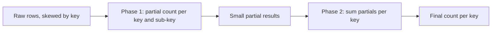

## 🎯 خلاصه

> **Hot key** کلیدی است (یک کاربر، یک محصول، یک کشور، یک تاریخ) که ترافیک یا داده‌ی بسیار بیشتری از بقیه می‌گیرد. وقتی داده را بر اساس کلید پارتیشن می‌کنی، کل این بار به **یک** partition، یک task یا یک ردیف می‌رود و به گلوگاه کل job تبدیل می‌شود. به این می‌گویند **skew**.

- Hash کردن، کلیدهای **مختلف** را یکنواخت پخش می‌کند. ولی نمی‌تواند **یک** کلید را پخش کند.
- راه‌حل‌های رایج، کلید سنگین را به زیرکلید تقسیم می‌کنند (**salting**)، تجمیع را دو‌مرحله‌ای می‌کنند، یا کلیدهای سنگین را جدا کرده و جداگانه پردازش می‌کنند.
- هر راه‌حل یک چیز را معامله می‌کند: ترتیب، shuffle اضافه، مرحله‌ی merge، یا کد پیچیده‌تر.
- قبل از رفع، پیدایشش کن: اندازه‌ی partitionها، مدت taskها و پرتکرارترین کلیدها را نگاه کن.

## 🌱 از ساده شروع کنیم (مبتدی)

> **💡 تشبیه:** یک سوپرمارکت ده صندوق دارد و مشتری‌ها بر اساس حرف اول فامیلی‌شان صندوق را انتخاب می‌کنند. اگر بیشتر فامیلی‌ها با «م» شروع شوند، صف «م» ۲۰۰ نفره است و نُه صندوق دیگر خالی‌اند. اضافه‌کردن صندوق کمکی نمی‌کند، چون مشکل یک حرف است. سه صندوق موقت فقط برای «م»ها کار را حل می‌کند.

در دنیای داده: یک جدول کلیک با ۱۰ میلیون ردیف در روز. ۹٫۹ میلیون از آن‌ها از یک بات است، با `user_id = 42`. hash partitioning همه‌ی `user_id = 42` را به یک partition می‌فرستد:

```text
partition 0:  ~ 100 000 rows   (normal users)
partition 1:  ~ 100 000 rows
...
partition 7:  9 900 000 rows   (user_id = 42)   <- hot key
```

هفت task در چند ثانیه تمام می‌شوند. task هشتم یک ساعت طول می‌کشد. job منتظر آن است. کل خوشه تقریباً بیکار است، در حالی که یک هسته کار می‌کند.

نکته‌ای که باید به خاطر بسپاری: **پخش کردن کلیدها همان پخش کردن کار نیست**. یک کلید واحد، تا وقتی کلید را عوض نکنی، همیشه در یک جا فرود می‌آید.

## 🔧 واقعاً چطور کار می‌کند (متوسط)

سیستم‌ها داده را بر اساس کلید جا می‌دهند، معمولاً با hash: `partition = hash(key) % N`. این وقتی خوب کار می‌کند که کلیدها زیاد باشند و ترافیکشان مشابه. با ترافیک skew‌شده (چند کلید بیشتر بار را حمل می‌کنند) خراب می‌شود، و این در داده‌ی واقعی زیاد است: محصولات پرطرفدار، یک مشتری بزرگ، یک مقدار پیش‌فرض مثل `NULL` یا `"unknown"`، یا تاریخ جاری در یک کلید زمانی.

جاهایی که این اتفاق می‌افتد:

| سیستم | چه چیزی داغ می‌شود | نشانه |
|---|---|---|
| Kafka | یک کلید → یک partition → یک consumer | lag روی یک partition، بقیه بیکار |
| Spark | کلید join یا `groupBy` | یک task کند (straggler)، shuffle read بزرگ روی یک partition |
| Flink | یک operator کلیددار (`keyBy`) | backpressure روی یک subtask، state در حال رشد روی یک task |
| دیتابیس‌ها | یک ردیف یا یک partition key | انتظار قفل روی ردیف شمارنده، throttling روی یک shard |

**مثال Spark.** `groupBy` روی `user_id` که در آن `42` دارای ۹٫۹ میلیون ردیف است:

```python
from pyspark.sql import functions as F

clicks = spark.table("raw.clicks")  # columns: user_id, click_id, ...
counts = clicks.groupBy("user_id").count()
```

در Spark UI، مرحله‌ای که این shuffle را می‌خواند یک task با حجم shuffle read بسیار بزرگ و مدت طولانی نشان می‌دهد، در حالی که task میانه بسیار کوچک است. این فاصله همان سیگنال است. در join هم همین اتفاق می‌افتد: یک کلید با میلیون‌ها ردیف متناظر در یک طرف باعث می‌شود یک task join تمام کار را انجام دهد.

**تجمیع دومرحله‌ای** (که local-then-global aggregation هم نامیده می‌شود) اولین راه‌حل برای aggregateهاست. هر partition ابتدا داده‌ی خودش را تجمیع می‌کند، که داده‌ی کلید داغ را به شدت کوچک می‌کند، و فقط نتایج جزئی کوچک shuffle و ترکیب می‌شوند:



**Salting** یک زیرکلید تصادفی اضافه می‌کند تا یک کلید منطقی به `N` کلید فیزیکی تبدیل شود که هرکدام به task متفاوتی می‌رسند:

```python
from pyspark.sql import functions as F

N = 16  # number of salt buckets

salted = clicks.withColumn("salt", (F.rand() * N).cast("int"))

# Phase 1: 16 partial counts for user 42 instead of one huge group
partial = salted.groupBy("user_id", "salt").agg(F.count("*").alias("c"))

# Phase 2: merge the partial counts back to one row per user
final = partial.groupBy("user_id").agg(F.sum("c").alias("clicks"))
```

نتیجه همان `groupBy` ساده است، ولی هیچ task واحدی همه‌ی ۹٫۹ میلیون ردیف `user_id = 42` را نگه نمی‌دارد.

**Salting روی join** فرق دارد. سمت بزرگ یک salt تصادفی می‌گیرد و سمت کوچک برای هر مقدار salt یک‌بار کپی می‌شود تا هر کلید salt‌شده هنوز همتای خودش را پیدا کند:

```python
small_exploded = small.withColumn(
    "salt", F.explode(F.array(*[F.lit(i) for i in range(N)]))
)
big_salted = big.withColumn("salt", (F.rand() * N).cast("int"))
joined = big_salted.join(small_exploded, ["user_id", "salt"])
```

مراقب باش: سمت کوچک در `N` ضرب می‌شود. این فقط وقتی ارزش دارد که سمت کوچک واقعاً کوچک باشد، وگرنه مشکل را جابه‌جا کرده‌ای.

## 🧠 عمق و trade-offها (سنیور)

- **اول تشخیص بده.** پرتکرارترین کلیدها را اندازه بگیر (`GROUP BY key ORDER BY COUNT(*) DESC LIMIT 20`) و توزیع اندازه‌ی partition یا task را بررسی کن. همه‌چیز را «برای احتیاط» salt نکن: این کار shuffle و کد اضافه می‌آورد بی‌آنکه سودی داشته باشد.
- **AQE در Spark.** Adaptive Query Execution می‌تواند در زمان اجرا partitionهای skew‌شده‌ی یک shuffle join را تقسیم کند (رفتار skew join با تنظیمات `spark.sql.adaptive.skewJoin.*` کنترل می‌شود). این برای join بین دو جدول بزرگ روی کلیدهای skew‌شده کمک می‌کند، اما آستانه دارد و خودش `groupBy` skew‌شده را حل نمی‌کند. رفتار و پیش‌فرض‌ها را در مستندات نسخه‌ی Spark خودت چک کن. (به [[spark-aqe]] و [[spark-joins-skew]] نگاه کن.)
- **جداکردن کلیدهای سنگین.** وقتی چند کلید بیشتر داده را حمل می‌کنند، آن‌ها را مسیر جدا بده: بُعد کوچک را فقط برای کلیدهای داغ broadcast کن، آن‌ها را در job جداگانه پردازش کن، یا در جدول اختصاصی بنویس. مسیر اصلی بعد از آن فضای کلید متعادلی می‌بیند. این اغلب ساده‌تر از salt کردن کل داده است.
- **Kafka: هزینه‌ی آن ترتیب است.** salt کردن `user_id` به `user_id#7` رویدادهای یک کاربر را بین چند partition پخش می‌کند. ترتیب هر کلید از بین می‌رود، و هر consumerی که کل تاریخچه‌ی یک کلید را لازم دارد باید بین partitionها merge کند. روی Kafka فقط وقتی salt کن که منطق consumer به ترتیب هر کلید نیاز ندارد، یا بتوانی پایین‌دست بر اساس event time دوباره merge کنی. همچنین یادت باشد اضافه‌کردن partition به یک کلید داغ کمکی نمی‌کند، چون کلید همچنان به یک partition نگاشت می‌شود.
- **Flink: state نقطه‌ی داغ است.** در `keyBy`، یک کلید داغ کل state و همه‌ی timerهایش را به یک subtask می‌فرستد. تجمیع دو‌مرحله‌ای یا local-global (Flink SQL برای برخی aggregateها این کار را می‌کند؛ پیکربندی نسخه‌ی خودت را چک کن) ترافیکی را که به operator کلیددار می‌رسد کم می‌کند. حجم checkpoint هر subtask را بپا: یک subtask چاق کل checkpoint را کند می‌کند.
- **دیتابیس‌ها: ردیف‌های داغ.** یک شمارنده که هزاران تراکنش در ثانیه آن را به‌روز می‌کنند، روی قفل یک ردیف سریالی می‌شود. راه‌حل کلاسیک **sharded counter** است: `N` ردیف برای هر شمارنده، هر تراکنش یک ردیف تصادفی را به‌روز می‌کند و خواندن‌ها جمع می‌زنند. نقاط داغ partition key در NoSQL (DynamoDB، Cassandra، Bigtable) همان مسئله در لایه‌ی دیگر است: کلید با cardinality بالا انتخاب کن، یا یک پسوند write-sharding اضافه کن و خواندن‌ها را fan-out کن. محدودیت‌های partition هر store را در مستنداتش چک کن.
- **هزینه‌ی هر راه‌حل.** salting کار سمت کوچک join را ضرب می‌کند. تجمیع دومرحله‌ای یک shuffle اضافه می‌کند. جداسازی یک مسیر کد دوم می‌سازد که باید همگام بماند. ارزان‌ترین راه‌حلی را انتخاب کن که گلوگاه را جابه‌جا کند، و بگو چرا همان را انتخاب کردی.
- **مانیتورینگ.** lag هر partition (Kafka)، نسبت حداکثر به میانه‌ی مدت task (Spark)، backpressure و اندازه‌ی state هر subtask (Flink) و زمان انتظار قفل (دیتابیس) را پایش کن. افزایش نسبت max/median زنگ خطر زودهنگام است.

## 🧪 امتحان کن

جدول `events` روزانه ۵۰۰ میلیون ردیف دارد. کلید `country = 'IR'` ۴۰٪ آن‌ها را دارد. یک job برای هر کشور `COUNT(*)` می‌گیرد و هر ردیف را به جدول `country_dim` با ۲۰۰ ردیف join می‌کند.

1. توضیح بده چرا اضافه‌کردن executor بیشتر این job را حل نمی‌کند. کدام عملیات گلوگاه است؟
2. SQL (یا PySpark) را برای شمارش هر کشور با تجمیع دومرحله‌ای بنویس. از `N = 8` زیرسطل استفاده کن. خروجی باید با `GROUP BY country` ساده یکسان باشد.
3. برای join با `country_dim` با ۲۰۰ ردیف کدام رویکرد را انتخاب می‌کنی و چرا؟ آیا salt می‌کنی؟

<details><summary>راه‌حل‌ها را نشان بده</summary>

**1.** گلوگاه، تنها task (یا partition) است که همه‌ی ردیف‌های `'IR'` را نگه می‌دارد. hash partitioning همه‌ی آن‌ها را کنار هم قرار می‌دهد، پس executor بیشتر نمی‌تواند آن گروه را تقسیم کند. executor بیشتر فقط کمک می‌کند بقیه‌ی taskها زودتر تمام شوند.

**2.**
```python
from pyspark.sql import functions as F

N = 8
partial = (events
    .withColumn("bucket", (F.rand() * N).cast("int"))
    .groupBy("country", "bucket")
    .agg(F.count("*").alias("c")))

result = partial.groupBy("country").agg(F.sum("c").alias("events"))
```
خروجی با `events.groupBy("country").count()` یکسان است، چون هر ردیف دقیقاً یک بار و در دقیقاً یک زیرسطل شمرده می‌شود.

**3.** join با جدول ۲۰۰ ردیفی باید **broadcast join** باشد: `country_dim` را به همه‌ی executorها بفرست و محلی join کن، بدون shuffle کردن ۵۰۰ میلیون ردیف بر اساس `country`. salting لازم نیست و ۲۰۰ ردیف را بی‌دلیل در `N` ضرب می‌کند. برای تأیید broadcast، plan این join را در Spark UI چک کن.

</details>

## 💬 گوشه‌ی مصاحبه

> **🎤 این را در مصاحبه بگو:** «job اسپارک ما روی یک task کند است» یک سؤال hot key است. با شاهد شروع کن (کلیدهای پرتکرار و توزیع مدت taskها)، بعد راه‌حل را انتخاب کن.

- **پاسخ متوسط:** «hot key را با شمارش ردیف‌ها بر اساس کلید پیدا می‌کنم. برای aggregate از تجمیع دومرحله‌ای استفاده می‌کنم و برای join، اگر یک طرف کوچک باشد broadcast می‌کنم یا سمت بزرگ را salt می‌کنم.»
- **پاسخ سنیور:** «اول اندازه‌گیری می‌کنم: کلیدهای پرتکرار، زمان task حداکثر در برابر میانه، و shuffle read هر task. اگر چند کلید بر داده غالب‌اند، آن‌ها را روی مسیر جدا قرار می‌دهم. اگر در یک join بزرگ‌اند، از مدیریت skew در AQE استفاده می‌کنم یا salt می‌کنم با تکرار سمت کوچک. برای Kafka اگر consumer به ترتیب هر کلید نیاز دارد، salt نمی‌کنم. بعد از آن هم بررسی می‌کنم که نتیجه یکسان مانده و نسبت max به median پایین آمده.»
- **نکته‌ی Staff:** درباره‌ی راه‌حل بالادستی صحبت کن، مثلاً producerی که دیگر کلید پیش‌فرضی مثل `NULL` یا `"unknown"` را به یک partition نمی‌فرستد، و اینکه مالک آن تغییر کیست.

**پاسخ نمونه (۳ تا ۵ جمله):** یک hot key باعث می‌شود بیشتر داده به یک partition یا task برود، پس اضافه‌کردن منابع کمکی نمی‌کند. اول آن را با کلیدهای پرتکرار و توزیع مدت taskها تأیید می‌کنم. برای aggregate از تجمیع دومرحله‌ای استفاده می‌کنم و برای join اگر یک طرف کوچک است broadcast، و اگر هر دو بزرگ‌اند مدیریت skew در AQE یا salting. برای Kafka در صورت نیاز به ترتیب هر کلید salting نمی‌کنم، و مطمئن می‌شوم هر راه‌حل نتیجه را یکسان نگه می‌دارد.

## ⚠️ اشتباهات رایج

- **اضافه‌کردن partition یا executor.** یک کلید واحد همچنان به یک partition یا task می‌رسد. راه‌حل توزیع کلید را عوض می‌کند، نه اندازه‌ی خوشه را.
- **salt کردن همه‌چیز.** salting shuffle و پیچیدگی اضافه می‌کند. اول اندازه‌گیری کن و فقط کلیدهای مهم را رفع کن.
- **فراموش کردن مرحله‌ی merge.** aggregateهای salt‌شده باید در فاز دوم ترکیب شوند. وگرنه هر سطل salt به‌عنوان یک «کاربر» جدا خروجی می‌شود.
- **تکرار اشتباه سمت بزرگ.** explode کردن جدول بزرگ با `N` حجمش را ضرب می‌کند. فقط سمت کوچک را تکرار کن.
- **شکستن بی‌صدای ترتیب Kafka.** salt کردن یک کلید تغییر می‌دهد کدام partition هر رویداد را دارد. منطق پایین‌دست که به ترتیب هر کلید تکیه داشت بدون خطا می‌شکند.
- **نادیده‌گرفتن کلید NULL.** در join و group-by، `NULL` یا یک مقدار پیش‌فرض مثل `'unknown'` اغلب داغ‌ترین کلید است و برنامه‌ی جداگانه لازم دارد.

## ✅ خودت را بسنج (quiz)

1. یک stage در Spark، ۱۹۹ task دارد که در چند ثانیه تمام می‌شوند و یک task که ۴۰ دقیقه طول می‌کشد با ۵۰ برابر shuffle read بیشتر. محتمل‌ترین علت چیست؟
   - A) یک دیسک کند روی یک executor
   - B) یک hot key که داده را در یک partition متمرکز می‌کند
   - C) تعداد کم shuffle partitionها به‌طور یکنواخت
   - D) Spark UI خراب است

   <details><summary>پاسخ</summary>

   **B** — یک task با ورودی بسیار بزرگ و بقیه‌ی taskهای کوچک، امضای skew روی یک کلید است. دیسک کند یکی از علل ممکن است، ولی فاصله‌ی حجم ورودی به کلید اشاره می‌کند.

   </details>

2. چرا salt کردن یک کلید به `GROUP BY` کمک می‌کند ولی به‌تنهایی بدون فاز دوم نه؟
   - A) salting کلید را کوچک‌تر می‌کند
   - B) کلیدهای salt‌شده به نتایج جزئی تقسیم می‌شوند که باید merge شوند؛ merge ارزان است چون نتایج جزئی کوچک‌اند
   - C) Spark ستون salt را خودکار حذف می‌کند
   - D) salting shuffle را حذف می‌کند

   <details><summary>پاسخ</summary>

   **B** — فاز اول کلید داغ را بین taskهای زیادی پخش می‌کند و فاز دوم نتایج جزئی کوچک را merge می‌کند. بدون merge، به‌جای یک ردیف برای هر کلید، یک ردیف برای هر سطل salt برمی‌گرداندی.

   </details>

3. جدول ۵۰۰ میلیون ردیفی fact را با یک بُعد ۲۰۰ ردیفی join می‌کنی و روی یک کلید skew می‌بینی. کدام تغییر مناسب‌تر است؟
   - A) سمت fact را salt کن و بُعد را ۱۶ برابر explode کن
   - B) بُعد ۲۰۰ ردیفی را به همه‌ی executorها broadcast کن
   - C) ۵۰۰ executor اضافه کن
   - D) join را به `UNION` تبدیل کن

   <details><summary>پاسخ</summary>

   **B** — broadcast join shuffle جدول بزرگ را حذف می‌کند، پس کلید داغ دیگر یک partition سنگین shuffle نمی‌سازد. salting اینجا لازم نیست.

   </details>

4. **تریدآف سنیور:** مصرف‌کننده‌های Kafka با کلید `user_id` به ترتیب هر کاربر نیاز دارند. یک کاربر ۳۰٪ رویدادها را تولید می‌کند. چه می‌کنی؟

   <details><summary>پاسخ</summary>

   کورکورانه کلید را salt نکن، چون ترتیب هر کاربر را می‌شکند. گزینه‌ها: استفاده از کلیدی که ترتیب مهم را نگه می‌دارد (مثلاً کلید session یا sequence)، مدیریت آن کاربر روی یک topic یا partition جدا با consumerی که با سرعت خودش پردازش کند، یا محدودکردن نرخ در producer. هر گزینه هزینه‌ای دارد و انتخاب به ترتیبی بستگی دارد که کسب‌وکار واقعاً لازم دارد.

   </details>

5. کدام متریک بهترین هشدار زودهنگام برای رشد یک hot key است؟

   <details><summary>پاسخ</summary>

   نسبت کندترین task (یا partition، یا subtask) به میانه. نسبتی که مدام بزرگ‌تر می‌شود، کلید skew‌شده را قبل از نقض SLA نشان می‌دهد. زمان کل job فقط وقتی مشکل را نشان می‌دهد که دیگر آسیب زده است.

   </details>

## 🗂️ فلش‌کارت

| Front | Back |
|---|---|
| Hot key | کلیدی با داده یا ترافیک بسیار بیشتر از بقیه که نقطه‌ی مالک آن را overload می‌کند |
| Skew | توزیع نایکنواخت داده یا کار بین partitionها یا taskها |
| Salting | شکستن یک کلید منطقی به N زیرکلید تا کار بین taskها پخش شود |
| تجمیع دومرحله‌ای | تجمیع جزئی روی هر زیرکلید، سپس merge برای هر کلید؛ shuffle کلید داغ را کم می‌کند |
| Broadcast join | کپی جدول کوچک روی هر executor؛ بدون shuffle جدول بزرگ |
| Sharded counter | N ردیف برای هر شمارنده تا قفل رقابتی یک ردیف پیش نیاید |
| نسبت max به median زمان task | نسبت هشدار زودهنگام skew در یک stage اسپارک |

## 🔗 ادامه

- موضوع: [[spark-joins-skew]]، [[spark-shuffle]]، [[spark-ui-debugging]]، [[pattern-realtime-aggregation]]، [[partitioning-sharding]].
- واژه‌نامه: [[hot-key]]، [[data-skew]]، [[salting]]، [[shuffle]]، [[broadcast-join]].
- مرجع: راهنمای tuning کارایی Spark SQL (بخش AQE) و مستندات partitioning و throughput store خودت برای محدودیت‌های دقیق نسخه‌ات.
