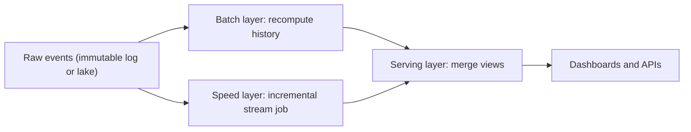
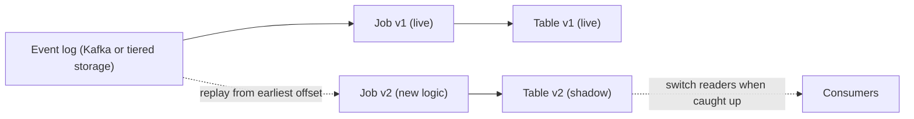

## 🎯 خلاصه

> **Lambda** دو مسیر برای یک داده نگه می‌دارد: مسیر **batch** که حقیقت را از تاریخچه دوباره محاسبه می‌کند، و مسیر **speed** (stream) که نتیجه‌ی تازه اما موقت می‌دهد. **Kappa** فقط یک مسیر stream دارد و اشتباه‌ها را با **replay** کردن log اصلاح می‌کند.

- Lambda درست است، اما منطق را دوبار می‌نویسد و دو کدبیس کم‌کم از هم دور می‌شوند. Kappa یک مسیر کد دارد، اما به logی نیاز دارد که بشود دوباره از آن خواند، و jobی که بتواند state خودش را از نو بسازد.
- جدول‌های lakehouse و موتورهایی که همان کد را هم در batch و هم در streaming اجرا می‌کنند، مرز بین این دو را کم‌رنگ کرده‌اند. سؤال واقعی این است: آیا یک مسیر کد می‌تواند نیازهای تأخیر، هزینه و تاریخچه‌ی ما را برآورده کند؟
- با سه سؤال تصمیم بگیر: چقدر عقب باید دوباره پردازش کنیم، جواب باید چقدر سریع باشد، و آیا منطق batch واقعاً با منطق stream فرق دارد؟

## 🌱 از ساده شروع کنیم (مبتدی)

> **💡 تشبیه:** یک روزنامه با «تیکر زنده» و نسخه‌ی چاپی. تیکر نتیجه را لحظه‌ای گزارش می‌کند (سریع، و ممکن است بعداً اصلاح شود). نسخه‌ی چاپی صبح روز بعد هر بازی را با سابقه‌ی رسمی چک می‌کند (کند، اما درست). Lambda مثل دو میز خبری با دو تیم است. Kappa یک خبرنگار است که متن زنده را به‌روز می‌کند و وقتی اشتباهی پیدا شد، بازی را از روی ضبط دوباره پخش می‌کند.

یک سؤال کسب‌وکار را در نظر بگیر: **هر تبلیغ در هر دقیقه چند کلیک گرفته؟**

- **Batch:** هر شب کلیک‌های خام دیروز را می‌خوانیم و می‌شماریم. جواب دقیق است، اما فردا صبح می‌رسد.
- **Stream:** کلیک‌ها را همان لحظه‌ای که می‌رسند می‌شماریم و هر چند ثانیه عدد را به‌روز می‌کنیم. جواب سریع است، اما یک رویداد دیرِ رسیده یا یک ری‌استارت می‌تواند عدد را کمی غلط کند.

برای یک تبلیغ و یک دقیقه، دو مسیر این‌طور اختلاف دارند:

```text
کلیک واقعی تبلیغ A در دقیقه‌ی 10:00                 : 100
عدد stream که در 10:01 نشان داده شد (یک کلیک دیر رسید): 99
عدد batch صبح روز بعد                               : 100
```

Lambda هر دو مسیر را نگه می‌دارد و به محض آماده شدنِ عدد batch، همان را نشان می‌دهد. Kappa می‌گوید: فقط مسیر stream را نگه دار، و وقتی منطق عوض شد، رویدادهای قدیمی را با نسخه‌ی جدید دوباره پخش کن.

## 🔧 واقعاً چطور کار می‌کند (متوسط)

**Lambda** سه لایه دارد. رویدادهای خام همان **master dataset** هستند: فقط اضافه می‌شوند و هرگز ویرایش نمی‌شوند. بقیه‌ی داده‌ها از آن ساخته می‌شوند.



- **view ی batch** تا یک نقطه‌ی برش کامل و دقیق است (مثلاً همه‌ی روزهای قبل از امروز).
- **view ی real-time** فقط چیزی را می‌پوشاند که batch هنوز به آن نرسیده (یعنی امروز). وقتی batch برسد، کنار گذاشته می‌شود.
- لایه‌ی serving این قاعده را دارد: «برای روزهای قبل از امروز view ی batch، برای امروز view ی real-time».

یک طرح از این قاعده‌ی ادغام (SQL به سبک PostgreSQL، برای توضیح):

```sql
CREATE VIEW clicks_per_minute AS
SELECT window_start, ad_id, clicks
FROM batch_clicks_minute
WHERE window_start <  DATE_TRUNC('day', now())
UNION ALL
SELECT window_start, ad_id, clicks
FROM speed_clicks_minute
WHERE window_start >= DATE_TRUNC('day', now());
```

**Kappa** یک مسیر دارد. پردازش دوباره یک replay است، نه یک pipeline دوم:



ترتیب امن برای پردازش دوباره در Kappa:

1. یک job با نسخه‌ی v2 مستقر کن که از **اولین offset قابل دسترس** بخواند و در یک جدول خروجی **جدید** بنویسد. هرگز در جدول فعال ننویس.
2. بگذار v2 به انتهای log برسد. lag مصرف‌کننده را تا صفر شدنش نگاه کن.
3. نسخه‌ی v1 و v2 را مقایسه کن: جمع کنترلی روزانه و نمونه‌ای از کلیدها.
4. خواننده‌ها را به v2 ببر (یک view یا یک مقدار config را عوض کن). v1 را برای مدتی نگه دار تا بشود برگشت، بعد حذفش کن.

منطق کسب‌وکار را می‌شود بین یک job batch و یک job stream مشترک کرد تا این دو از هم جدا نشوند:

```python
from pyspark.sql import DataFrame, functions as F

click_schema = "event_id STRING, ad_id STRING, event_time TIMESTAMP"

def minute_counts(events: DataFrame) -> DataFrame:
    # یک تعریف از قاعده‌ی کسب‌وکار، برای ورودی batch و streaming.
    return (events
        .groupBy(F.window("event_time", "1 minute").alias("w"), "ad_id")
        .agg(F.count("*").alias("clicks"))
        .select(F.col("w.start").alias("window_start"), "ad_id", "clicks"))

# Batch: دقیق، برای پردازش دوباره و view ی batch
batch_out = minute_counts(spark.read.parquet("s3://lake/clicks/"))

# Streaming: تازه؛ watermark به Spark اجازه می‌دهد state پنجره‌های قدیمی را پاک کند
stream_in = (spark.readStream.format("kafka")
    .option("kafka.bootstrap.servers", "broker:9092")
    .option("subscribe", "clicks.raw")
    .load()
    .select(F.from_json(F.col("value").cast("string"), click_schema).alias("e"))
    .select("e.*")
    .withWatermark("event_time", "5 minutes"))

query = (minute_counts(stream_in).writeStream
    .outputMode("append")      # هر پنجره یک‌بار، بعد از عبور watermark از آن، منتشر می‌شود
    .format("console")         # sink نمایشی؛ در production یک sink از lakehouse یا OLAP
    .start())
```

به چیزهایی که مشترک‌اند (قاعده) و چیزهایی که نیستند (منبع، watermark، output mode) دقت کن. این تقسیم، هسته‌ی عملی «lambda درست» است. برای دلیل وجود watermark، [[watermark]] و [[late-arriving-data]] را ببین.

## 🧠 عمق و trade-offها (سنیور)

**خطاهای Lambda**

- **انحراف (drift).** دو پیاده‌سازی از «یک کلیک» (فیلتر ربات، timezone، deduplication) کم‌کم از هم فاصله می‌گیرند. وقتی batch نتیجه‌ی stream را بازنویسی می‌کند، داشبورد عددش عوض می‌شود و کاربر اعتمادش را از دست می‌دهد. راه‌حل: یک ماژول مشترک (مثل بالا) به‌علاوه‌ی یک job تطبیق ([[pattern-reconciliation]]).
- **هزینه‌ی دوبرابر.** دو خوشه، دو نوبت on-call و دو مجموعه‌ی تست.
- **بازنویسی بی‌صدا.** اگر یک اصلاح batch عددی را عوض کند که قبلاً به مشتری رسیده، به جای فقط رفع کردن باید برنامه‌ی اطلاع‌رسانی داشته باشی.

**خطاهای Kappa**

- **موج replay.** replay کردن ۹۰ روز داده به یک sink یا API می‌تواند از ظرفیتش بیشتر شود. replay را محدود کن و آن را روی consumer group جدا اجرا کن.
- **sinkهای غیرidempotent.** replay در یک جدول فقط‌الحاقی (append-only) هر رویداد را دوبار می‌شمارد. sink باید upsert با کلید کسب‌وکار باشد، یا نوشتن exactly-once داشته باشی ([[pattern-exactly-once]]، [[idempotency]]).
- **منطق غیرقطعی.** استفاده از `now()` یا processing time داخل منطق، هر بار replay نتیجه‌ی متفاوتی می‌دهد. از event time که داخل رکورد است استفاده کن.
- **تکامل schema.** رویدادهای قدیمی باید با کد جدید هم parse شوند. schema registry و تغییرات سازگار لازم است ([[schema-evolution]]).
- **نگهداری (retention).** log باید تاریخچه‌ای را نگه دارد که لازم داری. محاسبه: ۹۰ روز با ۱۲۵ GB در روز می‌شود ۱۱٫۲۵ TB. یک consumer با سرعت ۲۰۰ MB/s به `11,250,000 MB / 200 MB/s = 56,250 s` نیاز دارد، یعنی حدود ۱۵٫۶ ساعت، قبل از هزینه‌ی sink. retention هفت‌روزه‌ی Kafka اصلاً نمی‌تواند این را replay کند.

**lakehouse جریانی.** وقتی log کوتاه است، رویدادهای خام را در یک فرمت جدول باز مثل [[iceberg]] یا [[delta-lake]] ذخیره کن. replay می‌شود خواندن batch از snapshotها، و خواندن افزایشی streaming هم snapshotهای جدید را برمی‌دارد. شکل Kappa حفظ می‌شود و محدودیت retention برداشته می‌شود. هزینه‌اش فایل‌های ریز و کار compaction است.

**کِی Lambda هنوز جواب درست است**

- عدد صورتحساب یا عدد تحت مقررات باید از یک مسیر batch قابل ممیزی بیاید، و داشبورد از stream. بسیاری از تیم‌ها «همه‌چیز را stream کن، و هر شب batch پارتیشن را بازنویسی کند» را اجرا می‌کنند. این یک hybrid است و اشکالی ندارد، به شرطی که صادقانه اسمش را بگذاری.
- محاسبه‌ی دقیق batch خیلی ارزان‌تر از یک stream با state بزرگ است: اسکن کامل فایل‌های ستونی می‌تواند از نگه‌داشتن state عظیم در یک job stream بهتر باشد.
- موتور stream نمی‌تواند بخشی از منطق را بیان کند (مثلاً join پیچیده با تاریخچه‌ی بزرگ).

**چه چیزهایی را پایش کنی:** lag مصرف‌کننده، lag متعلق به watermark، پیشرفت replay، جمع‌های کنترلی نسخه‌ی v1 در برابر v2، اندازه‌ی state هر job، و تعداد ردیف‌های اصلاح‌شده بعد از هر اجرای batch.

> **🎤 این را در مصاحبه بگو:** «من از سه سؤال شروع می‌کنم: افق پردازش دوباره، هدف تأخیر، و اینکه آیا منطق batch واقعاً با منطق stream فرق دارد. اگر یک مسیر کد هر سه را پوشش دهد، Kappa را انتخاب می‌کنم و تاریخچه‌ی خام را در یک جدول قابل replay نگه می‌دارم. اگر صورتحساب به یک مسیر batch قابل ممیزی نیاز دارد، مسیر batch را نگه می‌دارم، ولی منطق کسب‌وکار را مشترک می‌کنم تا داشبورد و صورتحساب از هم جدا نشوند.»

## 🧪 امتحان کن

1. یک job stream کلیک‌ها را در هر دقیقه می‌شمارد. قانون ربات از «IP در blocklist» به «user agent با الگوی مشخص» تغییر می‌کند. برنامه‌ی پردازش دوباره را شرح بده. راهنمایی: به جدول قدیمی و مقصد replay فکر کن.
2. باید ۳۰ روز با ۸۰ GB در روز را دوباره پردازش کنی، و یک consumer با ۱۵۰ MB/s می‌خواند. خواندن چقدر طول می‌کشد؟ محاسبه را نشان بده.
3. توضیح بده چرا عدد batch برای دقیقه‌ی 10:00 می‌تواند با عدد stream فرق داشته باشد، حتی وقتی هیچ رویدادی گم نشده.

<details><summary>راه‌حل‌ها را نشان بده</summary>

**1.** یک job با نسخه‌ی v2 و قانون جدید مستقر کن که از اولین offset موجود (یا snapshot در lake) بخواند و در یک جدول جدید بنویسد. به جدول فعال دست نزن. وقتی v2 به انتها رسید، جمع‌های کنترلی روزانه را مقایسه کن، بعد خواننده‌ها را سوئیچ کن و v1 را برای مدت برگشت نگه دار.

**2.** ۳۰ × ۸۰ GB = ۲٬۴۰۰ GB = ۲٬۴۰۰٬۰۰۰ MB. با ۱۵۰ MB/s: ۲٬۴۰۰٬۰۰۰ / ۱۵۰ = ۱۶٬۰۰۰ ثانیه، حدود ۴٫۴ ساعت، قبل از موازی‌سازی. با consumer یا partition بیشتر می‌شود کوتاه‌ترش کرد.

**3.** عدد stream موقت است: وقتی watermark از پنجره رد شود منتشر می‌شود و رویدادهایی را که بعد از مهلت تأخیر مجاز برسند نادیده می‌گیرد. batch همه‌ی رویدادهای آن روز را می‌بیند، پس رویدادهای دیررسیده را هم دارد. هر دو با قانون خودشان درست‌اند، و به همین دلیل لایه‌ی serving باید بگوید کدام را نشان می‌دهد.

</details>

## 💬 گوشه‌ی مصاحبه

**سؤال: «برای clickstream ما Lambda بهتر است یا Kappa؟»**

- **جواب متوسط:** «Kappa، چون یک مسیر کد داریم و می‌توانیم با replay کردن topic در Kafka باگ‌ها را اصلاح کنیم.»
- **جواب سنیور:** «به سه چیز بستگی دارد. اگر فقط هفته‌ی اخیر را دوباره پردازش می‌کنیم، retention کافکا کافی است و Kappa ساده است. اگر ۹۰ روز تاریخچه لازم است، log باید عمر طولانی‌تری داشته باشد، پس رویدادهای خام را در یک فرمت جدول باز ذخیره می‌کنم و از آنجا replay می‌کنم. اگر صورتحساب یک عدد دقیق و قابل ممیزی می‌خواهد، مسیر batch را برای صورتحساب نگه می‌دارم، ولی منطق کسب‌وکار را مشترک می‌کنم تا داشبورد و صورتحساب از هم فاصله نگیرند.»

**سؤال تکمیلی:** «در Kappa چطور backfill می‌کنی؟» با روش جدول سایه از بخش متوسط جواب بده.

## ⚠️ اشتباهات رایج

> **⚠️ توجه:** یک job stream به‌علاوه‌ی یک job جداگانه‌ی batch با زبان دیگر، Kappa نیست. این همان Lambda است با یک لایه‌ی کمتر. در طراحی درست اسمش را بگذار.

> **⚠️ توجه:** replay در جدول فعال روی یک sink فقط‌الحاقی، هر شمارش را دو برابر می‌کند. replay را در جدول سایه بنویس، یا sink را idempotent کن.

- فرض کردن اینکه retention کافکا برابر تاریخچه‌ی توست. معمولاً این‌طور نیست.
- استفاده از processing time در منطق، که باعث می‌شود replay جواب‌های متفاوت بدهد.
- اسم «دقیق» گذاشتن روی لایه‌ی stream، در حالی که رویدادهای دیررسیده عمداً کنار گذاشته می‌شوند.
- یادت برود که اصلاح batch عددهایی را عوض می‌کند که کاربران قبلاً دیده‌اند.
- انتخاب پیش‌فرض Lambda از سر عادت، بدون بررسی اینکه منطق batch و stream واقعاً فرق دارند.

## ✅ خودت را بسنج

1. در Lambda، نقش لایه‌ی speed چیست؟
   - A) تنها منبع حقیقت است
   - B) نتیجه‌ی تازه، افزایشی و موقت برای داده‌ی اخیر می‌دهد
   - C) رویدادهای خام را برای همیشه ذخیره می‌کند
   - D) جای لایه‌ی serving را می‌گیرد

<details><summary>جواب</summary>

**B** — لایه‌ی speed بخشی را پوشش می‌دهد که batch هنوز به آن نرسیده. وقتی batch برسد، نتیجه‌هایش جایگزین می‌شوند.

</details>

2. چرا یک job پردازش دوباره در Kappa در یک جدول **جدید** می‌نویسد و نه در جدول فعال؟

   - A) Kafka اجازه نمی‌دهد دو نویسنده به یک جدول بنویسند
   - B) خروجی فعال دست‌نخورده می‌ماند تا v2 اعتبارسنجی شود، و v1 برای برگشت در دسترس است
   - C) نوشتن در جدول‌های جدید سریع‌تر است
   - D) replay نمی‌تواند در جدول‌های موجود بنویسد

<details><summary>جواب</summary>

**B** — جدول سایه اجازه می‌دهد خروجی‌ها را مقایسه کنی و خواننده‌ها را در زمان دلخواه سوئیچ کنی. نوشتن روی جدول فعال هیچ برگشتی نمی‌دهد و خطر شمارش دوباره دارد.

</details>

3. **(سنیور)** topic کافکا هفت روز نگه می‌دارد، اما کسب‌وکار بعد از یک باگ منطقی، پردازش دوباره‌ی ۹۰ روزه می‌خواهد. طراحی درست چیست؟

   - A) retention همه‌ی topicها را به ۹۰ روز ببریم، بدون تغییر دیگری
   - B) از پردازش دوباره صرف‌نظر کنیم و باگ را در تاریخچه بپذیریم
   - C) رویدادهای خام را در یک جدول قابل replay در lake (مثل Iceberg یا Delta) ذخیره کنیم و از آن replay کنیم، و کافکا فقط پنجره‌ی زنده‌ی کوتاه را نگه دارد
   - D) replay را روی جدول فعال، روزی یک روز اجرا کنیم

<details><summary>جواب</summary>

**C** — جدول lake برای تاریخچه‌ی طولانی ارزان است و می‌شود آن را به‌صورت batch یا افزایشی خواند. گزینه‌ی A ممکن است ولی گران است و هنوز طراحی backfill نیست؛ D در جدول فعال می‌نویسد.

</details>

4. **(سنیور)** یک replay در یک جدول فقط‌الحاقی درآمد را در sink دو برابر کرده. محتمل‌ترین علت و راه‌حل چیست؟

   - A) موتور stream در windowing باگ دارد
   - B) sink idempotent نیست، پس رویدادهای دوباره‌پردازش‌شده دوباره اضافه می‌شوند؛ از upsert با کلید کسب‌وکار یا sink تک‌بار (exactly-once) استفاده کن
   - C) replay پارتیشن‌های زیادی استفاده کرده
   - D) watermarkها خیلی پایین تنظیم شده بودند

<details><summary>جواب</summary>

**B** — replay با at-least-once رویدادها را دوباره تحویل می‌دهد. یک sink فقط‌الحاقی هر بار تحویل را ذخیره می‌کند، پس جمع‌ها دو برابر می‌شوند. راه‌حل نوشتن idempotent با کلید پایدار کسب‌وکار است.

</details>

5. **(سنیور)** چرا منطق replay باید از event time استفاده کند و نه processing time؟

   - A) processing time در Spark در دسترس نیست
   - B) event time داخل رکورد ثابت است، پس ورودی یکسان همیشه پنجره‌های یکسان می‌دهد؛ processing time با سرعت replay عوض می‌شود
   - C) event time همیشه سریع‌تر است
   - D) processing time با watermark نمی‌تواند استفاده شود

<details><summary>جواب</summary>

**B** — قطعیت (determinism) باعث می‌شود نتیجه‌ی replay با اجرای اصلی قابل مقایسه باشد. processing time به زمان اجرای کد وابسته است.

</details>

## 🗂️ فلش‌کارت

| جلو | پشت |
|---|---|
| معماری Lambda | مسیر batch (دقیق، محاسبه‌ی دوباره) + مسیر speed (تازه، افزایشی) + لایه‌ی serving که این دو را ادغام می‌کند |
| معماری Kappa | یک مسیر stream؛ پردازش دوباره یعنی replay کردن log در نسخه‌ی جدید |
| Master dataset | رویدادهای خام غیرقابل تغییر که همه‌ی viewها از آن ساخته می‌شوند |
| چرا جدول سایه در Kappa | خروجی جدید را اعتبارسنجی کنی و قبل از سوئیچ خواننده‌ها، امکان برگشت داشته باشی |
| ریسک اصلی Lambda | انحراف بین دو پیاده‌سازی از یک قاعده‌ی کسب‌وکار |
| ریسک اصلی Kappa | replay در sinkهای غیرidempotent، شمارش دوباره ایجاد می‌کند |
| چرا replay به event time نیاز دارد | event time داخل رکورد است؛ processing time با هر اجرا عوض می‌شود |
| lakehouse جریانی | رویدادهای خام در Iceberg یا Delta، تا replay به retention کافکا محدود نباشد |

## 🔗 ادامه

- [[lambda-kappa]] مرور معماری را دارد؛ این درس درباره‌ی انتخاب و اجرای آن است.
- [[pattern-reconciliation]] نشان می‌دهد که در عمل دو عدد چطور مقایسه می‌شوند.
- [[pattern-backfill]] و [[backfills]] مکانیک بازاجرای تاریخچه را توضیح می‌دهند.
- [[pattern-late-data]] و [[pattern-realtime-aggregation]] تصمیم‌های watermark و پنجره را پوشش می‌دهند که لایه‌ی speed استفاده می‌کند.
- [[lakehouse-table-formats]] توضیح می‌دهد چرا lake می‌تواند مثل یک log قابل replay عمل کند.
