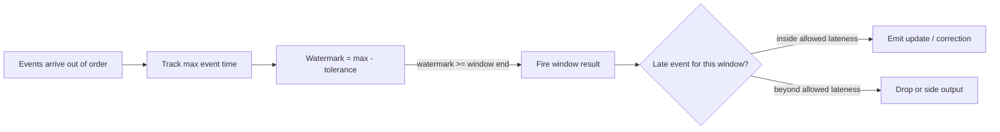

## 🎯 خلاصه

> در یک stream، رویدادها به ترتیبی که اتفاق افتاده‌اند نمی‌رسند. یک گوشی بعد از پیدا کردن آنتن کلیک خودش را می‌فرستد، یک retry رویداد قدیمی را دوباره می‌فرستد، یک partition از بقیه عقب می‌افتد. **watermark** می‌گوید «دیگر رویدادی قدیمی‌تر از این زمان انتظار نداریم»، پس یک window می‌تواند بسته شود و نتیجه منتشر کند. **allowed lateness** یک window بسته‌شده را مدتی باز نگه می‌دارد تا رویدادهای دیررس بتوانند نتیجه‌ی منتشرشده را **اصلاح** کنند. دیرتر از آن یا حذف می‌شوند یا به یک کانال جانبی می‌روند، و **batch شبانه** حرف آخر را می‌زند.

- **event time** (زمان وقوع) همان چیزی است که window ها باید استفاده کنند. **processing time** (زمانی که job دیده) فقط برای عملیات مفید است.
- **watermark** یک تخمین متحرک است: بزرگ‌ترین event time دیده‌شده، منهای بی‌نظمی‌ای که تحمل می‌کنی.
- **allowed lateness** حافظه و به‌روزرسانی‌های خروجی بیشتر را در برابر درستی معامله می‌کند.
- sink باید **به‌روزرسانی** را بپذیرد (upsert با کلید window و key)، وگرنه اصلاحات گم می‌شوند یا دو برابر می‌شوند.
- خروجی بلادرنگ **موقت** است. آن را با نتیجه‌ی batch آشتی بده و این را در داده مشخص کن.

## 🌱 از ساده شروع کنیم (مبتدی)

> **💡 تشبیه:** یک مدرسه تکالیف را جمع می‌کند و میانگین کلاس «هفته‌ی ۳» را وقتی اعلام می‌کند که معلم باور دارد همه تحویل داده‌اند. بعضی دانش‌آموزها کندترند. معلم کمی صبر می‌کند و بعد میانگین را اعلام می‌کند. اگر دانش‌آموزی فردای آن روز تکلیفش را بیاورد، معلم می‌تواند میانگین را **به‌روز** کند، ولی فقط چند روز. بعد از آن دفتر نمرات بسته است. **watermark** قانون معلم است برای «فکر می‌کنم تا الان همه‌ی هفته‌ی ۳ تحویل داده‌اند». **allowed lateness** همان روزهای اضافه‌ای است که معلم دفتر را باز نگه می‌دارد.

چهار رویداد کلیک را در نظر بگیر. هر کدام یک **event time** (زمانی که کاربر کلیک کرده) و یک ترتیب ورود (زمانی که سرور دریافت کرده) دارد:

```text
arrival 1: event_time 00:00:05
arrival 2: event_time 00:00:30
arrival 3: event_time 00:01:10   <- the next minute has started
arrival 4: event_time 00:00:20   <- this one is late: it belongs to minute 0
```

اگر به محض شروع دقیقه‌ی ۱ شمارش دقیقه‌ی ۰ را منتشر کنی، شمارش دقیقه‌ی ۰ غلط است. رویداد ۴ بعد از منتشر شدن نتیجه‌ی دقیقه‌ی ۰ رسیده است. سؤال طراحی این است: **چقدر صبر کنیم، و با رویداد ۴ چه کنیم؟**

دو قانون این را حل می‌کنند:

1. برای تعیین این‌که رویداد مربوط به کدام دقیقه است، از event time استفاده کن، نه زمان ورود.
2. یک قانون انتظار (watermark) و یک قانون اصلاح (allowed lateness) تعریف کن و هر دو را مکتوب کن.

## 🔧 واقعاً چطور کار می‌کند (متوسط)

### event time، processing time و watermark

یک موتور stream برای هر منبع یا partition، **event time** را دنبال می‌کند. watermark از آن به‌دست می‌آید:

```text
watermark = max(event_time seen so far) - allowed_out_of_orderness
```

با بی‌نظمی مجاز ۱۰ ثانیه، بعد از دیدن رویدادی در `10:01:10`، watermark برابر `10:01:00` است. موتور این را این‌طور می‌خواند: «دیگر رویدادی قدیمی‌تر از `10:01:00` انتظار ندارم.» یک window `[10:00, 10:01)` وقتی بسته می‌شود که watermark به پایانش برسد.



معامله در یک عدد است، یعنی تحمل:

- **خیلی کوچک:** windowها زود بسته می‌شوند و رویدادهای خوب دیررس حساب می‌شوند. شمارش‌ها غلط‌اند و اصلاحات زیاد می‌شوند.
- **خیلی بزرگ:** نتایج به اندازه‌ی تحمل دیر می‌رسند و state مدت بیشتری باز می‌ماند. تازگی آسیب می‌بیند.

قبل از انتخاب، تأخیر واقعی را اندازه بگیر. `event_time` را با `ingest_time` (زمانی که رویداد وارد Kafka شده) برای صدک ۹۹ و ۹۹٫۹ هر منبع مقایسه کن. یک منبع موبایلی ممکن است به دقیقه یا ساعت تحمل نیاز داشته باشد، یک لاگ سرور شاید به ثانیه.

### شبیه‌سازی قابل‌اجرا

این قوانین در کد ساده‌تر از نثر دیده می‌شوند. این برنامه‌ی Python ساده منطق watermark را با window یک‌دقیقه‌ای، تحمل ۱۰ ثانیه‌ای و allowed lateness ۱۲۰ ثانیه‌ای اجرا می‌کند و به هیچ فریم‌ورکی نیاز ندارد:

```python
WINDOW = 60             # tumbling window size (seconds)
OUT_OF_ORDER = 10       # watermark = max event time seen - 10
ALLOWED_LATENESS = 120  # keep a window open this long after the watermark passes its end

arrivals = [5, 30, 70, 20, 100, 50, 200, 65, 5]  # event times, in arrival order

counts = {}             # window start -> count
fired = set()           # windows already emitted once
max_seen = float("-inf")

for t in arrivals:
    w = t - t % WINDOW
    watermark = max_seen - OUT_OF_ORDER
    if watermark >= w + WINDOW + ALLOWED_LATENESS:
        print(f"t={t:>3}  DROP   window {w} is closed (wm={watermark})")
        continue
    counts[w] = counts.get(w, 0) + 1
    if w in fired:
        print(f"t={t:>3}  UPDATE window {w} -> {counts[w]}")
    max_seen = max(max_seen, t)
    watermark = max_seen - OUT_OF_ORDER
    for win in sorted(counts):
        if win not in fired and watermark >= win + WINDOW:
            fired.add(win)
            print(f"t={t:>3}  EMIT   window {win} -> {counts[win]} (wm={watermark})")
```

خروجی آن:

```text
t= 70  EMIT   window 0 -> 2 (wm=60)
t= 20  UPDATE window 0 -> 3
t= 50  UPDATE window 0 -> 4
t=200  EMIT   window 60 -> 2 (wm=190)
t= 65  UPDATE window 60 -> 3
t=  5  DROP   window 0 is closed (wm=190)
```

خط به خط بخوان:

- رویداد `70` watermark را به `60` می‌برد، که window `0` (یعنی `[0, 60)`) را می‌بندد. اولین نتیجه با شمارش ۲ منتشر می‌شود.
- رویدادهای `20` و `50` دیررس‌اند، اما هنوز داخل allowed lateness هستند. هر کدام شمارش منتشرشده را **به‌روز** می‌کنند (۳ و بعد ۴).
- رویداد `200` watermark را به `190` می‌برد. window `60` بسته و با شمارش ۲ منتشر می‌شود. window `0` حالا از حد دیرکرد خود گذشته است (`0 + 60 + 120 = 180`).
- رویداد `65` برای window `60` دیررس است، ولی آن window هنوز باز است، پس به‌روزرسانی است.
- رویداد آخر `5` وقتی می‌رسد که watermark برابر `190` است، یعنی از حد window `0` گذشته. حذف می‌شود. یک سیستم واقعی آن را به یک side output برای job ترمیم می‌فرستد.

### موتورهای واقعی چطور این کار را می‌کنند

- **Flink** watermark را برای هر منبع و هر operator دنبال می‌کند. توابع window در Flink SQL (`TUMBLE`، `HOP`) رویدادهایی را که بعد از گذشتن watermark از window آن‌ها می‌رسند حذف می‌کنند. DataStream API اجازه می‌دهد برای window مقدار allowed lateness تعیین کنی و رویدادهای دیررس را به **side output** بفرستی. نام گزینه‌ها را برای نسخه‌ی Flink خودت چک کن.
- **Spark Structured Streaming** روی ستون event time از `withWatermark` استفاده می‌کند. رویدادهای قدیمی‌تر از watermark از aggregation کنار گذاشته می‌شوند و state windowهای قدیمی پاک می‌شود.
- **Kafka** از event time خبر ندارد. مصرف‌کننده (یا موتوری که روی آن است) باید watermark را تعیین کند. skew بین partitionها کار را سخت‌تر می‌کند: کندترین partition watermark کل سیستم را عقب نگه می‌دارد.

### به‌روزرسانی نتایج قبلی

یک window ممکن است بیش از یک بار منتشر شود. sink باید این را بپذیرد. سه طراحی رایج:

| طراحی sink | رفتار هنگام اصلاح | ریسک |
|---|---|---|
| **Upsert با کلید** `(window_start, url)` | ردیف را با جمع جدید بازنویسی می‌کند | کلید یکتا لازم است؛ باید جدیدترین نتیجه نگه داشته شود |
| **Append با نسخه** `(window_start, url, emitted_at)` | نسخه‌ی جدید اضافه می‌کند؛ خواننده آخرین را می‌گیرد | خواننده باید dedupe کند؛ فضا زیاد می‌شود |
| **فقط Append** (بدون کلید) | ردیف دوم برای همان window اضافه می‌کند | شمارش دوبرابر، رایج‌ترین باگ |

upsert با کلید window معمولاً جواب است، چون replay بعد از restart همان ردیف را دوباره و یکسان می‌نویسد.

## 🧠 عمق و trade-offها (سنیور)

- **قرارداد درستی را اول تعیین کن.** قبل از طراحی سه عدد را مکتوب کن: تحمل (چقدر یک رویداد می‌تواند دیر باشد و هنوز در عدد بلادرنگ حساب شود)، دیرکرد مجاز (چقدر مدت یک عدد منتشرشده هنوز می‌تواند تغییر کند)، و **پنجره‌ی آشتی** (تا چه مدت تا نهایی‌شدن نتیجه‌ی batch). بقیه‌ی طراحی از این‌ها نتیجه می‌شود.
- **توزیع دیرکرد، نه یک عدد.** تحملی که ۹۹ درصد رویدادها را پوشش می‌دهد ممکن است هر ساعت ۱ درصد ترافیک را حذف کند. برای پول، fraud یا billing تصمیم بگیر که افت ۰٫۱ درصد قابل قبول است یا نه، و آن را در سمت batch اندازه بگیر.
- **state و حافظه.** allowed lateness همه‌ی windowهای باز را در state نگه می‌دارد. هزینه‌ی حافظه تقریباً (تعداد کلیدها) × (windowهای باز) × (بایت هر accumulator) است. دیرکرد طولانی با کلید با cardinality بالا می‌تواند backend state را پر کند. به [[streaming-state]] نگاه کن.
- **منبع بیکار watermark را متوقف می‌کند.** یک partition بدون ترافیک watermark خودش را جلو نمی‌برد، پس watermark سراسری متوقف می‌شود و هیچ windowی بسته نمی‌شود. از timeout برای منبع بیکار استفاده کن، یا partitionهای بیکار را تمام‌شده در نظر بگیر. این یک incident رایج در production است.
- **exactly-once همان correct بودن در برابر دیرکرد نیست.** checkpointها بعد از خطا state job را سازگار نگه می‌دارند. تصمیم نمی‌گیرند که یک رویداد دیررس است یا نه. وقتی طراحی را توضیح می‌دهی این دو را جدا نگه دار. به [[delivery-semantics]] نگاه کن.
- **آشتی با batch شبانه.** stream را موقت در نظر بگیر. هر batch شبانه چند روز اخیر را از داده‌ی خام بازمحاسبه می‌کند (به [[pattern-batch-etl]] نگاه کن) و کلیدهای یکسان را در جدول سرویس بازنویسی می‌کند، با نشانه‌ای مثل `source = 'batch'`. بعد مقایسه کن: برای هر window، اختلاف stream و batch باید در یک تحمل توافق‌شده باشد. وقتی نیست هشدار بده، چون اختلاف رو به رشد نشانه‌ی watermark یا sink خراب است. به [[pattern-reconciliation]] نگاه کن.
- **رویدادهای حذف‌شده هم داده‌اند.** آن‌ها را بشمار. یک side output از رویدادهای دیررس، همراه با event time و میزان دیرکرد، امکان یک backfill هدفمند و اندازه‌گیری افت را می‌دهد.
- **مانیتورینگ.** lag watermark (ساعت دیواری منهای watermark)، تعداد رویدادهای دیررس و حذف‌شده برای هر منبع، نرخ به‌روزرسانی هر window، اندازه‌ی state، و اختلاف آشتی روزانه.
- **کی اصلاح بلادرنگ لازم نیست.** اگر کسب‌وکار فقط یک عدد روزانه می‌خواهد، سیستم watermark نساز. پایپ‌لاین batch را استفاده کن و بپذیر که عدد فردا می‌رسد. اصلاح بلادرنگ فقط وقتی هزینه‌اش را دارد که کسی ظرف چند دقیقه روی عدد اقدام کند.
- **Lambda و Kappa.** stream جواب سریع و موقت می‌دهد؛ batch جواب نهایی. Kappa با بازپخش stream یک مسیر کد نگه می‌دارد؛ Lambda دو مسیر. به [[pattern-lambda-kappa]] نگاه کن.

## 🧪 امتحان کن

از شبیه‌سازی این درس و لیست ورود `[5, 30, 70, 20, 100, 50, 200, 65, 5]` استفاده کن.

1. **تغییر تحمل.** `OUT_OF_ORDER = 0` را تنظیم کن و برنامه را دوباره اجرا کن. کدام خطوط تغییر می‌کنند و چرا؟
2. **پیدا کردن حذف.** بدون اجرای کد تصمیم بگیر اگر `ALLOWED_LATENESS` برابر `60` بود، رویداد `65` حذف می‌شد یا نه. محاسبه را نشان بده.
3. **طراحی sink.** یک داشبورد بازدید در دقیقه را از stream نشان می‌دهد و batch شبانه اعداد دیروز را بازمحاسبه می‌کند. کلید upsert، یک ستون اضافه که دو منبع را از هم جدا می‌کند، و SQL ای بنویس که وقتی برای یک دقیقه هر دو وجود دارند نتیجه‌ی batch را نگه می‌دارد.

<details><summary>راه‌حل‌ها را نشان بده</summary>

**۱.** با `OUT_OF_ORDER = 0` خروجی این است:
```text
t= 70  EMIT   window 0 -> 2 (wm=70)
t= 20  UPDATE window 0 -> 3
t= 50  UPDATE window 0 -> 4
t=200  EMIT   window 60 -> 2 (wm=200)
t= 65  UPDATE window 60 -> 3
t=  5  DROP   window 0 is closed (wm=200)
```
همان رویدادها به‌روزرسانی یا حذف می‌شوند، ولی مقدار watermark بالاتر است، پس windowها نسبت به جدیدترین داده زودتر بسته می‌شوند. درس این است: در اینجا تحمل کوچک‌تر تعیین نمی‌کند کدام رویدادهای دیررس پذیرفته شوند، چون allowed lateness کار را انجام می‌دهد. ولی یعنی انتظار کمتر برای اولین emit، و روی داده‌ی واقعی یعنی رویدادهای بیشتری کاملاً از watermark رد می‌شوند.

**۲.** window رویداد `65` بازه‌ی `[60, 120)` است. شرط بسته‌شدن این است: `watermark >= 60 + 60 + ALLOWED_LATENESS`. وقتی `65` می‌رسد watermark برابر `190` است. با `ALLOWED_LATENESS = 60` حد برابر `60 + 60 + 60 = 180` است و `190 >= 180` پس رویداد حذف می‌شود. با `120` حد `240` است و `190 < 240` پس به‌عنوان به‌روزرسانی پذیرفته می‌شود.

**۳.**
```sql
-- Target table: one row per minute and URL, plus the source of the number
CREATE TABLE views_minute (
  minute  TIMESTAMP,
  url     STRING,
  views   BIGINT,
  source  STRING,          -- 'stream' or 'batch'
  PRIMARY KEY (minute, url) NOT ENFORCED
);

-- Batch writes its result with source = 'batch'; the upsert replaces the stream row.
-- Stream writes source = 'stream' only where no batch row exists yet:
INSERT INTO views_minute
SELECT s.minute, s.url, s.views, 'stream'
FROM stream_views s
WHERE NOT EXISTS (
  SELECT 1 FROM batch_views b WHERE b.minute = s.minute AND b.url = s.url
);
```
قاعده‌ی «batch برنده است» در خود داده نوشته می‌شود، پس خواننده‌ها می‌بینند کدام عددها نهایی‌اند. در سیستم واقعی نوشتن stream مسیر upsert متفاوتی دارد؛ نکته‌ی اصلی کلید و ستون source است.

</details>

## 💬 گوشه‌ی مصاحبه

**سؤال: «یک رویداد دو ساعت دیر می‌رسد. اتفاق برای aggregate ساعتی تو چیست؟»**

جواب متوسط: «اگر watermark از آن ساعت گذشته باشد، رویداد حذف می‌شود یا به side output می‌رود. در غیر این صورت aggregate را به‌روز می‌کند.»

جواب سنیور: «به قرارداد بستگی دارد. با تحمل مثلاً ۲ دقیقه و allowed lateness ده دقیقه، رویداد دو ساعت دیر از عدد بلادرنگ حذف می‌شود و به side output می‌رود. یک batch روزانه آن ساعت را از داده‌ی خام بازمحاسبه می‌کند، پس عدد نهایی درست است. توزیع تعداد رویدادهایی با این دیرکرد را اندازه می‌گیرم و اگر بالاتر از افت توافق‌شده باشد، یا تحمل را برای آن منبع بالا می‌برم یا پنجره‌ی آشتی طولانی‌تری می‌پذیرم. مطمئن می‌شوم sink با کلید window است، تا اصلاحات بازنویسی کنند و دوبار حساب نشوند.»

**سؤال: «چطور تأخیر watermark را انتخاب می‌کنی؟»** از توزیع اندازه‌گیری‌شده‌ی دیرکرد هر منبع شروع کن، نه حدس. مقداری را انتخاب کن که ترافیکی را که می‌توانی دیر بودنش را بپذیری پوشش دهد، و آن را با allowed lateness و آشتی batch جفت کن. تأخیر بیشتر تازگی و state را هزینه دارد؛ کمتر، درستی را.

> **🎤 این را در مصاحبه بگو:** «windowها از event time استفاده می‌کنند. watermark حدس محدود من از دیرترین رویدادهای ممکن است و تصمیم می‌گیرد کی یک عدد منتشر شود. allowed lateness تعیین می‌کند آن عدد تا کی قابل اصلاح است. هر چه بعد از آن برسد به side output می‌رود، و batch شبانه جواب نهایی است، پس sink باید به‌روزرسانی را بپذیرد.»

## ⚠️ اشتباهات رایج

> **⚠️ توجه:** استفاده از processing time برای window. رویدادهای یک اپ موبایلی که یک ساعت آفلاین بوده به bucket اشتباه می‌روند، و باگ شبیه نویز تصادفی به نظر می‌رسد.

> **⚠️ توجه:** sink فقط‌append همراه با allowed lateness. هر اصلاح یک ردیف اضافه می‌کند و داشبورد دوبار حساب می‌کند. اصلاحات به کلید upsert یا ستون نسخه نیاز دارند.

- انتخاب تحمل watermark با شهود. ابتدا توزیع دیرکرد را اندازه بگیر.
- فراموش کردن partitionهای بیکار. یک partition ساکت watermark سراسری را منجمد می‌کند و هیچ window بسته نمی‌شود.
- فکر کردن این‌که exactly-once یعنی داده‌ی دیررس وجود ندارد. exactly-once درباره‌ی پردازش یک‌بار است؛ دیرکرد درباره‌ی event time است.
- حذف بی‌صدای رویدادهای دیررس. آن‌ها را بشمار و در side output نگه دار.
- گزارش دادن عدد بلادرنگ به‌عنوان نهایی. تا وقتی batch آن را آشتی نداده، موقت برچسب بزن.
- تعیین allowed lateness خیلی بزرگ «برای احتیاط» بدون بررسی اندازه‌ی state.

## ✅ خودت را بسنج (quiz)

1. یک window `[10:00, 10:01)` با watermark برابر `10:01:05` چه می‌شود؟
   - A) هنوز باز است، چون watermark باید دقیقاً برابر پایان window باشد
   - B) بسته شده؛ رویدادهای آن حالا دیررس‌اند و با allowed lateness هندل یا حذف می‌شوند
   - C) بلافاصله از state پاک می‌شود، از جمله رویدادهای دیررس
   - D) از `10:01` دوباره شروع می‌شود

<details><summary>جواب</summary>

**B** — watermark از پایان window گذشته، پس window منتشر شده است. رویدادهای جدید برای آن دیررس‌اند. این‌که هنوز نتیجه را به‌روز می‌کنند یا نه به allowed lateness بستگی دارد؛ بعد از آن حذف یا به side output فرستاده می‌شوند.

</details>

2. چرا windowها باید از event time استفاده کنند، نه processing time؟

   - A) processing time در پایگاه‌داده ذخیره نمی‌شود
   - B) تأخیر شبکه و صف رویدادها را به windowهای اشتباه می‌برد وقتی از زمان ورود استفاده می‌شود؛ event time نشان می‌دهد چه زمانی اتفاق افتاده
   - C) event time همیشه سریع‌تر است
   - D) Flink از processing time پشتیبانی نمی‌کند

<details><summary>جواب</summary>

**B** — نتایج باید توصیف کنند در هر بازه چه اتفاقی افتاده. استفاده از زمان ورود تأخیر را به اعداد وارد می‌کند، پس همان رویداد ممکن است در replayهای مختلف در windowهای متفاوت بیفتد.

</details>

3. یک sink نتیجه‌ی اصلاح‌شده‌ی یک window را که قبلاً منتشر شده دریافت می‌کند. کدام طراحی درست است؟

   - A) ردیف جدید را append کن؛ خواننده‌ها همه را جمع می‌زنند
   - B) با کلید window upsert کن، تا جمع جدیدترین ردیف قدیمی را جایگزین کند
   - C) جدول را هر دقیقه حذف و بازسازی کن
   - D) اصلاحات را نادیده بگیر؛ کم پیش می‌آیند

<details><summary>جواب</summary>

**B** — upsert با کلید `(window, key)` اصلاحات و replayها را idempotent می‌کند. append باعث شمارش دوبرابر می‌شود و جمع‌زدن نسخه‌ها به‌راحتی اشتباه انجام می‌شود.

</details>

4. **(سنیور)** یکی از ۲۰ partition کافکا یک ساعت ترافیک ندارد. windowهای تو هرگز بسته نمی‌شوند. علت و راه حل چیست؟

   - A) window خیلی بزرگ است؛ کوچک‌ترش کن
   - B) watermark سراسری کمترین مقدار بین partitionهاست و partition بیکار جلو نمی‌رود؛ بعد از timeout، partition بیکار را خارج کن تا watermark حرکت کند
   - C) کافکا partition خالی را مجاز نمی‌داند
   - D) allowed lateness را به یک روز افزایش بده

<details><summary>جواب</summary>

**B** — watermark سراسری از کندترین ورودی فعال پیروی می‌کند، پس یک partition بیکار آن را عقب نگه می‌دارد. timeout بیکاری ورودی ساکت را کنار می‌گذارد. افزایش allowed lateness کمکی نمی‌کند، چون watermark اصلاً حرکت نمی‌کند.

</details>

5. **(سنیور)** عدد stream و batch شبانه برای جمع‌های دیروز ۰٫۵ درصد اختلاف دارند و این اختلاف این هفته بیشتر شده. دو علت محتمل را نام ببر و برای هر کدام چه می‌کنی؟

   - A) رنگ‌های داشبورد؛ پالت را عوض کن
   - B) تحمل خیلی کوچک که رویدادهای دیررس بیشتری را حذف می‌کند (تحمل را بالا ببر یا توزیع را اندازه بگیر)، یا sink ای که بعد از restart یا retry دوبار حساب می‌کند (کلید را upsert کن)
   - C) batch همیشه غلط است؛ نادیده‌اش بگیر
   - D) تعداد کاربران؛ کاربر بیشتر اضافه کن

<details><summary>جواب</summary>

**B** — اختلاف رو به رشد معمولاً یعنی تغییر در دیرکرد (رویدادهای بیشتری حذف می‌شوند) یا مشکل sink (تکرار بعد از restart یا retry). تعداد دیررس و حذف‌شده را اندازه بگیر، کلید sink را بررسی کن، و برای پیدا کردن منبع، آشتی را به تفکیک window انجام بده.

</details>

## 🗂️ فلش‌کارت

| Front | Back |
|---|---|
| event time در برابر processing time | زمان وقوع در برابر زمانی که سیستم دیده؛ window ها باید از event time استفاده کنند |
| watermark چیست؟ | تخمین متحرک: بزرگ‌ترین event time دیده‌شده منهای بی‌نظمی تحمل‌شده؛ «رویداد قدیمی‌تر انتظار نداریم» |
| یک window کی منتشر می‌شود؟ | وقتی watermark به پایان window برسد یا از آن بگذرد |
| allowed lateness چیست؟ | مدت باز ماندن یک window منتشرشده تا رویدادهای دیررس بتوانند نتیجه‌اش را به‌روز کنند |
| رویدادهای بعد از allowed lateness چه می‌شوند؟ | حذف یا به side output برای ترمیم فرستاده می‌شوند |
| چرا partitionهای بیکار مهم‌اند؟ | watermark سراسری از کندترین ورودی فعال پیروی می‌کند؛ یک ورودی بیکار آن را منجمد می‌کند |
| کدام طراحی sink اصلاحات را هندل می‌کند؟ | upsert با کلید window و key (append فقط باعث شمارش دوبرابر می‌شود) |
| عددهای بلادرنگ چطور برچسب بخورند؟ | موقت، تا وقتی آشتی batch اجرا شده باشد |

## 🔗 ادامه

- [[pattern-realtime-aggregation]] windowها و rollupهایی را نشان می‌دهد که این قوانین روی آن‌ها اعمال می‌شوند.
- [[pattern-reconciliation]] توضیح می‌دهد چطور stream و batch را مقایسه کنی و با اختلاف چه کنی.
- [[pattern-lambda-kappa]] انتخاب‌های معماری اجرای هر دو لایه یا بازپخش یکی را پوشش می‌دهد.
- [[pattern-backfill]] توضیح می‌دهد چطور بعد از افت بزرگ داده‌ی دیررس یک window را ترمیم کنی.
- [[streaming-state]] و [[time-and-ordering]] اندازه‌ی state و تضمین‌های ترتیب را عمیق‌تر پوشش می‌دهند.
- [[flink]] و [[delivery-semantics]] رفتار موتور و قرارداد exactly-once زیر این‌ها را نشان می‌دهند.
- قبل از نقل‌کردن نام گزینه‌های watermark و allowed lateness، مستندات نسخه‌ی Flink یا Spark خودت را چک کن.
