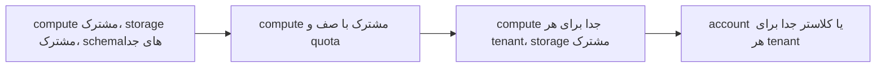

## 🎯 خلاصه

> **الگوی پلتفرم چندمستأجره (multi-tenant):** تیم‌های زیادی (tenantها) یک زیرساخت مشترک دارند. پلتفرم باید برای هر tenant **ایزوله‌سازی** (جاب‌های یک تیم منابع دیگران را تشنه نگه ندارند و داده‌شان را لو ندهند)، **quota** (سهم منصفانه با حداقل تضمین‌شده)، **کنترل دسترسی** (چه کسی کدام داده را می‌خواند)، و **self-service** (تیم‌ها بدون تیکت آنچه لازم دارند را فراهم کنند) را بدهد.

- سطح ایزوله‌سازی را بر اساس **ریسک و هزینه** انتخاب کن، نه عادت. compute مشترک با صف ارزان است؛ کلاستر جدا برای هر tenant گران و امن است.
- شکست اصلی **همسایهٔ پرسروصدا (noisy neighbour)** است: یک جاب از کنترل خارج یا یک export بزرگ، همه را کند می‌کند.
- محصول تیم پلتفرم **مسیر آسفالته** است (قالب‌ها، محافظ‌ها، دید هزینه)، نه تیکت‌هایی که می‌بندد.

## 🌱 از ساده شروع کنیم (مبتدی)

> **💡 تشبیه:** یک ساختمان اداری با اتاق جلسهٔ مشترک. همه از یک سیستم رزرو می‌کنند. قوانین مشخص می‌کنند رزرو چقدر طول بکشد، یک تیم هم‌زمان چند اتاق بگیرد، و کدام اتاق خصوصی است (اتاق مالی کلید دارد). اگر یک تیم همهٔ اتاق‌ها را تمام روز بگیرد، قوانین وارد می‌شوند. ساختمان مشترک است، ولی کسی نمی‌تواند کاغذهای تیم مالی را بخواند.

فرض کن سه تیم یک انبار داده‌ی مشترک دارند: بازاریابی، مالی و محصول. بدون پلتفرم، وضعیت این است:

- بازاریابی جمعه شب یک backfill بزرگ اجرا می‌کند و گزارش پایان ماه مالی را مسدود می‌کند.
- تیم محصول می‌تواند جدول خام پرداخت‌های مالی را بخواند، چون همه یک login مشترک دارند.
- هیچ‌کس نمی‌داند ماه گذشته کدام تیم هزینهٔ کلاستر را داده است.

یک پلتفرم چندمستأجره هر مشکل را با یک مکانیزم مشخص حل می‌کند: صف و quota، سیاست دسترسی، و برچسب هزینه.

## 🔧 واقعاً چطور کار می‌کند (متوسط)

### سطوح ایزوله‌سازی

این یک طیف است. هر چه ایزوله‌سازی قوی‌تر لازم باشد، به سمت راست برو و هزینه و کار عملیاتی بیشتری انتظار داشته باش:



| سطح | مکانیزم معمول | هزینه | شعاع آسیب | کی استفاده شود |
|---|---|---|---|---|
| compute مشترک، namespace | schemaها یا databaseهای جدا، یک موتور | کمترین | زیاد | تیم‌های کوچک، داده‌ی کم‌ریسک |
| compute مشترک با صف | resource group یا pool، quota برای هر tenant | کم | متوسط | بیشتر پلتفرم‌های داخلی |
| compute جدا، storage مشترک | یک warehouse یا کلاستر برای هر تیم | متوسط | کم برای compute | کارهای سنگین که دیگران را مختل می‌کنند |
| account یا کلاستر جدا | زیرساخت کامل برای هر tenant | بیشترین | کمترین | داده‌ی تحت مقررات، مشتری بیرونی |

ایزوله‌سازی storage سؤال جدایی است. storage مشترک با prefixهای جدا برای هر tenant و سیاست‌های دسترسی رایج است، ولی یک سیاست بد همه‌چیز داخل bucket را لو می‌دهد، پس سیاست را مثل یک کنترل امنیتی تست کن.

### quota و سهم منصفانه

quota قاعده‌ای دربارهٔ میزان مصرف یک tenant است. سیاست مفید سه عدد دارد: **تضمین** (آنچه tenant همیشه می‌گیرد)، **سقف** (بیشترین مصرف حتی وقتی بقیه بیکارند)، و **سهم منصفانه** (چیزی که وقتی همه مشغول‌اند می‌گیرد). مثال عملی برای یک کلاستر ۱٬۰۰۰ vCPU و چهار تیم:

- تضمین: ۱۰۰ vCPU برای هر تیم، پس ۴۰۰ رزرو است.
- ۶۰۰ vCPU باقی‌مانده به‌طور مساوی تقسیم می‌شود: ۱۵۰ برای هر تیم.
- سقف هر تیم ۴۰۰ vCPU است، پس وقتی بقیه بیکارند، tenant می‌تواند بیشتر مصرف کند.
- بررسی: اگر یک تیم ۴۰۰ vCPU کار داشته باشد و سه تیم دیگر هر کدام ۲۰۰، جمع ۱٬۰۰۰ می‌شود و هیچ‌کس بالاتر از تضمینش نیست. اگر آن سه تیم هر کدام به ۱۰۰ برسند، تیم پرمصرف تا ۴۰۰ می‌تواند بگیرد و بقیهٔ کلاستر بیکار می‌ماند.

اعداد مثال‌اند. موتورهای واقعی همین ایده‌ها را با اصطلاحات خودشان بیان می‌کنند، مثل resource pool، صف یا اندازهٔ warehouse. همچنین منابع **به‌ازای هر کوئری** را محدود کن: حداکثر بایت اسکن‌شده، حداکثر زمان اجرا، و حداکثر تعداد کوئری هم‌زمان برای هر کاربر.

```yaml
# سیاست نمونه، نه schema واقعی هیچ ابزاری
tenant: finance
guarantee_vcpu: 100
max_vcpu: 400
max_concurrent_queries: 20
query_timeout_min: 30
max_bytes_scanned_per_query_tb: 5
owners: ["finance-data@company"]
cost_center: "FIN-204"
```

### کنترل دسترسی

دسترسی لایه‌ای است:

- **مرز tenant:** یک تیم به‌صورت پیش‌فرض می‌تواند namespace خودش را بخواند. خواندن بین tenantها نیاز به grant دارد که داده را نام ببرد و یک owner آن را تأیید کند.
- **سیاست ستون و ردیف:** ستون‌های حساس را mask کن ([[data-masking]]) و ردیف‌ها را بر اساس tenant یا منطقه فیلتر کن، تا یک جدول مشترک بتواند امن به چند تیم سرویس دهد.
- **service account:** پایپ‌لاین‌ها با service accountی اجرا می‌شوند که متعلق به یک تیم است، نه یک فرد. وقتی فردی شرکت را ترک می‌کند، پایپ‌لاین‌ها کار می‌کنند و ردپای audit معنادار می‌ماند.
- **audit:** هر خواندن داده‌ی حساس ثبت می‌شود و owner داده می‌تواند آن لاگ‌ها را کوئری کند.

### self-service

self-service یعنی یک تیم بتواند بدون باز کردن تیکت، namespace، صف، قالب پایپ‌لاین و داشبورد بسازد. پلتفرم یک قالب، quota و retention پیش‌فرض، بررسی lint و برچسب هزینه می‌دهد. تیم‌ها پارامترها را از طریق پیکربندی بازبینی‌شده (معمولاً infrastructure as code) تغییر می‌دهند، نه با کلیک کردن در کنسولی که کسی ثبت نمی‌کند.

## 🧠 عمق و trade-offها (سنیور)

- **دفاع در برابر همسایهٔ پرسروصدا سه لایه دارد.** admission control در ورودی (صف‌ها و سقف هم‌زمانی)، محدودیت منابع در زمان اجرا (حافظه و CPU برای هر جاب)، و timeout یا سیاست kill برای کوئری‌های کنترل‌نشده. زمان انتظار در صف را برای هر tenant پایش کن. tenantی که منتظر منابع است یک سیگنال انصاف است؛ tenantی که همهٔ منابع را نگه می‌دارد یک مشکل quota است.
- **metadata مشترک یعنی سرنوشت مشترک.** یک catalog یا metastore به همهٔ tenantها سرویس می‌دهد. یک outage یا یک فراخوانی کند metadata به همه می‌خورد، و یک tenant که ۵۰۰٬۰۰۰ partition کوچک بسازد می‌تواند planner همهٔ کوئری‌ها را کند کند. برای تعداد partition و تعداد فایل در هر جدول محدودیت بگذار و تأخیر خود سرویس metadata را پایش کن.
- **topicهای مشترک Kafka و اشتباه ACL.** چندمستأجری روی bus پیام یعنی قرارداد نام‌گذاری topic، ACL برای هر consumer group، و quota برای پهنای باند producer و consumer. یک ACL اشتباه نشت داده است؛ تغییر ACL را مثل code review بررسی کن.
- **Chargeback در برابر showback.** showback هزینه را به هر تیم نشان می‌دهد و آگاهی ایجاد می‌کند. chargeback پول را جابه‌جا می‌کند. با showback شروع کن: برای آن به برچسب هزینه روی هر جاب و جدول نیاز داری، و بدون دعوای سیاسی هدررفت را آشکار می‌کند. برای تعیین quota از اعداد [[capacity-planning]] استفاده کن، نه حدس.
- **حذف و نگه‌داری به‌ازای هر tenant.** هر tenant ممکن است نگه‌داری قانونی متفاوتی داشته باشد. یک جدول مشترک با نگه‌داری مختلط به job حذف به‌ازای هر tenant نیاز دارد، که از حذف کل schema سخت‌تر است. [[pattern-data-deletion]] و [[data-retention]] را ببین.
- **پلتفرم به‌عنوان محصول.** تیم پلتفرم برای سرویس‌هایش به SLO (تأخیر صف، زمان provisioning)، یک ورودی برای درخواست‌ها، و سیاست deprecation برای قالب‌های قدیمی نیاز دارد. وگرنه صف بی‌مزد تیکت می‌شود.
- **کی این الگو را استفاده نکنی.** دو تیم با یک انبار و بدون محدودیت قانونی به پلتفرم چندمستأجره نیاز ندارند. با namespace، قرارداد نام‌گذاری و مرور ماهانهٔ هزینه شروع کن. وقتی رقابت منابع ظاهر شد صف اضافه کن، و وقتی tenant خاصی نیاز داشت کلاستر جدا بده. ایزوله‌سازی زودهنگام هزینه اضافه می‌کند و همهٔ تیم‌ها را کند می‌کند.

## 🧪 امتحان کن

یک کلاستر ۶۰۰ vCPU دارد. سه tenant این تنظیمات را دارند:

| tenant | تضمین | سقف |
|---|---|---|
| A | 100 | 300 |
| B | 100 | 300 |
| C | 100 | 200 |

۱. چقدر ظرفیت به‌عنوان تضمین رزرو است و چقدر مشترک می‌ماند؟
۲. تیم A بیکار است. B و C هر کدام ۴۰۰ vCPU می‌خواهند. هر کدام چقدر می‌گیرند و چرا؟
۳. A سقف ۶۰۰ می‌خواهد. یک دلیل برای رد و یک دلیل برای قبول بگو.

<details>
<summary>حدس تو؟</summary>

۱. ۳۰۰ vCPU رزرو است (۱۰۰ × ۳). ۳۰۰ باقی‌مانده مشترک است.
۲. B مقدار ۳۰۰ و C مقدار ۲۰۰ می‌گیرد. تقاضای هر کدام (۴۰۰) بیشتر از سقفشان است، پس سقف‌ها اعمال می‌شوند، حتی وقتی ۶۰۰ vCPU موجود است و ۱۰۰ vCPU بیکار می‌ماند. سقف یک محدودیت سخت است، نه هدف سهم منصفانه؛ جلوی این را می‌گیرد که یک tenant کل کلاستر بیکار را بگیرد.
۳. رد: سقف ۶۰۰ یعنی کل کلاستر، پس وقتی A پرمصرف می‌شود می‌تواند تضمین B و C را بگیرد. قبول: اگر A اوج واقعی و محدود به زمان دارد و بقیه به‌ندرت همزمان مشغول‌اند، یک سقف بالاتر با تاریخ بازبینی پایش‌شده قابل قبول است.

</details>

## 💬 گوشه‌ی مصاحبه

**سؤال معمول:** «یک پلتفرم داده طراحی کن که ۵۰ تیم با هم استفاده می‌کنند. چطور جلوی خراب شدن جاب یک تیم روی بقیه را می‌گیری و دسترسی را کنترل می‌کنی؟»

- **جواب مبتدی:** «به هر تیم یک database جدا می‌دهم و دسترسی‌ها را تنظیم می‌کنم.»
- **جواب متوسط:** «namespace برای هر تیم، صف منابع با quota، و دسترسی مبتنی بر نقش. تیم‌ها با قالب provision می‌کنند.»
- **جواب سنیور:** «ایزوله‌سازی را برای هر tenant بر اساس ریسک و هزینه انتخاب می‌کنم: برای بیشتر تیم‌ها compute مشترک با صف، و برای کارهای سنگین یا تحت مقررات compute اختصاصی. quota تضمین، سقف و سهم منصفانه دارد، به‌علاوهٔ محدودیت‌های هر کوئری. دسترسی بر اساس namespace است، با grant برای خواندن بین tenantها، mask ستون‌های حساس، و service account برای پایپ‌لاین‌ها. لایهٔ metadata مشترک و bus پیام ریسک‌های سرنوشت مشترک‌اند، پس برای partitionها محدودیت می‌گذارم، تغییر ACL را بازبینی می‌کنم، و زمان انتظار صف هر tenant را می‌سنجم تا همسایه‌های پرسروصدا را پیدا کنم.»

> **🎤 این را در مصاحبه بگو:** «ایزوله‌سازی tenantها را متناسب با ریسکشان انجام می‌دهم. بیشترشان compute مشترک با تضمین حداقل و سقف دارند، کارهای حساس یا سنگین compute اختصاصی می‌گیرند، و دسترسی بر اساس namespace با mask و service account است. ریسک‌های واقعی همسایهٔ پرسروصدا و metadata مشترک‌اند، پس کوئری‌ها را محدود می‌کنم و زمان انتظار صف هر tenant را پایش می‌کنم.»

## ⚠️ اشتباهات رایج

- **یک login مشترک برای همه.** کنترل دسترسی و audit را بی‌معنا می‌کند. نقش جدا برای هر تیم و service account برای پایپ‌لاین‌ها بده.
- **quota بدون تضمین.** tenant می‌تواند اوج بگیرد، ولی یک اوج ناگهانی تیم دیگر آن را گرسنه نگه می‌دارد. حداقل تضمین‌شده به‌علاوهٔ سقف بگذار.
- **ایزوله‌سازی همه‌چیز از روز اول.** کلاسترهای جدا برای تیم‌های پنج‌نفره هزینهٔ زیادی دارند و تحویل را کند می‌کنند.
- **نادیده گرفتن محدودیت‌های metadata.** یک میلیون فایل کوچک از یک تیم می‌تواند catalog را برای همه کند کند.
- **نداشتن برچسب هزینه.** بدون آن کسی نمی‌داند کدام تیم صورت‌حساب را بالا می‌برد، پس هدررفت هرگز اصلاح نمی‌شود.
- **یکی گرفتن self-service با «هرکس هر چیزی بسازد».** self-service به قالب، پیش‌فرض و محافظ نیاز دارد.

## ✅ خودت را بسنج

۱. برای بیشتر تیم‌های داخلی با ریسک متوسط، کدام سطح ایزوله‌سازی بهترین پیش‌فرض است؟
   - A) یک کلاستر جدا برای هر تیم
   - B) یک موتور مشترک با namespace، صف منابع و quota
   - C) یک حساب ادمین مشترک برای همهٔ تیم‌ها
   - D) یک کپی از انبار برای هر تیم

   <details>
   <summary>پاسخ</summary>

   **B** — compute مشترک با صف و quota سهم منصفانه و شعاع آسیب معقول با هزینهٔ کم می‌دهد. کلاسترهای جدا برای کارها یا داده‌هایی هستند که ایزوله‌سازی قوی‌تر لازم دارند.

   </details>

۲. **تضمین** چه چیزی را محافظت می‌کند که یک سقف به‌تنهایی نمی‌کند؟
   - A) داده‌ی tenant را از حذف
   - B) حداقل ظرفیت tenant وقتی بقیه مشغول‌اند
   - C) هزینهٔ tenant را از افزایش
   - D) schema tenant را از تغییر

   <details>
   <summary>پاسخ</summary>

   **B** — سقف فقط بیشترین مصرف را محدود می‌کند. بدون تضمین، یک همسایهٔ مشغول می‌تواند تقریباً همه‌چیز را بگیرد و وقتی tenant به سهمش نیاز دارد، چیزی باقی نمی‌ماند.

   </details>

۳. *(trade-off)* تیمی با داده‌ی تحت مقررات ایزوله‌سازی کامل می‌خواهد. بهترین پاسخ کدام است؟
   - A) رد کن؛ همه باید compute مشترک داشته باشند
   - B) یک compute اختصاصی یا account بده، با سیاست دسترسی خودش، و هزینه‌ی بالاتر آن tenant را بپذیر
   - C) سقف بالاتری روی کلاستر مشترک بده
   - D) داده‌اش را برای همهٔ tenantها کپی کن تا بررسی دسترسی لازم نباشد

   <details>
   <summary>پاسخ</summary>

   **B** — داده‌ی تحت مقررات ایزوله‌سازی قوی‌تر را توجیه می‌کند و هزینه از طریق برچسب هزینه دیده می‌شود. سقف بالاتر روی compute مشترک چیزی را ایزوله نمی‌کند، و کپی کردن داده قرار گرفتن در معرض را بیشتر می‌کند.

   </details>

۴. *(سنیور)* چرا catalog مشترک metadata حتی وقتی compute ایزوله است، یک ریسک در پلتفرم چندمستأجره است؟
   - A) رمزها را به‌صورت متن ساده ذخیره می‌کند
   - B) همهٔ tenantها به آن وابسته‌اند، پس یک outage یا tenantی که partitionهای زیاد می‌سازد، برنامه‌ریزی همه را کند می‌کند
   - C) نمی‌تواند بیش از یک schema را ذخیره کند
   - D) snapshotهای قدیمی را خودکار پاک می‌کند

   <details>
   <summary>پاسخ</summary>

   **B** — compute ایزوله هنوز control plane مشترک دارد. محدودیت partition و فایل در هر جدول و پایش سرویس metadata جلوی این را می‌گیرد که یک tenant مشکل همه شود.

   </details>

## 🗂️ فلش‌کارت

| Front | Back |
|---|---|
| پلتفرم چندمستأجره | تیم‌های زیادی زیرساخت مشترک دارند، با ایزوله‌سازی، quota، کنترل دسترسی و self-service |
| همسایهٔ پرسروصدا | بار یک tenant با مصرف منابع مشترک، بقیه را کند می‌کند |
| تضمین (guarantee) | حداقل ظرفیتی که tenant وقتی بقیه مشغول‌اند همیشه می‌گیرد |
| سقف (cap) | بیشترین مصرف tenant، حتی وقتی کلاستر بیکار است |
| شعاع آسیب (blast radius) | یک حادثه یا اشتباه چند tenant را تحت تأثیر قرار می‌دهد |
| showback | نشان دادن هزینه به هر تیم بدون جابه‌جایی پول؛ قدم اول خوب |
| chargeback | تحمیل هزینه به تیم‌ها؛ به برچسب دقیق و توافق نیاز دارد |
| سرنوشت مشترک (shared fate) | وابستگی مشترک (metadata، سرویس ACL، bus) که همهٔ tenantها به آن تکیه دارند |

## 🔗 ادامه

- [[governance-contracts-mesh]] برای مالکیت و قراردادها بین تیم‌ها روی پلتفرم مشترک.
- [[data-security]] برای کنترل دسترسی، رمزنگاری و کنترل‌های audit.
- [[data-retention]] برای نگه‌داری به‌ازای هر tenant و نگه‌داری قانونی.
- [[kubernetes-for-data]] برای اجرای کارهای چند tenant روی زیرساخت مشترک.
- [[pattern-data-deletion]] برای حذف داده‌ی یک tenant از یک جدول مشترک.
