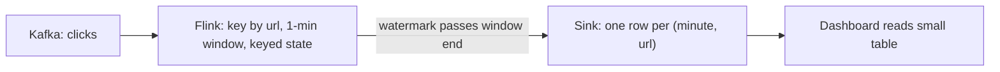

## 🎯 خلاصه

> **تجمیع بلادرنگ (real-time aggregation)** شمارش‌ها و جمع‌ها (به‌ازای دقیقه، صفحه، کاربر) را هم‌زمان با رسیدن رویدادها به‌روز نگه می‌دارد. دو شکل اصلی دارد: **محاسبه‌ی تجمیع داخل stream** (مثلاً window های Flink)، یا **ذخیره‌ی رویدادهای خام و تجمیع در زمان insert** (مثلاً materialized view در ClickHouse). انتخاب بین این‌ها به **محل نگه‌داری state**، **نحوه‌ی اصلاح داده‌ی دیررس**، و **انعطاف کوئری‌ها** بستگی دارد.

- یک **window** جریان بی‌پایان را به سطل‌های محدود تبدیل می‌کند (مثلاً یک سطل برای هر دقیقه).
- **pre-aggregation** برای هر سطل و کلید یک ردیف می‌نویسد، پس جدول سرویس کوچک می‌ماند.
- **خام + materialized view** همه‌ی رویدادها را نگه می‌دارد و database هنگام ورود آن‌ها را جمع می‌زند.
- هیچ‌کدام «بلادرنگ‌تر» نیستند. هر دو چند ثانیه تا چند دقیقه عقب‌اند. با توجه به نیاز به درستی و تعداد پرسش‌هایی که بعداً خواهی پرسید انتخاب کن.

## 🌱 از ساده شروع کنیم (مبتدی)

> **💡 تشبیه:** یک مغازه بازدیدکننده‌ها را می‌شمارد. یک فروشنده دفترچه دارد و هر بار کسی وارد می‌شود یک خط می‌زند؛ ساعت ۱۰:۰۱ می‌نویسد «۱۰:۰۰ — ۴۲ بازدید» و صفحه‌ی جدید را شروع می‌کند. این **pre-aggregation** است. مغازه‌ی دیگر دفتر ورود دارد، یک خط برای هر بازدید، و منشی‌ای که وقتی مدیر بخواهد آن را به تفکیک دقیقه جمع می‌زند. این **رویدادهای خام و تجمیع بعدی** است. گزینه‌ی سوم دفتری است که یک کمک‌فروشنده هر خط را بلافاصله در یک برگه‌ی خلاصه جمع می‌زند. این یک **materialized view** است.

فرض کن وب‌سایت برای هر کلیک یک رویداد می‌فرستد:

```text
{"user_id": "u42", "url": "/pricing", "event_time": "2026-10-12T10:00:07Z"}
{"user_id": "u17", "url": "/pricing", "event_time": "2026-10-12T10:00:31Z"}
{"user_id": "u42", "url": "/blog",    "event_time": "2026-10-12T10:01:02Z"}
```

محصول می‌خواهد: «برای هر URL در هر دقیقه چند بازدید، و به‌صورت زنده به‌روز.» خروجی دقیقه‌ی `10:00` این می‌شود:

| minute | url | views |
|---|---|---|
| 10:00 | /pricing | 2 |

قبل از هر ابزاری دو ایده لازم است:

1. **Window:** دقیقه‌ی `10:00` یک سطل است. هر رویداد به سطل `event_time` خودش تعلق دارد، نه زمانی که به سیستم رسیده.
2. **شکل نتیجه:** یک ردیف برای هر `(window, url)`. جواب یک جدول کوچک است که داشبورد سریع می‌خواند.

## 🔧 واقعاً چطور کار می‌کند (متوسط)

### گزینه‌ی A: pre-aggregation داخل stream (Flink)

یک job استریمی رویدادها را می‌خواند، بر اساس کلید و window گروه‌بندی می‌کند، شمارنده‌ی جاری را در **state** نگه می‌دارد (به [[state-store]] نگاه کن) و وقتی window بسته می‌شود یک نتیجه برایش می‌نویسد. در Flink SQL یک tumbling window یک‌دقیقه‌ای این شکل را دارد:

```sql
-- Source: events from Kafka. The WATERMARK defines how late an event may be.
CREATE TABLE clicks (
  user_id    STRING,
  url        STRING,
  event_time TIMESTAMP(3),
  WATERMARK FOR event_time AS event_time - INTERVAL '10' SECOND
) WITH (
  'connector' = 'kafka',
  'topic' = 'clicks',
  'properties.bootstrap.servers' = 'kafka:9092',
  'format' = 'json'
);

-- Sink: a table with the result columns (JDBC, Kafka or another store).
-- Its connector options are omitted here.
CREATE TABLE url_minute_counts (
  window_start TIMESTAMP(3),
  window_end   TIMESTAMP(3),
  url          STRING,
  views        BIGINT
) WITH ( /* sink connector options */ );

INSERT INTO url_minute_counts
SELECT window_start, window_end, url, COUNT(*) AS views
FROM TABLE(
  TUMBLE(TABLE clicks, DESCRIPTOR(event_time), INTERVAL '1' MINUTE))
GROUP BY window_start, window_end, url;
```



رفتار آن:

- نتیجه‌ی یک window وقتی منتشر می‌شود که **watermark** از پایان window گذشته باشد (به [[watermark]] نگاه کن). با تأخیر ۱۰ ثانیه‌ای، نتیجه‌ی window `10:00` حدود `10:01:10` نهایی می‌شود. این همان تأخیری است که باید اعلام کنی.
- state برای هر `(window, key)` باز یک شمارنده نگه می‌دارد. تعداد کلیدها ضربدر تعداد windowهای باز، حافظه را محدود می‌کند.
- sink نتایج **نهایی** هر window را می‌گیرد. مدیریت رویدادهای دیررس موضوع [[pattern-late-data]] است.

### گزینه‌ی B: ingestion خام + materialized view (ClickHouse)

هر رویداد را ذخیره کن و یک **materialized view** که هنگام insert اجرا می‌شود، جمع‌بندی را در جدول دوم بنویسد. ClickHouse این کار را با یک جدول مقصد از نوع `SummingMergeTree` انجام می‌دهد:

```sql
-- Raw events: every click is kept
CREATE TABLE clicks_raw (
  event_time DateTime,
  user_id    String,
  url        String
) ENGINE = MergeTree
ORDER BY (url, event_time);

-- Rollup: one row per (minute, url) per insert block; merged later
CREATE TABLE url_minute (
  minute DateTime,
  url    String,
  views  UInt64
) ENGINE = SummingMergeTree
ORDER BY (minute, url);

-- Runs on each insert into clicks_raw and writes into url_minute
CREATE MATERIALIZED VIEW url_minute_mv TO url_minute AS
SELECT toStartOfMinute(event_time) AS minute, url, count() AS views
FROM clicks_raw
GROUP BY minute, url;

-- Query: always aggregate again, because merges are eventual
SELECT minute, url, sum(views) AS views
FROM url_minute
WHERE minute >= now() - INTERVAL 1 HOUR
GROUP BY minute, url
ORDER BY minute DESC, views DESC
LIMIT 20;
```

نکات کلیدی:

- materialized view **با insert فعال می‌شود**: هر بلاک درج‌شده را جمع می‌زند، نه کل جدول. تا وقتی merge های پس‌زمینه آن‌ها را ترکیب کنند، می‌تواند چند ردیف جزئی برای هر `(minute, url)` وجود داشته باشد. به همین دلیل کوئری از `sum(views)` استفاده می‌کند.
- رویدادهای دیررس فقط با `event_time` قدیمی‌شان درج می‌شوند. ردیف rollup آن دقیقه‌ی قدیمی در merge بعدی به‌روز می‌شود. مفهوم watermark و «window بسته شده» وجود ندارد. این تفاوت بزرگ درستی است.
- برای **شمارش متمایز** (کاربران یکتا در هر دقیقه)، `SummingMergeTree` کافی نیست. از مقصد `AggregatingMergeTree` با `uniqState(user_id)` در view و `uniqMerge` در زمان کوئری استفاده کن. state را می‌توان بین بلاک‌ها ادغام کرد، پس rollup درست می‌ماند.

### انتخاب بین آن‌ها

| پرسش | pre-aggregation با Flink | خام + materialized view |
|---|---|---|
| کار کجا انجام می‌شود؟ | job استریمی، state در Flink | مسیر insert دیتابیس |
| تأخیر برای یک مقدار جدید | اندازه‌ی window + تأخیر watermark | بعد از insert و کوئری بعدی قابل‌دیدن است |
| رویدادهای دیررس | در محدوده‌ی allowed lateness، یا حذف / side output | در هر زمانی پذیرفته می‌شود؛ rollup در merge اصلاح می‌شود |
| سؤال‌های ad-hoc بعدی | محدود به آنچه تجمیع کرده‌ای | هر سؤالی روی رویدادهای خام |
| ذخیره‌سازی | فقط rollupها (کوچک) | رویدادهای خام (بزرگ) به‌علاوه‌ی rollupها |
| عملیات | checkpoint، اندازه‌ی state، ارتقای job | طراحی جدول، merge، اندازه‌ی بلاک insert |
| کاربرد معمول | هشدارها، سیگنال‌های fraud، متریک‌هایی که job مالکشان است | داشبوردها، تحلیل محصول، کاوش |

## 🧠 عمق و trade-offها (سنیور)

- **بر اساس آنچه باید درست باشد انتخاب کن.** اگر یک هشدار باید برای هر window با شمارش دقیق یک بار شلیک کند، یک job استریمی با watermark تعریف‌شده قراردادی روشن می‌دهد. اگر کسب‌وکار بپذیرد که «عدد تا چند ساعت می‌تواند تغییر کند»، خام + rollup ساده‌تر و بخشنده‌تر است.
- **state کلیددار و skew.** در Flink همه‌ی رویدادهای یک کلید به یک task می‌روند. یک URL ویروسی یا کاربر ربات یک [[hot-key]] است. تجمیع را دو مرحله‌ای انجام بده (شمارش جزئی محلی، بعد جمع سراسری) یا کلید را salt کن. همین skew در ClickHouse هم رخ می‌دهد وقتی یک `(minute, url)` بیشتر insertها را بگیرد.
- **اندازه‌ی state.** windowهای باز را بشمار: با tumbling window یک‌دقیقه‌ای و allowed delay یک ساعته، حدود ۶۰ window برای هر کلید باز می‌ماند. این را در تعداد کلیدها (مثلاً ۱۰ میلیون URL) و بایت‌های هر accumulator ضرب کن. پیش از انتخاب طراحی این محاسبه را انجام بده. اگر state جا نشود، window کوتاه‌تر، کلید کمتر، یا مسیر خام.
- **Exactly-once.** checkpointهای Flink به‌روزرسانی state را داخل job exactly-once می‌کنند. تضمین end-to-end به sink هم بستگی دارد. sink از نوع upsert با کلید `(window_start, url)` replay را idempotent می‌کند. sink از نوع append بدون dedupe بعد از restart می‌تواند شمارش را دو برابر کند. به [[pattern-exactly-once]] نگاه کن.
- **batch کردن insert در ClickHouse.** insertهای خیلی ریز تعداد زیادی part کوچک می‌سازند و merge را کند می‌کنند. insertها را دسته‌ای کن (هزاران ردیف در هر insert) یا از تنظیمات insert ناهمگام استفاده کن، و پیش از تکیه بر رفتار خاص، مستندات نسخه‌ی خودت را چک کن.
- **مانیتورینگ.** برای stream: lag مصرف‌کننده، مدت checkpoint، backpressure، و lag watermark (زمان فعلی منهای watermark). برای ClickHouse: نرخ insert، تعداد part در هر partition، صف merge. برای هر دو: **سن جدیدترین ردیف** روی داشبورد، که عددی است که مردم واقعاً حس می‌کنند.
- **سرویس‌دهی.** داشبوردی که هر ثانیه روی رویدادهای خام poll می‌کند مقیاس نمی‌شود. جدول rollup یا یک موتور [[realtime-olap]] کوئری‌ها را سرویس می‌دهد؛ جدول خام برای بررسی‌ها.
- **کی استفاده نکنیم.** اگر سؤال روزی یک بار جواب داده می‌شود، rollup دسته‌ای ارزان‌تر و قابل‌فهم‌تر است (به [[pattern-batch-etl]] نگاه کن). اگر یک state machine برای هر کاربر با منطق کسب‌وکار لازم است، آن یک اپلیکیشن استریمی است، نه تجمیع.
- **گزینه‌ی Lambda.** تیم‌ها اغلب هر دو را اجرا می‌کنند: stream عدد موقت می‌دهد و batch شبانه عدد نهایی. به [[pattern-lambda-kappa]] و [[pattern-reconciliation]] نگاه کن.

## 🧪 امتحان کن

از رویدادهای کلیک این درس استفاده کن.

1. **حساب window.** با tumbling window یک‌دقیقه‌ای و تأخیر watermark ده‌ثانیه‌ای، اگر رویداد دیررسی نباشد، window ساعت `10:03` در چه زمان دیواری منتشر می‌شود؟ جواب را در یک جمله توضیح بده.
2. **کاربران متمایز در ClickHouse.** materialized view و جدول مقصدی بنویس که `user_id` متمایز را برای هر `(minute, url)` می‌شمارد. راهنمایی: از `AggregatingMergeTree`، `uniqState` در view و `uniqMerge` در کوئری استفاده کن.
3. **انتخاب.** یک تیم برای داشبورد به top-10 URL در هر ساعت نیاز دارد، و یک هشدار وقتی هر URL در یک دقیقه از ۱۰٬۰۰۰ بازدید بیشتر شد. رویدادهای خام ۹۰ روز برای بررسی نگه داشته می‌شوند. برای هر نیاز طراحی انتخاب کن و در دو جمله دلیل بیاور.

<details><summary>راه‌حل‌ها را نشان بده</summary>

**۱.** window ساعت `10:03` بازه‌ی `10:03:00` تا `10:04:00` را پوشش می‌دهد. watermark باید از `10:04:00` بگذرد، و با تأخیر ۱۰ ثانیه یعنی رویدادی با زمان حداقل `10:04:10` باید دیده شده باشد. بدون رویداد دیررس، window تقریباً وقتی منتشر می‌شود که استریم به زمان رویداد `10:04:10` برسد، یعنی حدود ۱۰ ثانیه بعد از پایان window در زمان رویداد.

**۲.**
```sql
CREATE TABLE url_minute_uniq (
  minute   DateTime,
  url      String,
  users    AggregateFunction(uniq, String)
) ENGINE = AggregatingMergeTree
ORDER BY (minute, url);

CREATE MATERIALIZED VIEW url_minute_uniq_mv TO url_minute_uniq AS
SELECT toStartOfMinute(event_time) AS minute,
       url,
       uniqState(user_id) AS users
FROM clicks_raw
GROUP BY minute, url;

SELECT minute, url, uniqMerge(users) AS unique_users
FROM url_minute_uniq
GROUP BY minute, url;
```
اگر `count(DISTINCT ...)` را روی جدول rollup اجرا کنی اشتباه است، چون نمی‌توان شمارش‌های متمایز دو بلاک را جمع زد. شیء state قابل ادغام است.

**۳.** top-10 ساعتی یک کوئری روی rollup است: از جدول `url_minute` در ClickHouse استفاده کن و دقیقه‌ها را در هر ساعت جمع بزن، یا یک rollup ساعتی بساز. هشدار ۱۰٬۰۰۰ بازدید در دقیقه یک آستانه‌ی روی خروجی stream است (Flink با window یک‌دقیقه‌ای، و هشدار روی یک topic نوشته می‌شود)، چون باید سریع شلیک کند و قاعده‌ی ثابتی است. جدول خام ۹۰ روزه بررسی‌هایی را پوشش می‌دهد که rollupها نمی‌توانند پاسخ دهند.

</details>

## 💬 گوشه‌ی مصاحبه

**سؤال: «یک داشبورد زنده طراحی کن که بازدید صفحه در هر دقیقه را نشان دهد.»**

جواب متوسط: «رویدادها را در Kafka می‌گذارم، با یک tumbling window در Flink هر دقیقه را می‌شمارم و نتایج را در دیتابیسی می‌نویسم که داشبورد می‌خواند.»

جواب سنیور: «بستگی دارد به نیاز درستی. یک window در Flink برای هر دقیقه بعد از عبور watermark یک ردیف نهایی می‌دهد، پس تأخیر برابر است با اندازه‌ی window به‌علاوه‌ی تأخیر watermark، و state محدود است به تعداد windowهای باز ضربدر تعداد کلیدها. اگر تحلیلگرها سؤال‌های جدید هم بپرسند، رویدادهای خام را در ClickHouse نگه می‌دارم و rollup دقیقه‌ای را با materialized view نگه می‌دارم، با این پذیرش که rollup در نهایت merge می‌شود. مهم‌ترین SLO را سن جدیدترین ردیف می‌دانم.»

**سؤال: «چرا همه‌چیز را با materialized view انجام ندهیم؟»** چون view مفهومی از «بسته شدن window» ندارد. لحظه‌ی مشخصی وجود ندارد که عدد نهایی شود، و رویدادهای دیررس همیشه ردیف‌های قدیمی را تغییر می‌دهند. برای تحلیل خوب است و برای هشداری که باید یک بار شلیک کند اشتباه.

> **🎤 این را در مصاحبه بگو:** «من تأخیر یک عدد را از درستی‌اش جدا می‌کنم. window استریمی عددی می‌دهد که در زمان مشخصی نهایی است. انبار خام با rollup عددی می‌دهد که الان تازه است و بعداً اصلاح می‌شود. بر اساس این‌که مصرف‌کننده به نهایی‌بودن نیاز دارد یا به انعطاف، انتخاب می‌کنم.»

## ⚠️ اشتباهات رایج

> **⚠️ توجه:** استفاده از processing time (زمانی که رویداد رسیده) برای window. تأخیر شبکه رویدادها را به دقیقه‌ی اشتباه می‌برد. از event time همراه با watermark استفاده کن.

> **⚠️ توجه:** خواندن جدول `SummingMergeTree` در ClickHouse بدون `sum()` و `GROUP BY`. تا اجرای merge، چند ردیف جزئی برای یک کلید می‌بینی.

- اسم‌گذاری rollup به «بلادرنگ» بدون اعلام تأخیرش. تازگی را اعلام و اندازه‌گیری کن.
- استفاده از `count(DISTINCT)` روی جدول از قبل تجمیع‌شده. شمارش متمایز state قابل ادغام یا داده‌ی خام می‌خواهد.
- فراموش‌کردن رشد state در Flink: window با allowed delay طولانی و کلید با cardinality بالا حافظه‌ی زیادی مصرف می‌کند.
- insertهای خیلی ریز در ClickHouse که تعداد زیادی part می‌سازند.
- sink فقط‌append بدون dedupe و سپس restart کردن job. replay شمارش‌ها را دو برابر می‌کند.
- ساختن داشبورد ثانیه‌ای مستقیم روی جدول رویدادهای خام.

## ✅ خودت را بسنج (quiz)

1. در یک tumbling window یک‌دقیقه‌ای با تأخیر watermark ده‌ثانیه‌ای در Flink، نتیجه‌ی `10:00` کی نهایی است (با فرض نبود داده‌ی دیررس)؟
   - A) در `10:00:00`، وقتی window شروع می‌شود
   - B) در `10:01:00`، دقیقاً وقتی window تمام می‌شود
   - C) حدود `10:01:10`، وقتی watermark از پایان window گذشته است
   - D) در `10:10:00`

<details><summary>جواب</summary>

**C** — window وقتی منتشر می‌شود که watermark از پایانش بگذرد. با اجازه‌ی ۱۰ ثانیه‌ای بی‌نظمی، watermark به `10:01:00` می‌رسد فقط بعد از این‌که رویدادهایی با زمان `10:01:10` دیده شده باشند.

</details>

2. چرا کوئری ClickHouse روی یک rollup از نوع `SummingMergeTree` به `sum(views)` نیاز دارد، با این‌که view از قبل تجمیع کرده است؟

   - A) `SummingMergeTree` عدد ذخیره نمی‌کند
   - B) insertها برای هر کلید ردیف‌های جزئی می‌سازند و merge ها دیرهنگام انجام می‌شوند؛ کوئری باید آن‌ها را ترکیب کند
   - C) `sum` از خواندن یک ستون سریع‌تر است
   - D) materialized view جدول خام را حذف می‌کند

<details><summary>جواب</summary>

**B** — هر بلاک insert ردیف‌های جزئی خودش را می‌سازد و merge های پس‌زمینه بعداً آن‌ها را ترکیب می‌کنند. تا آن زمان، همان `(minute, url)` چند بار ظاهر می‌شود، پس کوئری باید دوباره تجمیع کند.

</details>

3. تیمی می‌خواهد شمارش دقیق کاربران یکتا در هر دقیقه را با materialized view داشته باشد. کدام طراحی درست است؟

   - A) `SummingMergeTree` با `count(DISTINCT user_id)` در view
   - B) `AggregatingMergeTree` که `uniqState(user_id)` را ذخیره می‌کند و با `uniqMerge` در زمان کوئری ادغام می‌شود
   - C) یک `MergeTree` ساده با `count(DISTINCT)` در هر کوئری داشبورد، فقط روی جدول خام
   - D) میانگین شمارش‌های متمایز هر بلاک

<details><summary>جواب</summary>

**B** — شمارش‌های متمایز را نمی‌شود بین بلاک‌ها جمع زد، پس state باید ذخیره و ادغام شود. گزینه‌ی C از نظر نتیجه درست است، اما با هر تازه‌سازی داشبورد همه‌ی ردیف‌های خام را می‌خواند، و rollup قرار است همین را نگه ندارد.

</details>

4. **(سنیور)** یک URL ویروسی ۸۰ درصد کل کلیک‌ها را می‌گیرد. job Flink تو بر اساس URL گروه‌بندی می‌کند. چه علامتی انتظار داری و چه چیزی را تغییر می‌دهی؟

   - A) اندازه‌ی window باید کوچک‌تر شود
   - B) یک task کلید داغ را نگه می‌دارد و عقب می‌افتد و lag و backpressure ایجاد می‌کند؛ کلید را با تجمیع دو مرحله‌ای (شمارش جزئی به‌ازای salt تصادفی، سپس جمع نهایی) تقسیم کن
   - C) Flink از `COUNT` پشتیبانی نمی‌کند
   - D) watermark delay را به یک ساعت افزایش بده

<details><summary>جواب</summary>

**B** — همه‌ی رویدادهای یک کلید به یک task موازی می‌روند، پس آن task گلوگاه می‌شود. تجمیع دو مرحله‌ای کار جزئی را پخش می‌کند و نتایج کوچک را جمع می‌زند.

</details>

5. **(سنیور)** بعد از یک deploy، داشبورد اعداد دیروز را نشان می‌دهد، با این‌که stream سالم به نظر می‌رسد. اول چه چیزی را چک می‌کنی؟

   - A) رنگ نمودارها
   - B) checkpoint و sink: آیا job از یک checkpoint قدیمی restore شده یا sink نوشتن را متوقف کرده، و سن جدیدترین ردیف
   - C) نام topic در Kafka
   - D) تعداد کاربران داشبورد

<details><summary>جواب</summary>

**B** — stream سالم اما خروجی قدیمی معمولاً یعنی sink خراب یا گیرکرده، یا restore از state قدیمی است. سن جدیدترین ردیف را اندازه بگیر و تاریخچه‌ی checkpoint job و خطاهای sink را بررسی کن.

</details>

## 🗂️ فلش‌کارت

| Front | Back |
|---|---|
| tumbling window چیست؟ | بازه‌های زمانی ثابت و غیرهم‌پوشان (مثلاً یک دقیقه) |
| نتیجه‌ی یک window در job استریمی کی نهایی است؟ | وقتی watermark از پایان window بگذرد |
| pre-aggregation در برابر خام + materialized view | stream در state rollup می‌سازد؛ database هنگام insert جمع می‌زند و رویدادهای خام را نگه می‌دارد |
| چرا `sum(views)` روی rollup از نوع SummingMergeTree؟ | ردیف‌های جزئی برای هر کلید تا merge پس‌زمینه وجود دارند |
| شمارش مقدار متمایز در rollup چطور؟ | state قابل ادغام ذخیره کن (`uniqState`) و ادغام کن (`uniqMerge`) |
| علت کندی یک task در Flink روی کلید ویروسی | کلید داغ همه‌ی رویدادهایش را به یک task موازی می‌فرستد |
| بهترین متریک برای «داشبورد تازه است؟» | سن جدیدترین ردیف، نه uptime job |
| داده‌ی دیررس در materialized view با کیست؟ | صریحاً هیچ‌کس؛ ردیف دیررس درج می‌شود و rollup در merge اصلاح می‌شود |

## 🔗 ادامه

- [[pattern-late-data]] watermark، allowed lateness و اصلاح نتایج را پوشش می‌دهد که سخت‌ترین بخش گزینه‌ی A است.
- [[pattern-hot-keys]] تکنیک کلی برای کلیدهای skew‌شده را نشان می‌دهد، از جمله تجمیع دو مرحله‌ای.
- [[realtime-olap]] و [[clickhouse]] توضیح می‌دهند چطور یک store ستونی OLAP داشبوردها را در مقیاس سرویس می‌دهد.
- [[flink]] و [[spark-structured-streaming]] دو موتور stream هستند که برای گزینه‌ی A توضیح داده شده‌اند.
- [[pattern-lambda-kappa]] توضیح می‌دهد چه زمانی یک لایه‌ی stream و یک لایه‌ی batch کنار هم اجرا شوند.
- نحو window و watermark را در مستندات Flink SQL برای نسخه‌ی خودت، و مستندات موتور ClickHouse را برای `SummingMergeTree` و `AggregatingMergeTree` چک کن.
