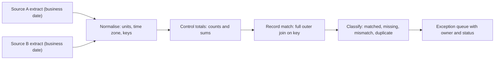

## 🎯 خلاصه

> **Reconciliation (تطبیق)** دو سیستمی را که باید درباره‌ی یک واقعیت کسب‌وکاری هم‌نظر باشند مقایسه می‌کند (مثلاً سوئیچ پرداخت و دفتر کل، یا CDRهای شبکه و سیستم صورتحساب)، آنچه تطبیق می‌دهد، آنچه فقط در یک طرف است و آنچه فرق دارد را پیدا می‌کند، و هر اختلاف را به یک **exception** قابل پیگیری تبدیل می‌کند.

- در **grain** درست تطبیق بده (یک تراکنش، یک رکورد تماس، یک ساعت برای هر سوئیچ) و اول **تعداد و جمع‌ها** را مقایسه کن، بعد رکوردهای تک‌تک.
- قبل از نوشتن هر SQL، **کلید تطبیق**، قواعد **نرمال‌سازی** (واحد پول، منطقه‌ی زمانی، گرد کردن) و **tolerance** را مشخص کن.
- خروجی تطبیق گزارش تمام‌کننده نیست. خروجی یک **workflow برای exception** است: هر اختلاف باز صاحب دارد، و قواعد cut-off می‌گویند کی یک آیتم گم‌شده مشکل واقعی است و کی فقط دیر رسیده.

## 🌱 از ساده شروع کنیم (مبتدی)

> **💡 تشبیه:** دو مغازه‌دار هر کدام دفترچه‌ای از فروش روز دارند. موقع تعطیل کردن دفترچه‌ها را با هم مقایسه می‌کنند. فروشی که فقط در یک دفترچه است بررسی می‌شود. فروشی که در هر دو هست ولی جمعش فرق دارد بررسی می‌شود. فروش‌هایی که جور درآمدند تیک می‌خورند. هیچ‌کدام دفترچه‌ی دیگری را عوض نمی‌کند؛ فقط اختلاف‌ها را ثبت می‌کنند و علتش را رفع می‌کنند.

به زبان داده:

- **سیستم A** یک نگاه به حقیقت است (سوئیچ پرداخت هر تراکنش را ثبت می‌کند).
- **سیستم B** نگاه دیگری است (دفتر کل ثبت می‌کند چه چیزی به حساب‌ها اعمال شده).
- **Reconciliation** پاسخ می‌دهد: برای یک روز، کدام تراکنش‌ها جور هستند، کدام فقط در A هستند، کدام فقط در B هستند، و مبلغ‌ها کجا با هم فرق دارند؟

یک مثال کوچک برای یک روز:

```text
txn_id   switch   ledger   note
T-001    500      500      matched
T-002    200      -        missing in ledger (ثبت ناموفق شد؟)
T-003    -        700      missing in switch (ثبت یتیم؟)
T-004    900      450      amount mismatch (ثبت ناقص؟)
```

چهار نتیجه، چهار بررسی متفاوت. Reconciliation یعنی این‌ها را نام‌گذاری کنی و مطمئن شوی که کسی به هر کدام نگاه می‌کند.

## 🔧 واقعاً چطور کار می‌کند (متوسط)

یک job تطبیق پنج مرحله دارد:



1. **استخراج** هر دو طرف برای یک **تاریخ کسب‌وکار** با همان قاعده‌ی cut-off. «همان تاریخ» باید در هر دو سیستم یک معنا داشته باشد: زمان تراکنش در یکی و تاریخ ثبت در دیگری ممکن است نگاشت لازم داشته باشد.
2. **نرمال‌سازی.** مبلغ‌ها را به یک واحد ببر (اینجا ریال، به‌صورت عدد صحیح، هرگز float)، زمان‌ها را به یک منطقه‌ی زمانی ببر، شناسه‌ها را تمیز کن و وضعیت‌ها را قابل مقایسه کن.
3. **اول جمع‌های کنترلی.** تعداد ردیف‌ها و جمع‌ها را برای هر گروه (هر سوئیچ، هر ساعت، هر محصول) مقایسه کن. اگر جور بودند، برای آن گروه کار تمام است و یک join کامل ذخیره می‌شود.
4. **تطبیق رکوردی** فقط برای گروه‌هایی که جمعشان فرق دارد. یک full outer join روی کلید تطبیق هر رکورد را دسته‌بندی می‌کند.
5. **دسته‌بندی و ارجاع.** هر نتیجه یک ردیف exception می‌شود با نوع، مبلغ، سن و صاحب.

جمع‌های کنترلی و query رکوردی:

```sql
-- مرحله‌ی 3: جمع‌های کنترلی هر طرف، برای یک تاریخ کسب‌وکار
SELECT 'switch' AS source, COUNT(*) AS n, SUM(amount_rial) AS total_rial
FROM switch_txn
WHERE business_date = DATE '2026-10-12' AND status = 'SUCCESS'
UNION ALL
SELECT 'ledger', COUNT(*), SUM(amount_rial)
FROM ledger_entry
WHERE business_date = DATE '2026-10-12';

-- مرحله‌ی 4 و 5: فقط exceptionهای رکوردی
WITH sw AS (
  SELECT txn_id, amount_rial
  FROM switch_txn
  WHERE business_date = DATE '2026-10-12' AND status = 'SUCCESS'
),
lg AS (
  SELECT txn_id, SUM(amount_rial) AS amount_rial, COUNT(*) AS n
  FROM ledger_entry
  WHERE business_date = DATE '2026-10-12'
  GROUP BY txn_id
)
SELECT COALESCE(sw.txn_id, lg.txn_id) AS txn_id,
       CASE
         WHEN lg.txn_id IS NULL THEN 'missing_in_ledger'
         WHEN sw.txn_id IS NULL THEN 'missing_in_switch'
         WHEN lg.n > 1         THEN 'duplicate_in_ledger'
         WHEN sw.amount_rial <> lg.amount_rial THEN 'amount_mismatch'
       END AS recon_status
FROM sw
FULL OUTER JOIN lg ON sw.txn_id = lg.txn_id
WHERE lg.txn_id IS NULL OR sw.txn_id IS NULL
   OR lg.n > 1 OR sw.amount_rial <> lg.amount_rial;
```

سه تصمیم در این query هست. سمت switch فقط روی `SUCCESS` فیلتر شده، چون انتظار نداریم تلاش‌های ناموفق در دفتر کل باشند. سمت ledger اول گروه‌بندی شده، پس یک ثبت تکراری شناسایی می‌شود و بی‌صدا در یک «تطابق» جمع زده نمی‌شود. و `WHERE` فقط exceptionها را نگه می‌دارد، پس خروجی آن‌قدر کوچک است که آدم‌ها بتوانند کار کنند.

**نسخه‌ی مخابراتی.** تراکنش‌ها را با CDR عوض کن. تعداد رکوردهای تماس و مجموع ثانیه‌های قابل‌صورتحساب را برای هر سوئیچ و هر ساعت، بین خروجی mediation و ورودی billing تطبیق بده. اختلاف تعداد معمولاً یعنی یک فایل گم شده ([[file-ingestion]] را ببین). اختلاف مجموع با تعداد برابر معمولاً یعنی تفاوت در rating یا گرد کردن. این دو مالک متفاوت دارند.

**Tolerance.** بعضی اختلاف‌ها انتظار می‌روند: cut-off نیمه‌شب، اختلاف زمانی، یا قاعده‌ی گرد کردن. tolerance را برای هر کنترل، مکتوب تعریف کن. برای پول صفر، برای برآورد یک درصد کوچک، و هرگز برای عدد صورتحساب «تقریباً درست» بی‌صدا.

## 🧠 عمق و trade-offها (سنیور)

**استقلال.** تطبیق وقتی مفید است که دو طرف از دو مسیر تولید شوند. اگر «دفتر کل» را همان job بسازد که جدول «switch» را ساخته، هر دو می‌توانند به یک شکل غلط باشند و چک رد نمی‌شود. منبع دوم را مستقل نگه دار، و اگر نشد، این را در گزارش صریح بنویس.

**Cut-off و داده‌ی دیررسیده.** پول دیر جابه‌جا می‌شود. تسویه‌ی یک کارت ممکن است یک روز بعد از مجوز برسد. قاعده را از اول مشخص کن: تطبیق بر اساس **تاریخ کسب‌وکار** با یک ساعت cut-off، و یک پنجره‌ی باز (مثلاً T+2) که در آن آیتم گم‌شده «در انتظار» است، نه «exception». این همان مسئله‌ی watermark در [[pattern-late-data]] است، ولی هزینه‌اش مالی است، پس سیاست باید صریح باشد و کسب‌وکار آن را بررسی کند.

**اثرهای exactly-once مهم‌اند.** تکراری بودن در هر طرف رایج‌ترین علت exceptionهای نادرست است. اول روی کلید کسب‌وکار dedup کن ([[pattern-dedup]] را ببین)، و خود تولید exception را idempotent کن: اجرای دوباره‌ی job برای یک تاریخ باید همان مجموعه‌ی exception را بدهد، نه اینکه آن را دو برابر کند. از upsert با کلید `(business_date, txn_id, recon_status)` استفاده کن.

**پول به‌صورت عدد صحیح.** ریال یا کوچک‌ترین واحد را به‌صورت عدد صحیح یا fixed-point ذخیره کن. جمع `DOUBLE` روی میلیون‌ها ردیف اختلاف‌های ریزی می‌دهد که مثل mismatch به نظر می‌رسند و اختلاف‌های واقعی را زیر خود دفن می‌کنند. از `DECIMAL` با scale مشخص یا واحد کوچک‌ترِ صحیح استفاده کن.

**Grain و کارایی.** full outer join روی ده‌ها میلیون ردیف گران است. جمع‌های کنترلی به‌ازای هر partition اغلب داده‌ی زیادی را حذف می‌کنند. هر دو طرف را با تاریخ کسب‌وکار partition کن (و در صورت بزرگ بودن join، با هش کلید)، تا join partition-wise شود؛ [[shuffle]] را ببین.

**workflow مربوط به exception.** یک exception مثل یک پرونده‌ی کوچک است: نوع، مبلغ، زمان اولین دیدن، سن، صاحب، وضعیت (باز، در حال بررسی، حل‌شده، سوخت‌شده‌ی بدهی) و شواهد (دو رکورد). تعداد باز و توزیع سن را اندازه بگیر. یک انباشت بزرگ از exceptionهای قدیمی یک خرابی کنترل است، حتی اگر درصد تطبیق خوب به نظر برسد.

**قابلیت ممیزی.** خروجی تطبیق و جمع‌های کنترلی را برای مدت نگهداری قانونی نگه دار. سؤال حسابرس این است: «نشان بده روی این روز چه چیزی را چک کردی و نتیجه چه بود»، نه «SQL‌ات را نشان بده».

**کِی رکورد به رکورد تطبیق نده.** در حجم خیلی بالا با فرایند پایدار، جمع‌های کنترلی و نمونه‌برداری (به‌علاوه‌ی بررسی کامل برای هر گروهی که جمعش فرق دارد) تقریباً همه‌چیز را با هزینه‌ی کمتر می‌گیرند.

**چه چیزهایی را پایش کنی:** نرخ تطبیق برای هر کنترل، تعداد و ارزش exceptionهای باز، سن قدیمی‌ترین exception باز، تعداد روزهایی که جمع‌ها جور نبودند، و تازگی job نسبت به cut-off.

> **🎤 این را در مصاحبه بگو:** «من لایه‌ای تطبیق می‌دهم: اول جمع‌های کنترلی به‌ازای تاریخ کسب‌وکار و گروه، و بعد فقط برای گروه‌هایی که فرق دارند یک full outer join رکوردی. کلید، نرمال‌سازی و tolerance را از اول مشخص می‌کنم، پول را عدد صحیح نگه می‌دارم، و هر اختلاف را یک exception با صاحب و سن می‌دانم. job باید idempotent باشد و منبع دوم باید مستقل باشد، وگرنه چک چیزی را ثابت نمی‌کند.»

## 🧪 امتحان کن

1. با داشتن switch و ledger برای یک روز، classification query برای این حالت بنویس: «در هر دو هست، ولی ledger برای همان تراکنش یک ثبت دوم دارد».
2. تطبیق CDR تعداد برابر ولی ۰٫۳٪ اختلاف در ثانیه‌های قابل‌صورتحساب نشان می‌دهد. سه علت محتمل را فهرست کن و بگو چطور هرکدام را تست می‌کنی.
3. چرا `SUM` روی ستون `DOUBLE` برای پول خطرناک است و به‌جایش چه چیزی استفاده می‌کنی؟

<details><summary>راه‌حل‌ها را نشان بده</summary>

**1.** ledger را بر اساس `txn_id` گروه‌بندی کن و تعداد ردیف‌ها را بشمار، بعد گروه‌هایی با `COUNT(*) > 1` را نگه دار و به switch روی `txn_id` join کن. شاخه‌ی `lg.n > 1` در query بالا دقیقاً همین کار را می‌کند، و با فیلتر کردن روی همان شرط می‌شود تکراری‌ها را دید.

**2.** علت‌های محتمل: گرد کردن در مرحله‌ی rating (گرد کردن هر تماس به بالا در برابر هر نشست)، اختلاف منطقه‌ی زمانی یا cut-off که چند تماس را از مرز نیمه‌شب رد می‌کند، و یک رکورد تکراری یا گم‌شده که با یک تعداد برابر در جای دیگر جبران شده. هرکدام را با مقایسه‌ی مجموع ثانیه‌ها در سطح تماس، بررسی bucketهای ساعتی در cut-off، و بررسی تکراری‌ها روی شناسه‌ی تماس تست کن.

**3.** جمع اعداد ممیز شناور associative نیست و ترتیب ردیف‌ها در جمع توزیع‌شده نتیجه را کمی عوض می‌کند. این اختلاف‌های ریز مثل mismatch دیده می‌شوند. از `DECIMAL(p, s)` با scale مشخص استفاده کن، یا واحد کوچک‌ترین صحیح ذخیره کن.

</details>

## 💬 گوشه‌ی مصاحبه

**سؤال: «switch پرداخت را چطور با دفتر کل تطبیق می‌دهی؟»**

- **جواب متوسط:** «دو جدول را روی شناسه‌ی تراکنش join می‌کنم و ردیف‌هایی که جور نیستند را لیست می‌کنم.»
- **جواب سنیور:** «اول جمع‌های کنترلی را به‌ازای تاریخ کسب‌وکار و سوئیچ مقایسه می‌کنم، و فقط روی گروه‌های مختلف یک full outer join رکوردی می‌زنم. قبلش واحد و منطقه‌ی زمانی را نرمال می‌کنم و پول را عدد صحیح نگه می‌دارم. خروجی یک جدول exception با نوع، سن و صاحب است و job idempotent است. یک پنجره‌ی T+2 هم تعریف می‌کنم، چون تسویه‌ها دیر می‌رسند، و مطمئن می‌شوم دفتر کل از feed سوئیچ مستقل ساخته شده.»

**سؤال تکمیلی:** «با یک آیتم گم‌شده‌ی سه روزه چه می‌کنی؟» جواب: این دیگر exception در حال انتظار نیست، بلکه exception تشدید‌شده است، و workflow مشخص می‌کند چه کسی بررسی می‌کند، چه شواهدی لازم است و کی با تأیید سوخت‌شده‌ی بدهی ثبت می‌شود.

## ⚠️ اشتباهات رایج

> **⚠️ توجه:** تطبیقی که دو طرفش از یک pipeline می‌آیند چیزی را ثابت نمی‌کند. دو نسخه از یک باگ همیشه با هم جور درمی‌آیند.

> **⚠️ توجه:** مقایسه‌ی پول با `DOUBLE` یا join روی مقادیر گردشده، اختلاف‌های واقعی را پنهان و اختلاف‌های ساختگی ایجاد می‌کند.

- join روی کلیدی که یکتا نیست، و در نتیجه join یک‌به‌چند ردیف‌ها را ضرب می‌کند و جمع‌ها را غلط نشان می‌دهد.
- جمع زدن قبل از dedup، که باعث می‌شود یک ثبت تکراری دو بار شمرده شود و بعد دستی «درست» شود.
- نادیده گرفتن cut-off: تراکنشی که در یک سیستم ۲۳:۵۹:۵۹ و در دیگری ۰۰:۰۰:۰۱ ثبت شده، mismatch نیست، بلکه یک قاعده‌ی زمان‌بندی است.
- نوشتن exceptionها بدون صاحب یا سن، که باعث می‌شود انباشت بی‌صدا بزرگ شود.
- پذیرفتن یک درصد اختلاف کوچک بدون tolerance مکتوب.
- اجرای دوباره‌ی job و گرفتن مجموعه‌ی exception متفاوت، چون خروجی idempotent نیست.

## ✅ خودت را بسنج

1. یک تراکنش در لاگ سوئیچ هست ولی در دفتر کل نیست. کدام دسته‌بندی درست است؟
   - A) `missing_in_switch`
   - B) `missing_in_ledger`
   - C) `amount_mismatch`
   - D) `duplicate_in_ledger`

<details><summary>جواب</summary>

**B** — رکورد فقط در سمت switch است، پس در ledger گم شده. تا وقتی پنجره‌ی cut-off نگذشته، آن را خطا فرض نکن.

</details>

2. چرا جمع‌های کنترلی (تعداد و مجموع به‌ازای هر گروه) قبل از join رکوردی بررسی می‌شوند؟

   - A) join روی ستون‌های پولی مجاز نیست
   - B) ارزان‌اند، و گروه‌های جورشده را می‌شود کنار گذاشت، پس join گران فقط جایی اجرا می‌شود که جمع‌ها فرق دارند
   - C) جمع‌های کنترلی جای جدول exception را می‌گیرند
   - D) مقررات join رکوردی برای هر ردیف را الزامی کرده

<details><summary>جواب</summary>

**B** — جمع‌ها فیلتر اولیه‌ی ارزان‌اند. join کامل فقط برای گروه‌هایی لازم است که با هم نمی‌خوانند.

</details>

3. **(سنیور)** یک تطبیق هر روز همان ۰٫۰۰۱٪ اختلاف را نشان می‌دهد، همیشه در یک جهت. اول به چه چیزی شک می‌کنی؟

   - A) افت تصادفی شبکه
   - B) یک علت سیستماتیک مثل گرد کردن، قاعده‌ی cut-off، یا کارمزدی که یک طرف اعمال می‌کند و طرف دیگر نه
   - C) اینکه job اشتباه است و باید حذف شود
   - D) اینکه tolerance آن‌قدر زیاد شود تا اختلاف ناپدید شود

<details><summary>جواب</summary>

**B** — جهت ثابت نشان‌دهنده‌ی تفاوت در قاعده است، نه تصادف. علتش را پیدا کن، رفعش کن یا مستندش کن، و بعد tolerance تعیین کن.

</details>

4. **(سنیور)** چرا تولید exception باید idempotent باشد؟

   - A) تا job سریع‌تر اجرا شود
   - B) تا اجرای دوباره برای یک تاریخ همان exceptionها را بدهد، نه تکراری یا پرونده‌هایی که اپراتورها قبلاً روی‌شان کار کرده‌اند را از دست بدهد
   - C) تا بشود switch را دو بار تطبیق داد
   - D) چون Spark نمی‌تواند دو بار بنویسد

<details><summary>جواب</summary>

**B** — اپراتورها روی شناسه‌ی exception کار می‌کنند. job غیرidempotent پرونده‌ی تکراری می‌سازد یا وضعیتشان را بازنویسی می‌کند، و این workflow و مسیر ممیزی را خراب می‌کند.

</details>

5. **(سنیور)** چرا برای تسویه‌ی کارت از پنجره‌ی T+2 استفاده می‌شود؟

   - A) تسویه‌ها همیشه دقیقاً دو روز طول می‌کشند
   - B) تأخیر در تسویه عادی است، پس آیتم گم‌شده داخل پنجره «در انتظار» است، نه exception؛ پنجره یک قاعده‌ی کسب‌وکار است که صریحاً توافق شده
   - C) پایگاه داده نمی‌تواند بیش از دو روز داده را ذخیره کند
   - D) T+2 نیاز به cut-off را برمی‌دارد

<details><summary>جواب</summary>

**B** — پنجره، تأخیر عادی را از مشکل واقعی جدا می‌کند. طول آن یک تصمیم کسب‌وکار و مقرراتی است و باید مستند و بازبینی شود.

</details>

## 🗂️ فلش‌کارت

| جلو | پشت |
|---|---|
| Reconciliation | مقایسه‌ی دو سیستمی که باید درباره‌ی یک واقعیت کسب‌وکاری هم‌نظر باشند، و پیگیری هر اختلاف |
| جمع‌های کنترلی | تعداد و مجموع به‌ازای هر گروه؛ اولین چک ارزان که گروه‌های جورشده را کنار می‌گذارد |
| چهار نتیجه | جور، گم‌شده در یک طرف، تکراری، اختلاف مبلغ |
| چرا full outer join | رکوردهایی را نشان می‌دهد که فقط در یک طرف هستند |
| چرا پول DOUBLE نیست | جمع اعداد شناور drift دارد؛ از DECIMAL یا واحد کوچک‌ترین صحیح استفاده کن |
| منبع مستقل | دو طرف باید از دو مسیر بیایند، وگرنه یک باگ مشترک از چک رد می‌شود |
| پنجره‌ی T+N | آیتم‌های دیررسیده داخل پنجره در انتظارند؛ بعد از آن exception می‌شوند |
| رکورد exception | نوع، مبلغ، اولین دیدن، سن، صاحب، وضعیت و شواهد |

## 🔗 ادامه

- [[design-payment-reconciliation]] همین الگو را از ابتدا تا انتها با یک سوئیچ پرداخت و یک دفتر کل اجرا می‌کند.
- [[design-telco-cdr]] آن را روی رکوردهای تماس و صورتحساب اجرا می‌کند.
- [[pattern-lambda-kappa]] توضیح می‌دهد چرا یک عدد streaming اغلب با عدد batch شبانه تطبیق داده می‌شود.
- [[pattern-late-data]] منطق cut-off و watermark پشت پنجره‌ی در انتظار را پوشش می‌دهد.
- [[data-quality]] و [[data-observability]] چک‌ها و هشدارهایی را توضیح می‌دهند که دور job تطبیق اجرا می‌شوند.
