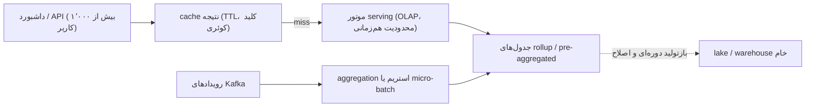

## 🎯 خلاصه

> **الگوی serving:** کار سنگین را **قبل از** رسیدن کاربر انجام بده. فکت‌ها را به جدول‌های کوچک pre-aggregate کن، داشبورد را از آن جدول‌ها و از یک موتور مخصوص هم‌زمانی جواب بده، و نتیجه‌هایی را که کاربران زیادی تکرار می‌کنند cache کن.

- داشبوردی که ۱٬۰۰۰ نفر می‌بینند، به ۱٬۰۰۰ اسکن کامل از رویدادهای خام نیاز ندارد. به چند هزار سطر از قبل آماده نیاز دارد.
- سه اهرم داریم: **pre-aggregation** (rollup)، **cache** (نتیجه‌ها)، و **موتور serving** که برای کوئری‌های کوچک و هم‌زمان ساخته شده.
- به **admission control** هم نیاز داریم: سقفی برای تعداد کوئری‌های هم‌زمان، تا یک گزارش سنگین بقیه را کند نکند.

## 🌱 از ساده شروع کنیم (مبتدی)

> **💡 تشبیه:** آشپزخانهٔ رستوران. اگر هر مشتری ماده‌ی خام سفارش می‌داد و سر میز می‌پخت، سرویس می‌ایستاد. آشپزخانه سس و پرس‌ها را از قبل آماده می‌کند (pre-aggregation)، غذاهای پرطرفدار را گرم نگه می‌دارد (cache)، و تعداد سفارش‌هایی که هم‌زمان می‌گیرد محدود است (محدودیت هم‌زمانی).

فرض کن یک داشبورد فروش داریم: «درآمد به تفکیک کشور در ۳۰ روز گذشته». هر بار که یک مدیر داشبورد را باز می‌کند، دیتابیس باید همهٔ فروش‌های ۳۰ روز گذشته را بخواند و جمع بزند. برای یک نفر مشکلی نیست. برای ۱٬۰۰۰ مدیر که هر دقیقه refresh می‌کنند، یک ترافیک بزرگ است.

راه حل این است که یک بار و از قبل جمع بزنیم:

```sql
-- یک بار در ساعت، نه هر بار که داشبورد باز می‌شود
CREATE TABLE sales_daily AS
SELECT CAST(event_ts AS DATE) AS day,
       country,
       COUNT(*)              AS orders,
       SUM(amount)           AS revenue
FROM events
GROUP BY 1, 2;
```

حالا داشبورد از `sales_daily` می‌خواند که برای هر روز و هر کشور یک سطر دارد. ۳۰ روز × ۲۰۰ کشور می‌شود ۶٬۰۰۰ سطر، به‌جای صدها میلیون رویداد.

## 🔧 واقعاً چطور کار می‌کند (متوسط)

مسیر serving معمولاً چهار لایه دارد، از کاربر تا ذخیره‌سازی:



### ۱. Pre-aggregation (rollup)

rollup فکت‌ها را بر اساس بُعدهایی گروه می‌کند که داشبوردها فیلتر و گروه‌بندی می‌کنند. **grain** تصمیم مهم است: `day × country × product` به سؤال‌های بیشتری جواب می‌دهد، ولی سطرهای بیشتری دارد. یک تخمین ساده: ۲۰۰ کشور × ۵٬۰۰۰ محصول × ۳۶۵ روز = حداکثر ۳۶۵ میلیون سطر در سال. در عمل تعداد کمتر است، چون بیشتر ترکیب‌های محصول-کشور فروشی ندارند، ولی باید اندازه‌اش را بسنجی.

**measureهای additive ساده‌اند.** `COUNT`، `SUM`، `MIN` و `MAX` را می‌توان از تکه‌های کوچک‌تر جمع زد: درآمد یک ماه جمع درآمد روزانه است.

**شمارش distinct ساده نیست.** `COUNT(DISTINCT user_id)` را نمی‌توان از شمارش‌های distinct روزانه جمع زد (کاربری که در دو روز فعال بوده دو بار شمرده می‌شود). از یک sketch مثل HyperLogLog ([[hyperloglog]]) استفاده کن که قابل merge است و خطای کوچکی دارد، یا فقط برای بُعدهای کوچک مجموعهٔ دقیق ذخیره کن.

### ۲. Cache

داشبوردها همان کوئری‌ها را تکرار می‌کنند. یک cache نتیجه با کلید «کوئری نرمال‌شده به‌علاوهٔ پارامترها» (مثلاً `country=IR, range=30d`) و TTL حدود ۳۰ تا ۶۰ ثانیه می‌تواند بیشتر ترافیک را جواب بدهد. دو مشکل را باید از قبل برنامه‌ریزی کنی:

- **Stampede.** وقتی یک مدخل پرطرفدار منقضی می‌شود، ممکن است ۵۰۰ درخواست هم‌زمان miss بخورند و همه به موتور بزنند. از request coalescing استفاده کن (یک درخواست محاسبه می‌کند و بقیه منتظر آن می‌مانند) یا مدخل‌های داغ را قبل از انقضا تازه کن.
- **Staleness (کهنگی).** cache یک کپی دوم از جواب است. زمان داده را روی داشبورد نشان بده تا کاربر بداند عدد چقدر قدیمی است.

### ۳. موتور serving و هم‌زمانی

انبارهای داده برای چند کوئری بزرگ و گران در یک زمان طراحی شده‌اند. serving به کوئری‌های زیاد، کوچک و سریع نیاز دارد. موتورهای ساخته‌شده برای این کار، مثل ClickHouse و StarRocks، از ذخیره‌سازی ستونی، اجرای vectorized و جدول‌های از قبل مرتب‌شده یا pre-aggregated استفاده می‌کنند، پس کوئری‌ای که ۶٬۰۰۰ سطر را لمس می‌کند در میلی‌ثانیه برمی‌گردد. سیستم‌های OLAP بلادرنگ هم می‌توانند از Kafka داده بگیرند، پس تازگی داده به‌جای ساعت‌ها می‌تواند ثانیه باشد.

کنترل هم‌زمانی بخشی از طراحی است:

- **admission control:** سقف تعداد کوئری‌های در حال اجرا برای هر موتور و هر tenant، با صف محدود.
- **timeout و سقف سطر:** کوئری داشبوردی که بیشتر از N سطر اسکن می‌کند رد می‌شود یا به مسیر کندتر فرستاده می‌شود.
- **اولویت:** داشبوردهای تعاملی قبل از export‌های زمان‌بندی‌شده.

```sql
-- کوئری داشبورد: کوچک، با index روی day و country
SELECT day, SUM(revenue) AS revenue
FROM sales_daily
WHERE country = 'IR'
  AND day >= CURRENT_DATE - INTERVAL '30' DAY
GROUP BY day
ORDER BY day;
```

همان شکل کوئری را فقط در تست روی جدول خام اجرا کن تا دو نتیجه را مقایسه کنی.

## 🧠 عمق و trade-offها (سنیور)

- **تازگی در برابر هزینه.** هر افزایش تازگی (از micro-batch به aggregation استریمی) هزینهٔ محاسباتی و عملیاتی بیشتری دارد. SLA تازگی را با عدد بنویس، مثلاً «داده حداکثر ۵ دقیقه کهنه است، p95»، و روی همان عدد طراحی کن، نه روی «real time».
- **انفجار rollup.** هر بُعد اضافه، تعداد سطرها را ضرب می‌کند. بُعدها را از داشبوردها انتخاب کن، نه از schema. جدول خام را برای تحلیل ad-hoc نگه دار و rollup را فقط برای شکل‌های شناخته‌شده بساز.
- **داده‌ی دیرهنگام و اصلاح‌شده.** rollupِ ساخته‌شده از رویدادها وقتی رویدادهای دیرهنگام می‌رسند باید اصلاح شود. سیاست را مشخص کن: هر اجرا N روز آخر را دوباره حساب کند، یا یک پنجرهٔ دیرکرد ثابت بپذیرد و مستند کند. [[pattern-late-data]] را ببین.
- **کوئری‌های داغ.** یک داشبورد می‌تواند بیشتر بار را بسازد. هزینهٔ هر کوئری را بسنج و اول پرتکرارترین شکل‌ها را cache کن. همان تفکر hot key در [[pattern-hot-keys]] برای محبوبیت کوئری‌ها هم صدق می‌کند.
- **نویز بین tenantها.** export بزرگ یک مشتری می‌تواند تأخیر دم (p99) را برای همه بالا ببرد. برای هر tenant یا کلاس کاری pool منابع جدا بگذار و سطرهای هر کوئری را محدود کن.
- **خطاهایی که باید پایش شوند.** p95 و p99 تأخیر، زمان انتظار در صف (نه فقط زمان اجرا)، نرخ hit cache، تازگی rollup (`max(event_ts)` در برابر زمان فعلی)، و نرخ خطا برای هر داشبورد. داشبوردی که سریع است ولی کهنه است، همچنان اشتباه است.
- **کی استفاده نکنی.** تحلیل ad-hoc توسط چند تحلیلگر یا یک گزارش ماهانه به لایهٔ serving نیاز ندارد. یک انبار داده با هم‌زمانی معمولی ساده‌تر است. موتور serving را به‌عنوان system of record استفاده نکن؛ کپی بهینه‌شده برای خواندن است.

## 🧪 امتحان کن

جدول rollup `sales_daily` برای کشور `IR` این سطرها را دارد:

| day | revenue |
|---|---|
| 2026-10-01 | 100 |
| 2026-10-02 | 150 |
| 2026-10-03 | 80 |

۱. کوئری بنویس که کل درآمد ۲۰۲۶-۱۰-۰۱ تا ۲۰۲۶-۱۰-۰۳ را برگرداند.
۲. همکارت می‌خواهد `COUNT(DISTINCT user_id)` روزانه را به rollup اضافه کند و بعد آن مقادیر را جمع بزند تا مجموع ۳ روز را بگیرد. مشکل این کار چیست؟
۳. تعداد سطرهای یک rollup با `day × country × device` را برای ۳۶۵ روز، ۲۰۰ کشور و ۳ دستگاه تخمین بزن، با فرض اینکه برای هر ترکیب فروش وجود دارد.

<details>
<summary>حدس تو؟</summary>

۱. `SELECT SUM(revenue) FROM sales_daily WHERE country = 'IR' AND day BETWEEN '2026-10-01' AND '2026-10-03';` مقدار ۳۳۰ را برمی‌گرداند.
۲. شمارش distinct قابل جمع نیست. کاربری که در دو روز خرید کرده، هر روز یک بار شمرده می‌شود و جمع، او را دو بار حساب می‌کند. از یک sketch قابل merge (مثلاً HyperLogLog) استفاده کن، یا برای بازهٔ مورد نظر از منبع دوباره حساب کن.
۳. ۳۶۵ × ۲۰۰ × ۳ = ۲۱۹٬۰۰۰ سطر. این یک حد بالا است؛ عدد واقعی کمتر است وقتی بسیاری از ترکیب‌ها فروشی ندارند.

</details>

## 💬 گوشه‌ی مصاحبه

**سؤال معمول:** «backend تحلیلی یک داشبورد با ۱۰٬۰۰۰ کاربر هم‌زمان و هدف p95 دو ثانیه را طراحی کن.»

- **جواب مبتدی:** «داده را در یک دیتابیس می‌گذارم و یک index اضافه می‌کنم.»
- **جواب متوسط:** «رویدادها را به جدول‌های روزانه بر اساس بُعدهای داشبورد pre-aggregate می‌کنم، نتیجه‌ها را برای TTL کوتاه cache می‌کنم و از یک موتور OLAP سرو می‌کنم.»
- **جواب سنیور:** «از SLA و شکل کوئری‌ها شروع می‌کنم. اندازهٔ rollup را با grain و تعداد ترکیب بُعدها می‌سنجم. شمارش‌های distinct را با sketch انجام می‌دهم، چون قابل جمع نیستند. cache با TTL کوتاه و request coalescing کوئری‌های تکراری را جذب می‌کند، و admission control با صف‌های جدا برای هر tenant، p99 را محافظت می‌کند. زمان انتظار در صف، تازگی و نرخ hit cache را پایش می‌کنم و انبار خام را برای کار ad-hoc نگه می‌دارم.»

> **🎤 این را در مصاحبه بگو:** «داشبورد را از جدول‌های pre-aggregated جواب می‌دهم، نه از رویدادهای خام. grain را از بُعدهای داشبورد انتخاب می‌کنم، شمارش distinct را با sketch قابل merge انجام می‌دهم، یک cache با TTL کوتاه و coalescing تکرارها را جذب می‌کند، و admission control نمی‌گذارد یک کوئری سنگین p99 همه را خراب کند.»

## ⚠️ اشتباهات رایج

- **pre-aggregate کردن همه‌چیز.** rollup خیلی بزرگ می‌شود و بازسازی آن ساعت‌ها طول می‌کشد. فقط شکل‌هایی را بساز که داشبوردها استفاده می‌کنند.
- **جمع زدن شمارش‌های distinct** بین روزها یا partitionها.
- **cache بدون زمان داده.** کاربر نمی‌فهمد عدد ۳۰ ثانیه کهنه است یا ۳ ساعت.
- **نداشتن admission control.** یک job export می‌تواند همهٔ داشبوردها را به timeout بیندازد.
- **سنجیدن فقط میانگین تأخیر.** کاربر p95 و p99 را حس می‌کند، نه میانگین را.
- **serve کردن از جدول خام** به این بهانه که «rollup هنوز آماده نیست». این کار باگ rollup را پنهان می‌کند تا روزی که جدول خام از بودجه رد شود.

## ✅ خودت را بسنج

۱. چرا rollup در سطح `day × country` برای یک داشبورد ۳۰ روزه خیلی سریع‌تر از جدول رویدادهای خام است؟
   - A) چون روی دیسک سریع‌تری ذخیره شده
   - B) چون به‌جای میلیون‌ها رویداد، صدها سطر در روز می‌خواند؛ گروه‌بندی و جمع از قبل انجام شده
   - C) چون نیاز به index را از بین می‌برد
   - D) چون رویدادها را به‌صورت فشرده JSON نگه می‌دارد

   <details>
   <summary>پاسخ</summary>

   **B** — کار گروه‌بندی و جمع یک بار در زمان ساخت rollup انجام می‌شود. داشبورد یک جدول کوچک و از قبل جمع‌شده می‌خواند، پس سطرهای خیلی کمتری اسکن می‌کند.

   </details>

۲. متریک «خریداران یکتای ماهانه» است. کدام روش برای rollupی که نمای ماهانه و سالانه را سرو می‌کند درست است؟
   - A) شمارش‌های distinct روزانه را ذخیره و جمع کن
   - B) برای هر روز (یا هر ماه) یک sketch قابل merge ذخیره کن و برای بازه‌های بلندتر sketchها را merge کن
   - C) فقط رویدادهای خام را ذخیره کن و در زمان کوئری distinct بگیر
   - D) شمارش distinct ماهانه را ذخیره کن و بر ۳۰ تقسیم کن

   <details>
   <summary>پاسخ</summary>

   **B** — sketchهای قابل merge (مثلاً HyperLogLog) را می‌توان بین روزها ترکیب کرد تا بازه‌ی بلندتر با خطای کوچک تخمین زده شود. جمع شمارش‌های روزانه خریداران تکراری را دو بار می‌شمارد و تقسیم بر ۳۰ یک شمارش distinct تولید نمی‌کند.

   </details>

۳. *(trade-off)* تیم محصول می‌خواهد داشبوردها «real-time» باشند. بهترین قدم اول چیست؟
   - A) همهٔ داشبوردها را به topic خام Kafka وصل کن
   - B) SLA تازگی را با عدد بگیر، سپس ارزان‌ترین pipeline‌ای را انتخاب کن که آن را برآورده کند، و سن داده را روی داشبورد نشان بده
   - C) TTL مربوط به cache را صفر کن
   - D) برای هر فیلتر ممکن یک rollup بساز

   <details>
   <summary>پاسخ</summary>

   **B** — «real-time» معنای ثابتی ندارد. عددی مثل «حداکثر پنج دقیقه کهنه، p95» طراحی را تعیین می‌کند و نشان دادن سن داده، کهنگی را قابل‌دیدن می‌کند. خواندن مستقیم topicهای خام Kafka برای داشبوردها گران است و برای کاربران زیاد مقیاس نمی‌گیرد.

   </details>

۴. چرا یک cache با TTL به request coalescing نیاز دارد؟
   - A) برای طولانی‌تر کردن TTL
   - B) تا وقتی یک مدخل پرطرفدار منقضی می‌شود، درخواست‌های زیادی همان کوئری را هم‌زمان دوباره حساب نکنند
   - C) برای ذخیره‌ی داده روی دیسک
   - D) برای اینکه از موتور serving برای نوشتن استفاده نشود

   <details>
   <summary>پاسخ</summary>

   **B** — بدون coalescing، یک miss برای کوئری پرطرفدار موجی از کوئری‌های یکسان می‌سازد (stampede) که می‌تواند موتور را overload کند.

   </details>

## 🗂️ فلش‌کارت

| Front | Back |
|---|---|
| Pre-aggregation | محاسبهٔ نتیجه‌های گروه‌بندی‌شده از قبل تا داشبورد از جدول کوچک بخواند |
| Rollup grain | مجموعهٔ بُعدهایی که در rollup نگه داشته می‌شوند؛ grain ریزتر یعنی سطر بیشتر |
| Additive measure | از تکه‌های کوچک‌تر قابل جمع است (COUNT، SUM)؛ شمارش distinct این‌طور نیست |
| HyperLogLog | sketch قابل merge که شمارش distinct را با خطای کوچک تخمین می‌زند |
| Cache stampede | درخواست‌های یکسان زیادی یک مدخل منقضی‌شده را هم‌زمان دوباره حساب می‌کنند |
| Request coalescing | یک درخواست مقدار گم‌شده را حساب می‌کند و بقیه منتظر نتیجه‌اش می‌مانند |
| Admission control | سقف کوئری‌های هم‌زمان با صف محدود برای حفظ تأخیر |
| SLA تازگی | عددی برای سن داده، مثل «حداکثر ۵ دقیقه کهنه، p95» |

## 🔗 ادامه

- [[serving-layer]] برای ایدهٔ کلی لایه‌ای که خواندن‌ها را از داده‌ی آماده جواب می‌دهد.
- [[clickhouse]] و [[starrocks-doris]] برای موتورهایی که برای خواندن‌های تحلیلی هم‌زمان ساخته شده‌اند.
- [[pattern-realtime-aggregation]] برای ساخت aggregateهای استریمی که جدول‌های serving را تغذیه می‌کنند.
- [[pattern-hot-keys]] برای skew در aggregation و در محبوبیت کوئری‌ها.
- [[capacity-planning]] برای تبدیل QPS و تعداد سطر به سخت‌افزار و هزینه.
