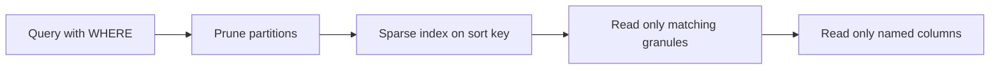

## 🎯 خلاصه

> در یک موتور ستونی MPP، **طراحی فیزیکی همان طراحی عملکرد است.** چهار تصمیم بیشترِ کار را انجام می‌دهند: **کلید مرتب‌سازی (sort key)**، **partitioning**، **توزیع (bucketing)** و **جدول‌های تجمیع‌شده از پیش (rollup)**.

- **کلید مرتب‌سازی** مشخص می‌کند فیلتر کدام بلوک‌های داده را می‌تواند رد کند. ستون‌هایی را که بیشتر فیلتر می‌کنی، با ترتیب درست، اول بگذار.
- **Partitionها** واحد مدیریت داده‌اند (حذف، TTL، بارگذاری بر اساس دوره). partitionهای درشت استفاده کن؛ partitionهای زیاد و کوچک فایل‌های ریز زیادی می‌سازند و برنامه‌ریزی را کند می‌کنند.
- **توزیع** ردیف‌ها را بین نودها یا bucketها پخش می‌کند. کلید خوب از skew جلوگیری می‌کند و اجازه می‌دهد joinهای روی همان کلید محلی اجرا شوند.
- **Rollup و materialized view** جمع‌های از پیش محاسبه‌شده را ذخیره می‌کنند، پس داشبوردها به‌جای میلیاردها ردیف، هزاران ردیف را می‌خوانند.
- نام موتورها فرق می‌کند (ClickHouse با `MergeTree`، مدل‌های جدول StarRocks، Doris، connectorهای Trino)، ولی سوال‌ها یکی‌اند. قبل از نقل یک پیش‌فرض، مستندات نسخه‌ی خودت را ببین.

## 🌱 از ساده شروع کنیم (مبتدی)

> **💡 Analogy:** یک دفترچه‌ی تلفن که بر اساس نام خانوادگی مرتب شده. پیدا کردن «کریمی» یعنی رفتن به بخش K و خواندن چند صفحه. اگر دفترچه بر اساس شماره‌تلفن مرتب بود، باید همه‌ی صفحات را می‌خواندی. **کلید مرتب‌سازی** همان ترتیب دفترچه است، و تعیین می‌کند چند صفحه را باید بخوانی.

فرض کن جدول رویدادها ۵ میلیارد ردیف دارد و بیشتر داشبوردها این را می‌پرسند:

```sql
SELECT count(*), sum(amount)
FROM events
WHERE country = 'IR'
  AND event_date >= '2026-01-01';
```

اگر داده بر اساس `country` و بعد `event_date` مرتب ذخیره شده باشد، موتور می‌تواند بیشتر بلوک‌های فایل را که نمی‌توانند جواب بدهند رد کند. اگر داده به ترتیب ورود ذخیره شده باشد، ممکن است هر بلوک ردیف‌های ایرانی سال ۲۰۲۶ را داشته باشد، پس موتور تقریباً همه‌چیز را می‌خواند. متن کوئری یکسان است؛ فقط چیدمان فیزیکی عوض شده.

## 🔧 واقعاً چطور کار می‌کند (متوسط)

### کلید مرتب‌سازی و ایندکس‌های sparse

جدول `MergeTree` در ClickHouse داده را در قطعه‌ها (parts) ذخیره می‌کند که بر اساس کلید `ORDER BY` مرتب‌اند. ایندکس اصلی آن **sparse** است: برای هر granule (به‌طور پیش‌فرض ۸۱۹۲ ردیف) یک ورودی نگه می‌دارد. کوئری ایندکس را می‌خواند، granuleهایی را که ممکن است جواب دهند پیدا می‌کند و بقیه را رد می‌کند. ستون‌ها جدا ذخیره می‌شوند، پس فقط ستون‌های نام‌برده در کوئری خوانده می‌شوند.

```sql
CREATE TABLE events
(
  event_date  Date,
  event_time  DateTime,
  country     LowCardinality(String),
  event_type  LowCardinality(String),
  user_id     UInt64,
  amount      Decimal(12, 2)
)
ENGINE = MergeTree
PARTITION BY toYYYYMM(event_date)
ORDER BY (country, event_type, event_date, user_id);
```

ترتیب کلید مرتب‌سازی مهم است. ستون‌های کم‌کاردینالیتی که در بیشتر فیلترها هستند را اول بگذار (اینجا `country`)، چون ایندکس فقط می‌تواند از پیشوند کلید استفاده کند. کوئری‌ای که فقط روی `user_id` فیلتر می‌کند نمی‌تواند از این ایندکس خوب استفاده کند، و بسته به موتور باید کلید مرتب‌سازی دیگری، projection یا ایندکس ثانویه بسازی.

### Partitioning

`PARTITION BY toYYYYMM(event_date)` برای هر ماه یک partition می‌سازد. partitionها برای نگه‌داری داده (حذف یک ماه ارزان است)، بارگذاری بر اساس دوره، و یک‌مقدار pruning مفیدند. ولی **جایگزین** کلید مرتب‌سازی نیستند. اشتباه رایج، partition کردن بر اساس `user_id` یا روزانه روی سال‌های زیاد است؛ این کار هزاران partition با قطعه‌های ریز می‌سازد و برنامه‌ریزی و merge را کند می‌کند.

### StarRocks: مدل جدول، bucket و colocation

در StarRocks مدل جدول باید هنگام ساخت انتخاب شود. ستون‌های کلیدی هم ترتیب مرتب‌سازی را مشخص می‌کنند و هم رفتار یکتایی را:

```sql
CREATE TABLE events_sr
(
  event_date  DATE,
  country     VARCHAR(8),
  event_type  VARCHAR(32),
  event_time  DATETIME,
  user_id     BIGINT,
  amount      DECIMAL(12, 2)
)
DUPLICATE KEY (event_date, country, event_type)
DISTRIBUTED BY HASH(user_id) BUCKETS 16;
```

- **Duplicate Key** همه‌ی ردیف‌ها را نگه می‌دارد. برای فکت‌های خام (رویداد، کلیک) استفاده کن.
- **Aggregate Key** ردیف‌هایی با کلید مشترک را از پیش تجمیع می‌کند، با تابع تجمیع برای هر ستون. برای rollupهایی که ردیف خام لازم ندارند استفاده کن.
- **Unique Key** و **Primary Key** آخرین ردیف هر کلید را نگه می‌دارند و برای upsert به کار می‌روند. رفتار و قواعد merge آن‌ها فرق دارد؛ برای نسخه‌ی خودت مستندات را ببین.
- `DISTRIBUTED BY HASH(user_id) BUCKETS 16` داده را به ۱۶ bucket تقسیم می‌کند. جدول‌هایی که روی `user_id` join می‌شوند و bucket count و توزیع یکسان دارند می‌توانند در یک **colocation group** قرار بگیرند، پس join روی هر نود اجرا می‌شود بدون این‌که ردیف‌ها در شبکه جابه‌جا شوند.

### Rollup با materialized view

rollup جدولی از جمع‌های از پیش محاسبه‌شده است. در ClickHouse، یک materialized view با هر insert اجرا می‌شود و در یک جدول مقصد می‌نویسد:

```sql
CREATE TABLE sales_daily
(
  day      Date,
  country  LowCardinality(String),
  revenue  SimpleAggregateFunction(sum, Decimal(18, 2))
)
ENGINE = SummingMergeTree
PARTITION BY toYYYYMM(day)
ORDER BY (day, country);

CREATE MATERIALIZED VIEW sales_daily_mv TO sales_daily AS
SELECT toDate(event_time) AS day, country, sum(amount) AS revenue
FROM events
GROUP BY day, country;
```

`SummingMergeTree` ردیف‌های با کلید یکسان را جمع می‌زند، ولی فقط در merge پس‌زمینه. تا آن موقع، مقصد ممکن است چند ردیف جزئی برای یک کلید داشته باشد، پس کوئری‌ها باید همچنان `sum(revenue) ... GROUP BY` را اعمال کنند. فراموش کردن این، باگ رایج است.



## 🧠 عمق و trade-offها (سنیور)

- **طراحی کلید مرتب‌سازی یک تصمیم بر اساس workload است.** کلید را از پنج الگوی کوئری پرتکرار انتخاب کن، نه از schema. کاردینالیتی مهم است: ستون اول با کاردینالیتی خیلی بالا پیشوند را تقریباً یکتا می‌کند، پس ایندکس برای فیلتر روی ستون‌های بعدی کمک کمی می‌کند. با `EXPLAIN` و خروجی استفاده از ایندکس موتور تست کن.
- **trade-off دانه‌بندی partition.** partitionهای روزانه برای نگه‌داری و pruning داده‌ی اخیر خوب‌اند، ولی تعداد قطعه‌ها و merge را ضرب می‌کنند. ماهانه یک حد وسط رایج است. partition را بر اساس ستونی بگذار که فیلتر و حذف رویش انجام می‌دهی، و تعدادش را در حد صدها نگه دار، نه ده‌ها هزار.
- **قطعه‌های ریز و فشار merge.** insertهای کوچک و مکرر قطعه‌های زیادی می‌سازند. merge پس‌زمینه باید عقب نیفتد، و کوئری‌های خواندن تا آن موقع کند می‌شوند. insertها را دسته‌ای کن (راهنمایی رایج: هزاران ردیف یا بیشتر در هر insert، نه یک ردیف در هر بار) و تعداد قطعه‌های فعال در هر partition را مانیتور کن. حدهای دقیق را در مستندات نسخه‌ات ببین.
- **توزیع و skew.** اگر کلید bucket یک مقدار داغ داشته باشد (یک مشتری، یک کد کشور، یا مقدار null)، بیشتر ردیف‌ها در یک bucket می‌افتند و آن نود گلوگاه می‌شود. اندازه و تعداد ردیف هر bucket را چک کن. کلیدی با کاردینالیتی بالا و پخش خوب انتخاب کن، و برای یک مقدار داغ شناخته‌شده کلید salted را در نظر بگیر.
- **colocation محدودیت است، نه برد رایگان.** joinهای colocated به کلید bucket و تعداد bucket یکسان نیاز دارند. تغییر تعداد bucket بعداً معمولاً یعنی بازسازی جدول. قبل از اولین بارگذاری، کلیدهای join جدول‌های فکت بزرگ را برنامه‌ریزی کن.
- **تازگی materialized view.** view ای که با insert اجرا می‌شود (ClickHouse) همیشه با منبعش سازگار است، ولی باگ در کوئری‌اش rollup را بی‌صدا خراب می‌کند و backfill نیاز به بازسازی دستی دارد. materialization های async یا زمان‌بندی‌شده (StarRocks و دیگران) تازگی را با بازیابی ساده‌تر عوض می‌کنند. بدان کدام را اجرا می‌کنی و چطور آن را با جدول پایه چک می‌کنی.
- **layout فیزیکی را مانیتور کن.** تعداد قطعه‌ها در هر partition، skew اندازه‌ی bucketها، عقب‌ماندگی merge و نسبت ردیف‌های اسکن‌شده به ردیف‌های برگشتی را برای کوئری‌های پرتکرار دنبال کن. اگر بعد از تغییر schema این نسبت بالا برود، یعنی کلید مرتب‌سازی دیگر با الگوی کوئری نمی‌خواند.
- **کِی بیش‌ازحد مدل نکنی.** برای جدول‌های کوچک (چند میلیون ردیف) هر layout معقولی سریع است، و partition و rollup اضافه هزینه است. تنظیم فیزیکی وقتی ارزش دارد که روی بزرگ‌ترین جدول‌ها و پرتکرارترین کوئری‌ها باشد.

## 🧪 امتحان کن

۱. **تمرین.** یک جدول چندمستأجره با `WHERE tenant_id = ? AND event_date BETWEEN ? AND ?` کوئری می‌شود. یک کلید مرتب‌سازی انتخاب کن و بگو در StarRocks برای bucketing کدام ستون را استفاده می‌کنی.

<details><summary>Solution</summary>

کلید مرتب‌سازی: `(tenant_id, event_date, event_type)`. مستأجر پرتکرارترین فیلتر است و کاردینالیتی متوسط دارد، و بازه‌ی تاریخ فیلتر دوم است، پس «مستأجر + بازه‌ی تاریخ» بخش پیوسته‌ای از داده‌ی مرتب‌شده را می‌خواند. برای bucketing، فقط `tenant_id` ریسک skew دارد اگر یک مستأجر خیلی بزرگ باشد. انتخاب امن‌تر کلیدی با کاردینالیتی بالا مثل `user_id` برای bucketهای یکنواخت است، یا فقط `tenant_id` اگر مستأجرها اندازه‌ی مشابه دارند. قبل از تصمیم، توزیع اندازه‌ی bucketها را اندازه بگیر.

```sql
-- قبل از انتخاب کلید bucket، پخش ردیف‌ها را بر اساس مستأجر چک کن
SELECT tenant_id, count(*) AS rows_
FROM events
GROUP BY tenant_id
ORDER BY rows_ DESC
LIMIT 10;
```

</details>

۲. **تمرین.** داده‌ی ۵ سال را روزانه partition کرده‌ای. چند partition داری و partitionهای ماهانه چه می‌دادند؟

<details><summary>Solution</summary>

روزانه: ۵ × ۳۶۵ = ۱٬۸۲۵ partition (حدود ۱٬۸۳۰ با سال‌های کبیسه). ماهانه: ۵ × ۱۲ = ۶۰ partition. هر partition قطعه‌ها و فایل‌هایی دارد، پس طراحی روزانه حدود ۳۰ برابر تعداد دایرکتوری partition و واحد merge دارد. مگر این‌که حذف روزانه لازم باشد، ماهانه معمولاً کافی است.

</details>

## 💬 گوشه‌ی مصاحبه

**«چطور یک جدول فکت را برای داشبوردی که بر اساس تاریخ و کشور فیلتر می‌کند، فیزیکی طراحی می‌کنی؟»** انتظار داری کلید مرتب‌سازی، partition، توزیع و یک rollup را با دلیل بگویی.

- **جواب متوسط:** «بر اساس تاریخ رویداد ماهانه partition می‌کنم، بر اساس کشور و تاریخ مرتب می‌کنم، و با یک کلید با کاردینالیتی بالا bucket می‌کنم. برای داشبورد یک rollup روزانه اضافه می‌کنم، پس کوئری یک جدول کوچک را می‌خواند.»
- **جواب سنیور:** «از الگوهای پرتکرار کوئری شروع می‌کنم و کاردینالیتی و skew هر ستون کاندید را چک می‌کنم. partitionها را درشت نگه می‌دارم تا تعداد قطعه‌ها محدود بماند، کلید مرتب‌سازی را با فیلترها هم‌راستا می‌کنم، و روی کلیدی bucket می‌کنم که به‌طور یکنواخت پخش شود تا joinها colocate شوند. rollup با یک job به‌روزرسانی (insert-time یا زمان‌بندی‌شده) نگه داشته می‌شود و با یک کوئری تطبیق، با جدول پایه چک می‌شود.»

**«بعد از اضافه کردن partition هنوز کوئری همه‌چیز را اسکن می‌کند. چرا؟»** جواب نمونه: «partition فقط وقتی pruning می‌کند که فیلتر با عبارت partition مطابقت داشته باشد. همچنین partitionها درشت‌اند، پس داده‌ی داخل یک partition هنوز باید اسکن شود، مگر این‌که کلید مرتب‌سازی کمک کند. اول plan کوئری را برای pruning چک می‌کنم، و بعد این‌که ستون‌های فیلتر پیشوند کلید مرتب‌سازی هستند یا نه.»

## ⚠️ اشتباهات رایج

- **partition را اصلی‌ترین بهینه‌سازی دانستن.** partitionها بر اساس دوره pruning می‌کنند؛ جایگزین کلید مرتب‌سازی خوب نیستند.
- **partition زیاد.** partition روزانه روی سال‌ها داده، یا partition روی ستون با کاردینالیتی بالا، قطعه‌های کوچک زیادی می‌سازد.
- **گذاشتن ستون با بیشترین کاردینالیتی اول در کلید مرتب‌سازی.** ستون‌های بعدی را برای pruning بی‌فایده می‌کند.
- **bucketing روی کلید skew‌دار.** یک مقدار داغ بیشتر داده را روی یک نود می‌گذارد.
- **فراموش کردن این‌که merge در جدول‌هایی مثل SummingMergeTree دیرهنگام است.** کوئری روی rollup هنوز باید تجمیع کند.
- **تغییر تعداد bucket یا کلید مرتب‌سازی بعداً بدون برنامه.** معمولاً یعنی بازسازی یک جدول بزرگ.
- **نقل پیش‌فرض‌ها از حافظه.** اندازه‌ی granule، حد partition و تنظیمات merge بین نسخه‌ها عوض می‌شوند.

## ✅ خودت را بسنج

۱. کوئری روی `country = 'IR'` و `event_date` هفته‌ی گذشته فیلتر می‌کند. جدول فقط بر اساس `event_time` مرتب است. مفیدترین تغییر کدام است؟
   - A) افزودن partition بیشتر بر اساس `user_id`
   - B) مرتب‌سازی بر اساس `(country, event_date, ...)` تا ایندکس بلوک‌های بی‌ربط را رد کند
   - C) تغییر به row store
   - D) حذف شرط `WHERE`

<details><summary>Answer</summary>

**B** — کلید مرتب‌سازی تعیین می‌کند کدام بلوک‌ها را می‌توان رد کرد. ترتیبی که با ستون‌های فیلتر شروع شود به ایندکس sparse اجازه می‌دهد بیشتر داده را کنار بگذارد. partition بر اساس `user_id` (A) تعداد زیادی partition می‌سازد و به این فیلتر کمک نمی‌کند.

</details>

۲. چرا partition روزانه روی ده سال داده معمولاً اشتباه است؟
   - A) روز را نمی‌توان کلید partition کرد
   - B) هزاران partition با قطعه‌های ریز می‌سازد که merge و برنامه‌ریزی را کند می‌کند
   - C) کلید مرتب‌سازی را غیرقابل استفاده می‌کند
   - D) همیشه اسکن کامل جدول را اجبار می‌کند

<details><summary>Answer</summary>

**B** — هزاران partition یعنی قطعه‌ها و واحدهای merge زیاد و ریز. راه‌حل partition درشت‌تر، مثل ماه، و کلید مرتب‌سازی خوب برای pruning دقیق است.

</details>

۳. **(سنیور)** یک join در StarRocks بین دو جدول فکت روی `user_id` هر بار حجم زیادی داده را جابه‌جا می‌کند. کدام تغییر طراحی مستقیم‌ترین است؟
   - A) هر دو جدول کلید bucket و تعداد bucket یکسان داشته باشند و در یک colocation group باشند
   - B) تعداد partitionهای هر دو جدول زیاد شود
   - C) هر دو جدول Duplicate Key باشند
   - D) یک `DISTINCT` به کوئری اضافه شود

<details><summary>Answer</summary>

**A** — colocation وقتی کار می‌کند که ردیف‌های متناظر دو جدول در یک bucket روی یک نود باشند، پس join محلی اجرا می‌شود. تعداد partition (B) جای قرارگیری bucketها را عوض نمی‌کند؛ مدل جدول (C) توزیع را عوض نمی‌کند؛ `DISTINCT` (D) کار اضافه می‌کند.

</details>

۴. **(سنیور)** یک rollup با `SummingMergeTree` بعد از یک insert، درآمد کمی کمتر از واقعی نشان می‌دهد و بعداً درست می‌شود. محتمل‌ترین دلیل چیست و راه‌حل کدام است؟
   - A) جدول پایه ردیف از دست داده
   - B) merge هنوز ردیف‌های جزئی هر کلید را ترکیب نکرده؛ rollup را با `sum(revenue) ... GROUP BY` بخوان، نه این‌که یک ردیف تکی را بخوانی
   - C) materialized view به‌طور طراحی‌شده غیرفعال است
   - D) rollup فقط کلید مرتب‌سازی بزرگ‌تری لازم دارد

<details><summary>Answer</summary>

**B** — جمع‌زدن در زمان merge پس‌زمینه انجام می‌شود، پس قبل از merge ممکن است یک کلید در چند ردیف باشد. یک `GROUP BY` نهایی با `sum` در هر زمان نتیجه‌ی درست می‌دهد.

</details>

۵. **(سنیور)** کلید bucket را `country` گذاشته‌ای، ولی ۶۰٪ ردیف‌ها از یک کشورند. کدام trade-off دقیق‌تر است؟
   - A) کاملاً متعادل، چون کشورها کم‌اند
   - B) skew: یک bucket بیشتر ردیف‌ها را می‌گیرد و یک نود گلوگاه می‌شود
   - C) joinهای سریع‌تر، چون همه‌ی ردیف‌ها در یک جا هستند
   - D) بی‌اثر؛ فقط کلید مرتب‌سازی روی توزیع اثر دارد

<details><summary>Answer</summary>

**B** — توزیع تابع کلید bucket است. یک مقدار غالب یک bucket داغ می‌سازد. اندازه‌ی هر bucket را چک کن و کلیدی با پخش بهتر انتخاب کن.

</details>

## 🗂️ فلش‌کارت

| Front | Back |
|---|---|
| کلید مرتب‌سازی چه را کنترل می‌کند؟ | این‌که فیلتر کدام بلوک‌ها یا granuleها را رد کند، و چیدمان داده روی دیسک |
| چرا ایندکس اصلی ClickHouse sparse است؟ | به‌ازای هر granule یک ورودی دارد، نه هر ردیف، پس کوچک می‌ماند |
| partitioning عمدتاً برای چیست؟ | مدیریت داده (نگه‌داری، حذف، بارگذاری دوره‌ای) و pruning درشت |
| چرا partition زیاد بد است؟ | قطعه‌ها و واحدهای merge زیاد و ریز، برنامه‌ریزی و کوئری را کند می‌کنند |
| جدول Duplicate Key در StarRocks | همه‌ی ردیف‌ها را نگه می‌دارد؛ برای فکت‌های خام |
| colocation group چیست؟ | جدول‌هایی با کلید و تعداد bucket یکسان، تا joinشان محلی اجرا شود |
| چرا SummingMergeTree به GROUP BY نهایی نیاز دارد؟ | جمع‌زدن در زمان merge است، پس ممکن است ردیف‌های جزئی وجود داشته باشند |
| bucket skew چیست؟ | وقتی کلید یک مقدار داغ دارد و یک bucket داده‌ی نامتناسب می‌گیرد |

## 🔗 ادامه

- **star-snowflake-obt** شکل منطقی‌ای را توضیح می‌دهد که این انتخاب‌های فیزیکی به آن خدمت می‌کنند.
- **columnar-storage** و **compression** توضیح می‌دهند چرا چیدمان ستونی و ترتیب مرتب‌سازی سود می‌دهد.
- **clickhouse** و **starrocks-doris** مدل‌های جدول و تنظیمات مخصوص هر موتور را پوشش می‌دهند.
- **mpp-architecture** توضیح می‌دهد توزیع و shuffle بین نودها چطور کار می‌کند.
- **realtime-olap** درج‌های استریمی و مشکل قطعه‌های ریز را عمیق‌تر پوشش می‌دهد.
- **partitioning-sharding** مفاهیم کلی پشت partition و bucket را توضیح می‌دهد.
- قبل از کپی‌کردن هر مقدار پیش‌فرض، مستندات رسمی نسخه‌ی موتورت را ببین.
