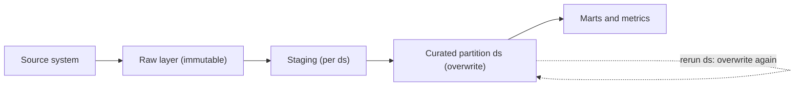

## 🎯 خلاصه

> یک پایپ‌لاین خوبِ batch یک **تابع از ورودی‌هایش** است: داده‌ی منبع یکسان، نسخه‌ی کد یکسان و پارامترهای یکسان (معمولاً یک partition تاریخی) باید خروجی یکسان بسازند. اجرای دوباره نباید نتیجه را عوض کند.

- هر نوشتن را **idempotent** کن: به‌جای append کردن، partitionی را که مال این اجراست بازنویسی کن.
- لایه‌ی **raw را تغییرناپذیر** نگه دار تا بتوانی بعد از رفع یک باگ، داده‌ی مشتق‌شده را دوباره بسازی.
- بر اساس **partition** پردازش کن (مثلاً یک `ds` در روز)، نه بر اساس «هر چیزی که الان تازه است».
- **workerها را stateless** نگه دار. state باید در storage و metadata باشد، تا یک task شکست‌خورده را بی‌خطر بکشی و دوباره اجرا کنی.

## 🌱 از ساده شروع کنیم (مبتدی)

> **💡 تشبیه:** یک دستور پخت که برای یک تاریخ مشخص نوشته شده. «دسته‌ی ۵ ژانویه» را دوبار بپزی باید یک دسته‌ی ۵ ژانویه بدهد، نه دو دسته که در یک قابلمه روی هم ریخته شده. اگر قابلمه قبل از پختن خالی شود، اجرای دوباره‌ی دستور ضرری ندارد.

فرض کن جابی تعداد سفارش‌های دیروز را می‌شمارد و نتیجه را در یک جدول خلاصه می‌نویسد:

```sql
-- نسخه‌ی A: در هر اجرا append می‌کند
INSERT INTO daily_orders_summary
SELECT '2026-01-05' AS ds, COUNT(*) AS orders
FROM orders
WHERE order_date = '2026-01-05';
```

اگر scheduler بعد از timeout این را دوباره اجرا کند، و تلاش اول در واقع موفق بوده باشد، حالا جدول **دو ردیف** برای ۵ ژانویه‌ی ۲۰۲۶ دارد. هر داشبوردی که جدول را جمع بزند، آن روز را دو بار حساب می‌کند.

```sql
-- نسخه‌ی B: ردیف‌های آن روز را جایگزین می‌کند
DELETE FROM daily_orders_summary WHERE ds = '2026-01-05';

INSERT INTO daily_orders_summary
SELECT '2026-01-05' AS ds, COUNT(*) AS orders
FROM orders
WHERE order_date = '2026-01-05';
```

نسخه‌ی B را ده بار اجرا کنی، باز هم برای آن روز یک ردیف دارد. (در بخش بعدی حذف و درج را atomic می‌کنیم.)

سه واژه را به خاطر بسپار:

- **Idempotent:** اجرای دوباره، همان وضعیت نهایی را باقی می‌گذارد.
- **Deterministic (قطعی):** ورودی‌های یکسان همیشه خروجی یکسان می‌دهند.
- **Partition:** یک تکه از داده، معمولاً بر اساس تاریخ، که یک اجرا مالکش است.

## 🔧 واقعاً چطور کار می‌کند (متوسط)

نوشتن idempotent از چند الگوی کوچک می‌آید:

| الگو | نحوه‌ی کار | مناسب برای | نکته‌ی مراقبت |
|---|---|---|---|
| بازنویسی partition | تمام ردیف‌های partition `ds` در یک commit جایگزین می‌شوند | fact‌های روزانه، aggregate ها | کل partition بازنویسی می‌شود، حتی اگر کمی تغییر کرده باشد |
| MERGE روی کلید کسب‌وکار | ردیف‌های با کلید مشابه به‌روز و بقیه درج می‌شوند | dimension ها، feedهای CDC | کلید یکتای قابل‌اعتماد لازم دارد؛ روی هدف‌های خیلی بزرگ پرهزینه است |
| staging و سپس publish اتمیک | در مسیر موقت ساخته و با یک commit جابه‌جا می‌شود | جدول‌های warehouse، فایل‌ها | object storeها rename اتمیک پوشه ندارند |
| commit در table format | Iceberg یا Delta یک snapshot جدید را اتمیک commit می‌کنند | جدول‌های lakehouse | snapshotهای قدیمی و فایل‌هایشان باید expire شوند |

در Spark SQL، بازنویسی یک partition این شکلی است:

```sql
SET spark.sql.sources.partitionOverwriteMode = dynamic;

INSERT OVERWRITE TABLE daily_orders PARTITION (ds)
SELECT order_id, customer_id, amount, ds
FROM staging_orders
WHERE ds = '2026-01-05';
```

با حالت `dynamic` فقط partitionهایی که در خروجی کوئری هستند جایگزین می‌شوند. رفتار پیش‌فرض یعنی `static` ممکن است بیشتر از چیزی که می‌خواستی از جدول را پاک کند، و به همین دلیل این تنظیم مهم است. برای نسخه‌ی Spark خودت داک را چک کن.

خود تبدیل باید یک **تابع خالص** از ورودی‌هایش باشد، با تاریخ به‌عنوان پارامتر:

```python
def build_daily_summary(orders: list[dict], ds: str) -> list[dict]:
    """Same orders and same ds always give the same output."""
    day_orders = [o for o in orders if o["order_date"] == ds]
    counts: dict[str, int] = {}
    for o in day_orders:
        counts[o["status"]] = counts.get(o["status"], 0) + 1
    return [{"ds": ds, "status": s, "orders": n} for s, n in sorted(counts.items())]


if __name__ == "__main__":
    sample = [
        {"order_date": "2026-01-05", "status": "paid"},
        {"order_date": "2026-01-05", "status": "refunded"},
        {"order_date": "2026-01-04", "status": "paid"},
    ]
    print(build_daily_summary(sample, "2026-01-05"))
```

به چیزی که **داخل** تابع نیست دقت کن: نه `datetime.now()`، نه عدد تصادفی، نه خواندن «پیکربندیِ فعلی». این‌ها معمول‌ترین منابع غیرقطعی بودن هستند:

- ساعت دیواری (`now()`، `current_date`، `date.today()`).
- `LIMIT` بدون `ORDER BY` (مثلاً `SELECT ... LIMIT 1000` هر بار نمونه‌ی متفاوتی برمی‌گرداند).
- منبعی که زیر پایت عوض می‌شود: API که فقط آخرین وضعیت را می‌دهد، یا جدولی که وسط اجرا به‌روز می‌شود.
- نویسنده‌های موازی که روی یک partition رقابت می‌کنند.

**لایه‌ی raw فقط append می‌شود.** landing zone دقیقاً همان چیزی را نگه می‌دارد که منبع فرستاده، به همراه زمان بارگذاری. اصلاحات به‌صورت ردیف یا نسخه‌ی جدید می‌رسند؛ کسی داده‌ی raw را دستی ویرایش نمی‌کند. هر چیز پایین‌دست مشتق‌شده است و می‌تواند دوباره ساخته شود:



این هسته‌ی **functional data engineering** است، ایده‌ای که Maxime Beauchemin معروف کرد: یک partition برابر است با `f(ورودی‌های تغییرناپذیر، نسخه‌ی کد)`. برای عوض کردن یک نتیجه، کد را درست می‌کنی و partitionهای تحت تأثیر را دوباره می‌سازی. ردیف‌ها را در جا وصله نمی‌کنی.

**پردازش بر اساس partition** یعنی هر اجرا به یک سؤال جواب می‌دهد: «partition `ds` را از ورودی‌هایش بساز.» داده‌ی دیررس نیازی به منطق ویژه‌ی داخل اجرا ندارد. فقط اجرای دوباره‌ی partitionهای تحت تأثیر را فعال می‌کند که آن‌ها را دوباره بازنویسی می‌کند.

**جدا کردن compute از state.** workerهای task نباید state مهمی نگه دارند. خروجی‌ها در object storage یا warehouse می‌روند. state ارکستریشن (کدام اجراها موفق بوده، تعداد retry) در یک دیتابیس metadata است، مثل همان که Airflow استفاده می‌کند. چون worker چیزی نگه نمی‌دارد، می‌توانی بکشیش، task را دوباره زمان‌بندی کنی و همان نتیجه را بگیری.

## 🧠 عمق و trade-offها (سنیور)

- **Idempotency از exactly-once ارزان‌تر است.** exactly-once سرتاسری بین سیستم‌ها نیاز به تراکنش‌هایی دارد که هر دو را پوشش دهد. نوشتن idempotent تحت تحویل at-least-once همان وضعیت نهایی را می‌دهد و معمولاً خیلی ارزان‌تر است. تحویل at-least-once به‌علاوه‌ی sink idempotent یعنی «effectively once». ببین [[exactly-once]].
- **هزینه‌ی بازنویسی.** بازنویسی یک partition ۲۰۰ گیگابایتی برای اصلاح ۰٫۱٪ ردیف‌هایش، منابع را هدر می‌دهد. MERGE روی کلید ارزان‌تر است ولی استدلال درباره‌اش سخت‌تر. partitionهای کوچک‌تر (ساعتی به‌جای روزانه) هزینه‌ی بازنویسی را کم می‌کنند، ولی فایل و task بیشتری می‌سازند. این یک trade-off واقعی است، نه یک قانون.
- **Side effectها idempotency را می‌شکنند.** فرستادن ایمیل، صدا زدن API پرداخت، افزایش یک شمارنده‌ی بیرونی یا append به یک topic بدون کلید، هر کدام به‌ازای هر اجرا رخ می‌دهد، نه به‌ازای هر نتیجه. به فراخوانی بیرونی یک idempotency key بده، یا آن را به یک مرحله‌ی outbox ببر. ببین [[outbox-pattern]].
- **منابع غیرقابل بازتولید.** یک API با «آخرین نرخ‌ها» نمی‌تواند نرخ‌های هفته‌ی پیش را بدهد. پاسخ خام را همراه زمان دریافتش ذخیره کن، یا وقتی منبع پشتیبانی می‌کند یک شناسه‌ی snapshot ثابت کن (جدول‌های Iceberg و Delta این کار را می‌کنند). اینکه time travel در دسترس است یا نه به engine و table format بستگی دارد؛ نسخه‌ات را چک کن.
- **منطقه‌ی زمانی.** یک logical date صریح استفاده کن، معمولاً UTC یا منطقه‌ی زمانی کسب‌وکار که در کانفیگ مشخص شده. ترکیب زمان محلی و UTC باعث می‌شود partitionها در اطراف تغییر ساعت تابستانی روی هم بیفتند یا جا بیفتند.
- **نسخه‌ی schema و کد.** اجرای دوباره‌ی یک partition قدیمی با کد جدید ممکن است ستون‌های دیگری بسازد. کد و schema را نسخه‌بندی کن، و backfillی که schema را عوض می‌کند را یک migration حساب کن.
- **مانیتورینگ به‌عنوان تور ایمنی.** تعداد ردیف و مجموع هر partition را با اجرای قبلی و با منبع مقایسه کن. اجرای دوباره‌ای که تعداد ردیف را ۴۰٪ عوض می‌کند باید publish را متوقف کند و هشدار بدهد، نه اینکه بی‌صدا یک partition خوب را بازنویسی کند. این را به هدف‌های تازگی و صحت در [[sla-slo]] وصل کن.
- **کجا استفاده نکنیم.** بازنویسی partition برای state بلندمدت streaming، مثل session ها یا جمع‌های در حال اجرا، مناسب نیست. آنجا از state storeهای checkpoint‌دار و upsert روی کلید استفاده کن. برای جدول‌های خیلی بزرگ که بازنویسی کل partition گران است، MERGE افزایشی روی کلید ابزار درست است، هرچند منطقش سخت‌تر درست درمی‌آید.

## 🧪 امتحان کن

1. جابی هر روز `INSERT INTO sales_daily SELECT ... WHERE order_date = :ds` اجرا می‌کند. آن را طوری بازنویسی کن که اجرای دوباره برای همان `ds` همان جدول را بدهد. الگوی نوشتنی که استفاده کردی را نام ببر.
2. پایپ‌لاینی فیلتر `WHERE created_at > now() - interval '1 day'` دارد. توضیح بده چرا اجرای آن در دوشنبه برای داده‌ی جمعه‌ی قبل، ردیف‌های متفاوتی می‌دهد، و فیلتر را طوری بازنویسی کن که از logical date استفاده کند.
3. یک API آخرین نرخ‌های ارز را برمی‌گرداند. توضیح بده چرا ذخیره‌ی فقط آخرین پاسخ، بازتولیدپذیری را می‌شکند، و چه چیزی باید ذخیره کنی.

<details><summary>جواب‌ها را ببین</summary>

**۱.** از بازنویسی partition استفاده کن. در یک تراکنش، `DELETE FROM sales_daily WHERE ds = :ds` و بعد `INSERT ... WHERE order_date = :ds`. یا `INSERT OVERWRITE` روی همان partition. اجرای دوباره همان partition را جایگزین می‌کند، پس تعداد ردیف ثابت می‌ماند.

**۲.** `now()` زمان اجرا است، نه روزی که خواسته بودی. در دوشنبه، «۲۴ ساعت گذشته» بازه‌ی دیگری است نسبت به آنچه اجرای جمعه دیده بود، پس اجراهای دوباره ردیف‌های متفاوتی می‌خوانند. از `WHERE order_date = :ds` استفاده کن، که `:ds` همان logical date ای است که scheduler می‌فرستد.

**۳.** API مقداری می‌دهد که با زمان عوض می‌شود، پس اجرای دوباره‌ی هفته‌ی بعد نمی‌تواند همان اعداد را بگیرد. پاسخ خام را همراه `fetched_at` و نام منبع در لایه‌ی raw تغییرناپذیر ذخیره کن. جدول curated را از همان نسخه‌ی ذخیره‌شده بساز.

</details>

## 💬 گوشه‌ی مصاحبه

**سؤال: «چطور پایپ‌لاینت را امن برای اجرای دوباره می‌کنی؟»**

جواب متوسط: «به‌جای append، partition روزانه را overwrite می‌کنم تا retry ردیف تکراری نسازد.»

جواب سنیور: «logical date را به‌عنوان پارامتر می‌گیرم و از لایه‌ی raw تغییرناپذیر یا یک snapshot ثابت می‌خوانم. هر partition به‌صورت اتمیک نوشته می‌شود، با overwrite یا MERGE روی کلید کسب‌وکار. side effectها از طریق idempotency key یا outbox می‌روند. قبل از publish، تعداد ردیف هر partition را با اجرای قبلی و منبع مقایسه می‌کنم، تا اجرای دوباره‌ی بد قبل از رسیدن به مصرف‌کننده گرفته شود.»

**سؤال: «جابت دو بار اجرا شد و درآمد دو برابر شد. حالا چه کار می‌کنی؟»** جواب متوسط «تکراری‌ها را حذف می‌کنم» است. جواب سنیور این است که بفهمی چرا نوشتن idempotent نبوده، آن را درست کنی، partitionهای تحت تأثیر را از raw دوباره بسازی، و چکی اضافه کنی که دو برابر شدن را می‌گرفت.

> **🎤 این را در مصاحبه بگو:** «هر اجرا را تابعی از logical date و ورودی‌های تغییرناپذیرش طراحی می‌کنم. اجرای دوباره، partitionی را که مال خودش است overwrite می‌کند، پس retry امن است و backfill فقط اجراهای بیشتری است. exactly-once از تحویل at-least-once به‌علاوه‌ی نوشتن idempotent ساخته می‌شود.»

## ⚠️ اشتباهات رایج

> **⚠️ هشدار:** `datetime.now()` یا `current_date` داخل یک task. خروجی به زمان اجرای task وابسته است، پس یک backfill بی‌صدا روزهای اشتباه را می‌سازد.

- append کردن در هر اجرا و بعد پنهان کردن تکراری‌ها با `DISTINCT` در گزارش.
- overwrite کردن کل جدول وقتی فقط یک partition باید عوض شود. یک `INSERT OVERWRITE` ایستا ممکن است بیشتر از چیزی که می‌خواستی پاک کند.
- partition کردن بر اساس زمان ingestion وقتی سؤال کسب‌وکار درباره‌ی تاریخ رخداد است. داده‌ی دیررس آنگاه در partition اشتباه می‌افتد.
- ویرایش داده‌ی raw برای «درست کردن» ردیف‌های بد. raw را همان‌طور که رسیده نگه دار، و لایه‌ی مشتق‌شده را درست کن یا یک اصلاح append کن.
- تکیه بر اینکه scheduler هرگز یک task را دوبار اجرا نمی‌کند، به‌جای idempotent کردن نوشتن.
- استفاده از `LIMIT` بدون `ORDER BY` روی منبعی که بعداً به‌عنوان نمونه‌ی قابل‌بازتولید به کارش می‌بری.

## ✅ خودت را بسنج

۱. کدام ویژگی یعنی اجرای یک task دوبار همان وضعیت نهایی اجرای یک‌بار را می‌دهد؟
   - A) Determinism
   - B) Idempotency
   - C) Durability
   - D) Serializability

<details><summary>جواب</summary>

**B** — idempotency یعنی اعمال تکراری همان وضعیت را باقی می‌گذارد. Determinism یعنی همان ورودی همان خروجی را بدهد؛ این دو مرتبط‌اند ولی سؤال متفاوتی را جواب می‌دهند.

</details>

۲. یک جاب روزانه برای `ds = 2026-01-05` ردیف append می‌کند. scheduler بعد از timeout دوباره اجرا می‌کند، و تلاش اول قبلاً commit شده بود. چه می‌شود و راه حل چیست؟
   - A) هیچ؛ دیتابیس ردیف‌های تکراری را نادیده می‌گیرد
   - B) ردیف‌های تکراری ظاهر می‌شوند؛ به‌جای append، partition `ds` را overwrite کن
   - C) retry با خطای کلید شکست می‌خورد، که همیشه امن است
   - D) جاب کندتر می‌شود ولی درست است

<details><summary>جواب</summary>

**B** — نوشتن append-only idempotent نیست، پس retry آن روز را دو برابر می‌کند. جایگزین کردن partition در یک commit باعث می‌شود retry همان نتیجه را بدهد.

</details>

۳. کدام تغییر این فیلتر را بازتولیدپذیر می‌کند؟ `SELECT * FROM rates WHERE ts > now() - interval '1 day'`
   - A) اضافه کردن `ORDER BY ts`
   - B) جایگزین کردن `now()` با logical date اجرا و فیلتر روی همان تاریخ
   - C) اضافه کردن `LIMIT 1000`
   - D) استفاده از `SELECT DISTINCT`

<details><summary>جواب</summary>

**B** — `now()` هر بار که task اجرا شود عوض می‌شود. مرتب‌سازی، محدود کردن و حذف تکراری بازه را درست نمی‌کنند، چون بازه هنوز به زمان اجرا وابسته است.

</details>

۴. **(سنیور)** رویدادها از Kafka به یک warehouse می‌روند و هیچ تراکنشی دو سیستم را با هم پوشش نمی‌دهد. بعد از restart، مصرف‌کننده ممکن است یک رویداد را بیش از یک بار ببیند. طراحی عملی چیست؟
   - A) فعال کردن retry نامحدود
   - B) تحویل at-least-once به‌همراه نوشتن idempotent با کلید یکتای رویداد (upsert یا MERGE)، تا تحویل دوباره وضعیت نهایی را عوض نکند
   - C) حذف primary key تا درج سریع‌تر شود
   - D) اجرای مصرف‌کننده روی یک thread

<details><summary>جواب</summary>

**B** — با تحویل at-least-once، تکرار انتظار می‌رود. نوشتن با کلید رویداد باعث می‌شود تحویل دوم کاری نکند، که نتیجه‌ی effectively-once را بدون تراکنش بین سیستمی می‌دهد.

</details>

۵. **(سنیور)** اجرای دوباره‌ی partition ماه قبل ۴۰٪ ردیف کمتر از اجرای اصلی تولید می‌کند. پایپ‌لاین باید چه کار کند؟
   - A) partition را overwrite کند، چون اجرای جدید تازه‌تر است و حتماً درست است
   - B) تعداد ردیف‌ها را با اجرای اصلی و منبع مقایسه کند، publish را متوقف کند و علتش را بررسی کند (مثلاً تغییر snapshot منبع یا تغییر کد)
   - C) نادیده بگیرد، چون تعداد ردیف قابل اتکا نیست
   - D) ردیف‌های جدید را به قدیمی‌ها append کند

<details><summary>جواب</summary>

**B** — تغییر بزرگ و بی‌توضیح یک سیگنال است، نه موفقیت. توقف publish باعث می‌شود مصرف‌کننده‌ها روی آخرین داده‌ی خوب بمانند تا کسی علتش را بفهمد.

</details>

## 🗂️ فلش‌کارت

| Front | Back |
|---|---|
| Idempotent | اعمال آن یک‌بار یا چند بار همان وضعیت نهایی را باقی می‌گذارد |
| Deterministic | همان ورودی‌ها و نسخه‌ی کد همیشه همان خروجی را می‌دهند |
| چرا `ds` را به‌جای `now()` پاس بدهیم | اجراهای دوباره و backfillها روزی را حساب می‌کنند که خواسته شده |
| Functional data engineering | Partition = f(ورودی‌های تغییرناپذیر، نسخه‌ی کد)؛ بازسازی و overwrite به‌جای mutate |
| چرا raw تغییرناپذیر باشد | داده‌ی مشتق‌شده بعد از رفع باگ همیشه قابل ساختن دوباره است |
| Idempotency در برابر exactly-once | نوشتن idempotent باعث می‌شود تحویل at-least-once مثل effectively-once رفتار کند |
| چرا workerها stateless باشند | state در storage و metadata است، پس task شکست‌خورده را می‌شود کشت و دوباره اجرا کرد |

## 🔗 ادامه

- **dedup-idempotent-loads** همین قواعد را برای حذف تکراری‌ها در هر لایه به کار می‌برد.
- **pattern-backfill** و **backfills** نشان می‌دهند همین قواعد چطور برای بازسازی تاریخچه استفاده می‌شوند.
- **airflow** توضیح می‌دهد logical date و data interval چطور مستقیم به پارامتر `ds` این درس وصل می‌شوند.
- **medallion-architecture** و **lakehouse-table-formats** لایه‌های raw، curated و commit اتمیک را در عمل نشان می‌دهند.
- واژه‌نامه: [[idempotency]]، [[incremental-processing]]، [[partition]].
