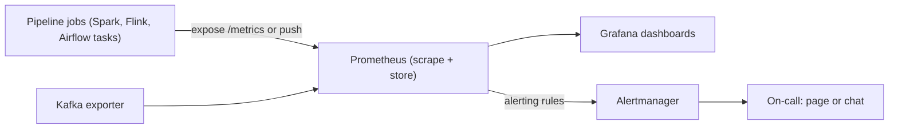

## 🎯 خلاصه

> **مانیتورینگ پایپ‌لاین** در هر لحظه سه سؤال را جواب می‌دهد: *داده تازه است؟ پایپ‌لاین سالم است؟ دارد به حجم ورودی می‌رسد؟* تو از هر job **متریک** منتشر می‌کنی، آن‌ها را جمع می‌کنی (مثلاً با Prometheus)، روی Grafana نمودار می‌کشی، و روی **نشانه‌هایی که کاربر حس می‌کند** هشدار می‌دهی. این هشدارها بر پایه‌ی یک **SLO** (هدف سطح سرویس) هستند که می‌گوید «به‌اندازه‌ی کافی خوب» یعنی چه.

- **متریک** عدد در طول زمان است: counter (فقط افزایش می‌یابد)، gauge (بالا و پایین می‌رود)، histogram (توزیع، مثل مدت اجرا).
- متریک‌های کلیدی پایپ‌لاین: **freshness** (سن جدیدترین داده)، **مدت job**، **رکورد ورودی و خروجی**، **تعداد خطا**، و برای streaming، **consumer lag**.
- **SLA** وعده به مصرف‌کننده است؛ **SLO** هدف داخلی‌ای است که از آن وعده محافظت می‌کند؛ **SLI** خودِ اندازه‌گیری است. روی مصرف بودجه‌ی SLO هشدار بده، نه روی هر لغزش کوچک.
- هر صفحه‌ی هشدار باید به یک **runbook** وصل باشد و بعد از هر حادثه‌ی واقعی یک **postmortem** بنویسی که چیزی را عوض کند.

## 🌱 از ساده شروع کنیم (مبتدی)

> **💡 تشبیه:** داشبورد ماشین. کیلومترشمار، سوخت‌سنج و چراغ موتور خودِ ماشین را تعمیر نمی‌کنند. زود وضعیت را نشان می‌دهند تا بتوانی عمل کنی. پایپ‌لاین هم همین را لازم دارد: عددهایی که در طول زمان تغییر می‌کنند و چراغ هشداری که قبل از درماندگی راننده روشن شود.

یک پایپ‌لاین روزانه‌ی `orders` را در نظر بگیر که باید تا ساعت ۰۷:۰۰ تمام شود تا تیم فروش درآمد دیروز را ساعت ۰۸:۰۰ ببیند. سه سؤال مشخص می‌کند کار می‌کند یا نه:

| سؤال | متریکی که جواب می‌دهد | نشانه‌ی بد |
|---|---|---|
| آیا داده تازه است؟ | زمان از آخرین داده‌ی لودشده‌ی موفق | ساعت ۰۸:۰۰ هنوز ۹ ساعت کهنه است |
| آیا job سالم است؟ | run‌های خطادار، تعداد خطا | سه retry و بعد شکست |
| آیا حجم عادی است؟ | رکورد پردازش‌شده در هر run | ۴۰٪ ردیف کمتر از معمول |

دو اصطلاحی که همه‌جا می‌بینی:

- **SLA (توافق سطح سرویس):** وعده به افراد بیرون از تیم، مثلاً «جدول `orders` روزهای کاری تا ۰۷:۰۰ آماده است».
- **SLO (هدف سطح سرویس):** هدف داخلی که این وعده را واقع‌بینانه می‌کند، مثلاً «جدول در ۹۵٪ روزهای یک ماه به‌موقع آماده است».

بدون داشبورد، مشکل را وقتی می‌فهمی که مدیر فروش زنگ بزند. با داشبورد، کندشدن job را ساعت ۰۳:۰۰ می‌بینی و قبل از ۰۷:۰۰ درستش می‌کنی.

## 🔧 واقعاً چطور کار می‌کند (متوسط)

### مسیر مانیتورینگ



Prometheus یک سیستم **pull** است: در بازه‌ی ثابت، endpoint HTTP هر هدف را scrape می‌کند و نمونه‌ها را به‌صورت time series ذخیره می‌کند. هر سری با نام متریک به‌علاوه‌ی labelها مشخص می‌شود، مثلاً `pipeline="orders"`. Grafana از Prometheus داده می‌خواند و نمودار می‌کشد. Alertmanager هشدارهای Prometheus را می‌گیرد و به آدم‌ها می‌رساند.

### Instrument کردن یک job

یک job سه نوع متریک منتشر می‌کند. این یک مثال کوتاه پایتون با کتابخانه‌ی `prometheus_client` است:

```python
import time
from prometheus_client import Counter, Gauge, Histogram, start_http_server

RECORDS = Counter("pipeline_records_processed_total", "Records processed", ["pipeline"])
LAST_OK = Gauge("pipeline_last_success_timestamp_seconds", "Unix time of last successful run", ["pipeline"])
DURATION = Histogram("pipeline_run_duration_seconds", "Run duration in seconds", ["pipeline"])

def run(batch):
    start = time.time()
    n = transform_and_load(batch)          # your job logic
    RECORDS.labels(pipeline="orders").inc(n)
    DURATION.labels(pipeline="orders").observe(time.time() - start)
    LAST_OK.labels(pipeline="orders").set_to_current_time()

if __name__ == "__main__":
    start_http_server(8000)                # exposes /metrics for Prometheus
    run(load_batch())
```

- **Counter** فقط زیاد می‌شود. برای گرفتن رکورد در ثانیه در PromQL از `rate()` استفاده کن.
- **Gauge** مقدار فعلی را نگه می‌دارد. زمان آخرین موفقیت یک gauge است، چون وضعیت است، نه انباشت.
- **Histogram** مدت‌ها را ثبت می‌کند تا بتوانی صدک ۹۵ را بپرسی.

jobهای batch کوتاه‌عمر ممکن است قبل از scrape شدن Prometheus تمام شوند. برای آن‌ها معمولاً از Pushgateway استفاده می‌کنند، یا orchestrator در پایان run متریک‌ها را ثبت می‌کند. Pushgateway فقط برای متریک‌های سطح job مناسب است، نه داده‌ی پرحجم.

### Freshness: مهم‌ترین متریک

Freshness سن جدیدترین داده‌ای است که مصرف‌کننده می‌تواند ببیند. آن را به‌صورت زمان از آخرین publish موفق اندازه می‌گیری، و اختیاری به‌صورت سن جدیدترین event time، که سخت‌گیرانه‌تر است.

```yaml
# Prometheus alerting rule: page if orders is more than 2 hours stale for 10 minutes
groups:
  - name: orders-pipeline
    rules:
      - alert: OrdersFreshnessBreached
        expr: time() - pipeline_last_success_timestamp_seconds{pipeline="orders"} > 7200
        for: 10m
        labels:
          severity: page
        annotations:
          summary: "orders is more than 2h stale"
```

بند `for: 10m` باعث می‌شود یک scrape دیرشده کسی را بیدار نکند.

### Streaming: consumer lag

در Kafka، **consumer lag** تعداد پیامی است که روی یک partition نوشته شده و consumer group هنوز آن را commit نکرده. یعنی log end offset منهای committed offset، که برای هر partition جمع زده می‌شود. lag نشان می‌دهد consumer چند پیام عقب است، و با نرخ تولید آن را به زمان تبدیل می‌کنی.

lag بیشتر یک مسئله‌ی **نرخ** است تا اندازه. اگر backlog برابر `B` پیام باشد، producer در ثانیه `P` پیام می‌نویسد و consumerها `C` پیام در ثانیه پردازش می‌کنند با `C > P`، زمان جبران عقب‌افتادگی این است:

```text
drain time = B / (C - P)

Example: B = 2,000,000 messages, C = 50,000/s, P = 40,000/s
         drain time = 2,000,000 / (50,000 - 40,000) = 200 seconds

If P = 60,000/s instead, C - P is negative: the lag grows forever.
```

پس هشدار «lag بیش از ۱ میلیون» ضعیف است. هشدار بهتر این است: «lag ۱۵ دقیقه است که بالا می‌رود» یا «زمان تخمینی تخلیه از SLO freshness بیشتر است».

## 🧠 عمق و trade-offها (سنیور)

- **اول SLI تعریف کن، بعد SLO.** SLI یک اندازه‌گیری است، مثل «نسبت run‌هایی که تا ۰۷:۰۰ publish می‌شوند». SLO یک هدف روی یک بازه است، مثل ۹۵٪ در ۳۰ روز. فاصله‌ی بین ۱۰۰٪ و SLO همان **error budget** توست.
- **محاسبه‌ی error budget.** برای یک job روزانه در ۳۰ روز، ۹۵٪ یعنی مجاز به از دست دادن `30 × 0.05 = 1.5` روز هستی. یک روز دیرکرد می‌شود ۲۹ از ۳۰ = ۹۶٫۷٪ و پاس می‌شود. دو روز می‌شود ۲۸ از ۳۰ = ۹۳٫۳٪ و رد می‌شود. هدف ۹۹٪ فقط ۰٫۳ روز مجاز می‌دهد، یعنی عملاً صفر، پس ۹۹٪ برای هدف روزانه معمولاً معقول نیست.
- **هشدار روی burn rate، نه روی شکست تکی.** burn rate یعنی بودجه‌ی خطا با چه سرعتی مصرف می‌شود. مصرف سریع (مثلاً کل بودجه‌ی یک روز در یک ساعت) صفحه‌ی on-call را روشن می‌کند. مصرف آرام فقط یک ticket باز می‌کند. این بیشتر نویز هشدار را حذف می‌کند بی‌آنکه خرابی واقعی را جا بگذارد.
- **روی نشانه هشدار بده، با علت‌ها تحقیق کن.** روی «داده کهنه است» یا «lag دارد بالا می‌رود» صفحه را روشن کن. روی «CPU ۸۰٪ است» نه، چون ممکن است کاملاً عادی باشد. علت‌ها (CPU، GC، از دست رفتن executorها) را روی داشبورد بگذار.
- **Cardinality هزینه دارد.** labelهایی مثل `pipeline` یا `table` مشکلی ندارند. label‌ای با `user_id` یا `order_id` میلیون‌ها سری می‌سازد و می‌تواند Prometheus را از کار بیندازد. جزئیات با cardinality بالا را در لاگ یا در warehouse نگه دار.
- **Spark و Flink.** Spark متریک‌های خودش (executor، stage، حجم shuffle) را منتشر می‌کند که می‌توانی scrape کنی؛ برای تشخیص از Spark UI استفاده کن (ببین [[spark-ui-debugging]]). Flink متریک‌های checkpoint duration و backpressure را منتشر می‌کند و lag منبع Kafka از متریک‌های connector می‌آید. مدت checkpoint را زیر نظر بگیر: وقتی به فاصله‌ی checkpoint نزدیک شود، یک ساعت کندی با شکست فاصله داری.
- **Airflow.** مدت task، تعداد retry و «آخرین run موفق» در سطح DAG را دنبال کن. یادت باشد که orchestrator که «success» گزارش می‌دهد ثابت نمی‌کند داده درست است؛ آن را با چک‌های freshness و کیفیت کنار هم بگذار (ببین [[data-quality]]).
- **مشکل ساعت.** freshness به ساعت سیستم وابسته است. اگر ساعت یک worker ۱۰ دقیقه غلط باشد، هشدار freshness هم همین‌قدر خطا دارد. برای اندازه‌گیری و هشدار از یک منبع زمان استفاده کن، و وقتی می‌خواهی بدانی داده چقدر دیر رسیده، event time را با processing time مقایسه کن.
- **بلوغ عملیاتی.** هر هشدار مالک، لینک runbook و اقدام مورد انتظار دارد. بعد از حادثه‌ی واقعی، postmortem بنویس (ببین [[incidents-postmortems]]) و حداقل یک چیز را عوض کن: یک متریک، یک آستانه، یک سیاست retry، یا runbook. وگرنه همان حادثه با اسم جدید برمی‌گردد.
- **کی این‌ها لازم نیستند.** یک گزارش شبانه که فقط یک نفر استفاده می‌کند به SLO و هشدار burn rate نیاز ندارد. یک heartbeat و یک پیام در Slack ممکن است کافی باشد. ابزار را با هزینه‌ی اشتباه‌بودن متناسب کن.

## 🧪 امتحان کن

یک job به نام `orders` گیج `pipeline_last_success_timestamp_seconds{pipeline="orders"}` (ثانیه‌ی Unix) را می‌نویسد. دو کار:

1. یک عبارت PromQL بنویس که بگوید داده‌ی `orders` چند ثانیه کهنه است.
2. با backlog کافکا برابر `B = 3,000,000`، consumerها با `C = 90,000/s` و producerها با `P = 75,000/s`، تخلیه‌ی lag چقدر طول می‌کشد؟ اگر نرخ producer به `95,000/s` برسد چه تغییری می‌کند؟

<details><summary>حدست چیست؟</summary>

1. سن به ثانیه: زمان فعلی منهای timestamp آخرین موفقیت.

```promql
time() - pipeline_last_success_timestamp_seconds{pipeline="orders"}
```

برای تبدیل آن به شرط هشدار `> 7200` اضافه کن، و `for: 10m` را در rule بگذار، مثل مثال YAML بالا.

2. زمان تخلیه = `B / (C - P)` = 3,000,000 / (90,000 - 75,000) = 3,000,000 / 15,000 = **200 ثانیه**. اگر نرخ producer به 95,000/s برسد، `C - P = -5,000` می‌شود: consumerها از producerها کندترند، مخرج منفی است، و lag در هر ثانیه ۵٬۰۰۰ پیام زیاد می‌شود. راه‌حل، consumer بیشتر (یا partition بیشتر برای موازی‌سازی) است، نه صبر طولانی‌تر.

</details>

## 💬 گوشه‌ی مصاحبه

**سؤال رایج:** «یک پایپ‌لاین روزانه‌ی داده را چطور مانیتور می‌کنی؟ روی چه چیزی هشدار می‌دهی؟»

- **پاسخ مبتدی:** «لاگ‌ها را نگاه می‌کنم و اگر job شکست بخورد هشدار می‌گذارم.»
- **پاسخ متوسط:** «متریک‌های مدت، تعداد رکورد و خطا را با Prometheus و Grafana منتشر می‌کنم. روی freshness، یعنی زمان از آخرین لود موفق، و روی شکست‌ها بعد از retry هشدار می‌دهم.»
- **پاسخ سنیور:** «برای freshness یک SLO تعریف می‌کنم، مثلاً ۹۵٪ روزها تا ۰۷:۰۰ آماده، و روی مصرف error budget هشدار می‌دهم نه روی شکست تکی. در streaming، lag را به‌عنوان نرخ رشد و زمان تخلیه می‌بینم. علت‌هایی مثل CPU و مدت checkpoint روی داشبورد می‌مانند و هر هشدار runbook دارد.»

> **🎤 این را در مصاحبه بگو:** «نشانه‌هایی را مانیتور می‌کنم که مصرف‌کننده حس می‌کند: freshness، حجم و شکست‌ها. روی SLO مربوط به freshness هشدار می‌دهم، با burn rate تا یک دیرکرد تکی کسی را بیدار نکند. در streaming، lag فقط به‌عنوان نرخ در برابر زمان تخلیه معنا دارد، پس وقتی رشد می‌کند یا تخمین تخلیه از SLO بیرون می‌زند هشدار می‌دهم. هر هشدار runbook دارد و هر حادثه‌ی واقعی با یک postmortem تمام می‌شود که چیزی را عوض می‌کند.»

## ⚠️ اشتباهات رایج

> **⚠️ مراقب باش:** هشدار دادن روی «job موفق شد». یک job می‌تواند موفق شود و باز هم داده‌ی دیروز یا صفر ردیف منتشر کند. روی freshness و حجم هم هشدار بده.

- **هشدار روی علت به‌جای نشانه.** CPU بالا یک علت است. داده‌ی کهنه نشانه‌ای است که کاربر به آن اهمیت می‌دهد.
- **آستانه روی اندازه‌ی lag.** «lag بیش از ۱ میلیون» در ترافیک اوج روی یک سیستم سالم هشدار می‌دهد و نشت آرام را جا می‌گذارد. از رشد و زمان تخلیه استفاده کن.
- **labelهای با cardinality بالا.** گذاشتن `order_id` در label برای هر سفارش یک سری جدید می‌سازد. حافظه‌ی Prometheus تا خرابی رشد می‌کند.
- **scrape کردن jobهای کوتاه‌عمر و تعجب از نبودن متریک.** job قبل از scrape تمام شده. از Pushgateway استفاده کن یا در پایان job ثبت کن.
- **صفحه‌ی on-call برای هر شکست.** retryهایی که موفق می‌شوند نباید کسی را بیدار کنند. روی مصرف سریع بودجه صفحه را روشن کن.
- **بدون مالک و بدون runbook.** هشداری که کسی نمی‌تواند رویش عمل کند نویز است، و نویز بی‌صدا می‌شود.
- **داشبورد بدون هشدار یا هشدار بدون داشبورد.** برای تشخیص به نمودار نیاز داری، و برای فهمیدن به هشدار.

## ✅ خودت را بسنج

1. برای «زمان آخرین run موفق» کدام نوع متریک مناسب‌تر است؟
   - A) Counter
   - B) Gauge
   - C) Histogram
   - D) Summary از نام job ها

2. یک job روزانه SLO فراهمی ۹۵٪ در ۳۰ روز دارد. چند روز دیرکرد می‌توانی داشته باشی و هنوز به SLO برسی؟
   - A) ۰
   - B) ۱
   - C) ۲
   - D) ۵

3. lag کافکا ۱٬۰۰۰٬۰۰۰ پیام است، consumerها ۳۰٬۰۰۰ پیام در ثانیه پردازش می‌کنند و producerها ۲۰٬۰۰۰ پیام در ثانیه می‌نویسند. تقریباً چقدر طول می‌کشد تا lag صاف شود؟
   - A) حدود ۳۳ ثانیه
   - B) حدود ۱۰۰ ثانیه
   - C) حدود ۱ ساعت
   - D) هرگز صاف نمی‌شود

4. **سناریو (سنیور):** تیم شما برای هر task شکست‌خورده صفحه را روشن می‌کند و on-call خسته شده. چه چیزی را عوض می‌کنی و چه چیزی را نگه می‌داری؟

5. **چرا/trade-off (سنیور):** کسی پیشنهاد می‌دهد روی counter تعداد رکورد یک label با `customer_id` بگذاریم تا «توان هر مشتری را ببینیم». مشکل چیست و طراحی بهتر کدام است؟

<details><summary>جواب</summary>

1. **B** — gauge وضعیت فعلی را نگه می‌دارد. زمان آخرین موفقیت بالا و پایین می‌رود و انباشت نیست (پس counter نیست) و توزیع هم نیست (پس histogram نیست).
2. **B** — ۳۰ × ۰٫۰۵ = ۱٫۵. یک روز دیرکرد می‌شود ۲۹ از ۳۰ = ۹۶٫۷٪ و پاس می‌شود. دو روز دیرکرد می‌شود ۹۳٫۳٪ و رد می‌شود.
3. **B** — زمان تخلیه = B / (C − P) = 1,000,000 / (30,000 − 20,000) = ۱۰۰ ثانیه.
4. شکست را به‌عنوان سیگنال نگه دار، ولی هشدار را روی burn rate و freshness بگذار. retryهایی که موفق می‌شوند نباید صفحه را روشن کنند. صفحه را برای مصرف سریع بودجه و نقض freshness نگه دار، و مصرف آرام را به ticket بفرست. هر هشدار باقی‌مانده runbook دارد؛ هشدارهایی که اقدامی ندارند حذف می‌شوند.
5. label با `customer_id` برای هر مشتری یک time series می‌سازد، یعنی میلیون‌ها سری، مصرف حافظه‌ی بالا، و Prometheus کند یا خراب. طراحی بهتر این است که جزئیات هر مشتری در لاگ یا در warehouse بماند (با SQL پرسیده شود)، و متریک‌ها در سطح کم‌cardinality مثل `pipeline` و `stage` بمانند.

</details>

## 🗂️ فلش‌کارت

| Front | Back |
|---|---|
| SLI، SLO، SLA | SLI = اندازه‌گیری؛ SLO = هدف داخلی روی یک بازه؛ SLA = وعده به مصرف‌کننده |
| Error budget | خطای مجازی که SLO ضمنی می‌دهد (مثلاً ۵٪ روزها) |
| Counter در برابر gauge | counter فقط زیاد می‌شود (با `rate()`)؛ gauge مقدار فعلی را نگه می‌دارد |
| متریک freshness برای job batch | زمان از آخرین publish موفق، معمولاً gauge از timestamp آخرین موفقیت |
| Consumer lag | log end offset منهای committed offset، جمع‌شده روی partitionها |
| فرمول زمان تخلیه | `B / (C - P)`؛ اگر `C <= P` باشد، lag هرگز صاف نمی‌شود |
| هشدار burn rate | وقتی بودجه‌ی خطا سریع مصرف شود صفحه را روشن می‌کند، نه روی شکست تکی |
| چرا label با `user_id` نگذاریم | هر مقدار متمایز یک سری زمانی جدید می‌سازد که Prometheus را از پا درمی‌آورد |

## 🔗 ادامه

- [[data-observability]] — تشخیص ناهنجاری روی freshness، حجم و schema، فراتر از آستانه‌های ثابت.
- [[data-quality]] — تست‌هایی که می‌گویند داده درست است، نه فقط اینکه رسیده.
- [[incidents-postmortems]] — چطور یک حادثه را مدیریت کنی و به تغییر تبدیلش کنی.
- [[kafka-consumers]] — consumer groups، rebalancing و اینکه lag چطور جمع می‌شود.
- [[spark-ui-debugging]] — تشخیص یک job کند Spark بعد از اینکه مانیتورینگ آن را نشان داد.
- [[airflow]] — retry در سطح task، SLA و هشدار در orchestrator.
