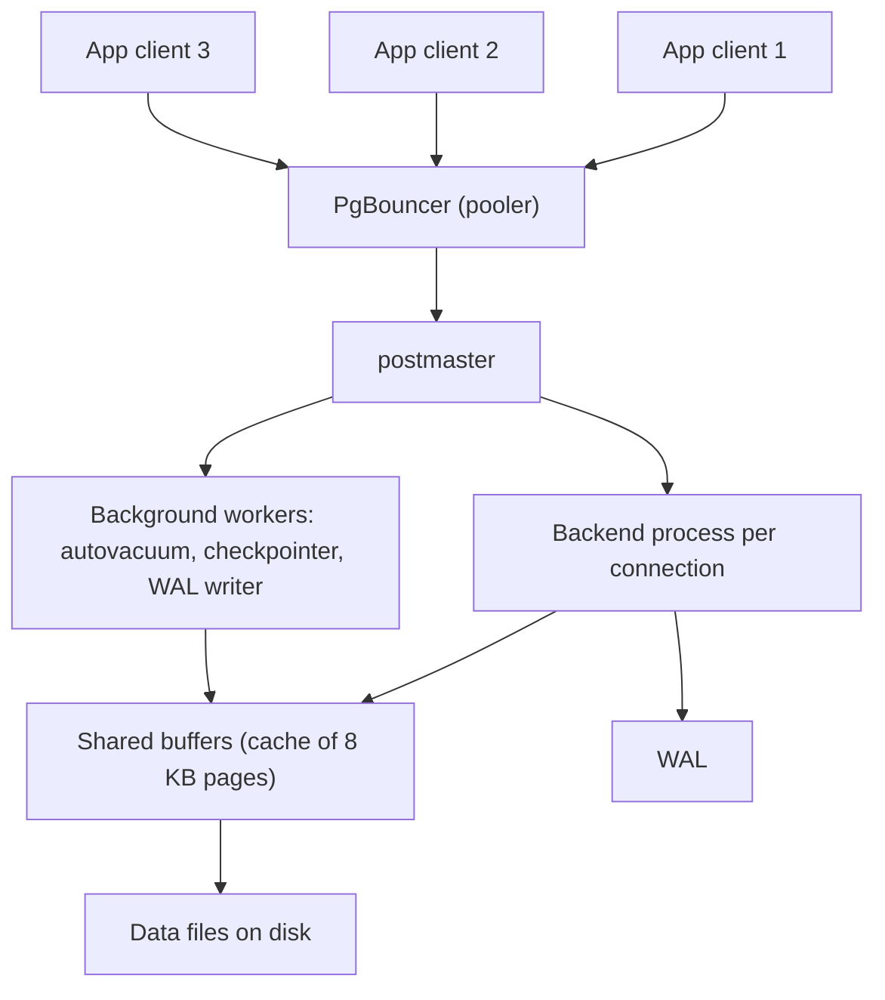

## 🎯 خلاصه

> PostgreSQL یک **row-store** عمومی با موتور SQL قوی، MVCC، write-ahead log و اکوسیستم بزرگ extension است. در بسیاری از شرکت‌ها دیتابیس OLTP پیش‌فرض است و برای مقدار قابل توجهی تحلیل هم کافی است. نقاط ضعف عملیاتی‌اش **اتصال‌ها**، **VACUUM و bloat** و **replication slot** ها هستند.

- هر کلاینت‌ِ متصل یک **backend process** جداگانه می‌گیرد که هزینه دارد. از یک pooler مثل PgBouncer استفاده کن.
- MVCC **نسخه‌های مرده‌ی ردیف** باقی می‌گذارد. VACUUM آن‌ها را پاک می‌کند و autovacuum باید همراهش باشد.
- **partitioning اعلانی** جدول‌های بزرگ را تقسیم می‌کند. **logical replication** و **replication slot** ها replicaها و CDC را تغذیه می‌کنند.
- **JSONB** داده‌ی نیمه‌ساختاریافته را با index نگه می‌دارد. **extension** هایی مثل TimescaleDB و Citus آن را به سمت time-series و مقیاس افقی می‌برند.

## 🌱 از ساده شروع کنیم (مبتدی)

> **💡 تشبیه:** PostgreSQL یک **دفتر خوب‌اداره‌شده** است. هر مراجعه‌کننده دستیار اختصاصی خودش را می‌گیرد (یک backend process). دستیار هر تغییر را در دفتر ثبت می‌کند (WAL). وقتی کاغذی خط می‌خورد و دوباره نوشته می‌شود، کسی باید نسخه‌های قدیمی را جمع کند (VACUUM). اگر 10,000 مراجعه‌کننده داشته باشی اما 20 میز، به یک پذیرش نیاز داری که صف بکشد (connection pooler).

با SQL ساده می‌توانی شروع کنی:

```sql
CREATE TABLE orders (
  id         bigint GENERATED ALWAYS AS IDENTITY PRIMARY KEY,
  user_id    bigint NOT NULL,
  status     text   NOT NULL,
  amount     numeric(12,2) NOT NULL,
  created_at timestamptz NOT NULL DEFAULT now()
);

INSERT INTO orders (user_id, status, amount)
VALUES (1, 'PAID', 120.00), (2, 'NEW', 45.50);

SELECT status, count(*) FROM orders GROUP BY status;
```

همین برای کار کردن یک جونیور با PostgreSQL کافی است. بقیه‌ی این درس درباره‌ی اتفاقات زیر پوسته و چیزهایی است که در مقیاس می‌شکنند.

## 🔧 واقعاً چطور کار می‌کند (متوسط)

### معماری در یک تصویر



- **postmaster** برای **هر اتصال یک backend process** راه می‌اندازد. هر process حافظه‌ی خودش را دارد، پس 2,000 اتصال بیکار RAM و هزینه‌ی زمان‌بندی CPU زیادی مصرف می‌کنند. به همین دلیل اپلیکیشن‌ها به pooling نیاز دارند.
- **shared buffers** صفحه‌های داده را cache می‌کند. نقطه‌ی شروع توصیه‌شده در مستندات حدود 25٪ RAM است و بقیه‌ی کار را cache سیستم‌عامل انجام می‌دهد.
- نوشتن‌ها اول به WAL می‌روند و صفحه‌ها در checkpoint نوشته می‌شوند (به [[wal-mvcc]] نگاه کن).

### connection pooling با PgBouncer

PgBouncer تعداد کمی اتصال واقعی به سرور نگه می‌دارد و آن‌ها را بین تعداد زیادی کلاینت به اشتراک می‌گذارد.

| حالت pool | اتصال سرور کی به pool برمی‌گردد | چه چیزی می‌شکند |
|---|---|---|
| session | وقتی کلاینت قطع شود | چیزی نمی‌شکند، ولی سود کمی دارد |
| transaction | در انتهای هر تراکنش | state نشست: `SET`، advisory lockهای نشست، جدول‌های موقت، prepared statement سطح نشست (پشتیبانی از prepared statement را در یادداشت نسخه‌ی خودت چک کن) |
| statement | بعد از هر statement | تراکنش‌های چندstatement‌ای |

حالت transaction انتخاب رایج برای وب‌اپ‌هاست. پیش از رفتن به آن، اپلیکیشنت را برای ویژگی‌های سطح نشست بررسی کن.

### VACUUM، bloat و wraparound

به‌خاطر MVCC (به [[wal-mvcc]] نگاه کن)، یک `UPDATE` تاپل جدید می‌نویسد و تاپل قدیمی را به‌صورت **dead tuple** باقی می‌گذارد. یک `DELETE` هم همین کار را می‌کند. dead tupleها فضا می‌گیرند و باعث می‌شوند scanها صفحات بیشتری بخوانند.

- **VACUUM** dead tupleها را قابل‌استفاده‌ی مجدد علامت می‌زند. معمولاً حجم فایل را کوچک نمی‌کند، اما visibility map را به‌روز می‌کند تا index-only scan بتواند صفحه‌ها را رد کند.
- **VACUUM FULL** جدول را بازنویسی می‌کند و قفل انحصاری می‌گیرد. کم استفاده‌اش کن، یا برای بازنویسی آنلاین از `pg_repack` استفاده کن.
- **autovacuum** خودکار اجرا می‌شود. آستانه‌های پیش‌فرض برای یک جدول شلوغ و بزرگ اغلب خیلی تنبل هستند. آن‌ها را برای هر جدول با `autovacuum_vacuum_scale_factor` و تنظیمات مرتبط تنظیم کن.
- **bloat** فاصله‌ی بین حجم فیزیکی و حجم داده‌ی زنده است. با view های آماری یا برای عدد دقیق با `pgstattuple` بررسی‌اش کن.
- **freeze و wraparound.** شناسه‌های تراکنش 32-bit هستند. vacuum ردیف‌های قدیمی را freeze می‌کند تا شمارنده ادامه پیدا کند. اگر autovacuum نتواند همگام شود، PostgreSQL برای محافظت از داده نوشتن را قبول نمی‌کند. سن قدیمی‌ترین شناسه‌ی تراکنش را در هر دیتابیس پایش کن.

### partitioning

partitioning اعلانی (range، list یا hash) یک جدول منطقی را به جدول‌های فرزند تقسیم می‌کند. هر partition ذخیره‌سازی و indexهای خودش را دارد.

```sql
CREATE TABLE events (
  event_time timestamptz NOT NULL,
  user_id    bigint      NOT NULL,
  payload    jsonb
) PARTITION BY RANGE (event_time);

CREATE TABLE events_2026_01 PARTITION OF events
  FOR VALUES FROM ('2026-01-01') TO ('2026-02-01');
CREATE TABLE events_2026_02 PARTITION OF events
  FOR VALUES FROM ('2026-02-01') TO ('2026-03-01');

-- Pruning: only events_2026_01 is scanned
EXPLAIN SELECT count(*) FROM events
WHERE event_time >= '2026-01-10' AND event_time < '2026-01-11';
```

partition pruning به planner اجازه می‌دهد partitionهایی را که نمی‌توانند تطبیق پیدا کنند رد کند، و حذف یک partition قدیمی خیلی ارزان‌تر از یک `DELETE` بزرگ است. partitioning به‌تنهایی کوئری‌ها را سریع‌تر نمی‌کند. وقتی کمک می‌کند که کوئری‌ها روی کلید partition فیلتر کنند.

### logical replication و replication slot

- **streaming replication فیزیکی** WAL را بایت به بایت به یک standby کپی می‌کند. standby یک کپی دقیق از کل کلاستر است.
- **logical replication** تغییرات ردیف جدول‌های انتخابی را از طریق یک **publication** منتشر می‌کند و یک **subscription** روی سرور دیگر آن‌ها را اعمال می‌کند. می‌تواند فقط بعضی جدول‌ها را تکثیر کند و به نسخه‌ی major دیگری هم تغذیه کند.
- یک **replication slot** وعده‌ی سرور برای نگه داشتن WAL ای است که مصرف‌کننده هنوز نیاز دارد. logical replication و ابزارهای CDC مثل Debezium از slot استفاده می‌کنند.

slot برای مصرف‌کننده امن و برای سرور ریسکی است. یک مصرف‌کننده‌ی متوقف‌شده باعث می‌شود سرور WAL را نگه دارد تا دیسک پر شود. برای سمت pipeline به [[cdc]] نگاه کن.

### JSONB

`jsonb` یک JSON را به شکل باینری ذخیره می‌کند، با کلیدهای deduplicate شده و دسترسی سریع. `json` را فقط وقتی استفاده کن که لازم است متن دقیق را نگه داری.

```sql
CREATE TABLE devices (id bigint PRIMARY KEY, attrs jsonb);
INSERT INTO devices VALUES (1, '{"os":"android","tags":["vip","beta"]}');

-- ->> returns text, -> returns jsonb
SELECT attrs->>'os' AS os FROM devices WHERE attrs @> '{"os":"android"}';

-- GIN index makes containment (@>) fast
CREATE INDEX devices_attrs_gin ON devices USING gin (attrs);
```

JSONB برای ویژگی‌های اختیاری و schema انعطاف‌پذیر خوب است. برای فیلدهایی که مدام فیلتر، join و aggregate می‌کنی انتخاب خوبی نیست. این فیلدها را به ستون واقعی تبدیل کن، یا از یک generated column با index استفاده کن.

### extension ها

extension ها نوع داده، روش index و قابلیت‌های کامل اضافه می‌کنند:

- **TimescaleDB** برای time-series، hypertable (partitioning خودکار زمانی)، continuous aggregate و فشرده‌سازی شبیه ستونی اضافه می‌کند. به [[time-series-db]] نگاه کن.
- **Citus** جدول‌ها را بین nodeها بر اساس یک ستون توزیع پخش می‌کند و مقیاس افقی برای بارهای چندمستاجری و تحلیلی می‌دهد.
- **PostGIS** نوع‌ها و index های جغرافیایی اضافه می‌کند.
- **pg_stat_statements** آمار کوئری‌ها را ثبت می‌کند و اولین ابزار برای پیدا کردن SQL کند است.

هر extension هزینه‌های عملیاتی و محدودیت‌های نسخه‌ی خودش را دارد، پس مستنداتش را برای نسخه‌ی سرورت بررسی کن.

## 🧠 عمق و trade-offها (سنیور)

- **اتصال‌ها اولین محدودیت مقیاس‌اند.** خیلی از اپلیکیشن‌ها اتصال‌های بیشتری از آنچه دیتابیس کارآمد اداره کند باز می‌کنند. در لبه pool کن، کل اتصال‌ها را محدود کن، و اندازه‌ی pool را بر اساس تعداد هسته‌ها و دیسک‌ها تعیین کن، نه تعداد threadهای اپ. بعد از deploy یا ری‌استارت، مراقب connection storm باش.
- **autovacuum به ظرفیت نیاز دارد.** روی جدول‌های بزرگ و داغ، پیش‌فرض‌ها عقب می‌مانند. آستانه‌ها را برای هر جدول تنظیم کن، `n_dead_tup` و سن قدیمی‌ترین XID را پایش کن، و به autovacuum کارگر و بودجه‌ی I/O کافی بده.
- **تراکنش‌های طولانی معمول‌ترین علت bloat هستند.** یک تراکنش باز یا یک replica با `hot_standby_feedback` می‌تواند پاک‌سازی را عقب بیندازد. timeout برای تراکنش‌های بیکار تنظیم کن و قدیمی‌ترین snapshot را بررسی کن.
- **replication slot و ایمنی دیسک.** برای WAL نگه‌داشته‌شده در هر slot هشدار بگذار. یک connector متوقف‌شده‌ی CDC می‌تواند دیسک منبع را پر کند، که یعنی قطع سرویس روی دیتابیس تولید.
- **هزینه‌ی نوشتن و index ها.** هر index روی جدول، با هر نوشتن به‌روز می‌شود و هر به‌روزرسانی یک tuple جدید می‌سازد، مگر این‌که HOT (heap-only tuple) update اعمال شود. index های زیاد نوشتن را کند و جدول را bloat می‌کنند. با `pg_stat_user_indexes` دنبال index های هرگز استفاده‌نشده بگرد.
- **آمار planner.** برآوردهای ردیف بد، planهای بد می‌دهند. بعد از load های بزرگ `ANALYZE` بزن و با `EXPLAIN (ANALYZE, BUFFERS)` برآوردها را با ردیف‌های واقعی مقایسه کن. به [[sql-query-optimization]] نگاه کن.
- **تنظیمات حافظه.** `shared_buffers`، `work_mem` (برای هر عملیات sort یا hash، در هر اتصال) و `effective_cache_size` (برآورد planner، نه تخصیص) را تنظیم کن. `work_mem` بالا ضربدر اتصال‌های زیاد می‌تواند RAM را تمام کند.
- **آیا Postgres برای warehouse کافی است؟** برای حجم داده‌ی متوسط، همزمانی معقول و بیشتر کوئری‌های انتخابی، بله. ذخیره‌سازی ردیفی اسکن‌های تحلیلی پهن را گران می‌کند. گزینه‌های ستونی وجود دارند (Citus columnar، فشرده‌سازی TimescaleDB)، اما وقتی اسکن روی جدول‌های بزرگ غالب شود، معمولاً یک موتور ستونی اختصاصی برنده است. تصمیم را بر اساس الگوی کوئری‌های اندازه‌گیری‌شده بگیر، نه فقط حجم. به [[columnar-storage]] نگاه کن.
- **کی Postgres را استفاده نکنیم.** نرخ نوشتن خیلی بالا روی nodeهای زیاد، اسکن‌های تحلیلی بسیار بزرگ، یا بارهایی که schema ثابت جور نیست و الگوی دسترسی سندمحور غالب است. آن‌وقت با [[nosql-families]] و موتورهای warehouse مقایسه کن.

## 🧪 امتحان کن

1. **اندازه‌ی pool.** یک اپ 40 thread در هر pod دارد و 20 pod، و دیتابیس 16 هسته دارد. چرا 800 اتصال مستقیم فکر بدی است و در PgBouncer چه تنظیم می‌کنی؟
2. **partition pruning.** با جدول `events` بالا، یک کوئری بنویس که فقط فوریه‌ی 2026 را لمس کند، و توضیح بده چرا `WHERE date_trunc('day', event_time) = '2026-02-10'` می‌تواند pruning را از بین ببرد.
3. **کوئری JSONB.** کوئری‌ای بنویس که `id` دستگاه‌هایی را برگرداند که در آرایه‌ی `tags` داخل `attrs` تگ `"beta"` دارند.
4. **بررسی slot.** کوئری‌ای بنویس که برای هر replication slot نشان دهد مصرف‌کننده‌اش چقدر از موقعیت فعلی WAL عقب است.

<details><summary>پاسخ‌ها را ببین</summary>

**1.** 800 backend با 16 هسته رقابت می‌کنند و حافظه‌ی زیادی مصرف می‌کنند، و سوییچ context بر کار غالب می‌شود. در PgBouncer از حالت transaction با یک pool کوچک سرور استفاده کن (مثلاً چند برابر تعداد هسته، مشترک بین همه‌ی podها) و اتصال کلاینت‌ها را محدود کن. عددهای دقیق به بارکاری بستگی دارند، پس اندازه‌گیری کن.

**2.** `WHERE event_time >= '2026-02-01' AND event_time < '2026-03-01'` قابل‌استفاده برای index و pruning است و planner را به partition فوریه می‌رساند. پیچیدن ستون در `date_trunc` آن را از محدودیت partition پنهان می‌کند، پس planner ممکن است همه‌ی partitionها را اسکن کند. آن را به یک بازه روی ستون خام بازنویسی کن.

**3.**
```sql
SELECT id FROM devices WHERE attrs @> '{"tags":["beta"]}';
```
عملگر containment آرایه‌هایی را پیدا می‌کند که عنصر را داشته باشند، و index از نوع GIN می‌تواند آن را پاسخ دهد.

**4.**
```sql
SELECT slot_name,
       active,
       pg_size_pretty(pg_wal_lsn_diff(pg_current_wal_lsn(), confirmed_flush_lsn)) AS lag
FROM pg_replication_slots
WHERE slot_type = 'logical';
```
lag رو به رشد با `active = false` یعنی مصرف‌کننده خاموش یا متوقف است. lag بزرگ با `active = true` یعنی کند است.

</details>

## 💬 گوشه‌ی مصاحبه

**سؤال: «Postgres ما زیر بار کند است. از کجا شروع می‌کنی؟»** جواب متوسط: «اول تعداد اتصال‌ها و pooling را بررسی می‌کنم، بعد کوئری‌های کند با `pg_stat_statements`، و بعد planها با `EXPLAIN (ANALYZE, BUFFERS)`.» جواب سنیور: «اول اتصال‌ها و pooling، بعد عقب‌افتادگی autovacuum و bloat، بعد تراکنش‌های طولانی، و بعد planهای کند. فقط بعد از آن به سخت‌افزار یا partitioning فکر می‌کنم. برای هر کدام از این‌ها قبل از incident باید پایش داشته باشیم.»

**سؤال: «می‌توانیم Postgres را به‌عنوان warehouse تحلیلی‌مان استفاده کنیم؟»** جواب متوسط: «برای داده‌ی کم و داشبوردهای ساده، بله. برای اسکن‌های بزرگ یک موتور ستونی بهتر است.» جواب سنیور: «درباره‌ی حجم داده، همزمانی، شکل کوئری و نیاز به تازگی داده می‌پرسم. با کوئری‌های واقعی اندازه می‌گیرم، partitioning را در نظر می‌گیرم، و اگر اسکن‌های پهن غالب شدند، مهاجرت به موتور ستونی را برنامه‌ریزی می‌کنم. CDC به warehouse از logical decoding استفاده می‌کند، با پایش slot.»

**سؤال: «تفاوت streaming replication و logical replication چیست؟»** جواب متوسط: «streaming، WAL را بایت به بایت کپی می‌کند، پس standby کل کلاستر است. logical، تغییرات ردیف جدول‌های انتخابی را کپی می‌کند و می‌تواند بین نسخه‌ها کار کند.» جواب سنیور: «logical برای تکثیر جزئی و مهاجرت مناسب است، ولی جدول‌های تکثیرشده به primary key نیاز دارند و DDL به‌صورت خودکار تکثیر نمی‌شود.»

> **🎤 این را در مصاحبه بگو:** «PostgreSQL برای هر اتصال یک process می‌سازد، پس من یک pooler جلویش می‌گذارم. MVCC dead tuple می‌سازد که VACUUM باید پاک کند، پس عقب‌افتادگی autovacuum و تراکنش‌های طولانی را پایش می‌کنم. برای CDC از logical decoding از طریق replication slot استفاده می‌کنم و برای WAL نگه‌داشته‌شده هشدار می‌گذارم.»

## ⚠️ اشتباهات رایج

> **⚠️ حواست باشد:** بالا بردن `max_connections` برای حل timeout. process های backend بیشتر، سرور را کندتر می‌کنند. اتصال‌ها را pool کن.

> **⚠️ حواست باشد:** اجرای `VACUUM FULL` روی یک جدول شلوغ تولید در ساعات کار. قفل انحصاری می‌گیرد و خواندن و نوشتن را برای مدت اجرایش بلاک می‌کند.

- فرض این‌که autovacuum همیشه کافی است. جدول‌های بزرگ و داغ اغلب تنظیم اختصاصی لازم دارند.
- استفاده از `json` جایی که `jsonb` لازم است، که index و operatorها را در دسترس نمی‌گذارد.
- پیچیدن ستون‌های index شده در تابع، که استفاده از index و partition pruning را از بین می‌برد.
- نگه داشتن یک replication slot بلااستفاده بعد از حذف یک pipeline CDC.
- تنظیم `work_mem` بالا به‌صورت سراسری، و بعد تمام شدن RAM وقتی اتصال‌های زیاد هم‌زمان sort می‌کنند.
- اعتماد به `EXPLAIN` بدون `ANALYZE` به‌عنوان اثبات. بدون `ANALYZE`، plan یک برآورد است.

## ✅ خودت را بسنج

1. چرا PostgreSQL برای اپلیکیشن‌هایی با کلاینت‌های زیاد connection pooler توصیه می‌کند؟
   - A) هر اتصال یک backend process جداگانه با حافظه‌ی خودش است، پس اتصال‌های زیاد گران‌اند
   - B) اتصال‌ها نمی‌توانند به‌صورت موازی کوئری اجرا کنند
   - C) PostgreSQL بیشتر از 10 اتصال را نمی‌پذیرد
   - D) poolerها جای WAL را می‌گیرند

<details><summary>جواب</summary>

**A** — هر اتصال یک backend process با حافظه و هزینه‌ی زمان‌بندی خودش می‌گیرد. pooler تعداد کمی اتصال سرور را بین کلاینت‌های زیاد به اشتراک می‌گذارد.

</details>

2. VACUUM چه کاری می‌کند؟
   - A) فایل‌های WAL غیرضروری را پاک می‌کند
   - B) نسخه‌های مرده‌ی ردیف را قابل‌استفاده‌ی مجدد علامت می‌زند و اطلاعات visibility را نگه می‌دارد، تا فضا دوباره استفاده شود
   - C) همه‌ی indexها را از صفر می‌سازد
   - D) سطح isolation تراکنش‌های در حال اجرا را عوض می‌کند

<details><summary>جواب</summary>

**B** — VACUUM dead tupleهای باقی‌مانده از MVCC را پاک می‌کند. معمولاً فضا را به سیستم‌عامل برنمی‌گرداند، ولی به جدول اجازه می‌دهد فضا را دوباره استفاده کند.

</details>

3. کدام شکل کوئری به planner اجازه می‌دهد partitionهای جدولی را که با `event_time` partition شده رد کند؟
   - A) `WHERE date_trunc('month', event_time) = '2026-02-01'`
   - B) `WHERE event_time >= '2026-02-01' AND event_time < '2026-03-01'`
   - C) `WHERE to_char(event_time) LIKE '2026-02%'`
   - D) `WHERE event_time::text = '2026-02-01'`

<details><summary>جواب</summary>

**B** — یک بازه روی ستون خام partition به planner اجازه می‌دهد آن را با مرزهای partition مقایسه کند. تابع یا cast روی ستون، این رابطه را از pruning پنهان می‌کند.

</details>

4. **(سنیور)** یک مصرف‌کننده‌ی CDC سه روز است خاموش است و دیسک منبع دارد پر می‌شود. علت چیست و پاسخ درست کدام است؟
   - A) مصرف‌کننده ردیف‌ها را حذف کرده؛ از بکاپ بازیابی کن
   - B) یک replication slot منطقی WAL را تا تأیید مصرف‌کننده نگه می‌دارد؛ مصرف‌کننده را بازیابی یا حذف کن و روی WAL نگه‌داشته‌شده هشدار بگذار
   - C) autovacuum خاموش است؛ آن را روشن کن
   - D) ستون‌های JSONB خیلی بزرگ‌اند؛ آن‌ها را به text تبدیل کن

<details><summary>جواب</summary>

**B** — slot سرور را مجبور می‌کند WAL ای را که مصرف‌کننده تأیید نکرده نگه دارد. بازیابی مصرف‌کننده اجازه می‌دهد WAL آزاد شود. حذف slot آخرین راه است، وقتی مصرف‌کننده دیگر لازم نیست، و پایش باید زودتر این مشکل را بگیرد.

</details>

5. **(سنیور)** تحت چه شرایطی PostgreSQL برای یک بار تحلیلی بزرگ انتخاب ضعیفی است، حتی با partitioning؟
   - A) وقتی کوئری‌ها روی کلید partition فیلتر می‌کنند
   - B) وقتی کوئری‌ها بازه‌های وسیعی از ستون‌های زیادی را روی جدول‌های خیلی بزرگ اسکن می‌کنند، چون ذخیره‌سازی ردیفی ستون‌های بی‌استفاده را هم می‌خواند
   - C) وقتی جدول کلید اصلی دارد
   - D) وقتی از `EXPLAIN` استفاده می‌کنی

<details><summary>جواب</summary>

**B** — ذخیره‌سازی ردیفی کل ردیف‌ها را می‌خواند، پس اسکن‌های پهن روی ستون‌های زیاد هزینه‌ی داده‌ای را می‌دهند که لازم نداری. موتورهای ستونی فقط ستون‌های لازم را می‌خوانند و بهتر فشرده می‌کنند.

</details>

## 🗂️ فلش‌کارت

| جلو | پشت |
|---|---|
| چرا PgBouncer | یک pool کوچک از اتصال‌های سرور را بین کلاینت‌های زیاد به اشتراک می‌گذارد، چون هر اتصال یک process است |
| آنچه در حالت transaction در PgBouncer می‌شکند | state نشست: `SET` نشستی، advisory lockهای نشستی، جدول‌های موقت |
| چه چیزی dead tuple می‌سازد | UPDATE و DELETE در MVCC نسخه‌ی قدیمی ردیف را باقی می‌گذارند |
| کار VACUUM | فضای dead tuple را برای استفاده‌ی مجدد آزاد می‌کند و visibility map را به‌روز می‌کند |
| شرط partition pruning | فیلتر روی بازه‌ی خام کلید partition، نه تابعی از آن |
| `jsonb` در برابر `json` | `jsonb` باینری است، با GIN قابل index است و containment را پشتیبانی می‌کند؛ `json` متن دقیق را نگه می‌دارد |
| ریسک replication slot منطقی | WAL را تا تأیید مصرف‌کننده نگه می‌دارد، که می‌تواند دیسک را پر کند |
| چرا `work_mem` ریسکی است | برای هر عملیات sort یا hash، در هر اتصال اعمال می‌شود، پس مجموعش می‌تواند بزرگ باشد |

## 🔗 ادامه

- [[storage-engines]] درخت B-tree را که PostgreSQL برای index استفاده می‌کند توضیح می‌دهد.
- [[wal-mvcc]] WAL، checkpoint و MVCC پشت VACUUM و slotها را توضیح می‌دهد.
- [[sql-indexing]] انواع index و زمان استفاده‌ی planner از آن‌ها را پوشش می‌دهد.
- [[sql-query-optimization]] نشان می‌دهد خروجی `EXPLAIN` را چطور بخوانی.
- [[cdc]] و [[replication]] logical replication را برای pipeline و failover به کار می‌برند.
- [[partitioning-sharding]] partitioning را با sharding مقایسه می‌کند، کاری که Citus خودکار می‌کند.
- پیش از تکیه روی پیش‌فرض‌ها یا ویژگی‌های pool mode، مستندات PostgreSQL نسخه‌ی major خودت را بررسی کن.
