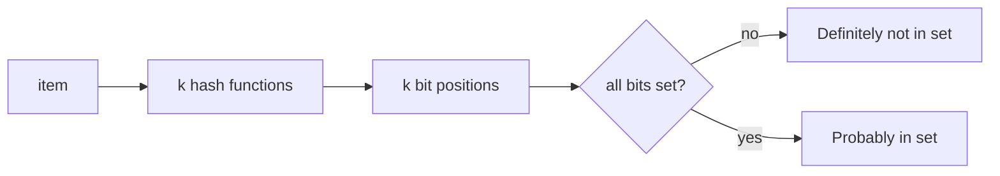

## 🎯 خلاصه

> **ساختارهای داده‌ی احتمالاتی (probabilistic)** به یک سؤال درباره‌ی داده‌ی بسیار حجیم با مقدار حافظه‌ی کم و ثابت جواب می‌دهند، و یک خطای کوچک و مشخص را می‌پذیرند. در ازای دقت کامل، حافظه و سرعت می‌گیری.

- **Bloom Filter**: «این آیتم در مجموعه هست؟» هیچ عضو واقعی را از دست نمی‌دهد، ولی گاهی برای یک غیرعضو «بله» می‌گوید (false positive).
- **HyperLogLog (HLL)**: «چند آیتم یکتا داریم؟» خطای معمول حدود ۱ تا ۲ درصد، با چند کیلوبایت حافظه، مستقل از تعداد.
- **Count-Min Sketch (CMS)**: «این آیتم چند بار آمده؟» هرگز کمتر از مقدار واقعی نمی‌شمارد؛ ممکن است بیشتر بشمارد.
- **t-digest**: صدک‌های تقریبی (p50، p99)، با دقت بیشتر در دم توزیع.
- **Reservoir Sampling**: نمونه‌ی تصادفی یکنواخت از `k` آیتم، از یک stream که طولش معلوم نیست، در یک بار عبور و با حافظه‌ی `O(k)`.
- مهم‌ترین ویژگی برای مهندس داده **mergeable بودن** است: sketchهایی که روی partitionها ساخته شده‌اند، بعداً می‌توانند ترکیب شوند؛ این برای موتورهای توزیع‌شده و تجمیع روزانه به ماهانه عالی است.

## 🌱 از ساده شروع کنیم (مبتدی)

> **💡 تشبیه:** یک نگهبان در را تصور کن که لیست مهمان دارد، ولی از هر اسم فقط یک **اثرانگشت** نگه می‌دارد. اگر اثرانگشت اسم کسی در لیست نباشد، آن شخص قطعاً دعوت نیست. اگر باشد، احتمالاً دعوت است، چون دو اسم مختلف می‌توانند اثرانگشت یکسان داشته باشند. Bloom Filter همین‌طور کار می‌کند.

سؤال کلاسیک مصاحبه این است: **«تعداد کاربران یکتای روزانه را روی میلیاردها رویداد حساب کن.»** اول رویکرد ساده را ببین:

```python
seen = set()
for event in events:          # billions of events
    seen.add(event.user_id)   # set grows with every new user
print(len(seen))
```

این درست است، ولی حافظه‌ی مصرفی با تعداد کاربران یکتا رشد می‌کند. با ۱۰۰ میلیون کاربر و شناسه‌های ۸ بایتی، خود شناسه‌ها حدود ۸۰۰ مگابایت می‌شوند و یک hash set در Python یا Java چند برابر بیشتر مصرف می‌کند. اگر این را برای هر کشور، هر اپ یا هر ساعت بخواهی، حافظه در هر گروه ضرب می‌شود.

یک sketch از نوع HyperLogLog همان سؤال را با **۱۲ کیلوبایت برای هر گروه** و خطای حدود ۱٪ جواب می‌دهد. این هسته‌ی ماجراست: مقدار کمی خطا در برابر صرفه‌جویی زیاد در حافظه و حجم shuffle.

سه قاعده‌ی ساده برای مبتدی:

- Bloom Filter: جواب «قطعاً نه» قابل اعتماد است، جواب «احتمالاً بله» نه.
- HLL: یک عدد با نوار خطا، نه شمارش دقیق.
- CMS: یک فراوانی که ممکن است کمی بیشتر از واقعیت باشد، هرگز کمتر.

## 🔧 واقعاً چطور کار می‌کند (متوسط)

### Bloom Filter

Bloom Filter یک آرایه‌ی `m` بیتی به همراه `k` تابع hash است. برای درج یک آیتم، `k` موقعیت را حساب می‌کنی و آن بیت‌ها را ۱ می‌کنی. برای پرسش، همان `k` موقعیت را حساب می‌کنی: اگر **حتی یک** بیت صفر باشد، آیتم هرگز درج نشده است. اگر **همه** یک باشند، احتمالاً درج شده است.



نرخ false positive تقریباً برابر `(1 - e^(-k*n/m))^k` است، برای `n` آیتم درج‌شده. با حدود **۱۰ بیت برای هر آیتم** و `k = 7`، نرخ حدود **۱٪** است. Bloom Filter نمی‌تواند آیتم حذف کند (اگر لازم بود، نسخه‌ی counting را استفاده کن)، و دو فیلتر با OR بیتی ادغام می‌شوند، به شرط یکسان بودن اندازه و تابع‌های hash.

جایی که با آن روبه‌رو می‌شوی: رد کردن فایل‌های داده‌ای که نمی‌توانند کلید را داشته باشند (Parquet و ORC فیلتر Bloom را برای هر column chunk پشتیبانی می‌کنند)، و جست‌وجوهای داخلی key-value storeها مثل Cassandra و RocksDB که با فیلتر از خواندن دیسک برای کلیدهای غایب جلوگیری می‌کنند.

### HyperLogLog

HLL هر آیتم را به یک hash ۶۴ بیتی تبدیل می‌کند. `p` بیت اول یکی از `m = 2^p` ثبات (register) را انتخاب می‌کند. بقیه‌ی بیت‌ها بررسی می‌شوند تا موقعیت اولین بیت ۱ پیدا شود (که به آن «rank» می‌گویند) و ثبات **بیشترین** rank دیده‌شده را نگه می‌دارد. دنباله‌های نادر و بلند از صفرهای ابتدایی یعنی آیتم‌های یکتای زیادی hash شده‌اند، پس بیشترین rank تخمینی از شمارش به دست می‌دهد. میانگین‌گیری روی ثبات‌های زیاد (با میانگین هماهنگ) آن را پایدار می‌کند.

خطای استاندارد تقریباً `1.04 / sqrt(m)` است:

| تعداد ثبات (`p`) | حافظه (تقریبی) | خطای استاندارد |
|---|---|---|
| 2^10 = 1,024 | کمتر از ۱ کیلوبایت | حدود ۳.۳٪ |
| 2^12 = 4,096 | حدود ۳ کیلوبایت | حدود ۱.۶٪ |
| 2^14 = 16,384 | حدود ۱۲ کیلوبایت | حدود ۰.۸٪ |

دستورهای `PFADD` و `PFCOUNT` در Redis از همین ایده استفاده می‌کنند، با ساختاری ۱۲ کیلوبایتی برای هر کلید، و `PFMERGE` کلیدها را اجتماع می‌گیرد. اندازه‌ی sketch به تعداد آیتم‌های یکتای اضافه‌شده وابسته نیست.

یک پیاده‌سازی کوتاه و قابل اجرا همراه با مقایسه با مجموعه‌ی دقیق:

```python
import hashlib
import math
import random


def h64(item: str) -> int:
    return int.from_bytes(hashlib.blake2b(item.encode("utf-8"), digest_size=8).digest(), "big")


class HyperLogLog:
    """Approximate distinct count. Memory is fixed at 2**p registers, whatever the input size."""

    def __init__(self, p: int = 12):
        self.p = p
        self.m = 1 << p
        self.registers = [0] * self.m
        self.alpha = 0.7213 / (1 + 1.079 / self.m)

    def add(self, item: str) -> None:
        x = h64(item)
        idx = x >> (64 - self.p)                  # first p bits choose a register
        rest = x & ((1 << (64 - self.p)) - 1)     # remaining 64 - p bits
        rank = (64 - self.p) - rest.bit_length() + 1   # position of the leftmost 1-bit
        if rank > self.registers[idx]:
            self.registers[idx] = rank

    def count(self) -> float:
        z = sum(2.0 ** -r for r in self.registers)
        estimate = self.alpha * self.m * self.m / z
        zeros = self.registers.count(0)
        if estimate <= 2.5 * self.m and zeros:   # small-range correction
            estimate = self.m * math.log(self.m / zeros)
        return estimate

    def merge(self, other: "HyperLogLog") -> None:
        """Union of two sketches: register-wise maximum. Both must use the same p."""
        assert self.p == other.p
        self.registers = [max(a, b) for a, b in zip(self.registers, other.registers)]


if __name__ == "__main__":
    random.seed(1)

    # 1) HyperLogLog vs exact count
    exact = set()
    hll = HyperLogLog(p=12)
    for _ in range(500_000):
        user = f"user-{random.randint(1, 200_000)}"
        exact.add(user)
        hll.add(user)
    est = hll.count()
    print(f"HLL: exact={len(exact)} estimate={est:,.0f} "
          f"error={abs(est - len(exact)) / len(exact):.2%} registers={hll.m}")

    # 2) Merge: two days of data, union via register-wise max
    day1, day2 = HyperLogLog(12), HyperLogLog(12)
    for i in range(0, 60_000):
        day1.add(f"u{i}")
    for i in range(30_000, 90_000):
        day2.add(f"u{i}")
    day1.merge(day2)
    print(f"merged estimate for 90,000 true distinct: {day1.count():,.0f}")
```

اجرایش کن: خطا معمولاً در حد چند دهم تا چند درصد است، هم‌خوان با جدول بالا. نتیجه‌ی merge اجتماع دو روز است، پس شمارش یکتای هفتگی فقط هفت merge است و نیازی به خواندن دوباره‌ی رویدادهای خام نیست.

### Count-Min Sketch

CMS شامل `d` سطر و `w` شمارنده در هر سطر است. هر درج، یک شمارنده در هر سطر را با hash متفاوت افزایش می‌دهد. پرسش، **کمترین** مقدار بین `d` شمارنده را برمی‌گرداند. برخورد hash فقط به شمارنده‌ها اضافه می‌کند، پس کمینه هرگز کمتر از واقعیت نیست. کران خطا این است: با `w = ceil(e / eps)` و `d = ceil(ln(1/delta))`، بیش‌شماری حداکثر `eps * N` است (که `N` مجموع کل است)، با احتمال حداقل `1 - delta`.

CMS به‌همراه یک heap کوچک، top-K تقریبی (heavy hitters) می‌دهد. این پاسخ معمول در [[design-top-k]] است.

### t-digest و صدک‌ها

صدک دقیق یعنی همه‌ی مقادیر را مرتب کنی. t-digest لیستی فشرده از centroidها نگه می‌دارد، با **وضوح بیشتر نزدیک دم توزیع** (p99، p999) که معمولاً همان جایی است که نگاه می‌کنیم. این ساختار mergeable است، پس digestهای هر partition را می‌توان ترکیب کرد. بسیاری از موتورها آن را به‌صورت تابع صدک تقریبی ارائه می‌کنند؛ قبل از نقل عدد در گزارش، ببین تابع برای داده‌ی تو چه برمی‌گرداند.

### Reservoir Sampling

برای نگه داشتن نمونه‌ی یکنواخت از `k` آیتم، از stream با طول نامعلوم: `k` آیتم اول را نگه دار. برای آیتم شماره‌ی `i > k`، یک عدد تصادفی `j` در بازه‌ی `[1, i]` انتخاب کن؛ اگر `j <= k` بود، خانه‌ی `j` را عوض کن. هر آیتم شانس یکسان `k / i` دارد که در نمونه بماند. از آن وقتی استفاده کن که نمونه‌ی نماینده برای بررسی سریع لازم داری، نه جمع دقیق.

### خلاصه‌ی Mergeability

| ساختار | عمل merge | نکته |
|---|---|---|
| Bloom Filter | OR بیتی | `m` و تابع‌های hash یکسان |
| HyperLogLog | بیشینه‌ی ثبات‌ها به‌ازای هر ثبات | `p` یکسان |
| Count-Min Sketch | جمع عنصر به عنصر | `w`، `d` و hashها یکسان |
| t-digest | ترکیب centroidها | بعد از merge دوباره فشرده کن |
| نمونه‌ی Reservoir | نمونه‌گیری وزنی مجدد | جمع ساده نیست |

## 🧠 عمق و trade-offها (سنیور)

- **خطا یک تصمیم محصولی است.** خطای ۱٪ در «بازدیدکنندگان یکتا» برای داشبورد خوب است، برای صورتحساب یا آستانه‌ی تقلب خوب نیست. کران خطا را در تعریف metric بنویس، و برای هر چیزی که به پول مربوط است، یک مسیر دقیق (یا audit نمونه‌ای) نگه دار.
- **موتورها.** `uniq` در ClickHouse تقریبی است و `uniqExact` دقیق؛ این یک انتخاب واقعی در query است. `approx_count_distinct` در Spark یک پارامتر انحراف استاندارد نسبی می‌گیرد، پس دقت را در برابر هزینه انتخاب می‌کنی. HLL در Redis یک نوع داده‌ی بومی است. رفتار دقیق و پیش‌فرض‌ها را در مستندات نسخه‌ی خودت بررسی کن.
- **Cardinality با حجم یکی نیست.** HLL مقادیر یکتا را می‌شمارد. `COUNT(DISTINCT ...)` دقیق روی یک کلید با cardinality بالا می‌تواند گران‌ترین مرحله‌ی query باشد، چون shuffle یا جدول hash بزرگ می‌سازد. distinct تقریبی این هزینه را حذف می‌کند، و به همین دلیل در داشبوردها دیده می‌شود.
- **Sketchها در pipeline.** sketch (بایت‌ها) را برای هر partition و گروه به‌صورت ستون ذخیره کن، و هنگام query ادغامش کن. این backfill و داده‌ی دیرِرس را ارزان می‌کند: sketch یک partition را دوباره بساز و دوباره merge کن. مجموعه‌ی دقیق بدون نگه‌داشتن همه‌ی شناسه‌ها این کار را نمی‌کند.
- **انضباط hash.** دو sketch فقط وقتی درست merge می‌شوند که تابع hash، seed و پارامترهای یکسان داشته باشند. seed عوض‌شده بی‌سروصدا نتیجه‌ی بی‌معنی می‌دهد. پارامترها را در schema بگذار و نسخه‌بندی کن.
- **ورودی‌های نامتوازن یا مخرب.** sketchها توزیع خوب hash را فرض می‌کنند. تابع hash با توزیع ضعیف یا ورودی‌های ساخته‌شده برای حمله، تخمین را خراب می‌کند. از یک hash ۶۴ بیتی آزموده‌شده استفاده کن، نه ساخته‌ی خودت.
- **Bloom Filter در موتورهای ذخیره‌سازی.** اندازه‌ی فیلتر یک trade-off بین فضا و خواندن است. کوچک بودنش یعنی false positive و خواندن اضافی دیسک؛ بزرگ بودنش یعنی حافظه‌ی هدررفته. شمارنده‌های «فیلتر مفید بود» موتورت را پایش کن.
- **کی استفاده نکنیم.** از ساختارهای تقریبی برای شناسه‌هایی که باید به کاربر برگردانی استفاده نکن (نمی‌توانی اعضای Bloom Filter را فهرست کنی)، برای شمارش‌های تحت مقررات، یا وقتی مجموعه‌ی دقیق به‌راحتی در حافظه جا می‌شود.

## 🧪 امتحان کن

از Python نسخه‌ی ۳.۱۰ به بعد و کلاس HLL بخش متوسط استفاده کن.

1. **محاسبه‌ی حافظه.** ۱٬۰۰۰ گروه (کشور × اپ) و ۳۶۵ روز داده داری. sketch هر روز ۱۲ کیلوبایت است. کل فضای sketchهای روزانه چقدر است؟ محاسبه را نشان بده. بعد توضیح بده شمارش یکتای سالانه برای هر گروه چطور به دست می‌آید.
2. **دقت در برابر p.** مقدار `p` را ۱۰، ۱۲ و ۱۴ بگذار، همان آزمون ۵۰۰٬۰۰۰ رویدادی را اجرا کن، و خطا را برای هر کدام ثبت کن. با جدول بخش متوسط مقایسه کن.
3. **اندازه‌ی Bloom.** برای ۱ میلیون آیتم و نرخ false positive هدف حدود ۱٪، چند بیت لازم است؟ با حدود ۱۰ بیت برای هر آیتم محاسبه کن و با ایده‌ی کلاس `BloomFilter` بخش متوسط بررسی کن.

<details><summary>جواب‌ها را نشان بده</summary>

**۱.** ۱٬۰۰۰ گروه × ۳۶۵ روز = ۳۶۵٬۰۰۰ sketch. ۳۶۵٬۰۰۰ × ۱۲ کیلوبایت = ۴٬۳۸۰٬۰۰۰ کیلوبایت، یعنی حدود ۴.۳۸ گیگابایت. شمارش سالانه‌ی هر گروه، merge ۳۶۵ sketch روزانه‌ی آن است که به رویدادهای خام نیاز ندارد.

**۲.** `p` کمتر یعنی حافظه‌ی کمتر و خطای بیشتر (حدود ۳.۳٪ برای p=10، حدود ۱.۶٪ برای p=12، حدود ۰.۸٪ برای p=14). خطای یک اجرا حول این مقادیر نوسان دارد.

**۳.** حدود ۱۰ بیت × ۱٬۰۰۰٬۰۰۰ آیتم = ۱۰٬۰۰۰٬۰۰۰ بیت، یعنی حدود ۱.۲۵ مگابایت. با `k` بهینه‌ی حدود ۷، نرخ false positive حدود ۱٪ است. با درج یک میلیون آیتم و آزمودن یک میلیون غیرعضو بررسی کن.

</details>

## 💬 گوشه‌ی مصاحبه

**سؤال: «تعداد کاربران یکتای روزانه را روی میلیاردها رویداد حساب کن.»**
جواب متوسط: «برای هر روز HyperLogLog می‌گذارم. حدود ۱٪ خطا با چند کیلوبایت می‌دهد و sketchها بین partitionها merge می‌شوند.»
جواب سنیور: «برای هر partition، گروه و روز یک sketch HLL می‌سازم، بایت‌هایش را ذخیره می‌کنم و برای نماهای هفتگی و ماهانه merge می‌کنم. کران خطا را در تعریف metric می‌نویسم. برای چیزی که در صورتحساب استفاده می‌شود، یک شمارش دقیق روی یک مسیر نمونه‌ای یا کوچک‌تر نگه می‌دارم تا sketch را اعتبارسنجی کنم. همچنین مطمئن می‌شوم همه‌ی producerها از همان تابع hash و دقت استفاده می‌کنند، چون sketchهای با پارامتر متفاوت قابل ادغام نیستند.»

**سؤال: «کی در یک pipeline داده از Bloom Filter استفاده می‌کنی؟»**
جواب متوسط: «برای این‌که قبل از lookup بررسی کنم کلید ممکن است وجود داشته باشد، مثلاً برای dedup شناسه‌های جدید در برابر یک مجموعه‌ی بزرگ.»
جواب سنیور: «وقتی false positive یک خواندن اضافی ارزان هزینه دارد و false negative به درستی آسیب می‌زند. مثلاً یک فیلتر برای هر فایل که می‌گوید کلید در آن می‌تواند باشد، تا موتور فایل‌ها را رد کند. اثر فیلتر را پایش می‌کنم و اندازه‌اش را برای نرخ false positive هدف تنظیم می‌کنم.»

> **🎤 این را در مصاحبه بگو:** «من خطای کوچک و مشخص را با صرفه‌جویی بزرگ در حافظه عوض می‌کنم. HyperLogLog شمارش یکتا می‌دهد که بین partitionها merge می‌شود، Bloom Filter عضویت سریع بدون false negative می‌دهد، و Count-Min فراوانی می‌دهد که هرگز کمتر نمی‌شمارد. انتخاب به این بستگی دارد که هزینه‌ی خطا قابل قبول است یا نه.»

## ⚠️ اشتباهات رایج

> **⚠️ توجه:** جواب «بله» از Bloom Filter تضمین نیست. ممکن است false positive باشد، پس قبل از عملی که قابل برگشت نیست، همیشه تأیید کن.

> **⚠️ توجه:** merge کردن sketchهای HLL با دقت یا seed متفاوت، عدد اشتباه می‌دهد، اغلب بدون هیچ خطایی.

- ارائه‌ی یک شمارش تقریبی به‌عنوان عدد دقیق در گزارش، بدون ذکر کران خطا.
- استفاده از `COUNT(DISTINCT)` روی یک کلید عظیم وقتی distinct تقریبی جواب سؤال را می‌دهد.
- فراموش کردن این‌که Bloom Filter نمی‌تواند آیتم حذف کند.
- فرض کردن این‌که CMS کمتر می‌شمارد. برخوردها باعث بیش‌شماری می‌شوند.
- برخورد با نمونه‌ی Reservoir به‌عنوان مجموع کل جامعه، یا مقیاس‌بندی مجموع نمونه بدون کسر نمونه‌گیری.
- ساختن تابع hash خودساخته برای sketchها.

## ✅ خودت را بسنج

1. یک Bloom Filter جواب «موجود نیست» می‌دهد. چه نتیجه‌ای می‌گیری؟
   - A) آیتم قطعاً در مجموعه نیست
   - B) آیتم احتمالاً در مجموعه نیست
   - C) آیتم حذف شده است
   - D) فیلتر پر است

<details><summary>جواب</summary>

**A** — Bloom Filter هیچ false negative ندارد، پس جواب «موجود نیست» قطعی است. جواب «موجود است» می‌تواند اشتباه باشد (false positive).

</details>

2. کدام ساختار «چند کاربر یکتا» را با حافظه‌ی ثابت می‌دهد و بین partitionها merge می‌شود؟
   - A) Count-Min Sketch
   - B) HyperLogLog
   - C) Reservoir Sampling
   - D) Bloom Filter

<details><summary>جواب</summary>

**B** — HyperLogLog ثبات‌هایی با اندازه‌ی ثابت دارد که با بیشینه‌ی عنصر به عنصر merge می‌شوند. Count-Min برای فراوانی، Reservoir برای نمونه، و Bloom Filter برای عضویت است.

</details>

3. چرا تخمین Count-Min برای یک آیتم هرگز از مقدار واقعی‌اش کمتر نیست؟
   - A) هر شمارنده مقدار دقیق را ذخیره می‌کند
   - B) برخورد hash فقط به شمارنده‌ها اضافه می‌کند، و پرسش کمینه را بین چند سطر برمی‌گرداند
   - C) sketch لاگ همه‌ی درج‌ها را نگه می‌دارد
   - D) تخمین به بالا گرد می‌شود

<details><summary>جواب</summary>

**B** — هر درج یک شمارنده در هر سطر را افزایش می‌دهد، پس هر شمارنده حداقل شمارش خود آیتم است. برخوردها فقط مقدار بیشتری اضافه می‌کنند، و کمینه بین سطرها کم‌ترین مقدار است.

</details>

4. (سنیور) sketchهای HLL روزانه‌ی ۹۰ روز را داری و یک شمارش یکتای سه‌ماهه لازم است. کدام روش درست است و چرا جمع شمارش‌های روزانه درست نیست؟
   - A) جمع ۹۰ تخمین روزانه
   - B) merge کردن ۹۰ sketch با بیشینه‌ی عنصر به عنصر و بعد شمارش
   - C) میانگین تخمین‌های روزانه
   - D) محاسبه‌ی دوباره از رویدادهای خام، چون sketchها قابل ترکیب نیستند

<details><summary>جواب</summary>

**B** — جمع شمارش‌های روزانه کاربرانی را که در روزهای زیاد ظاهر شده‌اند چند بار حساب می‌کند. merge کردن sketchها اجتماع می‌دهد، پس کاربری که ۳۰ روز دیده شده فقط یک بار حساب می‌شود. گزینه‌ی D هدررفت است، چون sketchها برای ترکیب شدن طراحی شده‌اند.

</details>

5. چرا صدک‌های تقریبی مثل t-digest دقت را در دم توزیع متمرکز می‌کنند؟
   - A) محاسبه‌ی وسط توزیع آسان‌تر است
   - B) ساختار در نزدیکی دو انتها centroidهای ریزتر نگه می‌دارد، جایی که p99 و p999 سنجیده می‌شوند
   - C) دم‌ها به‌صورت لیست دقیق ذخیره می‌شوند
   - D) میانه هرگز تخمین زده نمی‌شود

<details><summary>جواب</summary>

**B** — صدک‌های دم همان چیزی هستند که رصد می‌شوند، پس digest وضوح بیشتری آنجا دارد. وسط توزیع می‌تواند درشت‌تر باشد بدون این‌که اعداد مهم آسیب ببینند.

</details>

## 🗂️ فلش‌کارت

| جلو | پشت |
|---|---|
| Bloom Filter: false negative دارد؟ | نه. جواب «موجود نیست» همیشه درست است. |
| Bloom Filter: false positive دارد؟ | بله. جواب «موجود است» ممکن است اشتباه باشد، با نرخی که با بیت و `k` تنظیم می‌کنی. |
| HyperLogLog چه چیزی را تخمین می‌زند؟ | تعداد یکتا، با خطای استاندارد حدود 1.04 / sqrt(m) |
| عمل merge در HLL | بیشینه‌ی عنصر به عنصر ثبات‌ها (با دقت و hash یکسان) |
| جهت خطای Count-Min | فقط بیش‌شماری، هرگز کم‌شماری |
| قدرت t-digest | صدک‌های دقیق نزدیک دم (p99، p999) |
| Reservoir Sampling | نمونه‌ی یکنواخت از k آیتم، از stream با طول نامعلوم |
| چرا sketchها در pipeline مهم‌اند | حافظه‌ی ثابت، mergeable بین partitionها، backfill ارزان |

## 🔗 ادامه

- درس‌های مرتبط: [[design-unique-counts]] برای طراحی کامل pipeline شمارش یکتا، [[design-top-k]] برای heavy hitters با sketch و heap، و [[dsa-for-de]] برای مبانی hash و heap پشت این ساختارها.
- واژه‌نامه: [[bloom-filter]]، [[hyperloglog]]، [[cardinality]].
- تمرین: یک `COUNT(DISTINCT)` دقیق از گزارشی که مسئولش هستی را روی جدول بزرگ زمان‌بندی کن، و نتیجه و خطای یک تابع distinct تقریبی را روی همان داده مقایسه کن.

