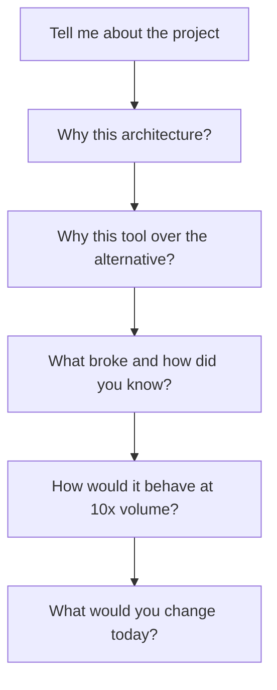
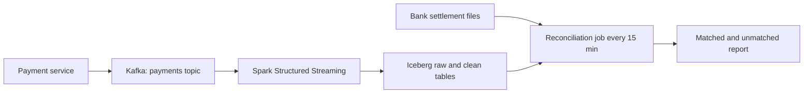

## 🎯 خلاصه

> **روایت عمیق پروژه (project deep-dive)** داستانی است که ۳۰ دقیقه می‌توانی از آن دفاع کنی. مصاحبه‌گر یک پروژه را انتخاب می‌کند و آن‌قدر می‌پرسد «چرا؟» تا به لبه‌ی دانسته‌هایت برسد.

- **۴ تا ۶** پروژه آماده کن که مهارت‌های مختلف را پوشش دهند: batch، streaming، مدل‌سازی، مهاجرت، یک incident، و یک پروژه‌ی پلتفرم یا هزینه.
- برای هر کدام، **زمینه و مقیاس**، **نقش** تو، یک **نمودار**، **سه تصمیم کلیدی** با trade-off، **بزرگ‌ترین incident**، **متریک‌ها**، و **درس‌ها** را بدان.
- **گزینه‌های ردشده** را آماده داشته باش. تصمیمی بدون گزینه‌ی دیگر، از نگاه مصاحبه‌گر یک حدس است.
- **عددها** را خوب بدان: حجم، تأخیر، هزینه، اندازه‌ی تیم. گرد کن، ولی چیزی اختراع نکن.

## 🌱 از ساده شروع کنیم (مبتدی)

> **💡 تشبیه:** پروژه مثل خانه‌ای است که ساخته‌ای. بازدیدکننده نقشه‌ی کامل را نمی‌خواهد. می‌خواهد بداند برای چه بود، کدام دیوارها را خودت ساختی، چرا این پی را به جای پی دیگری انتخاب کردی، در زمستان اول چه نشتی‌ای داشت، و الان چه می‌کردی.

از تو خواسته می‌شود پروژه را طوری توضیح دهی که انگار کسی را در آن قدم می‌زنی. یک روایت خوب شکل روشنی دارد:

1. **زمینه:** چه مشکلی، برای چه کسی، در چه مقیاسی.
2. **سهم تو:** آنچه مالکش بودی، و آنچه نبودی.
3. **طراحی:** یک تصویر ساده از جریان داده.
4. **تصمیم‌ها:** انتخاب‌هایی که کردی، و آنچه رد کردی.
5. **دردسر:** چه چیزی خراب شد، و چطور فهمیدی.
6. **نتیجه و درس‌ها:** عددها و آنچه یاد گرفتی.

از این کارت به عنوان قالب استفاده کن. برای هر پروژه یک کارت، در یک صفحه:

```text
PROJECT: [short name]
Context & scale: [who uses it, volume per day, latency need, team size]
My role: [what I owned; what I did NOT own]
Architecture: [one diagram, 5 to 8 boxes, arrows labeled with the protocol or format]
Decision 1: [choice] over [alternative] because [reason] | trade-off I accepted: [cost]
Decision 2: [choice] over [alternative] because [reason] | trade-off I accepted: [cost]
Decision 3: [choice] over [alternative] because [reason] | trade-off I accepted: [cost]
Biggest incident: [what broke] | detected by [how] | fixed by [what] | prevented by [what now]
Metrics: [before → after, measured how, over what period]
Lessons: [what I would change if I rebuilt it today]
```

> **⚠️ مراقب باش:** پروژه‌ای را توضیح نده که جزئیاتش را نمی‌توانی بگویی. مصاحبه‌گر درباره‌ی بخش‌هایی می‌پرسد که تو فهرست کرده‌ای. اگر ابزاری را نام می‌بری، آماده باش بگویی چرا انتخابش کردی و چطور شکست می‌خورد.

## 🔧 واقعاً چطور کار می‌کند (متوسط)

مصاحبه‌گر لایه‌لایه پیش می‌رود. این توالی را انتظار داشته باش و برای هر لایه یک پاسخ آماده کن:



**پروژه‌هایی انتخاب کن که مهارت‌های متفاوت را نشان دهند.** چهار پروژه‌ی خوب معمولاً این‌ها را پوشش می‌دهند:

- یک pipeline **batch** با مقصد warehouse یا lakehouse
- یک pipeline **streaming** یا نزدیک به زمان واقعی با state، داده‌ی دیرهنگام، یا replay
- یک پروژه‌ی **مدل‌سازی** (مدل ابعادی، data contract، یا semantic layer)
- یک پروژه‌ی **عملیاتی**: یک incident، یک مهاجرت، یا کاهش هزینه

**تصمیم‌ها را صریح بگو.** یک تصمیم چهار بخش دارد: **انتخاب**، **گزینه‌ی دیگر**، **دلیل**، و **هزینه‌ای که پذیرفتی**. این یک نمونه‌ی پرشده است.

**مثال کامل (عددهای تخیلی، با عددهای خودت جایگزین کن).** یک پروژه‌ی تطبیق (reconciliation) پرداخت:

- زمینه: حدود ۴۰ میلیون رویداد پرداخت در روز. نرخ متوسط ۴۰,۰۰۰,۰۰۰ / ۸۶,۴۰۰ ≈ ۴۶۳ رویداد در ثانیه است، و پیک حدود ۵ برابر آن، یعنی تقریباً ۲,۳۰۰ در ثانیه. مالی به تطبیق تراکنش‌ها در ۱۵ دقیقه نیاز داشت.
- معماری: سرویس پرداخت روی یک topic در Kafka منتشر می‌کند، Spark Structured Streaming ردیف‌های خام و تمیز را در جدول‌های Iceberg روی object storage می‌نویسد، و یک job تطبیق هر ۱۵ دقیقه با فایل‌های تسویه‌ی بانک اجرا می‌شود.



تصمیم‌ها:

1. **Kafka به جای polling با JDBC از پایگاه داده‌ی پرداخت.** polling بار خواندن را روی پایگاه داده‌ی تراکنشی اضافه می‌کرد، و replay نیاز به خواندن کامل مجدد داشت. Kafka چند مصرف‌کننده و پنجره‌ی replay می‌دهد. هزینه: اداره‌ی یک cluster و مدیریت رویدادهای تکراری.
2. **Iceberg به جای پارتیشن‌های سبک Hive.** اصلاحات دیرهنگام بانک‌ها بازنویسی کامل پارتیشن‌های روزانه را لازم می‌کرد. Iceberg از MERGE در سطح ردیف و time travel پشتیبانی می‌کند. هزینه: اداره‌ی catalog و منحنی یادگیری برای تیم.
3. **تحویل at-least-once با کلید dedup، به جای ادعای «exactly-once».** sink با MERGE روی `transaction_id` تکراری‌ها را حذف می‌کند. هزینه: یک مرحله‌ی dedup در هر اجرا، و این قاعده که یک تکراری باید همان payload را داشته باشد.

بزرگ‌ترین incident: یک producer شروع کرد مقدار را با دو قالب اعشاری بفرستد. parser جریان، قالب جدید را بی‌صدا به NULL تبدیل می‌کرد، پس ۰٫۸٪ تراکنش‌ها سه روز تطبیق نشدند. کنترل مالی این شکاف را گرفت. یک قاعده‌ی سازگاری schema در registry اضافه کردیم، parser را طوری کردیم که با مقدار بد متوقف شود، و یک کنترل تعداد ردیف برای هر پنجره‌ی ۱۵ دقیقه‌ای گذاشتیم. تراکنش‌های تطبیق‌نشده به کمتر از ۰٫۰۵٪ حجم روزانه رسیدند.

به ساختار توجه کن: هر تصمیم یک گزینه‌ی ردشده را نام می‌برد، incident می‌گوید چطور کشف شد، و متریک می‌گوید چطور اندازه گرفته شد.

## 🧠 عمق و trade-offها (سنیور)

در سطح سنیور، مصاحبه‌گر **عمق زیر فشار** را می‌سنجد. برای هر پروژه برای این پرسش‌ها آماده باش:

- **«در ۱۰ برابر حجم کجا می‌شکند؟»** برای مثال بالا، ۱۰ برابر پیک حدود ۲۳,۰۰۰ رویداد در ثانیه است. اولین گلوگاه را نام ببر (معمولاً پارتیشن‌بندی topic یا هزینه‌ی MERGE در هر micro-batch)، و بگو اول چه چیزی را اندازه می‌گیری.
- **«چه چیزی را فدا کردی؟»** هر تصمیم هزینه دارد. بدون اینکه پرسیده شود، آن را بگو. «تأخیر ۱۵ دقیقه‌ای تطبیق را پذیرفتیم تا از join استریمینگ روی فایل‌های تسویه که دسته‌ای می‌رسند، دوری کنیم» یک پاسخ سنیور است.
- **«چه کسی تصمیم گرفت، و سهم تو چه بود؟»** دقیق باش. اگر معماری تصمیم گروهی بود، بگو چه پیشنهاد دادی، بعد از بررسی چه چیزی را عوض کردی، و چه چیزی را پیاده کردی.
- **«از کجا می‌دانی کار کرد؟»** متریک، منبع حقیقت، و بازه را بگو. متریکی که روی داشبوردی سنجیده شده که خودت ساخته‌ای، به بررسی مستقل نیاز دارد.
- **«امروز چه چیزی را متفاوت می‌کردی؟»** پاسخ واقعی یک تغییر مشخص دارد، مثل یک contract test در producer، یا یک کلید dedup که نسخه را هم دربرگیرد. از «هیچ‌چیز، کامل بود» بپرهیز.

جزئیات را پاک‌سازی کن. اگر داده یا عددها محرمانه‌اند، بازه‌های گرد («ده‌ها میلیون رویداد در روز») بگو و مکانیزم را توضیح بده، نه داده‌ی شرکت را. هرگز نام داخلی یا عددی را که اجازه‌ی افشایش نداری، به زبان نیاور.

## 🧪 امتحان کن

**تمرین ۱: تصمیم‌ها را استخراج کن.** این توضیح را بخوان و سه تصمیم را همراه گزینه‌های ردشده فهرست کن.

> «داده‌ی رویدادهای مشتری را از یک export شبانه‌ی CSV به یک pipeline با Kafka منتقل کردیم که فایل‌های Parquet را در S3 می‌نویسد، و برای marts از dbt استفاده می‌کنیم. Airflow را برای زمان‌بندی نگه داشتیم، ولی DAGها را بر اساس دامنه تقسیم کردیم.»

<details><summary>پاسخ</summary>

۱. **pipeline با Kafka به جای export شبانه‌ی CSV.** ردشده: export دسته‌ای شبانه. دلیل: تازگی داده و امکان replay. هزینه: اداره‌ی stream و مدیریت تکراری‌ها.
۲. **لایه‌ی landing با Parquet روی S3 به جای CSV.** دلیل: فرمت ستونی و اسکن ارزان‌تر و سریع‌تر. هزینه: فایل‌ها را با دست کمتر می‌شود خواند.
۳. **DAGهای Airflow تقسیم‌شده بر اساس دامنه به جای یک DAG بزرگ.** ردشده: یک DAG یکپارچه. دلیل: مالکیت روشن‌تر و شعاع اثر کوچک‌تر.

توضیح برای dbt گزینه‌ی ردشده‌ای ندارد. پاسخ قوی می‌پرسد یا می‌گوید: «آماده‌ام توضیح دهم چرا dbt به جای job های SQL دست‌نوشته، مثلاً مدل‌های نسخه‌بندی‌شده و تست‌شده».

</details>

**تمرین ۲: محاسبه‌ی مقیاس.** pipeline تو روزانه ۸۶ میلیون ردیف پردازش می‌کند، با پیکی ۴ برابر متوسط. نرخ متوسط، نرخ پیک، و انباشت (backlog) بعد از یک ساعت قطعی با نرخ متوسط را حساب کن.

<details><summary>پاسخ</summary>

- متوسط: ۸۶,۰۰۰,۰۰۰ / ۸۶,۴۰۰ ≈ ۹۹۵ ردیف در ثانیه.
- پیک: ۴ × ۹۹۵ ≈ ۳,۹۸۰ ردیف در ثانیه.
- انباشت بعد از یک ساعت با نرخ متوسط: ۹۹۵ × ۳,۶۰۰ ≈ ۳.۵۸ میلیون ردیف (همان ۸۶ میلیون / ۲۴).

برای جبران، نرخ پردازش باید بالاتر از متوسط باشد، وگرنه انباشت کم نمی‌شود. این را در پاسخ بگو.

</details>

**تمرین ۳: یک ادعا را به متریک تبدیل کن.** این ادعا را طوری بازنویسی کن که مصاحبه‌گر بتواند بررسی‌اش کند: «pipeline را خیلی سریع‌تر کردیم.»

<details><summary>پاسخ</summary>

«تأخیر end-to-end در صدک ۹۵ (از زمان رویداد تا در دسترس بودن در mart) از ۴۵ دقیقه به ۶ دقیقه رسید. ۳۰ روز داده‌ی تولیدی قبل و بعد از تغییر را مقایسه کردیم، و حجم در هر دو دوره مشابه بود (حدود ۴۰ میلیون رویداد در روز).»

بازنویسی یک متریک، یک صدک، نقطه‌ی شروع و پایان، مبنا، و بازه دارد. توجه کن که باید بگویی حجم‌ها قابل مقایسه بودند؛ وگرنه مقایسه منصفانه نیست.

</details>

**تمرین ۴: کارت خودت را پر کن.** قالب را برای یک پروژه پر کن. بعد با صدای بلند بخوانش و زمانش را بگیر. هدف ۳ دقیقه برای مرور کلی است، و ۳۰ دقیقه زمانی است که باید برای عمق آماده باشی.

<details><summary>پاسخ</summary>

جواب واحد درست وجود ندارد. با این فهرست بسنج: هر خط قالب پر شده؛ هر تصمیم گزینه‌ی دیگر و هزینه‌ی پذیرفته‌شده دارد؛ incident روش کشف دارد؛ هر عدد بازه دارد. اگر مرور کلی بیشتر از ۳ دقیقه شد، زمینه را کوتاه کن، نه تصمیم‌ها را.

</details>

## 💬 گوشه‌ی مصاحبه

> **🎤 این را در مصاحبه بگو:** «پیچیده‌ترین پروژه‌ی داده‌ای‌ات را برایم توضیح بده.» با زمینه و مقیاس شروع کن، بعد معماری، بعد تصمیم‌ها.

**نمونه‌ی پاسخ سنیور (کوتاه):** «یک pipeline تطبیق پرداخت ساختم که روزانه حدود ۴۰ میلیون رویداد را پردازش می‌کرد، با پیک نزدیک ۲,۳۰۰ در ثانیه. Kafka را به جای polling پایگاه داده‌ی پرداخت انتخاب کردم تا سیستم تراکنشی محافظت شود و replay ممکن باشد، و Iceberg را به جای جدول‌های Hive با پارتیشن، تا اصلاحات دیرهنگام بانک‌ها با MERGE اعمال شوند و کل پارتیشن بازنویسی نشود. سخت‌ترین incident یک تغییر بی‌صدای قالب اعشاری بود که ۰٫۸٪ تراکنش‌ها را سه روز تطبیق‌نشده گذاشت؛ با کنترل تعداد ردیف گرفتیم و الان قواعد سازگاری schema جلوی آن را می‌گیرد. تراکنش‌های تطبیق‌نشده به کمتر از ۰٫۰۵٪ رسیدند، و اگر دوباره بسازم، contract test را از روز اول روی producer می‌گذارم.»

## ⚠️ اشتباهات رایج

- **توضیح فهرست ابزارها به جای تصمیم‌ها.** «از Kafka، Spark و Airflow استفاده کردیم» یک روایت نیست.
- **نبودن گزینه‌ی ردشده.** همه‌ی انتخاب‌ها تصادفی به نظر می‌رسند.
- **عدد بدون روش.** «۱۰ برابر سریع‌تر شد» به مبنا، اندازه‌گیری، و بازه نیاز دارد.
- **پنهان کردن incident.** مصاحبه‌گر فرض می‌کند هر پروژه‌ی واقعی یکی داشته. آن را باز بگو.
- **بزرگ‌نمایی مالکیت.** اگر یک سنیور هسته‌ی طراحی را ساخته، همین را بگو و سهم واقعی خودت را توضیح بده.
- **نمودار شلوغ.** یک نمودار با ۵ تا ۸ جعبه کافی است. بقیه را شفاهی توضیح بده.
- **داده‌ی محرمانه.** بازه و مکانیزم بگو. نام یا عدد داخلی را فاش نکن.

## ✅ خودت را بسنج

۱. در یک روایت پروژه، حداقل اطلاعات برای هر تصمیم کلیدی چیست؟
   - A) فقط نام ابزار
   - B) انتخاب، گزینه‌ی ردشده، دلیل، و هزینه‌ی پذیرفته‌شده
   - C) تاریخی که تصمیم گرفته شد
   - D) تعداد افراد جلسه

<details><summary>جواب</summary>

**B** — یک تصمیم وقتی قابل دفاع است که گزینه‌ی دیگر و هزینه‌اش دیده شوند. فقط نام ابزار مثل یک حدس به نظر می‌رسد.

</details>

۲. یک pipeline روزانه ۴۰ میلیون رویداد دارد. نرخ متوسط در ثانیه، به نزدیک‌ترین رویداد، چقدر است؟

   - A) ۴۶۳ در ثانیه
   - B) ۴,۶۳۰ در ثانیه
   - C) ۴۶ در ثانیه
   - D) ۱,۰۰۰ در ثانیه

<details><summary>جواب</summary>

**A** — ۴۰,۰۰۰,۰۰۰ / ۸۶,۴۰۰ ≈ ۴۶۲٫۹۶ که به ۴۶۳ گرد می‌شود. وقتی برآورد می‌دهی، محاسبه را همیشه نشان بده.

</details>

۳. مصاحبه‌گر می‌پرسد: «در ۱۰ برابر حجم کجا می‌شکند؟» کدام پاسخ قوی‌تر است؟

   - A) «خوب است، Spark مقیاس‌پذیر است.»
   - B) «ماشین‌های بیشتری اضافه می‌کنم.»
   - C) «اولین گلوگاه احتمالاً هزینه‌ی MERGE در هر micro-batch و پارتیشن‌بندی topic است؛ اول تأخیر و مدت batch را اندازه می‌گیرم، بعد تصمیم می‌گیرم.»
   - D) «به آن فکر نکرده‌ام.»

<details><summary>جواب</summary>

**C** — یک گلوگاه محتمل را نام می‌برد، شاهدی که جمع می‌کند، و ترتیب بررسی را. این همان عمقی است که مصاحبه‌ی سنیور می‌سنجد.

</details>

۴. **(سنیور)** نمی‌توانی عددهای واقعی یک پروژه را افشا کنی. کار درست چیست؟

   - A) عددهای قابل‌باور بساز
   - B) از بحث درباره‌ی پروژه خودداری کن
   - C) بازه‌های گرد بگو، مکانیزم را توضیح بده، و بگو کدام عددها را نمی‌توانی به اشتراک بگذاری
   - D) عددهای یک شرکت دیگر را استفاده کن

<details><summary>جواب</summary>

**C** — صداقت به‌همراه رازداری. عدد ساختگی بازجویی می‌شود و اعتبارت را از بین می‌برد. بازه‌ی گرد و مکانیزم روشن هم عمق تو را نشان می‌دهد.

</details>

## ✅ چک‌لیست خودارزیابی

- [ ] ۴ تا ۶ پروژه دارم که batch، streaming، مدل‌سازی، و عملیات را پوشش می‌دهند
- [ ] هر پروژه کارت پرشده با زمینه، نقش، نمودار، تصمیم‌ها، incident، متریک، و درس دارد
- [ ] هر تصمیم کلیدی یک گزینه‌ی ردشده و یک هزینه‌ی پذیرفته‌شده دارد
- [ ] هر عدد مبنا، روش اندازه‌گیری، و بازه دارد
- [ ] می‌توانم مرور ۳ دقیقه‌ای بدهم و در هر پروژه تا ۳۰ دقیقه عمق بروم
- [ ] برای هر پروژه می‌توانم به «در ۱۰ برابر چه می‌شکند؟» و «امروز چه تغییری می‌دادی؟» جواب بدهم
- [ ] جزئیات محرمانه گرد یا حذف شده‌اند

## 🗂️ فلش‌کارت

| Front | Back |
|---|---|
| چند پروژه باید آماده کنی؟ | ۴ تا ۶، با مهارت‌های متفاوت |
| چهار بخش یک تصمیم کدام‌اند؟ | انتخاب، گزینه‌ی ردشده، دلیل، هزینه‌ی پذیرفته‌شده |
| متوسط رویداد در ثانیه را چطور حساب می‌کنی؟ | رویدادهای روزانه تقسیم بر ۸۶,۴۰۰ ثانیه |
| چرا گزینه‌ی ردشده را در داستان نگه می‌داری؟ | بدون آن انتخاب شبیه حدس به نظر می‌رسد |
| ساختار مفید داستان incident کدام است؟ | چه خراب شد، چطور کشف شد، چطور رفع شد، حالا چطور جلوگیری می‌شود |
| متریک باید چه چیزی داشته باشد؟ | مبنا، روش اندازه‌گیری، و بازه |
| با عددهای محرمانه چه کنی؟ | بازه‌ی گرد بگو و مکانیزم را توضیح بده |

## 🔗 ادامه

- [[star-framework]] ساختار هر داستان داخل یک روایت پروژه را می‌دهد.
- [[incidents-postmortems]] توضیح می‌دهد بخش incident روایت‌ها را چطور بنویسی.
- [[senior-expectations]] نشان می‌دهد هر سطح باید به چه عمقی برسد.
- [[how-to-prepare]] این آمادگی را در یک برنامه‌ی مطالعه‌ی کلی قرار می‌دهد.
- [[senior-signals]] نشانه‌هایی را فهرست می‌کند که مصاحبه‌گر هنگام مرور پروژه دنبالشان است.
