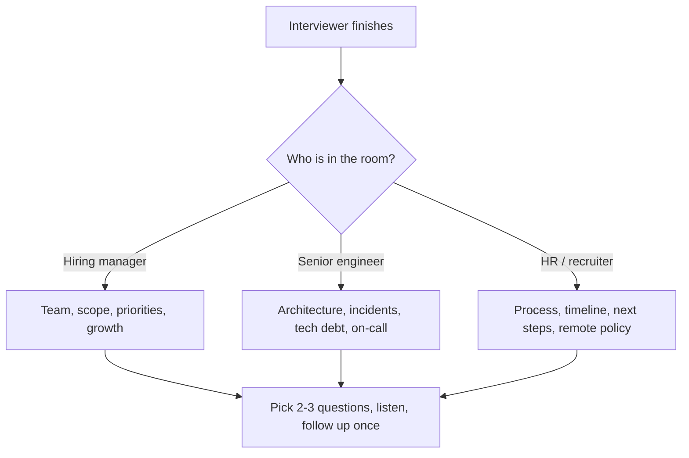

## 🎯 خلاصه

> تقریباً در پایان بیشتر مصاحبه‌ها می‌شنوی «سؤالی از ما داری؟». این یک ارزیابی واقعی است، نه تشریفات. سؤال‌های خوب به شرکت نشان می‌دهند که تو مثل یک مهندس فکر می‌کنی که مسئول یک سیستم خواهد بود، و به تو نشان می‌دهند که این شغل ارزش رفتن دارد یا نه.

- سؤال‌هایی بپرس که **مخصوص پلتفرم داده** باشند، نه کلی‌گویی («فرهنگ شرکت چطور است؟»).
- **۵ تا ۷** سؤال آماده کن و **۲ یا ۳ تا** را در مصاحبه استفاده کن. بقیه پشتیبان‌اند.
- درباره‌ی **کار واقعی روزانه** بپرس: حادثه‌ها، کیفیت داده، مالکیت، ددلاین و نحوه‌ی تصمیم‌گیری.
- به جواب گوش کن. یک سؤال پیگیری بهتر از یک سؤال جدید سنیوربودن را نشان می‌دهد.

## 🌱 از ساده شروع کنیم (مبتدی)

> **💡 تشبیه:** بازدید از یک خانه برای خرید. خریدار خوب فقط آشپزخانه را تحسین نمی‌کند. جعبه‌ی فیوز را باز می‌کند، می‌پرسد سقف چند ساله است و همسایه‌ها چطورند. فروشنده می‌فهمد تو جدی هستی؛ و تو می‌فهمی با چه چیزی واقعاً زندگی می‌کنی.

وقتی مصاحب‌کننده می‌پرسد «سؤالی داری؟»، بیشتر کاندیداها یا می‌گویند «نه، ممنون» یا در دقیقه‌ی اول درباره‌ی حقوق می‌پرسند. هر دو امتیاز از دست می‌دهند. یک ساختار ساده تقریباً در همه‌ی موارد کار می‌کند:

۱. **تیم چه می‌کند:** «پلتفرم داده امروز چه شکلی است؟»
۲. **روزانه چطور کار می‌کند:** «وقتی یک pipeline ساعت ۳ صبح خراب می‌شود، چطور رسیدگی می‌کنید؟»
۳. **موفقیت یعنی چه:** «چه چیزی باعث می‌شود کسی در شش ماه اول موفق باشد؟»

در ادامه یک نسخه‌ی ضعیف و یک نسخه‌ی قوی از همان سؤال را می‌بینی.

| ضعیف | قوی |
|---|---|
| «از Spark استفاده می‌کنید؟» | «کدام بخش‌های pipeline روی Spark اجرا می‌شوند و کدام‌ها SQL ساده در انبار داده هستند؟ بیشتر زمان پردازش کجا می‌رود؟» |
| «شرکت خوبی است؟» | «چند نفر جدول‌های انبار را مصرف می‌کنند و وقتی دو تیم روی تعریف یک متریک اختلاف دارند، چه کسی مالک تعریف است؟» |
| «حقوق چقدر است؟» | «ساختار حقوق برای این نقش چطور تعیین می‌شود و بازبینی بعدی کی است؟» (جزئیات حقوق در [[negotiation-iran]] آمده.) |
| «on-call دارید؟» | «on-call بین تیم داده چطور تقسیم می‌شود و پرتکرارترین هشدار ماه گذشته چه بود؟» |

سؤالی که خودت می‌توانی **در یک جمله تا حدی جواب بدهی** معمولاً ضعیف است. سؤالی که **داستان دعوت می‌کند** قوی است.

## 🔧 واقعاً چطور کار می‌کند (متوسط)

مصاحب‌کننده‌ها به شکل قابل پیش‌بینی جواب می‌دهند. دانستن این کمک می‌کند سؤال درست را برای آدم درست انتخاب کنی.

**نقشه‌ی سؤال بر اساس موضوع** (بسته به زمان، یک یا دو مورد از هر دسته):

- **معماری داده:** لایه‌ی منبع حقیقت کجاست (انبار داده، lakehouse، دیتابیس عملیاتی)؟ با داده‌ی دیررسیده و backfill چطور رفتار می‌کنید؟ استک batch است، streaming است یا هر دو؟
- **مقیاس:** تقریباً چند رویداد یا ردیف در روز، و رشد با چه سرعتی است؟ بزرگ‌ترین جدول و کندترین pipeline امروز کدام است؟
- **کیفیت و اعتماد:** از کجا بفهمیم اعداد درست‌اند؟ وقتی یک متریک غلط است چه کسی پیج می‌شود؟ آیا data contract با تولیدکننده‌ها وجود دارد؟
- **مالکیت:** یک دیتاست از ابتدا تا انتها مال کیست؟ تحلیلگرها تبدیل می‌نویسند یا فقط مهندس‌ها؟ جدول جدید چطور بازبینی می‌شود؟
- **تیم:** تیم داده چند نفر است و بین پلتفرم، pipeline و تحلیل چطور تقسیم شده؟ بیشتر با چه کسانی کار می‌کنم؟
- **on-call و قابلیت اطمینان:** چرخه‌ی on-call چطور است و در هفته چند پیج داریم؟ آخرین postmortem چه چیزی را عوض کرد؟
- **بدهی فنی:** اگر یک فصل وقت داشتی کدام بخش استک را عوض می‌کردی؟ شکننده‌ترین جاب کدام است؟
- **رشد:** مسیر سنیور اینجا چه شکلی است؟ آیا مسیر staff وجود دارد و ارتقا چطور تصمیم گرفته می‌شود؟
- **فرایند:** بعد از این مصاحبه چه اتفاقی می‌افتد و تصمیم کی اعلام می‌شود؟

### تبدیل سؤال به گفت‌وگو

یک سؤال خوب سه بخش دارد: **زمینه**، **خود سؤال** و **چرا می‌پرسی**. لازم نیست بخش سوم را بلند بگویی، اما کمک می‌کند سؤال تیز انتخاب کنی.

> **🎤 این را در مصاحبه بگو:** «ما هر ساعت batch روی Iceberg بار می‌کنیم و در لاگ جاب‌ها چند حادثه‌ی تازگی دیدم. وقتی یک پارتیشن دیررسیده، تصمیم می‌گیرید دوباره پردازشش کنید یا همان‌طور بپذیرید؟»

جواب اغلب تو را به یک سؤال عمیق‌تر می‌رساند. یک سؤال پیگیری بپرس؛ این نشان می‌دهد گوش داده‌ای.

### خواندن نشانه‌ها

- **جواب مشتاقانه و مشخص:** نشانه‌ی خوب؛ تیم مشکل واقعی دارد و به آن اهمیت می‌دهد.
- **جواب مبهم، مثل «ما یک خانواده‌ایم»:** یک سؤال مشخص‌تر بپرس («سه‌شنبه‌ی هفته‌ی پیش چه کسی on-call بود؟»). جواب مبهم به سؤال مشخص خودش داده است.
- **مصاحب‌کننده نمی‌داند:** مؤدبانه بپرس چه کسی می‌داند. این در شرکت‌های بزرگ عادی است و به‌تنهایی پرچم قرمز نیست.
- **خصومت نسبت به سؤال:** این مهم است. برای تصمیم نهایی‌ات یادداشت کن، نه برای خود مصاحبه.

## 🧠 عمق و trade-offها (سنیور)

در سطح سنیور، سؤال‌ها بر اساس نشان دادن **قضاوت** سنجیده می‌شوند. کاندیدای سنیور درباره‌ی trade-offهایی می‌پرسد که شرکت قبلاً انجام داده، نه درباره‌ی فیچرها.

**سؤال‌هایی که سنیوربودن را نشان می‌دهند:**

- «وقتی انبار فعلی را انتخاب کردید چه trade-offی پذیرفتید و اگر دوباره بود همان را می‌پذیرفتید؟»
- «امروز data contractها کجا تمام می‌شوند و کدام تولیدکننده‌ها هنوز آن‌ها را می‌شکنند؟»
- «بین جدول جدید و تغییر یک mart موجود چطور تصمیم می‌گیرید؟ تصمیم نهایی با کیست؟»
- «وقتی یک بررسی کیفیت pipeline را بلاک می‌کند، چقدر پیش می‌آید و آیا کسب‌وکار تأخیر را می‌پذیرد؟»
- «اگر تیم سال بعد دو برابر شود، در چرخه‌ی on-call چه چیزی را عوض می‌کنید؟»

**سؤال‌هایی که ریسک را آشکار می‌کنند (با لحن دوستانه بپرس):**

- «دو سال پیش تیم داده چند نفر بود و چه چیزی تغییر کرده؟» (جابه‌جایی زیاد نیروها اینجا دیده می‌شود.)
- «الان کدام سیستم مالک مشخصی ندارد؟» (سیستم بی‌صاحب زیاد است و اغلب کار واقعی همان‌جاست.)
- «معمولاً راه‌اندازی یک منبع داده‌ی جدید چقدر طول می‌کشد؟» (جواب طولانی یعنی تغییر کند است.)

**trade-offهایی که باید آماده‌ی بحث درباره‌شان باشی:**

- **سؤال زیاد در برابر سؤال کم.** پنج سؤال قوی از پانزده سؤال ضعیف بهترند. فقط چیزی بپرس که برای تصمیم‌گیری به کارت بیاید.
- **پرسیدن درباره‌ی مشکلات در برابر پرسیدن درباره‌ی نقاط قوت.** مشکلات بیشتر آشکار می‌کنند. بپرس «سخت‌ترین بخش پلتفرم داده الان چیست؟» و آماده باش جواب واقعی را بشنوی.
- **پرسیدن درباره‌ی حقوق در مصاحبه‌ی اول.** در بعضی فرایندها درست است، اما اغلب بهتر است برای ریکروتر یا مرحله‌ی پیشنهاد بماند. قبل از پرسیدن، فرایند را بسنج.

**چیزی که باید تا پایان مصاحبه بتوانی بگویی:** اول چه چیزی می‌سازی، در ماه اول کدام ریسک را بررسی می‌کنی، و قبل از «بله» گفتن چه چیزی را باید بدانی.

## 🧪 امتحان کن

این یک راهنماست، پس تمرین **بانک سؤال نوشتاری** است. قبل از مصاحبه‌ی بعدی، این جدول را با سؤال‌های خودت پر کن. هر سؤال را زیر ۲۵ کلمه نگه دار.

| دسته | سؤال من | از چه کسی بپرسم | پیگیری اگر جواب مبهم بود |
|---|---|---|---|
| معماری | | مهندس سنیور | |
| مقیاس | | مدیر تیم | |
| کیفیت | | مهندس سنیور | |
| on-call | | عضو تیم | |
| رشد | | مدیر تیم | |

بعد فهرستت را با این سه آزمون بسنج:

۱. آیا جواب می‌تواند چیزی را نشانم بدهد که در وب‌سایت شرکت پیدا نمی‌شود؟
۲. آیا یک کاندیدای ضعیف این را می‌پرسد؟ (اگر بله، بازنویسی کن.)
۳. آیا با کسی که از او می‌پرسی تناسب دارد؟

## 💬 گوشه‌ی مصاحبه

**سؤال رایج:** «سؤالی از ما داری؟»

- **پاسخ مبتدی:** «نه، فکر کنم همه‌چیز را پوشش دادید.» این گفت‌وگو را تمام می‌کند و نشان می‌دهد کنجکاو نیستی.
- **پاسخ متوسط:** «تیم داده چطور سازمان‌دهی شده و برای orchestration چه چیزی استفاده می‌کنید؟» خوب است، اما کلی است.
- **پاسخ سنیور:** یک trade-off واقعی از استک آن‌ها را نام می‌برد، می‌پرسد چطور مدیریت می‌شود، و با سؤالی درباره‌ی مالکیت یا حادثه‌ها پیگیری می‌کند.

> **🎤 این را در مصاحبه بگو:** «گفتید هم انبار داده و هم lakehouse به فایننس خدمت می‌کنند. کدام یک منبع حقیقت درآمد است و چطور این دو را با هم هم‌خوان نگه می‌دارید؟ دوست دارم بدانم کار تطبیق کجا قرار دارد، تا بتوانم بگویم در سه ماه اول چه کاری انجام می‌دهم.»

## ⚠️ اشتباهات رایج

- **پرسیدن فقط درباره‌ی حقوق، مزایا یا دورکاری** در دور اول. این موضوعات مهم‌اند، اما نشان می‌دهند تمرکزت روی چیز اشتباه است.
- **پرسیدن سؤالی که وب‌سایت شرکت جواب می‌دهد.** نشان می‌دهد آماده نشده‌ای.
- **پس دادن «سؤالی از ما دارید؟» به مصاحب‌کننده** به‌صورت عادت، بدون سؤال خودت.
- **تبدیل سؤال به امتحان.** «آیا Iceberg را می‌دانی؟» سؤال نیست. بپرس واقعاً چه چیزی می‌خواهی یاد بگیری.
- **گوش ندادن به جواب.** اگر مصاحب‌کننده بگوید تیم کوچک و شلوغ است، پرسیدن درباره‌ی یک پروژه‌ی بزرگ بین‌تیمی بی‌دقتی به نظر می‌رسد.
- **پشت سر هم سؤال زیاد پرسیدن.** مثل بازجویی حس می‌شود. یکی بپرس، گوش بده، بعد ادامه بده.
- **نادیده گرفتن نقش مصاحب‌کننده.** ریکروتر به سؤال‌های معماری جواب نمی‌دهد؛ از او درباره‌ی فرایند و زمان‌بندی بپرس.

## ✅ خودت را بسنج

۱. مصاحب‌کننده مدیر تیم است و وقت تقریباً تمام شده. کدام سؤال بهترین انتخاب است؟

   - A) «سیاست مرخصی‌تان چیست؟»
   - B) «چه چیزی باعث می‌شود کسی در شش ماه اول در این تیم موفق باشد؟»
   - C) «از Airflow استفاده می‌کنید؟»
   - D) «شرکت پایدار است؟»

پاسخ

**B** — درباره‌ی نقش و تیم است، جواب واقعی را دعوت می‌کند، و مدیر تیم کسی است که می‌تواند جواب بدهد. بقیه یا بهتر است به ریکروتر سپرده شوند، یا از وب‌سایت قابل پاسخ‌اند، یا آن‌قدر بسته‌اند که گفت‌وگو شروع نمی‌شود.

۲. کدام سؤال ضعیف‌ترین است و چرا؟

   - A) «وقتی یک پارتیشن دیررسیده بعد از اجرای جاب روزانه می‌رسد، چطور رفتار می‌کنید؟»
   - B) «امروز کدام جدول‌ها مالک مشخصی ندارند؟»
   - C) «داده‌ی زیادی دارید؟»
   - D) «چند وقت یک بار حادثه‌ای به کاربران کسب‌وکار می‌رسد؟»

پاسخ

**C** — بسته (بله یا خیر) و کلی است؛ کاندیدا می‌تواند جوابش را از اندازه‌ی شرکت حدس بزند. سه گزینه‌ی دیگر مشخص‌اند و گفت‌وگو را به نحوه‌ی کار تیم باز می‌کنند.

۳. مهندس سنیور می‌گوید «در لایه‌ی orchestration بدهی فنی داریم». قوی‌ترین سؤال پیگیری کدام است؟

   - A) «این مشکل بزرگی است؟»
   - B) «کدام جاب یا DAG بیشترین پیج را ایجاد می‌کند و جایگزینی‌اش چه کاری می‌خواهد؟»
   - C) «درباره‌ی چرخه‌ی ارتقای بعدی برایم بگویید؟»
   - D) «قصد دارید نیروی بیشتری استخدام کنید؟»

پاسخ

**B** — یک مثال مشخص می‌خواهد و نشان می‌دهد می‌دانی بدهی فنی یعنی هزینه‌های مشخص. A سؤال بسته است؛ C و D قبل از کاوش جواب، موضوع را عوض می‌کنند.

۴. **(سنیور)** می‌پرسی «بین ساختن یک جدول جدید و تغییر یک mart موجود چطور تصمیم می‌گیرید؟» و جواب این است: «هر کس بلندتر داد بزند.» این به تو چه می‌گوید و بعد چه می‌پرسی؟

   - A) هیچ؛ این جواب عادی همه‌ی تیم‌هاست
   - B) ممکن است تیم مدل تصمیم‌گیری روشنی برای داده‌ی مشترک نداشته باشد؛ بپرس تغییر martهای مشترک را چه کسی بازبینی می‌کند و اختلاف‌ها چطور حل می‌شوند
   - C) تیم بسیار منظم است
   - D) باید فوراً از این شرکت دوری کنی

پاسخ

**B** — نبود فرایند تصمیم‌گیری برای داده‌ی مشترک اغلب به جدول‌های تکراری و متریک‌های ناسازگار می‌انجامد. سؤال بعدی فرایند واقعی را می‌خواهد، که نشان می‌دهد مشکل شناخته شده و مدیریت‌شده است یا نه. از یک جواب، حکم نهایی نگیر.

## 🗂️ فلش‌کارت

| Front | Back |
|---|---|
| چرا سؤال‌های پرسیدنی ارزیابی واقعی‌اند؟ | نشان می‌دهند چطور درباره‌ی مالکیت، کیفیت و trade-off فکر می‌کنی و به تو کمک می‌کنند شغل را بسنجی |
| چند سؤال آماده کنم؟ | ۵ تا ۷ سؤال، و ۲ یا ۳ تا را در مصاحبه استفاده کن |
| سنیورها کدام سؤال‌ها را ترجیح می‌دهند؟ | trade-offها، مالکیت، واقعیت حادثه و on-call، و فرایندهای تصمیم‌گیری |
| سؤال ضعیف چه ویژگی دارد؟ | بسته است، کلی است، یا از وب‌سایت قابل جواب است |
| بهترین پیگیری برای جواب مبهم؟ | یک مثال مشخص بخواه («سه‌شنبه‌ی هفته‌ی پیش چه کسی on-call بود؟») |
| درباره‌ی فرایند از چه کسی بپرسم؟ | ریکروتر یا HR؛ سؤال‌های معماری را از مهندس سنیور یا مدیر تیم بپرس |

## 🔗 ادامه

- **interview-loop** مراحل مصاحبه و افرادی که می‌بینی را توضیح می‌دهد، یعنی جایی که این سؤال‌ها پرسیده می‌شوند.
- **behavioral-questions** داستان‌هایی را پوشش می‌دهد که در همان مصاحبه تعریف می‌کنی، تا سؤال‌ها و داستان‌هایت با هم جور باشند.
- **how-to-prepare** برنامه‌ی کلی آماده‌سازی برای مصاحبه‌های مهندسی داده را می‌دهد.
- **iran-de-market** زمینه‌ی شرکت‌ها و بازار محلی را شرح می‌دهد و کمک می‌کند درباره‌ی دورکاری، استک on-prem و ساختار تیم سؤال درست بپرسی.
- **negotiation-iran** توضیح می‌دهد چطور در مرحله‌ی پیشنهاد درباره‌ی حقوق صحبت کنی.
