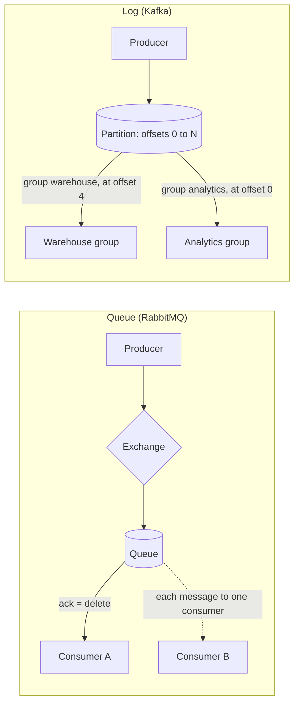

## 🎯 خلاصه

> یک **صف پیام (message queue)** مثل RabbitMQ هر پیام را به **یک** مصرف‌کننده می‌دهد و بعد از **ack** آن را **حذف** می‌کند. یک **log توزیع‌شده** مثل Kafka پیام‌ها را به یک دنباله‌ی مرتب و نگه‌داری‌شده **اضافه** می‌کند، و هر consumer group با یک **offset** (نشانگر پیشرفت) جای خودش را نگه می‌دارد تا بتواند تاریخچه را دوباره بخواند.

- در صف، broker نگه می‌دارد «چه چیزی مانده». در log، هر خواننده خودش نگه می‌دارد «کجا هستم».
- در صف، مصرف‌کننده‌های رقیب کار را **بین خودشان تقسیم** می‌کنند. در log، هر consumer group **کل** جریان را می‌گیرد؛ داخل یک گروه، partitionها بین اعضا تقسیم می‌شوند.
- log امکان replay و چند خواننده‌ی مستقل می‌دهد. صف مسیریابی ریزدانه‌ی هر پیام، اولویت و توزیع ساده‌ی کار را می‌دهد.

## 🌱 از ساده شروع کنیم (مبتدی)

> **💡 تشبیه:** صف مثل **صف باجه‌ی بانک** است: هر مشتری یک‌بار خدمت می‌گیرد و می‌رود. log مثل **تابلوی اعلانات با تاریخ** است: هر کسی می‌تواند هر مدخل را در هر زمانی بخواند، تا وقتی تابلو آن را نگه دارد.

فرض کن رویداد `order_created` داریم و دو تیم به آن نیاز دارند:

- **انبار**: باید هر سفارش را فقط یک‌بار بسته‌بندی کند.
- **تحلیل داده**: همه‌ی رویدادها را می‌خواهد، و ماه بعد که باگی رفع شد، می‌خواهد هفته‌ی گذشته را دوباره حساب کند.

با **صف**، مصرف‌کننده‌ی انبار پیام را ack می‌کند و broker آن را حذف می‌کند. تیم تحلیل هیچ‌وقت آن را نمی‌بیند، مگر اینکه تولیدکننده کپی دومی به صف دیگری فرستاده باشد.

با **log**، رویدادها ۷ روز نگه داشته می‌شوند. انبار و تحلیل هرکدام offset خودشان را دارند و تحلیل می‌تواند بدون پرسیدن از انبار به دیروز برگردد.

سه واژه برای بیشتر این موضوع کافی است:

- **producer**: پیام می‌نویسد.
- **consumer**: پیام می‌خواند.
- **offset**: عددی که یعنی «همه‌چیز تا اینجا را پردازش کرده‌ام».

این مدل کوچک را اجرا کن (`python3 queue_vs_log.py`):

```python
from collections import deque

# Queue: reading removes the message
queue = deque(["m1", "m2", "m3"])
print("queue get:", queue.popleft())
print("left in queue:", list(queue))

# Log: reading never removes; each reader keeps its own offset
log = ["e0", "e1", "e2", "e3"]
offsets = {"warehouse": 2, "analytics": 0}

def read(group):
    pos = offsets[group]
    if pos >= len(log):
        return None
    offsets[group] = pos + 1
    return log[pos]

print("warehouse:", read("warehouse"))
print("analytics:", read("analytics"))
print("analytics:", read("analytics"))
print("log still has:", log)
```

خروجی مورد انتظار:

```text
queue get: m1
left in queue: ['m2', 'm3']
warehouse: e2
analytics: e0
analytics: e1
log still has: ['e0', 'e1', 'e2', 'e3']
```

## 🔧 واقعاً چطور کار می‌کند (متوسط)

**صف (RabbitMQ، مدل صف کلاسیک).** تولیدکننده پیام را به یک **exchange** می‌فرستد. exchange با قاعده‌های **binding** (direct، topic، fanout و headers) پیام را به یک یا چند **صف** می‌رساند. broker پیام‌ها را به مصرف‌کننده push می‌کند، تا سقف **prefetch** از پیام‌های ack‌نشده. وقتی مصرف‌کننده ack بدهد، broker پیام را حذف می‌کند. اگر مصرف‌کننده قبل از ack بمیرد، broker پیام را دوباره (redelivery) به مصرف‌کننده‌ی دیگری می‌دهد.

مصرف‌کننده‌های رقیب روی یک صف، پیام‌ها را نوبتی می‌گیرند. این کار کار را مقیاس می‌دهد، اما با چند مصرف‌کننده ترتیب پردازش به هم می‌خورد: دو نفر ممکن است موازی و با سرعت متفاوت کار را تمام کنند، و پیام redeliver شده ممکن است بعد از پیام‌های جدیدتر برسد. پس با چند مصرف‌کننده، صف **هیچ ضمانت ترتیبی** نمی‌دهد.

**log (Kafka).** هر **topic** به **partition** تقسیم می‌شود. هر partition یک دنباله‌ی append-only است: هر رکورد offset بعدی را می‌گیرد (۰، ۱، ۲، ...). خواندن رکورد آن را حذف نمی‌کند؛ رکورد وقتی حذف می‌شود که **retention** (بر اساس زمان یا حجم) تمام شود. مصرف‌کننده با **pull** می‌گوید «از partition 3 از offset 4000 به بعد».

واحد اشتراک‌گذاری **consumer group** است. داخل یک گروه، هر partition حداکثر به یک مصرف‌کننده می‌رسد. بین گروه‌ها، هر گروه مستقل همه‌چیز را می‌خواند.



| پرسش | صف (RabbitMQ) | log (Kafka) |
|---|---|---|
| بعد از خواندن چه می‌شود؟ | پیام بعد از ack حذف می‌شود | چیزی حذف نمی‌شود؛ offset جلو می‌رود |
| پیشرفت را چه کسی نگه می‌دارد؟ | broker، برای هر پیام | مصرف‌کننده، برای هر گروه و هر partition |
| چند خواننده‌ی مستقل | برای هر خواننده صف جدا (و کپی) لازم است | رایگان: یک گروه برای هر خواننده |
| replay رویدادهای قدیمی | بعد از ack ممکن نیست | بله، در بازه‌ی retention |
| ترتیب | در هر صف، با چند مصرف‌کننده از بین می‌رود | فقط در هر partition |
| مسیریابی هر پیام | غنی (exchange، binding، اولویت) | بر اساس topic و کلید |

## 🧠 عمق و trade-offها (سنیور)

- **نقطه‌ی ack، معناشناسی تحویل را تعیین می‌کند.** در صف، ack بعد از پردازش یعنی at-least-once: اگر بعد از پردازش و قبل از ack کرش شود، duplicate ساخته می‌شود. ack قبل از پردازش یعنی at-most-once: با کرش، پیام گم می‌شود. در Kafka همین قانون با commit کردن offset برقرار است. برای نتیجه‌ی «تقریباً exactly-once» در هر دو حالت به مصرف‌کننده‌ی idempotent نیاز داری. ببین [[idempotency]] و [[exactly-once]].
- **مقیاس‌پذیری متفاوت است.** صف با اضافه کردن مصرف‌کننده به یک صف مقیاس می‌گیرد و بهای آن ترتیب است. log با تعداد partition مقیاس می‌گیرد: موازی‌سازی هر گروه سقف دارد (تعداد partition) و ترتیب هر کلید حفظ می‌شود چون کلید، partition را تعیین می‌کند.
- **backlog به شکل‌های متفاوتی دیده می‌شود.** صف در حال رشد یعنی پیام‌ها در حافظه و دیسک broker جمع می‌شوند، و RabbitMQ می‌تواند وقتی به حد منابع می‌رسد تولیدکننده‌ها را متوقف کند. backlog در log یعنی [[consumer-lag]]: داده تا وقتی retention آن را پاک نکرده روی دیسک امن است. مصرف‌کننده‌ای که از retention عقب بماند، داده‌هایی را که هرگز نخوانده از دست می‌دهد. پس هشدار را روی lag بگذار، نه فقط روی دیسک broker.
- **replay هزینه دارد.** بازخوانی یک هفته داده، یک هفته کار را دوباره انجام می‌دهد. sinkها باید duplicate را تحمل کنند و بار باید در ظرفیت اضافه جا شود.
- **ذخیره‌سازی.** log برای کل بازه‌ی retention بایت نگه می‌دارد. صف‌ها خالی می‌شوند و داده‌ی کمتری دارند، ولی همین دلیل نمی‌شود که تاریخچه‌ی رویدادها را در صف نگه داری.
- **ویژگی‌های جدید مرز را کم‌رنگ کرده‌اند.** RabbitMQ نوعی stream با رفتار log دارد و Kafka هم مدل‌های جدید مصرف شبیه صف دارد. پیش از ادعای نبودن یک قابلیت، مستندات نسخه‌ی خودت را ببین.
- **کی log مناسب نیست؟** صف‌های کار با TTL هر پیام، اولویت، retry با تأخیر و RPC به‌صورت request-reply برای RabbitMQ مناسب‌ترند. وقتی هر پیام قانون مسیریابی جدا دارد و هیچ‌وقت replay نمی‌کنی، log انتخاب ضعیفی است.

## 🧪 امتحان کن

کد بخش مبتدی را اجرا کن و قبل از دیدن جواب، این‌ها را حدس بزن.

1. یک بار دیگر `queue.popleft()` را صدا بزن. چه چاپ می‌شود و چه چیزی در صف می‌ماند؟
2. `offsets["analytics"]` را ۰ کن، سپس `read("analytics")` را پنج بار پشت‌سرهم صدا بزن. چه برمی‌گردد؟
3. دو مصرف‌کننده‌ی رقیب روی یک صف RabbitMQ داری. مصرف‌کننده‌ی A پیام `order-1` را می‌گیرد و قبل از ack می‌میرد. مصرف‌کننده‌ی B پیام `order-2` را می‌گیرد و کار را تمام می‌کند، بعد `order-1` دوباره تحویل داده می‌شود. کدام زودتر پردازش می‌شود، و چرا این مهم است؟
4. یک topic با ۴ partition و یک consumer group با ۶ مصرف‌کننده داری. چند مصرف‌کننده هیچ partition نمی‌گیرند؟

<details><summary>جواب‌ها را نشان بده</summary>

**1.** `m2` چاپ می‌شود و `['m3']` در صف می‌ماند.

**2.** `e0`، `e1`، `e2`، `e3` و بعد `None`. log هیچ‌کدام را حذف نکرده؛ خواننده فقط به انتهای آن رسیده است.

**3.** اول `order-2` پردازش می‌شود و بعد `order-1`. این همان از دست رفتن ترتیب در صفی با مصرف‌کننده‌های رقیب و redelivery است.

**4.** دو تا. هر partition در یک گروه به حداکثر یک مصرف‌کننده می‌رسد، پس ۲ تا از ۶ بیکار می‌مانند.

</details>

## 💬 گوشه‌ی مصاحبه

**سؤال: «برای این سیستم صف یا log؟»** جواب متوسط: «برای رویدادها Kafka، چون آن‌ها را نگه می‌دارد و به چند سرویس اجازه‌ی خواندن می‌دهد؛ برای کارهای پس‌زمینه RabbitMQ، چون هر پیام را مسیریابی و ack می‌کند.» جواب سنیور: «سه چیز را می‌پرسم: آیا replay لازم است؟ آیا چند تیم مستقل همین رویدادها را می‌خوانند؟ آیا ترتیب در سطح هر موجودیت مهم است؟ دو بله یا بیشتر یعنی log. اگر کارها به مسیریابی ریزدانه، اولویت یا retry با تأخیر نیاز دارند، صف مناسب است. در هر حالت نقطه‌ی ack و برنامه‌ی تحمل duplicate را می‌گویم.»

**سؤال: «آیا Kafka ترتیب پیام‌ها را تضمین می‌کند؟»** جواب متوسط: «داخل یک partition بله.» جواب سنیور: «داخل یک partition و به ترتیب offset، برای یک producer که درست تنظیم شده باشد. بین partitionها نه، و بین producerهایی که بدون هماهنگی روی یک کلید می‌نویسند هم نه. ترتیب برای هر موجودیت یعنی یک کلید برای هر موجودیت.»

> **🎤 این را در مصاحبه بگو:** «صف کار را بعد از انجام شدن حذف می‌کند، پس برای توزیع کار مناسب است. log تاریخچه را نگه می‌دارد و هر خواننده موقعیت خودش را دارد، پس برای رویدادهایی با replay و چند مصرف‌کننده مناسب است. انتخابم را بر اساس نیاز به replay، تعداد خواننده‌ها و محدوده‌ی ترتیب می‌گیرم، و مصرف‌کننده را طوری طراحی می‌کنم که duplicate را تحمل کند.»

## ⚠️ اشتباهات رایج

> **⚠️ هشدار:** «Kafka فقط یک صف سریع‌تر است.» در consumer group پیام‌ها حذف نمی‌شوند و تنها نشانه‌ی پیشرفت، offset گروه است. با این تصور، هشدار retention و lag دیده نمی‌شود تا وقتی داده دیگر وجود ندارد.

- انتظار ترتیب کلی از یک صف با چند مصرف‌کننده، یا از یک topic با چند partition.
- ack کردن پیام RabbitMQ قبل از پایان کار، و از دست رفتن آن با کرش.
- فراموش کردن اینکه مصرف‌کننده‌ای که از retention عقب بماند، رکوردهای منقضی‌شده را هرگز نمی‌بیند.
- کپی کردن یک رویداد در صف‌های متعدد، در حالی که یک log با چند گروه کافی است.
- نگه داشتن log با retention خیلی بزرگ بدون بودجه‌بندی دیسک.

## ✅ خودت را بسنج

1. در RabbitMQ یک پیام کی از صف کلاسیک حذف می‌شود؟
   - A) وقتی منتشر می‌شود
   - B) وقتی مصرف‌کننده آن را می‌خواند
   - C) وقتی مصرف‌کننده آن را ack می‌کند
   - D) وقتی `retention.ms` تمام شود

<details><summary>جواب</summary>

**C** — حذف با ack انجام می‌شود. صرف تحویل پیام را حذف نمی‌کند؛ اگر مصرف‌کننده قبل از ack بمیرد، broker دوباره تحویل می‌دهد.

</details>

2. یک topic با ۴ partition و یک consumer group با ۶ مصرف‌کننده داری. چند مصرف‌کننده هیچ partition نمی‌گیرند؟
   - A) ۰
   - B) ۲
   - C) ۴
   - D) ۶

<details><summary>جواب</summary>

**B** — هر partition در گروه به حداکثر یک مصرف‌کننده می‌رسد، پس ۲ تا از ۶ بیکار می‌مانند.

</details>

3. دو تیم تحلیلی به یک رویداد نیاز دارند و یکی‌شان می‌خواهد بعد از رفع باگ، ماه گذشته را دوباره حساب کند. کدام طراحی مناسب است؟
   - A) یک صف RabbitMQ مشترک بین هر دو تیم
   - B) دو صف RabbitMQ، یکی برای هر تیم، با کپی هر پیام
   - C) یک topic در Kafka و هر تیم در consumer group جدا
   - D) یک topic در Kafka با یک مصرف‌کننده‌ی مشترک

<details><summary>جواب</summary>

**C** — هر گروه offset خودش را دارد، پس تیم‌ها مستقل می‌خوانند و بازپردازش فقط یعنی برگرداندن offset به نقطه‌ای قدیمی‌تر در بازه‌ی retention. گزینه‌ی B کار می‌کند، اما پیام‌ها را تکرار می‌کند و بعد از ack امکان replay ندارد.

</details>

4. **(سنیور)** مصرف‌کننده‌ات offset را قبل از نوشتن در دیتابیس commit می‌کند. بعد از commit، پروسه کرش می‌کند. آن batch چه می‌شود و کدام طراحی مشکل را حل می‌کند؟
   - A) دو بار نوشته می‌شود؛ یک مصرف‌کننده‌ی دوم اضافه کن
   - B) گم می‌شود، چون offset از آن رد شده؛ بعد از نوشتن موفق commit کن و نوشتن را idempotent کن
   - C) در retention می‌ماند و چیزی گم نمی‌شود
   - D) Kafka آن را از کش broker دوباره می‌فرستد

<details><summary>جواب</summary>

**B** — offset می‌گوید «انجام شد» در حالی که نوشتن هرگز اتفاق نیفتاده. commit را بعد از نوشتن موفق بگذار و نوشتن را idempotent کن تا تحویل مجدد بعد از کرش آسیبی نزند.

</details>

5. **(سنیور)** با وجود Kafka در شرکت، برای یک workflow تلاش مجدد پرداخت RabbitMQ را انتخاب می‌کنی. قوی‌ترین دلیل کدام است؟
   - A) Kafka نمی‌تواند پیام ذخیره کند
   - B) ack تک‌تک پیام، retry با تأخیر و مسیریابی ریزدانه برای کارها مناسب‌ترند تا یک log مرتب
   - C) RabbitMQ ترتیب کلی را تضمین می‌کند
   - D) Kafka از consumer group پشتیبانی نمی‌کند

<details><summary>جواب</summary>

**B** — کارها به ack تک‌تک پیام، retry و مسیریابی نیاز دارند، و یک log برای این جنس کار مناسب نیست. انتخاب باید بر اساس نوع کار باشد، نه مد روز.

</details>

## 🗂️ فلش‌کارت

| Front | Back |
|---|---|
| صف: پیام کی حذف می‌شود؟ | وقتی مصرف‌کننده آن را ack می‌کند، نه وقتی خوانده می‌شود. |
| log: بعد از خواندن چه می‌شود؟ | چیزی حذف نمی‌شود؛ offset مصرف‌کننده جلو می‌رود. |
| offset | موقعیت در هر partition؛ یعنی «تا اینجا را پردازش کرده‌ام». |
| consumer group | مصرف‌کننده‌هایی که partitionهای یک topic را بین خود تقسیم می‌کنند؛ هر گروه کل جریان را می‌خواند. |
| ترتیب در Kafka | داخل هر partition تضمین می‌شود، بین partitionها نه. |
| consumer lag | فاصله‌ی offset گروه تا انتهای log. |
| مصرف‌کننده‌های رقیب | چند مصرف‌کننده روی یک صف؛ هر پیام به یکی از آن‌ها می‌رسد. |
| at-least-once | ack بعد از پردازش؛ کرش می‌تواند duplicate بسازد. |

## 🔗 ادامه

- `kafka-architecture`: partition، replica و leader.
- `kafka-consumers`: offset، commit و rebalancing.
- `delivery-semantics`: at-most-once، at-least-once و exactly-once در عمل.
- `backpressure`: وقتی مصرف‌کننده‌ها عقب می‌افتند چه کنیم.
- واژه‌نامه: [[consumer-lag]]، [[exactly-once]]، [[idempotency]].

