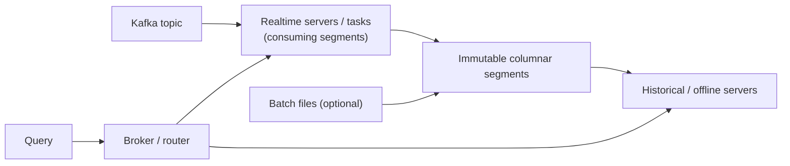

## 🎯 خلاصه

> یک **موتور OLAP بلادرنگ** (Apache Druid و Apache Pinot) رویدادها را مستقیم از یک stream مثل [[kafka-architecture|Kafka]] می‌گیرد و در عرض چند ثانیه قابل کوئری می‌کند، و **کوئری‌های تحلیلی هم‌زمانِ زیاد با تأخیر کم** را برای کاربرهای نهایی جواب می‌دهد.

- برای **داشبوردها و APIهای رو به کاربر** ساخته شده: هزاران کوئری در ثانیه، با p99 در حد ده‌ها تا صدها میلی‌ثانیه.
- داده در **segmentهای ستونی و تغییرناپذیر** با ایندکس زیاد ذخیره می‌شود، پس فیلتر و تجمیع کمترین داده را لمس می‌کنند.
- نقطه‌ی قوت اصلی تازگی داده است: یک رویداد می‌تواند چند ثانیه بعد از تولید قابل کوئری باشد، نه بعد از batch شبانه.
- هزینه‌اش: schema ثابت، join محدود، پیچیدگی عملیاتی، و نیاز واقعی به طراحی segment و ایندکس.

## 🌱 از ساده شروع کنیم (مبتدی)

> **💡 تشبیه:** گزارش انباره‌ی شبانه مثل **روزنامه** است: یک‌بار در روز چاپ می‌شود و برای دیروز بسیار دقیق است. موتور OLAP بلادرنگ مثل **تابلوی بورس** است: هر معامله در چند ثانیه روی صفحه می‌آید و هزاران نفر هم‌زمان نگاهش می‌کنند.

یک اپ سفارش غذا را تصور کن. هر رویداد سفارش (`order_id`، `city`، `status`، `amount`، `ts`) وارد Kafka می‌شود. کسب‌وکار می‌خواهد صفحه‌ای داشته باشد که صاحب رستوران بتواند ببیند «سفارش‌ها و درآمد یک ساعت اخیر، به تفکیک وضعیت» را هر چند ثانیه یک‌بار تازه‌شده ببیند، آن هم برای ۵۰٬۰۰۰ صاحب رستوران در اوج بار.

یک انباره‌ی معمولی این کوئری را جواب می‌دهد، اما نه برای ۵۰٬۰۰۰ نفر هم‌زمان با بودجه‌ی ۳۰۰ میلی‌ثانیه. موتور OLAP بلادرنگ دقیقاً برای همین الگو ساخته شده: **تجمیع سریع، هم‌زمانی زیاد، داده‌ی تازه**.

این شکل کوئری است که سرویس می‌دهد:

```sql
-- Pinot-style SQL: orders per status for one city in the last hour
SELECT status, COUNT(*) AS orders, SUM(amount) AS revenue
FROM orders
WHERE city = 'Tehran'
  AND ts > ago('PT1H')   -- Pinot time function; Druid uses its own time filters
GROUP BY status
ORDER BY orders DESC;
```

دو مفهوم را به خاطر بسپار: **OLAP** یعنی «تجمیع روی ردیف‌های زیاد»، و **بلادرنگ** یعنی «ردیف‌ها پیوسته می‌رسند و فوراً قابل کوئری‌اند».

## 🔧 واقعاً چطور کار می‌کند (متوسط)

Druid و Pinot طراحی کلی یکسانی دارند:



۱. **ingestion.** یک realtime server مستقیم یک partition از Kafka را مصرف می‌کند، بدون job ETL واسطه. ردیف‌ها در یک «consuming segment» در حافظه قرار می‌گیرند و بلافاصله قابل کوئری‌اند.
۲. **بستن segment.** وقتی یک آستانه‌ی زمان یا تعداد ردیف برسد، segment فلاش می‌شود و به یک **segment ستونی و تغییرناپذیر** تبدیل می‌شود که روی دیسک (یا deep storage) ذخیره و توسط یک سرور سرو می‌شود.
۳. **کوئری.** یک broker کوئری را به سرورهایی که segmentهای مرتبط را دارند پخش می‌کند، هر کدام تجمیع جزئی حساب می‌کند و broker نتایج را ادغام می‌کند. time pruning باعث می‌شود segmentهای قدیمی کاملاً نادیده گرفته شوند.

آنچه کوئری‌ها را سریع می‌کند، لایه‌ی **ایندکس و pre-aggregation** است:

- **dictionary encoding و ایندکس bitmap/inverted** روی ستون‌های dimension (مثل `city` و `status`)، تا فیلتر تبدیل به اشتراک bitmap شود.
- **ایندکس range و sorted** روی ستون زمان.
- **rollup** (در Druid): موقع ingestion، ردیف‌هایی که dimensionهای یکسان و زمان گرد‌شده‌ی یکسان دارند ادغام می‌شوند، پس حجم و کار کوئری کم می‌شود. اما جزئیات خام را از دست می‌دهی.
- **star-tree index** (در Pinot): تجمیع‌های از پیش محاسبه‌شده روی ترکیب dimensionهای انتخابی، در ازای فضا و زمان ساخت بیشتر.

**Upsert.** Pinot می‌تواند آخرین ردیف برای هر **primary key** را نگه دارد؛ این همان چیزی است که جریان‌های CDC را سرو می‌کند (سفارش وضعیتش عوض می‌شود و داشبورد باید وضعیت جدید را نشان دهد). یک قطعه‌ی حداقلی از schema و table:

```json
{
  "schemaName": "orders",
  "primaryKeyColumns": ["orderId"],
  "upsertConfig": {
    "mode": "FULL",
    "comparisonColumns": ["updatedAt"]
  },
  "routing": { "instanceSelectorType": "strictReplicaGroup" }
}
```

`FULL` کل ردیف یک کلید را جایگزین می‌کند؛ `PARTIAL` ستون‌ها را طبق استراتژی هر ستون ادغام می‌کند. `comparisonColumns` تعیین می‌کند وقتی رویدادها نامرتب می‌رسند کدام نسخه برنده است. (گزینه‌ها و پیش‌فرض‌ها بین نسخه‌های Pinot تغییر می‌کنند؛ داک نسخه‌ی خودت را چک کن.)

## 🧠 عمق و trade-offها (سنیور)

- **تازگی در برابر تعداد فایل.** آستانه‌ی flush کوچک‌تر یعنی داده زودتر دیده می‌شود، ولی segmentهای ریز و زیاد می‌سازد. segmentهای زیاد هزینه‌ی ثابت هر کوئری و فشار metadata را بالا می‌برند. هم زمان و هم تعداد ردیف را تنظیم کن.
- **upsert به co-location نیاز دارد.** وضعیت upsert روی هر سرور محلی است، پس همه‌ی رویدادهای یک primary key باید به یک سرور برسند. یعنی topic باید بر اساس primary key partition شود و routing از نوع strict replica-group باشد، که روش scale و recovery را محدود می‌کند. بدون این، یک کلید ممکن است در دو جا «زنده» باشد.
- **cardinality دشمن است.** یک `GROUP BY user_id` روی میلیون‌ها کلید، نقشه‌های میانیِ بزرگی روی broker و سرورها می‌سازد. موتور بلادرنگ OLAP برای dimensionهای محدود (شهر، وضعیت، محصول) قوی است و برای dimensionهای بی‌کران ضعیف. یا pre-aggregate کن، یا سؤال را عوض کن.
- **join.** تاریخاً این موتورها در join‌های بزرگ ضعیف بوده‌اند. موتورهای چندمرحله‌ای جدیدتر بهتر شده‌اند، ولی طراحی امن این است که **موقع ingestion denormalize کنی** (join را در stream processor مثل [[flink]] انجام بدهی) و جدول سرویس را پهن نگه داری.
- **مقایسه با ClickHouse.** ClickHouse یک DBMS ستونی همه‌منظوره با join SQL، فشرده‌سازی قوی و جدول‌های انعطاف‌پذیر `MergeTree` است؛ وقتی به ingestion بومی stream در این مقیاس نیاز نداری، اغلب ساده‌تر است. Druid و Pinot در سرو کردن هم‌زمانی بالا، کوئری‌های محدود به زمان، چندمستأجری، ingestion بومی از Kafka و storage لایه‌ای می‌درخشند. روی workload واقعی خودت مقایسه کن: هم‌زمانی، نیاز به join، نیاز به upsert و مهارت تیم.
- **چه چیزی را مانیتور کنی.** lag ingestion برای هر partition (ببین [[consumer-lag]])، تعداد consuming segmentها، تعداد segment برای هر جدول، p99 کوئری برای هر جدول، و CPU/heap روی سرورهایی که dictionary و نقشه‌ی upsert دارند.
- **کی استفاده نکنی.** کاوش ad-hoc توسط تحلیلگرها روی پتابایت، join‌های پیچیده‌ی چندجدولی، یا داده‌ی فقط batch. اینجا یک موتور lakehouse یا انباره ارزان‌تر و انعطاف‌پذیرتر است.

## 🧪 امتحان کن

باید یک داشبورد پشتیبانی کنی: **۱۰٬۰۰۰ رویداد در ثانیه**، هر رویداد `merchant_id` (حدود ۵۰٬۰۰۰ فروشنده)، `status` (۵ مقدار)، `amount` و `event_time` دارد. نیازمندی‌ها: کوئری‌ها داده‌ی ۲۴ ساعت گذشته‌ی هر فروشنده را نشان دهند، p99 زیر ۳۰۰ میلی‌ثانیه باشد، در ۲٬۰۰۰ کوئری در ثانیه.

۱. کدام فیلدها dimension می‌شوند، کدام metric، و کدام ستون زمان؟ چرا؟
۲. حجم خام رویدادهای یک روز را تخمین بزن. محاسبه را نشان بده.
۳. آیا upsert فعال می‌کنی؟ اگر تغییرات status به صورت رویدادهای CDC برسند، چه چیزی عوض می‌شود؟

<details><summary>راه‌حل را ببین</summary>

**۱.** `merchant_id` و `status` dimension هستند (در فیلتر و `GROUP BY` استفاده می‌شوند). `amount` یک metric است (با `SUM` تجمیع می‌شود). `event_time` ستون زمان است و برای pruning و retention به کار می‌رود. `event_id` را داخل ایندکس dimension نگذار: یکتاست و برای گروه‌بندی بی‌فایده است.

**۲.** ۱۰٬۰۰۰ رویداد/ثانیه × ۸۶٬۴۰۰ ثانیه = ۸۶۴٬۰۰۰٬۰۰۰ رویداد در روز، یعنی حدود ۰٫۸۶ میلیارد. با فرض ۱۰۰ بایت برای هر ردیف قبل از فشرده‌سازی، حدود ۸۶ گیگابایت خام در روز.

**۳.** اگر رویدادها fact‌های تغییرناپذیرند (یک ردیف برای هر سفارش)، upsert لازم نیست. اگر `status` در طول زمان عوض می‌شود و داشبورد باید وضعیت فعلی را نشان دهد، upsert با `primaryKeyColumns = [order_id]` و `comparisonColumns = [updated_at]` لازم است. آنگاه topic باید بر اساس `order_id` partition شود و routing باید هر کلید را روی یک replica group نگه دارد.

</details>

## 💬 گوشه‌ی مصاحبه

**سؤال: «کی Pinot یا Druid را به جای ClickHouse یا انباره انتخاب می‌کنی؟»**
پاسخ متوسط: «وقتی داشبورد با تأخیر زیر ثانیه و داده‌ی چند ثانیه‌ای از Kafka لازم داریم.»
پاسخ سنیور: «وقتی هم‌زمانی زیاد است، کوئری‌ها محدود به زمان‌اند و روی تعداد کمی dimension فیلتر می‌شوند، و به ingestion بومی stream و upsert در مقیاس نیاز دارم. اول نیاز به join و cardinality را چک می‌کنم، چون آن‌ها مشخص می‌کنند آیا یک DBMS ستونی عمومی ساده‌تر و ارزان‌تر است.»

**سؤال: «چطور آخرین وضعیت یک سفارش را در یک جدول بلادرنگ نگه می‌داری؟»**
پاسخ متوسط: «upsert با order id به عنوان primary key.»
پاسخ سنیور: «upsert با primary key و ستون مقایسه، topic را بر اساس همان کلید partition می‌کنم تا یک سرور مالک آن باشد، و رویدادهای نامرتب و حذف‌ها را با tombstone و TTL برای کلیدهای حذف‌شده هندل می‌کنم. recovery را تست می‌کنم، چون نقشه‌ی upsert بعد از restart باید بازسازی شود.»

> **🎤 این را در مصاحبه بگو:** «موتورهای OLAP بلادرنگ انعطاف را در برابر تأخیر و هم‌زمانی معامله می‌کنند. وقتی الگوی دسترسی مجموعه‌ای مشخص از تجمیع‌ها روی داده‌ی تازه برای کاربران زیاد باشد، سراغشان می‌روم، و جدول سرویس را پهن و با cardinality محدود نگه می‌دارم.»

## ⚠️ اشتباهات رایج

> **⚠️ توجه:** «بلادرنگ» یعنی «exactly-once رایگان» نیست. replay از Kafka و رویدادهای نامرتب به یک استراتژی صریح نیاز دارند: کلید upsert، ستون مقایسه یا کلیدهای idempotent.

> **⚠️ توجه:** استفاده از این موتورها به عنوان system of record. اینها موتور سرو هستند؛ رویدادهای خام را در lake یا انباره نگه دار تا بتوانی بازسازی کنی.

- گذاشتن شناسه‌های بی‌کران (user id، request id) داخل ایندکس dimension.
- فراموش کردن ستون زمان و در نتیجه اسکن همه‌ی segmentها.
- طراحی star schema با join‌های بزرگ زیاد در زمان کوئری.
- بی‌توجهی به اندازه‌ی segment: هزاران segment ریز هر کوئری را کند می‌کند.
- انتظار اینکه جدول upsert بدون فکر کردن به partition key افقی scale شود.

## ✅ خودت را بسنج

۱. دلیل اصلی استفاده از موتورهای OLAP بلادرنگ برای داشبوردهای رو به کاربر چیست؟
   - A) join کامل ANSI SQL روی جدول‌های بزرگ زیاد
   - B) سرو کردن هم‌زمانی زیاد با تأخیر کم روی داده‌ی تازه‌ی استریم‌شده
   - C) ذخیره‌ی داده به صورت row برای خواندن سریع تک‌ردیف
   - D) نیازی به هیچ ایندکسی ندارند

<details><summary>جواب</summary>

**B** — هدف طراحی، تجمیع‌های هم‌زمان با تأخیر کم روی داده‌ای است که پیوسته می‌رسد. join و lookup تک‌ردیفی نقطه‌ی قوت آن‌ها نیست.

</details>

۲. ستون `status` بعد از اولین رویداد از `PENDING` به `PAID` تغییر می‌کند. کدام قابلیت فقط آخرین وضعیت را نگه می‌دارد؟
   - A) Rollup
   - B) Star-tree index
   - C) Upsert با primary key و ستون مقایسه
   - D) Bloom filter

<details><summary>جواب</summary>

**C** — upsert ردیف یک primary key را جایگزین می‌کند و با ستون مقایسه تشخیص می‌دهد کدام نسخه تازه‌تر است. Rollup موقع ingestion ردیف‌ها را ادغام می‌کند، اما مفهوم «آخرین وضعیت یک کلید» را مدل نمی‌کند.

</details>

۳. **(سنیور)** upsert را فعال می‌کنی و بعد از deploy، برخی سفارش‌ها در کوئری‌های مختلف دو status متفاوت نشان می‌دهند. محتمل‌ترین علت چیست؟

   - A) کدگذاری dictionary اشتباه است
   - B) topic بر اساس primary key partition نشده، پس یک کلید را سرورهای مختلف مدیریت می‌کنند
   - C) ایندکس bitmap غیرفعال است
   - D) ستون زمان خیلی درشت است

<details><summary>جواب</summary>

**B** — وضعیت upsert محلی روی هر سرور است. اگر رویدادهای یک کلید بین partitionها پخش شوند، هر سرور یک نسخه‌ی «آخر» جدا دارد. بر اساس primary key partition کن و routing سخت‌گیرانه استفاده کن.

</details>

۴. **(سنیور)** چرا flush کردن segmentها هر ۱۰ ثانیه، به جای هر ۴ ساعت، عملکرد کوئری را بدتر می‌کند، با اینکه داده تازه‌تر است؟

   - A) داده‌ی تازه قابل ایندکس‌گذاری نیست
   - B) segmentهای بیشتر و ریزتر، fan-out هر کوئری و overhead متادیتا را بالا می‌برند
   - C) Kafka پیام‌ها را زودتر حذف می‌کند
   - D) dictionaryها از داده بزرگ‌تر می‌شوند

<details><summary>جواب</summary>

**B** — هر کوئری به segment بیشتری می‌رسد و هر segment هزینه‌ی ثابت دارد. تازگی باید با تعداد segment متعادل شود، پس هم زمان و هم تعداد ردیف را تنظیم کن.

</details>

۵. کدام workload **بدترین** انطباق را با موتور OLAP بلادرنگ دارد؟

   - A) شمارش زنده‌ی کمپین‌ها برای ساعت اخیر، برای ۱۰٬۰۰۰ کاربر هم‌زمان
   - B) کاوش ماهانه‌ی تحلیلگر که ده جدول بزرگ را join می‌کند
   - C) داشبورد درآمد هر شهر که هر چند ثانیه تازه می‌شود
   - D) محصولات پرفروش هر فروشگاه که از Kafka به‌روز می‌شود

<details><summary>جواب</summary>

**B** — کاوش ad-hoc با join‌های چندجدولی روی تاریخچه‌ی بزرگ، مسئله‌ی انباره یا lakehouse است. سه گزینه‌ی دیگر نقطه‌ی شیرین این موتورند: dimensionهای محدود، هم‌زمانی و داده‌ی تازه.

</details>

## 🗂️ فلش‌کارت

| Front | Back |
|---|---|
| موتور OLAP بلادرنگ | segmentهای ستونی و تغییرناپذیر دارد و تجمیع‌های هم‌زمان با تأخیر کم روی داده‌ی استریم‌شده سرو می‌کند |
| Druid در برابر Pinot | هر دو مستقیم از Kafka می‌خوانند؛ Pinot به خاطر upsert با primary key شناخته می‌شود |
| consuming segment | segment در حافظه که ردیف دریافت می‌کند و قبل از بسته شدن قابل کوئری است |
| Rollup | ادغام ردیف‌های با dimension یکسان و زمان گردشده، موقع ingestion |
| star-tree index | تجمیع‌های از پیش محاسبه‌شده روی ترکیب dimensionهای انتخابی |
| Upsert | نگه داشتن آخرین ردیف برای هر primary key با تصمیم ستون مقایسه |
| چرا برای upsert بر اساس کلید partition کنیم | وضعیت هر کلید روی یک سرور است، پس دو «آخرین نسخه» همزمان نمی‌سازیم |
| group-by با cardinality بالا | گران: نقشه‌های میانیِ بزرگ روی هر سرور و broker |

## 🔗 ادامه

- [[serving-layer]] — جای یک store بلادرنگ در کل معماری.
- [[clickhouse]] و [[starrocks-doris]] — جایگزین‌های اصلی برای مقایسه.
- [[pattern-realtime-aggregation]] — محاسبه‌ی تجمیع‌ها در بالادست، قبل از رسیدن به store.
- داک رسمی Apache Druid و Apache Pinot: گزینه‌های upsert، ایندکس و routing را برای نسخه‌ای که اجرا می‌کنی چک کن.
