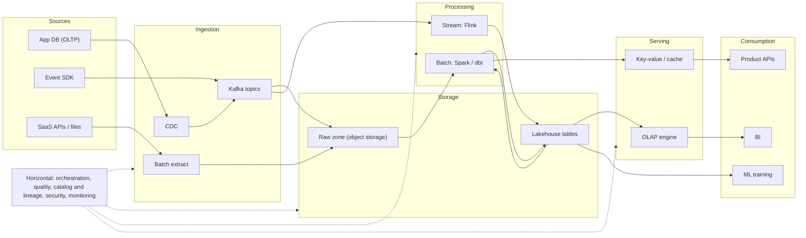
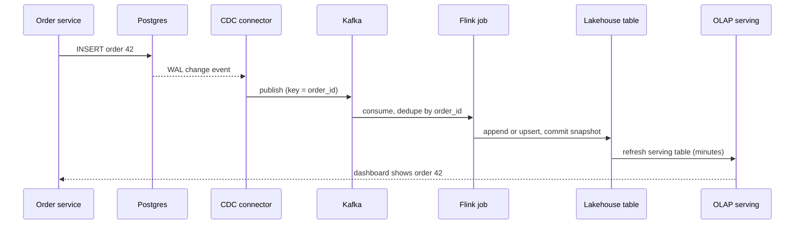

## 🎯 خلاصه

> **معماری مرجع (reference architecture)** نقشه‌ی استاندارد یک پلتفرم داده است: داده از **منابع** می‌آید، با **ingestion** وارد **ذخیره‌سازی** می‌شود، با **پردازش** تبدیل می‌شود، با **serving** در دسترس قرار می‌گیرد و توسط **مصرف‌کننده‌ها** استفاده می‌شود. لایه‌های افقی (ارکستراسیون، کیفیت، catalog، امنیت و مانیتورینگ) از همهٔ این‌ها عبور می‌کنند.

- هر لایهٔ عمودی یک کار مشخص دارد. اگر کارها را جدا نگه داری، می‌توانی یک ابزار را بدون بازنویسی بقیه عوض کنی.
- **log** (معمولاً Kafka) و **object storage** (مثل S3، GCS یا هر ذخیره‌ساز سازگار با HDFS) دو ستون مشترک اغلب پلتفرم‌های امروزی‌اند.
- یک فرمت جدول lakehouse (مثل Iceberg، Delta یا Hudi) اجازه می‌دهد چند موتور، داده‌ی یکسان را امن بخوانند و بنویسند.
- لایه‌های افقی اختیاری نیستند. بیشتر خرابی‌های پلتفرم، خرابی ارکستراسیون، کیفیت یا مالکیت است، نه موتور پردازش.

## 🌱 از ساده شروع کنیم (مبتدی)

> **💡 تشبیه:** به تأمین غذای یک شهر فکر کن. مزرعه‌ها غذا تولید می‌کنند (**منابع**). کامیون‌ها آن را می‌آورند (**ingestion**). انبار مرکزی نگهش می‌دارد (**ذخیره‌سازی**). آشپزخانه‌ها می‌پزند (**پردازش**). مغازه‌ها غذای آماده را نشان می‌دهند (**serving**). مردم می‌خورند (**مصرف**). چراغ‌های راهنمایی، بازرس‌ها و نقشهٔ شهر روی همهٔ این‌ها کار می‌کنند (**ارکستراسیون، کیفیت، catalog، امنیت، مانیتورینگ**).

همین تصویر برای داده:

| لایه | کار | ابزارهای رایج |
|---|---|---|
| منابع | جایی که واقعیت‌ها تولید می‌شوند | پایگاه داده‌ی اپلیکیشن، SDK رویداد، APIهای SaaS، فایل، دستگاه‌های IoT |
| Ingestion | انتقال مطمئن داده به داخل | کانکتورهای CDC، producerهای Kafka، job های استخراج batch، فایل‌ها |
| ذخیره‌سازی | نگه‌داری ارزان و بادوام | object storage، جدول‌های lakehouse، انبار داده |
| پردازش | پاک‌سازی، join، تجمیع، غنی‌سازی | Spark، Flink، dbt روی انبار، موتورهای SQL |
| Serving | پاسخ سریع به سؤال‌ها | موتورهای OLAP، key-value store، cache، APIها |
| مصرف | استفاده از نتایج | داشبورد BI، آموزش ML، feature محصول، گزارش |

جواب مبتدی جعبه‌ها را نام می‌برد. جواب خوب هم می‌گوید هر جعبه چه تضمینی می‌دهد و وقتی خراب می‌شود چه اتفاقی می‌افتد.

## 🔧 واقعاً چطور کار می‌کند (متوسط)

این تصویر مرجع است. فلش‌های توپر جریان داده‌اند؛ نوار افقی کنترل و حاکمیت را نشان می‌دهد.



### هر لایه در عمل

**منابع.** پایگاه داده‌های عملیاتی نباید کوئری تحلیلی سنگین اجرا کنند. تغییرات را با [[cdc]] بخوان (از write-ahead log پایگاه داده) و هر ساعت `SELECT` سنگین نزن. برای رویدادها از SDK با schema تعریف‌شده استفاده کن و اجازه نده producer بی‌صدا فیلد جدید بسازد.

**Ingestion.** سه الگو بیشتر موارد را پوشش می‌دهد: CDC برای تغییرات پایگاه داده، یک topic در [[kafka-architecture]] برای رویدادها، و استخراج batch برای APIهای SaaS و فایل‌ها. هر مسیر باید به دو سؤال جواب بدهد: روی رکورد تکراری و رکورد دیرِرسیده چه می‌شود؟ [[idempotency]] و کلید dedupe را همین‌جا انتخاب کن، نه در داشبورد.

**ذخیره‌سازی.** یک raw zone روی [[object-storage]] هر ورودی را دقیقاً همان‌طور که رسیده نگه می‌دارد. روی آن، یک [[lakehouse-table-formats|فرمت جدول lakehouse]] commit های ACID، تکامل schema و snapshot اضافه می‌کند. این یک جدول Iceberg است که روزانه partition شده و از Spark SQL نوشته شده:

```sql
CREATE TABLE lake.events.page_views (
  event_id   string,
  user_id    bigint,
  event_time timestamp,
  url        string
)
USING iceberg
PARTITIONED BY (days(event_time));
```

transform به نام `days(event_time)` باعث می‌شود کوئری‌هایی که روی `event_time` فیلتر می‌کنند فایل‌های بی‌ربط را کنار بگذارند، بدون اینکه writer یک ستون جداگانهٔ `event_date` اضافه کند.

**پردازش.** job های استریمینگ (مثلاً [[flink]]) جدول‌های با تأخیر کم می‌سازند؛ jobهای batch ([[spark-architecture]] یا تبدیل‌های SQL با [[dbt]]) جدول‌های روزانه و تاریخی. بسیاری از پلتفرم‌ها جدول‌ها را در لایه‌ها سازمان می‌دهند، مثل [[medallion-architecture|bronze، silver و gold]]، تا هر لایه قرارداد روشن داشته باشد.

**Serving.** داشبورد تحلیلگران به یک موتور [[olap]] (مثل [[clickhouse]] یا یک store ستونی دیگر) نیاز دارد. ویژگی‌های محصول به lookup نقطه‌ای نیاز دارند، یعنی یک key-value store یا cache. کوئری‌های داغ را از قبل تجمیع کن؛ به [[serving-layer]] نگاه کن.

**مصرف.** ابزارهای BI، pipelineهای feature برای ML و APIهای محصول از لایهٔ serving یا از lakehouse می‌خوانند. هر مصرف‌کننده باید به یک جدول منتشرشده با قرارداد مستند وابسته باشد، نه به یک topic خام.

### لایه‌های افقی

- **ارکستراسیون.** یک scheduler مثل [[airflow]] وابستگی‌ها، retry و backfill را اجرا می‌کند. خودش کار سنگین محاسباتی را انجام نمی‌دهد.
- **کیفیت.** بررسی تازگی داده، تعداد سطر، نرخ null و یکتایی، هم در ingestion و هم بعد از هر transform. به [[data-quality]] نگاه کن.
- **Catalog و lineage.** catalog می‌گوید چه جدول‌هایی وجود دارند و مالکشان کیست. [[lineage]] می‌گوید یک عدد از کجا آمده، که وقتی داشبورد ساعت ۹ صبح غلط است لازمش داری.
- **امنیت.** کنترل دسترسی، رمزنگاری، پوشاندن PII و audit log. به [[data-security]] نگاه کن.
- **مانیتورینگ.** lag مصرف‌کننده، مدت اجرای job، رکوردهای ناموفق، هزینه به ازای هر جدول. به [[pipeline-monitoring]] و [[data-observability]] نگاه کن.

### یک رویداد، از ابتدا تا انتها



هر فلش جایی است که خرابی می‌تواند رویداد را تکراری یا گم کند. سؤال طراحی این است که کدام فلش‌ها به نوشتن idempotent، کدام به commit کردن offset، و کدام به مسیر dead-letter ([[dead-letter-queue]]) نیاز دارند.

## 🧠 عمق و trade-offها (سنیور)

- **ذخیره‌سازی را از محاسبه جدا کن.** وقتی داده با فرمت باز روی object storage است، چند موتور می‌توانند آن را بخوانند. این اصلی‌ترین دلیلی است که lakehouse جای انبارهای یکپارچهٔ قدیمی را گرفت، ولی هزینه‌اش اجزای عملیاتی بیشتر و مواردی است که فایل‌های کوچک و metadata قدیمی آسیب می‌زنند.
- **یک کپی خام نگه دار.** نگه داشتن هر ورودی یک‌بار و بدون تغییر، و استخراج بقیه از آن، امکان پردازش مجدد بعد از باگ را می‌دهد. تیم‌هایی که درجا transform می‌کنند تاریخچه را از دست می‌دهند و نمی‌توانند ثابت کنند یک عدد چه بوده است.
- **log ستون یکپارچه‌سازی است.** یک log بادوام و قابل replay بین سیستم‌ها، producerها را از consumerها جدا می‌کند. سؤال از «آیا انبار بالاست؟» به «هر مصرف‌کننده چقدر عقب است؟» تغییر می‌کند (به [[consumer-lag]] نگاه کن).
- **دامنه‌های خرابی.** یک خوشهٔ Kafka، یک catalog، یک orchestrator: هرکدام یک دامنهٔ خرابی مشترک‌اند. تصمیم بگیر کدام‌ها باید high availability داشته باشند و کدام‌ها را می‌شود بازسازی کرد. زمان بازیابی هرکدام را بگو.
- **Exactly-once خاصیتی سرتاسری است.** یک job استریمینگ با checkpoint های [[exactly-once]] هنوز اگر sink idempotent نباشد رکورد تکراری تولید می‌کند. اول sink را طراحی کن.
- **هزینه یک تصمیم معماری است.** نگهداری داده، replication، فایل‌های کوچک و اسکن‌های کامل جدول معمولاً عامل‌های اصلی‌اند. هزینه به ازای هر جدول را روی داشبورد مانیتورینگ بگذار تا تیم‌ها قیمت یک کوئری را ببینند.
- **مالکیت بخشی از طراحی است.** هر جدول به یک مالک، یک [[sla-slo]] و یک قرارداد schema نیاز دارد. بدون مالکیت، catalog فقط فهرستی از جدول‌های ناشناخته می‌شود.
- **کل تصویر را برای یک تیم کوچک نساز.** برای شرکتی کوچک با چند منبع و چند داشبورد، یک انبار مدیریت‌شده، یک ابزار ingestion مدیریت‌شده و dbt بیشتر نیازها را پوشش می‌دهند. لایهٔ stream، lakehouse و یک store جدا برای serving را وقتی اضافه کن که یک نیاز اندازه‌گیری‌شده (تأخیر، مقیاس، هزینه) مجبورت کند. برای انتخاب هر جعبه از [[tech-selection]] استفاده کن.

## 🧪 امتحان کن

روی کاغذ کار کن. برای هر سناریو لایه‌ها را بکش، ابزار هر لایه را بنویس، و یک خرابی که برایش طراحی می‌کنی را بگو.

1. **سواری آنلاین.** راننده‌ها هر ۴ ثانیه موقعیت GPS می‌فرستند؛ مسافرها نمای «راننده‌های نزدیک» را زیر ۵ ثانیه می‌خواهند؛ مالی درآمد روزانه‌ی سفرها را می‌خواهد. هر سه نیاز را به لایه‌ها نگاشت کن.
2. **خرده‌فروشی.** داده‌ی سفارش در یک پایگاه داده‌ی PostgreSQL است. تحلیلگران داشبوردی می‌خواهند که حداکثر ۱۵ دقیقه عقب باشد. برای ingestion چه می‌گذاری، و چرا dump کامل شبانه نه؟
3. **حسابرسی.** یک نهاد نظارتی می‌پرسد «این عدد در گزارش سه‌ماه پیش از کدام منبع آمده؟» کدام لایهٔ افقی جواب می‌دهد، و چه چیزی باید از قبل وجود داشته باشد تا جواب ممکن باشد؟

<details><summary>جواب‌ها را نشان بده</summary>

**۱.** منابع: اپ راننده و SDK موقعیت. Ingestion: یک topic در Kafka با کلید `driver_id`. پردازش: Flink برای وضعیت زندهٔ «نزدیک» (یک state با کلید در هر منطقه). Serving: یک key-value store یا index در حافظه برای lookup زیر ۵ ثانیه. درآمد سفرها: لایهٔ batch (Spark یا dbt) روی lakehouse، که BI می‌خواندش. خرابی که باید برایش طراحی کنی: یک ping ممکن است دو بار برسد، پس نمای نزدیک باید روی `(driver_id, ping_time)` idempotent باشد.

**۲.** از [[cdc]] (خواندن WAL) به یک topic در Kafka استفاده کن، و بعد با micro-batch به lakehouse بنویس. dump کامل شبانه تا ۲۴ ساعت lag می‌دهد، هر بار کل جدول را اسکن می‌کند و به پایگاه داده‌ی تولیدی فشار می‌آورد. CDC تازگی در حد دقیقه و فقط تغییرات را می‌دهد. خرابی که باید برایش طراحی کنی: ری‌استارت تغییرات را دوباره replay می‌کند، پس sink باید روی کلید اصلی upsert کند.

**۳.** [[lineage]] (همراه با catalog) جواب می‌دهد. فقط وقتی کار می‌کند که هر جدول ورودی‌ها، نسخهٔ job و زمان اجرا را ثبت کرده باشد، و raw zone داده‌ی اصلی آن فصل را نگه داشته باشد. بدون این‌ها تیم فقط می‌تواند حدس بزند.

</details>

## 💬 گوشه‌ی مصاحبه

**سؤال: «پلتفرم داده را برای شرکتی با ۵۰ منبع طراحی کن.»** جواب متوسط: «ingestion با CDC و Kafka، یک lake روی S3 با Iceberg، Spark برای batch، Flink برای stream، و یک انبار برای BI، orchestrate شده با Airflow.» جواب سنیور: «اول می‌پرسم هر سؤال با چه تأخیری جواب لازم دارد و هر منبع مالکش کیست. کپی خام یکی را نگه می‌دارم، هر مسیر ingestion را idempotent می‌کنم، و فقط جدول‌های منتشرشده با قرارداد را در دسترس می‌گذارم. لایه‌های افقی اول می‌آیند: مالکیت، بررسی کیفیت و lineage. لایهٔ stream را فقط جایی اضافه می‌کنم که یک نیاز تأخیر اندازه‌گیری‌شده لازمش دارد، و می‌گویم فعلاً چه چیزی نمی‌سازم.»

**سؤال: «کیفیت داده کجای این تصویر است؟»** جواب متوسط: «بعد از هر transform، به شکل تست.» جواب سنیور: «در ingestion، روی هر transform، و قبل از serving. بررسی‌ها باید انتشار داده‌ی بد را متوقف کنند، نه فقط گزارشش را بدهند.»

> **🎤 این را در مصاحبه بگو:** «شش لایهٔ عمودی و بعد لایه‌های افقی را توضیح می‌دهم، و ابزار را فقط بعد از اینکه تأخیر، حجم و مالکیت را بدانم انتخاب می‌کنم. برای هر مسیر می‌گویم کدام خرابی را طراحی می‌کنم، چون trade-off واقعی همان‌جاست.»

## ⚠️ اشتباهات رایج

> **⚠️ هشدار:** کشیدن یک جعبه برای هر ابزاری که بلدی. معماری مرجع لایه‌ها و قراردادهایشان را نشان می‌دهد. ابزار یک انتخاب برای هر لایه است و مصاحبه‌گر می‌خواهد بشنود چرا.

> **⚠️ هشدار:** فرستادن داشبورد به topic خام یا پایگاه داده‌ی عملیاتی. مصرف‌کننده باید جدول‌های منتشرشده را بخواند، وگرنه نمی‌توانی داخل سیستم را عوض کنی بدون اینکه آن‌ها بشکنند.

- فراموش کردن لایه‌های افقی. کیفیت، lineage و مالکیت معمولاً مشخص می‌کنند پلتفرم قابل اعتماد است یا نه.
- استفاده از lakehouse برای همه‌چیز بدون لایهٔ serving. object storage ارزان است، ولی داشبورد با کوئری‌های همزمان زیاد به موتور سریع‌تر نیاز دارد.
- قاطی کردن داده‌ی خام و داده‌ی curated در یک جدول. raw zone را append-only و جدا نگه دار.
- تلقی scheduler به‌عنوان موتور محاسباتی. orchestrator کار را اجرا و retry می‌کند، ولی داده را در مقیاس پردازش نمی‌کند.
- گذاشتن CDC روی پایگاه داده‌ی تولیدی بدون بررسی replication slot و نگهداری log.
- فرض اینکه «exactly-once» در کل pipeline برقرار است چون یک موتور آن را تضمین می‌کند.

## ✅ خودت را بسنج (quiz)

۱. کدام لایه مسئول نگه‌داشتن یک کپی بدون تغییر از هر ورودی است تا بعداً بتوان دوباره پردازش کرد؟
   - A) serving
   - B) ingestion
   - C) ذخیره‌سازی (raw zone)
   - D) مصرف

<details><summary>جواب</summary>

**C** — raw zone در لایهٔ ذخیره‌سازی داده‌ی اصلی را نگه می‌دارد. serving جدول‌های مشتق‌شده و مناسب کوئری دارد و مصرف آن‌ها را می‌خواند. ingestion داده را منتقل می‌کند، ولی باید آن را در ذخیره‌سازی بنشاند، نه اینکه درجا تغییرش دهد.

</details>

۲. برای pipelineای که یک topic در Kafka را می‌خواند و در یک جدول lakehouse می‌نویسد، idempotency را کجا اعمال کنی؟
   - A) فقط در داشبورد
   - B) در نوشتن sink و کلید dedupe، چون تحویل دوباره طبیعی است
   - C) با غیرفعال کردن retry
   - D) با تعداد partition بیشتر

<details><summary>جواب</summary>

**B** — تحویل at-least-once یعنی تکرار طبیعی است. یک sink idempotent (مثلاً upsert روی یک کلید، یا commit با کلید بازهٔ offset) باعث می‌شود retry امن باشد. غیرفعال کردن retry داده را از دست می‌دهد، و partition بیشتر تکراری‌ها را حذف نمی‌کند.

</details>

۳. یک داشبورد درآمد دیروز را ۳٪ بیشتر از گزارش مالی نشان می‌دهد. برای پیدا کردن علت سریع، به کدام قابلیت افقی نیاز داری؟

   - A) امنیت
   - B) lineage و catalog (کدام jobها و ورودی‌ها جدول را ساخته‌اند، و کدام نسخه‌ها اجرا شده‌اند)
   - C) فشرده‌سازی
   - D) یک خوشهٔ بزرگ‌تر

<details><summary>جواب</summary>

**B** — lineage جدول‌های بالادستی و نسخهٔ jobهای پشت داشبورد را نشان می‌دهد، پس می‌توانی ورودی‌ها را مقایسه کنی و تغییر را پیدا کنی. بدون آن، باید دستی بین jobها بگردی.

</details>

۴. **(سنیور)** یک تیم می‌خواهد برای شرکتی با ۲۰۰ گیگابایت داده در ماه و ۳ تحلیلگر، یک موتور stream، یک store جدا برای OLAP و یک lakehouse راه بیندازد. مهم‌ترین استدلال علیه این کار چیست، و چه چیزی نظرت را عوض می‌کند؟

   - A) lakehouse نمی‌تواند ۲۰۰ گیگابایت را نگه دارد
   - B) هزینهٔ عملیاتی چند سیستم با نیازمندی‌ها توجیه نمی‌شود؛ هر افزودنی باید با یک نیاز اندازه‌گیری‌شده (مثلاً هدف تازگی ۵ ثانیه‌ای یا سقف همزمانی) توجیه شود
   - C) store های OLAP فقط با stream باید استفاده شوند
   - D) تحلیلگران نمی‌توانند روی lakehouse از SQL استفاده کنند

<details><summary>جواب</summary>

**B** — هر سیستم اضافه، عملیات، حالت‌های خرابی و بار on-call بیشتری می‌آورد. در این مقیاس، یک انبار مدیریت‌شده با ELT احتمالاً همهٔ نیازها را برآورده می‌کند. یک جزء را وقتی اضافه کن که یک نیاز اندازه‌گیری‌شده (مثلاً تازگی ۵ ثانیه‌ای) بدون آن ممکن نیست.

</details>

۵. **(سنیور)** چرا «جدا کردن ذخیره‌سازی از محاسبه» رفتار خرابی را عوض می‌کند، و چه ریسک جدیدی اضافه می‌کند؟

   - A) همهٔ خرابی‌ها را حذف می‌کند
   - B) چند موتور می‌توانند داده‌ی یکسان را بخوانند، پس یک تیم می‌تواند محاسبه را مستقل ری‌استارت یا مقیاس کند؛ ریسک جدید این است که فایل‌های کوچک و metadata قدیمی همهٔ موتورها را کند می‌کنند
   - C) محاسبه و ذخیره‌سازی باید روی یک دیسک باشند
   - D) بکاپ را غیرضروری می‌کند

<details><summary>جواب</summary>

**B** — لایهٔ محاسبه را می‌شود بدون جابه‌جایی داده ری‌استارت، مقیاس یا جایگزین کرد. هزینه این است که metadata جدول و چیدمان فایل‌ها مسئلهٔ مشترک می‌شوند: الگوی نوشتن بد (فایل‌های کوچک زیاد، snapshotهای مدیریت‌نشده) همهٔ موتورهایی که جدول را می‌خوانند کند می‌کند.

</details>

## 🗂️ فلش‌کارت

| رو | پشت |
|---|---|
| شش لایهٔ عمودی | منابع، ingestion، ذخیره‌سازی، پردازش، serving، مصرف |
| لایه‌های افقی | ارکستراسیون، کیفیت، catalog و lineage، امنیت، مانیتورینگ |
| چرا برای پایگاه داده از CDC استفاده کنیم | log تغییرات را می‌خواند، پس کوئری سنگین روی تولید نیست و تغییرات با تأخیر کم می‌رسند |
| نقش raw zone | هر ورودی را بدون تغییر نگه می‌دارد تا بشود دوباره پردازش و حسابرسی کرد |
| فرمت جدول lakehouse چه اضافه می‌کند | commit های ACID، تکامل schema، snapshot و نوشتن همزمان امن روی object storage |
| چرا log بین سیستم‌ها می‌نشیند | producer را از consumer جدا می‌کند و هر consumer می‌تواند با سرعت خودش replay کند |
| exactly-once را کجا باید بررسی کرد | سرتاسری، شامل sink، نه فقط داخل یک موتور |
| مصرف‌کننده‌ها باید از کجا بخوانند | جدول‌های منتشرشده با قرارداد، نه topic خام یا پایگاه داده‌ی منبع |

## 🔗 ادامه

- **[[tech-selection]]** جدول‌های تصمیم برای انتخاب ابزار در هر لایه را می‌دهد.
- **[[data-estimation]]** نشان می‌دهد هر لایه را چطور از روی اعداد محصول سایز کنی.
- **[[medallion-architecture]]** لایه‌بندی bronze، silver و gold داخل ذخیره‌سازی را توضیح می‌دهد.
- **[[lakehouse-table-formats]]** فرمت‌های جدول را عمیق‌تر مقایسه می‌کند.
- **[[serving-layer]]** و **[[kafka-architecture]]** به دو لایه‌ای می‌پردازند که بیشتر طراحی‌ها اشتباه می‌کنند.
- یک سیستمی را که می‌شناسی از حفظ روی کاغذ بکش، بعد با لایه‌های بالا مقایسه کن. ببین کدام لایهٔ افقی را فراموش کرده‌ای.
