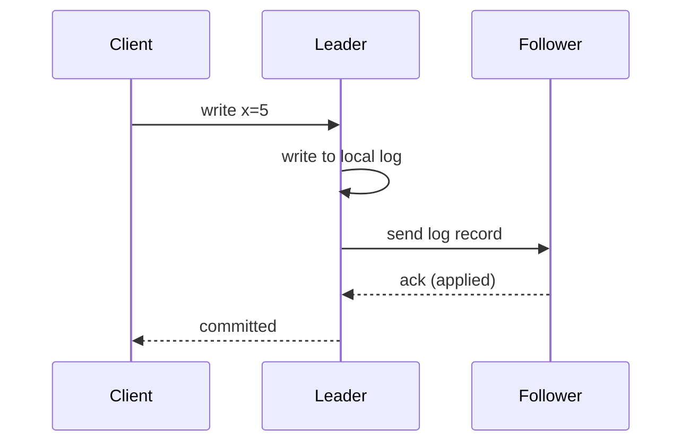

## 🎯 خلاصه

> **Replication** (تکثیر داده) یک داده را روی چند گره نگه می‌دارد تا خرابی یک ماشین سیستم را از پا نیندازد و خواننده‌های بیشتری جواب بگیرند. سه خانواده داریم: **single-leader** (یک گره نوشتن را می‌گیرد و بقیه کپی می‌کنند)، **multi-leader** (چند گره می‌نویسند و باید تعارض‌ها را حل کنند) و **leaderless** (هر replica می‌نویسد و **quorum** مشخص می‌کند چه چیزی «انجام‌شده» حساب می‌شود). همگام در برابر ناهمگام تعادل بین دوام و تأخیر را تعیین می‌کند. replica های ناهمگام عقب می‌افتند و این عقب‌افتادن ناهنجاری‌هایی می‌سازد که کاربر می‌بیند.

- single-leader پیش‌فرض بیشتر دیتابیس‌های رابطه‌ای و خیلی از logهای استریم است.
- multi-leader برای نوشتن چندمنطقه‌ای به کار می‌رود و هزینه‌اش مدیریت تعارض است.
- leaderless (به سبک Dynamo) دسترس‌پذیری نوشتن را ترجیح می‌دهد و سازگاری را به قانون‌های quorum می‌سپارد.

## 🌱 از ساده شروع کنیم (مبتدی)

> **💡 تشبیه:** یک شرکت فهرست قیمت اصلی را در یک فایل نگه می‌دارد. شعبه‌ها کپی را با پیک دریافت می‌کنند. اگر پیک دیر برسد، شعبه قیمت دیروز را نشان می‌دهد؛ این همان **replication lag** است. اگر دفتر مرکزی بسوزد، یکی از شعبه‌ها مرکز جدید می‌شود؛ این **failover** است. اگر فایل اصلی غلط باشد، همه‌ی کپی‌ها هم غلط‌اند؛ به همین دلیل replication جای backup نیست.

یک راه‌اندازی ساده‌ی single-leader:

```text
clients ──writes──▶ [leader]  ──log stream──▶ [follower A]
                       │                      ──▶ [follower B]
clients ──reads───▶ followers (may be a little behind)
```

سه پرسش طراحی را تعیین می‌کند:

1. **چه کسی می‌نویسد؟** یک گره، چند گره، یا هر گره؟
2. **چه زمانی نوشتن «انجام‌شده» حساب می‌شود؟** بعد از نوشتن در leader، یا بعد از اینکه یک follower هم داشته باشد؟
3. **وقتی یک گره خراب می‌شود چه می‌شود؟** چه کسی جایش را می‌گیرد و چه چیزی از دست می‌رود؟

## 🔧 واقعاً چطور کار می‌کند (متوسط)

**Single-leader.** leader هر تغییر را به [[wal|write-ahead log]] خودش اضافه می‌کند (WAL در PostgreSQL، binlog در MySQL). followerها جریان log را می‌گیرند و به همان ترتیب اعمال می‌کنند. هر follower نگه می‌دارد تا کجای log را اعمال کرده (LSN یا offset). خواندن می‌تواند به followerها برود، و عقب‌افتادن همین‌جا ظاهر می‌شود.

**همگام در برابر ناهمگام.** تفاوت در این است که leader کی به کلاینت می‌گوید «commit شد»:



- **همگام (Synchronous)**: leader منتظر ack از follower می‌ماند. یک commit شده روی دو گره وجود دارد، پس failover آن را از دست نمی‌دهد. هزینه تأخیر است و یک follower کند می‌تواند نوشتن‌ها را متوقف کند.
- **ناهمگام (Asynchronous)**: leader بعد از نوشتن محلی جواب می‌دهد. سریع است، اما اگر leader پیش از رسیدن رکورد به follower بمیرد، آن commit در failover از بین می‌رود.
- **نیمه‌همگام (Semi-synchronous)**: یک follower همگام است و بقیه ناهمگام. این سازش رایجی است. در PostgreSQL با `synchronous_standby_names` تنظیم می‌شود.

**ناهنجاری‌های replication lag.** خواندن ناهمگام می‌تواند تضمین‌هایی را که کاربر انتظار دارد بشکند:

- **Read-your-writes**: کاربر کامنت می‌گذارد، خواندن بعدی به follower عقب‌افتاده می‌رود و کامنت نیست. راه‌حل: خواندن‌های اخیر خود کاربر را از leader بگیرید، یا موقعیت نوشتن را نگه دارید و فقط از replicaهایی بخوانید که به آن رسیده‌اند.
- **Monotonic reads**: کاربر دو بار رفرش می‌کند و داده به عقب برمی‌گردد، چون دو خواندن به دو replica مختلف رفته‌اند. راه‌حل: خواندن‌های کاربر را به یک replica ثابت کنید، مثلاً با hash کردن شناسه‌ی کاربر.
- **Consistent prefix**: خواننده جواب را پیش از سؤال می‌بیند، چون دو نوشتن از دو partition یا مسیر متفاوت رفته‌اند. راه‌حل: نوشتن‌های مرتبط از نظر علّی را در یک partition نگه دارید یا ترتیبشان را ردیابی کنید.

**Multi-leader.** هر منطقه leader خودش را دارد، پس نوشتن‌ها محلی و سریع می‌مانند. مشکل تعارض است: دو leader در زمان قطعی شبکه یک ردیف را عوض می‌کنند. گزینه‌ها:

- **Last-write-wins (LWW)** بر اساس زمان. ساده است، اما بی‌صدا نوشتن‌ها را حذف می‌کند و به ساعت وابسته است.
- **Merge در لایه‌ی برنامه**: هر دو نسخه را نگه دارید و با قاعده‌ی کسب‌وکار ادغام کنید.
- **CRDT**: نوع‌هایی که merge آن‌ها از نظر ریاضی بدون تعارض است (شمارنده، مجموعه). فقط برای بعضی داده‌ها مناسب است.

**Leaderless با quorum.** سیستم‌های سبک Dynamo (Cassandra، Riak، Voldemort و طراحی DynamoDB) leader ندارند. یک نوشتن به هر N replica می‌رود و بعد از W ack موفق می‌شود. یک خواندن از R replica می‌پرسد و جدیدترین مقدار را برمی‌گزیند. قاعده این است:

> اگر **W + R > N** باشد، هر مجموعه‌ی خواندن با هر مجموعه‌ی نوشتن حداقل در یک replica مشترک است، پس خواندن آخرین نوشتن تأییدشده را می‌بیند (وقتی نوشتن همزمانی در کار نیست و sloppy quorum نداریم).

بررسی با N = 3:

| W | R | W + R | همیشه همپوشانی؟ | چه چیزی ممکن است خراب شود |
|---|---|---|---|---|
| 2 | 2 | 4 | بله | از این قاعده چیزی خراب نمی‌شود |
| 1 | 1 | 2 | خیر | خواندن ممکن است به همان replica برسد که نوشتن را نگرفته |
| 3 | 1 | 4 | بله | نوشتن به همه‌ی replicaها نیاز دارد، پس یک گره خاموش نوشتن را مسدود می‌کند |

Read repair (اصلاح replicaهای قدیمی هنگام خواندن) و anti-entropy (مقایسه‌ی پس‌زمینه، اغلب با Merkle tree) replicaها را دوباره همگام می‌کنند.

**Split brain و failover.** failover یعنی تشخیص مرگ leader (با timeout، که می‌تواند اشتباه باشد)، انتخاب leader جدید با کامل‌ترین log و هدایت کلاینت‌ها. خطر **split brain** است: قطعی شبکه باعث می‌شود leader قدیمی زنده بماند، هر دو طرف بنویسند و داده واگرا شود. دفاع‌ها: انتخاب مبتنی بر اجماع (نگاه کنید به [[consensus]])، fencing token (یک epoch صعودی که storage از leader های قدیمی رد می‌کند) و خاموش کردن leader قدیمی پیش از ارتقای جدید.

## 🧠 عمق و trade-offهای سنیور

- **Replica جای backup نیست.** یک `DELETE` اشتباه یا نوشتن خراب، با وفاداری کامل کپی می‌شود. backup نقطه‌ی زمانی نگه دارید و در جاهایی که مفید است یک replica با تأخیر عمدی داشته باشید.
- **Quorum معادل linearizability نیست.** W + R > N در حالت ساده خواندن قدیمی را حذف می‌کند، اما نوشتن‌های همزمان، sloppy quorum، hinted handoff، نوشتن ناموفقی که بخشی‌اش اعمال شده و حل تعارض بر اساس زمان همچنان می‌توانند سورپرایز بسازند. سازگاری برای هر پرسش (مثلاً `LOCAL_QUORUM` در Cassandra) یک انتخاب است که باید مستند شود.
- **تأخیر بین منطقه‌ای.** نوشتن همگام بین مناطق حداقل یک راند رفت‌وبرگشت هزینه دارد، که اغلب ده‌ها تا صدها میلی‌ثانیه است. اینجا [[cap-pacelc]] عملی می‌شود: هنگام قطعی یا دسترس‌پذیری را انتخاب می‌کنید یا سازگاری را، و بدون قطعی هم تأخیر را یا سازگاری را.
- **Replication slot و نگهداری WAL.** در PostgreSQL یک logical replication slot (که ابزارهای [[cdc]] استفاده می‌کنند) WAL را نگه می‌دارد تا مصرف‌کننده تأیید کند. یک مصرف‌کننده‌ی گیرکرده می‌تواند دیسک primary را پر کند. روی تأخیر slot هشدار بگذارید.
- **نسخه‌ی Kafka از این مشکل.** هر partition یک leader و followerهایی در مجموعه‌ی ISR (replicaهای همگام) دارد. `acks=all` همراه با `min.insync.replicas` کف دوام را تعیین می‌کند. partitionهای under-replicated و lag مصرف‌کننده را پایش کنید. نگاه کنید به [[kafka-architecture]].
- **عوارض جانبی failover.** بعد از failover، کلاینت‌ها ممکن است نوشتنی را دوباره بفرستند که قبلاً commit شده بود. نوشتن‌های idempotent (نگاه کنید به [[idempotency]]) این را امن می‌کنند؛ retry غیرidempotent یعنی شمارش دوبار.
- **چه چیزی را پایش کنیم:** تأخیر replication بر حسب ثانیه و بایت، زمان از آخرین تراکنش اعمال‌شده، تعداد failover، partitionهای under-replicated و نگهداری slot.
- **کی بین مناطق replicate نکنیم.** اگر کسب‌وکار خواندن قدیمی به مدت چند ثانیه را می‌پذیرد، یک منطقه با replica های ناهمگام ساده‌تر و ارزان‌تر از multi-leader است.

## 🧪 امتحان کن

قبل از اجرا، خروجی این اسکریپت را پیش‌بینی کنید. بررسی می‌کند که آیا هر مجموعه‌ی quorum خواندن با هر مجموعه‌ی نوشتن همپوشانی دارد.

```python
from itertools import combinations

def always_overlap(n, w, r):
    nodes = range(n)
    for write_set in combinations(nodes, w):
        for read_set in combinations(nodes, r):
            if not set(write_set) & set(read_set):
                return False
    return True

for n, w, r in [(3, 2, 2), (3, 1, 1), (5, 3, 3), (5, 2, 3)]:
    print(f"N={n} W={w} R={r} overlap={always_overlap(n, w, r)}")
```

۱. کدام‌یک از چهار پیکربندی قاعده‌ی `W + R > N` را دارند و آیا اسکریپت با آن موافق است؟
۲. برای N = 5 و R = 3، کوچک‌ترین W که همپوشانی را تضمین کند چیست؟ محاسبه را نشان دهید.
۳. یک خوشه‌ی single-leader با PostgreSQL از replication ناهمگام استفاده می‌کند. تأیید پرداخت یک کاربر commit می‌شود و بعد leader خراب می‌شود. بهترین و بدترین نتیجه بعد از failover را توصیف کنید.

<details><summary>جواب ها</summary>

۱. `(3,2,2)` و `(5,3,3)` قاعده را دارند، چون ۴ > ۳ و ۶ > ۵. `(3,1,1)` ندارد (۲ از ۳ بزرگ‌تر نیست) و `(5,2,3)` هم ندارد (۵ از ۵ بزرگ‌تر نیست). اسکریپت هم همین را چاپ می‌کند: `True`، `False`، `True`، `False`.
۲. با R = 3 باید W + 3 > 5 باشد، یعنی W > 2، پس کوچک‌ترین W برابر ۳ است.
۳. بهترین حالت: follower رکورد را داشته و پرداخت باقی می‌ماند. بدترین حالت: follower عقب بوده، leader جدید commit را ندارد و تأیید کاربر گم می‌شود در حالی که کاربر موفقیت را دیده است. راه‌حل: برای این داده replication همگام یا نیمه‌همگام، یا idempotent کردن نوشتن پرداخت و تطبیق با سرویس پرداخت.

</details>

## 💬 گوشه‌ی مصاحبه

**س: تفاوت replication همگام و ناهمگام چیست و هنگام failover چه می‌شود؟**

> **🎤 در مصاحبه این را بگو:** replication همگام قبل از تأیید commit منتظر یک follower می‌ماند، پس failover هیچ commit تأییدشده‌ای را از دست نمی‌دهد، اما هزینه‌ی تأخیر و دسترس‌پذیری دارد وقتی follower کند است. replication ناهمگام فوراً تأیید می‌کند و سریع‌تر است، اما commitهای اخیر ممکن است هنگام failover از بین بروند. بیشتر سیستم‌ها نیمه‌همگام را به‌عنوان حد وسط استفاده می‌کنند.

- **جواب مبتدی:** توضیح می‌دهد که کپی‌ها روی ماشین‌های دیگرند و ناهمگام ممکن است عقب باشد.
- **جواب متوسط:** stream مربوط به WAL، lag، ناهنجاری‌های read-your-writes و monotonic reads، و راه‌حل هرکدام را اضافه می‌کند.
- **جواب سنیور:** همپوشانی quorum (W + R > N) و محدودیت‌هایش، split brain و fencing، تأخیر بین منطقه‌ای، نگهداری slot، و اینکه چطور lag و failover را پایش می‌کند را پوشش می‌دهد.

**پرسش ادامه: «چرا W + R > N linearizability نمی‌دهد؟»** چون نوشتن‌های همزمان، نوشتن‌های ناقص ناموفق، sloppy quorum و حل تعارض بر اساس زمان همچنان می‌توانند مقدار قدیمی‌تر را به بعضی کلاینت‌ها برسانند. همپوشانی خواندن قدیمی ساده را حذف می‌کند، نه همه‌ی ناهنجاری‌ها را.

## ⚠️ اشتباهات رایج

- اینکه replica را backup بدانیم. یک `DELETE` بد در همه جا تکرار می‌شود.
- خواندن از replica بلافاصله بعد از نوشتن، و بعد گزارش «باگ» برای چیزی که در واقع lag است.
- فرض اینکه W + R > N در همزمانی، سازگاری قوی می‌دهد.
- استفاده از last-write-wins با زمان ساعت کلاینت، که وقتی ساعت‌ها اختلاف دارند بی‌صدا به‌روزرسانی‌ها را از بین می‌برد.
- ارتقای leader جدید بدون fence کردن قدیمی، که split brain را ممکن می‌کند.
- replication ناهمگام برای داده‌ای که از دست رفتن commit برایش هزینه‌ی واقعی دارد (پرداخت، موجودی) و بدون فرایند تطبیق.
- نادیده گرفتن متریک‌های lag تا وقتی کاربر شکایت کند.

## ✅ خودت را بسنج (کوییز)

۱. در یک سیستم leaderless با N replica، `W + R > N` چه چیزی را تضمین می‌کند؟
   - A) خواندن‌های linearizable در هر زمان
   - B) هر مجموعه‌ی خواندن با هر مجموعه‌ی نوشتن حداقل در یک replica همپوشانی دارد، پس در حالت ساده خواندن آخرین نوشتن تأییدشده را می‌بیند
   - C) نوشتن‌ها از خواندن‌ها سریع‌ترند
   - D) تعارض نمی‌تواند رخ دهد

<details><summary>جواب</summary>

**B** — همپوشانی خواندن قدیمی ساده را حذف می‌کند. نوشتن‌های همزمان، sloppy quorum و حل تعارض را پوشش نمی‌دهد، پس A و D قوی‌تر از حد مجازند.

</details>

۲. یک سیستم single-leader از replication ناهمگام استفاده می‌کند. leader یک تراکنش را commit می‌کند و قبل از رسیدن آن به هیچ follower خراب می‌شود. یک follower ارتقا می‌یابد. چه می‌شود؟
   - A) هیچ؛ commitها همیشه اول کپی می‌شوند
   - B) تراکنش commit شده از بین می‌رود، چون leader جدید هرگز آن را نداشته
   - C) نوشتن‌های leader قدیمی وقتی برگردد خودکار ادغام می‌شوند
   - D) خواندن تا برگشتن leader قدیمی مسدود می‌شود

<details><summary>جواب</summary>

**B** — replication ناهمگام پیش از رسیدن رکورد به follower تأیید می‌کند، پس خرابی در آن فاصله آن را از بین می‌برد. نیمه‌همگام یا همگام این شکاف را می‌بندد.

</details>

۳. کاربری کامنت می‌گذارد، سپس صفحه از یک follower عقب‌افتاده بارگذاری می‌شود و کامنت نیست. این کدام ناهنجاری است و ساده‌ترین راه‌حل چیست؟
   - A) Monotonic reads؛ کاربر را به یک follower ثابت کنید
   - B) Read-your-writes؛ خواندن‌های اخیر خود کاربر را از leader یا replicaای بخوانید که به موقعیت نوشتن رسیده
   - C) Split brain؛ leader قدیمی را fence کنید
   - D) Consistent prefix؛ از یک partition استفاده کنید

<details><summary>جواب</summary>

**B** — کاربر نوشتن خودش را نمی‌بیند، و این همان تضمین read-your-writes است. monotonic reads درباره‌ی برگشتن به عقب بین خواندن‌هاست و split brain درباره‌ی دو leader.

</details>

۴. **(سنیور)** دو منطقه در زمان قطعی شبکه برای یک پروفایل کاربر نوشتن می‌پذیرند. سیستم تعارض‌ها را با last-write-wins و زمان ساعت کلاینت حل می‌کند. چه چیزی ممکن است خراب شود؟
   - A) هیچ؛ LWW همیشه درست است
   - B) اگر ساعت نویسنده عقب باشد، یک به‌روزرسانی جدیدتر ممکن است ببازد و تغییر جدیدتر بی‌صدا دور ریخته شود
   - C) هر دو نوشتن رد می‌شوند
   - D) خواندن‌ها linearizable می‌شوند

<details><summary>جواب</summary>

**B** — برنده با ساعت تعیین می‌شود، نه با علیّت. اختلاف ساعت می‌تواند باعث شود نوشتن قدیمی‌تر برنده شود، و LWW مقدار دیگر را بدون خطا حذف می‌کند.

</details>

۵. **(سنیور)** چرا یک خوشه‌ی single-leader هنگام failover به fencing token یا انتخاب leader مبتنی بر اجماع نیاز دارد؟
   - A) برای سریع‌تر کردن خواندن روی followerها
   - B) برای جلوگیری از split brain: یک leader قدیمی که جدا شده ممکن است هنوز بنویسد، و fencing باعث می‌شود storage درخواست‌های قدیمی‌اش را رد کند
   - C) برای حذف نیاز به WAL
   - D) برای همگام کردن replication

<details><summary>جواب</summary>

**B** — failover بدون راهی برای متوقف کردن leader قدیمی می‌تواند دو leader بسازد که هر دو می‌نویسند. fencing و انتخاب مبتنی بر اجماع دفاع‌های استاندارد هستند.

</details>

## 🗂️ فلش‌کارت

| جلو | پشت |
|---|---|
| Single-leader replication | یک گره نوشتن را می‌گیرد؛ followerها log leader را به ترتیب اعمال می‌کنند |
| commit همگام در برابر ناهمگام | همگام منتظر ack follower می‌ماند (بدون از دست رفتن در failover، کندتر)؛ ناهمگام فوراً جواب می‌دهد (سریع‌تر، ممکن است commit از بین برود) |
| Semi-synchronous | یک follower همگام و بقیه ناهمگام؛ حد وسط رایج |
| Read-your-writes | بعد از نوشتن، همان کاربر باید آن نوشتن را ببیند؛ راه‌حل: خواندن از leader یا replica تا حد لازم جلو رفته |
| Monotonic reads | خواندن‌های پی‌درپی کاربر هرگز به عقب نمی‌روند؛ راه‌حل: پین کردن خواندن‌ها به یک replica |
| W + R > N | هر مجموعه‌ی quorum خواندن با هر مجموعه‌ی quorum نوشتن حداقل در یک replica مشترک است |
| Last-write-wins | حل تعارض با زمان؛ ساده، اما بی‌صدا نوشتن‌ها را حذف می‌کند |
| Split brain | دو گره بعد از قطعی هر دو مثل leader عمل می‌کنند؛ با اجماع و fencing جلوگیری می‌شود |

## 🔗 ادامه

- [[quorum]] و [[consensus]] مکانیزم‌های پشت قاعده‌های بالا را توضیح می‌دهند.
- [[consistency-models]] تضمین‌هایی را پوشش می‌دهد که این ناهنجاری‌ها می‌شکنند.
- [[cap-pacelc]] trade-offهای دسترس‌پذیری و تأخیر را برای سیستم‌های replicate شده توضیح می‌دهد.
- [[kafka-architecture]] ISR و replication را در یک سیستم log-محور نشان می‌دهد.
- [[wal-mvcc]] log ای را پوشش می‌دهد که سیستم‌های single-leader تکثیر می‌کنند.
