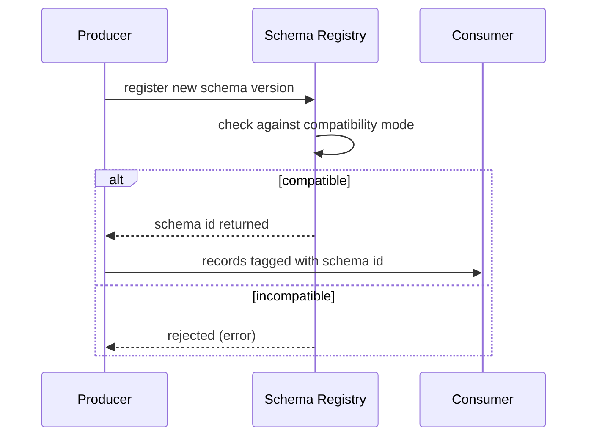

## 🎯 خلاصه

> **تکامل schema (schema evolution)** یعنی تغییر ساختار یک دیتاست در طول زمان (اضافه، حذف، تغییرنام یا تغییر نوع یک فیلد) **بدون شکستن readerها و writerهای موجود**. چیزی که مشخص می‌کند یک تغییر امن است یا نه، **سازگاری (compatibility)** است: اینکه کدام طرف باید بتواند داده‌ای را که طرف دیگر نوشته، بخواند.

- **سازگاری backward:** یک reader *جدید* می‌تواند داده‌ی *قدیمی* را بخواند.
- **سازگاری forward:** یک reader *قدیمی* می‌تواند داده‌ی *جدید* را بخواند.
- **full:** هر دو جهت کار می‌کند، پس producer و consumer را می‌شود به هر ترتیبی ارتقا داد.
- حرکت‌های امن: اضافه کردن فیلد **با default**، هرگز استفاده‌ی دوباره از یک نام یا ID، تغییرنام با alias یا column ID، و اجازه دادن به schema registry یا بررسی CI برای رد کردن تغییرهای ناامن.

## 🌱 از ساده شروع کنیم (مبتدی)

> **💡 تشبیه:** یک فرم کاغذی با خانه‌های شماره‌دار را در نظر بگیر که هزاران نسخه‌ی قدیمی‌اش در کمد بایگانی است. اضافه کردن یک خانه‌ی جدید در انتها امن است، چون خواننده‌های قدیمی آن را نادیده می‌گیرند. حذف خانه‌ای که هنوز بعضی‌ها دنبالش هستند، باعث می‌شود آن‌ها خالی ببینند. تغییر نام یک خانه بدون اطلاع‌رسانی یعنی آن‌ها اصلاً چیزی نمی‌خوانند.

یک جریان رویداد کوچک این موضوع را ملموس می‌کند. نسخه‌ی 1 یک رویداد سفارش:

```json
{"order_id": 42, "amount": 10.5}
```

نسخه‌ی 2 فیلد `currency` را اضافه می‌کند:

```json
{"order_id": 42, "amount": 10.5, "currency": "USD"}
```

دو سؤال مشخص می‌کنند تغییر امن است یا نه:

1. **مصرف‌کنندهٔ قدیمی، داده‌ی جدید.** مصرف‌کنندهٔ v1 رکوردهای v2 را دریافت می‌کند. بیشتر پارسرهای JSON فیلد ناشناختهٔ `currency` را نادیده می‌گیرند، پس کار می‌کند (سازگاری forward).
2. **مصرف‌کنندهٔ جدید، داده‌ی قدیمی.** مصرف‌کنندهٔ v2 رکوردهای v1 را می‌خواند که `currency` ندارند. به یک **default** (مثلاً `"USD"`) یا قاعدهٔ `null` نیاز دارد، وگرنه شکست می‌خورد (سازگاری backward).

قاعدهٔ سرانگشتی: **اضافه کردن** فیلد اختیاری با default امن است. **حذف** فیلد، **تغییرنام** آن، یا **تغییر نوعش** جایی است که پایپ‌لاین‌ها می‌شکنند.

## 🔧 واقعاً چطور کار می‌کند (متوسط)

هر فرمت قواعد سازگاری را به شیوهٔ متفاوتی کدگذاری می‌کند. مکانیزم مهم‌تر از اسم‌هاست.

**Avro** یک *writer schema* (schemaای که با آن بایت‌ها نوشته شده) را نگه می‌دارد و با یک *reader schema* می‌خواند. یک مرحلهٔ resolution فیلدها را **بر اساس نام** تطبیق می‌دهد:

- فیلدی که در writer هست و در reader نیست، نادیده گرفته می‌شود.
- فیلدی که در reader هست و در writer نیست، باید `default` داشته باشد، وگرنه خواندن شکست می‌خورد.
- reader می‌تواند با لیست `aliases` تغییرنام را پوشش دهد و نام قدیمی را به نام جدید وصل کند.
- ارتقای عددی مجاز است (`int` به `long`، `float` به `double`).

```json
{
  "type": "record",
  "name": "Trip",
  "namespace": "ride",
  "fields": [
    {"name": "trip_id", "type": "string"},
    {"name": "fare", "type": "double"},
    {"name": "currency", "type": "string", "default": "IRR"},
    {"name": "driver_id", "type": ["null", "string"], "default": null}
  ]
}
```

قرارداد فیلد nullable به شکل `["null", "string"]` است و `null` اول می‌آید، چون default باید با شاخهٔ اول union یکی باشد.

**Parquet** خودش schema سطح جدول ندارد؛ «جدول» یک پوشه از فایل‌ها به‌علاوه‌ی metastore است. بیشتر readerها (Spark، Arrow) ستون‌ها را **بر اساس نام** تطبیق می‌دهند:

- ستون جدید در فایل‌های قدیمی به صورت `NULL` خوانده می‌شود.
- ستون حذف‌شده در فایل‌های قدیمی می‌ماند و readerهای جدید آن را نادیده می‌گیرند.
- تغییرنام مثل *حذف + اضافه* دیده می‌شود، پس مقادیر قدیمی بی‌صدا زیر نام جدید `NULL` می‌شوند.
- فایل‌های مختلف در یک پوشه می‌توانند schema متفاوت داشته باشند. این شایع‌ترین منبع drift بی‌صدا در یک lake است.

**Iceberg** مشکل نام را حل می‌کند. هر ستون یک **field ID** یکتا دارد که در metadata جدول ذخیره می‌شود، و فایل‌های داده با ID ارجاع می‌دهند، نه با نام. پس:

- تغییرنام و جابه‌جایی ستون‌ها فقط metadata است و امن است.
- ستون جدید ID جدید می‌گیرد؛ فایل‌های قدیمی برای آن `NULL` برمی‌گردانند.
- حذف یک ستون و اضافه کردن ستونی با همان نام، **ID جدید** می‌سازد، پس مقادیر قدیمی برنمی‌گردند.
- فقط گسترش‌های امنِ نوع مجاز است (برای نمونه `int` به `bigint`، `float` به `double`، یا افزایش دقت `decimal`).

**ClickHouse** متفاوت کار می‌کند، چون داده در *partهای* تغییرناپذیر ذخیره می‌شود:

- `ALTER TABLE ... ADD COLUMN` یک تغییر metadata است. partهای موجود موقع خواندن مقدار `DEFAULT` ستون را برمی‌گردانند.
- تغییر نوع ستون معمولاً یعنی بازنویسی داده (mutation). قوانین بین نسخه‌ها فرق دارد، پس مستندات نسخه‌ی خودت را بخوان.
- ستونی که در کلید مرتب‌سازی یا primary key استفاده شده، ساده حذف نمی‌شود.

**schema registry** (به سبک Confluent و همراه با Kafka) قواعد را موقع نوشتن اعمال می‌کند. هر subject یک *حالت سازگاری (compatibility mode)* دارد:



حالت‌های اصلی `BACKWARD` (معمولاً پیش‌فرض)، `FORWARD`، `FULL`، `NONE` و نسخه‌های `_TRANSITIVE` هستند که با **همهٔ** نسخه‌های قبلی مقایسه می‌کنند، نه فقط آخری. پیش‌فرض و رفتار دقیق را در مستندات registry خودت تأیید کن.

## 🧠 عمق و trade-offها (سنیور)

- **حالت را از ترتیب دیپلوی انتخاب کن.** اگر مصرف‌کننده‌ها همیشه اول ارتقا می‌یابند، به سازگاری backward نیاز داری. اگر producerها اول ارتقا می‌یابند، به forward نیاز داری. اگر تیم‌ها مستقل دیپلوی می‌کنند، از full استفاده کن.
- **transitive برای replay مهم است.** یک topic با ۳۰ روز retention، یا backfill که offsetهای قدیمی را می‌خواند، باید همهٔ نسخه‌های قدیمی را همچنان قابل خواندن نگه دارد. بررسی غیر-transitive فقط با آخرین نسخه مقایسه می‌کند و ممکن است تغییری را رد نکند که readerهای نسخهٔ 1 را می‌شکند.
- **حذف فیلد ظریف است.** طبق قوانین Avro، یک reader جدید بدون آن فیلد می‌تواند داده‌ی قدیمی را بخواند (backward برقرار است). یک reader قدیمی که فیلد را انتظار دارد، اما داده‌ی جدید بدون آن می‌گیرد، شکست می‌خورد، مگر اینکه در schema قدیمی آن فیلد default داشته باشد. ترتیب امن: نوشتن فیلد را متوقف کن، آن را به‌صورت اختیاری با default نگه دار، صبر کن تا همهٔ readerها نادیده‌اش بگیرند، و بعد حذفش کن.
- **هرگز نام یا ID را با معنای جدید دوباره استفاده نکن.** بدترین حالت وقتی است که `amount` از دلار به سنت تغییر کند. نوع‌ها یکی‌اند، پس خطایی نمی‌آید و اعداد ماه‌ها غلط‌اند. آن را deprecate کن و `amount_cents` اضافه کن.
- **تغییر enum readerها را می‌شکند.** اضافه کردن یک symbol به enum در Avro برای readerهای قدیمی تغییر شکننده است، مگر اینکه enum یک default symbol داشته باشد. این را در دو مرحله برنامه‌ریزی کن.
- **اجباری کردن یک ستون شکننده است.** تبدیل `NULL`able به `NOT NULL` باعث می‌شود رکوردهای writerهای قدیمی نامعتبر شوند.
- **lakeها بی‌صدا drift می‌کنند.** گزینه‌هایی مثل schema merging در Spark فایل‌های بیشتری می‌خوانند و ممکن است تضاد نوع را پنهان کنند. قرارداد را در سمت producer یا با بررسی schema در پایپ‌لاین اعمال کن، و برای ستون‌های ناشناختهٔ جدید و نرخ `NULL` فیلدهای تازه هشدار بگذار.
- **کی schema را تکامل ندهیم.** برای ویژگی‌های واقعاً ناشناخته یا پراکنده، به‌جای اضافه کردن ستون جدید هر هفته، از ستون `MAP` یا JSON/`VARIANT` استفاده کن. هزینه‌اش تایپ ضعیف‌تر و کوئری کندتر روی آن فیلدهاست.

## 🧪 امتحان کن

1. **تغییر را دسته‌بندی کن.** رکورد `Trip` نسخه‌ی 1 فیلد `fare` از نوع `double` دارد. نسخه‌ی 2 آن را به `fare_amount` تغییر نام می‌دهد و نوعش را به `decimal(12,0)` می‌کند. کدام سازگاری را می‌شکند و ترتیب امن چندمرحله‌ای چیست؟
2. **فیلد reader در Avro بنویس.** فیلد `vehicle_type` (مقادیری مثل `"car"` و `"bike"`) به `Trip` اضافه کن تا داده‌ی قدیمی همچنان خوانده شود. این فیلد چه چیزی باید داشته باشد؟
3. **تغییرنام در Iceberg.** در یک جدول Iceberg، `driver_id` را به `driver_key` تغییر می‌دهی. آیا فایل‌های قدیمی هنوز مقادیر راننده را برمی‌گردانند؟ چرا؟

<details><summary>پاسخ‌ها را ببین</summary>

**1.** این یک اضافه‌کردن ساده نیست. برای reader ای که با نام تطبیق می‌دهد، تغییرنام مثل حذف + اضافه است، پس `fare` برای نام جدید `NULL` می‌شود، و تغییر نوع از `double` به `decimal` به cast نیاز دارد که readerهای قدیمی ممکن است انجامش ندهند. ترتیب امن: (الف) `fare_amount` را به‌عنوان فیلد اختیاری جدید با default اضافه کن و همچنان `fare` را بنویس؛ (ب) هر دو را همزمان بنویس؛ (ج) مصرف‌کننده‌ها را منتقل کن؛ (د) نوشتن `fare` را متوقف کن؛ (ه) بعد از انتقال همهٔ readerها، آن را حذف کن. در Iceberg به‌جای ستون جدید از تغییرنام و cast گسترشی استفاده می‌کنی.

**2.** به `default` نیاز دارد، برای مثال `{"name": "vehicle_type", "type": "string", "default": "car"}`. بدون default، یک reader جدید که داده‌ی قدیمی (بدون این فیلد) را می‌خواند شکست می‌خورد، پس تغییر backward سازگار نیست.

**3.** بله. Iceberg ستون‌ها را با field ID ارجاع می‌دهد، پس تغییرنام فقط metadata است و فایل‌های قدیمی همچنان مقادیر را برمی‌گردانند. تغییرنام در فرمت مبتنی بر نام مثل Parquet ساده، مقدار `NULL` برمی‌گرداند.

</details>

## 💬 گوشه‌ی مصاحبه

**سؤال: «چطور بدون شکستن مصرف‌کننده‌ها، یک ستون به یک topic در Kafka اضافه می‌کنی؟»** جواب متوسط: «آن را به‌عنوان فیلد اختیاری با default در schema مربوط به Avro اضافه می‌کنم و با سازگاری backward در schema registry ثبت می‌کنم.»

جواب سنیور: «آن را فیلد اختیاری با default می‌کنم، مطمئن می‌شوم حالت registry با ترتیب دیپلوی ما می‌خواند، و اگر offsetهای قدیمی را replay می‌کنیم، بررسی transitive می‌گذارم. مصرف‌کننده‌ها را طوری می‌سازم که فیلدهای ناشناخته را نادیده بگیرند و داشبوردی برای خطاهای رد شدن schema نگه می‌دارم. تغییرنام و تغییر نوع یک مهاجرت جدا و چندمرحله‌ای است، نه تکامل عادی.»

**سؤال: «چرا Iceberg برای تغییر schema امن‌تر از Parquet است؟»** متوسط: «Iceberg ستون‌ها را با ID ردیابی می‌کند، پس تغییرنام و جابه‌جایی امن است.» سنیور: «Parquet به‌تنهایی با نام تطبیق می‌دهد و schema سطح جدول ندارد، پس یک پوشه می‌تواند schemaهای مختلف را مخلوط کند. Iceberg تاریخچهٔ schema را در metadata نگه می‌دارد، که تغییرات را اتمیک می‌کند و اجازه می‌دهد فایل‌های قدیمی با ID خوانده شوند.»

> **🎤 این را در مصاحبه بگو:** «یک تغییر schema فقط وقتی امن است که readerها و writerهای موجود در زمان مهاجرت بتوانند بایت‌های یکدیگر را بخوانند. حالت سازگاری را از ترتیب دیپلوی انتخاب می‌کنم، فیلدها را با default اضافه می‌کنم و هرگز نام را دوباره استفاده نمی‌کنم. برای تغییرنام و تغییر نوع از مهاجرت چندمرحله‌ای استفاده می‌کنم و قواعد را در registry و CI اعمال می‌کنم.»

## ⚠️ اشتباهات رایج

> **⚠️ توجه:** تغییرنام فیلد تکامل نیست، حذف + اضافه است. مقادیر قدیمی بی‌صدا `NULL` می‌شوند (readerهای مبتنی بر نام) یا دیگر تطبیق نمی‌یابند (lookupها).

- اضافه کردن فیلد اجباری بدون default. داده‌ی قدیمی با schema جدید خوانده نمی‌شود.
- تغییر نوع از `string` به `int` یا برعکس. بیشتر readerها نمی‌توانند این‌ها را ارتقا دهند.
- استفاده‌ی دوباره از یک نام فیلد با معنای دیگر. خطایی نمی‌آید، پس باگ دیده نمی‌شود.
- فرض کردن اینکه همهٔ فایل‌های Parquet یک پوشه schema یکسان دارند.
- بررسی سازگاری فقط با آخرین نسخه، و بعد replay کردن یک topic قدیمی.
- تکیه بر ترتیب ستون در CSV یا فایل‌هایی که نام فیلد ندارند. جابه‌جایی بی‌صدا می‌شکند.
- تبدیل `NULL`able به `NOT NULL` در یک مرحله.

## ✅ خودت را بسنج

1. در Avro، کدام تغییر وقتی schema reader یک فیلد جدید اضافه می‌کند، سازگار با backward است؟
   - A) فیلد جدید default ندارد
   - B) فیلد جدید یک مقدار default دارد
   - C) فیلد جدید از یک فیلد موجود تغییرنام داده شده
   - D) نوع فیلد از `int` به `string` تغییر کرده

<details><summary>پاسخ</summary>

**B** — یک reader جدید که رکوردهای قدیمی را می‌خواند، برای فیلد جدید مقدار لازم دارد. `default` این مقدار را می‌دهد. بدون آن، resolution شکست می‌خورد.

</details>

2. می‌خواهی یک topic در Kafka را داشته باشی که producerها قبل از consumerها ارتقا می‌یابند. به کدام جهت سازگاری نیاز داری؟
   - A) Backward
   - B) Forward
   - C) فقط Full
   - D) None

<details><summary>پاسخ</summary>

**B** — وقتی producerها اول ارتقا می‌یابند، مصرف‌کننده‌های قدیمی داده‌ی جدید دریافت می‌کنند، پس readerهای قدیمی باید schema جدید را هم هندل کنند (سازگاری forward).

</details>

3. چرا تغییرنام یک ستون در یک پوشه‌ی Parquet ساده داده را از دست می‌دهد، ولی همین تغییرنام در Iceberg این کار را نمی‌کند؟
   - A) Parquet از رشته پشتیبانی نمی‌کند
   - B) Parquet بر اساس نام تطبیق می‌دهد، پس نام جدید مقدار قدیمی ندارد؛ Iceberg بر اساس field ID تطبیق می‌دهد
   - C) Iceberg موقع تغییرنام همهٔ فایل‌های داده را کپی می‌کند
   - D) تغییرنام در Parquet اصلاً مجاز نیست

<details><summary>پاسخ</summary>

**B** — یک reader مبتنی بر نام، نام جدید را یک ستون جدید و خالی می‌بیند. Iceberg به field ID پایدار ارجاع می‌دهد، پس تغییرنام فقط metadata را عوض می‌کند.

</details>

4. **(سنیور)** registry تو از `BACKWARD` غیر-transitive استفاده می‌کند. نسخهٔ 3 رد نمی‌شود، ولی یک مصرف‌کننده که بازهٔ offset مربوط به ۳۰ روز قبل را replay می‌کند، روی رکوردهای نسخهٔ 1 شکست می‌خورد. چرا، و راه حل چیست؟
   - A) registry خراب است
   - B) بررسی غیر-transitive فقط با نسخهٔ قبلی مقایسه می‌کند، پس نسخهٔ 3 می‌تواند با نسخهٔ 1 ناسازگار باشد؛ برای topicهایی که replay می‌شوند از حالت transitive استفاده کن
   - C) replay به schema ربطی ندارد
   - D) Avro بیش از دو نسخه را نمی‌تواند ذخیره کند

<details><summary>پاسخ</summary>

**B** — تغییر از نسخهٔ 2 به 3 بررسی شد و تغییر از 2 به 1 قبلاً، ولی نسخهٔ 3 با نسخهٔ 1 بررسی نشد. حالت‌های transitive نسخهٔ جدید را با همهٔ نسخه‌های قبلی مقایسه می‌کنند، و این چیزی است که replay طولانی لازم دارد.

</details>

5. **(سنیور)** تیم تو هر سه ماه ۲۰۰ ویژگی اختیاری محصول را اضافه می‌کند که بین دسته‌ها فرق دارند. طراحی بهتر از اضافه کردن ۲۰۰ ستون جدید در هر بار چیست؟

   - A) برای هر ویژگی یک جدول جدید بساز
   - B) ویژگی‌های پراکنده و متغیر را در یک ستون `MAP` یا JSON/`VARIANT` نگه دار، و ویژگی‌های پرکاربرد را به ستون‌های تایپ‌شدهٔ واقعی ارتقا بده
   - C) schema را حذف کن و همه‌چیز را در یک blob متنی ذخیره کن
   - D) برای همهٔ ستون‌های جدید `NOT NULL` بگذار

<details><summary>پاسخ</summary>

**B** — یک ستون انعطاف‌پذیر تغییرات پراکنده را بدون یک مهاجرت schema در هر بار جذب می‌کند، و ویژگی‌های داغ ستون واقعی و تایپ‌شده می‌گیرند تا سریع و امن باشند. هزینه تایپ ضعیف‌تر و دسترسی کندتر به بخش انعطاف‌پذیر است.

</details>

## 🗂️ فلش‌کارت

| Front | Back |
|---|---|
| سازگاری backward | یک reader **جدید** می‌تواند داده‌ی **قدیمی** را بخواند |
| سازگاری forward | یک reader **قدیمی** می‌تواند داده‌ی **جدید** را بخواند |
| سازگاری full | هر دو جهت؛ producer و consumer به هر ترتیبی ارتقا می‌یابند |
| reader در Avro فیلد اضافه می‌کند | به `default` نیاز دارد، وگرنه داده‌ی قدیمی خوانده نمی‌شود |
| چرا تغییرنام در Parquet ریسکی است؟ | تطبیق بر اساس نام، نام جدید را ستون خالی می‌کند |
| Iceberg تغییرنام را چطور امن می‌کند؟ | ستون‌ها با field ID یکتا در metadata ردیابی می‌شوند |
| سازگاری transitive چیست؟ | نسخهٔ جدید با همهٔ نسخه‌های قبلی مقایسه می‌شود، نه فقط آخری |
| چرا استفاده‌ی دوباره از یک نام با معنای جدید خطرناک است؟ | خطایی نمی‌آید، پس اعداد غلط بی‌صدا جریان پیدا می‌کنند |

## 🔗 ادامه

- **pattern-schema-evolution** نشان می‌دهد پایپ‌لاین چطور تغییرات منبع را از ابتدا تا انتها جذب می‌کند: registry، قرارداد، ستون‌های انعطاف‌پذیر و هشدار.
- **schema-registry** خود registry، subjectها و حالت‌ها را با جزئیات پوشش می‌دهد.
- **lakehouse-table-formats** مقایسهٔ Iceberg، Delta و Hudi است که هر کدام مشکل تطبیق بر اساس نام را به روش خودشان حل می‌کنند.
- **governance-contracts-mesh** قرارداد داده (data contract) و جنبهٔ سازمانی «چه کسی اجازهٔ تغییر schema را دارد» را پوشش می‌دهد.
- برای انواع تغییر نوع مجاز، مستندات فرمت و موتورت را بخوان؛ قوانین بین Avro، readerهای Parquet، Iceberg و نسخه‌های ClickHouse فرق دارد.
