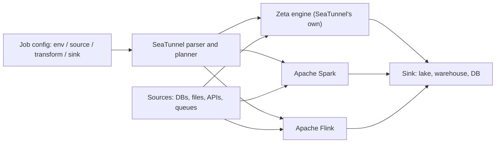

## 🎯 خلاصه

> یک **موتور یکپارچه‌سازی داده (data integration engine)** داده را از منبع به مقصد با **کانکتورهای پیکربندی‌شده** منتقل می‌کند، نه با کد دست‌نویس. Apache SeaTunnel یکی از این موتورهاست: جاب را در یک فایل پیکربندی توصیف می‌کنی (منبع، تبدیل اختیاری، مقصد) و روی یک موتور اجرا می‌شود، یا موتور خودش (Zeta) یا Spark یا Flink.

- برای موارد رایج، **پیکربندی** می‌نویسی، نه برنامه‌ی Spark یا Flink: از دیتابیس به lake، از API به warehouse، از Kafka به storage.
- موتور زیرین مهم است: Zeta موتور خود SeaTunnel است، و Spark و Flink مدل خرابی، مقیاس و state خودشان را دارند.
- trade-off این است: **سرعت تحویل و استانداردسازی** در برابر **انعطاف‌پذیری و هزینه‌ی دیباگ** وقتی کانکتور یا پیکربندی با مورد تو جور نیست.
- وقتی بیشتر کارت «این جدول را از آنجا به اینجا، مطمئن کپی کن» است، از آن استفاده کن. وقتی منطق خود محصول است، کد سفارشی بنویس.

## 🌱 از ساده شروع کنیم (مبتدی)

> **💡 Analogy:** یک شرکت حمل‌ونقل را تصور کن که جعبه‌های آماده و چک‌لیست دارد. تو می‌گویی «آشپزخانه را از خانه‌ی A به خانه‌ی B ببر، این وسایل را بسته‌بندی کن، و در این اتاق باز کن». شرکت از قبل می‌داند با جعبه، پله و وسایل شکستنی چه کند. تو فقط *چه چیزی* را جابه‌جا کنی توصیف می‌کنی. اگر جابه‌جایی‌ات پیانو از پنجره است، ممکن است برنامه‌ی سفارشی لازم باشد. آنجاست که کد دست‌نویس معنا دارد.

یک جاب یکپارچه‌سازی داده سه بخش دارد:

- **source**: داده از کجا می‌آید (یک جدول MySQL، پوشه‌ی CSV، یک REST API، یک topic در Kafka)،
- **transform** (اختیاری): تغییرات کوچک مثل تغییر نام فیلد، فیلتر، یا SQL روی جریان سطرها،
- **sink**: داده کجا می‌رود (یک جدول lake، یک warehouse، دیتابیس دیگر).

این یک جاب کامل به سبک SeaTunnel است به زبان HOCON، قالب پیکربندی‌ای که SeaTunnel استفاده می‌کند. بلوک `env` گزینه‌های موتور را تنظیم می‌کند، `source` می‌خواند، و `sink` می‌نویسد. گزینه‌های دقیق کانکتور را با مستندات نسخه‌ی خودت چک کن، چون نام کانکتورها و پارامترها بین نسخه‌ها تغییر می‌کند.

```hocon
env {
  parallelism = 2
  job.mode = "BATCH"
}

source {
  Jdbc {
    url = "jdbc:mysql://mysql.internal:3306/shop"
    driver = "com.mysql.cj.jdbc.Driver"
    user = "reader"
    password = "${DB_PASSWORD}"
    query = "SELECT id, customer_id, amount, created_at FROM orders"
  }
}

sink {
  Console {}
}
```

جاب را با launcher مربوط به SeaTunnel و مسیر فایل پیکربندی اجرا می‌کنی (دستور دقیق به نسخه و موتوری که انتخاب می‌کنی بستگی دارد). نکته‌ی اصلی شکل جاب است: هیچ کد خواندن، batching یا نوشتن ننوشته‌ای.

برای مبتدی، سؤال بزرگ این نیست که «چطور جاب را بنویسم»، بلکه این است که «کانکتوری وجود دارد؟ و آیا آن‌طور که لازم دارم رفتار می‌کند؟». بیشتر کار واقعی همین‌جا خرج می‌شود.

## 🔧 واقعاً چطور کار می‌کند (متوسط)

SeaTunnel **تعریف جاب** را از **موتوری که آن را اجرا می‌کند** جدا می‌کند.



بخش‌هایی که پیکربندی می‌کنی:

- **کانکتورها.** هر source و sink یک plugin است با گزینه‌هایی برای اتصال، حالت خواندن، partitioning و schema. بسیاری از کانکتورها داخلی‌اند: دیتابیس‌های رابطه‌ای از طریق JDBC، فایل‌های object storage، صف‌های پیام رایج، و بسیاری از storeهای تحلیلی. هرچه کانکتورهای بیشتری داشته باشی، تیم کد سفارشی کمتری می‌نویسد.
- **موازی‌سازی و split ها.** برای source از نوع JDBC، موتور می‌تواند یک جدول را به بازه‌ها (مثلاً بر اساس یک کلید عددی) تقسیم و موازی بخواند. انتخاب ستون split تعیین می‌کند بار متعادل باشد یا نه. کلید skewed یک split کند می‌سازد، همان مشکل skew که در Spark دیده‌ای (ببین [[data-skew]]).
- **حالت جاب.** جاب یا `BATCH` است (همه را بخوان و تمام شو) یا `STREAMING` (مدام اجرا شو و داده‌ی جدید را بخوان). CDC جریانی دلیل اصلی پذیرش این موتورها در بسیاری از تیم‌هاست: source لاگ تغییرات دیتابیس را می‌خواند، ببین [[cdc]].
- **تبدیل‌ها.** کارهای کوچک مثل map کردن فیلدها، فیلتر و تبدیل‌های SQLگونه داخل جاب اجرا می‌شوند. هر چیزی بزرگ‌تر (join بین منابع، منطق کسب‌وکار پیچیده) نشانه‌ی این است که جاب باید به dbt یا Spark برود.
- **Schema.** source و sink نوع داده‌ها را بین سیستم‌ها نگاشت می‌کنند. ناسازگاری نوع (مثلاً دقت decimal، timestamp با و بدون منطقه‌ی زمانی، یا متن فارسی با charset اشتباه) جایی است که بیشترین غافلگیری رخ می‌دهد. نگاشت هر ستونی که مهم است را چک کن.

**موتور اجرا** ویژگی‌های زمان اجرا را تعیین می‌کند:

| موتور | نقطه‌ی قوت | نکته |
|---|---|---|
| Zeta (موتور خود SeaTunnel) | برای کاربرد یکپارچه‌سازی ساخته شده؛ استقرارش با اجزای کم ساده است | جامعه‌ی کوچک‌تر از Spark یا Flink؛ ماتریس کانکتور و قابلیت‌ها را برای نسخه‌ات بررسی کن |
| Spark | یکپارچگی بالغ با cluster managerها، برای تیم‌های آشنا با Spark | مدل هزینه و زمان راه‌اندازی جاب Spark را به ارث می‌برد |
| Flink | استریم با checkpoint و معناشناسی exactly-once، جایی که کانکتور پشتیبانی کند | تنظیم state و checkpoint Flink را به ارث می‌برد |

اینکه یک جاب exactly-once است یا نه به ترکیب source و sink بستگی دارد، نه فقط به اسم موتور. یک sink فایل با commit اتمیک و یک source آگاه به checkpoint می‌تواند exactly-once باشد. یک sink ساده‌ی HTTP معمولاً at-least-once است، پس به نوشتن idempotent نیاز داری، همان‌طور که در [[idempotency]] توضیح داده شده.

## 🧠 عمق و trade-offها (سنیور)

**کجا سود می‌دهد.** قوی‌ترین مورد، تعداد زیادی pipeline معمولی است: ده‌ها یا صدها جدول از دیتابیس‌های عملیاتی به lake کپی می‌شوند، با retry، لاگ و مدیریت schema یکسان برای همه. فایل‌های پیکربندی ساده‌اند برای بازبینی، نسخه‌گذاری و تولید خودکار از یک کاتالوگ جدول‌ها. یک تیم کوچک می‌تواند بدون یک codebase جدا برای هر یکپارچه‌سازی، تعداد زیادی از آن‌ها را اجرا کند. همین دلیل استانداردسازی است: یک ابزار، یک روش مانیتورینگ، یک روش بازیابی.

**کجا درد دارد.** منطق سفارشی ناجور می‌شود. وقتی به state، سیاست retry سفارشی به ازای هر رکورد، یا joinهای پیچیده نیاز داری، با مدل پیکربندی درگیر می‌شوی. به plugin، transform سفارشی یا SQL در جاهای عجیب می‌رسی، و دیباگ یک خطا داخل plan اجرای تولیدشده سخت‌تر از خواندن کد خودت با Python است. همچنین کانکتورها ویژگی‌های خاص خودشان را دارند: ممکن است یک قابلیت (خواندن افزایشی، CDC، نوع‌های خاص، schema evolution) در نسخه‌ای که اجرا می‌کنی پشتیبانی نشود. قبل از تعهد به یک طراحی، ماتریس قابلیت‌ها را بررسی کن.

**آزمون واقعی، مدیریت خطاست.** برای هر ابزار یکپارچه‌سازی این سؤال‌ها را بپرس:

- با یک رکورد بد چه می‌شود؟ آیا مسیر dead-letter وجود دارد ([[dlq-bad-records]])، یا کل جاب شکست می‌خورد؟
- retry با sink چطور تعامل می‌کند؟ اجرای دوباره‌ی یک batch می‌تواند سطرها را تکراری کند، مگر اینکه sink از upsert idempotent پشتیبانی کند یا جاب در یک جدول staging بنویسد و اتمیک commit کند.
- checkpoint یا offset کجا ذخیره می‌شود؟ اگر جاب ری‌استارت شود، ادامه می‌دهد یا همه‌چیز را دوباره می‌خواند؟
- drift در schema چطور تشخیص داده می‌شود؟ ستون جدید در source نباید بی‌صدا sink را خراب کند. در صورت لزوم ابزار را با یک [[schema-registry]] یا چک‌های قرارداد جفت کن ([[data-quality]]).

**انتخاب در برابر جاب سفارشی.** این قاعده‌ی سرانگشتی را استفاده کن:

| وضعیت | گزینه‌ی مناسب‌تر |
|---|---|
| ۵۰ کپی جدول مشابه، نوع‌های استاندارد، batch یا CDC | موتور یکپارچه‌سازی |
| یک جریان پیچیده با state و windowهای سفارشی | کد Flink یا Spark |
| تبدیل‌های SQL روی داده‌ی warehouse | dbt، یا خود warehouse ([[etl-vs-elt]]) |
| هماهنگی بسیاری از مراحل بین ابزارها | یک orchestrator مثل [[airflow]]، که جاب یکپارچه‌سازی را یک مرحله صدا می‌زند |
| APIهای نامنظم با احراز هویت و paging سفارشی | کد سفارشی، یا کانکتور یکپارچه‌سازی اگر از قبل وجود دارد |

توجه کن که موتور یکپارچه‌سازی به‌ندرت کل پلتفرم است. داده را جابه‌جا می‌کند؛ orchestrator زمان‌بندی و پایش می‌کند؛ لایه‌ی کیفیت نتیجه را چک می‌کند. طراحی مرزهای بین این‌ها مهم‌تر از انتخاب خود ابزار است.

**عملیات و حاکمیت.** مدت اجرا، تعداد سطرهای خوانده و نوشته‌شده در هر اجرا، تعداد رکوردهای ردشده، و lag جاب‌های استریم را پایش کن. فایل‌های پیکربندی را در version control نگه دار و مثل کد بازبینی کن، چون یک متغیر رمز تغییریافته یا یک `query` اشتباه می‌تواند بی‌صدا آنچه کپی می‌شود را عوض کند. رمزها را داخل خود فایل نگذار: از متغیرهای محیطی یا یک secret store استفاده کن، همان‌طور که در مثال با `${DB_PASSWORD}` می‌بینی.

**در محیط on-prem ایران**، منابع معمول در بانک‌ها و اپراتورها Oracle و SQL Server و در شرکت‌های محصولی MySQL یا PostgreSQL هستند. ابزارهای یکپارچه‌سازی با کانکتور JDBC می‌توانند بسیاری از این‌ها را پوشش دهند، اما مجوز درایور و پشتیبانی آن را برای نسخه‌ی دقیق دیتابیسی که اجرا می‌کنی بررسی کن.

**چه چیزهایی را پایش کنی:** نرخ موفقیت جاب و روند مدت اجرا، سطر در ثانیه به‌ازای هر split (یک split کند نشانه‌ی skew است)، تعداد retry و حجم dead-letter. افت ناگهانی تعداد سطرها بدون خطا معمولاً یعنی یک فیلتر یا نگاشت schema تغییر کرده، نه اینکه منبع ساکت شده.

## 🧪 امتحان کن

به Docker نیاز داری و یک دیتابیس محلی برای خواندن (مثلاً یک کانتینر PostgreSQL با یک جدول کوچک `orders`). از مستندات SeaTunnel نسخه‌ی خودت برای پیدا کردن گزینه‌های کانکتور مطابق استفاده کن.

1. یک جاب batch بنویس که ۱۰۰ سطر تصادفی از source داخلی fake بخواند و روی console بنویسد. موازی‌سازی را تغییر بده و ببین چند split یا task اجرا می‌شود.
2. sink کنسول را با یک sink فایل (CSV یا Parquet، هرکدام را که کانکتور پشتیبانی می‌کند) جایگزین کن. جاب را دو بار اجرا کن. آیا سطرها تکراری‌اند؟ برای idempotent کردن اجرای دوم چه چیزی را تغییر می‌دهی؟
3. ستون source به نام `amount` از نوع `DECIMAL(12,2)` است و sink یک فرمت فایل با نوع `DOUBLE` است. توضیح بده برای مقادیر پولی چه چیزی می‌تواند اشتباه شود، و قبل از production چطور آن را می‌گیری؟

<details><summary>راه‌حل‌ها را نشان بده</summary>

**1.** یک اجرای درست با چاپ ۱۰۰ سطر و وضعیت موفق تمام می‌شود. بالا بردن موازی‌سازی روی source fake کوچک معمولاً خروجی را عوض نمی‌کند، اما روی یک source واقعی JDBC تعداد خواندن‌های موازی را تغییر می‌دهد، و الگوی خواندن ممکن است بین splitها فرق کند.

**2.** اجرای دوباره‌ی همان جاب batch بدون مرحله‌ی deduplication، سطرها را دوباره در یک sink فایل append-only می‌نویسد. برای idempotent کردن، در یک مسیر staging با شناسه‌ی اجرا بنویس، و بعد به مسیر نهایی اتمیک commit کن (یا partition آن اجرا را overwrite کن). یا از sinkی استفاده کن که upsert روی یک کلید را پشتیبانی کند.

**3.** `DOUBLE` عدد اعشاری باینری (floating point) است. مقادیری مثل `0.10` دقیقاً قابل نمایش نیستند، پس جمع‌ها دچار خطا می‌شوند و مقایسه‌ها شکست می‌خورند. پول باید از ابتدا تا انتها با نوع decimal باشد. با یک چک تطبیق (reconciliation) بگیرش: جمع `amount` را در source و sink برای یک تاریخ نمونه مقایسه کن، انتظار تطابق دقیق داشته باش، و روی هر اختلاف هشدار بده. همچنین نگاشت schema را در پیکربندی جاب قبل از اولین اجرای production بررسی کن.

</details>

## 💬 گوشه‌ی مصاحبه

**سؤال: «کی از SeaTunnel به جای نوشتن جاب Spark استفاده می‌کنی؟»** جواب متوسط: «وقتی جاب یک کپی استاندارد از دیتابیس به lake است، با تعداد زیاد جدول و بدون منطق پیچیده. SeaTunnel کانکتور دارد، پس من پیکربندی می‌نویسم و خواندن، split های موازی و نوشتن را خودش انجام می‌دهد.» جواب سنیور: «برای تعداد زیاد یکپارچه‌سازی مشابه، جایی که استانداردسازی و نگه‌داری کم از منطق سفارشی مهم‌تر است. قبل از هر چیز سه مورد را چک می‌کنم: اینکه کانکتورها و نوع‌های لازم در نسخه‌ام پشتیبانی می‌شوند، اینکه خطاها و retry با sink چطور تعامل دارند، و اینکه نگاشت schema برای پول و زمان درست است. اگر منطق stateful یا join چند جریان شد، آن بخش را به Flink یا Spark می‌برم و ابزار یکپارچه‌سازی را برای جابه‌جایی داده نگه می‌دارم.»

**سؤال: «آیا یک موتور یکپارچه‌سازی exactly-once است؟»** جواب متوسط: «به کانکتور بستگی دارد.» جواب سنیور: «exactly-once ویژگی ترکیب source و sink است، به‌علاوه‌ی رفتار checkpoint موتور. یک source آگاه به checkpoint با یک sink که commit اتمیک دارد می‌تواند exactly-once باشد. بسیاری از sinkها at-least-once هستند، پس نوشتن‌ها را idempotent طراحی می‌کنم، مثلاً با upsert روی یک کلید کسب‌وکاری یا commitهای staged با شناسه‌ی اجرا.»

> **🎤 Say this in the interview:** «من موتورهای یکپارچه‌سازی را راهی برای استانداردسازی کپی‌های معمول می‌بینم. وقتی کار شکل کانکتور دارد از آن‌ها استفاده می‌کنم، و وقتی منطق خود محصول است کد سفارشی می‌نویسم. قبل از پذیرش، پشتیبانی کانکتور، رفتار خطا و retry در sink، و نگاشت نوع برای پول و زمان را بررسی می‌کنم.»

## ⚠️ اشتباهات رایج

> **⚠️ Watch out:** فرض کردن اینکه «کانکتور دارد» یعنی «قابلیتی که لازم داری را دارد». خواندن افزایشی، CDC، schema evolution و نوع‌های داده خاص بین کانکتورها و نسخه‌ها فرق می‌کنند. ماتریس نسخه‌ی خودت را بررسی کن.

> **⚠️ Watch out:** اجرای دوباره‌ی یک جاب batch در یک sink append-only و گرفتن سطرهای تکراری. قبل از اولین اجرا، هویت اجرا و استراتژی commit را برنامه‌ریزی کن.

- استفاده از نوع float برای پول، فقط چون sink آن را پشتیبانی می‌کند.
- گذاشتن رمز دیتابیس مستقیم در فایل پیکربندی که در Git است.
- فرض کردن اینکه موازی‌سازی موتور رایگان است. کلید split با skew یک task کند و دنباله‌ی طولانی می‌سازد.
- فراموش کردن اینکه موتور اجرا (Zeta، Spark، Flink) مدل منابع و خرابی خودش را دارد، و دیباگ کردن نیازمند شناخت آن است.
- استفاده از ابزار پیکربندی‌محور برای منطقی که به state واقعی یا قوانین retry سفارشی نیاز دارد، و بعد ماه‌ها جنگیدن با این انتزاع.
- رد کردن reconciliation. جابی که با موفقیت تمام می‌شود ممکن است سطرهای اشتباه را کپی کرده باشد.

## ✅ خودت را بسنج

1. سه بخش تعریف یک جاب SeaTunnel چیست؟
   - A) ورودی، پردازش، خروجی
   - B) منبع (source)، تبدیل اختیاری (transform)، مقصد (sink)
   - C) تولیدکننده، broker، مصرف‌کننده
   - D) استخراج، بارگذاری، اعتبارسنجی

<details><summary>جواب</summary>

**B** — یک جاب با یک source (یا چند source)، یک transform اختیاری و یک sink تعریف می‌شود، به‌علاوه‌ی بلوک `env` برای گزینه‌های موتور. گزینه‌ی A همان ایده را به زبان کلی بیان می‌کند، اما نام‌های پیکربندی source، transform و sink هستند. گزینه‌ی C مربوط به Kafka است و گزینه‌ی D مراحل کلی ETL را توصیف می‌کند.

</details>

2. یک source از نوع JDBC با چهار split موازی خوانده می‌شود، اما یک split حدود ۸۰٪ زمان اجرا را می‌برد. محتمل‌ترین علت چیست؟

   - A) sink خیلی سریع است
   - B) کلید split دارای skew است، پس یک بازه بیشتر سطرها را دارد
   - C) حالت جاب روی `BATCH` تنظیم شده
   - D) متغیرهای محیطی وجود ندارند

<details><summary>جواب</summary>

**B** — وقتی ستون split دارای skew است (سطرهای زیادی در یک بازه)، یک split بیشترین کار را می‌کند. یک کلید با توزیع متعادل‌تر یا استراتژی split که سطرها را متعادل کند انتخاب کن. گزینه‌ی C تنظیم معتبری است، و گزینه‌ی D به شکست منجر می‌شود، نه به یک split کند.

</details>

3. چرا یک رمز دیتابیس نباید در فایل پیکربندی جاب باشد که در Git ذخیره شده؟

   - A) Git نمی‌تواند فایل متنی ذخیره کند
   - B) هر کسی که به مخزن دسترسی دارد آن را می‌خواند، و حتی بعد از حذف، در تاریخچه‌ی Git باقی می‌ماند
   - C) SeaTunnel با رمز داخل فایل شروع به کار نمی‌کند
   - D) رمز جاب را کند می‌کند

<details><summary>جواب</summary>

**B** — دسترسی به مخزن یعنی دسترسی به راز، و تاریخچه‌ی Git حتی اگر فایل بعداً عوض شود آن را نگه می‌دارد. از متغیرهای محیطی یا یک secret store استفاده کن، مثل `${DB_PASSWORD}`.

</details>

4. **(سنیور)** یک جاب شبانه ۸۰ جدول را با یک موتور یکپارچه‌سازی کپی می‌کند. یکی از جدول‌ها در source یک ستون جدید دارد، و جاب با موفقیت گزارش می‌دهد در حالی که جدول sink آن داده را ندارد. کدام کنترل زودتر این را می‌گرفت؟

   - A) افزایش موازی‌سازی
   - B) تشخیص drift در schema و یک چک قرارداد که ستون‌های source و sink را قبل یا بعد از اجرا مقایسه کند، با هشدار روی عدم تطابق
   - C) تبدیل همه‌ی نوع‌ها به رشته
   - D) تغییر حالت جاب به `STREAMING`

<details><summary>جواب</summary>

**B** — وضعیت موفق فقط یعنی جاب بدون خطا اجرا شده، نه اینکه نگاشت همه‌ی ستون‌ها را پوشش داده. مقایسه‌ی schema مورد انتظار و واقعی، و هشدار روی drift، این مشکل را در اولین اجرا می‌گیرد. گزینه‌ی C مشکلات نوع را پنهان می‌کند، و گزینه‌ی D نگاشت را حل نمی‌کند.

</details>

5. **(سنیور)** یک تیم می‌خواهد یک سیگنال تقلب را پیاده کند که دو جریان را join می‌کند، state دقیقه‌ی ۳۰ برای هر حساب نگه می‌دارد، و قوانین هشدار سفارشی اعمال می‌کند. آیا باید از موتور یکپارچه‌سازی استفاده کنند؟ دلیلت را بگو.

   - A) بله، چون موتورهای یکپارچه‌سازی هر منطقی را پشتیبانی می‌کنند
   - B) خیر؛ این منطق سفارشی و stateful است که مدل پیکربندی با آن می‌جنگد. برای پردازش از Flink (یا Spark Structured Streaming) استفاده کن و ابزار یکپارچه‌سازی را برای انتقال داده‌ی خام به داخل و بیرون نگه دار
   - C) بله، اگر sink یک فایل باشد
   - D) خیر، چون موتورهای یکپارچه‌سازی نمی‌توانند از Kafka بخوانند

<details><summary>جواب</summary>

**B** — joinهای stateful و قوانین سفارشی جایی‌اند که ابزارهای پیکربندی‌محور عملیاتی‌کردنشان سخت می‌شود، و مدل state موتور اجرا بیشترین اهمیت را دارد. تقسیم تمیز این است که ابزار یکپارچه‌سازی داده را جابه‌جا کند و یک پردازشگر جریان منطق را اجرا کند. گزینه‌های A و C تناسب را اشتباه ارزیابی می‌کنند، و گزینه‌ی D دلیلی کلی و درست نیست.

</details>

## 🗂️ فلش‌کارت

| Front | Back |
|---|---|
| موتور یکپارچه‌سازی داده چیست؟ | ابزاری که داده را از منبع به مقصد با کانکتورهای پیکربندی‌شده جابه‌جا می‌کند |
| سه بخش یک جاب SeaTunnel | منبع (source)، تبدیل اختیاری (transform)، مقصد (sink)؛ به‌علاوه‌ی env برای گزینه‌های موتور |
| Zeta، Spark، Flink در SeaTunnel | موتورهای اجرایی که همان تعریف جاب را اجرا می‌کنند |
| چرا «کانکتور دارد» کافی نیست؟ | قابلیت‌ها (افزایشی، CDC، نوع‌ها، schema evolution) بین کانکتورها و نسخه‌ها فرق می‌کنند |
| تضمین exactly-once از کجا می‌آید؟ | ترکیب source و sink، به‌علاوه‌ی checkpoint موتور؛ نه فقط اسم موتور |
| چرا پول را در نوع decimal نگه داریم؟ | نوع float بسیاری از عددهای اعشاری را دقیق نمایش نمی‌دهد، پس جمع‌ها دچار خطا می‌شوند |
| بهترین کاربرد موتور یکپارچه‌سازی | کپی‌های زیاد و مشابه با شکل کانکتوری و نوع‌های استاندارد |
| کی به جای آن کد سفارشی بنویسیم؟ | منطق stateful، پیچیده یا حیاتی کسب‌وکار که خود محصول است |

## 🔗 ادامه

- **batch-ingestion** و **ingestion-tools** موتورهای یکپارچه‌سازی را در کنار روش‌های دیگر بارگذاری داده قرار می‌دهند.
- **cdc** الگوی change-data-capture را توضیح می‌دهد که کانکتورهای استریم از آن استفاده می‌کنند.
- **dlq-bad-records** نشان می‌دهد چطور رکوردهای خراب را بدون از دست دادن جاب مدیریت کنی.
- **spark-architecture** و **flink** موتورهای اجرایی‌ای را توضیح می‌دهند که SeaTunnel روی آن‌ها اجرا می‌شود، و برای دیباگ به آن‌ها نیاز داری.
- **etl-vs-elt** کمک می‌کند تصمیم بگیری تبدیل داده باید در pipeline باشد یا در warehouse.
- مستندات SeaTunnel نسخه‌ی خودت را بخوان: لیست کانکتورها، ماتریس قابلیت‌ها و گزینه‌های موتور بین نسخه‌ها تغییر می‌کنند.
