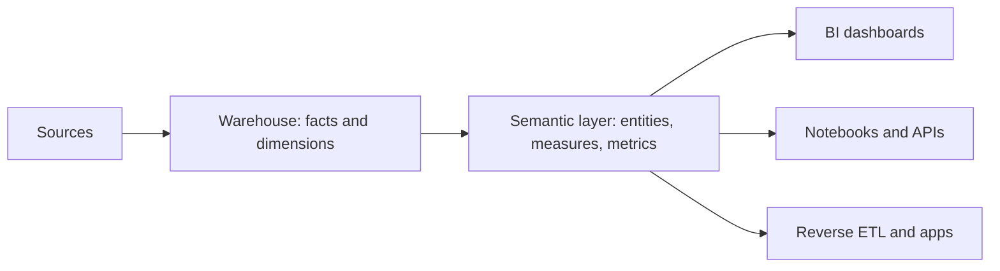

## 🎯 خلاصه

> **semantic layer** (لایه‌ی معنایی، که به آن metrics layer هم می‌گویند) جایی است که یک معیار کسب‌وکار **فقط یک‌بار** تعریف می‌شود: فرمول، فیلترها، بُعدهایی که می‌شود بر اساسشان برش زد، و قواعد زمانی‌اش. بعد هر داشبورد، نوت‌بوک و API معیار را از این لایه می‌پرسد، نه این‌که SQL خودش را بنویسد.

- هدف **یک تعریف، مصرف‌کنندگان زیاد** است. دو داشبوردی که «کاربران فعال» را نشان می‌دهند باید یک عدد نشان بدهند.
- این لایه بین جدول‌های مدل‌شده (fact و dimension) و ابزارهایی که آن‌ها را می‌خوانند (BI، نوت‌بوک، reverse ETL، اپلیکیشن) قرار می‌گیرد.
- پیاده‌سازی‌های رایج شامل dbt Semantic Layer، Cube و LookML داخل Looker هستند. از نظر محل نگه‌داری تعریف‌ها و نحوه‌ی ساختن کوئری با هم فرق دارند.
- اول از همه ابزار **حاکمیت و یکدستی** است. عملکرد بهتر فقط نتیجه‌ی pre-aggregation است، نه دلیل اصلی ساختنش.

## 🌱 از ساده شروع کنیم (مبتدی)

> **💡 تشبیه:** یک شرکت یک کیلوگرم رسمی دارد. همه‌ی ترازوهای کارخانه با آن کنترل می‌شوند. بدون این مرجع، هر بخش وزن‌ها را جور دیگری می‌سنجد و کسی نمی‌تواند جمع‌ها را با هم بزند. semantic layer همان کیلوگرم رسمی برای عددهاست.

فرض کن دو تحلیلگر داریم. علی کوئری می‌نویسد که هر کاربری که اپ را باز کرده بشمارد. سارا کوئری می‌نویسد که فقط کاربرانی را بشمارد که خرید کرده‌اند. هر دو اسمش را گذاشته‌اند «کاربران فعال». در جلسه‌ی ماهانه دو عدد ۴۰٪ با هم فرق دارند، و جلسه درباره‌ی این اختلاف حرف می‌زند، نه درباره‌ی کسب‌وکار.

راه‌حل این است که روی یک تعریف توافق کنید و آن را در یک جا ذخیره کنید:

- **نام:** `active_users`
- **قاعده:** `user_id` متمایز که در آن روز حداقل یک رویداد `session_start` دارد، بدون حساب‌های تست داخلی
- **grain:** یک ردیف در روز
- **برش بر اساس:** کشور، پلتفرم، پلن

حالا هر ابزار `active_users` را بر حسب کشور می‌خواهد و همه یک جواب می‌گیرند.

## 🔧 واقعاً چطور کار می‌کند (متوسط)

یک semantic layer سه چیزی را که در یک کوئری SQL معمولاً قاطی می‌شوند جدا می‌کند:

1. **fact و dimension** (داده، از مدل‌سازی [[star-schema]])
2. **measure** (چطور یک ستون را جمع یا شمارش کنیم: `SUM(amount)`، `COUNT(DISTINCT user_id)`)
3. **metric** (یک کمیت کسب‌وکار با نام، ساخته‌شده از measureها، همراه با فیلتر و قواعد زمانی)



تعریف یک metric معمولاً شامل این‌هاست:

- **جدول یا مدل پایه** با کلید اصلی (entity، مثلاً `user`)
- **measure** و نوع تجمیع (`COUNT(DISTINCT user_id)`)
- **فیلترهایی** که جزئی از تعریف‌اند (حذف کاربران تست)
- **بُعدهای مجاز** و نحوه‌ی join به آن‌ها (کشور از یک جدول dimension می‌آید)
- **grain و ستون زمانی** (روزانه، بر اساس `event_date`)

لایه بعد درخواست را به SQL **کامپایل** می‌کند. درخواست «کاربران فعال بر حسب کشور، به تفکیک هفته» به یک کوئری با join، فیلتر و تجمیع درست تبدیل می‌شود. این SQL معادل دستی آن است تا ببینی لایه چه کاری می‌کند:

```sql
-- The one definition of active_users, compiled for a weekly, per-country request
SELECT
  DATE_TRUNC('week', e.event_date) AS week,
  c.country,
  COUNT(DISTINCT e.user_id)        AS active_users
FROM fct_events e
JOIN dim_user c
  ON c.user_id = e.user_id
WHERE e.event_name = 'session_start'
  AND c.is_internal_test = FALSE
GROUP BY 1, 2;
```

مصرف‌کننده‌ها این SQL را نمی‌بینند. فقط `active_users` را می‌بینند و بُعد دلخواه‌شان را انتخاب می‌کنند.

### سه پیاده‌سازی شناخته‌شده

- **dbt Semantic Layer** (روی MetricFlow متن‌باز ساخته شده): مدل‌های معنایی را با entity، dimension و measure در YAML تعریف می‌کنی، و بعد metricها را روی آن‌ها. کوئری‌ها از یک API رد می‌شوند که ابزار BI صدایش می‌زند. نحو را برای نسخه‌ی خودت در مستندات dbt بررسی کن.
- **Cube**: یک سرویس با *cubeها* (مدلی از measure و dimension روی SQL)، *pre-aggregation*های اختیاری که در موتور سریع ذخیره می‌شوند، و APIهایی برای BI و اپلیکیشن.
- **LookML** (در Looker): *viewها* فیلدها را روی جدول‌ها توصیف می‌کنند و *exploreها* join‌ها را تعریف می‌کنند. لایه‌ی مدل‌سازی جزئی از Looker است، پس تعریف‌ها به همان ابزار وابسته‌اند.

همه یک مسئله را حل می‌کنند. تفاوت‌ها در این است که لایه مستقل از ابزار BI هست یا نه، کَش‌کردن چطور انجام می‌شود، و با metricهای غیرجمع‌پذیر چطور کنار می‌آید.

### جمع‌پذیر و غیرجمع‌پذیر

بعضی معیارها را می‌شود بین برش‌ها جمع کرد و بعضی را نه:

- **جمع‌پذیر**: درآمد. مجموع درآمد کشورها برابر درآمد کل است.
- **غیرجمع‌پذیر**: کاربران متمایز. جمع کاربران فعال روزانه در یک هفته، **کاربران فعال هفتگی نیست**، چون کاربری که سه روز فعال بوده سه بار شمرده می‌شود.
- **نسبت‌ها**: نرخ تبدیل `خریدها / sessionها` است. نسبت را باید از صورت و مخرج جمع‌شده حساب کنی، نه این‌که نسبت‌های روزانه را میانگین بگیری.

لایه‌ی درست می‌داند هر metric از کدام نوع است، و کوئری‌ای را که نسبت را میانگین می‌گیرد رد می‌کند یا بازنویسی می‌کند.

## 🧠 عمق و trade-offها (سنیور)

- **منطق کجا زندگی کند.** تعریف‌ها را در انبار داده (پروژه‌ی dbt یا view با SQL) یا در خود لایه (Cube یا LookML) بگذار. منطق داخل داشبورد همان چیزی است که می‌خواهی حذف کنی. یک منبع حقیقت در version control با code review نگه دار، مثل بقیه‌ی [[data-contract]]ها.
- **pre-aggregation و هزینه.** rollupهای از پیش محاسبه‌شده داشبورد را سریع می‌کنند، ولی باید تازه‌سازی شوند و ممکن است قدیمی شوند. تازگی هر metric را مشخص کن (مثلاً «ساعتی به‌روز می‌شود، حداکثر ۲ ساعت دیر») و آن را در ابزار نشان بده.
- **شمارش متمایز در مقیاس بزرگ.** `COUNT(DISTINCT)` دقیق روی میلیاردها ردیف گران است. موتورها sketchهای تقریبی مثل [[hyperloglog]] را دارند. به کسب‌وکار بگو کدام metric از کدام استفاده می‌کند، چون عدد تقریبی و دقیق کمی با هم فرق دارند.
- **داده‌ی دیرهنگام و بازنویسی.** معیار دیروز وقتی رویدادهای دیرهنگام برسند عوض می‌شود. پنجره‌ی بازبینی و زمان «نهایی شدن» عدد را تعریف کن، وگرنه لایه در زمان‌های مختلف به کاربران مختلف عدد متفاوت نشان می‌دهد.
- **کنترل دسترسی.** قواعد سطر و ستون (مثلاً فقط مالی درآمد به تفکیک مشتری را ببیند) در یک لایه ساده‌تر از بیست داشبورد اجرا می‌شود. برای فیلدهای حساس با [[data-masking]] ترکیب کن.
- **ریسک پذیرش.** لایه‌ای که از یک کوئری SQL کندتر است یا metric لازم را ندارد، مردم را به جدول‌های خام برمی‌گرداند. تأخیر کوئری را اندازه بگیر و مراقب «metricهای سایه» در نوت‌بوک‌های ad-hoc باش.
- **کی لازم نیست.** شرکتی با دو داشبورد و یک مالک تعریف‌ها هنوز به لایه نیاز ندارد. از یک مدل SQL مشترک و تست‌شده شروع کن. وقتی اختلاف عددها جلسه‌های زیادی می‌سازد، لایه را اضافه کن.
- **اجرا.** metricها را مثل کد تست کن: unit test با داده‌ی ثابت، و بررسی هم‌خوانی جمع metric با جمع انبار برای همان فیلترها. به [[data-quality]] نگاه کن.

## 🧪 امتحان کن

از PostgreSQL 13 یا بالاتر استفاده کن (یا DuckDB با تغییرات جزئی نحو). یک جدول رویداد و یک dimension کوچک بساز و metric را فقط یک‌بار تعریف کن.

```sql
CREATE TABLE dim_user (user_id text, country text, is_internal_test boolean);
INSERT INTO dim_user VALUES
 ('u1','IR',false), ('u2','IR',false), ('u3','DE',false), ('t1','IR',true);

CREATE TABLE fct_events (user_id text, event_date date, event_name text);
INSERT INTO fct_events VALUES
 ('u1','2026-01-05','session_start'),
 ('u1','2026-01-05','purchase'),
 ('u1','2026-01-06','session_start'),
 ('u2','2026-01-05','page_view'),
 ('u3','2026-01-06','session_start'),
 ('t1','2026-01-05','session_start');
```

۱. یک **view** به نام `metric_active_users_daily` بنویس که `(event_date, country, active_users)` را با تعریف این درس برگرداند. حساب تست `t1` نباید شمرده شود.
۲. کوئری **ساده‌لوحانه‌ای** بنویس که سارا نوشت: کاربران متمایز با **هر** رویدادی در هر روز، بدون کشور و بدون فیلتر تست. نتیجه‌ها را مقایسه کن.
۳. توضیح بده چرا جمع `active_users` در سه روز، کاربران فعال هفتگی را نمی‌دهد.

<details><summary>پاسخ‌ها را ببین</summary>

**۱.**
```sql
CREATE VIEW metric_active_users_daily AS
SELECT e.event_date, c.country,
       COUNT(DISTINCT e.user_id) AS active_users
FROM fct_events e
JOIN dim_user c ON c.user_id = e.user_id
WHERE e.event_name = 'session_start'
  AND c.is_internal_test = FALSE
GROUP BY e.event_date, c.country;
```
نتیجه: `2026-01-05 IR 1` (u1)، `2026-01-06 IR 1` (u1)، `2026-01-06 DE 1` (u3).

**۲.** کوئری ساده‌لوحانه کاربران `u1`، `u2` و `t1` را در ۲۰۲۶-۰۱-۰۵ می‌شمارد (۳ کاربر)، و `u1` و `u3` را در ۲۰۲۶-۰۱-۰۶ (۲ کاربر). حساب تست و کاربری با `page_view` را هم شمرده، پس عدد با metric فرق دارد.

**۳.** `u1` در هر دو روز فعال است. جمع عددهای روزانه، `u1` را دو بار می‌شمارد. کاربران متمایز یک هفته باید روی کل هفته محاسبه شوند، نه جمع روزها.

</details>

## 💬 گوشه‌ی مصاحبه

**سؤال: «دو داشبورد درآمد متفاوت نشان می‌دهند. چطور حلش می‌کنی؟»** پاسخ متوسط: «می‌بینم هر کوئری از کدام فیلترها و join‌ها استفاده می‌کند، بعد تعریف را در یک مدل مشترک می‌گذارم و هر دو داشبورد را به آن وصل می‌کنم.» پاسخ سنیور: «اول بررسی می‌کنم اختلاف از تعریف است (مرجوعی، سفارش‌های تست، ارز) یا از زمان‌بندی (داده‌ی دیرهنگام، زمان‌های مختلف تازه‌سازی). بعد metric را با فیلتر و قواعد زمانی‌اش در semantic layer یک‌بار تعریف می‌کنم، یک تست هم‌خوانی با جمع انبار اضافه می‌کنم، و تازگی را در ابزار نشان می‌دهم تا اختلاف بی‌صدا برنگردد.»

**سؤال: «semantic layer چیست و چرا از آن استفاده می‌کنی؟»** تعریف را بگو، بعد دو فایده: یک تعریف برای همه‌ی مصرف‌کننده‌ها، و حاکمیت (قواعد دسترسی، تست، version control). اضافه کن که با [[data-warehouse]] یا [[materialized-view]] یکی نیست، هرچند می‌تواند از آن‌ها استفاده کند.

> **🎤 این را در مصاحبه بگو:** «semantic layer هر metric را یک‌بار با فرمول، فیلترها و قواعد زمانی‌اش تعریف می‌کند و همه‌ی ابزارها همان تعریف را می‌پرسند. بخش سخت ماجرا metricهای غیرجمع‌پذیر، داده‌ی دیرهنگام و تازگی است، پس همیشه می‌گویم هر metric در طول زمان و بین برش‌ها چطور رفتار می‌کند.»

## ⚠️ اشتباهات رایج

> **⚠️ مراقب باش:** میانگین گرفتن از نسبت‌های روزانه برای به‌دست آوردن نسبت دوره. میانگین نرخ‌های تبدیل روزانه، نرخ تبدیل دوره نیست. اول صورت‌ها و مخرج‌ها را جمع کن.

> **⚠️ مراقب باش:** جمع کردن شمارش‌های متمایز روزانه برای یک دوره‌ی طولانی‌تر. کاربری که سه روز فعال بوده سه بار شمرده می‌شود.

- تعریف یک metric در فیلتر داشبورد به‌جای مدل مشترک. داشبورد بعدی آن فیلتر را به ارث نمی‌برد.
- دو چیز متفاوت با یک نام (فعال برای ورود و فعال برای خرید). نام‌های دقیق بگذار.
- فراموش کردن حساب‌های تست و داخلی در تعریف، و بعد بحث درباره‌ی نتیجه.
- اشتباه گرفتن semantic layer با کَش. این لایه معنا را تعریف می‌کند؛ کَش‌کردن یک بهینه‌سازی اختیاری است.
- ساختن لایه قبل از این‌که تیم روی تعریف‌ها توافق کند. ابزار اختلاف را سریع‌تر در خودش ثبت می‌کند.
- تغییر تعریف بدون نسخه یا changelog، که باعث می‌شود عدد ماه قبل بدون توضیح جابه‌جا شود.

## ✅ خودت را بسنج

۱. هدف اصلی یک semantic layer چیست؟
   - A) ذخیره‌ی داده‌ی خام ارزان‌تر از انبار داده
   - B) تعریف هر معیار کسب‌وکار یک‌بار، تا همه‌ی مصرف‌کننده‌ها نتیجه‌ی یکسان بگیرند
   - C) جایگزین شدن به‌جای مدل‌سازی بُعدی
   - D) اجرای یادگیری ماشین داخل ابزار BI

<details><summary>پاسخ</summary>

**B** — ارزش اصلی یک تعریف مشترک با فیلترها و قواعد زمانی است. از انبار داده استفاده می‌کند؛ جای ذخیره‌سازی یا مدل‌سازی را نمی‌گیرد.

</details>

۲. کدام metric بین روزها **جمع‌پذیر نیست**؟
   - A) درآمد
   - B) تعداد سفارش‌ها
   - C) کاربران متمایز فعال هفتگی
   - D) مبلغ بازپرداخت

<details><summary>پاسخ</summary>

**C** — کاربری که چند روز فعال بوده در یک هفته یک بار شمرده می‌شود، ولی اگر روزها را جمع کنی چند بار. درآمد، سفارش و بازپرداخت بین برش‌ها درست جمع می‌شوند.

</details>

۳. دو تحلیلگر برای یک ماه نرخ تبدیل متفاوت گزارش کرده‌اند. تحلیلگر A نرخ‌های ۳۱ روز را میانگین گرفته؛ تحلیلگر B کل خریدها را بر کل sessionها تقسیم کرده. کدام برای نرخ تبدیل ماهانه درست است، و چرا؟
   - A) A، چون میانگین‌ها همیشه دقیق‌ترند
   - B) B، چون نسبت باید از صورت و مخرج جمع‌شده محاسبه شود؛ میانگین‌گیری از نسبت‌های روزانه هر روز را بدون توجه به ترافیک آن هم‌وزن می‌کند
   - C) هر دو از نظر تعریف یکی‌اند
   - D) هیچ‌کدام، نرخ تبدیل را نمی‌شود ماهانه سنجید

<details><summary>پاسخ</summary>

**B** — وقتی نسبت‌ها را میانگین می‌گیری، یک روز کم‌ترافیک به اندازه‌ی یک روز پرترافیک حساب می‌شود. صورت و مخرج را جمع کن، بعد تقسیم کن.

</details>

۴. **(سنیور)** semantic layer شما `active_users` را از یک pre-aggregation روزانه که ساعت ۰۲:۰۰ تازه می‌شود می‌دهد. ساعت ۰۹:۰۰ یک دسته رویداد دیرهنگام برای دیروز می‌رسد. تعریف metric و ابزار چه چیزی باید بگویند؟

   - A) هیچ؛ لایه با هر کوئری دوباره حساب می‌کند
   - B) قاعده‌ی بازبینی یا نهایی شدن (مثلاً دیروز بعد از یک تأخیر ثابت نهایی می‌شود)، تازگی rollup، و این‌که عددهای قبل از زمان نهایی هنوز ممکن است عوض شوند
   - C) pre-aggregation را حذف کن تا داده‌ی دیرهنگام هیچ‌وقت مشکل نشود
   - D) `active_users` را به جمع رویدادها تبدیل کن

<details><summary>پاسخ</summary>

**B** — pre-aggregation سرعت را با تازگی معامله می‌کند. تعریف باید بگوید عدد کی نهایی است و داده‌ی دیرهنگام چطور مدیریت می‌شود، تا کاربران بدانند کدام عددها هنوز ممکن است تغییر کنند.

</details>

۵. **(سنیور)** مالی باید درآمد به تفکیک مشتری را ببیند، ولی بازاریابی فقط درآمد به تفکیک کشور. این را کجا اعمال می‌کنی، و چرا بهتر از فیلتر هر داشبورد است؟

   - A) در SQL هر داشبورد، تا هر تیم قواعد خودش را کنترل کند
   - B) در لایه‌ی معنایی یا دسترسی مشترک، با قواعد سطر و ستون که به metric وصل است، تا همه‌ی مصرف‌کننده‌ها یک سیاست را به ارث ببرند و قواعد قابل ممیزی باشند
   - C) در مرورگر، با مخفی کردن ستون‌ها
   - D) هیچ‌جا؛ درآمد حساس نیست

<details><summary>پاسخ</summary>

**B** — قواعد پراکنده در ده‌ها داشبورد از هم جدا می‌شوند و ممیزی‌شان سخت است. قواعد دسترسی مرکزی که به metric وصل‌اند همه‌جا اعمال می‌شوند، و ترکیب آن با [[data-masking]] فیلدهای حساس را محافظت می‌کند.

</details>

## 🗂️ فلش‌کارت

| Front | Back |
|---|---|
| semantic layer در یک جمله | تعریف metricها (فرمول، فیلتر، بُعد، قواعد زمانی) در یک جا که همه‌ی ابزارها می‌پرسند |
| measure در برابر metric | measure یک ستون را تجمیع می‌کند (`COUNT DISTINCT user_id`)؛ metric کمیت کسب‌وکار با نام است که از measureها و قواعد ساخته می‌شود |
| چرا شمارش‌های متمایز روزانه را جمع نکنیم؟ | کاربری که چند روز فعال بوده چند بار شمرده می‌شود |
| میانگین درست یک نسبت | صورت و مخرج‌ها را جمع کن، بعد تقسیم کن |
| dbt Semantic Layer روی چه ساخته شده؟ | MetricFlow (متن‌باز) با مدل‌های معنایی و metricها در YAML |
| LookML جزئی از چیست؟ | Looker: viewها و exploreها در لایه‌ی مدل‌سازی آن |
| ارزش اصلی semantic layer | یکدستی و حاکمیت؛ عملکرد بهتر فقط نتیجه‌ی pre-aggregation است |

## 🔗 ادامه

- **dimensional-modeling** و **star-framework** fact و dimensionهایی را توضیح می‌دهند که semantic layer روی آن‌ها نشسته.
- **dbt** و **bi-analytics-engineering** نشان می‌دهند metricها در عمل چطور ساخته و تست می‌شوند.
- **governance-contracts-mesh** مالکیت و قراردادهای تعریف‌های مشترک را پوشش می‌دهد.
- **data-lineage** کمک می‌کند وقتی عددی مشکوک است، metric را تا جدول‌های منبعش دنبال کنی.
- مستندات فعلی ابزاری که استفاده می‌کنی (dbt، Cube، Looker) را بخوان؛ نحو و امکانات بین نسخه‌ها تغییر می‌کنند.
