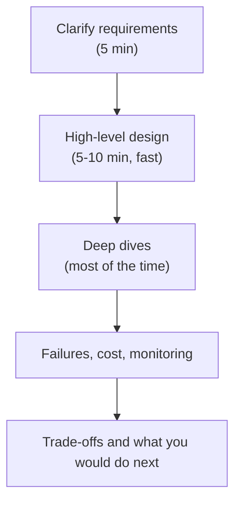

## 🎯 خلاصه

> یک مهندس داده‌ی **سنیور** کمتر با تعداد ابزارهایی که بلد است و بیشتر با نحوه‌ی برخورد او با **ابهام**، **trade-off**، **مالکیت** و **آدم‌های دیگر** سنجیده می‌شود. جواب Mid می‌گوید *چه* بسازیم. جواب Senior می‌گوید *چرا این و نه آن*، هزینه‌اش چیست و چطور خراب می‌شود.

- سنیور از یک مسئله‌ی نامشخص شروع می‌کند و آن را به یک برنامه‌ی محدود با فرض‌های صریح تبدیل می‌کند.
- از **تجربه‌ی واقعی** حرف می‌زند: یک شکست، یک بهینه‌سازی با عدد، یک تصمیمی که حالا متفاوت می‌گرفت.
- یک سیستم را **از ابتدا تا انتها** مالک است: طراحی، ساخت، بهره‌برداری، on-call، هزینه و کسانی که به آن وابسته‌اند.
- در راند طراحی سیستم از پایه‌ها سریع می‌گذرد و بیشترین وقت را صرف **Deep Dive** روی بخش‌هایی می‌کند که ریسک واقعی آنجاست.

## 🌱 از ساده شروع کنیم (مبتدی)

> **💡 Analogy:** دو نفر یک پل می‌سازند. مهندس Mid نقشه را دنبال می‌کند و مطمئن می‌شود هر تیر محکم است. سنیور می‌پرسد پل به کجا می‌رود، روزی چند کامیون از آن عبور می‌کند، در زلزله چه می‌شود، ده سال دیگر چه کسی تعمیرش می‌کند، و آیا یک کشتی‌رانی ارزان‌تر نیست. نقشه یکی است؛ سؤال‌ها فرق دارند.

یک مقایسه‌ی ساده برای یک کار واحد: *«هر ساعت سفارش‌ها را از دیتابیس فروشگاه به warehouse بار کن.»*

| جواب Mid | جواب Senior |
|---|---|
| «از یک ابزار CDC برای خواندن جدول سفارش‌ها استفاده می‌کنم و با Airflow هر ساعت به warehouse بار می‌کنم.» | «اول می‌پرسم چه کسی داده را مصرف می‌کند و یک ساعت تأخیر چه هزینه‌ای دارد. بعد CDC را با یک کوئری مبتنی بر timestamp مقایسه می‌کنم: CDC برای حذف‌ها و فشار کمتر روی منبع امن‌تر است، ولی یک جزء اضافه برای بهره‌برداری می‌آورد. بارگذاری را idempotent می‌کنم تا اجرای مجدد سفارش‌ها را تکراری نکند، و وقتی تازگی داده از هدف توافق‌شده پایین‌تر رفت هشدار می‌دهم.» |

هر دو جواب از نظر فنی معقول‌اند. جواب سنیور بدون اینکه پرسیده شود، استدلال، هزینه و مدیریت خرابی را نشان می‌دهد.

## 🔧 واقعاً چطور کار می‌کند (متوسط)

بیشتر ارزیابی‌های مصاحبه‌ی سطح سنیور به چهار حوزه نگاشت می‌شوند. برای یادآوری ساده:

| حوزه | چیزی که مصاحبه‌کننده دنبالش است |
|---|---|
| Problem navigation | آیا قبل از طراحی، نیازمندی‌ها را روشن می‌کنی، محدوده را تعیین می‌کنی و فرض‌ها را می‌گویی؟ |
| Solution design | آیا معماری معقولی انتخاب می‌کنی و جریان داده را توضیح می‌دهی؟ |
| Technical excellence | آیا می‌دانی ابزارها زیر بار و خرابی چطور رفتار می‌کنند و حدودشان کجاست؟ |
| Communication | آیا می‌توانی طراحی پیچیده را روشن توضیح دهی و وقتی بازخواست می‌شوی تطبیق بدهی؟ |

مهندس Mid معمولاً در solution design و technical excellence، در محدوده‌ی کارش، نمره‌ی خوبی می‌گیرد. مهندس سنیور باید در حوزه‌ی اول و چهارم هم خوب باشد، چون مسائلی که با آن‌ها روبه‌رو است مبهم‌اند و بین تیمی‌اند.

### عمق در برابر وسعت

- **وسعت** یعنی بتوانی اجزای یک سیستم را نام ببری: دریافت، ذخیره، orchestration، سرو.
- **عمق** یعنی یکی از آن‌ها را آن‌قدر خوب توضیح دهی که رفتارش را پیش‌بینی کنی: مثلاً وقتی leader یک partition جابه‌جا می‌شود، consumer lag در Kafka چه می‌شود، یا چرا یک shuffle در Spark spill می‌کند.
- جواب Mid اغلب پهن و سطحی است. جواب سنیور آن‌قدر پهن است که درست باشد و آنجا که مهم است عمیق است.

### «بستگی دارد» باید چطور به نظر برسد

«بستگی دارد» به‌تنهایی جواب ضعیفی است. وقتی جمله را با متغیرها و یک پیش‌فرض تمام کنی قوی می‌شود:

> «به تازگی هدف و حجم داده بستگی دارد. زیر ۱۰ دقیقه و چند گیگابایت در ساعت، micro-batch با یک فرمت جدولی مدیریت‌شده را انتخاب می‌کنم. بالاتر از آن، یا اگر تأخیر در سطح هر رویداد لازم باشد، یک stream processor می‌گیرم و هزینه‌ی عملیاتی‌اش را می‌پذیرم.»

این جواب متغیرها را نام می‌برد، آستانه می‌دهد و می‌گوید وقتی از آستانه رد شدیم چه عوض می‌شود.

## 🧠 عمق و trade-offها (سنیور)

- **مالکیت:** مهندس سنیور می‌داند کدام هشدارها به او پیجر می‌شوند، پایپ‌لاین ساعت ۳ صبح بعد از یک اجرای شکست‌خورده چطور بازیابی می‌شود، و مصرف‌کننده کیست. سیستم‌های بی‌مالک شایع‌ترین علت از دست رفتن بی‌صدای داده‌اند.
- **شکست‌های واقعی:** دو یا سه داستان آماده داشته باش: یک backfill که درآمد را دوبار شمرد، یک تغییر schema که داشبوردی را خراب کرد، یک job در Spark که وقتی کلید skew‌شده ظاهر شد از حافظه خارج شد. برای هر کدام علت ریشه‌ای، شکاف تشخیص و تغییری را که بعداً ایجاد کردی بگو.
- **بهینه‌سازی با عدد:** «جاب شبانه را از ۶ ساعت به ۹۰ دقیقه رساندم با حذف یک shuffle و رفع join با کلید skew‌شده» بسیار قوی‌تر از «عملکرد را بهتر کردم» است. قبل و بعد را با عدد نشان بده و اگر تخمین زده‌ای، محاسبه‌اش را هم بگو.
- **زبان trade-off:** گزینه‌ها را بگو، محوری را که بهینه‌اش می‌کنی (هزینه، تأخیر، صحت، بار عملیاتی) مشخص کن، و گزینه‌ای را که رد کردی و دلیلش را بگو.
- **رشد دادن دیگران:** review، design doc، pairing و نوشتن runbook. سنیورها تیم را چندبرابر می‌کنند و مصاحبه‌کننده‌ها دنبال شاهدی هستند که این کار را کرده‌ای.
- **نشانه‌های هشدار:** مقصر دانستن تیم‌های دیگر برای هر خرابی، ادعای «بهترین بودن» یک ابزار بدون زمینه، طراحی بدون پرسیدن درباره‌ی مقیاس، نبودن حرف از مانیتورینگ یا شکست، و جوابی که با اضافه‌شدن یک محدودیت جدید توسط مصاحبه‌کننده عوض نمی‌شود.

> **⚠️ Watch out:** سنیورانه بودن به سال‌ها کار نیست. کاندیدایی با هشت سال کار نگهداری و بدون مالکیت طراحی ممکن است کمتر سنیور باشد از کاندیدایی با سه سال مالکیت یک پایپ‌لاین حیاتی از ابتدا تا انتها.

## 🧪 امتحان کن

روی یک پروژه‌ای که روی آن کار کرده‌ای (یا یک سیستم عمومی که خوب می‌شناسی) کار کن.

1. سه جمله درباره‌ی مسئله، آن‌طور که به تو داده شد، بنویس و سه سؤالی که باید اول می‌پرسیدی.
2. یک شکست بنویس: چه خراب شد، چطور فهمیدی و چه را تغییر دادی.
3. یک trade-off که انتخاب کردی بنویس، با گزینه‌ای که رد کردی و دلیلش.

نمونه‌ی یک جمله‌ی trade-off قوی

«برای mart مالی batch روزانه را به استریم ساعتی ترجیح دادیم، چون گزارش‌های مالی روزی یک‌بار بسته می‌شوند و استریم بار on-call را بدون سود کسب‌وکاری دو برابر می‌کرد. هزینه‌اش این بود که یک فایل دیرکرده‌ی منبع، گزارش را تا ۲۴ ساعت عقب می‌اندازد؛ این را پذیرفتیم و مستند کردیم.»

## 💬 گوشه‌ی مصاحبه

**سؤال:** «مهندس داده‌ی سنیور با Mid چه فرقی دارد؟»

> **🎤 Say this in the interview:** «مهندس Mid پایپ‌لاین‌های با تعریف مشخص را خوب تحویل می‌دهد و ابزارها را می‌شناسد. مهندس سنیور وقتی مسئله مبهم است شروع می‌کند، هدف و محدودیت‌ها را روشن می‌کند و طراحی‌ای را انتخاب می‌کند که با trade-offهایش قابل توضیح باشد. همچنین مالک چیزی است که در تولید می‌سازد، از جمله شکست‌ها و هزینه، و سطح آدم‌های اطرافش را بالا می‌برد. می‌توانم با پروژه‌ای نشان بدهم که طراحی و on-call را خودم داشتم و الان می‌دانم چه را عوض می‌کنم.»

- **جواب مبتدی:** «سنیورها ابزار بیشتری بلدند و سال‌های بیشتری کار کرده‌اند.»
- **جواب متوسط:** «سنیورها سیستم طراحی می‌کنند و آدم‌ها را منتور می‌کنند.»
- **جواب سنیور:** تفاوت‌ها را در ابهام، trade-off، مالکیت و رشد نام می‌برد و هر کدام را با یک مثال و یک عدد پشتیبانی می‌کند.

## ⚠️ اشتباهات رایج

- **حرف زدن با ابزار، نه تصمیم.** «ما از Kafka و Spark استفاده کردیم» چیزی نمی‌گوید. «Kafka را انتخاب کردیم چون به replay برای ۷ روز نیاز داشتیم و بار عملیاتی‌اش را پذیرفتیم» چیزی می‌گوید.
- **پریدن به سمت راه‌حل.** سنیورها دقیقه‌های اول را صرف محدوده می‌کنند. رد کردن این مرحله مثل یک عادت Mid به نظر می‌رسد.
- **صرف زمان مساوی برای همه‌ی اجزا.** در راند طراحی، بخش‌های پایه باید دقیقه‌ها طول بکشند. Deep dive جایی است که نمره در آن است.
- **نداشتن داستان شکست.** هر سنیور یک بار تولید را خراب کرده. کسی که نمی‌تواند شکستی را توضیح دهد بی‌تجربه به نظر می‌رسد.
- **پنهان کردن عدم قطعیت.** گفتن «در این جزئیات مطمئن نیستم؛ این‌طور تأییدش می‌کنم» رفتار سنیورانه است.

## ✅ خودت را بسنج

1. کدام رفتار قوی‌ترین نشانه‌ی **problem navigation** در سطح سنیور است؟
   - A) نام بردن بیشترین ابزارها در دقیقه‌ی اول
   - B) پرسیدن درباره‌ی مقیاس، تازگی و مصرف‌کنندگان قبل از پیشنهاد معماری
   - C) کشیدن سریع‌ترین نمودار ممکن
   - D) انتخاب جدیدترین فناوری

جواب

**B** — روشن کردن نیازمندی‌ها و فرض‌ها قبل از طراحی، هسته‌ی navigation است. نام بردن ابزارها یا کشیدن سریع نمودار قضاوت دربارهٔ مسئله را نشان نمی‌دهد.

2. مصاحبه‌کننده می‌پرسد: «برای این کار استریم استفاده می‌کنی؟» کدام جواب بهتر trade-off را نشان می‌دهد؟
   - A) «بله، استریم همیشه بهتر است.»
   - B) «نه، batch ساده‌تر است.»
   - C) «به تازگی و حجم بستگی دارد. زیر ۱۵ دقیقه micro-batch می‌گیرم؛ زیر یک دقیقه، یک stream processor را با هزینه‌ی on-call‌اش می‌پذیرم.»
   - D) «با استریم کار نکرده‌ام.»

جواب

**C** — متغیرها را نام می‌برد، آستانه می‌دهد و هزینه‌ی گزینه‌ی قوی‌تر را می‌گوید. گزینه‌های A و B ادعاهای مطلق‌اند و D بحث را می‌بندد.

3. یک کاندیدا می‌گوید: «پایپ‌لاین دو سال بدون مشکل کار کرد.» کدام پیگیری برای سنجیدن سطح او مفیدتر است؟
   - A) «با چه زبانی نوشتیش؟»
   - B) «چه خراب شد، چطور فهمیدی و بعدش چه را عوض کردی؟»
   - C) «مخزن کد چند خط داشت؟»
   - D) «از کدام منطقه‌ی کلاد استفاده می‌کرد؟»

جواب

**B** — شکست، تشخیص و رفع آن مالکیت و یادگیری را نشان می‌دهد. پایداری به‌تنهایی نشان نمی‌دهد کاندیدا سیستم را فهمیده است.

4. **(سنیور)** در یک راند طراحی ۴۵ دقیقه‌ای، ۳۰ دقیقه را صرف نمودار سطح بالا کرده‌ای و مصاحبه‌کننده هنوز سؤال عمیقی نپرسیده. چه کنی؟
   - A) آن‌قدر جزء اضافه کن تا وقت تمام شود
   - B) بایست، دو یا سه جزء ریسکی (مثلاً state store یا مسیر backfill) را نام ببر و پیشنهاد بده روی یکی‌شان عمیق شوی
   - C) از مصاحبه‌کننده بخواه طراحی را برایت تمام کند
   - D) با معماری دیگری از نو شروع کن

جواب

**B** — سنیورها از پایه‌ها سریع می‌گذرند و محل سختی را انتخاب می‌کنند. ابتکار برای رفتن عمیق روی ریسک دقیقاً همان چیزی است که این راند می‌سنجد.

## 🗂️ فلش‌کارت

| Front | Back |
|---|---|
| جواب سنیور به جواب Mid چه اضافه می‌کند؟ | استدلال، trade-offها، هزینه و مدیریت خرابی |
| چهار حوزه‌ی سطح‌بندی | Problem navigation، solution design، technical excellence، communication |
| وسعت در برابر عمق | وسعت اجزا را نام می‌برد؛ عمق رفتار یک جزء زیر بار یا خرابی را پیش‌بینی می‌کند |
| جواب قوی «بستگی دارد» | متغیرها، آستانه‌ها و هزینه‌ی گزینه‌ی دیگر را می‌گوید |
| سنیورها زمان راند طراحی را کجا صرف می‌کنند؟ | بیشتر روی Deep Dive بخش‌های ریسکی |
| نشانه‌ی هشدار در مصاحبه‌ی سنیور | مقصر دانستن دیگران، نبودن حرف از مانیتورینگ یا شکست، نپرسیدن از مقیاس |
| داستان شکست خوب چه دارد؟ | علت ریشه‌ای، نحوه‌ی تشخیص و تغییری که بعداً ایجاد شد |

## 🔗 ادامه

- **senior-signals** نشانه‌های مشخصی را که مصاحبه‌کننده‌ها دنبالشان هستند، با مثال فهرست می‌کند.
- **delivery-framework** ساختاری برای راند طراحی سیستم می‌دهد، از جمله اینکه زمان را کجا صرف کنی.
- **behavioral-questions** و **star-framework** کمک می‌کنند داستان‌های شکست و مالکیتت را روشن تعریف کنی.
- **project-narratives** برای آماده کردن دو یا سه پروژه‌ای که درباره‌شان حرف می‌زنی کمک می‌کند.
- فصل‌های postmortem و مانیتورینگ کتاب Google SRE منبع خوبی برای جنبه‌ی عملیاتی مالکیت است.
