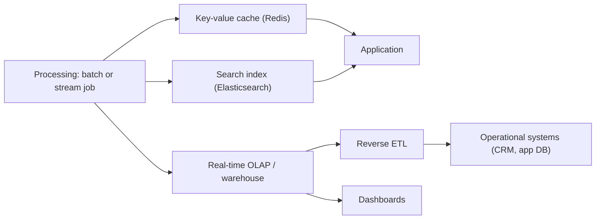

## 🎯 خلاصه

> **لایه‌ی serving** بخشی از پلتفرم داده است که داده‌ی پردازش‌شده را با تأخیری که لازم است به **اپلیکیشن‌ها و آدم‌ها** می‌رساند. پردازش جواب‌ها را می‌سازد؛ serving آن‌ها را سریع در دسترس مصرف‌کننده‌ی درست قرار می‌دهد.

- store را بر اساس الگوی دسترسی انتخاب کن: **lookup کلیدی** (Redis، یا یک store کلید-مقدار یا document)، **جستجو** (Elasticsearch / OpenSearch)، **داشبورد و تجمیع** (OLAP بلادرنگ یا انباره)، و **سیستم‌های عملیاتی** (reverse ETL به CRM یا دیتابیس اپ).
- تصمیم بگیر **چه چیزی را از پیش محاسبه کنی** (pre-aggregation) و **چه چیزی را لحظه‌ای**. محاسبه‌ی از پیش، تأخیر را می‌خرد و تازگی و storage را هزینه می‌کند.
- هر cache یا کپی به یک **سیاست invalidation و تازگی** نیاز دارد. بدون آن، لایه‌ی serving بی‌صدا با منبع اختلاف پیدا می‌کند.
- store سرویس، system of record نیست. داده‌ی خام و مسیر بازسازی را نگه دار.

## 🌱 از ساده شروع کنیم (مبتدی)

> **💡 تشبیه:** یک رستوران. **آشپزخانه** (پردازش) همه‌چیز را می‌پزد. **پیشخوان و تابلوی منو** (serving) تعیین می‌کنند مشتری چه چیزی، با چه سرعتی و در چه شکلی ببیند. کسی با رفتن داخل آشپزخانه سفارش نمی‌دهد.

فرض کن pipeline تو برای هر کاربر، مجموع خرج روزانه را حساب می‌کند. سه مصرف‌کننده‌ی متفاوت این را می‌خواهند:

- **اپ موبایل** «خرج امروز من» را زیر ۵۰ میلی‌ثانیه می‌خواهد. → یک store برای lookup کلیدی مثل Redis.
- **تیم پشتیبانی** کاربر را با نام، ایمیل یا شناسه‌ی سفارش جستجو می‌کند. → یک ایندکس جستجو مثل Elasticsearch.
- **داشبورد تحلیلی** خرج را به تفکیک شهر و ساعت برای میلیون‌ها کاربر نشان می‌دهد. → یک موتور OLAP.

همان داده، سه شکل. لایه‌ی serving مجموعه‌ی این شکل‌ها به‌علاوه‌ی jobهایی است که آن‌ها را همگام نگه می‌دارند.

شکل کلید-مقدار، با دستورهای سبک Redis در Python:

```python
import redis

r = redis.Redis(host="cache", port=6379, decode_responses=True)

# Key per user per day; the pipeline writes the pre-computed total
key = "spend:user:42:2026-01-01"
r.set(key, 1250)
r.expire(key, 60 * 60 * 24 * 7)   # keep 7 days, then let it expire

print(r.get(key))  # "1250" -> O(1) lookup, no SQL, no scan
```

## 🔧 واقعاً چطور کار می‌کند (متوسط)



**pre-aggregation در برابر محاسبه‌ی لحظه‌ای.**
- *Pre-aggregation*: job جواب را از قبل حساب می‌کند (`spend per user per day`) و serving یک lookup است. تأخیر قابل پیش‌بینی است و بار کم، ولی جواب فقط به اندازه‌ی آخرین اجرای job تازه است و فقط برای شکل‌هایی که پیش‌بینی کرده‌ای.
- *لحظه‌ای*: کوئری موقع درخواست، جواب را از داده‌ی جزئی حساب می‌کند. انعطاف‌پذیر و همیشه تازه، ولی تأخیر و هزینه به حجم داده و هم‌زمانی بستگی دارد.

یک قاعده‌ی عملی: سؤال‌های **کم، داغ و از پیش‌شناخته‌شده** (صفحه‌ی اصلی اپ، کاشی‌های اصلی داشبورد) را pre-aggregate کن، و سؤال‌های **زیاد، سرد و ad-hoc** را موقع درخواست حساب کن.

**Cache invalidation.** کپی Redis از یک fact وقتی منبع عوض می‌شود کهنه می‌شود. گزینه‌ها:
- **TTL**: مقدار بعد از N ثانیه منقضی می‌شود. ساده، کهنگی محدود، و چند miss.
- **Write-through / به‌روزرسانی رویدادمحور**: pipeline هر بار که منبع را عوض می‌کند کلید را به‌روز می‌کند (اغلب با رویدادهای [[cdc]] یا خروجی stream). تازه، ولی writer باید خطاهای نیمه‌کاره را هندل کند.
- **کلیدهای نسخه‌دار**: `spend:user:42:v37` را بنویس و یک pointer را جابه‌جا کن. برای بارگذاری batch که کل یک مجموعه را اتمیک جایگزین می‌کند خوب است.

هر انتخاب یک بودجه‌ی تازگی دارد (مثلاً «حداکثر ۵ دقیقه کهنه»). آن را بنویس و مانیتور کن.

**Reverse ETL.** نتیجه‌ی پردازش به یک سیستم عملیاتی برمی‌گردد، مثلاً یک فیلد CRM به نام «ارزش عمر مشتری»، تا فروش آن را در محلی که کار می‌کند ببیند. این هم serving است: مقصد یک مصرف‌کننده با محدودیت نرخ و حالت‌های خرابی خودش می‌شود، پس upsert idempotent با کلید شناسه‌ی کسب‌وکار بنویس.

## 🧠 عمق و trade-offها (سنیور)

- **SLO برای serving.** برای هر مصرف‌کننده تأخیر (p99)، تازگی (حداکثر سن داده) و دسترس‌پذیری را تعریف کن. داشبورد دقایقی کهنگی را تحمل می‌کند؛ تصمیم تقلب یا قیمت نمی‌کند. این عددها store را تعیین می‌کنند.
- **Redis به عنوان store سرویس.** سریع است چون داده در حافظه است. اندازه‌ی حافظه برای هر کلید، سیاست eviction (eviction کش بی‌صدا «پیدا نشد» برمی‌گرداند) و تنظیمات persistence را زیر نظر داشته باش. cache miss را مسیر عادی بدان، با fallback به منبع یا مقدار پیش‌فرض. کلیدهای داغ (یک کلید محبوب با ترافیک عظیم) به replication یا cache سمت کلاینت نیاز دارند؛ ببین [[hot-key]].
- **Elasticsearch به عنوان analytics، با محدودیت‌ها.** برای full-text search، فیلتر روی فیلدهای زیاد و رتبه‌بندی عالی است. به عنوان موتور تحلیلی هزینه‌های واقعی دارد: تجمیع روی فیلدهای با cardinality بالا حافظه‌ی زیادی مصرف می‌کند؛ join عمومی ندارد؛ داده بعد از یک refresh interval قابل جستجو می‌شود (نزدیک به بلادرنگ، نه فوری)؛ و dynamic mapping می‌تواند تعداد فیلدها را منفجر کند. آن را برای جستجو و تجمیع کوچک تا متوسط استفاده کن، و برای داشبوردهای سنگین یک موتور OLAP. پیش از نقل کردن مقادیر پیش‌فرض refresh یا حافظه، داک نسخه‌ات را چک کن.
- **سازگاری بین store‌ها.** یک رویداد ممکن است Redis، Elasticsearch و جدول OLAP را هم‌زمان به‌روز کند. اگر یک نوشتن شکست بخورد، از هم جدا می‌شوند. نوشتن‌های idempotent با یک شناسه‌ی پایدار و یک job مقایسه‌ی تعداد یا checksum برای آشتی لازم است. ببین [[pattern-reconciliation]].
- **قابلیت بازسازی.** store سرویس باید از lake یا event log قابل بازسازی باشد. اگر کلاستر Redis از بین برود، یک backfill باید بدون SQL دستی آن را برگرداند. این مسیر را تست کن.
- **امنیت و دامنه.** store‌های سرویس اغلب داده را به سرویس‌های زیادی نشان می‌دهند. دسترسی را برای هر مصرف‌کننده محدود کن و داده‌ی شخصی خام را در cacheهایی که بیشتر از کاربردشان عمر می‌کنند نگذار.
- **مانیتورینگ.** hit ratio و miss rate، p99 تأخیر، lag تازگی (زمان از آخرین به‌روزرسانی موفق)، evictionها و اندازه‌ی هر خانواده‌ی کلید.
- **کی لایه‌ی serving اضافه نکنی.** اگر یک کوئری انباره SLO داشبوردی را که ده تحلیلگر استفاده می‌کنند برآورده می‌کند، اضافه کردن Redis و Elasticsearch فقط باگ‌های همگام‌سازی اضافه می‌کند بدون سود.

## 🧪 امتحان کن

تیم محصول سه چیز از pipeline سفارش روزانه می‌خواهد:

۱. lookup وضعیت سفارش با `order_id` در اپ، زیر ۲۰ میلی‌ثانیه، با داده‌ای که بیشتر از ۱ دقیقه کهنه نیست.
۲. تیم پشتیبانی سفارش‌ها را بر اساس ایمیل مشتری و بخشی از نام محصول جستجو کند.
۳. داشبورد مدیریتی درآمد هفتگی به تفکیک دسته‌بندی برای دو سال اخیر.

برای هر کدام بگو: کدام store، pre-aggregated یا لحظه‌ای، و چطور تازه نگهش می‌داری.

<details><summary>راه‌حل را ببین</summary>

**۱.** یک store کلید-مقدار (Redis) با کلید `order:{order_id}`، که توسط یک stream job یا رویدادهای [[cdc]] از دیتابیس سفارش‌ها نوشته می‌شود. تازگی حدود ۱ دقیقه است، پس به‌روزرسانی رویدادمحور و یک TTL به عنوان پشتیبان لازم است. pre-aggregation لازم نیست: جواب یک رکورد است.

**۲.** یک ایندکس جستجو (Elasticsearch یا OpenSearch) با `customer_email` به عنوان فیلد keyword و `product_name` به عنوان فیلد text. ایندکس از همان جریان رویداد به‌روز می‌شود، با نوشتن‌های idempotent که با `order_id` کلیددار هستند. تأخیر چند ثانیه‌ای refresh در جستجو اینجا قابل قبول است.

**۳.** یک store ستونی OLAP یا انباره. `revenue by category by week` را در یک job روزانه pre-aggregate کن، چون مجموعه‌ی سؤال‌ها ثابت است و داشبورد زیاد خوانده می‌شود. دو سال سطر هفتگی به تفکیک دسته‌بندی جدول کوچکی است، پس ارزان است. جزئیات سفارش‌ها را برای سؤال‌های ad-hoc در دسترس نگه دار.

</details>

## 💬 گوشه‌ی مصاحبه

**سؤال: «این متریک‌ها را چطور به یک اپ رو به کاربر سرو می‌کنی؟»**
پاسخ متوسط: «متریک‌ها را در یک job batch از پیش حساب می‌کنم و در Redis ذخیره می‌کنم تا اپ سریع بخواند.»
پاسخ سنیور: «اول روی SLO توافق می‌کنم: تأخیر، تازگی و تحمل خرابی مصرف‌کننده. جواب‌های داغ و ثابت در یک store کلید-مقدار با به‌روزرسانی رویدادمحور و TTL پشتیبان می‌روند. سؤال‌های ad-hoc یا گسترده به یک موتور OLAP می‌روند. هر دو از lake قابل بازسازی‌اند و من تأخیر تازگی و hit ratio را مانیتور می‌کنم.»

**سؤال: «چرا Elasticsearch را برای همه‌ی analytics استفاده نکنیم؟»**
پاسخ متوسط: «برای تجمیع کند است.»
پاسخ سنیور: «برای جستجو و تجمیع‌های کوچک خوب کار می‌کند، ولی تجمیع با cardinality بالا پرحافظه است، join محدود است و نتایج نزدیک به بلادرنگ‌اند. برای داشبوردهای روی تاریخچه‌ی بزرگ از موتور OLAP استفاده می‌کنم و برای جستجو و فیلتر روی همان داده، Elasticsearch.»

> **🎤 این را در مصاحبه بگو:** «لایه‌ی serving درباره‌ی الگوهای دسترسی است. برای هر مصرف‌کننده یک store انتخاب می‌کنم، بر اساس SLO تصمیم می‌گیرم چه چیزی را از پیش حساب کنم، و هر کپی را چیزی با سیاست invalidation و مسیر بازسازی می‌دانم.»

## ⚠️ اشتباهات رایج

> **⚠️ توجه:** cache بدون سیاست invalidation. یک کلید Redis بدون TTL و بدون مسیر به‌روزرسانی، یک باگ داده‌ی بی‌صداست که ماه‌ها بعد ظاهر می‌شود.

> **⚠️ توجه:** رفتار با store سرویس به عنوان منبع حقیقت. وقتی از بین برود یا خراب شود، باید بتوانی بازسازی‌اش کنی.

- از پیش حساب کردن همه‌چیز «برای هر حالتی»، که storage و هزینه‌ی pipeline را ضرب می‌کند.
- رفتار با cache miss به عنوان خطا به جای مسیر عادی.
- انتخاب Elasticsearch برای analytics سنگین فقط چون از قبل در stack هست.
- فراموش کردن نوشتن idempotent، پس retryها مقدارهای تکراری یا ناسازگار می‌سازند.
- اندازه‌گیری فقط تأخیر و هرگز تازگی.

## ✅ خودت را بسنج

۱. کدام store برای یک اپ موبایل مناسب است که موجودی فعلی یک کاربر را زیر ۱۰ میلی‌ثانیه نیاز دارد؟
   - A) یک ایندکس full-text
   - B) یک store کلید-مقدار مثل Redis با کلید user id
   - C) یک انباره با scan کامل
   - D) یک فایل CSV روی object storage

<details><summary>جواب</summary>

**B** — الگوی دسترسی یک lookup تک‌کلیدی با هدف تأخیر کم است. store کلید-مقدار برای این شکل ساخته شده.

</details>

۲. اصلی‌ترین trade-off pre-aggregation در برابر محاسبه‌ی لحظه‌ای چیست؟

   - A) همیشه دقیق‌تر است
   - B) تأخیر و هزینه‌ی کوئری قابل پیش‌بینی و کم می‌دهد، ولی جواب‌ها فقط به اندازه‌ی آخرین job تازه‌اند و فقط برای شکل‌های پیش‌بینی‌شده
   - C) نیاز به storage را از بین می‌برد
   - D) join را غیرضروری می‌کند

<details><summary>جواب</summary>

**B** — pre-aggregation کار را به pipeline منتقل می‌کند. تأخیر و هزینه را می‌گیری و تازگی و انعطاف را می‌دهی.

</details>

۳. یک مقدار cache شده ساعت‌ها بعد از تغییر منبع هنوز غلط است. کدام سیاست مستقیم‌ترین پاسخ است؟

   - A) افزایش حافظه‌ی Redis
   - B) یک TTL، یا به‌روزرسانی رویدادمحور که با تغییرات منبع فعال می‌شود
   - C) تغییر نام کلید
   - D) حذف ایندکس روی `user_id`

<details><summary>جواب</summary>

**B** — TTL کهنگی را محدود می‌کند و به‌روزرسانی رویدادمحور cache را با تغییرات هماهنگ نگه می‌دارد. حافظه و نام کلید روی درستی تأثیری ندارند.

</details>

۴. **(سنیور)** چرا تجمیع terms در Elasticsearch روی فیلدی با ده‌ها میلیون مقدار متمایز در لایه‌ی serving ریسکی است؟

   - A) Elasticsearch نمی‌تواند رشته ذخیره کند
   - B) تجمیع با cardinality بالا حافظه‌ی زیادی روی نودها مصرف می‌کند و زیر بار هم‌زمان داشبورد می‌تواند کل کلاستر را ناپایدار کند
   - C) تجمیع برای فیلدهای keyword غیرفعال است
   - D) refresh interval سطل‌های تجمیع را حذف می‌کند

<details><summary>جواب</summary>

**B** — هر مقدار متمایز به state سطل نیاز دارد و این با cardinality رشد می‌کند. زیر هم‌زمانی، فشار حافظه کل کلاستر را اذیت می‌کند. pre-aggregate کن یا کوئری را به موتور OLAP ببر.

</details>

۵. **(سنیور)** یک job reverse ETL هر ساعت یک فیلد «ارزش عمر مشتری» را به CRM می‌فرستد. بعد از retry، فروش رکوردهای تکراری گزارش می‌کند. اصلاح طراحی درست چیست؟

   - A) job را کمتر اجرا کن
   - B) نوشتن را یک upsert idempotent با کلید شناسه‌ی پایدار کسب‌وکار کن
   - C) کلید API بیشتری به CRM اضافه کن
   - D) مقدار را فقط در یک CSV ذخیره کن

<details><summary>جواب</summary>

**B** — با upsert idempotent روی شناسه‌ی پایدار، retry همان رکورد را بازنویسی می‌کند به جای ساختن رکورد جدید. تعداد دفعات اجرا تکرار را حل نمی‌کند، چون retry همچنان رخ می‌دهد.

</details>

## 🗂️ فلش‌کارت

| Front | Back |
|---|---|
| لایه‌ی serving | store‌ها و jobهایی که داده‌ی پردازش‌شده را با تأخیر لازم به اپ و آدم‌ها می‌رسانند |
| Pre-aggregation | جواب را از قبل حساب کن؛ serving می‌شود یک lookup |
| محاسبه‌ی لحظه‌ای | جواب را موقع درخواست از داده‌ی جزئی حساب کن |
| Cache invalidation | سیاستی که کپی را با منبعش هم‌سو نگه می‌دارد: TTL، به‌روزرسانی رویدادمحور، کلید نسخه‌دار |
| Reverse ETL | برگرداندن داده‌ی پردازش‌شده به سیستم‌های عملیاتی |
| SLO تازگی | حداکثر سن قابل قبول داده‌ای که یک مصرف‌کننده می‌خواند |
| محدودیت Elasticsearch | refresh نزدیک به بلادرنگ، بدون join عمومی، هزینه‌ی حافظه‌ی تجمیع با cardinality بالا |
| قابلیت بازسازی | store سرویس بدون کار دستی از lake یا event log برمی‌گردد |

## 🔗 ادامه

- [[pattern-serving]] — الگوی serving با جزئیات بیشتر و گزینه‌های پیاده‌سازی.
- [[realtime-olap]] — store‌ای که وقتی داشبوردها تجمیع تازه با هم‌زمانی زیاد لازم دارند انتخاب می‌شود.
- [[cdc]] — منبع رایج به‌روزرسانی رویدادمحور برای store‌های serving.
- [[pattern-reconciliation]] — چطور انحراف بین store‌ها را پیدا و تعمیر کنی.
