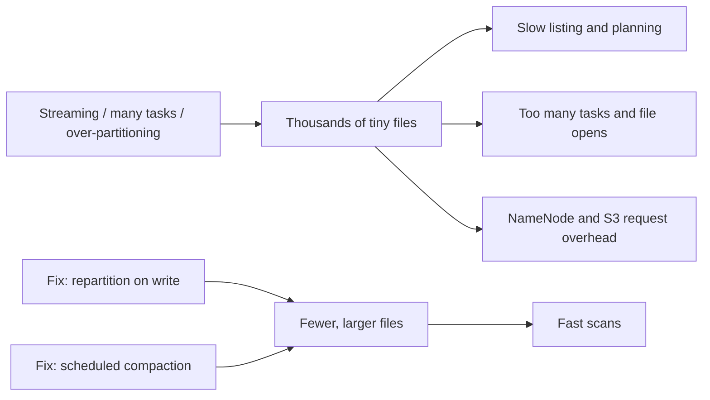

## 🎯 خلاصه

> **مشکل فایل‌های کوچک (small files problem):** جدولی که از هزاران یا میلیون‌ها فایل ریز (از چند کیلوبایت تا چند مگابایت) ساخته شده، حتی وقتی حجم کل داده کم است، لیست‌کردن، برنامه‌ریزی و خواندنش کند است.

- هزینه **به‌ازای هر فایل** است، نه به‌ازای هر بایت: هر فایل نیاز به جست‌وجوی metadata، یک ورودی در listing، یک بار open و معمولاً یک task دارد.
- علت‌های رایج: partition زیاد، تعداد زیاد writer task، و jobهای streaming یا micro-batch که خیلی‌خیلی زود commit می‌کنند.
- راه‌حل‌ها: فایل کمتر و بزرگ‌تر بنویس، فایل‌های موجود را ادغام کن (compaction)، و از یک table format استفاده کن که فایل‌ها را برایت دنبال کند.

## 🌱 از ساده شروع کنیم (مبتدی)

> **💡 تشبیه:** فرض کن باید ۱۰۰۰ کتاب را جابه‌جا کنی. می‌توانی همه را در یک جعبه‌ی بزرگ ببری، یا هر کتاب را در یک جعبه‌ی جدا. وزن کل یکی است، اما روش دوم ۱۰۰۰ برابر برچسب‌زدن، بلندکردن و بازرسی دارد.

یک data lake هم همین مشکل را دارد. فرض کن داده‌ی یک روز ۱۰ گیگابایت است. اگر آن را ۱۰ فایل ۱ گیگابایتی ذخیره کنی، کوئری ۱۰ فایل را باز می‌کند. اگر ۱۰۰٬۰۰۰ فایل ۱۰۰ کیلوبایتی باشد، همان کوئری باید:

۱. ۱۰۰٬۰۰۰ نام فایل را از storage بگیرد،
۲. ۱۰۰٬۰۰۰ فایل را باز کند (هر open روی S3 یا HDFS یک رفت‌وبرگشت شبکه است)،
۳. از هر فایل footer و metadata را بخواند،
۴. برای هر فایل یک کار زمان‌بندی کند.

بایت‌ها یکی‌اند، اما سربار یکی نیست.

```text
همان ۱۰ گیگابایت، دو چیدمان

  events/dt=2026-10-12/
    part-00000.parquet   1.0 GB     <- ۱۰ فایل: سریع
    ...
    part-00009.parquet   1.0 GB

  events/dt=2026-10-12/
    part-000000.parquet  100 KB     <- ۱۰۰٬۰۰۰ فایل: کند
    ...
    part-099999.parquet  100 KB
```

یک قاعده‌ی سرانگشتی که خیلی از تیم‌ها استفاده می‌کنند این است که برای فرمت‌های ستونی مثل Parquet حدود **۱۲۸ مگابایت تا ۱ گیگابایت** برای هر فایل هدف بگیرند. عدد دقیق به موتور و storage بستگی دارد، پس آن را نقطه‌ی شروع بدان و اندازه‌گیری کن.

## 🔧 واقعاً چطور کار می‌کند (متوسط)

### فایل‌های کوچک از کجا می‌آیند؟

Spark برای هر **task، به‌ازای هر مقدار partition خروجی** یک فایل می‌نویسد. اگر job ـی ۲۰۰ task داشته باشد و با `partitionBy("dt")` روی ۳۶۵ تاریخ بنویسی، هر task که سطر برای یک تاریخ دارد، فایل جدا برای آن تاریخ می‌نویسد. بدترین حالت:

```text
tasks x distinct partition values = files
200 tasks x 365 dates            = up to 73,000 files for one write
```

عدد ۲۰۰ از `spark.sql.shuffle.partitions` می‌آید (پیش‌فرض ۲۰۰ در Spark SQL، قبل از تغییرات adaptive). اگر هر task فقط چند سطر برای هر تاریخ داشته باشد، هر کدام از آن ۷۳٬۰۰۰ فایل خیلی کوچک است.

منبع‌های رایج دیگر:

- **partition بیش‌ازحد.** partition زدن بر اساس ساعت، user id، یا هر ستون با cardinality بالا، پوشه‌های زیادی می‌سازد که داخلشان داده‌ی کمی است.
- **Streaming و micro-batch.** jobی که هر دقیقه commit می‌کند، در روز برای هر partition ۱٬۴۴۰ فایل کوچک می‌سازد.
- **آپلودهای ریز زیاد.** ابزارهای ingestion که برای هر رکورد یا هر صفحه‌ی API یک object می‌نویسند.
- **jobهای شکست‌خورده یا تکرارشده.** retry و speculative task خروجی‌های نیمه‌کاره باقی می‌گذارند که باید پاک شوند.

### راه‌حل در زمان نوشتن

تعداد taskهایی را که هر partition را می‌نویسند کنترل کن:

```python
from pyspark.sql import functions as F

# Bad: each of the 200 tasks writes a file for every date it holds
df.write.partitionBy("dt").parquet("s3a://lake/events")

# Better: send all rows of one date to one task, so one file per date
df.repartition("dt").write.partitionBy("dt").parquet("s3a://lake/events")

# Fixed file count for an unpartitioned output (no shuffle, but uneven sizes)
df.coalesce(16).write.parquet("s3a://lake/events_flat")
```

- `repartition(cols)` یک **shuffle** اضافه می‌کند: هزینه‌ی شبکه و زمان دارد، اما فایل‌های یکنواخت و قابل‌پیش‌بینی می‌دهد.
- `coalesce(n)` بدون shuffle partitionهای موجود را ادغام می‌کند. ارزان است، اما ممکن است stage بالادستی را با taskهای کمتری اجرا کند و اندازه‌ی فایل‌های خروجی نامساوی باشد.
- Adaptive Query Execution (AQE) می‌تواند هنگام اجرا shuffle partitionهای کوچک را ادغام کند، که مشکل taskهای ریز را کم می‌کند. تنظیمات دقیق را در مستندات نسخه‌ی خودت چک کن.

### راه‌حل برای داده‌ی موجود: compaction

Compaction فایل‌های کوچک زیادی را می‌خواند و دوباره به صورت تعداد کمتری فایل بزرگ می‌نویسد. در Hive یا Spark روی یک پوشه‌ی ساده، این یک job است که یک partition را می‌خواند، با `coalesce` دوباره می‌نویسد و نتیجه را جای قبلی می‌گذارد. table formatها این کار را امن و استاندارد می‌کنند:

- **Delta Lake** دستور `OPTIMIZE` دارد.
- **Apache Iceberg** رویه‌های rewrite مثل `rewrite_data_files` دارد.
- **Apache Hudi** امکانات clustering و compaction دارد.

این‌ها به‌صورت نگه‌داری زمان‌بندی‌شده اجرا می‌شوند، نه درون هر نوشتن.



## 🧠 عمق و trade-offها (سنیور)

- **حافظه‌ی NameNode در HDFS.** در HDFS، هر فایل و هر block یک object در حافظه‌ی NameNode است. میلیون‌ها فایل ریز، heap این NameNode را برای داده‌ی تقریباً صفر مصرف می‌کنند و NameNode به گلوگاه تبدیل می‌شود. به همین دلیل این مشکل در شرکت‌های Hadoop به این اسم شناخته شد. قبل از نقل‌کردن عدد دقیق هزینه‌ی هر object، برای نسخه‌ی Hadoop خودت چک کن.
- **هزینه‌ی request در object storage.** روی S3 و مشابه‌هایش، هزینه و تأخیر به‌ازای هر request است. listing یک prefix با میلیون‌ها key صفحه‌بندی‌شده و کند است. jobی که ۱۰۰٬۰۰۰ object کوچک را باز می‌کند، برای ۱۰۰٬۰۰۰ GET و تأخیر هرکدام هزینه می‌دهد، حتی اگر حجم بایت‌ها ناچیز باشد.
- **برنامه‌ریزی در Hive و Spark.** موتورها splitها را از روی اندازه‌ی فایل می‌سازند. فایل‌های زیاد یعنی splitهای زیاد، که هرکدام سربار راه‌اندازی دارند. Spark با تنظیماتی مثل `spark.sql.files.maxPartitionBytes` و `spark.sql.files.openCostInBytes` فایل‌های کوچک را در taskهای کمتری قرار می‌دهد. این‌ها خواندن را بهتر می‌کنند، ولی چیدمان storage را درست نمی‌کنند.
- **trade-off در streaming.** کمتر commit کردن یعنی فایل بزرگ‌تر، اما تأخیر بیشتر. الگوی رایج این است که stream با فاصله‌ی کوتاه داخل یک staging بنویسد و هر ساعت یا هر روز compaction را وارد جدول اصلی کند. اول هدف تازگی داده را تعیین کن، بعد زمان‌بندی compaction را.
- **compaction رایگان نیست.** بازنویسی فایل‌ها هزینه‌ی compute دارد و ممکن است با writerهای همزمان تداخل کند. table formatها با optimistic concurrency این را مدیریت می‌کنند، ولی هنوز به زمان‌بندی و مانیتور نیاز داری. تعداد فایل و میانگین اندازه‌ی فایل در هر partition را به‌عنوان metric دنبال کن.
- **کجا نجنگی.** جدولی با چند صد فایل بزرگ مشکلی ندارد. برای داده‌ی کوچک که کم کوئری می‌شود، pipeline کردن compaction لازم نیست. همچنین partition را آن‌قدر ریز نکن که هر partition از اندازه‌ی هدف فایل کوچک‌تر باشد.

## 🧪 امتحان کن

یک Spark session محلی (PySpark نسخه‌ی ۳.x یا بالاتر) و یک پوشه‌ی محلی استفاده کن، نه S3.

۱. ۱ میلیون سطر کوچک با ستون `dt` که ۳۰ مقدار دارد بساز. با `partitionBy("dt")` بنویس و تعداد فایل‌های هر پوشه را بشمار. بعد دوباره با `repartition("dt")` بنویس و تعداد فایل‌ها را مقایسه کن.
۲. همان داده را با `coalesce(4)` بنویس و اندازه‌ی فایل‌ها را چک کن. توضیح بده چرا بعضی فایل‌ها بزرگ‌ترند.
۳. سناریو: یک stream هر ۶۰ ثانیه داخل `events/dt=.../hr=...` commit می‌کند. دو تغییر پیشنهاد بده که تعداد فایل‌ها در روز را کم کند، بدون اینکه داده بیش از یک ساعت دیر برسد.

<details><summary>Show solutions</summary>

**۱.** بدون repartition، تعداد فایل برای هر `dt` تقریباً برابر تعداد taskهایی است که سطر آن تاریخ را دارند (برای داده‌ی پهن اغلب نزدیک تعداد shuffle partitionها). با `repartition("dt")` هر تاریخ به یک task می‌رسد، پس باید تقریباً یک فایل در هر پوشه ببینی. اعداد دقیق به چیدمان داده و تنظیمات محلی بستگی دارد.

**۲.** `coalesce` شافل (shuffle) نمی‌کند. هر یک از ۴ task خروجی همان partitionهای ورودی‌ای را می‌گیرد که به آن رسیده، پس اندازه‌ها فرق دارند اگر partitionهای ورودی نامساوی باشند. `repartition(4)` اندازه‌های یکنواخت‌تر می‌دهد، به قیمت یک shuffle.

**۳.** دو تغییر: (الف) partitionهای ساعتی به‌جای partitionهای دقیقه‌ای بنویس، یا داده‌ی دقیقه‌ای را در یک مسیر staging نگه دار و هر ساعت در پوشه‌ی `hr=` compaction کن؛ (ب) فاصله‌ی commit را فقط جایی زیاد کن که تأخیر اجازه می‌دهد، یا قبل از sink با `coalesce` تعداد taskهای هر micro-batch را کم کن. در هر صورت برای ساعتی که تازه بسته شده یک job compaction زمان‌بندی کن.

</details>

## 💬 گوشه‌ی مصاحبه

**سؤال: «یک job ‏Spark تو هزاران فایل Parquet ریز می‌نویسد. چرا بد است و چه می‌کنی؟»**

- **جواب متوسط:** «هر فایل metadata و سربار task اضافه می‌کند، پس خواندن کند می‌شود. قبل از نوشتن روی ستون partition یک `repartition` می‌گذارم و برای فایل‌های موجود یک job compaction اجرا می‌کنم.»
- **جواب سنیور:** «هزینه به‌ازای هر فایل است: object در NameNode روی HDFS، تأخیر و هزینه‌ی request روی S3، و یک task یا split برای هر فایل موقع خواندن. اول علت را پیدا می‌کنم: shuffle partitionهای زیاد، کلید partition خیلی ریز، یا فاصله‌ی commit در streaming. راه‌حل نوشتن `repartition` روی کلید partition است تا هر partition یک writer داشته باشد. برای داده‌ی انباشته، compaction با table format را زمان‌بندی می‌کنم و تعداد فایل و میانگین اندازه را به‌عنوان metric دنبال می‌کنم تا قبل از کندشدن کوئری‌ها مشکل دیده شود.»

> **🎤 این را در مصاحبه بگو:** «small files یک مشکل سربار به‌ازای هر فایل است، نه مشکل حجم بایت‌ها. در زمان نوشتن کنترل می‌کنم چند task هر partition را می‌نویسد، و برای داده‌ی انباشته از compaction روی یک table format استفاده می‌کنم.»

## ⚠️ اشتباهات رایج

> **⚠️ هشدار:** `coalesce(1)` روی داده‌ی بزرگ کل نوشتن را در یک task می‌گذارد. یک فایل می‌گیری، اما یک task کند و احتمالاً خطای out-of-memory. عددی انتخاب کن که با اندازه‌ی فایل هدف جور باشد.

- partition زدن روی ستونی با cardinality بالا (user id، order id). فقط وقتی استفاده کن که تعداد مقادیرش کم باشد.
- فکر کردن به این‌که `partitionBy` به‌تنهایی فایل‌های خوب می‌سازد. فقط داده را بر اساس مقدار تقسیم می‌کند؛ تعداد فایل هنوز به تعداد task بستگی دارد.
- compaction با کپی‌کردن فایل‌ها به پوشه‌ی جدید بدون swap اتمیک. خوانندگان ممکن است داده‌ی نیمه‌نوشته ببینند. از table format یا commit protocol استفاده کن.
- فراموش‌کردن retry. اجرای دوباره بدون پاک‌کردن مسیر خروجی ممکن است فایل تکراری باقی بگذارد.
- فقط حجم کل را اندازه‌گیری کردن. همیشه تعداد فایل و میانگین اندازه‌ی فایل را هم چک کن.

## ✅ خودت را بسنج

۱. یک job Spark با ۲۰۰ shuffle partition داده را با `partitionBy("dt")` برای ۳۶۵ تاریخ می‌نویسد. کدام گزاره دقیق‌ترین است؟
   - A) دقیقاً ۳۶۵ فایل می‌نویسد.
   - B) ممکن است تا ۷۳٬۰۰۰ فایل بنویسد، چون هر task ممکن است برای هر تاریخی که دارد یک فایل بنویسد.
   - C) یک فایل برای هر executor می‌نویسد.
   - D) تعداد فایل به تعداد task بستگی ندارد.

۲. کدام تغییر، با یک shuffle، مستقیم‌ترین کاهش تعداد فایل را برای همان داده می‌دهد؟
   - A) `df.coalesce(1)`
   - B) `df.repartition("dt")` قبل از `partitionBy("dt")`
   - C) افزایش اندازه‌ی row group در Parquet
   - D) استفاده از CSV به‌جای Parquet

۳. سناریو: یک جدول ۲ میلیون فایل ۵۰ کیلوبایتی در S3 دارد. کدام اولین قدم بهتر است؟
   - A) حذف قدیمی‌ترین فایل‌ها.
   - B) زمان‌بندی compaction (مثلاً rewrite با table format) و دنبال‌کردن تعداد فایل و میانگین اندازه.
   - C) اضافه‌کردن executor به job خواندن.
   - D) انتقال داده به دیسک محلی.

۴. **سنیور:** چرا `coalesce` برای نوشتن می‌تواند ارزان‌تر از `repartition` باشد، و کی هنوز `repartition` را انتخاب می‌کنی؟
   - A) `coalesce` همیشه سریع‌تر است، پس همیشه از آن استفاده کن.
   - B) `coalesce` از shuffle جلوگیری می‌کند اما ممکن است فایل‌های نامساوی و taskهای بالادستی کمتری بدهد؛ وقتی اندازه‌های یکنواخت لازم است و هزینه‌ی shuffle قابل قبول است، `repartition` را انتخاب کن.
   - C) `repartition` فقط CSV می‌نویسد.
   - D) در هر حالتی کاملاً یکسان‌اند.

۵. **سنیور:** یک stream هر دقیقه داخل partitionهای ساعتی commit می‌کند. اصلی‌ترین trade-off کم‌تر commit کردن چیست؟
   - A) فایل‌های بزرگ‌تر و commit کمتر، اما تأخیر بیشتر در داده.
   - B) فایل‌های کوچک‌تر و تأخیر کمتر.
   - C) بدون تغییر در اندازه‌ی فایل.
   - D) همیشه ردیف تکراری ساخته می‌شود.

<details><summary>Answer</summary>

**۱ — B.** هر task برای هر تاریخی که سطر دارد یک فایل می‌نویسد، پس جمع کل می‌تواند به تعداد task ضربدر تعداد تاریخ برسد (۲۰۰ × ۳۶۵ = ۷۳٬۰۰۰ در بدترین حالت). A غلط است چون فایل‌ها یکی‌به‌ازای‌هر تاریخ نیستند.

**۲ — B.** `repartition("dt")` هر تاریخ را به یک task می‌فرستد، پس هر partition یک writer دارد. `coalesce(1)` یک task بسیار بزرگ می‌سازد، و CSV یا اندازه‌ی row group تعداد فایل را تغییر نمی‌دهد.

**۳ — B.** مشکل از قبل روی دیسک است، پس بازنویسی (compaction) راه‌حل است. حذف داده (A) داده را از دست می‌دهد و executor بیشتر (C) تعداد open فایل‌ها را بیشتر می‌کند.

**۴ — B.** `coalesce` بدون shuffle partitionها را ادغام می‌کند که ارزان‌تر است، اما ممکن است اندازه‌های نامساوی ورودی را نگه دارد و تعداد taskهای بالادستی را کم کند. `repartition` هزینه‌ی shuffle دارد ولی خروجی یکنواخت می‌دهد.

**۵ — A.** commit کمتر و بزرگ‌تر یعنی فایل‌های بزرگ‌تر و سربار کمتر، اما داده دیرتر قابل‌دیدن می‌شود. انتخاب فاصله‌ی commit یک تصمیم بین تأخیر و تعداد فایل است.

</details>

## 🗂️ فلش‌کارت

| Front | Back |
|---|---|
| مشکل فایل‌های کوچک چیست؟ | فایل‌های ریز زیاد، خواندن و نوشتن را کند می‌کنند، حتی وقتی حجم کل کم است. هزینه به‌ازای هر فایل است. |
| چرا تعداد فایل به تعداد task بستگی دارد؟ | Spark برای هر task و هر مقدار partition که دارد یک فایل می‌نویسد. |
| compaction چیست؟ | بازنویسی فایل‌های کوچک زیاد به فایل‌های بزرگ‌تر و کمتر، معمولاً به‌عنوان نگه‌داری زمان‌بندی‌شده. |
| `repartition(col)` چه تغییری می‌دهد؟ | با shuffle، هر مقدار `col` به یک task می‌رود، پس تقریباً یک فایل به‌ازای هر مقدار. |
| `coalesce(n)` چه تغییری می‌دهد؟ | بدون shuffle به n partition ادغام می‌کند؛ اندازه‌ها ممکن است نامساوی باشد. |
| چرا HDFS به فایل کوچک حساس است؟ | هر فایل و هر block یک object در حافظه‌ی NameNode است. |
| کدام table formatها compaction دارند؟ | Delta Lake (`OPTIMIZE`)، Iceberg (رویه‌های rewrite)، Hudi (clustering و compaction). |
| چه چیزی را باید مانیتور کرد؟ | تعداد فایل، میانگین اندازه‌ی فایل، و تعداد فایل کوچک در هر partition. |

## 🔗 ادامه

- [[spark-writes]] توضیح می‌دهد Spark خروجی را چطور commit می‌کند، که تعیین می‌کند بازنویسی امن است یا نه.
- [[lakehouse-table-formats]] نشان می‌دهد table formatها چطور فایل‌ها را دنبال می‌کنند و compaction را اتمیک می‌کنند.
- [[small-files-problem]] مدخل واژه‌نامه برای یادآوری سریع است.
- [[file-layout]] نشان می‌دهد چیدمان پوشه و فایل چطور روی برنامه‌ریزی کوئری اثر می‌گذارد.
