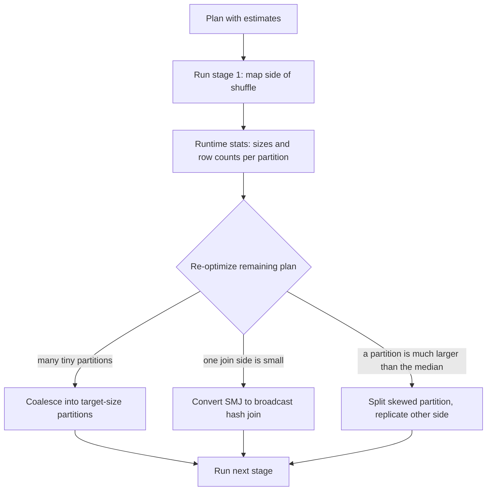

## 🎯 خلاصه

> **Adaptive Query Execution (AQE)** به Spark اجازه می‌دهد physical plan را **همان موقع که کوئری اجرا می‌شود** عوض کند، با استفاده از اندازه‌ی واقعی خروجی shuffleهایی که تازه تولید شده‌اند، نه با تخمین‌هایی که قبل از شروع job داشت.

- AQE در **مرزهای shuffle** (query stageها) دوباره برنامه‌ریزی می‌کند. وقتی یک stage تمام می‌شود، Spark اندازه و تعداد ردیف دقیق خروجی‌اش را می‌داند و مراحل بعدی را دوباره تصمیم می‌گیرد.
- سه کار اصلی: **coalesce** کردن partitionهای کوچک shuffle به تعداد کمتر و بزرگ‌تر؛ **تبدیل** sort-merge join به broadcast join وقتی یک طرف کوچک از کار درآمد؛ و **تقسیم** partitionهای skewed در join.
- **Dynamic partition pruning (DPP)** از کلیدهای یک dimension کوچک و فیلترشده در زمان اجرا استفاده می‌کند تا partitionهای یک fact table بزرگ را رد کند.
- AQE در نسخه‌های جدید Spark 3.x به‌صورت پیش‌فرض روشن است. نمی‌تواند شکل بد کوئری یا فیلتر جاافتاده را درست کند، و برای skew داخل یک کلید تکی که broadcast هم نمی‌تواند جذبش کند کاری نمی‌کند.

## 🌱 از ساده شروع کنیم (مبتدی)

> **💡 تشبیه:** برای یک سفر جاده‌ای با نقشه‌ای که ماه قبل چاپ شده برنامه‌ریزی کرده‌ای. نیمه‌راه می‌شنوی پل بسته شده و جاده‌ی دیگر خالی است. راننده‌ی خوب در اولین چهارراه مسیر را عوض می‌کند، نه این‌که تا آخر طبق نقشه برود. AQE همان راننده است: در هر چهارراه (هر shuffle) ترافیک واقعی را می‌بیند و تنظیم می‌کند.

قبل از AQE، Spark plan را بر اساس **تخمین** انتخاب می‌کرد. تخمین‌ها اغلب اشتباه‌اند، به‌خصوص بعد از join و فیلترهای روی داده‌ای که آمار ندارد. نشانه‌ی رایج: optimizer یک sort-merge join انتخاب می‌کند چون فکر می‌کند جدولی ۵۰۰ مگابایت است، ولی بعد از فیلتر فقط ۲۰ مگابایت است و broadcast join خیلی ارزان‌تر بود.

اثر آن را در یک خط کد می‌بینی:

```python
spark.conf.set("spark.sql.adaptive.enabled", "true")  # در نسخه‌های جدید 3.x پیش‌فرض true است

df = spark.table("orders").join(spark.table("customers"), "customer_id")
df.explain()
```

plan با `AdaptiveSparkPlan isFinalPlan=false` شروع می‌شود. بعد از اجرای یک action، `df.explain()` plan نهایی را با `isFinalPlan=true` نشان می‌دهد که شامل انتخاب‌هایی است که AQE واقعاً انجام داده. موقع debug این دو را کنار هم مقایسه کن.

## 🔧 واقعاً چطور کار می‌کند (متوسط)

یک job در Spark در هر shuffle به **stage** تقسیم می‌شود. AQE از همین نقاط برش استفاده می‌کند:



**تنظیمات اصلی** (پیش‌فرض‌های Spark 3.x؛ نسخه‌ی خودت را چک کن):

| تنظیم | پیش‌فرض | کار |
|---|---|---|
| `spark.sql.adaptive.enabled` | `true` (از Spark 3.2) | روشن کردن AQE |
| `spark.sql.adaptive.coalescePartitions.enabled` | `true` | ادغام partitionهای پشت‌سرهم و کوچک shuffle |
| `spark.sql.adaptive.advisoryPartitionSizeInBytes` | 64 MB | اندازه‌ی هدف برای coalesce و برای تقسیم skew |
| `spark.sql.adaptive.skewJoin.enabled` | `true` | تقسیم partitionهای skewed در sort-merge و shuffled hash join |
| `spark.sql.adaptive.localShuffleReader.enabled` | `true` | خواندن محلی داده‌ی shuffle وقتی بعد از تبدیل به broadcast نیازی به repartition نیست |
| `spark.sql.autoBroadcastJoinThreshold` | 10 MB | حداکثر اندازه‌ای که جدول broadcast می‌شود (برنامه‌ریزی ایستا) |

**Coalescing.** اغلب `spark.sql.shuffle.partitions` را عدد بزرگی مثل ۲۰۰۰ می‌گذاری تا روزهای پرحجم سال spill نکنند. بیشتر روزها داده کم است و ۲۰۰۰ partition یعنی ۲۰۰۰ task ریز. AQE همسایه‌های کوچک را ادغام می‌کند تا به اندازه‌ی توصیه‌شده برسند، پس stage بعدی تعداد taskهای معقولی دارد. مقدار تنظیم‌شده را **سقف** در نظر بگیر، نه هدف.

**تبدیل join.** بعد از تمام شدن سمت map یک shuffle، Spark اندازه‌ی واقعی هر ورودی join را می‌داند. اگر یک طرف زیر آستانه‌ی broadcast باشد، sort-merge join با broadcast hash join عوض می‌شود. طرف بزرگ اصلاً shuffle نمی‌شود و گران‌ترین بخش job حذف می‌شود. `localShuffleReader` وقتی نیاز به repartition نیست، از shuffle دوم برای طرف بزرگ جلوگیری می‌کند.

**رفع skew.** برای sort-merge یا shuffled hash join، یک partition وقتی skewed حساب می‌شود که خیلی بزرگ‌تر از partition میانه و بالاتر از یک حداقل اندازه باشد. AQE آن را به چند زیرpartition تقسیم می‌کند و partitionهای متناظر طرف دیگر را تکرار می‌کند، پس کار بین چند task پخش می‌شود. فاکتور و آستانه قابل تنظیم‌اند (`spark.sql.adaptive.skewJoin.*`)؛ برای نسخه‌ی خودت در مستندات نگاه کن.

**Dynamic partition pruning.** یک fact table را در نظر بگیر که با `sale_date` partition شده و با یک dimension تاریخ فیلترشده join می‌شود:

```sql
SELECT f.product_id, SUM(f.amount) AS total
FROM sales f                              -- partitioned by sale_date
JOIN dim_date d ON f.sale_date = d.date_key
WHERE d.year = 2026 AND d.month = 10
GROUP BY f.product_id;
```

بدون DPP، Spark همه‌ی partitionهای `sale_date` در `sales` را اسکن می‌کند و بعد فیلتر می‌زند. با DPP، Spark ابتدا طرف کوچک فیلترشده (`dim_date`) را ارزیابی می‌کند، مقادیر `date_key` مطابق را جمع می‌کند و به‌عنوان **فیلتر زمان‌اجرا** روی partitionهای `sales` استفاده می‌کند. فقط partitionهای اکتبر خوانده می‌شوند. DPP وقتی کار می‌کند که کلید join همان ستون partition در طرف بزرگ باشد، طرف فیلترشده برای broadcast یا محاسبه‌ی ارزان کافی کوچک باشد، و join از نوع equi-join باشد.

**کارهایی که AQE نمی‌کند.** فقط در مرزهای shuffle عمل می‌کند، پس stage اول را نمی‌تواند عوض کند. یک کلید تکی که سطرهایش قابل تقسیم نیستند را نمی‌تواند تقسیم کند (مثلاً کلید skewed در aggregation که هنوز salting یا aggregation دو مرحله‌ای لازم دارد). منطق کسب‌وکار کوئری را هم بازنویسی نمی‌کند.

## 🧠 عمق و trade-offها (سنیور)

- **مرزهای stage تأخیر دارند.** برنامه‌ریزی دوباره منتظر تمام شدن stage می‌ماند، پس AQE یک هزینه‌ی هماهنگی کوچک برای هر stage اضافه می‌کند. برای کوئری‌های خیلی کوتاه با stageهای زیاد این سربار دیده می‌شود؛ بیشتر jobهای ETL دسته‌ای بیشتر از این سود می‌برند.
- **تخمین هنوز در شروع مهم است.** stage اول با تخمین ایستا برنامه‌ریزی می‌شود. آمار خوب جدول (`ANALYZE TABLE ... COMPUTE STATISTICS`)، فرمت ستونی و partitioning معقول به تصمیم‌های اولیه شانس درست بودن می‌دهد. AQE اشتباه‌ها را اصلاح می‌کند؛ جای چیدمان خوب را نمی‌گیرد.
- **تصمیم broadcast بعد از واقعیت گران می‌تواند باشد.** broadcast لازم دارد طرف کوچک در حافظه‌ی هر executor جا شود (درایور اول آن را جمع می‌کند). AQE فقط وقتی سوئیچ می‌کند که اندازه‌ی زمان‌اجرا زیر آستانه باشد، ولی آستانه باید با تنظیمات حافظه‌ات هماهنگ باشد. بالابردن زیاد `autoBroadcastJoinThreshold` یکی از علت‌های کلاسیک OOM در درایور یا executor است. ببین [[broadcast-join]].
- **AQE skew را کامل حل نمی‌کند.** تقسیم یک partition skewed فقط وقتی کمک می‌کند که join بتواند طرف دیگر را تکرار کند. کلید داغی که در هر دو طرف خیلی بزرگ است، یا `GROUP BY` skewed، هنوز نیاز به راه‌حل در سطح برنامه دارد: salting، pre-aggregation، یا جداکردن کلیدهای داغ. ببین [[data-skew]] و [[hot-key]].
- **تعداد partition و چیدمان فایل روی هم اثر دارند.** coalesce نمی‌تواند partitionها را بین فایل‌های خروجی‌ای که می‌نویسی ادغام کند. jobی که ۲۰۰۰ فایل ۱ مگابایتی می‌نویسد هنوز فایل ریز تولید می‌کند؛ قبل از نوشتن یک repartition یا مرحله‌ی compaction اضافه کن. ببین [[small-files-problem]].
- **Debug.** در Spark UI تب SQL را ببین: plan نهایی گره‌های جایگزین‌شده را نشان می‌دهد (مثلاً `BroadcastHashJoin` به‌جای `SortMergeJoin`)، و نمای stage تعداد taskها را بعد از coalesce نشان می‌دهد. اگر نمی‌دانی کدام گره عوض شده، `explain()` قبل و بعد از اجرا را مقایسه کن.
- **نکته‌ی نسخه.** AQE و DPP در طول نسخه‌های Spark 3.x تغییر کرده‌اند (قانون‌های جدید skew، cost evaluator و نوع join بیشتر). وقتی در مصاحبه ادعایی می‌کنی، آن را به نسخه وصل کن، یا بگو «در نسخه‌های اخیر Spark 3» و مستندات نسخه‌ای را که واقعاً اجرا می‌کنی چک کن.

## 🧪 امتحان کن

این‌ها را روی هر نصب محلی Spark 3.x (PySpark یا `spark-sql`) می‌توانی اجرا کنی. داده‌ی کوچک تولید کن و plan را با `explain()` چک کن.

1. یک جدول `big` با ۱۰ میلیون سطر و ستون `customer_id` (با `spark.range` و `% 1000`) و یک جدول کوچک `small` با ۱۰۰ سطر بساز. با `customer_id` join کن. `explain()` را با AQE روشن و خاموش (`spark.sql.adaptive.enabled`) مقایسه کن. کدام join در plan نهایی ظاهر می‌شود؟
2. `spark.sql.shuffle.partitions` را ۲۰۰۰ بگذار و یک `GROUP BY customer_id` اجرا کن. تعداد taskها را در stage داخل Spark UI با و بدون `spark.sql.adaptive.coalescePartitions.enabled` بسنج.
3. کوئری DPP بالا را روی یک fact table partition‌شده (`PARTITIONED BY (sale_date)`) بنویس، `EXPLAIN` را قبل و بعد از اجرا ببین و `DynamicPruningExpression` را در plan پیدا کن. توضیح بده چرا وقتی فیلتر روی خود ستون fact table است، این عبارت وجود ندارد.

<details><summary>پاسخ‌ها را ببین</summary>

**1.** با AQE روشن، بعد از stage shuffle که طرف کوچک را materialize می‌کند، Spark باید در plan نهایی `SortMergeJoin` را با `BroadcastHashJoin` عوض کند، به شرط این‌که جدول کوچک فیلترشده زیر آستانه‌ی broadcast باشد. با AQE خاموش، plan همان `SortMergeJoin` با دو shuffle می‌ماند. توجه کن اگر جدول «کوچک» بعد از فیلتر کوچک نباشد، سوئیچی رخ نمی‌دهد.

**2.** بدون coalesce، ۲۰۰۰ reduce task می‌بینی (چند تا بدون داده). با coalesce، تعداد reduce taskها به عددی می‌رسد که نزدیک به اندازه‌ی توصیه‌شده‌ی کل داده‌ی shuffle است. مثلاً ۲ گیگابایت داده‌ی shuffle با هدف ۶۴ مگابایت حدود ۳۲ task می‌دهد، نه ۲۰۰۰.

**3.** از `EXPLAIN FORMATTED` (یا `explain()`) استفاده کن و دنبال `DynamicPruningExpression` روی اسکن `sales` بگرد. اگر فیلتر مستقیم روی `sales.sale_date` باشد (فیلتر ایستا)، Spark در زمان برنامه‌ریزی static partition pruning انجام می‌دهد و عبارت پویا لازم نیست. DPP برای فیلترهایی است که از طریق join می‌رسند.

</details>

## 💬 گوشه‌ی مصاحبه

> **🎤 این را در مصاحبه بگو:** «AQE در مرزهای shuffle با آمار دقیق زمان‌اجرا دوباره بهینه می‌کند. partitionهای ریز shuffle را ادغام می‌کند، وقتی یک طرف join بعد از فیلتر کوچک شد sort-merge را به broadcast تبدیل می‌کند، و partitionهای skewed را تقسیم می‌کند. Dynamic partition pruning با کلیدهای طرف کوچک، partitionهای fact را در زمان اجرا رد می‌کند. AQE یک کلید داغ تکی را که join نمی‌تواند تقسیمش کند حل نمی‌کند، برای همین هنوز skew را در UI چک می‌کنم.»

**سؤال‌های رایج**

- *AQE در زمان اجرا چه چیزی را عوض می‌کند؟* coalesce کردن partitionها، عوض‌کردن استراتژی join، و رسیدگی به skew در join. هر کدام را با آماری که به آن تکیه می‌کند توضیح بده.
- *تفاوت static و dynamic partition pruning چیست؟* static از مقادیر فیلتری استفاده می‌کند که در زمان برنامه‌ریزی معلوم‌اند؛ dynamic از مقادیری استفاده می‌کند که طرف دیگر join در زمان اجرا تولید می‌کند.
- *چرا `spark.sql.shuffle.partitions` را بالا بگذاریم اگر AQE coalesce می‌کند؟* تا روزهای پرحجم spill نکنند و AQE روزهای کم‌حجم تعداد را کم کند.
- *چرا broadcast join بعد از انتخاب AQE هنوز می‌تواند شکست بخورد؟* اندازه‌ی زمان‌اجرا زیر آستانه بود، ولی executorها یا درایور حافظه‌ی کافی برای hash table مربوط به broadcast نداشتند.

**جواب mid:** سه کار را نام می‌برد، توضیح می‌دهد که از آمار زمان‌اجرا در مرزهای stage استفاده می‌کنند، و نشان می‌دهد plan نهایی را چطور ببینی.

**جواب senior:** هزینه‌ی مرز stage، تعامل با آمار جدول و چیدمان فایل، محدودیت AQE در برابر skew تکی، و ریسک حافظه‌ی broadcast را اضافه می‌کند و جواب را به نسخه‌ی اجراشده وصل می‌کند.

## ⚠️ اشتباهات رایج

- **فرض این‌که AQE همه‌جا همیشه روشن است.** تنظیم را برای نسخه و پلتفرم خودت چک کن. بعضی پلتفرم‌های مدیریت‌شده آن را متفاوت فعال می‌کنند، پس configuration مؤثر را بخوان.
- **خواندن plan اولیه و نتیجه‌گرفتن این‌که AQE کاری نکرده.** plan نهایی را بعد از اجرای action ببین.
- **بالابردن `spark.sql.autoBroadcastJoinThreshold` برای اجبار به broadcast.** broadcast بزرگ‌تر می‌تواند درایور را از کار بیندازد. به‌جایش فیلتر یا آمار را درست کن.
- **انتظار این‌که AQE کار partitioning را حذف کند.** coalesce تعداد فایل‌های خروجی را عوض نمی‌کند.
- **فراموش‌کردن این‌که DPP به ستون partition در join نیاز دارد.** اگر fact table با ستونی غیر از کلید join partition شده باشد، DPP چیزی برای رد کردن ندارد.

## ✅ خودت را بسنج

۱. AQE آمار لازم برای دوباره‌برنامه‌ریزی را کجا و از کجا می‌گیرد؟

   - A) هنگام parse، از هدر جدول‌ها
   - B) در انتهای stage نقشه‌ی shuffle، از اندازه‌ی دقیق خروجی آن
   - C) در شروع job، فقط از Metastore
   - D) بعد از پایان job، برای اجرای بعدی

<details><summary>پاسخ</summary>

**B** — مرز stage جایی است که AQE اندازه‌ی واقعی خروجی را دارد. آمار Metastore تخمین است و در زمان برنامه‌ریزی استفاده می‌شود، نه به‌عنوان ورودی زمان‌اجرای AQE.

</details>

۲. یک کوئری یک fact table ۵۰ گیگابایتی را با یک dimension join می‌کند که بعد از فیلتر ۲۰ مگابایت است، ولی plan هنوز `SortMergeJoin` با دو shuffle را نشان می‌دهد. محتمل‌ترین دلیل چیست؟

   - A) AQE روی join کار نمی‌کند
   - B) طرف dimension در زمان اجرا هنوز بالاتر از آستانه‌ی broadcast است، پس AQE sort-merge را نگه می‌دارد
   - C) sort-merge join همیشه سریع‌تر است
   - D) fact table اول باید cache شود

<details><summary>پاسخ</summary>

**B** — تصمیم بر اساس اندازه‌ی زمان‌اجرا گرفته می‌شود، نه بر اساس چیزی که از فیلتر انتظار داری. اندازه‌ی واقعی طرف فیلترشده را در Spark UI ببین و با آستانه‌ی broadcast مقایسه کن. اگر واقعاً زیر آستانه است و سوئیچی رخ نداده، بعدی این است که آیا AQE برای آن session روشن است.

</details>

۳. **(متوسط)** اگر بخواهی تعداد خروجی فایل‌های کمتر و بزرگ‌تری از یک job داشته باشی، کدام تنظیم را بالا ببری و AQE کدام را تحت تأثیر قرار می‌دهد؟

   - A) coalesce در AQE تعداد فایل خروجی را کم می‌کند؛ `advisoryPartitionSizeInBytes` را بالا ببر
   - B) coalesce در AQE تعداد taskهای shuffle را کم می‌کند، نه فایل‌های خروجی‌ای که می‌نویسی؛ برای کنترل اندازه‌ی فایل خروجی قبل از نوشتن repartition یا compaction انجام بده
   - C) `spark.sql.shuffle.partitions` مستقیم اندازه‌ی فایل خروجی را کنترل می‌کند
   - D) join های broadcast فایل خروجی می‌سازند

<details><summary>پاسخ</summary>

**B** — coalesce partitionهای داخل کوئری را ادغام می‌کند. تعداد فایل‌هایی که می‌نویسی به partitioning مرحله‌ی write بستگی دارد، پس repartition یا مرحله‌ی compaction صریح لازم است.

</details>

۴. **(سنیور)** یک job با AQE روشن هنوز یک task دارد که ۴۰ دقیقه طول می‌کشد، در حالی که بقیه ۲ دقیقه تمام می‌شوند؛ join sort-merge روی `user_id` است و یک کاربر ۳۰٪ سطرها را در هر دو طرف دارد. چرا AQE کمک نمی‌کند و چه می‌کنی؟

   - A) تقسیم skew در AQE برای هر کلیدی همیشه کار می‌کند
   - B) تقسیم محدود است وقتی هر دو طرف برای کلید داغ خیلی بزرگ‌اند و تکرار طرف دیگر ارزان نیست؛ کلید داغ را جدا کن (مثلاً جداگانه با broadcast طرف کوچک آن پردازش کن، یا هر دو طرف را salt کن و بعد از join تجمیع کن)
   - C) تعداد executorها را به ۱۰۰۰ برسان
   - D) از Parquet به CSV برو

<details><summary>پاسخ</summary>

**B** — AQE یک طرف را برای partition skewed تکرار می‌کند، که وقتی طرف دیگر کوچک است ارزان است. اگر کلید داغ در هر دو طرف خیلی بزرگ باشد، تکرار گران است و راه‌حل باید در سطح برنامه باشد: جداکردن کلید داغ، یا salting.

</details>

۵. **(سنیور)** توضیح بده چرا dynamic partition pruning می‌تواند خواندن‌هایی را رد کند که static pruning نمی‌تواند، با یک join روی `sale_date`.

   - A) DPP در زمان اجرا footerهای Parquet را می‌خواند
   - B) مقدار فیلتر فقط از طرف دیگر join و در زمان اجرای کوئری معلوم می‌شود، پس Spark partitionهای لازم را بعد از ارزیابی آن طرف می‌تواند تعیین کند
   - C) DPP join را حذف می‌کند
   - D) DPP partitionها را نادیده می‌گیرد و کل جدول را می‌خواند

<details><summary>پاسخ</summary>

**B** — با فیلتری مثل `d.year = 2026` روی dimension، مجموعه‌ی مقادیر `sale_date` منطبق تا وقتی طرف dimension اجرا نشود معلوم نیست. static pruning به مقادیر لفظی در زمان برنامه‌ریزی نیاز دارد؛ DPP آن‌ها را در حین اجرا محاسبه می‌کند و بعد اسکن fact را prune می‌کند.

</details>

## 🗂️ فلش‌کارت

| Front | Back |
|---|---|
| AQE چیست؟ | برنامه‌ریزی دوباره در زمان اجرا، در مرزهای shuffle (query stage)، با اندازه‌ی دقیق خروجی shuffle |
| AQE کی دوباره برنامه‌ریزی می‌کند؟ | بعد از تمام شدن stage نقشه‌ی shuffle، وقتی آمار زمان‌اجرا موجود است |
| coalesce چه می‌کند؟ | partitionهای کوچک و پشت‌سرهم shuffle را به سمت اندازه‌ی توصیه‌شده ادغام می‌کند؛ taskهای کمتر و بزرگ‌تر |
| پیش‌فرض اندازه‌ی توصیه‌شده‌ی partition؟ | ۶۴ مگابایت (`spark.sql.adaptive.advisoryPartitionSizeInBytes`)؛ نسخه‌ات را چک کن |
| AQE برای طرف کوچک بعد از فیلتر چه می‌کند؟ | sort-merge join را به broadcast hash join تبدیل می‌کند؛ طرف بزرگ shuffle نمی‌شود |
| dynamic partition pruning چیست؟ | فیلتر زمان‌اجرا از طرف دیگر join که partitionهای fact را رد می‌کند |
| plan نهایی را چطور ببینی؟ | `explain()` بعد از action: `AdaptiveSparkPlan isFinalPlan=true` |
| AQE چه چیزهایی را حل نمی‌کند؟ | کلید تکی خیلی بزرگ در هر دو طرف، منطق بد کوئری، یا فایل‌های ریزی که job می‌نویسد |

## 🔗 ادامه

- **spark-shuffle** مبادله‌ای را توضیح می‌دهد که AQE از آن به‌عنوان نقطه‌ی تصمیم استفاده می‌کند.
- **spark-joins-skew** استراتژی‌های join و salting را عمیق‌تر پوشش می‌دهد.
- **spark-ui-debugging** نشان می‌دهد تب SQL را چطور بخوانی و plan قبل و بعد از AQE را مقایسه کنی.
- **spark-caching** وقتی مهم است که یک شاخه از plan دوباره استفاده شود: intermediate کش‌شده آمار ثابت دارد، که انتخاب‌هایی را که AQE می‌تواند بکند تغییر می‌دهد.
- صفحه‌ی performance tuning در Spark SQL را برای نسخه‌ی خودت بخوان؛ لیست تنظیمات AQE بین نسخه‌ها عوض می‌شود.
- واژه‌نامه: [[broadcast-join]]، [[data-skew]]، [[cost-based-optimizer]].
