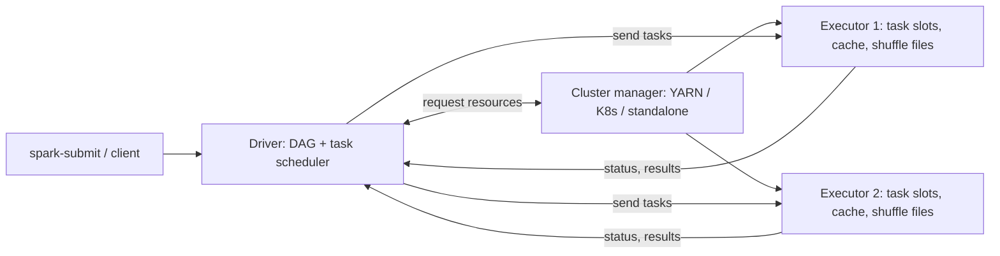
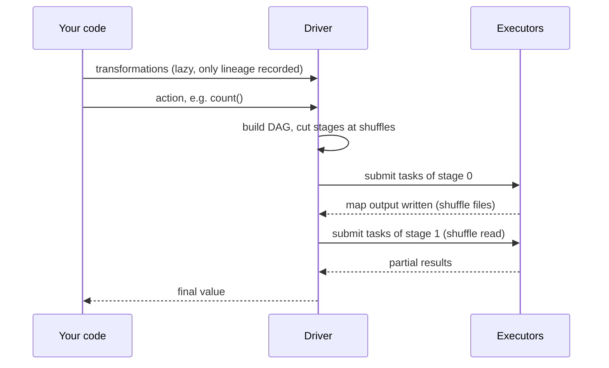

## 🎯 خلاصه

> یک application در Spark یک **driver** دارد (کار را برنامه‌ریزی و پیگیری می‌کند) و **executorهای** زیادی (روی partitionهای داده task اجرا می‌کنند). یک **cluster manager** ماشین‌ها را تخصیص می‌دهد. کار به **job → stage → task** تقسیم می‌شود و هر جا داده باید **shuffle** شود، یک **مرز stage** ایجاد می‌شود.

- transformationها **تنبل (lazy)** هستند: فقط lineage را ثبت می‌کنند. یک **action** (مثل `count`، `collect` یا `write`) یک job را شروع می‌کند.
- هر stage مجموعه‌ای از taskهاست که بدون جابه‌جایی داده بین ماشین‌ها اجرا می‌شوند. یک transformation **wide** (یعنی shuffle) یک stage جدید شروع می‌کند.
- از دست رفتن یک executor معمولاً قابل جبران است (taskها دوباره اجرا می‌شوند و partitionهای گم‌شده از روی lineage بازسازی می‌شوند). از دست رفتن **driver** کل application را متوقف می‌کند.

## 🌱 از ساده شروع کنیم (مبتدی)

> **💡 تشبیه:** آشپزخانه‌ی یک رستوران. **سرآشپز (driver)** سفارش‌ها را می‌خواند، مراحل پخت را برنامه‌ریزی می‌کند و آن‌ها را بین آشپزها تقسیم می‌کند. **آشپزها (executorها)** کارِ خرد کردن و سرخ کردن را روی ایستگاه خودشان انجام می‌دهند. **دفتر کاریابی (cluster manager)** تعیین می‌کند چند آشپز داری و کجا کار کنند.

یک word count کوچک کل تصویر را نشان می‌دهد:

```python
from pyspark.sql import SparkSession

spark = SparkSession.builder.appName("wordcount").getOrCreate()
sc = spark.sparkContext

lines = sc.textFile("s3a://logs/2026-10-01/")      # lazy: nothing runs yet
words = lines.flatMap(lambda line: line.split())   # lazy
pairs = words.map(lambda w: (w, 1))                # lazy
counts = pairs.reduceByKey(lambda a, b: a + b)     # lazy, needs a shuffle

print(counts.count())                              # action: now Spark runs
```

تا خط آخر چیزی خوانده نمی‌شود. چهار خط اول فقط یک plan را توصیف می‌کنند. به این می‌گویند **ارزیابی تنبل (lazy evaluation)**: Spark صبر می‌کند تا نتیجه خواسته شود تا کل plan را ببیند و بهینه‌اش کند.

## 🔧 واقعاً چطور کار می‌کند (متوسط)

**سه نقش اصلی**

- **Driver**: پروسه‌ی JVM که `main()` شما را اجرا می‌کند. `SparkSession` را می‌سازد، کد شما را به یک DAG (گراف جهت‌دار بی‌دور) از stageها تبدیل می‌کند، taskها را زمان‌بندی می‌کند، پیشرفت partitionها را نگه می‌دارد و نتایج را دریافت می‌کند (مثلاً خروجی `collect()`).
- **Executor**: پروسه‌های JVM روی ماشین‌های worker. هرکدام تعدادی **core** (اسلات اجرای task) دارند. taskها را اجرا می‌کنند، partitionهای cache‌شده را در حافظه نگه می‌دارند و **فایل‌های shuffle** را روی دیسک محلی می‌نویسند.
- **Cluster manager**: container یا pod مربوط به driver و executorها را تخصیص می‌دهد. انتخاب‌های رایج YARN، Kubernetes و Spark standalone هستند. Spark منابع را از آن می‌خواهد، ولی taskهای جداگانه را خودش زمان‌بندی نمی‌کند.

در **client mode** درایور روی ماشینی اجرا می‌شود که job را submit کرده. در **cluster mode** درایور داخل cluster اجرا می‌شود. برای کار تعاملی client mode و برای production غالباً cluster mode مناسب است، تا قطع شدن لپ‌تاپ جob را نکشد.



**Job، stage و task**

- هر **action** یک **job** می‌سازد. یک query ممکن است چند job تولید کند.
- یک **stage** گروهی از taskهاست که می‌توانند روی همان داده، بدون جابه‌جایی آن، در یک pipeline اجرا شوند. driver در هر **وابستگی shuffle** (هر transformation wide) یک stage جدید می‌سازد.
- یک **task** یک partition را در یک stage پردازش می‌کند. stageی که ۲۰۰ partition ورودی دارد، ۲۰۰ task اجرا می‌کند.



**Narrow در برابر Wide**

- transformationهای **narrow** (مثل `map`، `filter`، `flatMap`، `mapPartitions`، `union`) اجازه می‌دهند هر partition خروجی از یک partition ورودی ساخته شود. داخل یک stage به‌صورت pipeline اجرا می‌شوند.
- transformationهای **wide** (مثل `reduceByKey`، `groupByKey`، `join` با ورودی‌های نامرتب، `distinct`، `repartition`، `sortBy`) نیاز دارند هر رکوردی با کلید یکسان به یک جا برسد. پس یک **shuffle** و مرز stage ایجاد می‌کنند. [[shuffle]] را ببین.

قانون سرانگشتی برای مصاحبه: **بعد از هر shuffle یک stage جدید شروع می‌شود**، و **تعداد taskهای یک stage برابر تعداد partitionهای آن است**.

**خرابی‌ها**

- **خرابی task**: driver آن task را، به‌طور پیش‌فرض چند بار، روی executor دیگری دوباره اجرا می‌کند.
- **از دست رفتن executor**: taskهای در حال اجرا دوباره زمان‌بندی می‌شوند. partitionهای cache‌شده‌ی آن executor از بین می‌روند؛ Spark وقتی لازم شوند، آن‌ها را از روی **lineage** (زنجیره‌ی ثبت‌شده‌ی transformationها) دوباره می‌سازد. اگر executor خروجی **shuffle** داشته باشد و سرویس shuffle خارجی آن را نگه ندارد، taskهای map که آن را تولید کرده بودند دوباره اجرا می‌شوند. به همین دلیل خطای `FetchFailed` می‌تواند یک stage قبلی را دوباره submit کند.
- **از دست رفتن driver**: application متوقف می‌شود. در standalone cluster mode می‌توان با `--supervise` ری‌استارت خودکار خواست؛ جزئیاتش را برای cluster manager خودت در مستندات چک کن.

## 🧠 عمق و trade-offها (سنیور)

- **حافظه‌ی driver یک نقطه‌ی فشار است.** `collect()`، `toPandas()` یا broadcast یک جدول بزرگ داده را به JVM درایور می‌آورد. jobی که روی نمونه‌ی کوچک کار می‌کند و روی داده‌ی production شکست می‌خورد، اغلب به همین دلیل است: `OutOfMemoryError` روی driver، نه روی executor.
- **taskهای خیلی ریز** driver را گلوگاه می‌کنند، چون driver هر task را زمان‌بندی و پیگیری می‌کند. میلیون‌ها partition ۱ کیلوبایتی کندتر از چند صد partition ۱۲۸ مگابایتی هستند.
- **اندازه‌ی executor** یک trade-off است. executorهای خیلی بزرگ (core زیاد و heap عظیم) دچار توقف‌های طولانی GC می‌شوند و برای دیسک و شبکه رقابت می‌کنند. executorهای خیلی کوچک حافظه را صرف overhead می‌کنند. نقطه‌ی شروع رایج چند core برای هر executor است و بعد باید اندازه‌گیری کنی. تنظیمات دقیق حافظه را برای نسخه‌ی خودت در مستندات چک کن.
- **dynamic allocation** executorها را با بار کاری اضافه و کم می‌کند. حذف یک executor فقط وقتی برای داده‌ی shuffle امن است که فایل‌های shuffle بعد از حذف آن هم باقی بمانند (سرویس shuffle خارجی، یا shuffle tracking در نسخه‌های جدیدتر).
- **پایش**: Spark UI سطح job، stage و task را نشان می‌دهد، همراه با spill و GC در هر stage. History Server بعد از پایان application از event logها استفاده می‌کند. دنبال stageهایی باش که چند task خیلی کند دارند ([[data-skew]]) و stageهایی که بعد از `FetchFailed` تکرار می‌شوند.
- **Kubernetes** به‌جای containerهای YARN از pod استفاده می‌کند؛ pod درایور، pod executorها را مالک است و حذف درایور آن‌ها را هم حذف می‌کند.
- **Spark را کجا استفاده نکنیم**: چند گیگابایت داده‌ای که روی یک ماشین جا می‌شود. هزینه‌ی راه‌اندازی cluster و shuffle بیشتر از خود کار است. یک موتور تک‌ماشینه در آن حالت ساده‌تر و سریع‌تر است.

## 🧪 امتحان کن

برای سه تمرین اول از این کد استفاده کن:

```python
df = spark.read.parquet("s3a://sales/2026/")          # (a)
big = df.filter(df.amount > 100)                      # (b)
by_cust = big.groupBy("customer_id").count()          # (c)
top = by_cust.orderBy("count", ascending=False)       # (d)
top.show(10)                                          # (e)
```

۱. کدام‌یک از خطوط (a) تا (e) یک action است؟ کدام‌ها مرز stage ایجاد می‌کنند؟
۲. job مربوط به `top.show(10)` چند stage دارد و چرا؟ فرض کن خواندن Parquet ۳۰۰ partition تولید می‌کند و `groupBy` از تعداد پیش‌فرض partition برای shuffle استفاده می‌کند.
۳. همکارت روی یک جدول ۴۰ گیگابایتی `result = df.collect()` می‌نویسد و بعد روی لیست پایتون حلقه می‌زند. کدام جزء دچار کمبود حافظه می‌شود؟ دو راه امن‌تر بگو.

<details><summary>راه‌حل‌ها را نشان بده</summary>

**۱.** فقط (e) یعنی `show` یک action است. خط (c) یعنی `groupBy().count()` wide است (aggregation به shuffle نیاز دارد). خط (d) یعنی `orderBy` هم wide است: مرتب‌سازی برای توزیع کل داده بین executorها به range partitioning نیاز دارد. خطوط (a) و (b) narrow یا lazy هستند و مرز ایجاد نمی‌کنند.

**۲.** در یک plan معمولی حداقل سه stage داریم. shuffle مربوط به `groupBy` اولین مرز را می‌سازد: اسکن Parquet، فیلتر و aggregation جزئی در یک stage هستند (یک task برای هر partition ورودی، اینجا ۳۰۰ تا). `orderBy` به range partitioning نیاز دارد که یک shuffle و مرز دیگر اضافه می‌کند. تعداد دقیق را با `explain()` تأیید کن، چون plan به نسخه و adaptive execution بستگی دارد.

**۳.** **driver** کمبود حافظه می‌گیرد، چون `collect()` کل جدول را داخل JVM درایور می‌آورد. گزینه‌های امن‌تر: کار را توزیع‌شده نگه دار (نتیجه را `write` کن، یا اول aggregate کن و فقط نتیجه‌ی کوچک را `collect()` کن)، یا برای نمونه‌گیری از `take(n)` / `limit(n)` استفاده کن.

</details>

## 💬 گوشه‌ی مصاحبه

**سوال: «چه چیزی یک stage جدید ایجاد می‌کند؟»** جواب متوسط: «یک shuffle، مثل `groupBy` یا `join`.» جواب سنیور: «مرز stage یک وابستگی shuffle است. transformationهای narrow داخل یک stage به‌صورت pipeline اجرا می‌شوند؛ transformation wide فایل‌های shuffle را سمت map می‌نویسد و سمت reduce می‌خواند، و همین یک stage جدید می‌سازد. تعداد taskهای هر stage برابر تعداد partitionهای آن است.»

**سوال: «چه چیزی روی driver و چه چیزی روی executor اجرا می‌شود؟»** جواب متوسط: «driver برنامه‌ریزی و زمان‌بندی می‌کند؛ executorها taskها را اجرا می‌کنند و داده‌ی cache‌شده را نگه می‌دارند.» جواب سنیور اضافه می‌کند: «هر چیزی که داده را به driver برمی‌گرداند (`collect`، `toPandas`، broadcast بزرگ) ریسک حافظه‌ی driver است و معمولاً اولین چیزی است که برای OOM چک می‌کنم.»

**سوال: «اگر یک executor بمیرد چه می‌شود؟»** جواب متوسط: «taskهایش جای دیگری دوباره زمان‌بندی می‌شوند.» جواب سنیور: «taskها دوباره اجرا می‌شوند و partitionهای cache‌شده از روی lineage بازسازی می‌شوند. اگر executor مرده خروجی shuffle داشته باشد و سرویس shuffle خارجی نباشد، stage تولیدکننده دوباره محاسبه می‌شود؛ به همین دلیل ممکن است job به نظر برسد که یک stage را از اول شروع کرده. با dynamic allocation و بدون سرویس shuffle خارجی، scale-in دقیقاً همین را ایجاد می‌کند.»

> **🎤 این را در مصاحبه بگو:** «driver یک DAG از stageها می‌سازد و taskها را زمان‌بندی می‌کند؛ executorها آن‌ها را روی partitionها اجرا می‌کنند. stageها در shuffleها می‌شکنند. transformationهای lazy فقط در action اجرا می‌شوند. از دست رفتن executor با lineage جبران می‌شود، ولی از دست رفتن driver application را تمام می‌کند.»

## ⚠️ اشتباهات رایج

> **⚠️ مراقب باش:** «Spark کد را خط‌به‌خط اجرا می‌کند وقتی من صدا می‌زنم.» نه. transformationها یک plan می‌سازند و تا وقتی action نیاید هیچ‌چیز اجرا نمی‌شود. خط کندی که می‌بینی ممکن است چند خط بعد از action باشد.

> **⚠️ مراقب باش:** `collect()` روی یک DataFrame بزرگ. کل داده را به driver منتقل می‌کند. از `write` استفاده کن یا اول aggregate کن.

- فکر کردن به اینکه تعداد executor به‌تنهایی موازی‌سازی را تعیین می‌کند. موازی‌سازی تعداد **اسلات‌های task** (مجموع core های executorها) است که با تعداد partitionها محدود می‌شود.
- فرض کردن اینکه `count()` رایگان است. اگر داده cache نشده باشد، یک job کامل اجرا می‌شود.
- دیدن `FetchFailed` فقط به‌عنوان یک قطعی شبکه؛ اغلب یعنی خروجی shuffle گم شده و stage دوباره محاسبه شده.
- اجرای jobهای production در client mode از روی لپ‌تاپ یا یک notebook server که ممکن است قطع شود.

## ✅ خودت را بسنج

۱. کدام action یک job جدید شروع می‌کند؟
   - A) `filter`
   - B) `select`
   - C) `count`
   - D) `withColumn`

<details><summary>Answer</summary>

**C** — `count` یک action است. سه گزینه‌ی دیگر transformation هستند و فقط plan را گسترش می‌دهند.

</details>

۲. Spark کجا یک stage جدید را می‌بُرد؟
   - A) بعد از هر `map`
   - B) در هر وابستگی shuffle (هر transformation wide)
   - C) بعد از هر ۱۲۸ مگابایت داده
   - D) در هر فراخوانی `cache()`

<details><summary>Answer</summary>

**B** — transformationهای narrow داخل یک stage به‌صورت pipeline اجرا می‌شوند. transformation wide به shuffle نیاز دارد و همین مرز stage را ایجاد می‌کند.

</details>

۳. کدام جزء مسئول درخواست container یا pod برای executorهاست؟
   - A) task scheduler داخل driver
   - B) cluster manager (YARN، Kubernetes، standalone)
   - C) خواننده‌ی Parquet
   - D) سرویس shuffle

<details><summary>Answer</summary>

**B** — cluster manager منابع را تخصیص می‌دهد. بعد driver taskهای جداگانه را روی executorهایی که گرفته زمان‌بندی می‌کند.

</details>

۴. **(سنیور)** یک job با ورودی ۱۰ گیگابایتی درست اجرا می‌شود و با ورودی ۲ ترابایتی با OOM شکست می‌خورد. جزء خراب driver است و کد در انتها `toPandas()` را صدا می‌زند. چرا نمونه‌ی کوچک رد شد و چه چیزی را تغییر می‌دهی؟
   - A) executor بیشتر اضافه کن؛ driver با آن‌ها مقیاس می‌شود
   - B) نمونه آنقدر کوچک بود که در driver جا شود؛ نتیجه را توزیع‌شده نگه دار (روی storage بنویس) یا قبل از جمع‌آوری aggregate کن
   - C) به `RDD.count()` برو که از driver رد نمی‌شود
   - D) مقدار `spark.sql.shuffle.partitions` را زیاد کن

<details><summary>Answer</summary>

**B** — `toPandas()` کل نتیجه را در حافظه‌ی driver می‌آورد. اضافه کردن executor به driver کمکی نمی‌کند. نتیجه را روی storage بنویس، یا اول aggregate کن تا داده‌ی جمع‌آوری‌شده کوچک شود.

</details>

۵. **(سنیور)** بعد از حذف یک executor توسط dynamic allocation، یک stage طولانی از یک stage قبلی دوباره شروع می‌شود. محتمل‌ترین علت و راه‌حل چیست؟
   - A) lineage شکسته است؛ cache را غیرفعال کن
   - B) executor حذف‌شده خروجی shuffle داشته که توسط سرویس shuffle خارجی یا shuffle tracking نگه داشته نمی‌شد، پس stage تولیدکننده‌ی map دوباره محاسبه شده؛ سرویس shuffle خارجی یا shuffle tracking را فعال کن
   - C) stageها نمی‌توانند ری‌استارت شوند؛ خطا فقط در UI است
   - D) driver heartbeat را از دست داده؛ حافظه‌ی driver را زیاد کن

<details><summary>Answer</summary>

**B** — فایل‌های shuffle روی دیسک محلی executor هستند. اگر همراه executor از بین بروند، Spark باید taskهای تولیدکننده را دوباره اجرا کند. سرویس shuffle خارجی (یا shuffle tracking در نسخه‌های جدیدتر) باعث می‌شود آن فایل‌ها بعد از حذف executor هم در دسترس بمانند.

</details>

## 🗂️ فلش‌کارت

| Front | Back |
|---|---|
| driver چه کاری می‌کند؟ | `main()` را اجرا می‌کند، DAG می‌سازد، taskها را زمان‌بندی می‌کند، پیشرفت را پیگیری و نتایج را دریافت می‌کند |
| executorها چه کاری می‌کنند؟ | taskها را روی partitionها اجرا می‌کنند، داده را cache می‌کنند، فایل‌های shuffle می‌نویسند |
| cluster manager چه کاری می‌کند؟ | container یا pod را برای driver و executorها تخصیص می‌دهد؛ taskها را زمان‌بندی نمی‌کند |
| client mode در برابر cluster mode | client: driver روی ماشین submit‌کننده. cluster: driver داخل cluster |
| چه چیزی job را شروع می‌کند؟ | یک action (`count`، `collect`، `write`، `show`) |
| مرز stage کجاست؟ | در هر وابستگی shuffle (هر transformation wide) |
| چند task در یک stage است؟ | یکی برای هر partition همان stage |
| بازیابی بعد از از دست رفتن executor | taskها دوباره زمان‌بندی می‌شوند، partitionهای cache‌شده از lineage، و خروجی shuffle گم‌شده دوباره ساخته می‌شوند |

## 🔗 ادامه

- **spark-shuffle** توضیح می‌دهد داخل یک transformation wide چه می‌گذرد و تعداد partitionها را چطور تنظیم کنی.
- **spark-catalyst** نشان می‌دهد plan DataFrame که driver می‌سازد، قبل از ساختن taskها چطور بهینه می‌شود.
- **spark-ui-debugging** خواندن job، stage و task در Spark UI را یاد می‌دهد.
- **spark-memory-tuning** و **spark-on-kubernetes** حافظه‌ی executor و اجرا روی pod را پوشش می‌دهند.
- **yarn-vs-k8s** دو cluster manager رایج را مقایسه می‌کند.
