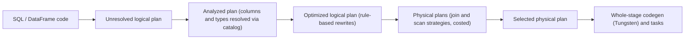

## 🎯 خلاصه

> در Spark، APIهای **DataFrame** و **SQL** می‌گویند **چه** چیزی می‌خواهی. بهینه‌ساز **Catalyst** این توصیف را به یک **logical plan** تبدیل می‌کند، آن را با قوانین بازنویسی می‌کند، یک **physical plan** انتخاب می‌کند، و **Tungsten** مسیرهای داغ را به کد تولیدشده‌ی فشرده تبدیل می‌کند. API مربوط به **RDD** همه‌ی این‌ها را دور می‌زند، پس Spark نمی‌تواند چیزی را که نوشته‌ای بهینه کند.

- pushdown (فیلتر و ستون‌ها) حجم بایت‌هایی که از storage خوانده می‌شود را کم می‌کند. constant folding کار را در زمان ساختن plan حذف می‌کند.
- یک **Python UDF** برای Catalyst جعبه‌ی سیاه است: pushdown را مسدود می‌کند و باعث می‌شود ردیف‌ها بین JVM و Python serialize شوند.
- `explain()` plan را در هر مرحله نشان می‌دهد. خواندن آن مهم‌ترین مهارت در بهینه‌سازی performance در Spark است.

## 🌱 از ساده شروع کنیم (مبتدی)

> **💡 تشبیه:** از یک آژانس مسافرتی بخواهی «بلیط ارزان به شیراز، جمعه، اکونومی، حداکثر یک توقف». آژانس می‌تواند هوشمندانه جستجو کند. حالا مقایسه کن با «به همه‌ی فرودگاه‌ها سر بزن و هر پرواز را خودت چک کن». حالت اول به آژانس جا برای بهینه‌سازی می‌دهد؛ حالت دوم هیچ جایی نمی‌دهد. DataFrame از نوع اول است. RDD با lambdaهای پایتون بیشتر شبیه نوع دوم است.

هر دو کد زیر یک نتیجه برمی‌گردانند:

```python
from pyspark.sql import functions as F

df = spark.read.parquet("s3a://warehouse/employees/")   # columns: id, name, dept, salary

# DataFrame: a declarative description Spark can rewrite
ok = df.filter(F.col("dept") == "data").select("name", "salary")

# RDD: opaque Python functions; Spark runs them as written
rdd = (df.rdd.filter(lambda r: r.dept == "data")
              .map(lambda r: (r.name, r.salary)))
```

نسخه‌ی DataFrame به Spark می‌گوید کدام ستون لازم است و کدام شرط را بررسی کند. نسخه‌ی RDD هر دو را داخل lambda پنهان می‌کند. Spark نمی‌تواند داخل lambda را ببیند، پس نمی‌تواند چیزی را جابه‌جا یا pushdown کند.

## 🔧 واقعاً چطور کار می‌کند (متوسط)

**APIها**

- **RDD**: مجموعه‌ی توزیع‌شده‌ی سطح پایین از اشیای پایتون یا JVM. schema و optimizer ندارد. هر رکورد یک شیء است، پس RDDهای پایتون برای هر ردیف هزینه‌ی serialization دارند.
- **DataFrame** (در Scala و Java به شکل `Dataset[Row]`؛ در PySpark یک DataFrame ساده): ردیف‌هایی با schema و عبارت‌های ستونی. Catalyst آن را بهینه می‌کند.
- **Dataset** (فقط Scala و Java): یک DataFrame با نوع. عبارت‌های ستونی بهینه می‌شوند. یک lambda تایپ‌شده مثل `ds.map(x => ...)` مثل تابع RDD برای optimizer نامرئی است.

**pipeline کاتالیست**



۱. **Analysis** نام‌ها را resolve می‌کند: `dept` به یک ستون مشخص از یک جدول مشخص تبدیل می‌شود و نوع‌ها بررسی می‌شوند.
۲. **بهینه‌سازی منطقی** قوانین را اعمال می‌کند تا وقتی plan دیگر تغییر نکند. مهم‌ترین‌ها:
   - **predicate pushdown**: فیلترها را تا حد امکان نزدیک به source ببر.
   - **column pruning** (projection pushdown): فقط ستون‌هایی را بخوان که query لازم دارد.
   - **constant folding**: `F.lit(2) * F.lit(3000)` در زمان ساختن plan به `6000` تبدیل می‌شود.
   - **boolean simplification**: `x AND TRUE` می‌شود `x`.
۳. **physical planning** تصمیم می‌گیرد چطور اجرا شود: کدام scan، کدام الگوریتم join (broadcast hash، shuffled hash، sort-merge) و کجا shuffle اضافه شود. وقتی cost-based optimization فعال باشد و statistics جدول موجود باشد، Catalyst از تعداد ردیف‌ها برای انتخاب ترتیب join هم استفاده می‌کند.
۴. **تولید کد**: **whole-stage codegen** در Tungsten یک زنجیره از operatorها را در یک تابع Java تولیدشده ادغام می‌کند، و از یک فراخوانی virtual برای هر ردیف و هر operator جلوگیری می‌کند. Tungsten ردیف‌ها را در یک فرمت باینری فشرده نگه می‌دارد و تا جایی که ممکن است حافظه را خارج از heap جاوا مدیریت می‌کند.

**یک مثال کامل**

```python
q = (df.select("name", "dept", "salary")
       .filter((F.col("dept") == "data") &
               (F.col("salary") > F.lit(2) * F.lit(3000)))
       .select("name"))
q.explain(True)
```

در plan بهینه‌شده باید ببینی:

- به‌جای `2 * 3000` عدد `6000` (constant folding)
- شرط `dept = data` و شرط حقوق در `PushedFilters` گره‌ی scan (predicate pushdown به Parquet، که می‌تواند با استفاده از statistics گروه‌های سطر را رد کند)
- یک `ReadSchema` بدون `id` (column pruning)

`explain(True)` plan های parsed، analyzed، optimized و physical را چاپ می‌کند. در Spark 3.x، `explain("formatted")` درخت خواناتری می‌دهد. متن دقیق بین نسخه‌ها فرق می‌کند، پس operatorها و ترتیبشان را بخوان، نه رشته‌ها را حفظ کن.

**چرا UDFها بهینه‌سازی را مسدود می‌کنند**

یک Python UDF تابعی است که Catalyst نمی‌تواند داخلش را ببیند:

```python
from pyspark.sql.types import StringType

@F.udf(StringType())
def upper_py(s):
    return s.upper() if s else None

slow = df.filter(upper_py("dept") == "DATA")   # no PushedFilters for dept
fast = df.filter(F.col("dept") == "data")      # EqualTo(dept, data) is pushed
```

چون Catalyst نمی‌تواند UDF را تحلیل کند، نمی‌تواند شرط را به scan ببرد، ستون‌های استفاده‌شده داخلش را prune کند، اندازه‌ی خروجی‌اش را تخمین بزند، و باید هر ردیف را از JVM به یک worker پایتون و برگشت بفرستد. تابع داخلی را ترجیح بده. اگر لازم است منطق پایتونی بنویسی، یک **pandas UDF** (مبتنی بر Arrow و برداری) خیلی ارزان‌تر از UDF ردیف‌به‌ردیف است، هرچند Catalyst باز هم آن را opaque می‌بیند.

## 🧠 عمق و trade-offها (سنیور)

- **pushdown به source بستگی دارد.** Parquet و ORC می‌توانند از statistics مینیمم/ماکسیمم و پوشه‌های partition استفاده کنند. شرط روی عبارت محاسبه‌شده، یا روی فرمتی بدون statistics، بعد از خواندن ارزیابی می‌شود. به‌جای فرض، `PushedFilters` گره‌ی scan را چک کن.
- **انفجار plan.** حلقه‌ای که چند صد بار `withColumn` صدا می‌زند، یا self-joinهای متوالی، یک logical plan عظیم می‌سازد. آنگاه analysis و optimization روی driver چند دقیقه طول می‌کشند، قبل از اینکه یک task اجرا شود. راه‌حل: ساختن ستون‌ها در یک `select`، یا شکستن lineage با `df.checkpoint()` یا `localCheckpoint()` در نقطه‌ی مناسب.
- **statistics برای join مهم است.** بدون statistics، Catalyst اندازه‌ها را حدس می‌زند. broadcast join فقط وقتی انتخاب می‌شود که تخمین بزند یک طرف به‌اندازه‌ی کافی کوچک است؛ پس نبودن `ANALYZE TABLE` می‌تواند روی جدولی که باید broadcast می‌شد، sort-merge join بسازد. physical plan را چک کن و آستانه‌ی broadcast را برای نسخه‌ات بررسی کن.
- **تایپ‌شده در برابر بدون نوع.** با `Dataset` تایپ‌شده، یک `map` با lambda منطق را از optimizer پنهان می‌کند. عبارت‌های ستونی آن را قابل‌دیدن نگه می‌دارند. در PySpark این trade-off بیشتر از قبل برایت انجام شده است.
- **adaptive query execution (AQE)** در زمان اجرا، بعد از پایان stageهای shuffle و با اندازه‌ی واقعی partitionها، دوباره بهینه‌سازی می‌کند. این مکمل plan ایستای Catalyst است. درس AQE را ببین.
- **هزینه‌ی خود بهینه‌سازی.** jobهای خیلی کوتاه ممکن است زمان بیشتری را صرف برنامه‌ریزی کنند تا اجرا. برای داده‌ی کم، یک موتور تک‌ماشینه یا یک موتور SQL ساده معمولاً ساده‌تر است.
- **دیباگ در production**: plan بهینه‌شده را با physical plan مقایسه کن، دنبال گره‌های `Exchange` (shuffle) غیرمنتظره باش، و گره‌های `Python` یا `BatchEvalPython` را ببین که مرز UDF را نشان می‌دهند.

## 🧪 امتحان کن

یک DataFrame به نام `employees` با ستون‌های `id, name, dept, salary` (Parquet) در نظر بگیر.

۱. query‌ای بنویس که نام کارمندان `data` را برگرداند که حقوق‌شان بیشتر از `2 * 4500` است. `explain(True)` را اجرا کن و ثابتی که fold شده و فیلتری که pushdown شده را نشان بده.
۲. فیلتر را با یک Python UDF که `dept` را مقایسه می‌کند عوض کن. توضیح بده چه چیزی از plan حذف شد و چرا.
۳. یک DataFrame با ۱۰۰۰ ستون داری که از ۴۰۰ فراخوانی زنجیره‌ای `withColumn` ساخته شده و driver قبل از اولین task، چند دقیقه طول می‌کشد. دو راه‌حل پیشنهاد بده.

<details><summary>راه‌حل‌ها را نشان بده</summary>

**۱.**
```python
q = (df.filter((F.col("dept") == "data") & (F.col("salary") > F.lit(2) * F.lit(4500)))
       .select("name"))
q.explain(True)
```
plan بهینه‌شده به‌جای `2 * 4500` عدد `9000` را نشان می‌دهد. برابری `dept` در `PushedFilters` گره‌ی scan ظاهر می‌شود. یادت باشد `name` تنها ستون خروجی است، پس `ReadSchema` به `id` نیاز ندارد.

**۲.** نسخه‌ی UDF این است: `df.filter(upper_py("dept") == "DATA")`. ورودی `dept` در `PushedFilters` حذف می‌شود، چون Catalyst نمی‌تواند UDF را به یک source filter تبدیل کند. ردیف‌ها به پایتون فرستاده می‌شوند و فیلتر بعد از scan اجرا می‌شود، پس داده‌ی بیشتری خوانده و serialize می‌شود. توابع داخلی این مشکل را ندارند.

**۳.** دو راه‌حل: (الف) زنجیره را با یک `select` جایگزین کن که همه‌ی عبارت‌ها را فهرست کند، تا analysis یک projection ببیند به‌جای ۴۰۰ projection تودرتو؛ (ب) بعد از ساختن بخش بزرگی از plan، lineage را با `checkpoint()` یا `localCheckpoint()` بشکن، تا optimizer درخت همیشه‌بزرگ‌شونده را دوباره تحلیل نکند.

</details>

## 💬 گوشه‌ی مصاحبه

**سوال: «Catalyst چه کاری می‌کند؟»** جواب متوسط: «query‌های DataFrame را بهینه می‌کند: فیلترها را pushdown می‌کند و ستون‌ها را prune می‌کند.» جواب سنیور: «query را با catalog resolve می‌کند، قوانین بازنویسی را اعمال می‌کند تا plan پایدار شود، استراتژی‌های physical را انتخاب می‌کند (از جمله الگوریتم join که به تخمین اندازه بستگی دارد)، و نتیجه را به whole-stage codegen می‌دهد. قدرتش به دیدن عبارت‌ها وابسته است، پس UDF را روی مسیر بحرانی نمی‌گذارم.»

**سوال: «RDD یا DataFrame؟»** جواب متوسط: «DataFrame، چون بهینه می‌شود.» جواب سنیور: «برای تقریباً همه‌ی کارهای ساختاریافته DataFrame. RDD را وقتی بخواهم کنترل سطح پایین روی partitioning داشته باشم، یا پردازش باینری سفارشی که با schema جور نیست. حتی آن‌جا اول بررسی می‌کنم که یک عبارت داخلی یا pandas UDF کافی نیست.»

> **🎤 این را در مصاحبه بگو:** «من عبارت‌های DataFrame می‌نویسم، نه lambdaهای پایتون، تا Catalyst بتواند فیلترها را به Parquet pushdown کند و ستون‌ها را prune کند. با `explain` pushdown را تأیید می‌کنم، و هر Python UDF را یک مرز می‌دانم که بهینه‌سازی را مسدود و هزینه‌ی serialization دارد.»

## ⚠️ اشتباهات رایج

> **⚠️ مراقب باش:** فکر کنی `filter` بعد از یک UDF به‌اندازه‌ی فیلتر روی ستون خام ارزان است. UDF شرط را از source پنهان می‌کند، پس داده‌ی بیشتری خوانده می‌شود.

> **⚠️ مراقب باش:** یک بار `explain()` را در توسعه ببینی و دیگر هیچ‌وقت. حجم داده، statistics و AQE plan را تغییر می‌دهند.

- استفاده از APIهای RDD برای داده‌ی ساختاریافته، «چون انعطاف‌پذیرترند»، و از دست دادن optimizer.
- نوشتن `df.rdd.map(...)` وسط یک pipeline و برگرداندن دوباره به DataFrame. هر تبدیل یک رفت‌وبرگشت شیء ردیف است.
- زنجیره‌ی صدها `withColumn` در یک حلقه (انفجار plan).
- انتظار pushdown روی source‌ای که statistics یا partitioning ندارد.
- فرض اینکه متن `explain` بین نسخه‌های Spark ثابت است.

## ✅ خودت را بسنج

۱. کدام جزء قوانینی مثل predicate pushdown و column pruning را روی logical plan اعمال می‌کند؟
   - A) Tungsten
   - B) Catalyst
   - C) cluster manager
   - D) خواننده‌ی Parquet

<details><summary>Answer</summary>

**B** — Catalyst بهینه‌ساز است. Tungsten چیدمان حافظه و تولید کد را مدیریت می‌کند، و خواننده‌ی Parquet فقط scانی را که داده شده اجرا می‌کند.

</details>

۲. کدام عبارت قبل از اجرای هر task در زمان ساختن plan ارزیابی می‌شود؟
   - A) `F.col("salary") * 2`
   - B) `F.lit(2) * F.lit(3000)`
   - C) یک Python UDF روی `dept`
   - D) `df.count()`

<details><summary>Answer</summary>

**B** — هر دو operand literal هستند، پس constant folding عبارت را با `6000` جایگزین می‌کند. عبارت ستونی به داده در زمان اجرا وابسته است، و `count()` یک action است که job اجرا می‌کند.

</details>

۳. چرا یک Python UDF روی فیلتر معمولاً predicate pushdown را مسدود می‌کند؟
   - A) UDFها فقط روی driver اجرا می‌شوند
   - B) Catalyst نمی‌تواند یک تابع opaque را به source filter تبدیل کند، پس شرط بعد از scan اعمال می‌شود
   - C) Parquet از رشته پشتیبانی نمی‌کند
   - D) UDFها column pruning را برای همه‌ی ستون‌ها غیرفعال می‌کنند

<details><summary>Answer</summary>

**B** — source فقط شرط‌های ساده را می‌فهمد. یک UDF opaque را نمی‌شود به آن تبدیل کرد، پس شرط بعد از خواندن ردیف‌ها اعمال می‌شود. برای تأیید، `PushedFilters` گره‌ی scan را ببین.

</details>

۴. **(سنیور)** یک broadcast join در محیط تست استفاده شد، ولی در production همان query یک sort-merge join دارد. محتمل‌ترین علت چیست و چه چیزی را چک می‌کنی؟
   - A) production executor بیشتری دارد و broadcast را غیرفعال می‌کند
   - B) Catalyst برای جدول production تخمین اندازه ندارد (statistics نبودن یا ورودی بزرگ‌تر)، و دیگر تخمین نمی‌زند که یک طرف از آستانه‌ی broadcast کوچک‌تر است؛ statistics را محاسبه کن و physical plan ها را مقایسه کن
   - C) روی Parquet همیشه sort-merge join استفاده می‌شود
   - D) broadcast join با DataFrame کار نمی‌کند

<details><summary>Answer</summary>

**B** — استراتژی join به تخمین اندازه بستگی دارد. بدون statistics به‌روز، یا با ورودی واقعی بزرگ‌تر، planner ممکن است broadcast را انتخاب نکند. statistics را دوباره محاسبه کن، آستانه را چک کن و دو physical plan را مقایسه کن.

</details>

۵. **(سنیور)** یک تیم می‌خواهد سرعت job را بالا ببرد و قانون کسب‌وکار را از یک `filter` روی ستون به یک `Dataset.map` تایپ‌شده با lambda «برای type safety» منتقل کند. trade-off چیست؟
   - A) هیچ؛ lambdaهای تایپ‌شده همیشه سریع‌ترند
   - B) lambda برای Catalyst opaque است، پس pushdown و column pruning روی آن منطق از دست می‌رود؛ قانون را به‌صورت عبارت ستونی نگه دار و type safety را فقط جایی استفاده کن که لازم است
   - C) lambda فایل Parquet را غیرقابل خواندن می‌کند
   - D) optimizer باید دو بار اجرا شود

<details><summary>Answer</summary>

**B** — lambda تایپ‌شده منطق را از optimizer پنهان می‌کند. نگه داشتن قانون به‌صورت عبارت ستونی، pushdown و pruning را ممکن نگه می‌دارد، و type safety را می‌توان در لبه‌های pipeline حفظ کرد.

</details>

## 🗂️ فلش‌کارت

| Front | Back |
|---|---|
| RDD در برابر DataFrame | RDD: اشیای opaque و بدون optimizer. DataFrame: schema به‌همراه عبارت‌هایی که Catalyst بهینه می‌کند |
| Catalyst چه تولید می‌کند؟ | logical plan تحلیل‌شده و بهینه‌شده، سپس یک physical plan انتخاب‌شده |
| predicate pushdown | فیلترها تا حد امکان نزدیک به source اعمال شوند، ترجیحاً داخل scan |
| column pruning | خواندن فقط ستون‌هایی که query لازم دارد |
| constant folding | عبارت‌های literal در زمان ساختن plan ارزیابی می‌شوند |
| چرا UDFها بهینه‌سازی را مسدود می‌کنند | Catalyst داخلشان را نمی‌بیند، پس pushdown و pruning در آن مرز متوقف می‌شوند |
| Tungsten چیست؟ | فرمت باینری ردیف، حافظه‌ی خارج از heap، و تولید کد whole-stage |
| بهینه‌سازی را کجا تأیید کنیم؟ | `explain(True)` یا `explain("formatted")`، و در گره‌ی scan مقادیر `PushedFilters` و `ReadSchema` |

## 🔗 ادامه

- **spark-architecture** توضیح می‌دهد چطور plan بهینه‌شده به stageها و taskها تبدیل می‌شود.
- **spark-aqe** بهینه‌سازی مجدد در زمان اجرا را پوشش می‌دهد که مکمل plan ایستای Catalyst است.
- **spark-shuffle** گره‌های `Exchange` را که در هر plan می‌بینی توضیح می‌دهد.
- **pyspark-api** و **python-dataframes** انتخاب‌های API سمت پایتون را عمیق‌تر پوشش می‌دهند.
- **sql-query-optimization** دید عمومی SQL به pushdown predicate و خواندن plan را می‌دهد.
