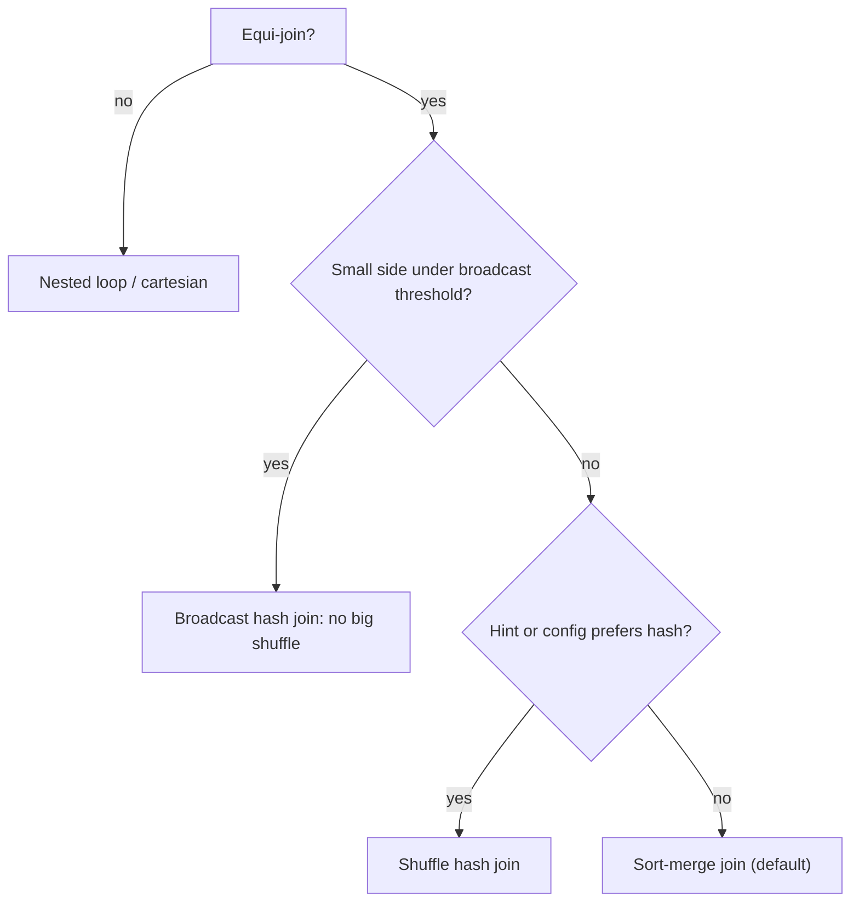

## 🎯 خلاصه

> یک join در Spark وقتی ارزان است که یکی از دو طرف آن‌قدر کوچک باشد که بشود **به همه‌ی executorها کپی کرد** (broadcast). وقتی هر دو طرف بزرگ‌اند، باید هر دو را بر اساس کلید **shuffle** کرد و این گران است. Skew یعنی یک کلید آن‌قدر ردیف دارد که یک task تنها به گلوگاه تبدیل می‌شود.

- **Broadcast hash join:** جدول بزرگ shuffle نمی‌شود. فقط لازم است یک طرف در حافظه‌ی هر executor جا شود.
- **Sort-merge join:** پیش‌فرض برای دو جدول بزرگ. هر دو طرف بر اساس کلید join، shuffle و sort می‌شوند.
- **Shuffle hash join:** هر دو طرف shuffle می‌شوند و طرف کوچک‌تر در هر partition به یک hash table تبدیل می‌شود. کمتر انتخاب می‌شود.
- **Skew:** یک یا چند کلید بیشتر ردیف‌ها را دارند. با AQE skew join، salting یا جداکردن کلیدهای داغ حل می‌شود.

## 🌱 از ساده شروع کنیم (مبتدی)

> **💡 تشبیه:** فرض کن فهرست ۱۰ هزار سفارش را با فهرست ۵۰ نام محصول تطبیق می‌دهی. می‌توانی فهرست کوتاه محصولات را فتوکپی کنی و به هر میز یک نسخه بدهی (broadcast). یا هر دو فهرست بزرگ را بر اساس محصول مرتب کنی و کنار هم رد شوی (sort-merge). وقتی یکی از فهرست‌ها کوتاه است، کپی‌کردن سریع‌تر است.

یک مثال ساده:

```sql
SELECT o.order_id, c.country
FROM orders o
JOIN customers c ON o.customer_id = c.customer_id;
```

Spark برای این کوئری باید به یک سؤال جواب بدهد: **آیا ردیف‌هایی با `customer_id` یکسان روی یک executor قرار می‌گیرند؟** اگر `customers` کوچک باشد، Spark آن را به همه‌ی executorها کپی می‌کند و دیگر این سؤال مطرح نیست. اگر هر دو جدول بزرگ باشند، Spark باید ردیف‌ها را روی شبکه جابه‌جا کند تا کلیدهای برابر به هم برسند. این جابه‌جایی **shuffle** است و بیشتر زمان join همین‌جا می‌رود.

مشکل دوم skew است. فرض کن یک مشتری، حساب «مهمان»، ۴۰٪ همه‌ی سفارش‌ها را دارد. این ۴۰٪ ردیف به یک partition می‌روند و یک task آن‌ها را پردازش می‌کند. ۱۹۹ task دیگر در چند ثانیه تمام می‌شوند و job منتظر همان یک task می‌ماند.

## 🔧 واقعاً چطور کار می‌کند (متوسط)

Spark هنگام برنامه‌ریزی یک استراتژی join انتخاب می‌کند. مهم‌ترین‌ها:

| استراتژی | Shuffle | نیاز | کاربرد معمول |
|---|---|---|---|
| Broadcast hash join (BHJ) | فقط طرف کوچک کپی می‌شود، جدول بزرگ shuffle نمی‌شود | طرف کوچک در حافظه‌ی هر executor جا شود | جدول fact که به یک dimension کوچک join می‌شود |
| Sort-merge join (SMJ) | هر دو طرف shuffle و بر اساس کلید sort می‌شوند | شرط equi-join | جدول بزرگ به جدول بزرگ (پیش‌فرض) |
| Shuffle hash join (SHJ) | هر دو طرف shuffle می‌شوند، hash table در هر partition | هر partition طرف کوچک‌تر در حافظه جا شود | جدول‌های متوسط وقتی sort گران است |
| Broadcast nested loop / cartesian | بسته به حالت | نبود کلید equi-join | شرط‌های غیر equi، آخرین راه |

**Broadcast.** تنظیم `spark.sql.autoBroadcastJoinThreshold` (پیش‌فرض ۱۰ MB) به planner می‌گوید کدام اندازه‌ی تخمینی مناسب broadcast است. با hint می‌توان آن را اجباری کرد:

```sql
SELECT /*+ BROADCAST(c) */ o.order_id, c.country
FROM orders o JOIN customers c ON o.customer_id = c.customer_id;
```

```python
from pyspark.sql.functions import broadcast
result = orders.join(broadcast(customers), "customer_id")
```

اندازه‌ی تخمینی از آمار جدول یا اندازه‌ی فایل‌ها می‌آید. یک subquery فیلترشده ممکن است خیلی کوچک‌تر از جدول اصلی باشد و Spark این را تا زمان اجرا نمی‌داند. با Adaptive Query Execution (AQE)، Spark بعد از تمام شدن اولین مرحله‌ی shuffle و دانستن اندازه‌ی واقعی، می‌تواند join را به broadcast تبدیل کند.

**Sort-merge.** هر دو طرف بر اساس کلید hash-partition، داخل هر partition sort و سپس merge می‌شوند. می‌تواند روی دیسک spill کند، پس داده‌ی بزرگ‌تر از حافظه را هم تحمل می‌کند. هزینه‌اش دو shuffle کامل است.

**جدول‌های bucketed.** اگر هر دو جدول با `bucketBy(n, key)` و همان `n` نوشته شده باشند، Spark می‌تواند bucketهای متناظر را بدون shuffle join کند. bucketing باید هنگام نوشتن تعیین شود و هر دو طرف باید با آن موافق باشند؛ پس این یک تصمیم طراحی است، نه راه‌حل runtime.



**Skew در UI.** در تب Stages به مدت اجرای task و shuffle read نگاه کن. اگر بیشینه ۵۰ برابر میانه باشد، skew داری. task کند معمولاً یک partition بزرگ shuffle را می‌خواند. skew مشکل داده است، نه کلاستر؛ اضافه‌کردن executor کمک نمی‌کند، چون باز هم یک task کل کلید داغ را می‌گیرد.

**کار AQE برای skew.** با `spark.sql.adaptive.enabled` و `spark.sql.adaptive.skewJoin.enabled` (در نسخه‌های جدید Spark پیش‌فرض true)، Spark یک partition بزرگ shuffle در sort-merge join را به چند task کوچک‌تر تقسیم می‌کند و ردیف‌های متناظر طرف دیگر را تکرار می‌کند. یک partition وقتی skewed حساب می‌شود که از `spark.sql.adaptive.skewJoin.skewedPartitionFactor` (پیش‌فرض 5.0) برابر اندازه‌ی میانه‌ی partitionها بزرگ‌تر باشد و از `spark.sql.adaptive.skewJoin.skewedPartitionThresholdInBytes` (پیش‌فرض 256 MB) هم بزرگ‌تر باشد. عددها را قبل از نقل‌کردن، در مستندات نسخه‌ی Spark خودت چک کن.

## 🧠 عمق و trade-offها (سنیور)

- **Salting.** روی طرف بزرگ به کلید داغ یک پسوند تصادفی اضافه کن و طرف کوچک را به تعداد پسوندها تکرار کن:

```python
from pyspark.sql import functions as F

N = 16  # number of salt buckets
big_salted = big.withColumn("salt", (F.rand() * N).cast("int"))
small_exploded = small.withColumn(
    "salt", F.explode(F.array(*[F.lit(i) for i in range(N)]))
)
joined = big_salted.join(small_exploded, ["customer_id", "salt"]).drop("salt")
```

  حالا ردیف‌های داغ تا ۱۶ task تقسیم می‌شوند. هزینه: طرف کوچک N برابر بزرگ‌تر می‌شود و salting دستی است، پس راحت اشتباه می‌شود. AQE skew join کار مشابهی را خودکار انجام می‌دهد، اما فقط برای sort-merge join.

- **جداکردن کلیدهای داغ.** کلید داغ را جدا کن، فقط ردیف‌های همان کلید در طرف کوچک را broadcast کن و بقیه را معمولی join کن:

```python
HOT = "guest"
hot_part = big.filter(F.col("customer_id") == HOT).join(
    F.broadcast(customers.filter(F.col("customer_id") == HOT)), "customer_id")
rest_part = big.filter(F.col("customer_id") != HOT).join(customers, "customer_id")
result = hot_part.unionByName(rest_part)
```

  وقتی فقط یک کلید داغ مشخص داری، این معمولاً تمیزترین راه‌حل است. مراقب کلیدهای `NULL` باش: شرط `!= HOT` آن‌ها را حذف می‌کند، که برای inner join درست است ولی برای left join نه.

- **کلیدهای NULL.** همه‌ی کلیدهای `NULL` در یک partition قرار می‌گیرند. در inner join هیچ‌وقت match نمی‌شوند، پس قبل از join فیلترشان کن. در left join نگهشان دار ولی پخشان کن (با کلید تصادفی جایگزین کن) یا در شاخه‌ی جداگانه مدیریتشان کن.

- **اندازه‌گیری join ۵ TB × ۵۰ GB.** ۵۰ GB برای broadcast پیش‌فرض (آستانه‌ی ۱۰ MB) خیلی بزرگ است و broadcast دستی آن روی بیشتر executorها واقع‌بینانه نیست. پاسخ، sort-merge join با کاهش کار قبلی است: هر دو طرف را قبل از join فیلتر کن، فقط ستون‌های لازم را انتخاب کن، روی ستون تاریخ partition pruning انجام بده و اگر join هر روز تکرار می‌شود، هر دو جدول را روی کلید join bucket کن. محاسبه: ۵ TB ≈ ۵٬۱۲۰ GB؛ با ۱۲۸ MB برای هر partition حدود ۴۰٬۰۰۰ partition می‌شود، پس تعداد task به اندازه‌ی حافظه‌ی هر task مهم است.

- **پایش.** مدت stage، نسبت بیشینه/میانه‌ی زمان task، shuffle read هر task و spill را با Spark UI یا event log دنبال کن. هشدار را روی نسبت بیشینه/میانه بگذار، نه روی کل زمان job.

- **کی AQE skew را کافی نمی‌دانی.** فقط برای sort-merge و shuffle hash join کار می‌کند. یک aggregation با skew (`groupBy` روی کلید داغ) مسئله‌ی دیگری است: آن را در دو مرحله salt کن یا قبلش aggregate کن.

## 🧪 امتحان کن

یک local Spark session بساز و دو DataFrame تعریف کن (PySpark 3.x):

```python
from pyspark.sql import SparkSession, functions as F
spark = SparkSession.builder.master("local[4]").getOrCreate()
big = spark.range(0, 2_000_000).withColumn(
    "customer_id", F.when(F.col("id") % 2 == 0, F.lit(0)).otherwise(F.col("id") % 1000))
small = spark.range(0, 1000).withColumnRenamed("id", "customer_id")
```

1. `big.join(small, "customer_id").explain()` را اجرا کن. کدام استراتژی انتخاب شد؟ بعد `broadcast(small)` را اجباری کن و مقایسه کن.
2. Spark UI را باز کن، stage مربوط به join را پیدا کن و زمان بیشینه و میانه‌ی task را مقایسه کن. کدام کلید داغ است و چند ردیف دارد؟
3. روش salting بالا را با N = 8 اجرا کن و بررسی کن تعداد ردیف‌ها تغییر نکرده است.

<details><summary>راه‌حل‌ها را نشان بده</summary>

**1.** با جدول ۱٬۰۰۰ ردیفی `small`، معمولاً Spark خودکار broadcast hash join انتخاب می‌کند. اگر broadcast خودکار را غیرفعال کنی (`spark.sql.autoBroadcastJoinThreshold = -1`)، sort-merge انتخاب می‌شود. خروجی explain این‌ها را نشان می‌دهد: `BroadcastHashJoin` یا `SortMergeJoin`.

**2.** کلید `0` حدود ۱٬۰۰۰٬۰۰۰ ردیف دارد (همه‌ی id های زوج)؛ بقیه‌ی کلیدها حدود ۱٬۰۰۰ ردیف. در shuffle join، taskی که کلید `0` را دارد خیلی کندتر از بقیه است.

**3.** `small` بعد از explode، ۸٬۰۰۰ ردیف دارد و هر ردیف `big` یک salt می‌گیرد، پس تعداد خروجی با تعداد inner join بدون salt برابر است (هر ردیف `big` دقیقاً با یک ردیف `small` همان کلید match می‌شود).

</details>

## 💬 گوشه‌ی مصاحبه

**سؤال: «یک task دو ساعت طول می‌کشد و بقیه دو دقیقه؛ چه کار می‌کنی؟»**

- جواب متوسط: «در Spark UI مرحله‌ی کند را می‌بینم، می‌بینم یک task shuffle read بیشتری دارد و AQE skew join را فعال می‌کنم.»
- جواب سنیور: «اول تأیید می‌کنم که skew داده است و نه نود خراب: بیشینه‌ی task خیلی بیشتر از میانه shuffle می‌خواند. بعد کلید داغ را پیدا می‌کنم. اگر یک کلید غالب است، یا آن را با broadcast ردیف‌های dimension همان کلید جدا می‌کنم یا salting می‌کنم. همچنین چک می‌کنم AQE skew فعال باشد و join از نوع sort-merge باشد، چون AQE روی broadcast join کاری نمی‌کند. در آخر کلیدهای NULL را هم چک می‌کنم، چون اغلب همین علامت را می‌دهند.»

**سؤال: «یک جدول ۵ TB را با یک جدول ۵۰ GB join کن.»**

جواب سنیور: «طرف ۵۰ GB برای broadcast امن بزرگ است، پس این sort-merge است. اول هر دو ورودی را با فیلتر و حذف ستون‌های اضافی کم می‌کنم، skew روی کلید join را چک می‌کنم، و اجازه می‌دهم AQE partitionها را ادغام و تقسیم کند. اگر join روزانه باشد، هر دو جدول را روی کلید bucket می‌کنم تا shuffle حذف شود.»

> **🎤 این را در مصاحبه بگو:** «تصمیم را بر اساس اندازه‌ی هر طرف می‌گیرم. طرف کوچک یعنی broadcast؛ دو طرف بزرگ یعنی sort-merge با ورودی‌های کاهش‌یافته. اگر یک task خیلی از بقیه کندتر است، آن skew است و با تقسیم کلید داغ حلش می‌کنم، نه با اضافه‌کردن executor.»

## ⚠️ اشتباهات رایج

> **⚠️ حواست باشد:** اضافه‌کردن executor، skew را حل نمی‌کند. یک کلید داغ باز هم در یک task قرار می‌گیرد و آن task گلوگاه است.

> **⚠️ حواست باشد:** جدولی را که «کوچک» به نظر می‌رسد، قبل از فیلتر broadcast کنی. تخمین ممکن است بر اساس جدول اصلی باشد و وقتی broadcast واقعاً بزرگ است، حافظه تمام می‌شود.

- فکر کردن به اینکه آستانه‌ی broadcast درباره‌ی اندازه‌ی جدول روی دیسک است، نه اندازه‌ی تخمینی‌اش در حافظه بعد از decompression.
- فراموش کردن اینکه همه‌ی کلیدهای `NULL` به یک partition می‌روند.
- salting روی left join بدون salt درست طرف کوچک؛ ردیف‌های match نشده باید همچنان یک‌بار ظاهر شوند.
- خاموش‌کردن broadcast خودکار برای کل کلاستر به خاطر یک query، که باعث کندشدن همه‌ی join های dimension کوچک می‌شود.
- سنجیدن job با کل زمان اجرا به جای نسبت بیشینه/میانه‌ی task.

## ✅ خودت را بسنج

1. join بین یک جدول fact ۴ GB و یک جدول dimension ۶ MB با sort-merge کند است. محتمل‌ترین راه‌حل چیست؟
   - A) افزایش `spark.executor.cores` به ۶۴
   - B) broadcast جدول dimension با hint یا مطمئن‌شدن از زیر آستانه بودنش
   - C) تبدیل جدول fact به `bucketBy` در همان query
   - D) تنظیم `spark.sql.shuffle.partitions` روی ۱

<details><summary>جواب</summary>

**B** — ۶ MB خیلی زیر آستانه‌ی پیش‌فرض ۱۰ MB است، پس broadcast hash join جلوی shuffle شدن جدول ۴ GB را می‌گیرد. مشکل sort-merge اینجا تخمین اندازه است، پس hint راه مستقیم است.

</details>

2. در Spark UI یک task از stage ای join، ۴۰ GB shuffle read دارد و میانه‌ی taskها ۲۰۰ MB. این چیست؟
   - A) مشکل GC روی یک executor
   - B) skew داده روی کلید join
   - C) خطای شبکه
   - D) تعداد زیاد executor

<details><summary>جواب</summary>

**B** — اندازه‌ی shuffle read نشان می‌دهد داده به‌طور نامساوی توزیع شده. کلید داغ را چک کن. GC یا node کند معمولاً با task طولانی و shuffle read عادی نشان داده می‌شود.

</details>

3. کدام جمله درباره‌ی AQE skew join درست است؟
   - A) partitionهای skewed در sort-merge و shuffle hash join را تقسیم می‌کند و روی broadcast join هم کار می‌کند
   - B) partitionهای skewed در sort-merge و shuffle hash join را تقسیم می‌کند و روی broadcast join کار نمی‌کند
   - C) نیاز به کلید join را حذف می‌کند
   - D) فقط در streaming query کار می‌کند

<details><summary>جواب</summary>

**B** — broadcast join هیچ shuffle partitionی ندارد که تقسیم شود، پس AQE skew روی آن اعمال نمی‌شود. روی sort-merge و shuffle hash join کار می‌کند.

</details>

4. **(سنیور)** یک مشتری داغ با ۳۰٪ از ۳ میلیارد ردیف داری. salting را با جداکردن کلید داغ مقایسه کن. هر کدام را کی انتخاب می‌کنی؟

   - A) salting همیشه بهتر است چون نیاز به تغییر کد ندارد
   - B) جداکردن کلید وقتی یک کلید داغ مشخص داری و ردیف‌های dimension آن کوچک‌اند ساده‌تر است؛ salting برای چند کلید داغ بدون مورد خاص‌کردن کار می‌کند، به قیمت N بار تکرار طرف کوچک
   - C) هیچ‌کدام روی ۳ میلیارد ردیف کار نمی‌کند
   - D) هر دو به جدول bucketed نیاز دارند

<details><summary>جواب</summary>

**B** — جداکردن یک کلید مشخص ارزان و خوانا است. salting عمومی است، ولی طرف کوچک را N برابر می‌کند و برای outer join باید دقیق نوشته شود.

</details>

5. **(سنیور)** یک left join بدون skew تعداد ردیف درست می‌دهد، ولی بعد از salting خروجی دو برابر شده. محتمل‌ترین اشتباه چیست؟

   - A) ستون salt قبل از join حذف نشده بود
   - B) طرف کوچک برای هر مقدار salt تکرار نشده، یا salt روی هر دو طرف بدون explode متناظر اعمال شده و ردیف‌های اشتباه ضرب شده‌اند
   - C) left join از salting پشتیبانی نمی‌کند
   - D) `F.rand()` باید seed شود

<details><summary>جواب</summary>

**B** — salting وقتی درست کار می‌کند که برای هر مقدار salt در طرف بزرگ، یک ردیف متناظر در طرف کوچک وجود داشته باشد. salt تصادفی روی هر دو طرف یا explode اشتباه، تعداد match ها را تغییر می‌دهد.

</details>

## 🗂️ فلش‌کارت

| Front | Back |
|---|---|
| Broadcast hash join | طرف کوچک به همه‌ی executorها کپی می‌شود؛ طرف بزرگ shuffle نمی‌شود |
| join پیش‌فرض برای دو جدول بزرگ | Sort-merge join: هر دو طرف بر اساس کلید shuffle و sort می‌شوند |
| پیش‌فرض `spark.sql.autoBroadcastJoinThreshold` | ۱۰ MB (اندازه‌ی تخمینی) |
| علت skew | یک کلید ردیف‌های بسیار بیشتری از بقیه دارد و یک task بیشتر کار را می‌کند |
| نشانه‌ی skew در Spark UI | زمان بیشینه‌ی task یا shuffle read خیلی بالاتر از میانه |
| AQE skew join روی چه چیزی کار می‌کند | sort-merge و shuffle hash join، نه broadcast join |
| Salting | پسوند تصادفی روی کلید داغ طرف بزرگ؛ طرف کوچک برای همه‌ی پسوندها explode می‌شود |
| چرا کلیدهای `NULL` skew می‌سازند | همه‌ی کلیدهای `NULL` در یک partition hash می‌شوند |

## 🔗 ادامه

- **spark-shuffle** توضیح می‌دهد که همه‌ی shuffle join ها به آن وابسته‌اند.
- **spark-aqe** تغییر runtime به broadcast و قانون تقسیم skew را با جزئیات می‌آورد.
- **spark-ui-debugging** نشان می‌دهد چطور metrics مرحله و task را بخوانی که skew را نشان می‌دهند.
- **spark-memory-tuning** بررسی می‌کند وقتی یک task skewed حافظه‌اش تمام می‌شود چه می‌شود.
- **sql-joins** انواع join را پوشش می‌دهد، که برای نحوه‌ی salting و مدیریت NULL مهم است.
