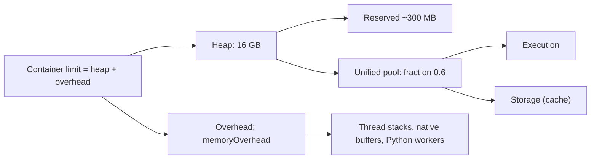

## 🎯 خلاصه

> Spark داخل container های JVM اجرا می‌شود. دو سیستم حافظه‌ی مختلف می‌توانند job را بکشند: **heap جاوا** (خطای `java.lang.OutOfMemoryError` می‌گیری) و **سقف container** (YARN یا Kubernetes پروسه را می‌کشد، اغلب بدون هیچ خطای جاوایی).

- heap بین **execution** (shuffle، join، sort، aggregation) و **storage** (داده‌ی cache‌شده) تقسیم می‌شود. هر دو یک pool مشترک دارند و execution می‌تواند storage را بیرون بیندازد.
- **Overhead** (off-heap، بافرهای native، Python workerها، thread ها) بیرون از heap است، ولی از همان سقف container کم می‌شود.
- OOM در **driver** معمولاً یعنی داده‌ی زیادی به یک جا آورده‌ای (`collect()`، broadcast بزرگ، نتیجه‌ی خیلی بزرگ).
- OOM در **executor** معمولاً یعنی یک task داده‌ی زیادی گرفته (skew، aggregation پهن، UDF سنگین).

## 🌱 از ساده شروع کنیم (مبتدی)

> **💡 تشبیه:** یک executor مثل یک کارگاه است با یک میز (heap) و یک انبار کوچک کنارش (overhead). میز باید ابزار کار فعلی (execution) و قطعات ذخیره‌شده برای بعد (cache) را نگه دارد. اگر میز پر شد، Spark قطعات را در جعبه‌ای روی زمین می‌گذارد (spill روی دیسک). اگر کل کارگاه از اتاقی که اجاره کرده‌ای بزرگ‌تر شود (container)، صاحب‌خانه (YARN یا Kubernetes) بیرونت می‌کند. همان پیام «OOM-killed».

دو نکته را به خاطر بسپار:

1. **Java OOM** پیامی داخل لاگ job است. JVM حافظه‌ی heap را تمام کرده و متوقف شده.
2. **executor کشته‌شده با OOM** پیامی از cluster manager است. پروسه از سقف container بیشتر حافظه مصرف کرده و container کشته شده. JVM شاید اصلاً نفهمیده باشد.

این دو راه‌حل متفاوت دارند. Java OOM معمولاً داده‌ی کمتر در هر task یا heap بیشتر می‌خواهد. kill شدن container معمولاً overhead بیشتر یا مصرف off-heap کمتر (Python، کتابخانه‌های native) می‌خواهد.

## 🔧 واقعاً چطور کار می‌کند (متوسط)

برای executor با `spark.executor.memory = 16g` چیدمان تقریباً این است:



**Unified memory.** Spark مقدار `(heap - 300 MB رزرو) x spark.memory.fraction` (پیش‌فرض 0.6) را به‌عنوان pool مشترک در نظر می‌گیرد. execution و storage این pool را شریک‌اند. `spark.memory.storageFraction` (پیش‌فرض 0.5) ناحیه‌ای را در pool مشخص می‌کند که بلوک‌های cache‌شده در آن محفوظ‌اند: execution فقط بالای این ناحیه می‌تواند cache را پاک کند. یعنی یک shuffle بزرگ می‌تواند cache را بیرون بیندازد، ولی cache نمی‌تواند shuffle در حال اجرا را بیرون کند.

**Overhead.** `spark.executor.memoryOverhead` حافظه‌ی اضافه‌ی non-heap برای هر executor است. پیش‌فرض آن بزرگ‌ترِ «۱۰٪ حافظه‌ی executor» و ۳۸۴ MB است (کف ۳۸۴ MB در مستندات نسخه‌های جدید آمده). روی Kubernetes برای job های non-JVM (PySpark با UDF سنگین پایتونی)، فاکتور پیش‌فرض 0.40 است. وقتی مصرف واقعی native job را می‌دانی، آن را صریح تنظیم کن.

**Spill.** وقتی یک عملگر execution (sort، hash aggregate، join) در سهمش جا نمی‌شود، تکه‌های مرتب‌شده یا hash‌شده را روی دیسک محلی می‌نویسد. Spark UI این را به‌صورت «Spill (memory)» و «Spill (disk)» برای هر stage نشان می‌دهد. مقداری spill طبیعی و ارزان است. spill سنگین در همه‌ی taskها یعنی partitionها خیلی بزرگ‌اند؛ این مشکل اندازه است، نه memory leak.

**OOM در driver در برابر executor.**

| علامت | علت معمول | اولین کار |
|---|---|---|
| `OutOfMemoryError` در driver | `collect()`، `toPandas()`، `broadcast` بزرگ، فراتر رفتن از `spark.driver.maxResultSize` | نتیجه را بنویس به‌جای collect؛ broadcast را کوچک کن |
| `OutOfMemoryError` در executor (جاوا) | یک task داده‌ی زیاد دارد (skew، aggregation بزرگ، لیست بزرگ در UDF) | repartition، رفع skew، حافظه‌ی بیشتر برای هر task |
| «Container killed ... exceeding memory limits» | RSS بالاتر از سقف container (overhead، Python، native) | افزایش `memoryOverhead`، کاهش حافظه‌ی Python |
| توقف‌های طولانی GC بدون خطا | اشیای زنده‌ی زیاد، heap های بزرگ | executorهای کوچک‌تر، ذخیره‌ی سریال‌شده، بررسی زمان GC |

**Dynamic allocation.** با `spark.dynamicAllocation.enabled=true`، Spark بر اساس taskهای در انتظار executor اضافه و کم می‌کند. برای اینکه فایل‌های shuffle بعد از حذف executor از بین نروند، به external shuffle service یا `spark.dynamicAllocation.shuffleTracking.enabled` نیاز دارد. executor بیکار بعد از `spark.dynamicAllocation.executorIdleTimeout` آزاد می‌شود. این روی cluster اشتراکی کمک می‌کند؛ به یک stage با skew کمکی نمی‌کند.

**Serialization.** `spark.serializer=org.apache.spark.serializer.KryoSerializer` سریال‌سازی RDD را کوچک‌تر و سریع‌تر می‌کند. داده‌ی DataFrame و SQL از قبل از فرمت باینری داخلی Spark استفاده می‌کند، پس Kryo آنجا اهمیت کمتری دارد. پیش‌فرض‌ها را قبل از نقل‌کردن، در مستندات نسخه‌ی خودت چک کن.

## 🧠 عمق و trade-offها (سنیور)

- **Driver یک JVM واحد است.** هر چیزی که داده را به driver بیاورد گلوگاه است: `collect()` و `toPandas()` روی نتیجه‌ی بزرگ. از `take(n)`، `limit` یا نوشتن در storage استفاده کن.
- **Broadcast اول روی driver ساخته می‌شود.** broadcast بزرگ روی driver ساخته و روی همه‌ی executorها کپی می‌شود. اندازه‌اش را در حافظه بعد از decompression بسنج، نه روی دیسک.
- **اندازه‌گذاری job ۲ TB.** قاعده‌ی سرانگشتی: ۴ تا ۵ core برای هر executor (core بیشتر یعنی taskهای بیشتری که یک heap و یک GC را شریک‌اند) و heap حدود ۱۶ تا ۳۲ GB، چون heap های خیلی بزرگ توقف‌های GC طولانی می‌سازند. محاسبه: ۲ TB = ۲٬۰۴۸ GB = ۲٬۰۹۷٬۱۵۲ MB؛ با ۱۲۸ MB برای هر partition، ۱۶٬۳۸۴ task می‌شود. با ۴۰ executor و ۵ core، ۲۰۰ task هم‌زمان داریم، پس حدود ۸۲ wave. حافظه‌ی execution هر task تقریباً (۱۶ - ۰٫۳) x ۰٫۶ / ۵ ≈ ۱٫۹ GB است؛ این عدد را با بزرگ‌ترین partitionها مقایسه کن. این‌ها نقطه‌ی شروع‌اند؛ اندازه بگیر و تنظیم کن.
- **executor بیشتر همیشه سریع‌تر نیست.** بعد از یک حد، هزینه‌ی shuffle و هماهنگی driver رشد می‌کند. timeline مرحله را ببین، نه فقط تعداد executor را.
- **تنظیم GC آخرین راه است.** اگر زمان GC در UI بیشتر از حدود ۱۰٪ زمان task باشد، اول اشیای زنده را کم کن: کپی‌های cache کمتر، فرمت ستونی، partitionهای کوچک‌تر، و پرهیز از اشیای `Dataset` در حلقه‌های داغ. روی JVM های جدید G1 معمول است؛ collector را فقط با اندازه‌گیری عوض کن.
- **Kubernetes.** سقف container سخت است. overhead که تنظیم می‌کنی همان چیزی است که kubelet اعمال می‌کند، و یک job پایتونی با بافرهای Arrow و Python workerها می‌تواند از اندازه‌گذاری فقط برای heap فراتر برود. `memoryOverhead` را صریح تنظیم کن و کد خروج ۱۳۷ (کشته‌شده) را در رویدادهای pod دنبال کن. ببین **spark-on-kubernetes**.
- **trade-off در cache.** یک DataFrame cache‌شده حافظه‌ی storage را در همان unified pool رزرو می‌کند و با execution رقابت دارد. فقط چیزی را cache کن که چند بار استفاده می‌شود و وقتی تمام شد `unpersist()` کن.

## 🧪 امتحان کن

این job با `spark.executor.memory=8g` و ۴ core اجرا می‌شود:

```python
df = spark.read.parquet("s3://bucket/events/")     # 600 GB
agg = df.groupBy("user_id").agg(F.count("*").alias("n"))
rows = agg.collect()                                # step X
```

1. توضیح بده مرحله‌ی X چه نوع OOM ای می‌تواند ایجاد کند و چرا.
2. مرحله‌ی X را با نوشتن جایگزین کن. بعد برای ۶۰۰ GB با هر partition ۱۲۸ MB چند partition لازم است، و حافظه‌ی execution هر task با ۴ core و heap ۸ GB چقدر است؟
3. دو نشانه در Spark UI بنویس که یک stage بیش از حد spill می‌کند، و چه چیزی را تغییر می‌دهی.

<details><summary>راه‌حل‌ها را نشان بده</summary>

**1.** `collect()` همه‌ی ردیف‌های aggregate‌شده را به heap driver می‌آورد. اگر `user_id` مقادیر متمایز زیادی داشته باشد، heap driver تمام می‌شود: `OutOfMemoryError` در driver. راه‌حل نوشتن نتیجه است، نه collect.

**2.** با `agg.write.parquet(...)` بنویس. partition ها: ۶۰۰ GB = ۶۱۴٬۴۰۰ MB؛ با ۱۲۸ MB برای هر کدام، ۴٬۸۰۰ partition. حافظه‌ی execution هر task: (۸ - ۰٫۳) x ۰٫۶ / ۴ ≈ ۱٫۱۵ GB. partitionهایی که بزرگ‌تر از این باشند spill می‌کنند.

**3.** در جزئیات stage ستون‌های «Spill (memory)» و «Spill (disk)» بزرگ‌اند و کندترین taskها بیشترین spill را دارند. راه‌حل: partition بیشتر (ورودی کوچک‌تر برای هر task)، یا حافظه‌ی بیشتر برای هر task (core کمتر برای هر executor، یا heap بزرگ‌تر).

</details>

## 💬 گوشه‌ی مصاحبه

**سؤال: «executorها روی Kubernetes مدام OOM-killed می‌شوند؛ دیباگ کن.»**

- جواب متوسط: «لاگ pod را نگاه می‌کنم، کد خروج ۱۳۷ می‌بینم و `memoryOverhead` را بالا می‌برم.»
- جواب سنیور: «اول دو OOM را جدا می‌کنم. اگر لاگ یک `OutOfMemoryError` جاوا نشان بدهد، heap است: دنبال skew و partitionهای بزرگ در تب Stages می‌گردم. اگر pod با کد خروج ۱۳۷ و بدون خطای جاوا کشته شده، حافظه‌ی container است: heap به‌علاوه‌ی overhead به‌علاوه‌ی مصرف Python و native از سقف بیشتر شده. overhead، استفاده از UDF پایتونی یا Arrow، و RSS اوج executor را چک می‌کنم. بعد `memoryOverhead` را صریح بالا می‌برم یا حافظه‌ی Python را کم می‌کنم، و اثر را در متریک‌های اجرای بعد تأیید می‌کنم.»

**سؤال: «یک job ۲ TB را چطور اندازه‌گذاری می‌کنی؟»**

جواب سنیور: «از تعداد partition شروع می‌کنم، حدود ۱۶٬۰۰۰ partition با ۱۲۸ MB. ۴ تا ۵ core برای هر executor و heap بین ۱۶ تا ۳۲ GB انتخاب می‌کنم، تا هر task حافظه‌ی execution کافی برای partition خودش داشته باشد. بعد taskهای هم‌زمان و تعداد wave ها را حساب می‌کنم و قبل از scale کردن، spill و GC را در یک اجرای آزمایشی چک می‌کنم.»

> **🎤 این را در مصاحبه بگو:** «مشکلات حافظه را به driver، heap executor و overhead container تقسیم می‌کنم، چون هرکدام علامت و راه‌حل متفاوتی دارند. executorها را از روی اندازه‌ی partition و core اندازه می‌گیرم و spill و GC را در UI تأیید می‌کنم، نه حدس می‌زنم.»

## ⚠️ اشتباهات رایج

> **⚠️ حواست باشد:** افزایش `spark.executor.memory` وقتی کشتن از سمت container است. سقف container یعنی heap به‌علاوه‌ی overhead، پس heap بزرگ‌تر تنهایی ممکن است کشتن‌ها را بیشتر کند.

> **⚠️ حواست باشد:** روی یک DataFrame بزرگ `collect()` بزنی تا «داده را ببینی». از `show()`، `take()` یا نوشتن خروجی استفاده کن.

- یکی‌گرفتن Java `OutOfMemoryError` با پیام «container killed» کلاستر.
- تنظیم heap های خیلی بزرگ (بیشتر از ۱۰۰ GB) برای جلوگیری از spill و بعد رنج توقف‌های طولانی GC.
- استفاده از core زیاد برای هر executor در job سنگین از نظر حافظه، که باعث می‌شود taskها سهم کوچکی از حافظه‌ی execution داشته باشند.
- cache کردن همه‌چیز برای سرعت‌دادن به pipeline ای که فقط یک‌بار استفاده می‌شود.
- فرض کردن اینکه dynamic allocation مشکل stage کند را حل می‌کند. این تعداد executor را عوض می‌کند، نه توزیع داده را.

## ✅ خودت را بسنج

1. Kubernetes یک executor را با کد خروج ۱۳۷ می‌کشد و لاگ جاوا خطایی ندارد. محتمل‌ترین علت چیست؟
   - A) سرریز heap جاوا
   - B) حافظه‌ی container (heap به‌علاوه‌ی overhead، یا حافظه‌ی Python و native) بالاتر از سقف pod
   - C) driver دستور `collect()` را اجرا کرده
   - D) broadcast join خیلی بزرگ بوده

<details><summary>جواب</summary>

**B** — کد خروج ۱۳۷ یعنی کلاستر یا kernel پروسه را برای عبور از سقف کشته. خطای جاوا چاپ نمی‌شود چون JVM فرصت پرتاب آن را نداشته. overhead و مصرف off-heap را چک کن.

</details>

2. `spark.memory.storageFraction` چه چیزی را کنترل می‌کند؟
   - A) سهم دیسک برای فایل‌های shuffle
   - B) بخشی از unified pool که بلوک‌های cache‌شده در آن از حذف شدن توسط execution محفوظ‌اند
   - C) تعداد core ها در هر executor
   - D) اندازه‌ی overhead

<details><summary>جواب</summary>

**B** — execution فقط بالای ناحیه‌ی محفوظ storage می‌تواند cache را پاک کند. بالابردن آن cache را محافظت می‌کند، به قیمت حافظه‌ی کمتر برای execution.

</details>

3. یک job با `groupBy` روی کلید skew شده، یک task با spill خیلی زیاد دارد و بقیه عادی‌اند. بهترین اولین قدم چیست؟
   - A) اضافه‌کردن executor
   - B) بالابردن حافظه‌ی driver
   - C) رسیدگی به skew (salting، pre-aggregation یا AQE) تا partition داغ کوچک شود
   - D) خاموش‌کردن spill

<details><summary>جواب</summary>

**C** — یک partition داغ مشکل داده است. executor بیشتر آن را کوچک نمی‌کند، و خاموش‌کردن spill فقط job را زودتر خراب می‌کند.

</details>

4. **(سنیور)** ۴ executor با heap ۳۲ GB و ۱۶ core داری و taskها spill سنگین دارند. trade-off راه‌حلت چیست؟

   - A) core کمتر برای هر executor به هر task حافظه‌ی execution بیشتری می‌دهد ولی موازی‌سازی هر executor را کم می‌کند؛ معمولاً executor بیشتر با core کمتر تعادل بهتری می‌دهد
   - B) core بیشتر همیشه حافظه را بهتر می‌کند
   - C) spill فقط روی driver رخ می‌دهد
   - D) core ها روی حافظه اثری ندارند

<details><summary>جواب</summary>

**A** — با ۱۶ core که یک heap را شریک‌اند، هر task سهم کوچکی از حافظه‌ی execution دارد. core کمتر برای هر executor (و executor بیشتر) حافظه‌ی بیشتر برای هر task می‌دهد، به قیمت موازی‌سازی کمتر در هر executor. spill و زمان stage را اندازه بگیر.

</details>

5. **(سنیور)** dynamic allocation روشن است، ولی یک stage با کلید skew شده دو ساعت طول می‌کشد. چرا dynamic allocation کمک نمی‌کند؟

   - A) dynamic allocation فقط برای streaming است
   - B) تعداد executor را عوض می‌کند، ولی یک task skew شده partition داغ را تنها پردازش می‌کند
   - C) external shuffle service را غیرفعال می‌کند
   - D) به `collect()` نیاز دارد

<details><summary>جواب</summary>

**B** — dynamic allocation وقتی taskی در انتظار است executor اضافه یا کم می‌کند. یک partition داغ هنوز یک task روی یک core است و executorهای اضافی بیکار می‌مانند. راه‌حل در توزیع داده است.

</details>

## 🗂️ فلش‌کارت

| Front | Back |
|---|---|
| Java OOM در برابر container killed | Java OOM خطای heap در لاگ است؛ container killed یعنی کلاستر پروسه را برای عبور از سقف حافظه متوقف کرده |
| اندازه‌ی unified pool | `(heap - 300 MB) x spark.memory.fraction` (پیش‌فرض 0.6) |
| `spark.memory.storageFraction` | سهم محفوظ cache؛ execution فقط بالای آن می‌تواند cache را پاک کند |
| پیش‌فرض `memoryOverhead` | بزرگ‌ترِ ۱۰٪ حافظه‌ی executor و ۳۸۴ MB (نسخه‌ات را چک کن) |
| کد خروج ۱۳۷ در Kubernetes | پروسه برای عبور از سقف حافظه کشته شده |
| علت رایج OOM در driver | `collect()`، `toPandas()`، broadcast بزرگ، نتایج بزرگ |
| spill در UI | Spill (memory) و Spill (disk) برای هر stage؛ spill سنگین یعنی partitionها بزرگ‌اند |
| نقطه‌ی شروع اندازه‌ی executor | ۴ تا ۵ core، heap ۱۶ تا ۳۲ GB، سپس اندازه بگیر |

## 🔗 ادامه

- **spark-architecture** نقش driver و executor را توضیح می‌دهد که این درس به آن تکیه دارد.
- **spark-shuffle** فایل‌های shuffle را پوشش می‌دهد که spill و dynamic allocation به آن‌ها وابسته‌اند.
- **spark-on-kubernetes** و **yarn-vs-k8s** نشان می‌دهند سقف container چطور تنظیم و اعمال می‌شود.
- **spark-joins-skew** رایج‌ترین علت یک task بیش‌ازحد بزرگ را پوشش می‌دهد.
- **spark-ui-debugging** نشان می‌دهد چطور spill، GC و متریک‌های task را در عمل بخوانی.
