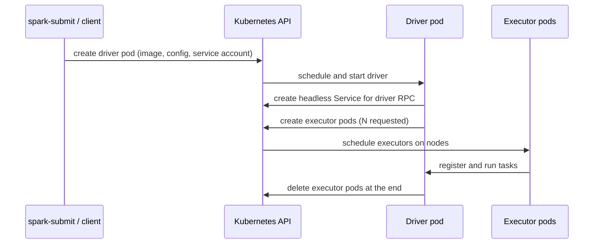

## 🎯 خلاصه

> Spark روی Kubernetes یعنی وقتی به منبع محاسباتی نیاز دارد، **از API سرور Kubernetes پاد (pod) می‌خواهد**، و وقتی لازم نیست پس می‌دهد. درایور (driver) یک پاد است و هر executor هم یک پاد جداگانه.

- به‌جای YARN، Kubernetes نقش cluster manager را دارد. Spark خودش **پادهای executor** را می‌سازد؛ لازم نیست مجموعه‌ای ثابت از دیمون‌های کارگر از قبل بالا باشند.
- Dynamic allocation بدون external shuffle service هم کار می‌کند، اما فقط اگر Spark **فایل‌های shuffle را رهگیری (track)** کند.
- داده‌ی shuffle روی دیسک محلی executor می‌ماند. وقتی executor حذف شود (کاهش مقیاس، از دست رفتن نود، یا preemption در spot)، خروجی shuffle‌اش هم می‌رود، مگر اینکه ذخیره‌سازی shuffle از راه دور یا قابل بازیابی داشته باشی.
- تقریباً همه‌ی مشکلات عملیاتی از سه چیز می‌آید: منابع پاد (محدودیت حافظه و OOMKilled)، محل قرارگرفتن پاد (node selector و spot در برابر on-demand)، و لایه‌ی shuffle.

## 🌱 از ساده شروع کنیم (مبتدی)

> **💡 Analogy:** رستورانی را تصور کن که آشپزخانه‌ی خودش را ندارد. برای هر مهمانی بزرگ، چند ایستگاه آشپزی از یک ساختمان مشترک اجاره می‌کند. سرآشپز (**driver**) منو را طراحی می‌کند و ایستگاه‌ها (**پادهای executor**) را اجاره می‌کند. وقتی مهمانی تمام شد، ایستگاه‌ها به ساختمان برمی‌گردند و مستأجرهای دیگر می‌توانند از آن‌ها استفاده کنند.

در YARN، روی هر نود کارگر یک NodeManager از قبل در حال اجراست و Spark از YARN کانتینر می‌خواهد. در Kubernetes اصلاً کارگر ثابت Spark وجود ندارد. Spark فقط یکی از کلاینت‌های API کوبرنتیز است.

یک ارسال ساده در **cluster mode** (که درایور هم داخل یک پاد اجرا می‌شود):

```bash
spark-submit \
  --master k8s://https://k8s-api.internal:6443 \
  --deploy-mode cluster \
  --name daily-orders \
  --conf spark.kubernetes.container.image=registry.internal/spark:3.5.1-py \
  --conf spark.kubernetes.authenticate.driver.serviceAccountName=spark \
  --conf spark.executor.instances=4 \
  --conf spark.executor.memory=4g \
  --conf spark.executor.cores=2 \
  local:///opt/spark/work-dir/daily_orders.py
```

این فلگ‌ها را مثل یک چک‌لیست بخوان:

- `--master k8s://...` به Spark می‌گوید با کدام API سرور حرف بزند.
- `--deploy-mode cluster` درایور را داخل کلاستر می‌گذارد. با `client` درایور روی لپ‌تاپ یا سرور واسط می‌ماند.
- `serviceAccountName` به درایور دسترسی لازم برای ساختن پاد را می‌دهد.
- ایمیج باید خود Spark و وابستگی‌های جاب را داشته باشد. executorها همان ایمیج را اجرا می‌کنند.

نتیجه را با ابزارهای معمولی می‌توانی ببینی:

```bash
kubectl get pods -l spark-role=driver
kubectl get pods -l spark-role=executor
kubectl logs <driver-pod-name>
```

وقتی جاب تمام شد، پادهای executor حذف می‌شوند. پاد درایور در وضعیت `Completed` می‌ماند تا لاگ‌هایش را بخوانی.

## 🔧 واقعاً چطور کار می‌کند (متوسط)

وقتی جاب را ارسال می‌کنی، این اتفاقات می‌افتد:



نکات کلیدی:

- **ترافیک درایور به executor** به یک آدرس پایدار نیاز دارد. Spark یک Service از نوع headless برای درایور می‌سازد و executorها با نام DNS به آن وصل می‌شوند. Network policyهایی که ارتباط پاد به پاد را می‌بندند، این مسیر را بی‌صدا خراب می‌کنند و علامتش executorهایی است که هرگز ثبت نمی‌شوند.
- **نام و labelهای پاد** شناسه‌ی application Spark را حمل می‌کنند. با همین است که با `kubectl` پیدایشان می‌کنی و سیستم‌های مانیتورینگ گروه‌بندی‌شان می‌کنند.
- **منابع تنظیمات.** تنظیمات از خصوصیات `spark.*`، از pod template (فایل‌های YAML که درایور و executor را توصیف می‌کنند) و از مقادیر پیش‌فرض می‌آیند. pod templateها راه فرار برای چیزهایی‌اند که Spark خصوصیت مستقیم برایشان ندارد.

**Pod template** در عمل مفیدترین ابزار است:

```yaml
# executor-template.yaml
apiVersion: v1
kind: Pod
spec:
  nodeSelector:
    workload: batch
  tolerations:
    - key: "spot"
      operator: "Equal"
      value: "true"
      effect: "NoSchedule"
  containers:
    - name: executor        # Spark looks for a container named "executor"
      resources:
        limits:
          memory: "6Gi"
```

```bash
--conf spark.kubernetes.executor.podTemplateFile=/opt/templates/executor-template.yaml
```

از template برای node selector، toleration، affinity، volumeهای اضافی و sidecarهایی مثل ارسال‌کننده‌ی لاگ استفاده کن. خصوصیات Spark را برای چیزهایی نگه دار که خود Spark می‌فهمد، مثل حافظه و تعداد core.

**Dynamic allocation** به Spark اجازه می‌دهد تعداد executorها را وسط اجرای جاب تغییر دهد:

```bash
--conf spark.dynamicAllocation.enabled=true \
--conf spark.dynamicAllocation.minExecutors=0 \
--conf spark.dynamicAllocation.maxExecutors=50 \
--conf spark.dynamicAllocation.shuffleTracking.enabled=true
```

در YARN، dynamic allocation معمولاً به یک **external shuffle service** متکی است: دیمونی روی هر نود که فایل‌های shuffle را زنده نگه می‌دارد، حتی بعد از اینکه executor نویسنده‌ی آن‌ها رفته باشد. Kubernetes به‌طور پیش‌فرض چنین دیمونی ندارد. پس Spark از **shuffle tracking** استفاده می‌کند: تا وقتی executor فایل shuffle‌ای دارد که یک stage در حال اجرا به آن نیاز دارد، آن executor را زنده نگه می‌دارد. پیش‌فرض این تنظیم را برای نسخه‌ی Spark خودت بررسی کن و صریح مقدار بده.

هزینه‌ی shuffle tracking این است که executorهای بیکاری که داده‌ی shuffle دارند، بیشتر می‌مانند، و کلاستر ممکن است پادهای بیشتری از نیاز کار نگه دارد. تنظیم `spark.dynamicAllocation.shuffleTracking.timeout` مدت این ماندن را محدود می‌کند.

**حساب‌کردن حافظه** جایی است که خیلی از جاب‌ها شکست می‌خورند. محدودیت حافظه‌ی پاد executor باید این‌ها را پوشش دهد:

- هیپ JVM (`spark.executor.memory`)،
- حافظه‌ی off-heap و overhead (`spark.executor.memoryOverhead`، که کسری از هیپ با یک حداقل است؛ برای نسخه‌ات بررسی کن)، و
- پروسه‌های Python، اگر از PySpark استفاده می‌کنی.

اگر جمع این‌ها از محدودیت پاد بیشتر شود، کرنل کانتینر را می‌کشد. پاد وضعیت `OOMKilled` (کد خروج 137) را نشان می‌دهد. در این حالت Spark هرگز `OutOfMemoryError` جاوا نمی‌بیند، پس Spark UI عادی به نظر می‌رسد تا وقتی executorها ناپدید شوند. وقتی executorها می‌روند، `kubectl describe pod` را نگاه کن.

## 🧠 عمق و trade-offها (سنیور)

**ذخیره‌سازی shuffle مهم‌ترین تصمیم طراحی است.** فایل‌های shuffle روی دیسک محلی هر executor نوشته می‌شوند (معمولاً یک volume از نوع `emptyDir` یا دیسک نود). گزینه‌ها:

| گزینه | چه چیزی می‌دهد | هزینه |
|---|---|---|
| دیسک محلی + shuffle tracking | ساده، بدون سرویس اضافه | از دست رفتن executor یعنی بازمحاسبه‌ی خروجی shuffle‌ای که گم شده؛ کاهش مقیاس کندتر است |
| shuffle روی PVC (`KubernetesLocalDiskShuffleDataIO`، در مستندات Spark 3.5) | داده‌ی shuffle با راه‌اندازی مجدد executor روی همان volume می‌ماند | مدیریت storage class و چرخه‌ی عمر volume؛ مستندات نسخه‌ات را ببین |
| سرویس shuffle از راه دور (Apache Celeborn، Apache Uniffle) | shuffle از executorها جدا می‌شود، پس scale کردن پویا و استفاده از spot امن می‌شود | یک سرویس توزیع‌شده‌ی دیگر که باید اجرا و پایش شود |

سرویس‌های shuffle از راه دور پاسخ امروزی برای جاب‌های بزرگ روی ظرفیت spot هستند. اما رایگان نیستند: ترافیک شبکه و یک حوزه‌ی خرابی جدید اضافه می‌کنند، و باید اندازه‌شان را با حجم shuffle تنظیم کنی. یک عدد برای ذهن: جابی که ۲ ترابایت shuffle می‌کند و روی ۱۰۰ executor با دیسک محلی اجرا می‌شود، تقریباً ۲۰ گیگابایت shuffle روی هر executor می‌نویسد؛ و از دست رفتن ۱۰ نود spot یعنی بازمحاسبه‌ی stageهایی که سهم آن نودها را تولید کرده بودند.

**Spot و preemption.** روی کاغذ، executorها ارزان‌اند که از دست بروند؛ اما اگر داده‌ی shuffle داشته باشند، در عمل گران تمام می‌شوند. یک چینش رایج:

- درایور روی نود on-demand (چون وضعیت برنامه را نگه می‌دارد؛ اگر بمیرد، کل application شکست می‌خورد)،
- executorها روی نودهای spot با pod template مناسب،
- و یا shuffle از راه دور، یا حاشیه‌ی retry کافی (`spark.task.maxFailures`، retry کردن stage) تا preemption جاب را نکشد.

**چرخه‌ی عمر جاب در مقیاس.** ارسال مستقیم با `spark-submit` برای چند جاب خوب است. برای جاب‌های زیاد، از **Spark Operator** استفاده کن (پروژه‌ی `spark-operator` در Kubeflow، یا Apache Spark Kubernetes Operator). این operator یک custom resource به نام `SparkApplication` تعریف می‌کند، ارسال را انجام می‌دهد، با سیاست retry دوباره اجرا می‌کند، و وضعیت را از طریق API کوبرنتیز نشان می‌دهد. Airflow و بقیه‌ی orchestratorها معمولاً از طریق operator ارسال می‌کنند. **Livy** یک رابط REST برای sessionهای تعاملی و ارسال جاب دارد که برای notebook و gateway مناسب است. برای هر تیم یک مسیر ارسال انتخاب کن، وگرنه سه روش مختلف برای پیکربندی یک جاب خواهی داشت.

**YARN در برابر Kubernetes.** انتخاب را بر اساس عملیات انجام بده، نه مد:

| سؤال | YARN | Kubernetes |
|---|---|---|
| مالک workerها کیست؟ | تیم Hadoop، NodeManagerهای بلندمدت | تیم پلتفرم، کلاستر مشترک برای بار کاری‌های زیاد |
| زمان راه‌اندازی executor | شروع کانتینر روی نود گرم | زمان‌بندی پاد و pull ایمیج (ایمیج‌ها را cache کن) |
| سرویس shuffle | سرویس external بالغ | پیش‌فرض ندارد؛ tracking یا shuffle از راه دور |
| اپ‌های چندمستأجره (Spark، Flink، Trino، سرویس‌ها) | بیشتر batch و Hadoop | تناسب خوب؛ یک scheduler برای همه |
| data locality | locality روی HDFS ممکن است | معمولاً ندارد؛ محاسبه و storage جدا هستند |

در ایران، خیلی از تیم‌ها Kubernetes روی زیرساخت خودشان (on-prem) اجرا می‌کنند، چون کلاد عمومی در دسترس نیست. این یعنی داده معمولاً در یک object store یا storage سازگار با HDFS است که از طریق شبکه به آن وصل می‌شوی؛ پس مزیت data locality YARN را از دست می‌دهی و باید برای پهنای باند شبکه برنامه‌ریزی کنی.

**چه چیزهایی را پایش کنی:** پادهای executor در وضعیت pending (زمان‌بندی نشده‌اند، معمولاً مشکل منابع یا quota)، تعداد `OOMKilled`، تعداد executor ساخته و حذف‌شده در هر دقیقه (نشانه‌ی thrash در dynamic allocation)، حجم shuffle نوشته‌شده و خوانده‌شده، و زمان بین ساخته‌شدن پاد و ثبت شدن executor.

**کی استفاده نکنی:** اگر کلاستر Hadoop‌ات خوب کار می‌کند و داده را محلی نگه می‌دارد، انتقال Spark به Kubernetes ریسک اضافه می‌کند بی‌آنکه سود واضحی داشته باشد. برای جاب‌های خیلی کوچک و حساس به تأخیر هم که زمان راه‌اندازی پاد بیشتر از زمان اجراست، استفاده نکن.

## 🧪 امتحان کن

به یک کلاستر Kubernetes محلی (kind یا minikube) و یک ایمیج Spark نیاز داری. از `bin/docker-image-tool.sh` توزیع Spark یا هر ایمیجی که Spark داخلش باشد استفاده کن، و بعد:

1. مثال آماده‌ی `SparkPi` را در cluster mode با ۲ executor ارسال کن. پاد درایور را پیدا کن و لاگ‌هایش را چاپ کن. خط آخر چه می‌گوید؟
2. وسط اجرای جاب یک پاد executor را حذف کن (`kubectl delete pod <executor>`). لاگ درایور چه می‌گوید؟ جاب زنده می‌ماند؟ چرا؟
3. محدودیت حافظه‌ی پاد executor را کمتر از `spark.executor.memory` به‌علاوه‌ی overhead قرار بده. جابی اجرا کن که یک DataFrame بزرگ را cache می‌کند. `kubectl get pod` کدام وضعیت را نشان می‌دهد؟

<details><summary>راه‌حل‌ها را نشان بده</summary>

**1.** آخر لاگ درایور خطی شبیه `Pi is roughly 3.14...` است. پاد درایور بعد از اجرا در وضعیت `Completed` است. executorها خودکار حذف شده‌اند.

**2.** درایور یک executor گم‌شده را ثبت می‌کند و taskهایش را روی executor جدید دوباره زمان‌بندی می‌کند. جاب زنده می‌ماند، اگر executor گم‌شده خروجی shuffle‌ای را نگه نداشته باشد که stage بعدی هنوز به آن نیاز دارد. اگر داشته باشد، Spark stageهایی را که آن خروجی را تولید کرده بودند دوباره محاسبه می‌کند. به همین دلیل روی K8s باید به ذخیره‌سازی shuffle اهمیت بدهی.

**3.** پاد وضعیت `OOMKilled` را نشان می‌دهد (کرنل کانتینر را کشته است). Spark ممکن است بگوید executor از دست رفته، نه یک خطای out-of-memory داخل JVM. محدودیت را بالا ببر یا `spark.executor.memory` را کم کن، و `spark.executor.memoryOverhead` را بررسی کن.

</details>

## 💬 گوشه‌ی مصاحبه

**سؤال: «Spark روی Kubernetes با Spark روی YARN چه فرقی دارد؟»** جواب متوسط: «روی Kubernetes، درایور و executorها پادهایی‌اند که از طریق API server ساخته می‌شوند. workerهای بلندمدت Spark وجود ندارند، و dynamic allocation به جای سرویس shuffle بیرونی از shuffle tracking استفاده می‌کند.» جواب سنیور: «فرقی که مهم است shuffle است. روی YARN، سرویس external shuffle فایل‌های shuffle را وقتی executor می‌رود زنده نگه می‌دارد. روی Kubernetes، یا بازمحاسبه را با shuffle tracking می‌پذیرم، یا یک سرویس shuffle از راه دور مثل Celeborn اضافه می‌کنم تا executorها بتوانند امن scale یا preempt شوند. مسیر ارسال را هم تعیین می‌کنم: برای جاب‌های زیاد و زمان‌بندی‌شده Spark Operator، و برای استفاده‌ی تعاملی Livy.»

**سؤال: «روی K8s یک executor مدام ناپدید می‌شود. چه چیزی را بررسی می‌کنی؟»** جواب متوسط: «رویدادها و لاگ‌های پاد، تا ببینم OOMKilled شده یا eviction.» جواب سنیور: «اول `kubectl describe pod` را برای `OOMKilled` یا دلیل eviction نگاه می‌کنم. اگر حافظه است، محدودیت کانتینر را با جمع هیپ، `memoryOverhead` و حافظه‌ی پروسه‌ی Python مقایسه می‌کنم. اگر preemption است، labelهای نود و tolerationها را چک می‌کنم، و اینکه آیا executor گم‌شده داده‌ی shuffle داشته که بازمحاسبه را مجبور کرده.»

> **🎤 Say this in the interview:** «روی Kubernetes، executorها پادهایی‌اند که می‌آیند و می‌روند، پس سؤال‌های طراحی درباره‌ی دوام shuffle، محدودیت حافظه‌ای که overhead را هم حساب کند، و محل اجرای درایور است. درایور را روی ظرفیت پایدار نگه می‌دارم و executorها را فقط روی ظرفیت ارزان‌تر می‌گذارم، وقتی shuffle با یک سرویس از راه دور مدیریت شود یا بازمحاسبه را بپذیرم.»

## ⚠️ اشتباهات رایج

> **⚠️ Watch out:** تنظیم `spark.executor.memory=8g` با محدودیت پاد `8Gi` تقریباً همیشه شکست می‌خورد. overhead و پروسه‌های Python روی هیپ حافظه می‌خواهند. محدودیت پاد را هیپ به‌علاوه‌ی overhead بگیر.

> **⚠️ Watch out:** فعال‌کردن dynamic allocation روی K8s بدون shuffle tracking (یا سرویس external) باعث می‌شود executorها حذف شوند، در حالی که stageها هنوز به فایل‌های shuffle‌شان نیاز دارند. `spark.dynamicAllocation.shuffleTracking.enabled` را صریح تنظیم کن.

- اجرای درایور روی ظرفیت spot. درایورِ preemption‌شده کل application را می‌کشد.
- فراموش کردن اینکه ایمیج executor باید همان نسخه‌ی Python و کتابخانه‌های درایور را داشته باشد.
- استفاده از `client` mode از یک پاد که مسیر شبکه‌ای برگشت از executorها به درایور ندارد. executorها ثبت نمی‌شوند.
- فرض کردن data locality به سبک HDFS. روی K8s داده معمولاً در object store است و از طریق شبکه می‌آید.
- گذاشتن secret در خصوصیات `spark.*`، که در تب environment در Spark UI دیده می‌شود. از Kubernetes Secret استفاده کن که از طریق pod template mount شده.
- تعیین‌نکردن requestها و limitهای منابع، که باعث می‌شود scheduler executorها را روی نودها فشرده کند و نودها شروع به eviction کنند.

## ✅ خودت را بسنج

1. در cluster mode روی Kubernetes، درایور کجا اجرا می‌شود؟
   - A) روی ماشینی که `spark-submit` را اجرا کرده
   - B) داخل یک پاد درایور که Spark روی کلاستر ساخته
   - C) روی یک پاد master مخصوص Spark که همیشه اجراست
   - D) داخل خود API server کوبرنتیز

<details><summary>جواب</summary>

**B** — در cluster mode، `spark-submit` یک پاد درایور می‌سازد و درایور بعد پادهای executor را می‌سازد. client mode درایور را روی ماشین ارسال‌کننده نگه می‌دارد (گزینه‌ی A)، اما در این مدل master دائمی Spark (گزینه‌ی C) وجود ندارد.

</details>

2. کدام تنظیم مستقیم‌ترین راه برای امن‌کردن dynamic allocation روی Kubernetes بدون سرویس external shuffle است؟
   - A) `spark.dynamicAllocation.minExecutors=0`
   - B) `spark.dynamicAllocation.shuffleTracking.enabled=true`
   - C) `spark.executor.instances=1000`
   - D) `spark.sql.shuffle.partitions=1`

<details><summary>جواب</summary>

**B** — shuffle tracking executorها را تا وقتی فایل‌های shuffle‌شان هنوز لازم است زنده نگه می‌دارد. گزینه‌ی A فقط اجازه می‌دهد به صفر برسد، گزینه‌ی C تعداد را ثابت می‌کند و scale کردن را خاموش می‌کند، و گزینه‌ی D تعداد partitionهای shuffle را عوض می‌کند، نه عمر executor را.

</details>

3. یک پاد executor ری‌استارت شده، Spark UI هیچ `OutOfMemoryError` جاوا نشان نمی‌دهد، اما `kubectl describe pod` وضعیت `OOMKilled` را نشان می‌دهد. محتمل‌ترین علت چیست؟

   - A) باگ در scheduler اسپارک
   - B) کانتینر از محدودیت حافظه‌اش (هیپ به‌علاوه‌ی overhead به‌علاوه‌ی حافظه‌ی Python) عبور کرده و کرنل آن را کشته
   - C) تعداد partitionهای shuffle خیلی کم است
   - D) درایور دیسک کم آورده

<details><summary>جواب</summary>

**B** — `OOMKilled` یعنی کرنل کانتینر را به خاطر عبور از محدودیت حافظه کشته. JVM فرصت پرتاب خطا را نداشته، پس Spark UI خطایی نشان نمی‌دهد. محدودیت پاد را بالا ببر یا تقاضای هیپ و overhead را کم کن.

</details>

4. **(سنیور)** روزی ۳۰۰ جاب Spark را روی executorهای spot در Kubernetes اجرا می‌کنی. shuffleها بزرگ‌اند و preemptionهای spot باعث بازمحاسبه‌ی مکرر stageها می‌شوند. کدام تغییر بهترین قابلیت اطمینان به ازای هر واحد تلاش را می‌دهد، و trade-off آن چیست؟

   - A) افزایش `spark.executor.instances` تا executorهای بیشتری زنده بمانند
   - B) افزودن سرویس shuffle از راه دور (Celeborn یا Uniffle) تا داده‌ی shuffle به executor نویسنده‌اش وابسته نباشد؛ trade-off این است که یک سرویس توزیع‌شده‌ی دیگر باید اجرا و اندازه‌گیری شود
   - C) خاموش‌کردن dynamic allocation و نگه‌داشتن درایور هم روی spot
   - D) استفاده از `client` mode برای همه‌ی جاب‌ها

<details><summary>جواب</summary>

**B** — با سرویس shuffle از راه دور، از دست رفتن یک executor دیگر خروجی shuffle‌اش را از بین نمی‌برد، پس بازمحاسبه به شدت کم می‌شود. بهایش، اجرای یک سرویس توزیع‌شده‌ی دیگر با ظرفیت، حوزه‌های خرابی و هزینه‌ی شبکه‌ی خودش است. گزینه‌ی A مواجهه با preemption را بیشتر می‌کند، گزینه‌ی C درایور را نقطه‌ی خرابی واحد می‌کند، و گزینه‌ی D به shuffle ربطی ندارد.

</details>

5. **(سنیور)** تیمت می‌خواهد جاب‌ها را از یک رابط notebook ارسال کند و هم‌زمان ۲۰۰ جاب زمان‌بندی‌شده را شبانه اجرا کند. کدام طراحی ارسال تمیزتر است و چرا؟

   - A) استفاده از `spark-submit` در هر taskِ Airflow و در notebook، با پیکربندی‌های جدا
   - B) استفاده از Spark Operator برای جاب‌های زمان‌بندی‌شده (منبع‌های declarative از نوع `SparkApplication`، retry و وضعیت در API) و یک gateway مثل Livy برای sessionهای تعاملی، همراه با templateهای مشترک برای پیکربندی مشترک
   - C) اجرای یک درایور بلندمدت که همه‌ی جاب‌ها با هم از آن استفاده کنند
   - D) استفاده از YARN برای notebook و Kubernetes برای جاب‌های batch

<details><summary>جواب</summary>

**B** — Spark Operator ارسال‌های زمان‌بندی‌شده را declarative، قابل مشاهده و قابل retry می‌کند، و Livy استفاده‌ی تعاملی را پوشش می‌دهد. templateهای مشترک پیکربندی را در یک جا نگه می‌دارند. یک درایور بلندمدت مشترک (گزینه‌ی C) جاب‌های نامرتبط را از نظر خرابی به هم گره می‌زند.

</details>

## 🗂️ فلش‌کارت

| Front | Back |
|---|---|
| درایور Spark در cluster mode روی K8s چه می‌شود؟ | یک پاد درایور که spark-submit روی کلاستر می‌سازد |
| چه چیزی پادهای executor را می‌سازد؟ | درایور، از طریق API کوبرنتیز |
| چرا dynamic allocation روی K8s نیاز به دقت دارد؟ | سرویس external shuffle پیش‌فرض ندارد؛ از shuffle tracking یا سرویس shuffle از راه دور استفاده کن |
| `OOMKilled` (کد خروج 137) یعنی چه؟ | کرنل کانتینر را به خاطر عبور از محدودیت حافظه کشته؛ JVM خطایی پرتاب نکرده |
| محدودیت حافظه‌ی پاد باید چه چیزهایی را پوشش دهد؟ | هیپ + memoryOverhead + حافظه‌ی پروسه‌ی Python |
| pod templateها چه چیزی را کنترل می‌کنند؟ | node selector، toleration، affinity، volume و sidecar برای پادهای درایور یا executor |
| نقش Celeborn / Uniffle | سرویس‌های shuffle از راه دور که داده‌ی shuffle را بیرون از executorها نگه می‌دارند |
| Spark Operator | operator کوبرنتیز که جاب‌های Spark را از منبع‌های declarative به نام SparkApplication اجرا می‌کند |

## 🔗 ادامه

- **spark-architecture** درایور، executor و سلسله‌مراتب job → stage → task را توضیح می‌دهد که در پادها می‌بینی.
- **spark-shuffle** توضیح می‌دهد چرا خروجی shuffle مهم است و از دست رفتنش چرا باعث بازمحاسبه می‌شود.
- **yarn-vs-k8s** موضوع مقایسه‌ی cluster managerها را عمیق‌تر پوشش می‌دهد.
- **kubernetes-for-data** مفاهیم Kubernetes (پاد، requests و limits، namespace) را توضیح می‌دهد که این درس فرض می‌کند.
- **spark-memory-tuning** حسابداری هیپ، overhead و off-heap پشت قاعده‌ی محدودیت پاد را توضیح می‌دهد.
- صفحه‌ی مستندات Spark درباره‌ی اجرا روی Kubernetes را برای نسخه‌ی دقیق خودت بخوان. نام خصوصیات و پیش‌فرض‌های shuffle tracking، memory overhead و بازیابی داده‌ی shuffle بین نسخه‌ها تغییر می‌کنند.
