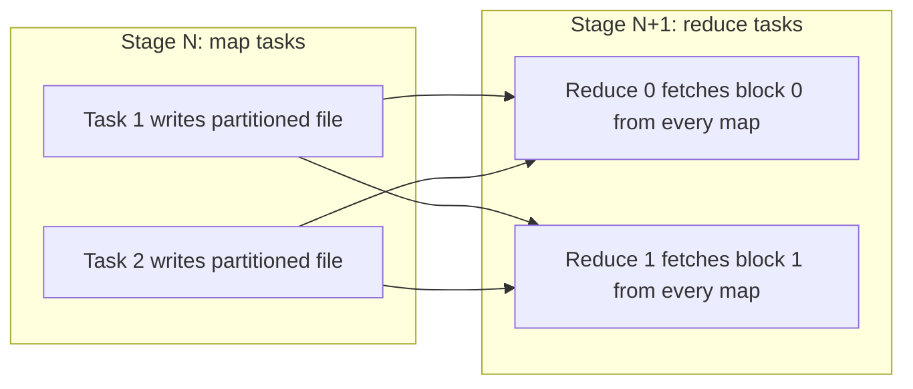

## 🎯 خلاصه

> **shuffle** یعنی جابه‌جا کردن ردیف‌ها بین executorها، طوری که همه‌ی ردیف‌های با کلید یکسان در یک partition قرار بگیرند. این گران‌ترین کاری است که Spark انجام می‌دهد: داده روی دیسک نوشته می‌شود، روی شبکه فرستاده می‌شود، و دوباره خوانده می‌شود. تقریباً هر مشکل performance که دیباگ می‌کنی از این سؤال شروع می‌شود: «چند shuffle هست، چقدر بزرگ‌اند و چند partition داریم؟»

- shuffle از `groupBy`، `join` (غیر broadcast)، `distinct`، window با `PARTITION BY`، `orderBy` و `repartition` ایجاد می‌شود.
- تعداد partitionهای shuffle (`spark.sql.shuffle.partitions`) تعیین می‌کند هر reduce task چقدر بزرگ باشد. هدف partitionهایی حدود ۱۲۸ تا ۲۵۶ مگابایت است.
- `coalesce` بدون shuffle تعداد partition را کم می‌کند. `repartition` همیشه shuffle می‌کند، ولی داده را یکنواخت پخش می‌کند. `partitionBy` هنگام نوشتن پوشه می‌سازد، نه partition در حافظه.

## 🌱 از ساده شروع کنیم (مبتدی)

> **💡 تشبیه:** یک اتاق مرتب‌سازی پست. نامه‌ها از کامیون‌های زیادی می‌رسند (taskهای map) و قاطی‌اند. هر نامه باید به سبد کد پستی خودش برود (کلید). کارگرها نامه‌های کامیون خودشان را برمی‌دارند و هر نامه را در سبد مربوطه می‌اندازند؛ یعنی یک میز مرتب‌سازی با یک سبد برای هر کد پستی. بعد تیم دوم همه‌ی نامه‌های یک سبد را جمع می‌کند و تحویل می‌دهد. جابه‌جایی نامه‌ها بین این میزها همان shuffle است.

```python
from pyspark.sql import functions as F

sales = spark.read.parquet("s3a://sales/2026/")
per_customer = sales.groupBy("customer_id").agg(F.sum("amount").alias("total"))
```

برای محاسبه‌ی جمع هر مشتری، Spark باید **همه‌ی** ردیف‌های مشتری ۴۲ را به **یک** task برساند، حتی اگر این ردیف‌ها را ۲۰۰ task مختلف خوانده باشند. این جابه‌جایی همان shuffle است. `filter` یا `select` به آن نیاز ندارند، چون هر ردیف را می‌شود همان‌جا که هست پردازش کرد.

## 🔧 واقعاً چطور کار می‌کند (متوسط)

shuffle دو طرف دارد که با یک مرز stage از هم جدا می‌شوند (ایده‌ی کلی را در [[shuffle]] و درس معماری در مورد stageها ببین).

۱. **سمت map**: هر map task خروجی‌اش را بر اساس partition مقصد (که از کلید با hash یا range به دست می‌آید) تقسیم می‌کند و روی **دیسک محلی** می‌نویسد. در sort-based shuffle (که سال‌ها پیش‌فرض بوده)، هر map task یک فایل داده و یک فایل index می‌نویسد که بر اساس partition مقصد مرتب شده‌اند. بافرهایی که در حافظه جا نمی‌شوند روی دیسک **spill** می‌شوند و بعداً ادغام می‌گردند.
۲. **سمت reduce**: هر reduce task از هر executorی که بلاک‌هایش را دارد، آن‌ها را روی شبکه می‌گیرد، ادغام می‌کند و پردازش می‌کند.



**تعداد partition.** shuffle در DataFrame تعداد `spark.sql.shuffle.partitions` reduce partition تولید می‌کند (پیش‌فرض ۲۰۰). عملیات RDD از `spark.default.parallelism` استفاده می‌کنند، مگر اینکه عددی بدهی. هر دو عدد ثابت‌اند و با حجم داده مقیاس نمی‌شوند، و به همین دلیل اغلب اشتباه از آب درمی‌آیند.

**محاسبه‌ی اندازه.** فرض کن یک stage ۳۰۰ گیگابایت را shuffle می‌کند:

- با ۲۰۰ partition: ۳۰۰ گیگ / ۲۰۰ = ۱.۵ گیگ برای هر reduce task. هر task spill می‌کند، مدت زیادی طول می‌کشد و خطر OOM در executor دارد.
- هدف ۲۰۰ مگابایت برای هر partition: ۳۰۰ × ۱۰۲۴ مگابایت / ۲۰۰ مگابایت ≈ ۱٬۵۳۶ partition.

قاعده‌ی سرانگشتی: partitionها حدود ۱۲۸ تا ۲۵۶ مگابایت باشند. Adaptive query execution (AQE، درس AQE را ببین) می‌تواند partitionهای کوچک بعد از shuffle را در زمان اجرا ادغام کند، پس می‌توانی با عدد بزرگ شروع کنی و بگذاری Spark کمش کند.

**Spill.** وقتی حافظه‌ی execution برای sort یا aggregation کافی نیست، Spark runهای مرتب‌شده را روی دیسک می‌نویسد و ادغام می‌کند. Spark UI برای هر stage ستون‌های **Shuffle spill (memory)** و **Shuffle spill (disk)** را نشان می‌دهد. spill همیشه باگ نیست، ولی spill سنگین در همه‌ی taskها یعنی partitionها خیلی بزرگ‌اند.

**repartition در برابر coalesce در برابر partitionBy**

| عملیات | shuffle دارد؟ | می‌تواند تعداد را زیاد کند؟ | توزیع یکنواخت؟ | کاربرد معمول |
|---|---|---|---|---|
| `repartition(n)` | بله | بله | بله (round-robin) | رفع partitionهای نامتوازن یا کم |
| `repartition(col)` | بله | بله | بسته به توزیع کلید | کنار هم آوردن ردیف‌های یک کلید قبل از نوشتن |
| `coalesce(n)` | خیر | خیر | اغلب خیر | کم کردن تعداد قبل از نوشتن داده‌ی کوچک |
| `partitionBy("dt")` (هنگام نوشتن) | خیر (چیدمان نوشتن) | n/a | n/a | یک پوشه برای هر مقدار، برای partition pruning هنگام خواندن |

الگوی کلاسیک برای داده‌ی روزانه:

```python
(sales.repartition("dt")          # one shuffle: all rows for a day land in the same task
      .write.partitionBy("dt")    # one folder per day
      .mode("overwrite")
      .parquet("s3a://lake/sales_daily/"))
```

بدون `repartition("dt")` هر task برای هر روزی که دارد یک فایل جدا می‌نویسد. با ۲۰۰ task و ۳۶۵ روز، می‌توانی تا ۲۰۰ × ۳۶۵ = ۷۳٬۰۰۰ فایل کوچک بگیری. با `repartition("dt")`، هر روز معمولاً به یک task می‌رسد و نتیجه تقریباً یک فایل برای هر روز است.

**shuffle در SQL کجاست.** `GROUP BY`، `JOIN` (sort-merge یا shuffled hash)، `DISTINCT`، window با `PARTITION BY`، `ORDER BY` روی داده‌ی بزرگ (range partitioning بعد از نمونه‌گیری) و `UNION` همراه با dedup. `EXPLAIN` آن‌ها را به‌صورت گره‌ی `Exchange` نشان می‌دهد، مثلاً `Exchange hashpartitioning(customer_id, 200)`.

## 🧠 عمق و trade-offها (سنیور)

- **سرویس shuffle خارجی.** فایل‌های shuffle روی دیسک executor هستند. اگر executor برود (مثلاً در dynamic allocation)، فایل‌ها هم از بین می‌روند. سرویس shuffle خارجی، یک پروسه‌ی per-node که فایل‌ها را سرو می‌کند، آن‌ها را در دسترس نگه می‌دارد. shuffle tracking (در Spark 3.x) executor را تا وقتی داده‌ی shuffle‌اش لازم است زنده نگه می‌دارد. بدون یکی از این دو، کم کردن executorها می‌تواند stageهای قبلی را دوباره محاسبه کند.
- **push-based shuffle.** در نسخه‌های جدید Spark، mapperها می‌توانند بلاک‌های ادغام‌شده را به سمت reducerها push کنند، و تعداد زیادی خواندن تصادفیِ کوچک را به تعداد کمتری خواندن بزرگ‌تر تبدیل کنند. عمدتاً روی YARN پشتیبانی می‌شود و به نسخه وابسته است؛ قبل از تکیه بر آن، مستندات نسخه‌ات را چک کن.
- **skew.** سرعت یک shuffle به کندترین reduce task بستگی دارد. اگر یک کلید ۶۰٪ ردیف‌ها را داشته باشد، یک task بیشترِ داده را پردازش می‌کند و بقیه‌ی stage منتظرش می‌مانند. با توزیع مدت taskها در Spark UI تشخیص بده. راه‌حل‌ها: مدیریت skew در AQE برای join، salting کلید (اضافه کردن پسوند تصادفی و aggregate دو مرحله‌ای)، یا جدا کردن کلید داغ. [[data-skew]] را ببین.
- **فشرده‌سازی و serialization** بایت‌های shuffle را کم می‌کنند. فرمت‌های ستونی و فشرده، و کم کردن ستون‌ها قبل از shuffle (column pruning) در بیشتر jobهای واقعی از tuning کردن مهم‌ترند.
- **shuffle کمتر.** ترتیب مهم است: قبل از shuffle فیلتر و projection کن، aggregationهای روی کلید یکسان را ترکیب کن، و وقتی یک طرف کوچک است از broadcast join استفاده کن (طرف بزرگ shuffle نمی‌شود). استفاده‌ی مجدد از یک DataFrame shuffle‌شده با `cache()` از تکرار shuffle جلوگیری می‌کند، به قیمت حافظه.
- **حالت خرابی.** بلاک shuffle از دست‌رفته به‌صورت `FetchFailedException` ظاهر می‌شود. Spark با محاسبه‌ی دوباره‌ی stage مربوط به map دوباره تلاش می‌کند. jobی که مدام در یک stage شکست می‌خورد، اغلب یک executor داغ، مشکل دیسک، یا spill زیاد دارد.
- **پایش.** حجم خواندن و نوشتن shuffle در هر stage، ستون‌های spill، و فاصله‌ی بین سریع‌ترین و کندترین task را ببین. این سه عدد به بیشتر سؤال‌های shuffle جواب می‌دهند.

## 🧪 امتحان کن

۱. یک stage، ۳۰۰ گیگابایت را با تعداد پیش‌فرض partition shuffle می‌کند. متوسط اندازه‌ی هر reduce task و تعداد partition برای هدف ۲۰۰ مگابایت را حساب کن.
۲. همکارت روی یک job با ۱۰ ترابایت می‌نویسد `result.coalesce(1).write.parquet(path)` و روی یک executor ساعت‌ها طول می‌کشد. توضیح بده چرا، و یک راه‌حل پیشنهاد بده.
۳. دو نوشتن را مقایسه کن: `df.write.partitionBy("dt").parquet(p)` و `df.repartition("dt").write.partitionBy("dt").parquet(p)`. برای ۲۰۰ task و ۳۶۵ روز، تعداد فایل‌ها را تخمین بزن و تفاوت را توضیح بده.

<details><summary>راه‌حل‌ها را نشان بده</summary>

**۱.** با ۲۰۰ partition پیش‌فرض، ۳۰۰ گیگ / ۲۰۰ = ۱.۵ گیگ برای هر reduce task. برای هدف ۲۰۰ مگابایت: ۳۰۰ × ۱۰۲۴ مگابایت / ۲۰۰ مگابایت = ۳۰۷٬۲۰۰ / ۲۰۰ = ۱٬۵۳۶ partition. در عمل اندازه‌های واقعی shuffle را در Spark UI ببین و تنظیم کن، یا بگذار AQE ادغام کند.

**۲.** `coalesce(1)` shuffle نمی‌کند، پس یک عملیات **narrow** است. کار بالادستی (اسکن، فیلترها، join ها و aggregationهایی که قبل از `coalesce` هستند) داخل تعداد کمتری task جمع می‌شود و نوشتن نهایی در یک task اجرا می‌شود. کل ۱۰ ترابایت از یک executor رد می‌شود. راه‌حل: موازی‌سازی طبیعی را نگه دار و بعد از اینکه داده کوچک شد (مثلاً بعد از aggregation) تعداد را کم کن، یا از `repartition(n)` با تعدادی که با خروجی تناسب دارد استفاده کن.

**۳.** بدون `repartition`، هر task ردیف‌های روزهای زیادی را دارد و برای هر روزی که دارد یک فایل می‌نویسد: در بدترین حالت حدود ۲۰۰ × ۳۶۵ = ۷۳٬۰۰۰ فایل. با `repartition("dt")`، ردیف‌ها بر اساس `dt` hash می‌شوند، پس هر روز بیشتر به یک task می‌رسد و حدود ۳۶۵ فایل داریم. shuffle زمان می‌گیرد، ولی انفجار فایل‌های کوچک را که هر خواندن بعدی را کند می‌کند جلوگیری می‌کند.

</details>

## 💬 گوشه‌ی مصاحبه

**سوال: «shuffle چیست و کی رخ می‌دهد؟»** جواب متوسط: «داده را بین executorها جابه‌جا می‌کند تا کلیدها گروه‌بندی شوند؛ با `groupBy` و `join` رخ می‌دهد.» جواب سنیور: «یک تبادل دوطرفه است: taskهای map فایل‌های partition‌شده را روی دیسک محلی می‌نویسند، و taskهای reduce بلاک‌های خودشان را روی شبکه می‌گیرند. با وابستگی‌های wide فعال می‌شود. اول تعداد shuffleها را در query می‌شمارم، بعد حجم بایت‌ها و اندازه‌ی partition را نگاه می‌کنم، نه فقط مدت زمان را.»

**سوال: «تعداد partitionهای shuffle را چطور انتخاب می‌کنی؟»** جواب متوسط: «برای یک job بزرگ `spark.sql.shuffle.partitions` را روی چیزی مثل ۴۰۰ می‌گذارم.» جواب سنیور: «از حجم shuffle و هدف اندازه‌ی partition حدود ۱۲۸ تا ۲۵۶ مگابایت شروع می‌کنم، و بعد spill و توزیع مدت taskها را چک می‌کنم. با AQE می‌توانم بالا شروع کنم و Spark را کم‌کردن بگذارم. مقدار پیش‌فرض ۲۰۰ را هیچ‌وقت جواب درست همه‌ی jobها حساب نمی‌کنم.»

**سوال: «repartition یا coalesce؟»** جواب متوسط: «repartition shuffle می‌کند، coalesce نمی‌کند.» جواب سنیور اضافه می‌کند: «`coalesce` می‌تواند نامتوازن باشد و کار بالادستی را داخل تعداد کمتری task می‌برد، پس برای کوچک کردن یک نتیجه‌ی کوچک مناسب است. `repartition` برای متوازن کردن یا کنار هم آوردن یک کلید قبل از نوشتن است.»

> **🎤 این را در مصاحبه بگو:** «shuffle داده را بر اساس کلید از طریق دیسک محلی و شبکه جابه‌جا می‌کند. اول shuffleها را می‌شمارم، partitionها را حدود ۱۲۸ تا ۲۵۶ مگابایت تنظیم می‌کنم، و spill و skew زمان taskها را در UI دنبال می‌کنم. برای نوشتن، بر اساس ستون partition repartition می‌کنم تا هر پوشه تعداد کمی فایل بگیرد.»

## ⚠️ اشتباهات رایج

> **⚠️ مراقب باش:** `coalesce(1)` قبل از نوشتن. عملیات narrow است، پس کل کار بالادستی داخل یک task اجرا می‌شود.

> **⚠️ مراقب باش:** نگه داشتن `spark.sql.shuffle.partitions = 200` برای هر job. برای ۱ ترابایت خیلی کم است و برای ۱ گیگابایت خیلی زیاد.

- استفاده از `partitionBy` هنگام نوشتن روی ستونی با تعداد مقدار بسیار زیاد (مثل شناسه‌ی کاربر) و انتظار چند فایل. هر مقدار یک پوشه می‌سازد.
- فراموش کردن اینکه join روی کلید نامتوازن، حتی با executor زیاد، یک task کند دارد.
- صدا زدن `distinct()` یا `groupBy` روی کل جدول، وقتی یک `filter` یا pre-aggregation اول داده را کوچک‌تر می‌کرد.
- فرض اینکه shuffle رایگان است چون query شبیه SQL است. گره‌های `Exchange` را در plan ببین.
- فرض اینکه executor بیشتر همیشه shuffle را حل می‌کند. تعداد partition بهتر، توزیع متوازن‌تر و spill کمتر بیشتر کمک می‌کنند.

## ✅ خودت را بسنج

۱. کدام عملیات **shuffle** ایجاد نمی‌کند؟
   - A) `groupBy().agg()`
   - B) `repartition("customer_id")`
   - C) `filter`
   - D) `join` بین دو جدول بزرگ بدون broadcast

<details><summary>Answer</summary>

**C** — `filter` narrow است: هر ردیف همان‌جا که هست بررسی می‌شود. سه گزینه‌ی دیگر ردیف‌ها را بر اساس کلید جابه‌جا می‌کنند.

</details>

۲. `coalesce(n)` در برابر `repartition(n)` چه کاری انجام می‌دهد؟
   - A) به‌طور یکنواخت shuffle می‌کند، `repartition` نمی‌کند
   - B) از shuffle پرهیز می‌کند و فقط می‌تواند تعداد را کم کند؛ ممکن است اندازه‌ها نامتوازن بمانند
   - C) همیشه تعداد را زیاد می‌کند
   - D) فایل می‌نویسد، `repartition` نمی‌نویسد

<details><summary>Answer</summary>

**B** — `coalesce` partitionهای موجود را بدون shuffle ادغام می‌کند، پس نمی‌تواند تعداد را زیاد کند و ممکن است اندازه‌ها نامتوازن باشند. `repartition` همیشه shuffle می‌کند و داده را متوازن می‌کند.

</details>

۳. یک shuffle ۳۰۰ گیگابایتی از ۲۰۰ partition پیش‌فرض استفاده می‌کند. اندازه‌ی تقریبی هر reduce task چقدر است و علامت احتمالی چیست؟
   - A) ۱۵ مگابایت؛ job خیلی سریع است
   - B) ۱.۵ گیگابایت؛ spill سنگین و taskهای طولانی، با خطر OOM در executor
   - C) ۳۰۰ گیگابایت؛ Spark یک task اجرا می‌کند
   - D) ۲ گیگابایت؛ علامتی ندارد

<details><summary>Answer</summary>

**B** — ۳۰۰ گیگ / ۲۰۰ = ۱.۵ گیگ برای هر task. این خیلی بالاتر از راهنمای ۱۲۸ تا ۲۵۶ مگابایت است، پس taskها spill می‌کنند و کند می‌شوند و بعضی ممکن است حافظه‌شان تمام شود.

</details>

۴. **(سنیور)** در یک stage، ۱۹۹ task در ۳۰ ثانیه تمام می‌شوند، ولی یک task ۴۰ دقیقه کار می‌کند. محتمل‌ترین علت چیست و چه می‌کنی؟
   - A) driver کند است؛ حافظه‌ی driver را زیاد کن
   - B) skew داده: یک کلید بیشترِ ردیف‌ها را دارد؛ کلید داغ را پیدا کن، بعد برای join از مدیریت skew در AQE استفاده کن، کلید را salt کن، یا کلید داغ را جدا پردازش کن
   - C) تعداد partitionهای shuffle زیاد است؛ آن را به ۱ کم کن
   - D) سرویس shuffle خارجی خاموش است

<details><summary>Answer</summary>

**B** — یک task کند در میان بقیه‌ی taskهای سریع، نشانه‌ی کلاسیک skew است. کلیدی را پیدا کن که بیشترین ردیف را دارد، و راه‌حلی انتخاب کن که با عملیات بخواند (برای join از AQE، برای aggregation از salting، یا مسیر جدا برای کلید داغ).

</details>

۵. **(سنیور)** dynamic allocation executorها را تند کم می‌کند، و بعد از کم شدن، یک job مدام stageهای map قبلی را دوباره محاسبه می‌کند. محتمل‌ترین علت و راه‌حل چیست؟
   - A) فایل‌های Parquet خراب‌اند؛ دوباره بنویسشان
   - B) فایل‌های shuffle روی executorهای حذف‌شده بودند و نه سرویس shuffle خارجی و نه shuffle tracking نگهشان نمی‌داشت؛ یکی از این دو را فعال کن
   - C) تعداد partition زیاد است؛ آن را ۱ کن
   - D) cache غیرفعال است؛ فعالش کن

<details><summary>Answer</summary>

**B** — خروجی shuffle روی دیسک محلی executor ذخیره می‌شود. وقتی آن executor برود، خروجی هم می‌رود، مگر اینکه سرویس shuffle خارجی یا shuffle tracking آن را در دسترس نگه دارد؛ آنگاه Spark stage مربوط به map را دوباره محاسبه می‌کند.

</details>

## 🗂️ فلش‌کارت

| Front | Back |
|---|---|
| shuffle چیست؟ | جابه‌جا کردن ردیف‌ها بین executorها تا ردیف‌های یک کلید در یک partition باشند؛ از طریق دیسک محلی و شبکه |
| کدام عملیات‌ها shuffle می‌کنند؟ | `groupBy`، `join` غیر broadcast، `distinct`، window با `PARTITION BY`، `orderBy` روی داده‌ی بزرگ، `repartition` |
| پیش‌فرض `spark.sql.shuffle.partitions` | ۲۰۰ (ثابت و بی‌توجه به داده، پس تنظیم کن یا بگذار AQE ادغام کند) |
| اندازه‌ی هدف partition | حدود ۱۲۸ تا ۲۵۶ مگابایت |
| `repartition` در برابر `coalesce` | `repartition` shuffle و متوازن می‌کند؛ `coalesce` فقط کم می‌کند، بدون shuffle، و ممکن است نامتوازن باشد |
| `partitionBy` چه می‌سازد؟ | پوشه‌ها روی storage برای هر مقدار (partition pruning هنگام خواندن)، نه partition در حافظه |
| سرویس shuffle خارجی چه کاری می‌کند؟ | فایل‌های shuffle را بعد از رفتن executor نویسنده سرو می‌کند |
| spill را کجا ببینیم؟ | ستون‌های Shuffle spill (memory) و (disk) در صفحه‌ی stage در Spark UI |

## 🔗 ادامه

- **spark-architecture** نشان می‌دهد shuffleها بین stageها و taskها کجا قرار دارند.
- **spark-catalyst** گره‌های `Exchange` و اینکه optimizer چطور shuffle اضافه یا حذف می‌کند را توضیح می‌دهد.
- **spark-aqe** ادغام در زمان اجرا و مدیریت skew را پوشش می‌دهد.
- **spark-joins-skew** استراتژی‌های join و کلیدهای داغ را عمیق‌تر توضیح می‌دهد.
- **spark-writes** و **small-files** توضیح می‌دهند چیدمان partition چطور به تعداد فایل تبدیل می‌شود.
- **spark-memory-tuning** spill و حافظه‌ی executor را پوشش می‌دهد.
