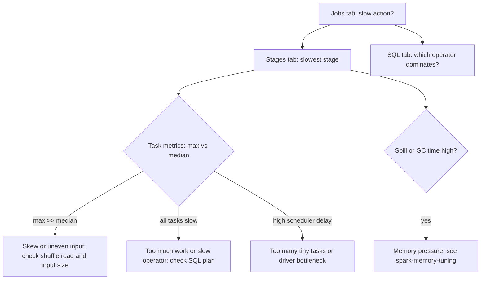

## 🎯 خلاصه

> دیباگ کردن یک job کند در Spark مثل یک قیف است: **کدام job**، بعد **کدام stage**، بعد **کدام الگوی task**، بعد **کدام operator**. هر مرحله علت را محدودتر می‌کند و هر راه‌حل را با همان متریک‌ها تأیید می‌کنی.

- تب **Jobs**: کدام action کند بوده و هر job چقدر طول کشیده.
- تب **Stages**: کدام stage، و **کمینه / میانه / بیشینه**ی taskهایش. پراکندگی نشان می‌دهد مشکل از داده است یا از کلاستر.
- تب **SQL**: physical plan یک query با تعداد ردیف و زمان هر operator.
- تب **Executors**: زمان GC، spill، taskهای شکست‌خورده و حافظه برای هر executor.
- **میانه** و **بیشینه**ی task را مقایسه کن. فاصله‌ی زیاد یعنی skew. همه‌ی taskها کند یعنی کار زیاد برای هر task یا یک operator کند.

## 🌱 از ساده شروع کنیم (مبتدی)

> **💡 تشبیه:** Spark UI مثل داشبورد ماشین است. سرعت‌سنج (Jobs) می‌گوید job کند است. دمای موتور (GC) و نشانگر سوخت (spill) می‌گویند چرا. قبل از اینکه موتور را باز کنی، داشبورد را می‌خوانی.

یک job کند معمولی:

```python
orders = spark.read.parquet("s3://bucket/orders/")
customers = spark.read.parquet("s3://bucket/customers/")
report = (orders.join(customers, "customer_id")
               .groupBy("country").agg(F.sum("amount").alias("revenue")))
report.write.mode("overwrite").parquet("s3://bucket/report/")
```

کل کار ۴۰ دقیقه طول می‌کشد. از کجا شروع کنی؟ UI را در `http://<driver>:4040` باز کن (یا بعد از تمام شدن job، History Server را) و برو تب **Jobs**. job ای که آخرش `parquet` است، نوشتن است. job ای که `join` دارد، گران است. حالا می‌دانی باید کدام بخش کد را بررسی کنی.

از تغییر تنظیمات شروع نکن. اول کندترین **stage** همان job را پیدا کن و بعد ببین آن stage چه کاری می‌کند.

## 🔧 واقعاً چطور کار می‌کند (متوسط)

یک **job** در Spark یک action است (`write`، `count`، `collect`). job در هر مرز shuffle به **stage** تقسیم می‌شود. هر stage تعداد زیادی **task** اجرا می‌کند، یکی برای هر partition. هر task متریک گزارش می‌دهد و UI آن‌ها را جمع می‌کند.



**صفحه‌ی stage: جدول متریک‌های خلاصه.** بیشتر تشخیص‌ها از اینجا شروع می‌شوند. برای هر متریک، Min، صدک ۲۵، Median، صدک ۷۵ و Max را نشان می‌دهد:

- **Duration** و **Scheduler Delay**: زمان انتظار برای شروع. تأخیر بالا یعنی driver یا scheduler زیر بار است، یا taskهای ریز زیادند.
- **GC Time**: زمان garbage collection. بالاتر از حدود ۱۰٪ زمان task هشدار است.
- **Input** و **Shuffle Read**: داده‌ی خوانده‌شده. پراکندگی زیاد اینجا امضای skew یا اندازه‌ی نامساوی فایل‌ها است.
- **Shuffle Write** و **Spill (memory / disk)**: داده‌ی نوشته‌شده و spill شده. spill یعنی یک operator در حافظه جا نشده.

**تب SQL.** برای query های DataFrame و SQL، هر query physical plan خودش را نشان می‌دهد. هر operator (`Scan parquet`، `Exchange`، `SortMergeJoin`، `HashAggregate`) متریک‌هایی مثل تعداد ردیف خروجی و زمان دارد. با Adaptive Query Execution، plan **نهایی** را نشان می‌دهد؛ یعنی همان چیزی که واقعاً اجرا شده. هر `Exchange` یک shuffle است؛ آن‌ها را بشمار. دو `Exchange` قبل از یک join معمولاً یعنی دو shuffle کامل.

**تب Executors.** هر executor را با taskهای فعال و شکست‌خورده، حافظه‌ی storage، shuffle read و write، زمان task و زمان GC فهرست می‌کند. یک executor که taskهای شکست‌خورده یا GC خیلی بیشتر از بقیه دارد، یک مشکل سخت‌افزاری یا حافظه‌ای است، نه مشکل داده.

**Event log و History Server.** UI زنده بعد از پایان application ناپدید می‌شود. برای دیدنش بعداً، event log را فعال کن (`spark.eventLog.enabled=true` و یک `spark.eventLog.dir` روی storage مشترک) و History Server را اجرا کن. jobهای production باید همیشه event log بنویسند؛ بدون آن نمی‌توانی اجرای کند دیروز را دیباگ کنی.

## 🧠 عمق و trade-offها (سنیور)

- **پراکندگی را بخوان، نه میانگین.** stage ای با میانه‌ی ۲۰ ثانیه و بیشینه‌ی ۴۵ دقیقه یک مشکل است. stage ای که میانه و بیشینه‌اش هر دو ۳ دقیقه است مشکل دیگری دارد: موازی‌سازی کم یا operator گران.
- **قبل از تغییر کد، operator را پیدا کن.** stage کند را به node SQL اش وصل کن. stageای که shuffle read دارد و با `SortMergeJoin` تمام می‌شود، مشکل join است؛ stageای که با `Scan` شروع و هزاران partition ورودی ریز دارد، مشکل small-files است (ببین **small-files**).
- **skew ورودی در برابر skew shuffle.** skew ورودی (یک task اسکن داده‌ی خیلی بیشتری می‌خواند) معمولاً یعنی یک فایل خیلی بزرگ یا تعداد زیاد فایل ریز. skew shuffle (یک task reduce داده‌ی خیلی بیشتری می‌خواند) معمولاً یعنی یک کلید داغ. راه‌حل‌ها متفاوت‌اند: **spark-joins-skew** را ببین.
- **speculative execution علامت‌ها را پنهان می‌کند.** `spark.speculation` taskهای کند را دوباره اجرا می‌کند. ممکن است job تمام شود و مشکل skew پنهان بماند، و اگر خروجی idempotent نباشد، نوشتن‌ها را تکراری می‌کند. قبل از روشن کردن آن، task کند را بررسی کن.
- **گلوگاه job در برابر گلوگاه کلاستر.** driver ای که ۳۰٪ زمان دیواری را صرف planning می‌کند (فایل‌های زیاد، plan های عمیق، فراخوانی زیاد `withColumn`) شبیه job کند است، ولی هیچ executor مشغول نیست. timeline مرحله فاصله‌های بین stageها را نشان می‌دهد.
- **پایش در مقیاس.** متریک‌ها (سیستم متریک Spark یا event log) را به stack پایش‌ات بفرست و روی مدت stage و نسبت بیشینه/میانه هشدار بگذار. روی اینکه کسی UI را باز کند حساب نکن.
- **کی از UI استفاده نکن.** برای job تکراری، UI یک میکروسکوپ یک‌باره است. یک بررسی رگرسیون بر اساس زمان کل job، حجم shuffle و spill از event log بساز تا تغییر بد در CI یا در اولین اجرا گرفته شود.

## 🧪 امتحان کن

از job بالا استفاده کن، یا هر job Spark که می‌توانی به‌صورت local اجرا کنی (`spark-submit` در حالت `local[*]` کار می‌کند، ولی skew و GC فقط در مقیاس واقعی دیده می‌شوند).

1. event log را در `spark-defaults.conf` فعال کن:

```text
spark.eventLog.enabled           true
spark.eventLog.dir               file:///tmp/spark-events
spark.history.fs.logDirectory    file:///tmp/spark-events
```

یک job اجرا کن، بعد History Server را بالا بیاور و روی پورت ۱۸۰۸۰ باز کن.

2. با توجه به این خلاصه برای کندترین stage، مشکل را نام ببر:

| متریک | Min | Median | Max |
|---|---|---|---|
| Duration | 8 s | 11 s | 52 min |
| Shuffle Read | 120 MB | 130 MB | 38 GB |
| GC Time | 0.2 s | 0.4 s | 1.1 s |
| Spill (disk) | 0 | 0 | 0 |

3. همان job، ولی حالا: Duration کمینه ۵ ثانیه، میانه ۶ ثانیه، بیشینه ۹ ثانیه؛ Scheduler Delay میانه ۴ ثانیه؛ ۴۰٬۰۰۰ task. مشکل چیست و چه چیزی را تغییر می‌دهی؟

<details><summary>راه‌حل‌ها را نشان بده</summary>

**1.** History Server application های تمام‌شده را با تب‌های Jobs، Stages و SQL نشان می‌دهد. اگر صفحه خالی بود، چک کن application در همان `spark.eventLog.dir` نوشته باشد و History Server همان مسیر را بخواند.

**2.** یک کلید داغ کلاسیک. میانه و کمینه‌ی taskها حدود ۱۳۰ MB می‌خوانند، ولی یک task ای ۳۸ GB می‌خواند و ۵۲ دقیقه طول می‌کشد. هیچ علامتی از GC یا spill نیست، پس حافظه علت نیست. کلید join یا aggregation را برای یک مقدار غالب بررسی کن، و بعد از AQE skew handling، salting یا جداکردن کلید داغ استفاده کن (ببین **spark-joins-skew**).

**3.** هر task حدود ۶ ثانیه کار می‌کند، ولی scheduler delay ۴ ثانیه است و بیشتر زمان را می‌گیرد. هزینه سربار taskهاست: ۴۰٬۰۰۰ task ریز. راه‌حل: تعداد partition را کم کن (coalesce، یا shuffle partition کمتر با coalesce در AQE)، یا فایل‌های ورودی ریز را compact کن. executor بیشتر کمک نمی‌کند؛ driver دارد تعداد زیادی task را مدیریت می‌کند.

</details>

## 💬 گوشه‌ی مصاحبه

**سؤال: «یک job در Spark کند است. چطور بهینه‌اش می‌کنی؟»**

- جواب متوسط: «Spark UI را باز می‌کنم، کندترین stage را پیدا می‌کنم، shuffle و SQL plan را نگاه می‌کنم و بعد partition و حافظه را تنظیم می‌کنم.»
- جواب سنیور: «با baseline شروع می‌کنم: زمان کل، حجم ورودی و SLA. بعد Jobs، Stages، SQL. در stage، میانه و بیشینه‌ی متریک‌های task را مقایسه می‌کنم تا skew را از کندی یکنواخت تشخیص بدهم، و spill، GC و scheduler delay را چک می‌کنم. stage کند را به operator اش در SQL plan وصل می‌کنم و علت همان operator را رفع می‌کنم. بعد دوباره اجرا می‌کنم و همان متریک‌ها را مقایسه می‌کنم، و یک بررسی رگرسیون بر اساس event log اضافه می‌کنم تا بهبود حفظ شود.»

**سؤال: «فاصله‌ی زیاد بین زمان میانه و بیشینه‌ی task یعنی چه؟»**

یعنی skew یا ورودی نامساوی. shuffle read یا اندازه‌ی ورودی را برای هر task چک می‌کنم، کلید داغ یا فایل بیش‌ازحد بزرگ را پیدا می‌کنم و همان را رفع می‌کنم. executor اضافه نمی‌کنم، چون آن task کند باز هم تنها است.

> **🎤 این را در مصاحبه بگو:** «Spark را از بیرون به داخل دیباگ می‌کنم: job، بعد stage، بعد پراکندگی متریک‌های task، بعد operator در SQL plan. نسبت میانه به بیشینه به من می‌گوید قبل از تغییر هر تنظیم، مشکل داده است یا منابع.»

## ⚠️ اشتباهات رایج

> **⚠️ حواست باشد:** فقط زمان میانگین task را بخوانی. یک task خیلی بزرگ داخل میانگینی که سالم به نظر می‌رسد پنهان می‌ماند.

> **⚠️ حواست باشد:** چند تنظیم را با هم عوض کنی. نمی‌فهمی کدام کمک کرد. یک چیز را عوض کن، دوباره اجرا کن، و همان متریک‌ها را مقایسه کن.

- باز کردن تب Stages بدون دانستن اینکه کدام job کند است.
- فراموش کردن اینکه UI زنده بعد از پایان application از بین می‌رود. بدون event log چیزی برای خواندن نداری.
- تلقی کردن زمان GC به عنوان مشکل، وقتی ۱٪ زمان task است.
- نادیده گرفتن scheduler delay که به driver یا taskهای ریز زیاد اشاره می‌کند.
- تنظیم executorها قبل از خواندن plan. راه‌حل اغلب در query است، نه در کلاستر.

## ✅ خودت را بسنج

1. در متریک‌های task یک stage، میانه‌ی shuffle read ۱۰۰ MB و بیشینه ۲۰ GB است. محتمل‌ترین علت چیست؟
   - A) فشار GC روی همه‌ی executorها
   - B) skew روی کلید operatorی که این shuffle را می‌خواند
   - C) تعداد زیاد executor
   - D) شبکه‌ی کند برای همه‌ی taskها

<details><summary>جواب</summary>

**B** — task ای که خیلی بیشتر از میانه داده‌ی shuffle می‌خواند، یعنی کلید داغ یا partition بندی نامساوی. کندی یکنواخت میانه‌ی بالا نشان می‌داد، نه بیشینه‌ی خیلی بزرگ.

</details>

2. برای دیدن اینکه یک join با دو shuffle انجام شده یا با broadcast، کجا را نگاه می‌کنی؟
   - A) تب Environment
   - B) تب Storage
   - C) تب SQL، در physical plan (دنبال گره‌های `Exchange` و operator جوین بگرد)
   - D) تب Executors

<details><summary>جواب</summary>

**C** — تب SQL operatorها را نشان می‌دهد. `SortMergeJoin` با گره‌های `Exchange` در دو طرف یعنی دو shuffle؛ `BroadcastHashJoin` در طرف بزرگ shuffle ندارد.

</details>

3. بعد از تمام شدن job شبانه، UI زنده ناپدید شده و باید اجرای کند دیروز را توضیح بدهی. چه چیزی کم بود؟
   - A) حافظه‌ی بیشتر برای driver
   - B) event log که روی storage ماندگار نوشته شده و توسط History Server خوانده شود
   - C) broadcast کردن driver
   - D) dynamic allocation

<details><summary>جواب</summary>

**B** — UI زنده فقط وقتی application اجرا می‌شود وجود دارد. event logِ ماندگار اجازه می‌دهد History Server تب‌ها را بعداً بازسازی کند.

</details>

4. **(سنیور)** stage ای ۴۰٬۰۰۰ task دارد که هر کدام حدود ۶ ثانیه است و میانه‌ی scheduler delay ۴ ثانیه. گلوگاه چیست و trade-off راه‌حلت چیست؟

   - A) executorها کوچک‌اند؛ حافظه اضافه کن
   - B) سربار task غالب است؛ partition را کم کن یا ورودی را compact کن، و موازی‌سازی کمتر در هر task را بپذیر
   - C) join برادکست شده؛ به sort-merge تغییر بده
   - D) GC خیلی بالاست؛ core اضافه کن

<details><summary>جواب</summary>

**B** — زمان‌بندی تعداد زیادی task ریز بیشتر از خود کار داخل آن‌ها هزینه دارد. partitionهای کمتر و بزرگ‌تر سربار را کم می‌کنند، ولی هر task کار بیشتری می‌کند؛ پس trade-off بین موازی‌سازی و سربار است. هر دو را اندازه بگیر.

</details>

5. **(سنیور)** چرا speculative execution می‌تواند یک مشکل واقعی را پنهان کند؟

   - A) event log را غیرفعال می‌کند
   - B) taskهای کند را روی executor دیگری دوباره اجرا می‌کند، پس job می‌تواند تمام شود در حالی که partition skew شده ریشه‌ی مشکل است؛ همچنین ممکن است نوشتن‌های غیرidempotent را تکراری کند
   - C) متریک‌های خلاصه‌ی stage را حذف می‌کند
   - D) join های broadcast را اجباری می‌کند

<details><summary>جواب</summary>

**B** — speculation با دوباره‌اجراکردن taskهای کند علامت را پنهان می‌کند. skew همچنان در داده است. اگر خروجی idempotent نباشد، کپی speculative می‌تواند نوشتن تکراری بسازد، پس قبل از فعال کردنش مسیر نوشتن را چک کن.

</details>

## 🗂️ فلش‌کارت

| Front | Back |
|---|---|
| از کجا دیباگ را شروع کنیم | تب Jobs: پیدا کردن action کند، سپس stage کند |
| میانه در برابر بیشینه‌ی زمان task | فاصله‌ی زیاد یعنی skew یا ورودی نامساوی؛ کندی یکنواخت یعنی کار زیاد یا operator کند |
| scheduler delay بالا | گلوگاه driver یا taskهای ریز زیاد |
| Spill (disk) در صفحه‌ی stage | یک operator در حافظه جا نشده و روی دیسک نوشته |
| کجا استراتژی واقعی join را ببینی | تب SQL، physical plan (plan نهایی با AQE) |
| `Exchange` در plan | یک shuffle؛ هر کدام یک مرز stage با جابه‌جایی داده است |
| چرا event log مهم است | UI زنده بعد از پایان application ناپدید می‌شود |
| ریسک speculation | ممکن است skew را پنهان کند و نوشتن‌های غیرidempotent را تکراری کند |

## 🔗 ادامه

- **spark-joins-skew** راه‌حل‌ها را بعد از پیدا کردن کلید داغ پوشش می‌دهد.
- **spark-memory-tuning** spill، GC و OOM را عمیق‌تر توضیح می‌دهد.
- **spark-aqe** توضیح می‌دهد چرا تب SQL plan نهایی را نشان می‌دهد که با plan اولیه فرق دارد.
- **spark-writes** و **small-files** الگوهای خروجی و ورودی را پوشش می‌دهند که به صورت taskهای ریز زیاد دیده می‌شوند.
