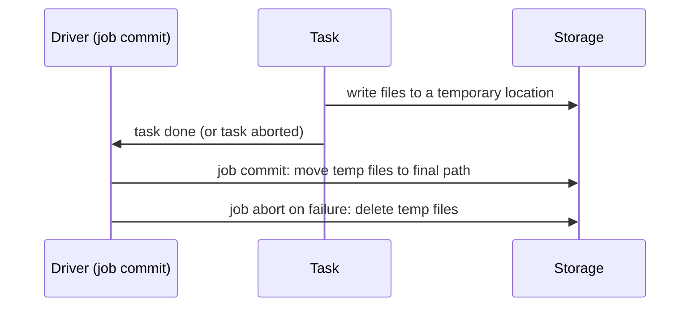

## 🎯 خلاصه

> یک نوشتن در Spark **یک عمل ساده نیست**. تعداد زیادی task فایل موقت می‌نویسند، و بعد یک **commit** بعضی از آن‌ها را قابل‌دیدن می‌کند. قابل‌اعتماد بودن به این بستگی دارد که اگر task یا کل job بین این مراحل خراب شود، چه اتفاقی می‌افتد.

- **save mode** تعیین می‌کند داده‌ی موجود نگه داشته شود یا نه: `append`، `overwrite`، `errorifexists`، `ignore`.
- **commit protocol** تعیین می‌کند فایل‌های موقت چطور نهایی شوند. روی HDFS تغییرنام (rename) ارزان و تقریباً اتمیک است؛ روی S3 یعنی کپی و بعد حذف، پس protocol خیلی مهم‌تر است.
- یک نوشتن **idempotent** اگر دوبار اجرا شود همان نتیجه را می‌دهد. overwrite یک partition idempotent است؛ append ساده نیست.
- table formatها (Delta، Iceberg، Hudi) commit را داخل یک log متادیتا می‌برند، که دیده‌شدن اتمیک می‌دهد.

## 🌱 از ساده شروع کنیم (مبتدی)

> **💡 تشبیه:** یک آشپزخانه‌ی رستوران را تصور کن. آشپزها غذا را در اتاق پشتی آماده می‌کنند (فایل موقت). فقط وقتی پیشخدمت بشقاب را به میز می‌برد (commit) مشتری آن را می‌بیند. اگر آشپزخانه وسط کار بسوزد، نمی‌خواهی نصف غذا روی میز باشد.

ساده‌ترین نوشتن این است:

```python
df = spark.read.parquet("s3a://raw/orders/2026-10-12/")
df.write.mode("append").parquet("s3a://curated/orders/")
```

سه سؤال تعیین می‌کند این کار امن است یا نه:

۱. **با ردیف‌های موجود چه می‌شود؟** `append` آن‌ها را نگه می‌دارد و جدیدها را اضافه می‌کند. `overwrite` اول چیزی را که می‌خواهد جایگزین کند پاک می‌کند.
۲. **اگر job وسط کار خراب شود چه؟** ممکن است بعضی فایل‌ها باشند و بعضی نباشند. آیا خواننده داده‌ی نیمه‌کاره می‌بیند؟
۳. **اگر دوباره اجرایش کنم چه؟** آیا ردیف‌ها دوبار ظاهر می‌شوند؟

بقیه‌ی این درس درباره‌ی همین سه سؤال است.

## 🔧 واقعاً چطور کار می‌کند (متوسط)

### حالت‌های ذخیره (save modes)

| حالت | کاری که می‌کند | امن برای اجرای دوباره؟ |
|---|---|---|
| `append` | فایل‌های جدید را کنار فایل‌های قبلی اضافه می‌کند | نه، ردیف تکراری می‌سازد |
| `overwrite` | اول مقصد را پاک می‌کند، بعد می‌نویسد | بله، اما همه‌چیز را پاک می‌کند (زیر را ببین) |
| `errorifexists` (پیش‌فرض) | اگر مسیر وجود داشته باشد خطا می‌دهد | امن، ولی پاک‌سازی دستی لازم دارد |
| `ignore` | اگر مسیر وجود داشته باشد هیچ کاری نمی‌کند | داده را بی‌صدا رد می‌کند، که ریسکی است |

**overwrite با partition تله دارد.** در حالت پیش‌فرض static، `overwrite` روی یک جدول partition شده **کل جدول** را جایگزین می‌کند، نه فقط partitionهایی که در DataFrame هستند. برای اینکه فقط partitionهای موجود در داده‌ی جدید جایگزین شوند، حالت dynamic را فعال کن:

```python
spark.conf.set("spark.sql.sources.partitionOverwriteMode", "dynamic")

(df.write
   .mode("overwrite")
   .partitionBy("dt")
   .parquet("s3a://curated/orders/"))
```

در حالت dynamic، partition ‏`dt=2026-10-12` فقط وقتی بازنویسی می‌شود که DataFrame برایش ردیف داشته باشد. بقیه‌ی partitionها دست نمی‌خورند. table formatها همین ایده را با `overwritePartitions()` (در DataFrameWriterV2) و گزینه‌هایی مثل `replaceWhere` ارائه می‌کنند. برای API دقیق، مستندات نسخه‌ی Spark و table format خودت را چک کن.

### commit protocol

Spark از طریق یک **output committer** مربوط به Hadoop می‌نویسد. نسخه‌ی ساده‌اش این‌طور کار می‌کند:



- **روی HDFS**، پوشه‌ی موقت به جای نهایی‌اش تغییرنام داده می‌شود. تغییرنام یک عملیات metadata است، پس commit سریع است و commit در سطح فایل تقریباً اتمیک است.
- **روی S3** تغییرنام واقعی وجود ندارد. «rename» یعنی **هر object را کپی کن و بعد اصلی را حذف کن**. پوشه‌ای با ۱۰٬۰۰۰ فایل یعنی ۱۰٬۰۰۰ کپی، و خرابی وسط کار خروجی را نیمه‌جابه‌جا رها می‌کند. committerهای پیش‌فرض قدیمی اینجا کند و ناامن شناخته شده‌اند.

راه‌حل یک committer آگاه از S3 است. **magic committer** در S3A هر فایل را به‌صورت یک multipart upload معلق (pending) می‌نویسد. تا زمان commit چیزی قابل‌دیدن نیست، و commit همه‌ی uploadها را در یک قدم کامل می‌کند. یک پیکربندی معمول (مستندات Hadoop و ارائه‌دهنده‌ات را چک کن، چون EMR و Databricks committer مخصوص خودشان را دارند):

```text
fs.s3a.committer.name=magic
fs.s3a.committer.magic.enabled=true
```

committerهای دیگر S3A (`directory`، `partitioned`) مبتنی بر staging هستند و برای الگوهای نوشتن متفاوت مناسب‌اند. همان را انتخاب کن که پلتفرمت مستند کرده.

### نوشتن idempotent

نوشتن **idempotent** است اگر اجرای دوباره‌اش همان وضعیت نهایی اجرای یک‌باره را بدهد. چهار الگوی عملی:

۱. **partition متعلق به همان اجرا را overwrite کن** (dynamic overwrite). اجرای دوباره همان partition را جایگزین می‌کند.
۲. **staging و بعد swap.** در `tmp/run_id=<uuid>/` بنویس، تعداد سطرها را چک کن، و بعد نتیجه را در یک عملیات metadata جابه‌جا یا ثبت کن.
۳. **MERGE روی کلید** با table format. `MERGE INTO target USING source ON key ...` کلیدهای موجود را به‌روز و کلیدهای جدید را درج می‌کند.
۴. **حذف تکراری روی کلید یکتا** اگر مقصد فقط append است و منبع ممکن است ردیف تکراری بدهد (به [[dedup-idempotent-loads]] نگاه کن).

### bucketing

`bucketBy(n, col)` ردیف‌ها را با hash در `n` bucket ثابت می‌ریزد که همراه جدول ذخیره می‌شود، و join های بعدی روی `col` می‌توانند shuffle را رد کنند. این با `saveAsTable` کار می‌کند که به catalog نیاز دارد، نه با نوشتن ساده روی `path`:

```python
(df.write
   .bucketBy(64, "customer_id")
   .sortBy("customer_id")
   .mode("overwrite")
   .saveAsTable("curated.orders_bucketed"))
```

bucketing برای join های بزرگ و تکراری روی یک کلید مفید است. تعداد `n` را با دقت انتخاب کن، چون بعد از نوشتن ثابت می‌ماند.

### مقصدهای دیگر

- **JDBC (PostgreSQL، MySQL، Oracle).** هر task یک اتصال باز می‌کند و دسته‌ای درج می‌کند. خرابی وسط کار یعنی بعضی ردیف‌ها commit شده‌اند. به یک جدول staging بنویس، بعد ردیف‌ها را در یک تراکنش دیتابیس منتقل کن، یا از `MERGE` استفاده کن.
- **Kafka.** ستون‌های `key` و `value` لازم است (وگرنه کل سطر سریالایز می‌شود). تحویل به‌صورت پیش‌فرض at-least-once است؛ exactly-once تنظیمات producer idempotent یا transactional و یک consumer که تکرار را هندل کند می‌خواهد. به [[exactly-once]] نگاه کن.
- **StarRocks و OLAP store های دیگر.** از Spark connector ارائه‌دهنده استفاده کن که دسته‌ای load می‌کند (معمولاً از طریق API بارگذاری HTTP). چک کن connector گزینه‌های transactional یا label-based دارد یا نه؛ این‌ها راه retry بدون تکرار می‌دهند.

## 🧠 عمق و trade-offها (سنیور)

- **speculative execution و تلاش‌های تکراری.** با speculation روشن، دو تلاش از یک task ممکن است خروجی بنویسند. committer باید فقط یکی را قابل‌دیدن کند. این یک دلیل دیگر است که روی object store از writerهای ساده‌لوحانه پرهیز کنی.
- **پاک‌سازی بعد از خرابی جزئی.** بعد از شکست job، فایل‌های موقت و multipart uploadهای معلق ممکن است بمانند و هزینه بسازند. پاک‌سازی را تنظیم کن (مثلاً تنظیمات abort کردن pending uploadها در S3A) و بررسی دوره‌ای uploadهای یتیم داشته باش.
- **commit اتمیک در table formatها.** Delta، Iceberg و Hudi اول فایل‌های داده را می‌نویسند و بعد یک snapshot یا ورودی log جدید را در یک به‌روزرسانی اتمیک متادیتا commit می‌کنند. خواننده یا snapshot قدیمی را می‌بیند یا جدید را، نه ترکیبی. این بیشتر مشکلات نوشتن نیمه‌کاره را حل می‌کند، اما متادیتای بیشتری می‌سازد که باید نگه‌داری شود (به [[small-files]] و expire کردن snapshot ها نگاه کن).
- **هزینه‌ی commit در برابر تعداد فایل.** فایل‌های خروجی زیاد و کوچک، commit را روی S3 کند می‌کنند (object بیشتری باید کامل شود) و خواندن بعدی را هم کند. تعداد partition را قبل از نوشتن کنترل کن، نه بعد از آن.
- **همزمانی.** دو job Spark که با Parquet ساده به یک مسیر می‌نویسند، می‌توانند خروجی یکدیگر را خراب کنند. از table formatها با optimistic concurrency یا مسیر جدا برای هر job استفاده کن.
- **کی از Spark مستقیم ننویسی.** برای به‌روزرسانی ردیفی با تأخیر کم در دیتابیس OLTP، batch در Spark ابزار اشتباه است. به‌جایش CDC یا outbox سطح اپلیکیشن بگذار.
- **مانیتورینگ.** تعداد ردیف‌های نوشته‌شده در برابر خوانده‌شده، تعداد و حجم فایل خروجی، مدت commit، و تعداد تلاش‌های شکست‌خورده یا abort‌شده را دنبال کن. اختلاف بین ردیف‌های خوانده و نوشته‌شده هشدار زودهنگام یک باگ در فیلتر یا join است.

## 🧪 امتحان کن

یک Spark session محلی (نسخه‌ی ۳.x یا بالاتر) و پوشه‌های محلی استفاده کن. رفتار object store فرق دارد، پس برای بخش‌های S3 به‌جای تست محلی مستندات را بخوان.

۱. ۱٬۰۰۰ ردیف با مقادیر `dt` برای ۳ تاریخ را با `mode("append")` در `out/orders` بنویس. همان کد را دوباره اجرا کن. الان چند ردیف داری؟ بعد به `mode("overwrite")` با `partitionOverwriteMode=dynamic` برو و دوباره روی یک DataFrame اجرا کن که فقط یک `dt` دارد. کدام partitionها باقی می‌مانند؟
۲. در دو جمله توضیح بده چرا `mode("overwrite")` بدون حالت dynamic برای یک job روزانه که فقط داده‌ی امروز را دارد خطرناک است.
۳. طراحی: یک job روزانه از Spark یک جدول JDBC را پر می‌کند. در ۷۰٪ ردیف‌ها خراب می‌شود. یک برنامه‌ی load بنویس که بتوان امن دوباره اجرایش کرد.

<details><summary>Show solutions</summary>

**۱.** بعد از اولین append، N ردیف داری. بعد از اجرای دوم، ۲N ردیف داری، چون append داده‌ی موجود را بررسی نمی‌کند. با dynamic overwrite فقط `dt` موجود در DataFrame جدید جایگزین می‌شود؛ دو تاریخ دیگر می‌مانند. این تستی است که نشان می‌دهد تنظیم کار می‌کند.

**۲.** overwrite به حالت static کل جدول را جایگزین می‌کند، پس یک job که فقط ردیف‌های امروز را دارد تمام تاریخچه را پاک می‌کند. dynamic overwrite فقط partitionهای موجود در داده‌ی جدید را جایگزین می‌کند.

**۳.** اجرای ۷۰٪-خراب‌شده را در یک جدول staging (یا با ستون `run_id`) بنویس. جدول اصلی تا وقتی load روی staging کامل و شمارش نشده دست نمی‌خورد. بعد در یک تراکنش دیتابیس، partition هدف را حذف یا merge کن و از staging درج کن. اجرای دوباره اول جدول staging را خالی می‌کند، پس نتیجه در هر حال یکی است.

</details>

## 💬 گوشه‌ی مصاحبه

**سؤال: «یک job ‏Spark تو روی S3 می‌نویسد و گاهی خروجی نیمه‌کاره باقی می‌گذارد. چرا و چطور درستش می‌کنی؟»**

- **جواب متوسط:** «committer پیش‌فرض روی S3 یعنی کپی و حذف، پس خرابی وسط کار ترکیبی باقی می‌گذارد. از magic committer در S3A استفاده می‌کنم و job را idempotent می‌کنم با overwrite فقط partitionهای خودش.»
- **جواب سنیور:** «ریشه‌ی مشکل این است که S3 تغییرنام اتمیک ندارد، پس committer پیش‌فرض می‌تواند خروجی نیمه‌جابه‌جا باقی بگذارد و کند هم هست. برای فایل‌های ساده از committer آگاه از S3 استفاده می‌کنم، ولی برای چیزی که مشترک است table format را ترجیح می‌دهم، چون snapshot را اتمیک commit می‌کند. بعد job را قابل‌اجرای دوباره می‌کنم: dynamic overwrite روی partitionهای متعلق به خودش، یا stage و swap. همچنین روی multipart uploadهای یتیم هشدار می‌گذارم، چون هزینه دارند.»

**سؤال: «چطور خروجی exactly-once از Spark بگیری؟»** اول با idempotence جواب بده: exactly-once در عمل یعنی یک sink idempotent (MERGE روی کلید، یا overwrite partition متعلق به خودت) به‌علاوه commit اتمیک. تضمین‌های خود Spark داخل job برقرار است؛ بقیه را باید sink تأمین کند.

> **🎤 این را در مصاحبه بگو:** «یک نوشتن Spark وقتی امن است که commit اتمیک و job idempotent باشد. روی S3 اولی به committer مناسب یا table format نیاز دارد، و دومی به overwrite partitionهای متعلق به خودت یا MERGE روی کلید.»

## ⚠️ اشتباهات رایج

> **⚠️ هشدار:** `mode("overwrite")` روی جدول partition شده بدون `partitionOverwriteMode=dynamic` همه‌ی partitionها را پاک می‌کند، نه فقط آن‌هایی که نوشته‌ای.

> **⚠️ هشدار:** append داخل حلقه‌ی retry ردیف تکراری می‌سازد. اجرای دوباره‌ی job فقط وقتی امن است که نوشتن idempotent باشد.

- فرض کردن اینکه تغییرنام در S3 اتمیک یا ارزان است.
- استفاده از `bucketBy` با `save("path")`. به `saveAsTable` نیاز دارد.
- فکر کردن به اینکه نوشتن Kafka از Spark به‌صورت پیش‌فرض exactly-once است.
- نوشتن batchهای JDBC مستقیم در جدول production بدون staging، و بعد تعجب از load نیمه‌کاره.
- نادیده‌گرفتن فایل‌های موقت و multipart uploadهای باقی‌مانده بعد از خرابی.
- انتخاب تعداد partition خروجی بدون نگاه کردن به اندازه‌ی فایل‌ها (به [[small-files]] نگاه کن).

## ✅ خودت را بسنج

۱. یک جدول partition شده با `dt` را با `mode("overwrite")` می‌نویسی، و DataFrame فقط partition امروز را دارد. در حالت پیش‌فرض static چه می‌شود؟
   - A) فقط partition امروز جایگزین می‌شود.
   - B) کل جدول جایگزین می‌شود و تاریخچه از بین می‌رود.
   - C) نوشتن با خطا شکست می‌خورد.
   - D) ردیف‌های تکراری append می‌شوند.

۲. چرا committer پیش‌فرض روی S3 عملکرد ضعیف و ریسک دارد؟
   - A) S3 از Parquet پشتیبانی نمی‌کند.
   - B) «تغییرنام» یعنی کپی و حذف، که کند و غیراتمیک است.
   - C) S3 نمی‌تواند بیش از یک فایل در یک پوشه نگه دارد.
   - D) Spark اصلاً نمی‌تواند روی S3 بنویسد.

۳. کدام الگو باعث می‌شود یک نوشتن روزانه بتواند امن دوباره اجرا شود؟
   - A) `append` با timestamp در نام فایل.
   - B) dynamic overwrite روی partition متعلق به همان اجرا.
   - C) `coalesce(1)` قبل از نوشتن.
   - D) افزایش `spark.sql.shuffle.partitions`.

۴. **سنیور:** یک load از ۱۰ میلیون ردیف JDBC در ردیف ۷ میلیون خراب می‌شود. چرا نوشتن مستقیم در جدول هدف ریسکی است و چه چیزی بهتر است؟
   - A) هیچ‌وقت ریسکی نیست؛ JDBC در Spark به‌صورت پیش‌فرض تراکنشی است.
   - B) بعضی batchها commit شده و بعضی نه، و داده‌ی نیمه‌کاره می‌ماند؛ به جدول staging load کن و ردیف‌ها را در یک تراکنش منتقل کن، یا از MERGE استفاده کن.
   - C) JDBC از درج پشتیبانی نمی‌کند.
   - D) فقط حافظه‌ی driver تحت تأثیر قرار می‌گیرد.

۵. **سنیور:** چرا Kafka به‌عنوان sink خروجی یک job Spark ضعیف‌تر از یک table format است؟
   - A) Kafka به‌صورت پیش‌فرض at-least-once است و اجرای دوباره می‌تواند تکرار بسازد، مگر اینکه producer و consumer برای آن تنظیم و طراحی شده باشند.
   - B) Kafka نمی‌تواند رشته ذخیره کند.
   - C) Kafka همیشه بر اساس offset تکراری‌ها را حذف می‌کند.
   - D) Spark نمی‌تواند به Kafka وصل شود.

<details><summary>Answer</summary>

**۱ — B.** در حالت static، overwrite کل هدف را قبل از نوشتن حذف می‌کند. حالت dynamic (`partitionOverwriteMode=dynamic`) فقط `dt` امروز را جایگزین می‌کرد، و برای این job همان تنظیم درست است.

**۲ — B.** S3 تغییرنام اتمیک ندارد. committer هر object را کپی و اصلی را حذف می‌کند، پس کند است و بعد از خرابی می‌تواند خروجی نیمه‌جابه‌جا باقی بگذارد.

**۳ — B.** overwrite کردن partition متعلق به خودت هر بار همان نتیجه را می‌دهد. append (A) ردیف تکراری می‌سازد، coalesce (C) فقط تعداد فایل را تغییر می‌دهد، و shuffle partitions (D) روی idempotence اثری ندارد.

**۴ — B.** batchها جداگانه commit می‌شوند، پس خرابی داده‌ی نیمه‌کاره باقی می‌گذارد. یک جدول staging به‌همراه یک تراکنش (یا MERGE) جدول هدف را سازگار نگه می‌دارد، و اجرای دوباره می‌تواند از اول شروع شود.

**۵ — A.** sinkهای Kafka در Spark به‌صورت پیش‌فرض at-least-once هستند، مگر اینکه producer idempotent یا transactional فعال کنی و تکرارها را پایین‌دست هندل کنی. table format یک commit اتمیک snapshot با گزینه‌های idempotent مثل MERGE می‌دهد.

</details>

## 🗂️ فلش‌کارت

| Front | Back |
|---|---|
| `append` در اجرای دوباره چه می‌کند؟ | ردیف‌ها را دوباره اضافه می‌کند و تکراری می‌سازد. idempotent نیست. |
| dynamic partition overwrite چیست؟ | فقط partitionهای موجود در DataFrame را جایگزین می‌کند؛ بقیه می‌مانند. `spark.sql.sources.partitionOverwriteMode=dynamic` را تنظیم کن. |
| چرا rename در S3 مشکل است؟ | کپی و حذف است، پس کند و غیراتمیک است؛ خرابی خروجی نیمه‌جابه‌جا می‌گذارد. |
| magic committer در S3A چه می‌کند؟ | multipart uploadهای معلق می‌نویسد و در commit کامل می‌کند، پس چیزی زودتر قابل‌دیدن نیست. |
| نوشتن idempotent چیست؟ | نوشتنی که اجرای دوباره‌اش همان وضعیت نهایی یک اجرا را بدهد. |
| چرا `bucketBy` به `saveAsTable` نیاز دارد؟ | متادیتای bucket باید در یک جدول catalog ذخیره شود، نه فقط در یک مسیر. |
| JDBC را امن چطور load کنی؟ | ردیف‌ها را staging کن، بعد در یک تراکنش به هدف منتقل یا merge کن. |
| table format چه چیزی به نوشتن Spark اضافه می‌کند؟ | commit اتمیک snapshot، پس خواننده‌ها داده‌ی نیمه‌نوشته نمی‌بینند. |

## 🔗 ادامه

- [[small-files]] جنبه‌ی تعداد فایل همین نوشتن‌ها را توضیح می‌دهد.
- [[dedup-idempotent-loads]] نشان می‌دهد چطور load ها را امن برای اجرای دوباره کنی.
- [[delivery-semantics]] at-least-once، at-most-once و exactly-once را توضیح می‌دهد.
- [[lakehouse-table-formats]] نشان می‌دهد table formatها چطور داده را اتمیک commit می‌کنند.
