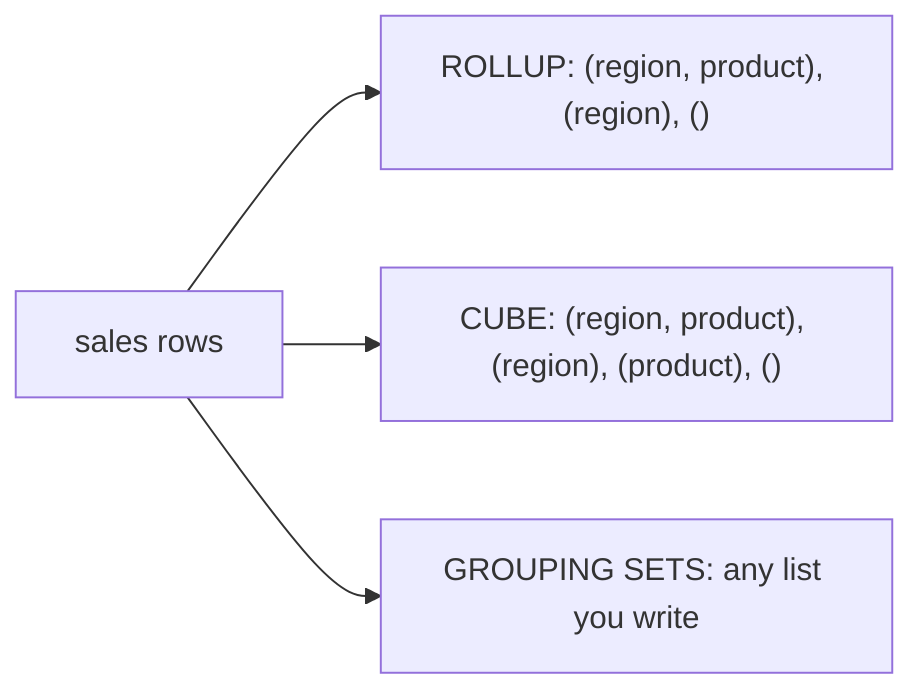

## 🎯 خلاصه

> **GROUPING SETS**، **ROLLUP** و **CUBE** چند سطح زیرجمع را در **یک** پرس‌وجو محاسبه می‌کنند. **تجمیع شرطی** (`SUM(CASE WHEN ...)` یا `FILTER`) ردیف‌ها را به ستون تبدیل می‌کند. **GROUPING()** مشخص می‌کند کدام NULLها داده‌ی واقعی‌اند و کدام نشانگر زیرجمع.

- `GROUP BY ROLLUP (a, b)` سطوح `(a, b)`، `(a)` و جمع کل `()` را می‌دهد.
- `GROUP BY CUBE (a, b)` همه‌ی ترکیب‌ها را می‌دهد: `(a, b)`، `(a)`، `(b)` و `()`.
- `GROUP BY GROUPING SETS ((a), (b))` دقیقاً همان سطوحی را می‌دهد که فهرست کرده‌ای و نه بیشتر.
- `FILTER (WHERE ...)` یک تجمیع را محدود می‌کند؛ `CASE` همین کار را در همه‌ی موتورها انجام می‌دهد.
- pivot (ردیف به ستون) همان تجمیع شرطی است. unpivot (ستون به ردیف) با `UNION ALL` یا JOIN روی `VALUES` انجام می‌شود.

## 🌱 از ساده شروع کنیم (مبتدی)

> **💡 تشبیه:** یک گزارش فروش با سه سطح: هر فروشگاه، هر منطقه و کل کشور. بدون این ابزارها سه کوئری می‌نویسی و عددها را کنار هم می‌گذاری. `ROLLUP` هر سه سطح را در یک بار پیمایش می‌نویسد و مشخص می‌کند کدام ردیف زیرجمع است.

از این جدول کوچک استفاده می‌کنیم. مثال‌ها برای PostgreSQL هستند.

```sql
CREATE TABLE sales (region text, product text, amt int);
INSERT INTO sales VALUES
 ('EU','A',10), ('EU','B',20),
 ('US','A',30), ('US','B',40);
```

یک `GROUP BY` ساده یک سطح می‌دهد:

```sql
SELECT region, product, SUM(amt) AS total
FROM sales
GROUP BY region, product;
```

چهار ردیف، یکی برای هر (region, product). برای اضافه کردن زیرجمع هر منطقه و جمع کل، `ROLLUP` همان را در همین کوئری انجام می‌دهد:

```sql
SELECT region, product, SUM(amt) AS total
FROM sales
GROUP BY ROLLUP (region, product);
```

این کوئری هفت ردیف برمی‌گرداند: چهار ردیف جزئیات، `EU` با product برابر `NULL` (30)، `US` با product برابر `NULL` (70)، و یک ردیف که هر دو ستون `NULL` دارند (100). آن `NULL`ها در ردیف‌های زیرجمع **نشانگر**اند، نه داده. بخش‌های بعدی نشان می‌دهند چطور آن‌ها را از هم تشخیص دهی.

## 🔧 واقعاً چطور کار می‌کند (متوسط)

هر grouping set یک لیست `GROUP BY` است. موتور هر مجموعه را از همان ردیف‌های ورودی محاسبه می‌کند:

| بند | grouping setهای تولیدشده برای `(a, b)` | تعداد |
|---|---|---|
| `GROUP BY a, b` | `(a, b)` | 1 |
| `ROLLUP (a, b)` | `(a, b)`، `(a)`، `()` | n + 1 (سلسله‌مراتبی) |
| `CUBE (a, b)` | `(a, b)`، `(a)`، `(b)`، `()` | 2^n (همه‌ی ترکیب‌ها) |
| `GROUPING SETS ((a), (b))` | `(a)`، `(b)` | دقیقاً همان فهرست |



**تشخیص NULLهای زیرجمع از NULLهای واقعی.** `GROUPING(col)` وقتی ردیف زیرجمع آن ستون باشد `1` و وقتی مقدار واقعی باشد `0` برمی‌گرداند. با چند ستون، `GROUPING(a, b)` یک bit mask برمی‌گرداند.

```sql
SELECT
  CASE WHEN GROUPING(region) = 1 THEN 'ALL'    ELSE region  END AS region,
  CASE WHEN GROUPING(product) = 1 THEN 'ALL'   ELSE product END AS product,
  SUM(amt) AS total
FROM sales
GROUP BY CUBE (region, product)
ORDER BY region, product;
```

`CUBE` ردیف‌های `(ALL, A) = 40` و `(ALL, B) = 60` را هم اضافه می‌کند. برچسب `'ALL'` اینجا امن است، اما اگر خود جدول یک region واقعی و `NULL` داشته باشد، `COALESCE(region, 'ALL')` آن‌ها را با زیرجمع‌ها قاطی می‌کند. `GROUPING()` این اشتباه را نمی‌گذارد.

**مجموعه‌های صریح.** وقتی فقط بعضی سطوح را لازم داری، `GROUPING SETS` دقیق است:

```sql
SELECT region, product, SUM(amt) AS total
FROM sales
GROUP BY GROUPING SETS ((region), (product), ());
```

این جمع هر منطقه (30، 70)، جمع هر محصول (40، 60) و جمع کل (100) را می‌دهد. بدون ردیف‌های جزئیات.

**تجمیع شرطی: ردیف به ستون.** pivot قابل‌حمل همان `SUM(CASE WHEN ...)` است:

```sql
SELECT region,
       SUM(CASE WHEN product = 'A' THEN amt END) AS a_total,
       SUM(CASE WHEN product = 'B' THEN amt END) AS b_total
FROM sales
GROUP BY region
ORDER BY region;
```

نتیجه: `EU 10 20` و `US 30 40`. `ELSE` عمداً حذف شده: ترکیب گم‌شده `NULL` می‌شود نه `0`، که معمولاً پاسخ صادقانه‌تری است. برای نمایش، در صورت نیاز از `COALESCE` استفاده کن.

**`FILTER`: شکل تمیزتر.** PostgreSQL (و SQLite، DuckDB) اجازه می‌دهند یک تجمیع را مستقیم فیلتر کنی:

```sql
SELECT region,
       SUM(amt)                              AS total,
       SUM(amt) FILTER (WHERE product = 'A') AS a_only
FROM sales
GROUP BY region;
```

نتیجه: `EU 30 10` و `US 70 30`. چند بند `FILTER` در یک `SELECT` یک اسکن را شریک می‌شوند. موتورهای دیگر ممکن است آن را نداشته باشند، پس برای هر dialect، `CASE` شکلی است که باید بشناسی.

**ستون به ردیف (unpivot).** در PostgreSQL یک JOIN با `LATERAL VALUES` یک ردیف پهن را به چند ردیف باریک تبدیل می‌کند:

```sql
WITH wide AS (
  SELECT region,
         SUM(CASE WHEN product = 'A' THEN amt END) AS a,
         SUM(CASE WHEN product = 'B' THEN amt END) AS b
  FROM sales GROUP BY region
)
SELECT w.region, v.product, v.amt
FROM wide w
CROSS JOIN LATERAL (VALUES ('A', w.a), ('B', w.b)) AS v(product, amt)
ORDER BY w.region, v.product;
```

نتیجه: `EU A 10`، `EU B 20`، `US A 30`، `US B 40`.

## 🧠 عمق و trade-offها (سنیور)

- **هزینه با تعداد مجموعه‌ها رشد می‌کند.** `CUBE` روی n ستون، 2^n grouping set تولید می‌کند. شش بُعد یعنی 64 مجموعه. موتورها معمولاً همه را از یک اسکن محاسبه می‌کنند، اما هر ردیف ورودی را برای هر مجموعه گسترش می‌دهند (Spark به این می‌گوید عملگر `Expand`)، پس حافظه، shuffle و حجم خروجی ضرب می‌شوند. برای سطوحی که واقعاً لازم داری، `ROLLUP` یا `GROUPING SETS` صریح ترجیح داده می‌شود.
- **داشبورد را از قبل تجمیع کن.** یک `CUBE` روی جدول fact با یک میلیارد ردیف در هر بار باز شدن صفحه گران است. آن را شبانه در یک جدول خلاصه محاسبه کن، یا از materialized view استفاده کن، و بگذار ابزار BI نتیجه‌ی کوچک را بخواند. ببین [[materialized-view]] و [[star-schema]].
- **pivot پویا یک کوئری واحد نیست.** `PIVOT` نام ستون‌های خروجی را در زمان کامپایل لازم دارد. اگر دسته‌ها پویا هستند (محصول جدید هر روز می‌آید)، یا SQL را در orchestrator تولید کن، یا داده را در فرم بلند نگه دار و در لایه‌ی BI pivot کن.
- **پشتیبانی موتورها فرق دارد.** PostgreSQL، Oracle و Spark SQL، `GROUPING SETS`، `ROLLUP` و `CUBE` را دارند. MySQL 8 فقط `WITH ROLLUP` دارد. ClickHouse شکل‌های postfix مثل `WITH ROLLUP` و `WITH CUBE` دارد. StarRocks شکل‌های استاندارد را پشتیبانی می‌کند. قبل از اتکا به هرکدام، مستندات نسخه‌ی خودت را ببین.
- **سینتکس PIVOT.** Oracle و Spark SQL بند `PIVOT` دارند. در Spark به شکل `SELECT * FROM sales PIVOT (SUM(amt) FOR product IN ('A' AS a_total, 'B' AS b_total))` است. این فقط راحتی برای همان تجمیع شرطی بالاست.
- **ترتیب در بالای گزارش مهم است.** ردیف‌های زیرجمع در ستون‌های گروه‌بندی `NULL` دارند، پس `ORDER BY region` آن‌ها را کنار NULLهای واقعی می‌گذارد. وقتی زیرجمع‌ها باید آخر بیایند، `GROUPING()` را به‌عنوان کلید مرتب‌سازی بگذار.
- **کجا استفاده نکنیم.** اگر گزارش نیاز به جمع تجمعی یا رتبه درون هر گروه دارد، آن یک window function است، نه grouping set. ببین [[window-function]].

## 🧪 امتحان کن

از جدول `sales` ابتدای درس استفاده کن (PostgreSQL نسخه‌ی 13 یا بالاتر).

1. یک کوئری بنویس که برای هر `product` جمع آن و جمع کل را در یک خروجی برگرداند، و جمع کل با برچسب `'ALL'` باشد.
2. برای هر منطقه ستون‌های `total`، `a_only` (جمع محصول A) و `b_only` (جمع محصول B) را با `FILTER` بساز. بعد همان را فقط با `CASE` بنویس.
3. یک ردیف با `region` برابر `NULL`، `product` برابر `'A'` و `amt` برابر 5 به `sales` اضافه کن. یک کوئری `ROLLUP` بنویس که هم region واقعی `NULL` و هم زیرجمع دیده شوند و از هم قابل تشخیص باشند.

<details><summary>جواب‌ها را نشان بده</summary>

**1.**
```sql
SELECT
  CASE WHEN GROUPING(product) = 1 THEN 'ALL' ELSE product END AS product,
  SUM(amt) AS total
FROM sales
GROUP BY GROUPING SETS ((product), ())
ORDER BY GROUPING(product), product;
```
نتیجه: `A 40`، `B 60`، `ALL 100`.

**2.**
```sql
-- FILTER
SELECT region,
       SUM(amt) AS total,
       SUM(amt) FILTER (WHERE product = 'A') AS a_only,
       SUM(amt) FILTER (WHERE product = 'B') AS b_only
FROM sales GROUP BY region ORDER BY region;

-- CASE
SELECT region,
       SUM(amt) AS total,
       SUM(CASE WHEN product = 'A' THEN amt END) AS a_only,
       SUM(CASE WHEN product = 'B' THEN amt END) AS b_only
FROM sales GROUP BY region ORDER BY region;
```

**3.**
```sql
INSERT INTO sales VALUES (NULL, 'A', 5);

SELECT
  CASE WHEN GROUPING(region) = 1 THEN 'ALL' ELSE COALESCE(region, '(null)') END AS region,
  SUM(amt) AS total
FROM sales
GROUP BY ROLLUP (region)
ORDER BY GROUPING(region), region;
```
region واقعی `NULL` به صورت `(null)` با جمع 5 نشان داده می‌شود و زیرجمع به صورت `ALL`. `GROUPING()` تنها راه قابل‌اعتماد برای تشخیص آن‌ها در خروجی است؛ یک `COALESCE(region, 'ALL')` ساده آن‌ها را قاطی می‌کرد.

</details>

## 💬 گوشه‌ی مصاحبه

**سؤال: «فروش را به تفکیک منطقه، محصول و جمع کل، در یک کوئری بده.»** پاسخ متوسط: «`GROUP BY ROLLUP (region, product)`.» پاسخ سنیور: «`ROLLUP` سلسله‌مراتب لازم را می‌دهد. ردیف‌های زیرجمع را با `GROUPING()` برچسب می‌زنم، نه با `COALESCE`، چون NULLهای واقعی داده با آن‌ها تداخل می‌کنند. اگر این کوئری با هر بار باز شدن داشبورد اجرا شود، آن را در یک جدول خلاصه از قبل محاسبه می‌کنم.»

**سؤال: «در SQL چطور ردیف‌ها را به ستون pivot می‌کنی؟»** پاسخ متوسط: «`SUM(CASE WHEN ... THEN ... END)` برای هر ستون.» پاسخ سنیور: «این در هر موتوری کار می‌کند. `PIVOT` بومی کوتاه‌تر است، اما لیست ستون‌ها را در زمان کامپایل لازم دارد. برای دسته‌های ناشناخته SQL را تولید می‌کنم یا در لایه‌ی BI pivot می‌کنم.»

> **🎤 این را در مصاحبه بگو:** «`ROLLUP` سلسله‌مراتب را در یک اسکن می‌دهد و `GROUPING()` مشخص می‌کند کدام NULLها زیرجمع‌اند. برای pivot از تجمیع شرطی استفاده می‌کنم چون قابل‌حمل است، و قبل از استفاده از `CUBE` هزینه‌اش را می‌سنجم.»

## ⚠️ اشتباهات رایج

> **⚠️ توجه:** `COALESCE(region, 'ALL')` یک region واقعی `NULL` را زیرجمع فرض می‌کند. برای تصمیم‌گیری از `GROUPING()` استفاده کن.

> **⚠️ توجه:** `SUM(CASE WHEN product = 'A' THEN amt ELSE 0 END)` برای منطقه‌ای که ردیف محصول A ندارد `0` می‌دهد و غیبت را پنهان می‌کند. بدون `ELSE` نتیجه `NULL` است. عمداً انتخاب کن.

- استفاده از `CUBE` وقتی `ROLLUP` کافی است، که خروجی را چند برابر می‌کند.
- فراموش کردن اینکه `ROLLUP (a, b)` با `ROLLUP (b, a)` یکی نیست. ترتیب سلسله‌مراتب را تعیین می‌کند.
- انتظار اینکه `FILTER` در همه‌ی موتورها کار کند.
- نوشتن `PIVOT` با لیست ثابت ستون و انتظار اینکه دسته‌های جدید خودکار ظاهر شوند.
- مرتب‌سازی گزارشی که زیرجمع دارد و قاطی شدن زیرجمع‌ها با ردیف‌های داده.

## ✅ خودت را بسنج

1. `GROUP BY ROLLUP (a, b)` چند grouping set تولید می‌کند؟
   - A) 1
   - B) 2
   - C) 3
   - D) 4

<details><summary>جواب</summary>

**C** — `ROLLUP (a, b)` این‌ها را تولید می‌کند: `(a, b)`، `(a)` و `()`، یعنی سلسله‌مراتبی سه‌سطحی. `CUBE (a, b)` چهار مجموعه تولید می‌کرد.

</details>

2. در یک ردیف `GROUPING(region) = 1` است. این یعنی چه؟
   - A) مقدار region در داده یک `NULL` واقعی است
   - B) ردیف زیرجمع است و `NULL` منطقه‌اش نشانگر است
   - C) region در بند `FILTER` است
   - D) کوئری خطا دارد

<details><summary>جواب</summary>

**B** — `GROUPING()` وقتی ستون در آن ردیف roll up شده باشد `1` برمی‌گرداند. `NULL`های واقعی داده `0` می‌دهند.

</details>

3. کدام عبارت راه قابل‌حمل برای شمارش فروش محصول A در هر منطقه است؟
   - A) `SUM(amt) FILTER (WHERE product = 'A')`
   - B) `SUM(CASE WHEN product = 'A' THEN amt END)`
   - C) `COUNT(product = 'A')`
   - D) `SUM(amt) WHERE product = 'A'`

<details><summary>جواب</summary>

**B** — `CASE` در همه‌ی موتورهای SQL کار می‌کند. `FILTER` در PostgreSQL و برخی موتورهای دیگر هست، و `WHERE` داخل تجمیع سینتکس معتبر نیست.

</details>

4. **(سنیور)** داشبوردی روی یک جدول fact با دو میلیارد ردیف، در هر بار باز شدن صفحه، `GROUP BY CUBE (country, device, channel, month, product, plan)` اجرا می‌کند. مشکل اصلی چیست و چه چیزی را تغییر می‌دهی؟

   - A) `CUBE` با بیش از 3 ستون مجاز نیست
   - B) 2^6 = 64 grouping set تولید می‌کند که هرکدام ورودی را گسترش می‌دهند؛ سطوح لازم را با زمان‌بندی در یک جدول خلاصه از پیش حساب کن، یا فقط سطوح لازم را با `GROUPING SETS` بگیر
   - C) `CUBE` جمع‌های اشتباه برمی‌گرداند
   - D) برای سریع‌تر شدن `DISTINCT` اضافه کن

<details><summary>جواب</summary>

**B** — شش ستون یعنی 64 grouping set، و موتور ورودی را برای هر کدام گسترش می‌دهد. راه‌حل این است که سطوح لازم را یک‌بار محاسبه و ذخیره کنی و نتیجه‌ی کوچک را بخوانی، نه اینکه برای هر درخواست دوباره محاسبه کنی.

</details>

5. **(سنیور)** یک کوئری PIVOT لیست ثابتی از ستون‌های محصول دارد. محصولات جدید هر هفته می‌آیند و گزارش بی‌صدا آن‌ها را جا می‌اندازد. چرا، و طراحی مقاوم چیست؟

   - A) PIVOT نمی‌تواند مقدار متنی را مدیریت کند
   - B) ستون‌های خروجی در زمان کامپایل ثابت‌اند، پس دسته‌های جدید در لیست نیستند؛ لیست ستون‌ها را از داده‌ی فعلی (در orchestrator) تولید کن، یا داده را در فرم بلند نگه دار و در لایه‌ی ارائه pivot کن
   - C) PIVOT همیشه ردیف‌های جدید را حذف می‌کند
   - D) راه‌حل اضافه کردن `ROLLUP` است

<details><summary>جواب</summary>

**B** — pivot بومی باید ستون‌های خروجی‌اش در زمان نوشتن کوئری معلوم باشند. دسته‌های پویا به یک کوئری تولیدشده، یا به جدول فرم بلند نیاز دارند که لایه‌ی ارائه آن را pivot کند.

</details>

## 🗂️ فلش‌کارت

| Front | Back |
|---|---|
| `ROLLUP (a, b)` تولید می‌کند | `(a, b)`، `(a)`، `()`: سلسله‌مراتبی از زیرجمع‌ها |
| `CUBE (a, b)` تولید می‌کند | همه‌ی چهار ترکیب: `(a, b)`، `(a)`، `(b)`، `()` |
| `GROUPING SETS ((a), ())` | دقیقاً سطوح فهرست‌شده، نه بیشتر |
| `GROUPING(col)` | `1` برای ردیف زیرجمع آن ستون، `0` برای داده‌ی واقعی |
| pivot قابل‌حمل | `SUM(CASE WHEN x = 'v' THEN amt END)` برای هر ستون |
| `FILTER (WHERE ...)` | یک تجمیع را محدود می‌کند؛ در PostgreSQL و برخی موتورها هست، نه همه |
| unpivot در PostgreSQL | `CROSS JOIN LATERAL (VALUES (...), (...)) AS v(...)` |
| هزینه‌ی `CUBE` روی n ستون | 2^n grouping set |

## 🔗 ادامه

- [[sql-window-functions]] — رتبه و جمع تجمعی درون گروه‌ها، که grouping setها نمی‌توانند.
- [[sql-nulls]] — چرا نشانگرهای `NULL` نیاز به دقت دارند.
- [[sql-dialects]] — تفاوت PIVOT، FILTER و ROLLUP در موتورهای مختلف.
- [[star-schema]] — مدل fact و dimension که این گزارش‌ها معمولاً روی آن اجرا می‌شوند.
- [[materialized-view]] — از پیش محاسبه‌ی تجمیع‌های چندسطحی گران.

