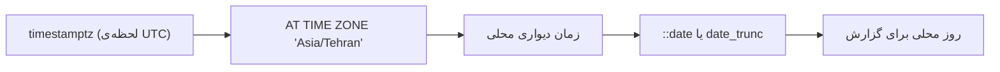

## 🎯 خلاصه

> **لحظه‌ها** (instant) را در UTC ذخیره کن (`timestamptz` یا نوع معادل). فقط در مرز، یعنی وقت نمایش یا وقتی باید تعیین کنی یک رویداد متعلق به کدام **روز** محلی است، به منطقه‌ی زمانی محلی تبدیلش کن. **تاریخ** یک روز تقویمی است و با timestamp یکی نیست.

- **timestamp با منطقه‌ی زمانی** یک لحظه‌ی مشخص است. **timestamp بدون منطقه‌ی زمانی** فقط یک خوانش ساعت دیواری است که منطقه ندارد، پس به‌تنهایی مبهم است.
- `date_trunc` در PostgreSQL (یا `DATE_TRUNC` در بسیاری از موتورها) مقدار را به روز، هفته یا ماه گرد می‌کند. مرز روز کجا قرار بگیرد به منطقه‌ی زمانی‌ای که استفاده می‌کنی بستگی دارد.
- حساب‌وکار تاریخ همیشه از یک نوع نیست: در PostgreSQL، `date - date` عدد صحیح روز می‌دهد، ولی `timestamp - timestamp` یک interval می‌دهد.
- برای گزارش روزهایی که داده ندارند، یک **date spine** (تقویم کامل) بساز و فکت‌ها را با `LEFT JOIN` به آن وصل کن.

## 🌱 از ساده شروع کنیم (مبتدی)

> **💡 تشبیه:** یک بازی فوتبال در یک لحظه‌ی مشخص اتفاق می‌افتد. یک دوست در تهران و یک دوست در برلین هر دو آن را روی ساعتشان می‌بینند، و ساعت‌هایشان عدد متفاوتی نشان می‌دهد. بازی جابه‌جا نشده؛ فقط **خواندن** ساعت تغییر کرده. منطقه‌ی زمانی قاعده‌ی خواندن یک لحظه به‌عنوان ساعت محلی است.

این دیتاست کوچک را برای کل درس استفاده کن. زمان‌ها در UTC ذخیره شده‌اند:

```sql
CREATE TABLE events (id int, user_id int, happened_at timestamptz);
INSERT INTO events VALUES
 (1, 10, '2026-01-01 22:30:00+00'),
 (2, 10, '2026-01-02 08:00:00+00'),
 (3, 11, '2026-01-02 21:00:00+00'),
 (4, 11, '2026-01-03 23:45:00+00'),
 (5, 12, '2026-01-05 12:00:00+00');

CREATE TABLE daily_sales (day date, amount int);
INSERT INTO daily_sales VALUES
 ('2026-01-01', 10), ('2026-01-02', 20), ('2026-01-03', 5), ('2026-01-05', 30);
```

دو سؤالی که بیشتر آدم‌ها اشتباه جواب می‌دهند:

```sql
SELECT happened_at::date AS utc_day, COUNT(*) FROM events GROUP BY 1 ORDER BY 1;
```

این کوئری بر اساس روز **UTC** می‌شمارد. رویداد ساعت ۲۲:۳۰ UTC در ۱ ژانویه، در UTC متعلق به ۱ ژانویه است، ولی در تهران از قبل ۲ ژانویه است. کدام جواب «درست» است به سؤال کسب‌وکار بستگی دارد، و کوئری باید بگوید منظورش کدام است.

## 🔧 واقعاً چطور کار می‌کند (متوسط)

**لحظه در برابر ساعت دیواری.** در PostgreSQL، `timestamptz` یک لحظه‌ی مطلق را ذخیره می‌کند (داخلی به‌صورت UTC) و برای نمایش به منطقه‌ی زمانی session تبدیلش می‌کند. `timestamp` همان ارقامی را ذخیره می‌کند که به آن داده‌ای و هیچ منطقه‌ای به آن وصل نمی‌کند. موتورهای دیگر هم ایده‌ی مشابهی دارند با اسم‌های دیگر: `TIMESTAMP` در BigQuery یک لحظه است و `DATETIME` نیست؛ Snowflake انواع `TIMESTAMP_LTZ`، `TIMESTAMP_NTZ` و `TIMESTAMP_TZ` را دارد؛ Spark یک `TIMESTAMP` (لحظه‌ای که با منطقه‌ی زمانی session نمایش داده می‌شود) و نوع جدیدتر `TIMESTAMP_NTZ` دارد. قبل از تکیه به یک نام مشخص، مستندات نسخه‌ی خودت را ببین.



**تبدیل به روز محلی.** با `AT TIME ZONE` زمان دیواری محلی را بگیر و بعد گردش کن:

```sql
SELECT (happened_at AT TIME ZONE 'Asia/Tehran')::date AS local_day,
       COUNT(*) AS events
FROM events
GROUP BY 1
ORDER BY 1;
```

تهران UTC+3:30 است، پس رویدادها می‌شوند: ۲۰۲۶-۰۱-۰۲ ساعت ۰۲:۰۰، ۱۱:۳۰، ۲۰۲۶-۰۱-۰۳ ساعت ۰۰:۳۰، ۲۰۲۶-۰۱-۰۴ ساعت ۰۳:۱۵ و ۲۰۲۶-۰۱-۰۵ ساعت ۱۵:۳۰. شمارش روزهای محلی: ۲ ژانویه: ۲، ۳ ژانویه: ۱، ۴ ژانویه: ۱، ۵ ژانویه: ۱. از نام IANA (`Asia/Tehran`) استفاده کن، نه یک offset ثابت مثل `+03:30`. offset و قاعده‌ی تغییر ساعت در طول زمان عوض می‌شوند و نام منطقه تاریخچه را درست نگه می‌دارد.

**گرد کردن (truncation).** در PostgreSQL، `date_trunc('week', ts)` دوشنبه‌ی هفته‌ی ISO را می‌دهد. هفته‌ی کاری در ایران اغلب از شنبه شروع می‌شود، پس شروع هفته را خودت حساب کن:

```sql
SELECT day,
       day - ((EXTRACT(DOW FROM day)::int + 1) % 7) AS saturday_week_start,
       amount
FROM daily_sales
ORDER BY day;
```

`EXTRACT(DOW ...)` برای یکشنبه ۰ و برای شنبه ۶ می‌دهد. با جمع یک و باقی‌مانده‌ی ۷، شنبه می‌شود ۰، پس فرمول تعداد روزهای گذشته از آخرین شنبه را کم می‌کند. برای ۲۰۲۶-۰۱-۰۱ (پنجشنبه) هفته از ۲۰۲۵-۱۲-۲۷ شروع می‌شود؛ برای ۲۰۲۶-۰۱-۰۳ (شنبه) خودِ همان روز شروع هفته است.

**اختلاف‌ها.** برای تاریخ، `d2 - d1` تعداد صحیح روز است. برای timestamp، `t2 - t1` یک interval است. وقتی ثانیه یا دقیقه لازم داری، صریح تبدیلش کن: `EXTRACT(EPOCH FROM (t2 - t1)) / 60`.

**date spine.** جدول فکت فقط برای روزهایی ردیف دارد که فعالیت داشته‌اند. برای نشان دادن روزهای بدون فروش، همه‌ی روزها را تولید کن و left join بزن:

```sql
SELECT g::date AS day, COALESCE(SUM(s.amount), 0) AS amount
FROM generate_series('2026-01-01'::date, '2026-01-08'::date, interval '1 day') AS g
LEFT JOIN daily_sales s ON s.day = g::date
GROUP BY g::date
ORDER BY 1;
```

نتیجه: ۰۱ → ۱۰، ۰۲ → ۲۰، ۰۳ → ۵، ۰۴ → ۰، ۰۵ → ۳۰، ۰۶ → ۰، ۰۷ → ۰، ۰۸ → ۰. `COALESCE` مقدار NULL روزهای گم‌شده را به ۰ تبدیل می‌کند. به همین دلیل spine اولین قدم هر میانگین متحرک یا گزارش نگهداری (retention) است.

**تاریخ جلالی.** موتورهای SQL با تقویم میلادی کار می‌کنند. برای نمای جلالی یک بار جدول بعد (dimension) بساز، با یک ردیف برای هر روز میلادی و ستون‌های `jalali_year`، `jalali_month`، `jalali_day` و نام ماه جلالی. آن را با Python (کتابخانه‌ای مثل `jdatetime`) یا یک اسکریپت تولید کن و فکت‌ها را با تاریخ میلادی به آن join بزن. مثلاً ۲۰۲۶-۰۱-۰۱ برابر ۱۱ دی ۱۴۰۴ است و ۲۰۲۶-۰۳-۲۱ برابر ۱ فروردین ۱۴۰۵. تبدیل جلالی را در هر کوئری حساب نکن.

## 🧠 عمق و trade-offها (سنیور)

- **مرز پارتیشن.** اگر UTC ذخیره کنی و دیتا را با `DATE(happened_at)` در UTC پارتیشن‌بندی کنی، یک روز تهران روی دو پارتیشن UTC پخش می‌شود. یک job «روزانه» برای تهران باید از دو پارتیشن بخواند و هم‌پوشانی را مدیریت کند. منطقه‌ی زمانی گزارش را یک بار تصمیم بگیر و در data contract ثبت کن.
- **زمان رویداد در برابر زمان پردازش.** مقدار `happened_at` زمان رویداد است. زمانی که رکورد به pipeline می‌رسد زمان پردازش است. رویدادهای دیررس ممکن است رکورد را به روز بعد ببرند، پس جمع روزانه‌ای که منتشر کرده‌ای ممکن است بعداً تغییر کند. برای اصلاحش یک سیاست [[watermark]] و در صورت نیاز اجرای [[backfill]] داشته باش.
- **شکاف‌ها و هم‌پوشانی‌های DST.** در تغییر ساعت تابستانی، یک ساعت محلی یا وجود ندارد یا دو بار تکرار می‌شود. timestamp بدون منطقه نمی‌تواند این دو را از هم تشخیص بدهد، پس تبدیل بعدی‌اش مبهم است. این هم دلیل دیگری است که `timestamptz` یا UTC به‌همراه نام منطقه‌ی مبدأ را ترجیح بدهی.
- **تابع‌های مخصوص موتور.** ترتیب آرگومان `date_trunc`، `DATEDIFF` (ترتیب آرگومان‌ها بین موتورها فرق دارد)، `DATE_ADD` و نحو `interval` در PostgreSQL، MySQL، BigQuery و Spark SQL یکسان نیستند. وقتی migration می‌نویسی، تابع را روی مقدارهای مرزی تست کن: انتهای ماه، ۲۹ فوریه، نیمه‌شب و اولین ثانیه‌ی هفته.
- **فیلتر و ایندکس.** روی بازه فیلتر کن (`ts >= '2026-01-02' AND ts < '2026-01-03'`) نه روی `DATE(ts) = ...`. پیچیدن ستون در تابع معمولاً مانع استفاده از ایندکس یا حذف پارتیشن (partition pruning) می‌شود.
- **تقویم‌ها برای کسب‌وکار.** سال مالی، هفته‌ی ISO، هفته‌ی شنبه‌شروع و ماه‌های جلالی قاعده‌ی کسب‌وکارند، پس آن‌ها را در یک dimension تقویمی نگه دار. عبارت‌های `CASE` را در داشبوردهای مختلف پخش نکن.

## 🧪 امتحان کن

جدول‌های `events` و `daily_sales` ابتدای این درس را در PostgreSQL نسخه‌ی ۱۳ یا بالاتر اجرا کن.

1. رویدادها را یک بار بر اساس **روز محلی تهران** و یک بار بر اساس **روز UTC** بشمار. توضیح بده چرا نتایج برای رویداد ساعت ۲۲:۳۰ UTC در ۱ ژانویه فرق می‌کند.
2. با استفاده از date spine و الگوی anti-join (`WHERE s.day IS NULL`)، روزهای بین ۲۰۲۶-۰۱-۰۱ تا ۲۰۲۶-۰۱-۰۸ را که **هیچ** ردیفی در `daily_sales` ندارند پیدا کن.
3. `daily_sales` را بر اساس هفته‌ی شنبه‌شروع گروه کن و مبالغ را جمع بزن.

<details><summary>راه‌حل‌ها را نشان بده</summary>

**1.**
```sql
SELECT happened_at::date AS utc_day, COUNT(*) FROM events GROUP BY 1 ORDER BY 1;
-- 2026-01-01: 1, 2026-01-02: 2, 2026-01-03: 1, 2026-01-05: 1

SELECT (happened_at AT TIME ZONE 'Asia/Tehran')::date AS local_day, COUNT(*)
FROM events GROUP BY 1 ORDER BY 1;
-- 2026-01-02: 2, 2026-01-03: 1, 2026-01-04: 1, 2026-01-05: 1
```
رویداد ساعت ۲۲:۳۰ UTC در ۱ ژانویه، در کوئری UTC به ۱ ژانویه و در کوئری تهران به ۲ ژانویه شمرده می‌شود، چون تهران ۳:۳۰ ساعت جلوتر است.

**2.**
```sql
SELECT g::date AS missing_day
FROM generate_series('2026-01-01'::date, '2026-01-08'::date, interval '1 day') AS g
LEFT JOIN daily_sales s ON s.day = g::date
WHERE s.day IS NULL;
-- 2026-01-04, 2026-01-06, 2026-01-07, 2026-01-08
```

**3.**
```sql
SELECT day - ((EXTRACT(DOW FROM day)::int + 1) % 7) AS saturday_week_start,
       SUM(amount) AS total
FROM daily_sales
GROUP BY 1
ORDER BY 1;
-- 2025-12-27: 30  (۰۱ و ۰۲ ژانویه)
-- 2026-01-03: 35  (۰۳ و ۰۵ ژانویه)
```

</details>

## 💬 گوشه‌ی مصاحبه

**سؤال: «تعداد کاربران فعال روزانه را برای یک محصول با مخاطب تهرانی چطور حساب می‌کنی؟»** جواب متوسط: «`happened_at` را با `AT TIME ZONE` به زمان محلی تهران تبدیل می‌کنم، بعد تاریخ را می‌گیرم و کاربران یکتا را می‌شمارم.» جواب سنیور: «منطقه‌ی زمانی گزارش را در تعریف متریک ثابت می‌کنم، و می‌گویم رویدادهای دیررس که بعد از انتشار به روز دیگری منتقل می‌شوند چطور مدیریت می‌شوند. همچنین پارتیشن‌بندی را با همان منطقه هماهنگ می‌کنم یا خواندن چند پارتیشن را می‌پذیرم.»

**سؤال: «چطور روزهایی با فروش صفر را نشان می‌دهی؟»** جواب متوسط: «با left join به یک سری تاریخ تولیدشده و `COALESCE` به ۰.» جواب سنیور: «برای grain روزانه درست است. برای متریک‌های متحرک، spine باید قبل از window ساخته شود، وگرنه frameهای `ROWS` روزهای اشتباه را می‌شمارند که به [[sql-window-functions]] مربوط می‌شود.»

**سؤال: «چرا زمان‌ها را در UTC ذخیره می‌کنی؟»** جواب متوسط: «تا معنای یکتا و بدون ابهام داشته باشند.» جواب سنیور: «UTC ابهام DST را حذف می‌کند و مرتب‌سازی و join بین منابع مختلف را امن می‌کند. فقط برای نمایش و قاعده‌های روز محلی به زمان محلی تبدیل می‌کنم.»

> **🎤 این را در مصاحبه بگو:** «لحظه‌ها را در UTC ذخیره می‌کنم و در مرز به یک منطقه‌ی زمانی مشخص تبدیل می‌کنم. صریح می‌گویم یک رویداد متعلق به کدام روز است، شکاف‌ها را با date spine پر می‌کنم، و قاعده‌های تقویم، از جمله هفته‌ی شنبه‌شروع و ماه‌های جلالی، را در یک dimension نگه می‌دارم.»

## ⚠️ اشتباهات رایج

> **⚠️ توجه:** `DATE(happened_at) = '2026-01-02'` در `WHERE` می‌تواند حذف پارتیشن یا استفاده از ایندکس را مانع شود. به‌جایش `happened_at >= '2026-01-02' AND happened_at < '2026-01-03'` بنویس (در منطقه‌ای که منظورته).

- مقایسه‌ی `timestamp` با `timestamptz` بدون فکر کردن به منطقه‌ی زمانی session.
- استفاده از offset ثابت (`+03:30`) به‌جای نام منطقه، که تغییر قاعده‌ها را از دست می‌دهد.
- شمردن «روزانه» بر اساس UTC برای کسب‌وکار محلی، بدون اعلام آن.
- استفاده از `ROWS` برای میانگین متحرک ۷ روزه وقتی بعضی روزها گم شده‌اند.
- محاسبه‌ی `t2 - t1` و خواندن آن به‌عنوان تعداد روز یا ثانیه، بدون `EXTRACT`.
- ساختن دستی ماه‌های جلالی در هر گزارش، به‌جای یک dimension مشترک.

## ✅ خودت را بسنج

1. کدام نوع، یک لحظه‌ی مطلق را ذخیره می‌کند که در منطقه‌های زمانی مختلف متفاوت نمایش داده می‌شود؟
   - A) `date`
   - B) `timestamp without time zone`
   - C) `timestamp with time zone`
   - D) `varchar` که رشته‌ی ISO نگه می‌دارد

<details><summary>جواب</summary>

**C** — `timestamptz` یک لحظه را نمایش می‌دهد. بقیه گزینه‌ها یا زمان را حذف می‌کنند (`date`)، یا منطقه ندارند (`timestamp`)، یا رشته‌هایی هستند که پایگاه داده آن‌ها را زمان تفسیر نمی‌کند.

</details>

2. رویدادی ساعت ۲۲:۳۰ UTC در ۲۰۲۶-۰۱-۰۱ رخ می‌دهد. در تهران (UTC+3:30) متعلق به کدام روز محلی است؟
   - A) ۲۰۲۶-۰۱-۰۱
   - B) ۲۰۲۶-۰۱-۰۲
   - C) ۲۰۲۵-۱۲-۳۱
   - D) بستگی به ساعت تابستانی دارد

<details><summary>جواب</summary>

**B** — ۲۲:۳۰ + ۳:۳۰ = ۰۲:۰۰ در ۲ ژانویه. در SQL offset را ثابت کد نکن. از نام منطقه `Asia/Tehran` استفاده کن و بگذار پایگاه داده قاعده‌های معتبر در آن تاریخ را اعمال کند.

</details>

3. چرا `LEFT JOIN` از date spine به `daily_sales` به `COALESCE(SUM(amount), 0)` نیاز دارد؟
   - A) بدون آن join تکراری برمی‌گرداند
   - B) روزهای بدون فروش از تجمیع NULL می‌دهند، و گزارش به ۰ نیاز دارد
   - C) `SUM` روی تاریخ قابل استفاده نیست
   - D) `COALESCE` برای هر `GROUP BY` لازم است

<details><summary>جواب</summary>

**B** — spine روزهای گم‌شده را نگه می‌دارد، پس ستون‌های فروش join‌شده NULL می‌شوند. جمع هیچ ردیفی NULL است و `COALESCE` آن را به ۰ تبدیل می‌کند.

</details>

4. **(سنیور)** یک job روزانه فایل‌ها را بر اساس `DATE(event_ts)` پارتیشن‌بندی می‌کند، در حالی که `event_ts` به UTC است. مدیر محصول «دیروز در تهران» می‌خواهد. مشکل چیست و چه کار می‌کنی؟

   - A) هیچ؛ پارتیشن‌های UTC همیشه با روزهای محلی یکی هستند
   - B) یک روز تهران روی دو پارتیشن UTC پخش می‌شود، پس هر دو را بخوان و روی timestamp تبدیل‌شده دقیقاً فیلتر کن، یا ستون پارتیشن را در منطقه‌ی گزارش تعیین کن
   - C) ستون پارتیشن را به رشته تغییر بده
   - D) با `DISTINCT` روزهای تکراری را حذف کن

<details><summary>جواب</summary>

**B** — روز محلی ۲۰۲۶-۰۱-۰۲ در تهران از ۲۰۲۶-۰۱-۰۱ ساعت ۲۰:۳۰ UTC تا ۲۰۲۶-۰۱-۰۲ ساعت ۲۰:۳۰ UTC را می‌پوشاند، که از مرز پارتیشن UTC عبور می‌کند. هر دو پارتیشن را بخوان و دقیق فیلتر کن، یا منطقه‌ی گزارش را برای کلید پارتیشن تعیین و در قرارداد ثبت کن.

</details>

5. **(سنیور)** چرا `WHERE DATE(happened_at) = '2026-01-02'` روی جدول بزرگ با ایندکس روی `happened_at` معمولاً کندتر از `WHERE happened_at >= '2026-01-02' AND happened_at < '2026-01-03'` است؟

   - A) شکل اول نمی‌تواند تاریخ‌ها را مقایسه کند
   - B) پیچیدن ستون در یک تابع معمولاً مانع استفاده‌ی موتور از ایندکس روی ستون خام می‌شود، در حالی که شرط بازه می‌تواند از آن استفاده کند
   - C) شکل دوم ردیف‌های متفاوتی برمی‌گرداند
   - D) ایندکس روی timestamp کار نمی‌کند

<details><summary>جواب</summary>

**B** — فراخوانی تابع ترتیب ستون را از دید ایندکس پنهان می‌کند و موتور scan می‌کند. بازه‌ی نیمه‌باز (`>=` شروع و `<` شروع روز بعد) از ایندکس استفاده می‌کند و مرز را درست نگه می‌دارد.

</details>

## 🗂️ فلش‌کارت

| Front | Back |
|---|---|
| `timestamptz` در برابر `timestamp` | `timestamptz` یک لحظه است؛ `timestamp` خوانش ساعت دیواری بدون منطقه است |
| زمان‌های ذخیره‌شده کجا باشند؟ | UTC (یا نوع لحظه‌ای)، و در مرز نمایش یا قاعده‌ی روز به یک منطقه‌ی نام‌دار تبدیل شوند |
| `Asia/Tehran` در برابر `+03:30` | نام منطقه را بنویس؛ offset ثابت تغییر قاعده‌ها را از دست می‌دهد |
| `date - date` در PostgreSQL | تعداد صحیح روز |
| Date spine | تقویم تولیدشده که با left join به فکت‌ها روزهای بدون فعالیت را نشان می‌دهد |
| هفته‌ی شنبه‌شروع | `day - ((EXTRACT(DOW FROM day)::int + 1) % 7)` در PostgreSQL |
| چرا فیلتر بازه‌ی نیمه‌باز؟ | از ایندکس روی ستون خام استفاده می‌کند و خطای مرز نیمه‌شب را نمی‌دهد |

## 🔗 ادامه

- درس قبلی: NULLها، که معنای timestamp گم‌شده را مشخص می‌کنند: `sql-nulls`.
- spine را با window در `sql-window-functions` به کار ببر، و ببین در الگوهایی مثل retention و gaps در `sql-interview-patterns` چطور ظاهر می‌شود.
- برای سمت انبار داده، dimension تقویمی را در `dimensional-modeling` ببین و داده‌ی دیررس را در مدخل [[watermark]].
