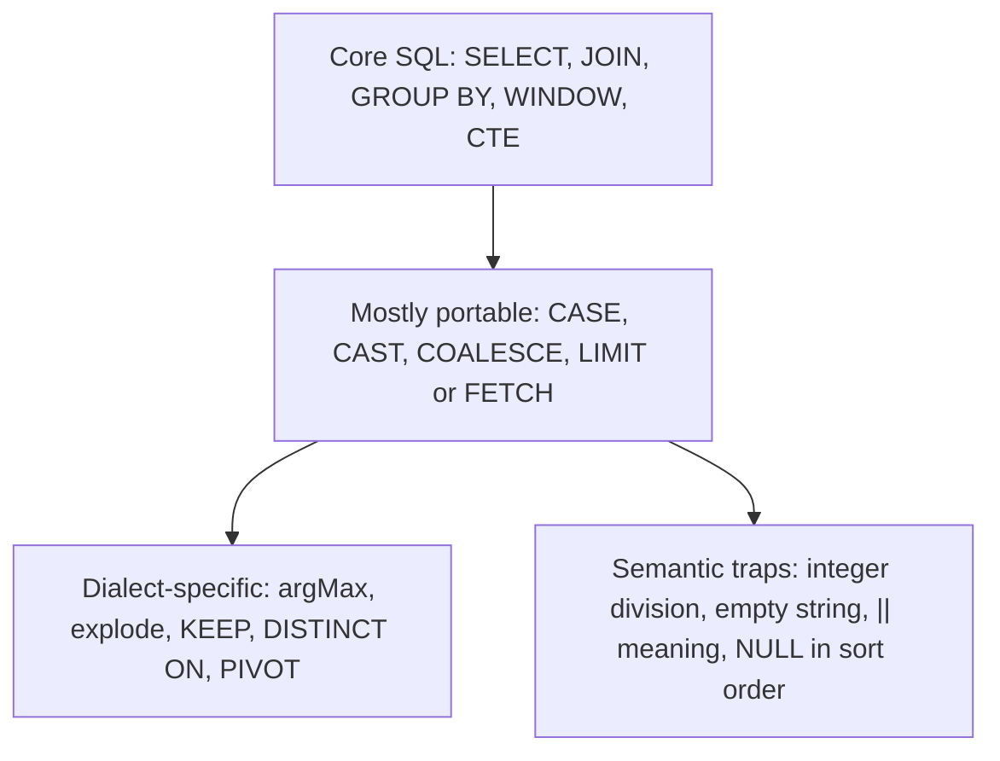

## 🎯 خلاصه

> SQL روی کاغذ یک استاندارد است و در عمل خانواده‌ای از dialectها. بیشتر تفاوت‌ها در **تابع‌ها، نوع‌ها و معناشناسی لبه‌ها** است (تقسیم صحیح، رشته‌ی خالی، مدیریت `NULL`، محاسبات تاریخ)، نه در هسته‌ی `SELECT ... FROM ... WHERE ... GROUP BY`.

- در مصاحبه **dialect** مورد نظرت را بگو. اگر سؤال مشخص نکرده، **PostgreSQL** را فرض کن و همین را بگو؛ امن‌ترین و استانداردترین انتخاب است.
- تفاوت‌های خطرناک **بی‌صدا** هستند: کوئری اجرا می‌شود اما جواب دیگری می‌دهد (`7 / 2`، `||` در MySQL، `''` در Oracle).
- پنج ایده‌ی روزمره را در هر موتور یاد بگیر: محدودیت تعداد ردیف، الحاق رشته، شروع ماه، «آخرین مقدار به ازای هر کلید»، و باز کردن آرایه به ردیف.
- ویژگی‌های مخصوص موتور (`argMax` در ClickHouse، `explode` در Spark، `KEEP (DENSE_RANK ...)` در Oracle) سریع و قدرتمندند. آن‌ها را بشناس و بدان جای چه چیزی در موتورهای دیگر می‌نشینند.

## 🌱 از ساده شروع کنیم (مبتدی)

> **💡 تشبیه:** زبان‌هایی با دستور زبان یکسان اما اصطلاحات متفاوت. یک کلمه در یک شهر مؤدبانه است و در شهر دیگر بی‌ادبانه. تفاوتی که معنا را عوض می‌کند همان است که گیرت می‌اندازد.

دستورهای `SELECT`، `WHERE`، `GROUP BY` و `JOIN` که بلدی تقریباً همه‌جا کار می‌کنند. غافلگیری‌ها در جزئیات‌اند:

```sql
SELECT 7 / 2;
```

این چه چیزی برمی‌گرداند؟ جواب به موتور بستگی دارد:

| موتور | نتیجه‌ی `7 / 2` |
|---|---|
| PostgreSQL | `3` (تقسیم صحیح) |
| Oracle | `3.5` |
| Spark SQL | `3.5` (`div` می‌دهد `3`) |
| ClickHouse | `3.5` (`intDiv(7, 2)` می‌دهد `3`) |
| MySQL | `3.5000` |

همان متن SQL، پنج جواب. دو نتیجه: **همیشه قبل از اعتماد به محاسبه‌ی عدد صحیح، dialect را چک کن**، و **هرگز کوئری را بدون بازبینی از یک موتور به موتور دیگر کپی نکن**.

## 🔧 واقعاً چطور کار می‌کند (متوسط)

dialectهای SQL را در سه لایه ببین:



هسته‌ی SQL تقریباً همه‌جا یکسان است. تابع‌های مخصوص dialect وقتی موتور را می‌شناسی اشکالی ندارند. دام‌های معنایی همان‌هایی‌اند که باید حفظ کنی.

**پنج کار روزمره در موتورهای مختلف.** این‌ها بیشتر کوئری‌های واقعی را پوشش می‌دهند.

**1. محدودیت تعداد ردیف.** PostgreSQL، Spark، ClickHouse و خانواده‌ی MySQL از `LIMIT n` استفاده می‌کنند. Oracle از `FETCH FIRST n ROWS ONLY` (از نسخه‌ی 12c) یا فیلتر قدیمی `ROWNUM` استفاده می‌کند. شکل استاندارد SQL همان `FETCH FIRST` است، پس قابل‌حمل‌ترین است.

**2. الحاق رشته.** PostgreSQL، Oracle و Spark از `||` استفاده می‌کنند. در MySQL، `||` به‌طور پیش‌فرض یعنی **OR** منطقی، پس `'a' || 'b'` مقدار `0` می‌دهد. از `CONCAT('a', 'b')` استفاده کن که تقریباً همه‌جا کار می‌کند.

**3. ابتدای ماه.**

```sql
-- PostgreSQL
SELECT date_trunc('month', order_ts) FROM orders;
-- Oracle
SELECT TRUNC(order_ts, 'MM') FROM orders;
-- Spark SQL
SELECT date_trunc('month', order_ts) FROM orders;
-- ClickHouse
SELECT toStartOfMonth(order_ts) FROM orders;
```

**4. تعداد روز بین دو تاریخ.**

```sql
-- PostgreSQL و Oracle: تفریق تاریخ‌ها روز می‌دهد
SELECT d2 - d1 FROM t;
-- Spark SQL
SELECT datediff(d2, d1) FROM t;
-- ClickHouse
SELECT dateDiff('day', d1, d2) FROM t;
```

**5. آخرین مقدار به ازای هر کلید.** جدول `events(order_id, status, ts)` را در نظر بگیر و وضعیت در جدیدترین `ts` برای هر سفارش را بخواه. چهار موتور، چهار اصطلاح:

```sql
-- PostgreSQL
SELECT DISTINCT ON (order_id) order_id, status
FROM events
ORDER BY order_id, ts DESC;

-- Oracle
SELECT order_id,
       MAX(status) KEEP (DENSE_RANK LAST ORDER BY ts) AS status
FROM events
GROUP BY order_id;

-- Spark SQL
SELECT order_id, max_by(status, ts) AS status
FROM events
GROUP BY order_id;

-- ClickHouse
SELECT order_id, argMax(status, ts) AS status
FROM events
GROUP BY order_id;
```

جواب قابل‌حمل یک window function است: `ROW_NUMBER() OVER (PARTITION BY order_id ORDER BY ts DESC) = 1` داخل یک subquery، که در هر چهار موتور کار می‌کند (ببین [[sql-window-functions]]). شکل‌های بومی کوتاه‌تر و گاهی سریع‌ترند، پس یادشان بگیر، اما شکل قابل‌حمل را هم بدان.

**باز کردن آرایه به ردیف.** هر موتور شکل خودش را دارد:

```sql
-- PostgreSQL: جدول با ستون آرایه‌ای tags text[]
SELECT p.id, t.tag
FROM posts p
CROSS JOIN LATERAL unnest(p.tags) AS t(tag);

-- Spark SQL (lateral view به سبک Hive)
SELECT p.id, t.tag
FROM posts p
LATERAL VIEW explode(p.tags) t AS tag;

-- ClickHouse
SELECT id, tag
FROM posts
ARRAY JOIN tags AS tag;
```

به دام معنایی توجه کن: در Spark، `explode` ردیف‌هایی را که آرایه‌شان `NULL` یا خالی است حذف می‌کند. `explode_outer` آن‌ها را نگه می‌دارد. `ARRAY JOIN` در ClickHouse هم آرایه‌های خالی را حذف می‌کند، مگر اینکه `LEFT ARRAY JOIN` بنویسی. قبل از فرض «یک ردیف به ازای هر تگ و هیچ‌چیز گم نمی‌شود»، رفتار موتور خودت را بررسی کن.

**Upsert.** PostgreSQL: `INSERT ... ON CONFLICT (key) DO UPDATE`. Oracle و Spark (برای جدول‌های Delta یا Iceberg): `MERGE`. MySQL: `INSERT ... ON DUPLICATE KEY UPDATE`. ClickHouse upsert سطر‌به‌سطر به معنای OLTP ندارد؛ بخش سنیور را ببین.

## 🧠 عمق و trade-offها (سنیور)

- **dialect را بر اساس بار کاری انتخاب کن.** PostgreSQL مرجع SQL تراکنشی و تحلیلی عمومی است. Oracle در بانک‌ها و مخابرات بزرگ رایج است و توابع تحلیلی، `MERGE`، `CONNECT BY` و `PL/SQL` آن را می‌بینی. Spark SQL برای batch در lakehouse است. ClickHouse برای اسکن‌های تحلیلی سریع و بزرگ روی داده‌ی append-محور است. StarRocks با MySQL سازگار است و برای تحلیل تعاملی به کار می‌رود.
- **خطاهای بی‌صدا را بشناس.**
  - Oracle رشته‌ی خالی `''` را `NULL` در نظر می‌گیرد. `WHERE comment IS NULL` رشته‌های خالی را هم پیدا می‌کند، و `'' = ''` در Oracle درست نیست، چون مقایسه با `NULL` انجام می‌شود.
  - PostgreSQL نام‌های بدون کوتیشن را به حروف کوچک و Oracle به حروف بزرگ تبدیل می‌کند. `"Name"` با کوتیشن در PostgreSQL با `name` فرق دارد.
  - Spark: `/` همیشه double برمی‌گرداند؛ برای تقسیم صحیح از `div` استفاده کن. تبدیل رشته‌ی غیرعددی به `int` با `CAST` در حالت non-ANSI مقدار `NULL` می‌دهد و در حالت ANSI خطا می‌دهد؛ این به تنظیمات بستگی دارد، پس آن‌ها را چک کن.
  - ClickHouse: ستون‌ها مگر اینکه `Nullable(T)` تعریف شده باشند، non-nullable هستند، و `Nullable` هزینه‌ی ذخیره‌سازی و سرعت دارد. رفتار `NULL` در ستون non-nullable را با مستندات نسخه‌ی خودت بررسی کن.
- **ترتیب‌دهی `NULL` بین موتورها فرق دارد.** PostgreSQL در `ASC` معمولاً `NULL` را آخر می‌گذارد؛ Oracle هم همین‌طور است، اما MySQL آن را اول می‌گذارد. کوئری `LIMIT` که به این بستگی دارد بعد از مهاجرت ردیف‌های دیگری برمی‌گرداند. ترتیب را با `NULLS LAST` صریح کن، جایی که موتور پشتیبانی کند.
- **مهاجرت بیشترین ریسک را پنهان می‌کند.** انتقال یک گزارش از Oracle به lakehouse یعنی بازبینی: تقسیم صحیح، `NULL` در برابر رشته‌ی خالی، محاسبه‌ی تاریخ (تفریق تاریخ در Oracle وقتی زمان هست عدد اعشاری می‌دهد)، حساسیت به حروف، و ترتیب مساوی‌ها در `ROW_NUMBER`. یک تست بنویس که دو نتیجه را روی یک نمونه مقایسه کند.
- **امکانات بومی موتور در مقیاس بالا از SQL قابل‌حمل بهترند.** `argMax` یا `max_by` در یک تجمیع، یک پاس است؛ نسخه‌ی قابل‌حمل با window ممکن است برای هر کلید یک sort لازم داشته باشد. هزینه‌اش قابل‌حمل نبودن است. برای کدبیسی مشترک که چند موتور را هدف گرفته، شکل قابل‌حمل را ترجیح بده و گزینه‌ی بومی را مستند کن.
- **رویه‌ها و کد رویه‌ای** مثل `PL/SQL`، `T-SQL` و `PL/pgSQL` dialectهای کد رویه‌ای‌اند. آن‌ها را به‌عنوان SQL ساده منتقل نکن. منطق را به لایه‌ی تبدیل (مثلاً مدل‌های dbt) ببر تا قابل تست باشد.
- **کجا لازم نیست به dialect فکر کنی.** اگر داده کوچک است و تیم یک موتور دارد، امکانات بومی را آزادانه استفاده کن. دام این است که از روی عادت SQL «قابل‌حمل» بنویسی وقتی پلتفرم ثابت است.

## 🧪 امتحان کن

برای هر سؤال، بگو به کدام dialect پاسخ می‌دهی.

1. در PostgreSQL، `SELECT 10 / 4, 10 / 4.0, 10 % 4;` چه چیزی برمی‌گرداند؟
2. جدول `users(id, nickname)` است و بعضی nicknameها به صورت `''` ذخیره شده‌اند. در Oracle کوئری «کاربران بدون nickname» بنویس که رشته‌های خالی را هم پیدا کند.
3. کوئری ClickHouse `SELECT id, argMax(status, ts) FROM events GROUP BY id` را به SQL استاندارد قابل‌حمل که روی PostgreSQL اجرا شود بازنویسی کن.
4. یک job در Spark از `LATERAL VIEW explode(tags)` استفاده می‌کند. بعضی پست‌ها آرایه‌ی `tags` خالی دارند و باید با یک تگ `NULL` در خروجی بمانند. کوئری را درست کن.

<details><summary>جواب‌ها را نشان بده</summary>

**1.** `10 / 4` برابر `2` است (تقسیم صحیح)، `10 / 4.0` برابر `2.5` است (لیترال عددی)، و `10 % 4` برابر `2`. ردیف نتیجه: `2، 2.5، 2`.

**2.**
```sql
SELECT id
FROM users
WHERE nickname IS NULL
   OR TRIM(nickname) = '';
```
در Oracle، `''` همان `NULL` است، پس `nickname IS NULL` رشته‌های خالی را هم می‌گیرد. بررسی `TRIM` عادت خوبی است وقتی احتمال فاصله‌ی سفید در داده هست. کسی که `nickname = ''` بنویسد در Oracle هیچ ردیفی نمی‌گیرد، و همین دام است.

**3.**
```sql
SELECT e.id, e.status
FROM events e
JOIN (
  SELECT id, MAX(ts) AS max_ts
  FROM events
  GROUP BY id
) latest
  ON e.id = latest.id AND e.ts = latest.max_ts;
```
یا شکل window که در join جلوی مساوی‌ها را هم می‌گیرد: `ROW_NUMBER() OVER (PARTITION BY id ORDER BY ts DESC) = 1` در یک subquery. در نسخه‌ی join اگر `ts` مساوی داشته باشی دو ردیف برمی‌گردد؛ این نکته‌ای است که در مصاحبه ارزش گفتن دارد.

**4.**
```sql
SELECT p.id, t.tag
FROM posts p
LATERAL VIEW OUTER explode(p.tags) t AS tag;
```
`OUTER` (معادل `explode_outer` در Spark) پست‌هایی را که آرایه‌شان خالی یا `NULL` است با تگ `NULL` نگه می‌دارد. `explode` ساده آن‌ها را حذف می‌کند، که از دست رفتن بی‌صدای داده است.

</details>

## 💬 گوشه‌ی مصاحبه

**سؤال: «کوئری آخرین وضعیت هر سفارش را بنویس.»** پاسخ متوسط: «یک window با `ROW_NUMBER` که بر اساس زمان نزولی مرتب شده و در یک subquery روی 1 فیلتر شده.» پاسخ سنیور: «SQL قابل‌حمل با window function، و قاعده‌ی مساوی‌ها را می‌گویم. اگر موتور ClickHouse باشد از `argMax` در یک تجمیع استفاده می‌کنم، و اگر Oracle باشد از `KEEP (DENSE_RANK ...)`. اول اسم dialect را می‌گویم.»

**سؤال: «این کوئری روی Spark قابل‌حمل است؟»** جواب درباره‌ی بازبینی است، نه حفظ کردن: تقسیم صحیح، `||`، رشته‌ی خالی، ترتیب `NULL`، حساسیت نام‌ها به حروف، محاسبات تاریخ و باز کردن آرایه را نگاه کن.

> **🎤 این را در مصاحبه بگو:** «مگر اینکه خلافش را بگویی، برای PostgreSQL می‌نویسم. نکاتی که برای موتور دیگر دوباره چک می‌کنم تقسیم صحیح، الحاق رشته، رشته‌ی خالی در Oracle و ترتیب `NULL`هاست، چون این‌ها جواب را بدون هیچ خطایی عوض می‌کنند.»

## ⚠️ اشتباهات رایج

> **⚠️ توجه:** در MySQL، `'a' || 'b'` الحاق نیست. از `CONCAT` استفاده کن.

> **⚠️ توجه:** `7 / 2` در PostgreSQL برابر `3` است، ولی در Spark، ClickHouse و Oracle برابر `3.5`. کپی کردن محاسبه‌ی میانگین یا درصد بین موتورها می‌تواند همه‌ی نتایج را عوض کند.

- فرض رفتار ANSI در همه‌جا، بدون چک کردن موتور.
- نوشتن `= ''` برای پیدا کردن رشته‌های خالی در Oracle.
- استفاده از `explode` در Spark وقتی باید آرایه‌های خالی نگه داشته شوند، به جای `explode_outer`.
- انتقال کوئری `LIMIT n BY` (ClickHouse) یا `DISTINCT ON` (PostgreSQL) به موتور دیگر بدون بازنویسی با window function.
- تکیه بر جای پیش‌فرض `NULL` در مرتب‌سازی بعد از انتقال به موتور دیگر.
- استفاده‌ی همه‌جایی از امکانات بومی، که وقتی پلتفرم عوض شود کوئری را غیرقابل‌انتقال می‌کند.

## ✅ خودت را بسنج

1. کدام موتور برای `SELECT 7 / 2` با لیترال‌های صحیح `3` برمی‌گرداند؟
   - A) Spark SQL
   - B) PostgreSQL
   - C) ClickHouse
   - D) Oracle

<details><summary>جواب</summary>

**B** — PostgreSQL تقسیم صحیح انجام می‌دهد. Spark، ClickHouse و Oracle مقدار `3.5` می‌دهند. `div` در Spark و `intDiv` در ClickHouse مقدار `3` می‌دهند.

</details>

2. در Oracle، `''` چه مقداری دارد؟
   - A) یک رشته‌ی خالی که با `NULL` فرق دارد
   - B) `NULL`
   - C) عدد `0`
   - D) خطا

<details><summary>جواب</summary>

**B** — Oracle رشته‌ی خالی را `NULL` در نظر می‌گیرد. پس `WHERE col = ''` هیچ ردیفی برنمی‌گرداند و `WHERE col IS NULL` همان ردیف‌ها را پیدا می‌کند.

</details>

3. کدام تابع ClickHouse وضعیت را در آخرین timestamp برای هر گروه برمی‌گرداند؟
   - A) `argMin(status, ts)`
   - B) `argMax(status, ts)`
   - C) `groupArray(status)`
   - D) `uniqExact(status)`

<details><summary>جواب</summary>

**B** — `argMax(value, key)` مقدار را در بیشترین key برمی‌گرداند. `argMin` اولین مقدار را برمی‌گرداند.

</details>

4. **(سنیور)** یک کوئری ClickHouse از `LIMIT 1 BY user_id` برای گرفتن جدیدترین رویداد هر کاربر استفاده می‌کند، و تو آن را روی Spark SQL لازم داری. کدام بازنویسی درست و قابل‌حمل است؟

   - A) `SELECT * FROM events LIMIT 1` با `GROUP BY user_id`
   - B) یک subquery با `ROW_NUMBER() OVER (PARTITION BY user_id ORDER BY ts DESC) = 1` که در کوئری بیرونی فیلتر شده
   - C) `SELECT DISTINCT user_id FROM events`
   - D) `WHERE ts = MAX(ts)`

<details><summary>جواب</summary>

**B** — نسخه‌ی window قابل‌حمل است و یک ردیف به ازای هر کاربر می‌دهد. `WHERE` نمی‌تواند مستقیم از تجمیع استفاده کند (D)، `DISTINCT` بقیه‌ی ستون‌ها را حذف می‌کند (C)، و `LIMIT` ساده گروه را نادیده می‌گیرد (A).

</details>

5. **(سنیور)** یک جدول ده میلیارد ردیفی در ClickHouse مکرراً روی همان کلیدها به‌روز می‌شود و تیم برای هر تغییر `ALTER TABLE ... UPDATE` اجرا می‌کند. طراحی بهتر چیست و چرا؟

   - A) همان فراخوانی‌های `ALTER ... UPDATE` را نگه دار و یک ایندکس اضافه کن
   - B) جدول را به‌صورت log فقط-append با ستون نسخه یا موتور replacing مدل کن (یا آخرین مقدار را با `argMax` تجمیع کن)، و بگذار merge های پس‌زمینه یا کوئری‌ها آخرین نسخه را تعیین کنند
   - C) برای هر به‌روزرسانی به `UNION ALL` برو
   - D) `DELETE` و `INSERT` را در یک تراکنش اجرا کن

<details><summary>جواب</summary>

**B** — ClickHouse برای append ساخته شده. `ALTER ... UPDATE` یک mutation غیرهمزمان است که بخش‌های داده را بازنویسی می‌کند و در این مقیاس گران است. طراحی append-محور با ستون نسخه و خواندن replacing یا مبتنی بر `argMax` از بازنویسی میلیاردها ردیف برای هر تغییر جلوگیری می‌کند.

</details>

## 🗂️ فلش‌کارت

| Front | Back |
|---|---|
| `7 / 2` در PostgreSQL | `3` (تقسیم صحیح) |
| `7 / 2` در Spark SQL | `3.5`؛ برای `3` از `div` استفاده کن |
| `||` در MySQL | پیش‌فرض OR منطقی است؛ از `CONCAT()` استفاده کن |
| `''` در Oracle | `NULL` |
| محدودیت ردیف (استاندارد) | `FETCH FIRST n ROWS ONLY` |
| آخرین مقدار به ازای هر کلید | `DISTINCT ON` (PG)، `KEEP (DENSE_RANK LAST ...)` (Oracle)، `max_by` (Spark)، `argMax` (ClickHouse) |
| باز کردن آرایه به ردیف | `unnest` (PG)، `explode` / `explode_outer` (Spark)، `ARRAY JOIN` (ClickHouse) |
| top-1 قابل‌حمل به ازای گروه | `ROW_NUMBER() OVER (PARTITION BY ... ORDER BY ...) = 1` در یک subquery |

## 🔗 ادامه

- [[sql-window-functions]] — شکل قابل‌حمل پشت بیشتر سؤال‌های «آخرین مقدار به ازای کلید».
- [[sql-nulls]] — منطق سه‌مقداری و اینکه چرا `NULL` با هیچ چیز برابر نیست.
- [[sql-datetime]] — محاسبات تاریخ و منطقه‌ی زمانی با جزئیات بیشتر.
- [[sql-advanced-grouping]] — PIVOT، ROLLUP و FILTER در موتورهای مختلف.
- [[clickhouse]] و [[spark-architecture]] — موتورهایی که امکانات بومی‌شان در این درس مقایسه شده.

