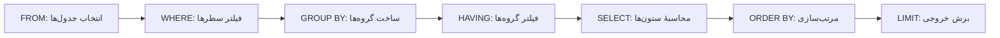

## 🎯 خلاصه

> یک کوئری SQL به صورت فهرستی از بندها (clause) نوشته می‌شود، اما پایگاه‌داده آن‌ها را به ترتیبی که تو تایپ کرده‌ای اجرا **نمی‌کند**. ترتیب منطقی این است: `FROM → WHERE → GROUP BY → HAVING → SELECT → ORDER BY → LIMIT`. بیشتر سؤال‌های «چرا این کوئری کار نمی‌کند؟» با همین ترتیب جواب داده می‌شوند.

- `WHERE` قبل از گروه‌بندی **سطرها** را فیلتر می‌کند. `HAVING` بعد از تجمیع **گروه‌ها** را فیلتر می‌کند.
- نامی (alias) که در `SELECT` تعریف می‌شود، داخل `WHERE` یا `HAVING` هنوز وجود ندارد.
- `NULL` یعنی «نامشخص»، نه صفر و نه رشتهٔ خالی. با `IS NULL` مقایسه کن، هرگز با `=`.
- `COUNT(*)` سطرها را می‌شمارد، `COUNT(col)` مقادیر غیر-NULL را، و `CASE WHEN` همان if/else در SQL است.

## 🌱 از ساده شروع کنیم (مبتدی)

> **💡 تشبیه:** فکر کن داری گزارش فروش را دستی درست می‌کنی. اول فیش‌های فروش را از کشو بیرون می‌آوری (`FROM`). فیش‌های مرجوعی را کنار می‌گذاری (`WHERE`)، بقیه را بر اساس مشتری دسته‌بندی می‌کنی (`GROUP BY`)، فقط مشتری‌های پرخرید را نگه می‌داری (`HAVING`)، ستون‌هایی که در گزارش می‌آیند را انتخاب می‌کنی (`SELECT`)، مرتب‌شان می‌کنی (`ORDER BY`) و ۱۰ تای اول را چاپ می‌کنی (`LIMIT`).

در کل این درس از این جدول استفاده می‌کنیم:

```sql
CREATE TABLE orders (id int, customer_id int, amount numeric, status text);
INSERT INTO orders VALUES
 (1, 10, 120.00, 'paid'),
 (2, 10,  80.00, 'refunded'),
 (3, 11, 200.00, 'paid'),
 (4, 12,    NULL, 'pending'),
 (5, 11,  50.00, 'paid');
```

این کوئری همهٔ بندهای اصلی را دارد:

```sql
SELECT customer_id, COUNT(*) AS n_orders, SUM(amount) AS paid_total
FROM orders
WHERE status = 'paid'
GROUP BY customer_id
HAVING SUM(amount) > 100
ORDER BY paid_total DESC
LIMIT 10;
```

**قبل از نگاه کردن پیش‌بینی کن:** کدام مشتری‌ها ظاهر می‌شوند و به چه ترتیبی؟

<details><summary>حدست چیست؟</summary>

اول مشتری ۱۱ (دو سفارش پرداخت‌شده، جمع ۲۵۰.۰۰)، بعد مشتری ۱۰ (یک سفارش پرداخت‌شده، جمع ۱۲۰.۰۰). مشتری ۱۲ فقط یک سفارش `pending` دارد، پس `WHERE` آن سطر را قبل از شروع گروه‌بندی حذف می‌کند. نتیجه `(11, 2, 250.00)` و `(10, 1, 120.00)` است.

</details>

هر بند به یک سؤال جواب می‌دهد:

| بند | سؤالی که پاسخ می‌دهد | روی چه چیزی کار می‌کند |
|---|---|---|
| `FROM` | سطرها از کدام جدول‌ها می‌آیند؟ | جدول‌ها → سطرها |
| `WHERE` | کدام سطرها را نگه دارم؟ | سطرهای تکی |
| `GROUP BY` | کدام سطرها کنار هم تعلق دارند؟ | سطرها → گروه‌ها |
| `HAVING` | کدام گروه‌ها را نگه دارم؟ | گروه‌ها |
| `SELECT` | کدام ستون‌ها یا عبارت‌ها را خروجی بدهم؟ | گروه‌ها یا سطرها |
| `ORDER BY` | به چه ترتیبی نشان بدهم؟ | سطرهای خروجی |
| `LIMIT` | چند تا نشان بدهم؟ | سطرهای خروجی |

### نامِ alias و محدودهٔ آن

یک alias (مثل `AS paid_total`) در `SELECT` ساخته می‌شود و `SELECT` دیرتر اجرا می‌شود. پس این کوئری در PostgreSQL خطا می‌دهد:

```sql
SELECT amount * 0.9 AS net
FROM orders
WHERE net > 100;   -- ERROR: column "net" does not exist
```

راه‌حل این است که عبارت را دوباره در `WHERE` بنویسی، یا کوئری را داخل یک subquery یا CTE ببری (در **sql-subqueries-ctes** توضیح داده می‌شود). `ORDER BY` می‌تواند از alias استفاده کند چون بعد از `SELECT` اجرا می‌شود.

### شمارش، NULL و DISTINCT

```sql
SELECT COUNT(*)                    AS all_rows,     -- 5
       COUNT(amount)               AS with_amount,  -- 4، چون NULL حذف می‌شود
       AVG(amount)                 AS avg_amount,   -- 450 / 4 = 112.5
       COALESCE(SUM(amount), 0)    AS total         -- 450
FROM orders;

SELECT DISTINCT status FROM orders;  -- paid, refunded, pending (ترتیب سطرها تضمین نمی‌شود)
```

`SUM` و `AVG` مقادیر NULL را نادیده می‌گیرند. NULL را صفر حساب نمی‌کنند، و به همین دلیل میانگین را بر ۴ تقسیم می‌کنیم، نه ۵. `COALESCE` اولین آرگومان غیر-NULL را برمی‌گرداند و یک مقدار پیش‌فرض برای مقدار گم‌شده می‌سازد.

### CASE WHEN

```sql
SELECT id,
       CASE
         WHEN status = 'paid'     THEN 'revenue'
         WHEN status = 'refunded' THEN 'money back'
         ELSE 'open'
       END AS bucket,
       COALESCE(amount, 0) AS amount_or_zero
FROM orders
ORDER BY id;
```

سطرها: `1 revenue 120`، `2 money back 80`، `3 revenue 200`، `4 open 0`، `5 revenue 50`. `CASE` شرط‌ها را از بالا به پایین بررسی می‌کند و اولین تطابق را برمی‌گرداند. اگر `ELSE` نباشد، نتیجه `NULL` است.

## 🔧 واقعاً چطور کار می‌کند (متوسط)

ترتیب منطقی یک **قرارداد معنایی** است: می‌گوید نتیجه باید چه باشد. برنامه‌ریز (planner) موتور آزاد است اجرا را به ترتیب فیزیکی دیگری انجام دهد (مثلاً فیلتر را تا مرحلهٔ خواندن جدول پایین بیاورد)، به شرطی که نتیجه یکی باشد. ترتیب منطقی را مثل قوانین بازی ببین و برنامه‌ریز را مثل داوری که ممکن است سریع‌تر حرکت کند.

این ترتیب قوانین رایج را توضیح می‌دهد:

- **چرا `WHERE` نمی‌تواند تجمیع را ببیند:** `SUM(amount)` تا وقتی `GROUP BY` اجرا نشده وجود ندارد. آن شرط را در `HAVING` بنویس.
- **چرا `WHERE` نمی‌تواند alias های `SELECT` را ببیند:** چون `SELECT` هنوز اجرا نشده.
- **چرا `ORDER BY` می‌تواند alias ببیند:** چون بعد از `SELECT` اجرا می‌شود.
- **چرا فیلتر در `WHERE` ارزان‌تر است:** سطرهایی که `WHERE` حذف می‌کند هرگز به مرحلهٔ گروه‌بندی نمی‌رسند. `HAVING` گروه‌ها را بعد از ساخته‌شدنشان حذف می‌کند.



### NULL از منطق سه‌ارزشی پیروی می‌کند

مقایسه با NULL نتیجه‌اش `UNKNOWN` است، و `WHERE` فقط سطرهایی را نگه می‌دارد که شرطشان `TRUE` باشد. روی همین جدول امتحان کن:

```sql
SELECT id FROM orders WHERE amount = NULL;               -- 0 سطر، هرگز true نمی‌شود
SELECT id FROM orders WHERE amount IS NULL;              -- 4
SELECT id FROM orders WHERE amount > 100 OR amount <= 100; -- 4 سطر (1، 2، 3، 5)، نه 5
```

کوئری سوم به نظر می‌رسد همهٔ سطرها را برگرداند، ولی این کار را نمی‌کند: سطر ۴ مقدار `amount = NULL` دارد، پس هر دو طرف `UNKNOWN` هستند و `UNKNOWN OR UNKNOWN` هم همچنان `UNKNOWN` است.

همچنین `WHERE status <> 'paid'` بی‌صدا سطرهایی را که `status` آن‌ها NULL است حذف می‌کند. اگر به آن‌ها نیاز داری، بنویس `WHERE status IS DISTINCT FROM 'paid'` (نحو PostgreSQL که در چند موتور دیگر هم موجود است).

## 🧠 عمق و trade-offها (سنیور)

- **قطعی بودن (determinism).** `LIMIT` بدون `ORDER BY` زیرمجموعهٔ دلخواهی از سطرها را برمی‌گرداند. این در داشبوردهایی که «هر بار رفرش که می‌شود عوض می‌شود» رایج است. همیشه یک `ORDER BY` با tie-breaker یکتا اضافه کن (مثلاً `ORDER BY paid_total DESC, customer_id`). این موضوع برای view ها و موتورهای توزیع‌شده مثل Spark و Trino هم صدق می‌کند، جایی که ترتیب سطرها بین مراحل حفظ نمی‌شود.
- **هرس ستون‌ها روی ذخیره‌سازی ستونی.** روی Parquet، ClickHouse یا StarRocks، `SELECT *` همهٔ ستون‌ها را از دیسک می‌خواند و خیلی گران‌تر از فهرست ستون‌های لازم تمام می‌شود. در warehouse، فهرست صریح ستون‌ها یک تصمیم هزینه است، نه فقط سلیقه.
- **`DISTINCT` می‌تواند باگ را پنهان کند.** اگر join سطرها را تکثیر کند (ببین **sql-joins**)، `DISTINCT` گزارش را درست نشان می‌دهد در حالی که عددها هنوز غلط‌اند. `DISTINCT` روی جدول بزرگ را نشانهٔ بد بدان و `COUNT(DISTINCT ...)` را یک تجمیع گران بشمار. شمارش تقریبی مقادیر یکتا (مثل `uniq` در ClickHouse یا توابع مبتنی بر HyperLogLog) خطای کوچکی را با سرعت بیشتر عوض می‌کند.
- **کی از `HAVING` استفاده نکنیم.** اگر شرط فقط از ستون‌های سطر استفاده می‌کند (نه تجمیع)، آن را در `WHERE` بگذار. نتیجه یکی است و موتور سطرهای کمتری را پردازش می‌کند.
- **پیش‌فرض‌های `NULLS FIRST` / `NULLS LAST`** در موتورهای مختلف فرق دارند. برای موتور خودت در مستندات نسخهٔ خودت بررسی کن.

## 🧪 امتحان کن

داده‌های ابتدای این درس را در PostgreSQL اجرا کن.

1. **گروه‌های بیش از یک سطر.** برای هر `status` تعداد سفارش و جمع مبلغ را نشان بده، ولی فقط برای وضعیت‌هایی که بیش از یک سطر دارند.
2. **مبلغ گم‌شده یا کم.** شناسهٔ (`id`) سفارش‌هایی را فهرست کن که مبلغشان گم شده یا کمتر از ۱۰۰ است، مرتب‌شده بر اساس `id`.
3. **کوئری خراب.** کوئری زیر خطا می‌دهد. دلیلش را توضیح بده و آن را طوری اصلاح کن که مشتری‌هایی با جمع بیش از ۱۰۰ را برگرداند.

```sql
SELECT customer_id, SUM(amount) AS total
FROM orders
WHERE total > 100
GROUP BY customer_id;
```

<details><summary>راه‌حل‌ها را نشان بده</summary>

**1.**
```sql
SELECT status, COUNT(*) AS n, SUM(amount) AS total
FROM orders
GROUP BY status
HAVING COUNT(*) > 1;
```
نتیجه: `paid 3 370.00`. وضعیت‌های `refunded` و `pending` هر کدام یک سطر دارند، پس `HAVING` آن‌ها را حذف می‌کند.

**2.**
```sql
SELECT id
FROM orders
WHERE amount IS NULL OR amount < 100
ORDER BY id;
```
نتیجه: `2`، `4`، `5`. توجه کن که `amount < 100` به تنهایی سطر ۴ را از دست می‌داد.

**3.** `total` یک alias است و `WHERE` قبل از `SELECT` اجرا می‌شود، پس این نام هنوز وجود ندارد. همچنین تابع تجمیعی مثل `SUM` اصلاً در `WHERE` قابل استفاده نیست. راه‌حل شرط را به `HAVING` منتقل می‌کند:
```sql
SELECT customer_id, SUM(amount) AS total
FROM orders
GROUP BY customer_id
HAVING SUM(amount) > 100;
```
نتیجه: مشتری ۱۰ با جمع ۲۰۰ و مشتری ۱۱ با جمع ۲۵۰. مشتری ۱۲ جمع NULL دارد، پس `NULL > 100` درست نیست و سطر حذف می‌شود.

</details>

## 💬 گوشه‌ی مصاحبه

**س: چرا نمی‌توانم alias مربوط به `SELECT` را در `WHERE` استفاده کنم؟**

> **🎤 این را در مصاحبه بگو:** SQL بندها را به ترتیب منطقی ارزیابی می‌کند: `FROM`، `WHERE`، `GROUP BY`، `HAVING`، `SELECT`، `ORDER BY`. alias در مرحلهٔ `SELECT` ساخته می‌شود، که بعد از `WHERE` اجرا می‌شود، پس `WHERE` آن را نمی‌بیند. `ORDER BY` می‌تواند از آن استفاده کند چون دیرتر اجرا می‌شود. برنامه‌ریز ممکن است اجرای فیزیکی را تغییر دهد، ولی نتیجه باید با این ترتیب منطقی یکی باشد.

پاسخ **مبتدی** به «ترتیب FROM، WHERE، ...» بسنده می‌کند. پاسخ **متوسط** تفاوت `WHERE` و `HAVING` را توضیح می‌دهد و می‌گوید تجمیع‌ها در `HAVING` می‌روند. پاسخ **سنیور** اضافه می‌کند که ترتیب منطقی قرارداد معنایی است، `LIMIT` بدون `ORDER BY` غیرقطعی است، و فیلتر زودهنگام کار گروه‌بندی را کم می‌کند.

**س: تفاوت `COUNT(*)` و `COUNT(col)` چیست؟**

`COUNT(*)` سطرها را می‌شمارد. `COUNT(col)` سطرهایی را می‌شمارد که `col` در آن‌ها NULL نیست. روی جدول نمونه، `COUNT(*)` برابر ۵ و `COUNT(amount)` برابر ۴ است.

## ⚠️ اشتباهات رایج

- **`= NULL` به جای `IS NULL`.** `WHERE amount = NULL` هیچ سطری برنمی‌گرداند. از `IS NULL` یا `IS NOT NULL` استفاده کن.
- **تابع تجمیعی در `WHERE`.** `WHERE SUM(amount) > 100` خطاست. از `HAVING` استفاده کن.
- **alias در `WHERE`.** عبارت را دوباره بنویس یا کوئری را بسته‌بندی کن.
- **فرض اینکه `<>` و NOT مقادیر NULL را نگه می‌دارند.** `WHERE status <> 'paid'` سطرهایی را که `status` آن‌ها NULL است حذف می‌کند.
- **اشتباه گرفتن دو شمارش.** `COUNT(amount)` بی‌صدا مبالغ NULL را رد می‌کند، پس شمارش و میانگین ممکن است با انتظارت نخواند.
- **`LIMIT` بدون `ORDER BY`.** نتیجه بین اجراها پایدار نیست.
- **`SELECT *` در کد production.** تغییر schema می‌تواند jobهای پایین‌دستی را خراب کند، و موتورهای ستونی برای هر ستونی که نخواستی هزینه می‌دهند.

## ✅ خودت را بسنج (quiz)

1. کدام بند اول اجرا می‌شود؟
   - A) `SELECT`
   - B) `WHERE`
   - C) `ORDER BY`
   - D) `LIMIT`

2. چرا `SELECT amount AS a FROM orders WHERE a > 100;` در PostgreSQL خطا می‌دهد؟
   - A) `amount` عددی نیست
   - B) `a` در `SELECT` ساخته می‌شود و `SELECT` بعد از `WHERE` اجرا می‌شود
   - C) `WHERE` با `>` مقایسه نمی‌کند
   - D) alias باید داخل کوتیشن باشد

3. با جدول نمونه، `SELECT COUNT(amount) FROM orders;` چند سطر برمی‌گرداند؟
   - A) 5
   - B) 4
   - C) 1
   - D) 0

4. `SELECT id FROM orders WHERE amount = NULL;` چه برمی‌گرداند؟
   - A) همهٔ سطرها
   - B) سطرهایی که `amount` آن‌ها صفر است
   - C) صفر سطر
   - D) خطا

5. **سؤال سنیور.** داشبوردی با `LIMIT 10` و بدون `ORDER BY` «ده مشتری برتر» را نشان می‌دهد. هر بار رفرش که می‌شود فهرست عوض می‌شود. چرا، و راه‌حل چیست؟

<details><summary>پاسخ</summary>

**1 — B.** اول `FROM` و بعد `WHERE` اجرا می‌شود. `SELECT`، `ORDER BY` و `LIMIT` بعداً می‌آیند.

**2 — B.** alias در `SELECT` تعریف می‌شود و `WHERE` قبل از `SELECT` اجرا می‌شود. عبارت را تکرار کن یا از subquery استفاده کن.

**3 — B.** `COUNT(col)` مقادیر NULL را رد می‌کند و یکی از پنج مقدار `amount` NULL است، پس نتیجه ۴ است.

**4 — C.** `amount = NULL` برای همهٔ سطرها `UNKNOWN` است و `WHERE` فقط `TRUE` را نگه می‌دارد. از `IS NULL` استفاده کن.

**5 — (پاسخ سنیور).** بدون `ORDER BY`، پایگاه‌داده تعهدی ندارد که همان سطرها را به همان ترتیب برگرداند، پس `LIMIT 10` یک زیرمجموعهٔ دلخواه می‌دهد. `ORDER BY total_spent DESC, customer_id` اضافه کن تا ترتیب پایدار شود، با یک tie-breaker یکتا.

</details>

## 🗂️ فلش‌کارت

| Front | Back |
|---|---|
| ترتیب منطقی یک کوئری | FROM → WHERE → GROUP BY → HAVING → SELECT → ORDER BY → LIMIT |
| WHERE در برابر HAVING | WHERE سطرها را قبل از گروه‌بندی فیلتر می‌کند؛ HAVING گروه‌ها را بعد از تجمیع |
| چرا WHERE نمی‌تواند از alias مربوط به SELECT استفاده کند؟ | alias در SELECT ساخته می‌شود و SELECT بعد از WHERE اجرا می‌شود |
| `COUNT(*)` در برابر `COUNT(col)` | سطرها در برابر مقادیر غیر-NULL ستون `col` |
| NULL را چطور تست کنیم؟ | `IS NULL` / `IS NOT NULL` (هرگز `= NULL`) |
| COALESCE چه می‌کند؟ | اولین آرگومان غیر-NULL را برمی‌گرداند |
| آیا `LIMIT` بدون `ORDER BY` پایدار است؟ | خیر؛ زیرمجموعهٔ سطرها دلخواه است |

## 🔗 ادامه

- **sql-advanced-grouping** گروه‌بندی را با `ROLLUP`، `CUBE` و `GROUPING SETS` گسترش می‌دهد.
- **sql-nulls** رفتار NULL را عمیق‌تر پوشش می‌دهد، از جمله مرتب‌سازی و ایندکس.
- **sql-joins** قدم بعدی است: ترکیب جدول‌ها بدون تکثیر یا از دست دادن سطرها.
- **sql-window-functions** نشان می‌دهد چطور همهٔ سطرها را نگه داری و در عین حال مقادیر سطح گروه را محاسبه کنی.
- بخش مدیریت NULL و مرتب‌سازی مستندات موتور خودت را یک بار بخوان؛ پیش‌فرض‌ها بین PostgreSQL، MySQL و warehouseها فرق دارند.
