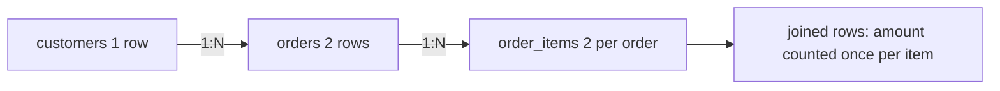

## 🎯 خلاصه

> **join** ردیف‌های دو جدول را بر اساس یک شرط کنار هم می‌گذارد. نوع join تعیین می‌کند با ردیف‌هایی که **جفت ندارند** چه می‌شود، و کاردینالیتی join (1:1، 1:N، N:M) تعیین می‌کند آیا عددهایت **تکثیر** می‌شوند یا نه.

- `INNER` فقط جفت‌های تطابق‌یافته را نگه می‌دارد. `LEFT` همهٔ ردیف‌های سمت چپ را نگه می‌دارد و اگر تطابقی نباشد، سمت راست را با NULL پر می‌کند.
- `FULL OUTER` ردیف‌های بی‌جفت از هر دو طرف را نگه می‌دارد. `CROSS` همهٔ ترکیب‌ها را می‌سازد.
- **semi join** (با `EXISTS`) می‌پرسد «آیا تطابقی هست؟» بدون تکثیر ردیف. **anti join** (با `NOT EXISTS` یا `LEFT JOIN ... IS NULL`) می‌پرسد «آیا تطابقی نیست؟».
- join به یک جدول 1:N ردیف‌های سمت «1» را تکثیر می‌کند. این پدیدهٔ **fan-out** رایج‌ترین علت بزرگ‌نمایی درآمد است.
- کلید NULL با هیچ چیزی مطابقت ندارد، حتی با NULL دیگر.

## 🌱 از ساده شروع کنیم (مبتدی)

> **💡 تشبیه:** دو لیست مهمان برای یک مهمانی. **inner join** یعنی «فقط کسانی که در هر دو لیست هستند». **left join** یعنی «همهٔ لیست اول، و اطلاعات همراهشان از لیست دوم اگر آنجا بودند، وگرنه خالی». خالی یعنی NULL.

از این جدول‌ها استفاده می‌کنیم:

```sql
CREATE TABLE customers (id int, name text);
CREATE TABLE orders (id int, customer_id int, amount numeric);

INSERT INTO customers VALUES (1,'Ali'), (2,'Sara'), (3,'Reza');
INSERT INTO orders VALUES
 (10, 1, 100), (11, 1, 50), (12, 2, 200),
 (13, NULL, 30),   -- اصلاً مشتری ندارد
 (14, 9, 70);      -- مشتری ۹ وجود ندارد
```

Inner join:

```sql
SELECT c.name, o.id AS order_id, o.amount
FROM customers c
JOIN orders o ON o.customer_id = c.id;   -- همان INNER JOIN
```

نتیجه: Ali 10 100، Ali 11 50، Sara 12 200. Reza (بدون سفارش) و سفارش‌های ۱۳ و ۱۴ (بدون مشتری متناظر) حذف شده‌اند.

Left join، Reza را نگه می‌دارد:

```sql
SELECT c.name, o.id AS order_id
FROM customers c
LEFT JOIN orders o ON o.customer_id = c.id;
```

نتیجه: Ali 10، Ali 11، Sara 12، **Reza NULL**. جدول سمت چپ (`customers`) کامل نگه داشته می‌شود.

**قبل از نگاه کردن پیش‌بینی کن:** یک `FULL OUTER JOIN` روی این دو جدول چند ردیف برمی‌گرداند؟

<details><summary>حدست چیست؟</summary>

شش. چهار ردیف مشتری (Ali 10، Ali 11، Sara 12، Reza NULL) که یا جفت دارند یا فقط سمت چپ‌اند، به‌علاوه دو سفارشی که فقط سمت راست‌اند (سفارش ۱۳ با مشتری NULL و سفارش ۱۴ با مشتری ۹). full outer join ردیف‌های بی‌جفت از هر دو طرف را نگه می‌دارد.

</details>

| Join | جفت‌های تطابق‌یافته | سمت چپ بی‌جفت | سمت راست بی‌جفت |
|---|---|---|---|
| `INNER` | بله | خیر | خیر |
| `LEFT` | بله | بله | خیر |
| `RIGHT` | بله | خیر | بله |
| `FULL OUTER` | بله | بله | بله |
| `CROSS` | همهٔ جفت‌ها (بدون شرط) | — | — |

### پیدا کردن ردیف‌های بدون تطابق (anti join)

«مشتری‌هایی که هرگز سفارش نداده‌اند» سؤال کلاسیک مصاحبه است. سه روش درست:

```sql
-- ۱. LEFT JOIN + IS NULL
SELECT c.id, c.name
FROM customers c
LEFT JOIN orders o ON o.customer_id = c.id
WHERE o.id IS NULL;

-- ۲. NOT EXISTS (anti join)
SELECT c.id, c.name
FROM customers c
WHERE NOT EXISTS (SELECT 1 FROM orders o WHERE o.customer_id = c.id);

-- ۳. NOT IN (اینجا کار می‌کند، ولی تلهٔ زیر را بخوان)
SELECT c.id, c.name
FROM customers c
WHERE c.id NOT IN (SELECT customer_id FROM orders);
```

هر سه Reza را برمی‌گردانند. روش سوم یک تله دارد: `orders.customer_id` یک NULL دارد (سفارش ۱۳). `c.id NOT IN (1, 2, NULL, 9)` هرگز `TRUE` نمی‌شود، چون مقایسه با NULL نتیجه‌اش `UNKNOWN` است. پس اگر subquery حتی یک NULL برگرداند، `NOT IN` **صفر سطر** برمی‌گرداند. `NOT EXISTS` را ترجیح بده.

## 🔧 واقعاً چطور کار می‌کند (متوسط)

join در واقع یک ضرب دکارتی فیلترشده است. از نظر مفهومی، موتور هر جفت `(ردیف چپ، ردیف راست)` را می‌سازد، جفت‌هایی را نگه می‌دارد که شرط `ON` آن‌ها `TRUE` است، و سپس ردیف‌های بی‌جفتی را که نوع outer join می‌خواهد اضافه می‌کند. برنامه‌ریز یک الگوریتم فیزیکی برای اجرای کارآمد انتخاب می‌کند:

- **hash join:** روی ورودی کوچک‌تر یک جدول hash می‌سازد و ورودی دیگر را با آن جستجو می‌کند. معمولاً برای join های تساوی (`a.k = b.k`) روی داده‌های بزرگ انتخاب می‌شود.
- **sort-merge join:** هر دو ورودی را روی کلید مرتب و سپس ادغام می‌کند. وقتی ورودی‌ها از قبل مرتب‌اند یا خیلی بزرگ‌اند خوب است.
- **nested loop:** برای هر ردیف سمت چپ، سمت راست را اسکن می‌کند. فقط وقتی ارزان است که سمت راست خیلی کوچک یا ایندکس‌دار باشد.

### فیلتر در ON در برابر WHERE

برای outer join، محل شرط نتیجه را عوض می‌کند:

```sql
-- الف: شرط در ON -> همهٔ مشتری‌ها می‌مانند
SELECT c.name, o.id
FROM customers c
LEFT JOIN orders o ON o.customer_id = c.id AND o.amount > 60;
-- Ali 10، Sara 12، Reza NULL

-- ب: شرط در WHERE -> مشتری‌هایی که سفارش بزرگ ندارند حذف می‌شوند
SELECT c.name, o.id
FROM customers c
LEFT JOIN orders o ON o.customer_id = c.id
WHERE o.amount > 60;
-- Ali 10، Sara 12  (Reza حذف شد: NULL > 60 یعنی UNKNOWN)
```

در حالت الف، شرط تعیین می‌کند کدام سفارش‌ها می‌توانند تطابق پیدا کنند و مشتری بی‌تطابق حذف نمی‌شود. در حالت ب، `WHERE` بعد از join اجرا می‌شود، NULL مربوط به Reza را می‌بیند و او را حذف می‌کند؛ پس LEFT JOIN در عمل مثل INNER JOIN رفتار می‌کند. اگر «left join با فیلتر» می‌خواهی، فیلتر را در `ON` بگذار.

### کاردینالیتی و fan-out

| رابطه | مثال | اثر روی تعداد ردیف |
|---|---|---|
| 1:1 | مشتری → پروفایل مشتری | تعداد ردیف ثابت می‌ماند |
| 1:N | مشتری → سفارش‌ها | هر ردیف مشتری به تعداد سفارش‌هایش تکرار می‌شود |
| N:M | سفارش ↔ محصول (از طریق آیتم‌ها) | ردیف‌ها در هر دو طرف ضرب می‌شوند |



## 🧠 عمق و trade-offها (سنیور)

- **Fan-out بی‌صداست.** اضافه کردن یک join به جدول 1:N خطا نمی‌دهد؛ فقط باعث می‌شود `SUM(orders.amount)` از واقعیت بزرگ‌تر شود. قبل از join بپرس: «grain این جدول چیست؟» (ببین **grain**). سمت «زیاد» را اول تجمیع کن، یا وقتی فقط وجود تطابق مهم است از semi join (`EXISTS`) استفاده کن.
- **ترتیب join و کاردینالیتی.** بهینه‌ساز تعداد ردیف هر join را تخمین می‌زند. تخمین بد (آمار قدیمی، ستون‌های وابسته) باعث می‌شود nested loop انتخاب شود در جایی که باید hash join باشد. در Postgres، `EXPLAIN ANALYZE` را بررسی کن و تعداد ردیف تخمینی را با واقعی مقایسه کن.
- **join توزیع‌شده.** در Spark، join یک **shuffle** است، مگر اینکه یک طرف آن‌قدر کوچک باشد که بتوان آن را **broadcast** کرد. کلیدهای skew شده (یک `customer_id` با میلیون‌ها ردیف) کل کار را به یک task می‌فرستند. ببین **data-skew** و **spark-joins-skew**.
- **ایندکس.** کلیدهای خارجی (foreign key) را که در join استفاده می‌شوند ایندکس کن (`orders.customer_id`). بدون آن، nested loop روی جدول بزرگ برای هر ردیف بیرونی یک اسکن کامل است. ببین **sql-indexing**.
- **کلیدهای NULL هرگز تطابق ندارند.** ردیف‌های یتیم با کلید NULL بی‌صدا از inner join بیرون می‌افتند و در outer join فقط به‌عنوان ردیف بی‌جفت ظاهر می‌شوند. تصمیم صریح بگیر که با آن‌ها چه کنی، نگذار بی‌دلیل ناپدید شوند.
- **Warehouse و star schema.** در star schema، جدول‌های fact به dimension ها به صورت many-to-one join می‌شوند، که امن است. خطر وقتی است که دو جدول fact را به هم join کنی (many-to-many). این را با جدول واسط (bridge) مدل کن یا هر طرف را جداگانه تجمیع کن.
- **راهنماهای join موتور خودت** (مثل `/*+ BROADCAST */` یا `FORCE JOIN ORDER`) را در مستندات نسخهٔ خودت بررسی کن؛ فرض نکن در همه‌جا موجودند.

## 🧪 امتحان کن

از جدول‌های `customers` و `orders` همین درس استفاده کن و این را هم اضافه کن:

```sql
CREATE TABLE order_items (order_id int, sku text);
INSERT INTO order_items VALUES (10, 'A'), (10, 'B'), (12, 'C');
```

1. **مشتری‌ها با تعداد سفارش، شامل صفر.** نام هر مشتری و تعداد سفارش‌هایش را نشان بده. Reza باید ۰ نشان داده شود.
2. **سفارش‌های یتیم.** سفارش‌هایی را فهرست کن که مشتری‌شان وجود ندارد (شامل مشتری‌های NULL).
3. **جمع بزرگ‌نمایی‌شده.** کوئری زیر عددی بیش از حد بزرگ برمی‌گرداند. دلیلش را توضیح بده، سپس نسخهٔ درستی بنویس که مبلغ سفارش‌هایی را جمع بزند که حداقل یک آیتم دارند.

```sql
SELECT SUM(o.amount)
FROM orders o
JOIN order_items i ON i.order_id = o.id;
```

<details><summary>راه‌حل‌ها را نشان بده</summary>

**1.**
```sql
SELECT c.name, COUNT(o.id) AS n_orders
FROM customers c
LEFT JOIN orders o ON o.customer_id = c.id
GROUP BY c.name;
```
نتیجه: Ali 2، Sara 1، Reza 0. `COUNT(o.id)` برای Reza مقدار ۰ می‌دهد چون id متصل‌شده NULL است. `COUNT(*)` به اشتباه ۱ می‌داد.

**2.**
```sql
SELECT o.id, o.customer_id, o.amount
FROM orders o
LEFT JOIN customers c ON c.id = o.customer_id
WHERE c.id IS NULL;
```
نتیجه: سفارش‌های ۱۳ (مشتری NULL) و ۱۴ (مشتری ۹).

**3.** سفارش ۱۰ دو آیتم دارد، پس join برای آن دو ردیف تولید می‌کند و مبلغ ۱۰۰ آن دوبار شمرده می‌شود. جمع می‌شود 100 × 2 + 200 = 400. مقدار درست روی سفارش‌هایی که حداقل یک آیتم دارند ۳۰۰ است:
```sql
SELECT SUM(o.amount)
FROM orders o
WHERE EXISTS (SELECT 1 FROM order_items i WHERE i.order_id = o.id);
```

</details>

## 💬 گوشه‌ی مصاحبه

**س: بعد از join، درآمدم دو برابر شد. چرا؟**

> **🎤 این را در مصاحبه بگو:** احتمالاً رابطهٔ join از نوع 1:N است، پس هر ردیف والد به تعداد ردیف‌های فرزندش تکرار می‌شود و `SUM` مقادیر تکراری را جمع می‌زند. grain هر جدول را بررسی می‌کنم، سمت «زیاد» را قبل از join تجمیع می‌کنم، یا اگر فقط فیلتر لازم است از `EXISTS` استفاده می‌کنم. همچنین تعداد ردیف‌ها را قبل و بعد از join چک می‌کنم.

پاسخ **مبتدی** می‌گوید «چون join تکراری است» و `DISTINCT` پیشنهاد می‌دهد. پاسخ **متوسط** fan-out و کاردینالیتی را نام می‌برد و پیش‌تجمیع را پیشنهاد می‌دهد. پاسخ **سنیور** بررسی grain، هزینهٔ الگوریتم join، و ریسک skew را در موتورهای توزیع‌شده اضافه می‌کند.

**س: تفاوت شرط در `ON` و `WHERE` برای LEFT JOIN چیست؟**

شرط در `ON` تعیین می‌کند کدام ردیف‌های سمت راست می‌توانند تطابق پیدا کنند، پس ردیف‌های سمت چپ بی‌تطابق همچنان برگردانده می‌شوند. شرط در `WHERE` بعد از join اجرا می‌شود و ردیف‌هایی را که سمت راستشان NULL است حذف می‌کند، که در عمل LEFT JOIN را به INNER JOIN تبدیل می‌کند.

## ⚠️ اشتباهات رایج

- **فیلتر کردن LEFT JOIN در `WHERE`.** `WHERE o.amount > 60` بی‌صدا مشتری‌های بدون سفارش را حذف می‌کند. اگر می‌خواهی نگهشان داری، شرط را به `ON` ببر.
- **`NOT IN` با subquery که NULL می‌تواند داشته باشد.** یک NULL کل شرط را `UNKNOWN` می‌کند و نتیجه صفر سطر است. از `NOT EXISTS` استفاده کن.
- **`COUNT(*)` بعد از LEFT JOIN.** ردیف NULL-شده را هم می‌شمارد. از `COUNT(جدول_راست.id)` استفاده کن.
- **استفاده از `DISTINCT` برای پنهان کردن تکرار.** گزارش را درست نشان می‌دهد در حالی که منطق join هنوز غلط است.
- **join روی کلید غیریکتا بدون بررسی.** مطمئن شو کلید در سمتی که انتظار داری یکتاست (`SELECT key, COUNT(*) ... HAVING COUNT(*) > 1`).
- **فرض اینکه NULL = NULL در join برقرار است.** ردیف‌های با کلید NULL join نمی‌شوند. `IS NOT DISTINCT FROM` را فقط وقتی بنویس که واقعاً می‌خواهی NULL با NULL تطابق داشته باشد.
- **نوشتن ناخواستهٔ cross join.** جا انداختن `ON` در join قدیمی با کاما، همهٔ ترکیب‌ها را تولید می‌کند.

## ✅ خودت را بسنج (quiz)

1. کدام join همهٔ ردیف‌های سمت چپ را حتی وقتی سمت راست تطابقی ندارد نگه می‌دارد؟
   - A) `INNER JOIN`
   - B) `LEFT JOIN`
   - C) `CROSS JOIN`
   - D) `JOIN ... USING`

2. کوئری `customers c LEFT JOIN orders o ON o.customer_id = c.id WHERE o.amount > 60` برای Reza چه برمی‌گرداند؟
   - A) Reza با NULL
   - B) Reza با ۰
   - C) هیچ‌چیز برای Reza
   - D) خطا

3. چرا `WHERE id NOT IN (SELECT customer_id FROM orders)` وقتی subquery یک NULL دارد صفر سطر برمی‌گرداند؟
   - A) `NOT IN` زیرکوئری نمی‌پذیرد
   - B) مقایسه با NULL نتیجه‌اش UNKNOWN است، پس شرط هرگز TRUE نمی‌شود
   - C) NULL به ۰ تبدیل می‌شود
   - D) برنامه‌ریز همیشه NULLها را اول حذف می‌کند

4. دو ردیف هر دو کلید join شان NULL است. با `a.key = b.key` چه می‌شود؟
   - A) تطابق دارند
   - B) تطابق ندارند
   - C) کوئری خطا می‌دهد
   - D) فقط در FULL OUTER JOIN تطابق دارند

5. **سؤال سنیور.** گزارشی `orders` را به `payments` join می‌کند، و هر سفارش چند پرداخت دارد (پرداخت تقسیطی). بعد از join، درآمد کل ۳۰٪ بیشتر از واقع است. مشکل را تشخیص بده و دو راه‌حل بگو که یکی از آن‌ها تعداد ردیف‌ها را تغییر نمی‌دهد.

<details><summary>پاسخ</summary>

**1 — B.** `LEFT JOIN` همهٔ ردیف‌های سمت چپ را نگه می‌دارد و وقتی تطابقی نباشد سمت راست را با NULL پر می‌کند.

**2 — C.** شرط `WHERE` بعد از join اجرا می‌شود، `NULL > 60` یعنی UNKNOWN است و Reza حذف می‌شود. برای نگه داشتن او شرط را در `ON` بگذار.

**3 — B.** برای هر id مشتری، `id <> NULL` یعنی UNKNOWN، پس هیچ ردیفی برنمی‌گردد. از `NOT EXISTS` استفاده کن که این مشکل را ندارد.

**4 — B.** NULL با NULL برابر نیست، پس شرط join هرگز TRUE نمی‌شود. `IS NOT DISTINCT FROM` را فقط وقتی بنویس که بخواهی کلیدهای NULL تطابق داشته باشند.

**5 — (پاسخ سنیور).** این fan-out است. هر سفارش به تعداد پرداخت‌هایش تکرار می‌شود، پس `SUM(orders.amount)` آن را چند بار می‌شمارد. راه‌حل ۱: ابتدا `payments` را به یک ردیف برای هر سفارش تجمیع کن، و بعد join کن. راه‌حل ۲: وقتی فقط سفارش‌هایی را می‌خواهی که پرداخت دارند از `WHERE EXISTS (SELECT 1 FROM payments p WHERE p.order_id = o.id)` استفاده کن، که یک ردیف برای هر سفارش نگه می‌دارد. قبل و بعد از join تعداد ردیف‌ها را چک کن.

</details>

## 🗂️ فلش‌کارت

| Front | Back |
|---|---|
| INNER JOIN | فقط جفت‌هایی که شرط ON آن‌ها TRUE است |
| LEFT JOIN | همهٔ ردیف‌های چپ؛ سمت راست بی‌تطابق با NULL پر می‌شود |
| FULL OUTER JOIN | ردیف‌های بی‌جفت از هر دو طرف نگه داشته می‌شوند |
| Semi join | `EXISTS`: آیا تطابقی هست؟ بدون تکرار |
| Anti join | `NOT EXISTS` یا `LEFT JOIN ... IS NULL`: تطابقی وجود ندارد |
| Fan-out | join از نوع 1:N سمت «1» را تکرار می‌کند و SUM و COUNT را بزرگ می‌کند |
| چرا `NOT IN` ممکن است هیچ برنگرداند؟ | یک NULL در subquery همهٔ مقایسه‌ها را UNKNOWN می‌کند |
| فیلتر در ON در برابر WHERE (LEFT JOIN) | ON ردیف‌های بی‌تطابق سمت چپ را نگه می‌دارد؛ WHERE آن‌ها را حذف می‌کند |

## 🔗 ادامه

- **sql-subqueries-ctes** درباره `EXISTS`، زیرکوئری‌های correlated و CTE برای پیش‌تجمیع توضیح می‌دهد.
- **sql-nulls** منطق سه‌ارزشی را عمیق‌تر توضیح می‌دهد، که پایهٔ تلهٔ `NOT IN` است.
- **sql-indexing** نشان می‌دهد کلیدهای join چطور ایندکس می‌شوند و برنامه‌ریز چطور از آن‌ها استفاده می‌کند.
- **sql-query-optimization** خواندن خروجی `EXPLAIN` برای hash join، merge join و nested loop را یاد می‌دهد.
- **spark-joins-skew** و **spark-shuffle** نشان می‌دهند همین join ها روی موتور توزیع‌شده چقدر هزینه دارند.
