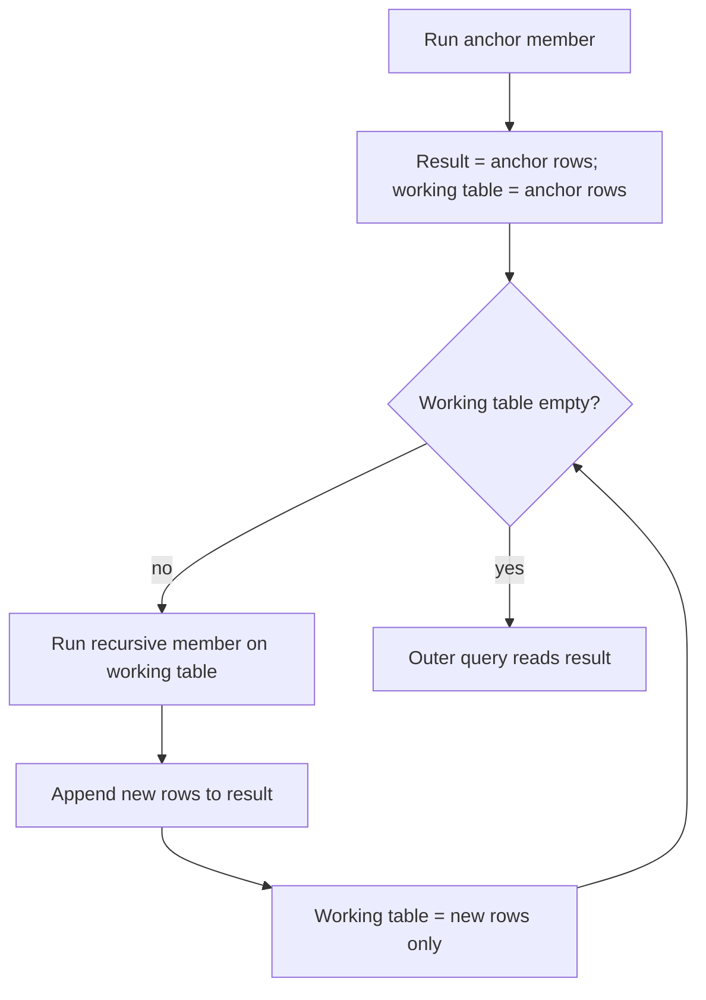

## 🎯 خلاصه

> **CTE بازگشتی** پرس‌وجویی است که به خودش ارجاع می‌دهد. از یک مجموعه‌ی **پایه (anchor)** شروع می‌کند، سپس مرحله‌به‌مرحله **عضو بازگشتی (recursive member)** را به ردیف‌های مرحله‌ی قبل وصل می‌کند، و وقتی یک مرحله ردیف جدیدی تولید نکند، متوقف می‌شود.

- وقتی عمق داده از قبل معلوم نیست از آن استفاده کن: چارت سازمانی، درخت دسته‌بندی کالا، bill-of-materials، مسیر در گراف، و تقویم تولیدشده.
- ساختار: `WITH RECURSIVE name AS (anchor UNION ALL recursive_member)`. PostgreSQL کلمه‌ی `RECURSIVE` را لازم دارد؛ SQL Server و Oracle از آن استفاده نمی‌کنند.
- هر پرس‌وجوی بازگشتی به **شرط توقف** نیاز دارد. بدون آن تا رسیدن به یک محدودیت منابع ادامه می‌دهد.
- اگر به‌جای `UNION ALL` از `UNION` استفاده کنی، ردیف‌های تکراری در هر مرحله حذف می‌شوند و این می‌تواند یک چرخه (cycle) را خودبه‌خود تمام کند (با یک قید که پایین‌تر نشان می‌دهم).

## 🌱 از ساده شروع کنیم (مبتدی)

> **💡 تشبیه:** پوشه‌های تودرتو. برای فهرست کردن همه‌چیز زیر پوشه‌ی «Projects»، آن را باز می‌کنی، زیرپوشه‌هایش را می‌بینی، هرکدام را باز می‌کنی و این کار را تکرار می‌کنی تا زیرپوشه‌ای نماند. CTE بازگشتی همین حلقه است، به زبان SQL.

در این درس از یک جدول کوچک استفاده می‌کنیم. این یک چارت سازمانی است: هر ردیف به مدیرش اشاره می‌کند.

```sql
CREATE TABLE org (
  id         int PRIMARY KEY,
  name       text NOT NULL,
  manager_id int REFERENCES org(id)
);

INSERT INTO org (id, name, manager_id) VALUES
 (1, 'CEO',        NULL),
 (2, 'CTO',        1),
 (3, 'Data Lead',  2),
 (4, 'Engineer A', 3),
 (5, 'Engineer B', 3),
 (6, 'CFO',        1),
 (7, 'Analyst',    6);
```

سؤال این است: «چه کسانی مستقیم یا غیرمستقیم زیر نظر CTO کار می‌کنند؟» یک JOIN معمولی جواب نمی‌دهد، چون تعداد سطوح را از قبل نمی‌دانی. نسخه‌ی بازگشتی:

```sql
WITH RECURSIVE reports AS (
  -- anchor: از CTO شروع کن
  SELECT id, name, manager_id
  FROM org
  WHERE name = 'CTO'

  UNION ALL

  -- عضو بازگشتی: افرادی که مدیرشان الان در نتیجه است
  SELECT o.id, o.name, o.manager_id
  FROM org o
  JOIN reports r ON o.manager_id = r.id
)
SELECT name FROM reports ORDER BY name;
```

نتیجه: `CTO`، `Data Lead`، `Engineer A`، `Engineer B`. anchor خود CTO را می‌دهد و هر حلقه‌ی بعدی سطح پایین‌تر را اضافه می‌کند.

## 🔧 واقعاً چطور کار می‌کند (متوسط)

PostgreSQL یک CTE بازگشتی را با یک **جدول کاری (working table)** اجرا می‌کند:

1. anchor را اجرا می‌کند. ردیف‌هایش هم به نتیجه می‌روند و هم به جدول کاری.
2. عضو بازگشتی را اجرا می‌کند. ارجاع به خودِ CTE فقط **جدول کاری** را می‌خواند، نه کل نتیجه را.
3. ردیف‌های جدید را به نتیجه اضافه می‌کند و آن‌ها را جدول کاری بعدی می‌کند.
4. تکرار می‌کند تا یک مرحله ردیفی تولید نکند. بعد پرس‌وجوی بیرونی نتیجه‌ی انباشته را می‌خواند.



این یعنی هر تکرار فقط ردیف‌های مرحله‌ی قبلی را می‌بیند، پس پیمایش در واقع سطح‌به‌سطح و breadth-first است.

**حمل داده در طول درخت.** یک ستون `depth` و یک ستون `path` اضافه کن و در عضو بازگشتی منتقلشان کن:

```sql
WITH RECURSIVE tree AS (
  SELECT id, name, 0 AS depth, name AS path
  FROM org
  WHERE manager_id IS NULL
  UNION ALL
  SELECT o.id, o.name, t.depth + 1, t.path || ' > ' || o.name
  FROM org o
  JOIN tree t ON o.manager_id = t.id
)
SELECT repeat('  ', depth) || name AS org_chart
FROM tree
ORDER BY path;
```

خروجی (برای هر سطح دو فاصله تورفتگی است):

```text
CEO
  CFO
    Analyst
  CTO
    Data Lead
      Engineer A
      Engineer B
```

مرتب‌سازی بر اساس `path` ترتیب خوانای درخت را می‌دهد. قاعده‌ی نوع را هم در نظر بگیر: anchor و عضو بازگشتی باید نوع ستون‌های یکسان تولید کنند. `0 AS depth` از نوع `integer` است و `t.depth + 1` هم `integer` است، پس کار می‌کند. اگر یکی متن و دیگری varchar باشد، PostgreSQL خطا می‌دهد.

**تولید سری تاریخ.** یک CTE بازگشتی می‌تواند تقویم بسازد، که برای پر کردن روزهای خالی در گزارش روزانه مفید است:

```sql
WITH RECURSIVE days AS (
  SELECT DATE '2026-01-01' AS d
  UNION ALL
  SELECT d + 1 FROM days WHERE d < DATE '2026-01-07'
)
SELECT d FROM days;
```

PostgreSQL برای این کار `generate_series` هم دارد که کوتاه‌تر است. فرم بازگشتی قابل‌حمل‌تر است.

**چرخه‌ها (cycles).** یک گراف جهت‌دار با حلقه‌ی `1 → 2 → 3 → 1` و یک شاخه‌ی `3 → 4` در نظر بگیر:

```sql
CREATE TABLE links (src int, dst int);
INSERT INTO links VALUES (1,2), (2,3), (3,1), (3,4);

-- UNION ردیف‌های تکراری را حذف می‌کند، پس پیمایش وقتی به گره‌ی شناخته‌شده برسد تمام می‌شود
WITH RECURSIVE reach(node) AS (
  SELECT 1
  UNION
  SELECT l.dst FROM reach r JOIN links l ON l.src = r.node
)
SELECT node FROM reach ORDER BY node;   -- 1, 2, 3, 4
```

با `UNION ALL` این پرس‌وجو تا ابد حلقه می‌زند (1، 2، 3، 1، 2، ...). یک نکته: `UNION` فقط ردیف‌های کاملاً یکسان را حذف می‌کند. اگر یک ستون `depth` اضافه کنی، هر بازدید مجدد عمق جدیدی دارد، پس ردیف‌ها دیگر یکسان نیستند و حلقه متوقف نمی‌شود. در این حالت گره‌های بازدیدشده را صریح نگه دار:

```sql
WITH RECURSIVE walk(node, path) AS (
  SELECT 1, ARRAY[1]
  UNION ALL
  SELECT l.dst, w.path || l.dst
  FROM walk w
  JOIN links l ON l.src = w.node
  WHERE NOT (l.dst = ANY (w.path))   -- روی گره‌ای که از قبل در این مسیر است نرو
)
SELECT node, path FROM walk ORDER BY path;
```

این پرس‌وجو مسیرهای `[1]`، `[1,2]`، `[1,2,3]` و `[1,2,3,4]` را برمی‌گرداند. مسیر `3 → 1` قطع می‌شود چون `1` از قبل در مسیر است. PostgreSQL نسخه‌ی 14 به بعد هم یک بند `CYCLE` دارد که این کار را خودکار انجام می‌دهد؛ نحوه‌ی دقیق آن را در مستندات نسخه‌ی خودت بررسی کن.

**محدودیت عمق.** یک تور ایمنی ارزان، شرط روی سطح است، مثلاً `WHERE t.depth < 20` در عضو بازگشتی. وقتی به کیفیت داده اطمینان کامل نداری، همیشه این شرط را اضافه کن.

## 🧠 عمق و trade-offها (سنیور)

- **هزینه = تعداد تکرار × میانگین فرزند در هر گره.** هر تکرار یک JOIN است. درخت عمیق و پهن بیشتر از تعداد ردیف‌هایش هزینه دارد، چون هر سطح دوباره JOIN می‌شود. کلید JOIN (`org.manager_id`) باید ایندکس داشته باشد، وگرنه هر تکرار یک full scan می‌شود. ببین [[database-index]] و [[sql-indexing]].
- **UNION در برابر UNION ALL.** `UNION` در هر تکرار deduplicate می‌کند (sort یا hash). در برابر چرخه امن‌تر است اما کندتر. وقتی می‌دانی درخت بدون چرخه است، `UNION ALL` بگیر.
- **ترتیب جستجو.** رفتار پیش‌فرض (جدول کاری) breadth-first است و برای «همه‌ی سطوح» مناسب است. وقتی مسیر به ترتیب خاصی لازم داری، ترتیب depth-first اهمیت دارد. PostgreSQL نسخه‌ی 14 به بعد بندهای `SEARCH` دارد؛ نحو دقیق را در مستندات بررسی کن.
- **پشتیبانی موتورها فرق دارد.** بسیاری از موتورهای تحلیلی CTE بازگشتی را محدود می‌کنند یا ندارند، و ClickHouse آن را به شکل معمول ارائه نمی‌دهد. پشتیبانی Spark SQL به نسخه بستگی دارد. برای سری‌ها در ClickHouse معمولاً از `numbers()` استفاده می‌شود. قبل از طراحی روی بازگشت، موتور خودت را چک کن.
- **انبارها معمولاً closure از پیش‌محاسبه‌شده را ترجیح می‌دهند.** برای سلسله‌مراتبی که تمام روز پرس‌وجو می‌شود، یک **closure table** (یا bridge table) هر جفت «جد-نسل» را ذخیره می‌کند که یک job دسته‌ای یک‌بار پرش می‌کند. خواندن‌ها JOIN ساده می‌شوند. این پاسخ استاندارد مدل‌سازی برای بُعدهای با عمق متغیر است؛ ببین [[dimensional-modeling]].
- **بازگشت بی‌پایان** تا پایان یا timeout قفل و حافظه نگه می‌دارد. برای نقش‌های تحلیلی ad-hoc یک `statement_timeout` تنظیم کن و تور ایمنی عمق را نگه دار.
- **کجا استفاده نکنیم.** اگر سلسله‌مراتب عمق ثابت و کوچک دارد (دو یا سه سطح)، چند JOIN صریح ساده‌تر و سریع‌تر است.

## 🧪 امتحان کن

از جدول `org` ابتدای درس استفاده کن (PostgreSQL نسخه‌ی 13 یا بالاتر).

1. برای هر کارمند، عمقش نسبت به CEO را برگردان (CEO عمق 0 دارد).
2. با `generate_series` یا سری تاریخ بازگشتی، هر روز از 2026-01-01 تا 2026-01-07 را فهرست کن و تعداد ردیف‌های `daily_sales` آن روز را بشمار. روزهای بدون ردیف را هم نشان بده. (فرض کن جدول `daily_sales(day date, amount int)` وجود دارد.)
3. با جدول `links` که چرخه دارد، تعداد گره‌های متمایزی را بشمار که از گره 1 در حداکثر 2 قدم قابل دسترسی‌اند.

<details><summary>جواب‌ها را نشان بده</summary>

**1.**
```sql
WITH RECURSIVE t AS (
  SELECT id, name, 0 AS depth FROM org WHERE manager_id IS NULL
  UNION ALL
  SELECT o.id, o.name, t.depth + 1
  FROM org o JOIN t ON o.manager_id = t.id
)
SELECT name, depth FROM t ORDER BY depth, name;
```

**2.**
```sql
WITH RECURSIVE days AS (
  SELECT DATE '2026-01-01' AS d
  UNION ALL
  SELECT d + 1 FROM days WHERE d < DATE '2026-01-07'
)
SELECT days.d, COUNT(s.day) AS sales_rows
FROM days
LEFT JOIN daily_sales s ON s.day = days.d
GROUP BY days.d
ORDER BY days.d;
```
`COUNT(s.day)` فقط ردیف‌های متصل را می‌شمارد، پس روزهای بدون فروش صفر نشان داده می‌شوند. `COUNT(*)` برای آن‌ها عدد 1 می‌دهد که اشتباه کلاسیک است.

**3.**
```sql
WITH RECURSIVE walk(node, steps) AS (
  SELECT 1, 0
  UNION
  SELECT l.dst, w.steps + 1
  FROM walk w JOIN links l ON l.src = w.node
  WHERE w.steps < 2
)
SELECT COUNT(DISTINCT node) FROM walk;
```
قابل‌دسترسی از 1 در حداکثر 2 قدم: 1 (0 قدم)، 2 (1 قدم)، 3 (2 قدم). جواب: 3. گره 4 به 3 قدم نیاز دارد. محدودیت عمق است که این را محدود می‌کند؛ `UNION` به‌تنهایی نمی‌تواند، چون `steps` در هر بازدید مجدد تغییر می‌کند.

</details>

## 💬 گوشه‌ی مصاحبه

**سؤال: «در جدولی با `manager_id`، همه‌ی زیردستان یک مدیر را چطور پیدا می‌کنی؟»** پاسخ متوسط: «با یک CTE بازگشتی: anchor برای مدیر، و عضو بازگشتی که کارمندان را به سطح قبلی روی `manager_id` وصل کند، با `UNION ALL` و ایندکس روی `manager_id`.» پاسخ سنیور: «همان بازگشت، به‌علاوه‌ی محافظ چرخه برای داده‌ی کثیف، محدودیت عمق، و این نکته که برای جدول تحلیلی که هزاران بار در روز خوانده می‌شود، ترجیح می‌دهم closure table را در انبار از پیش بسازم تا در هر کوئری بازگشت کنم.»

**سؤال: «چرا پرس‌وجوی بازگشتی من هیچ‌وقت تمام نمی‌شود؟»** پاسخ مورد انتظار: یک چرخه با `UNION ALL`، یا عضو بازگشتی‌ای که هرگز تولید ردیف را متوقف نمی‌کند. رفع: بررسی مسیر بازدیدشده، محدودیت عمق، یا استفاده از `UNION` وقتی محتوای ردیف در بازدید مجدد یکسان است.

> **🎤 این را در مصاحبه بگو:** «CTE بازگشتی یک anchor و یک عضو بازگشتی دارد که روی ردیف‌های سطح قبلی کار می‌کند. همیشه شرط توقف می‌گذارم و چرخه را بررسی می‌کنم، چون `UNION ALL` روی داده‌ی چرخه‌دار هیچ‌وقت تمام نمی‌شود.»

## ⚠️ اشتباهات رایج

> **⚠️ توجه:** عضو بازگشتی کل نتیجه را نمی‌بیند. فقط ردیف‌های تولیدشده در تکرار قبلی را می‌بیند. اگر انتظار داشته باشی به «همه‌ی چیزهایی که تا الان پیدا شده» JOIN بزند، نتیجه‌ی غلط می‌گیری.

> **⚠️ توجه:** در PostgreSQL نوشتن نکردن `RECURSIVE` خطای syntax یا «relation does not exist» می‌دهد که ظاهراً ربطی به بازگشت ندارد.

- نبود شرط توقف: پرس‌وجو تا تمام شدن حافظه یا زمان ادامه می‌دهد.
- استفاده از `UNION ALL` روی گرافی که چرخه دارد.
- استفاده از `UNION` در حالی که یک ستون متغیر (مثل `depth`) اضافه شده که deduplication را از کار می‌اندازد.
- کلید JOIN بدون ایندکس، که هر سطح را به یک full table scan تبدیل می‌کند.
- ناهماهنگی نوع ستون‌ها بین anchor و عضو بازگشتی.
- استفاده از بازگشت برای سلسله‌مراتب دو سطحی ثابت، در حالی که دو JOIN خواناتر است.

## ✅ خودت را بسنج

1. نقش anchor در یک CTE بازگشتی چیست؟
   - A) شرط توقف است
   - B) مجموعه‌ی ردیف‌های اولیه‌ای تولید می‌کند که بازگشت از آن شروع می‌شود
   - C) جای پرس‌وجوی بیرونی را می‌گیرد
   - D) همیشه باید از `UNION` استفاده کند

<details><summary>جواب</summary>

**B** — anchor ردیف‌های شروع را تولید می‌کند. عضو بازگشتی بعد روی ردیف‌های تکرار قبلی اجرا می‌شود تا وقتی چیزی برنگرداند.

</details>

2. در PostgreSQL، در یک مرحله‌ی بازگشتی، ارجاع به خود CTE چه چیزی را می‌خواند؟
   - A) کل نتیجه‌ی انباشته‌شده تا آن لحظه
   - B) فقط جدول کاری، یعنی ردیف‌های تولیدشده در تکرار قبلی
   - C) دوباره جدول پایه از اول
   - D) هیچ‌چیز؛ یک placeholder است

<details><summary>جواب</summary>

**B** — هر تکرار فقط ردیف‌هایی را می‌خواند که تکرار قبلی اضافه کرده. به همین دلیل بازگشت را می‌توان پیمایش سطح‌به‌سطح فهمید.

</details>

3. گرافی چرخه‌ی `1 → 2 → 1` دارد. کدام پرس‌وجو تمام می‌شود؟
   - A) `WITH RECURSIVE r(n) AS (SELECT 1 UNION ALL SELECT l.dst FROM r JOIN links l ON l.src = r.n)`
   - B) `WITH RECURSIVE r(n) AS (SELECT 1 UNION SELECT l.dst FROM r JOIN links l ON l.src = r.n)`
   - C) هر دو تمام می‌شوند
   - D) هیچ‌کدام؛ چرخه‌ها قابل پرس‌وجو نیستند

<details><summary>جواب</summary>

**B** — `UNION` ردیف‌های تکراری را حذف می‌کند، پس وقتی گره `1` دوباره تولید شود چیز جدیدی نیست و جدول کاری خالی می‌شود. `UNION ALL` مدام `1, 2, 1, 2, ...` تولید می‌کند و تمام نمی‌شود.

</details>

4. **(سنیور)** برای هر کارمند فهرست کامل جدهایش لازم داری، و این کوئری در هر بار باز شدن داشبورد روی یک بُعد ۵۰ میلیون ردیفی اجرا می‌شود. طراحی بهتر چیست و چرا؟

   - A) همان CTE بازگشتی را نگه دار و `DISTINCT` اضافه کن
   - B) با یک job زمان‌بندی‌شده یک closure table (جد، نسل، عمق) از پیش بساز تا خواندن‌ها JOIN ساده روی کلیدهای ایندکس‌شده باشند
   - C) سلسله‌مراتب را با تعداد ستون ثابت جایگزین کن و هرگز به‌روز نکن
   - D) برای سریع‌تر شدن از `UNION ALL` استفاده کن

<details><summary>جواب</summary>

**B** — closure table کار بازگشتی را به یک job دسته‌ای منتقل می‌کند و مسیر خواندن را به JOIN روی کلیدهای ایندکس‌شده تبدیل می‌کند. بازگشت در هر کوئری همان پیمایش را تکرار می‌کند و هزینه‌اش با عمق و تعداد فرزند بالا می‌رود.

</details>

5. **(سنیور)** یک پیمایش بازگشتی با ستون `depth` و `UNION` روی گراف چرخه‌دار تا ابد اجرا می‌شود. چرا `UNION` کمک نمی‌کند و چه چیزی را عوض می‌کنی؟

   - A) `UNION` فقط با عدد صحیح کار می‌کند
   - B) هر بازدید مجدد `depth` متفاوتی دارد، پس ردیف‌ها تکراری نیستند؛ گره‌های بازدیدشده را در یک آرایه‌ی مسیر نگه دار، یا محدودیت سطح بگذار
   - C) `UNION` در CTE بازگشتی مجاز نیست
   - D) ستون `depth` باید حذف شود و چیز دیگری عوض نشود

<details><summary>جواب</summary>

**B** — deduplication کل ردیف‌ها را مقایسه می‌کند. عمق جدید باعث می‌شود گره‌ی بازدیدشده مثل یک ردیف جدید به نظر برسد، پس حلقه ادامه پیدا می‌کند. بررسی مسیر بازدیدشده یا محدودیت سطح است که آن را متوقف می‌کند.

</details>

## 🗂️ فلش‌کارت

| Front | Back |
|---|---|
| CTE بازگشتی، دو بخش | anchor (ردیف‌های شروع) و عضو بازگشتی (به ردیف‌های مرحله‌ی قبل JOIN می‌زند) |
| عضو بازگشتی چه چیزی می‌خواند؟ | فقط جدول کاری: ردیف‌های تکرار قبلی |
| شرط توقف | بازگشت وقتی یک مرحله ردیف جدید نداشته باشد تمام می‌شود |
| `UNION` در برابر `UNION ALL` در بازگشت | `UNION` در هر مرحله deduplicate می‌کند و می‌تواند چرخه را تمام کند؛ `UNION ALL` سریع‌تر است اما روی چرخه حلقه می‌زند |
| محافظ چرخه با مسیر | گره‌های بازدیدشده را در آرایه نگه دار و گره‌ای که در آن است را رد کن |
| چرا محدودیت عمق مهم است | کار روی داده‌ی بد یا چرخه‌دار را محدود می‌کند |
| Closure table | جفت‌های جد-نسل از پیش محاسبه‌شده که بازگشت را در زمان خواندن جایگزین می‌کنند |

## 🔗 ادامه

- [[sql-subqueries-ctes]] — CTEهای غیربازگشتی که این درس روی آن‌ها بنا شده.
- [[sql-joins]] — JOINی که هر تکرار آن را تکرار می‌کند.
- [[sql-query-optimization]] — خواندن plan یک کوئری بازگشتی.
- [[dimensional-modeling]] — مدل‌سازی سلسله‌مراتب در انبارها با bridge و closure table.
- [[sql-interview-patterns]] — جایی که بازگشت در سؤال‌های مصاحبه ظاهر می‌شود.

