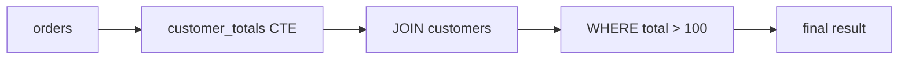

## 🎯 خلاصه

> **subquery** یک کوئری است که داخل کوئری دیگری قرار گرفته. **CTE** (عبارت جدول مشترک، بند `WITH`) یک subquery نام‌دار است که می‌توانی از بالا به پایین بخوانی. هر دو به تو اجازه می‌دهند یک سؤال سخت را به سؤال‌های کوچک‌تر بشکنی.

- **scalar subquery:** یک مقدار برمی‌گرداند و مثل یک عدد یا رشته استفاده می‌شود.
- **derived table:** یک subquery در `FROM` که مثل جدول موقت رفتار می‌کند.
- **correlated subquery:** به ستونی از کوئری بیرونی اشاره می‌کند، پس منطقاً برای هر ردیف بیرونی یک بار اجرا می‌شود.
- **CTE:** یک مرحله را نام‌گذاری می‌کند تا کوئری نهایی مثل یک pipeline خوانده شود. مزیت اصلی خوانایی است؛ کارایی بستگی دارد به اینکه موتور آن را inline کند یا materialize.

## 🌱 از ساده شروع کنیم (مبتدی)

> **💡 تشبیه:** یک دستور آشپزی. subquery یعنی «اول سس را درست کن، بعد بریز روی ماکارونی». CTE یعنی روی کارت دستور بنویسی «مرحلهٔ ۱: سس. مرحلهٔ ۲: ماکارونی. مرحلهٔ ۳: سرو»، تا هر مرحله با نامش دیده شود.

از جدول‌های درس join استفاده می‌کنیم:

```sql
CREATE TABLE customers (id int, name text);
CREATE TABLE orders (id int, customer_id int, amount numeric);

INSERT INTO customers VALUES (1,'Ali'), (2,'Sara'), (3,'Reza');
INSERT INTO orders VALUES
 (10, 1, 100), (11, 1, 50), (12, 2, 200),
 (13, NULL, 30), (14, 9, 70);
```

**Scalar subquery:** سفارش‌هایی که از میانگین سفارش‌ها بزرگ‌ترند.

```sql
SELECT id, amount
FROM orders
WHERE amount > (SELECT AVG(amount) FROM orders);
```

زیرکوئری یک بار اجرا می‌شود و یک عدد، یعنی 90 (450 / 5)، برمی‌گرداند. کوئری بیرونی سفارش‌های ۱۰ (100) و ۱۲ (200) را نگه می‌دارد. یک scalar subquery باید حداکثر یک سطر و یک ستون برگرداند، وگرنه پایگاه‌داده خطا می‌دهد.

**قبل از نگاه کردن پیش‌بینی کن:** این کوئری برای Reza چه برمی‌گرداند؟

```sql
SELECT c.name,
       (SELECT MAX(o.amount) FROM orders o WHERE o.customer_id = c.id) AS biggest
FROM customers c;
```

<details><summary>حدست چیست؟</summary>

Ali 100، Sara 200، و برای Reza **NULL**. زیرکوئری برای هر مشتری اجرا می‌شود. برای Reza هیچ سطری پیدا نمی‌شود و `MAX` روی صفر سطر NULL برمی‌گرداند. کوئری همچنان سه سطر دارد، چون scalar subquery در `SELECT` هرگز سطر کوئری بیرونی را حذف نمی‌کند.

</details>

**Derived table:** یک subquery در `FROM` که نقش جدول موقت را دارد.

```sql
SELECT t.customer_id, t.total
FROM (
  SELECT customer_id, SUM(amount) AS total
  FROM orders
  GROUP BY customer_id
) AS t
WHERE t.total > 100;
```

نتیجه: مشتری ۱ با ۱۵۰، و مشتری ۲ با ۲۰۰. مشتری NULL یک گروه جدا می‌سازد (جمع ۳۰) و مشتری ۹ جمع ۷۰ دارد، پس هر دو فیلتر می‌شوند.

**CTE:** همان منطق، با یک نام.

```sql
WITH customer_totals AS (
  SELECT customer_id, SUM(amount) AS total
  FROM orders
  WHERE customer_id IS NOT NULL
  GROUP BY customer_id
)
SELECT c.name, t.total
FROM customer_totals AS t
JOIN customers AS c ON c.id = t.customer_id
WHERE t.total > 100
ORDER BY t.total DESC;
```

نتیجه: Sara با ۲۰۰، بعد Ali با ۱۵۰. از بالا به پایین بخوان: اول جمع‌ها را حساب کن، بعد نام‌ها را وصل کن، بعد فیلتر کن.

## 🔧 واقعاً چطور کار می‌کند (متوسط)

سه روش برای گذاشتن subquery داخل یک کوئری داریم و هر کدام جای متفاوتی در ترتیب منطقی دارند:

| شکل | کجا می‌آید | چه برمی‌گرداند | مثال |
|---|---|---|---|
| Scalar | `SELECT`، `WHERE`، `HAVING` | یک مقدار | `WHERE amount > (SELECT AVG ...)` |
| Derived table | `FROM` | مجموعه‌ای از سطرها با alias | `FROM (SELECT ...) AS t` |
| Predicate | `WHERE` | `TRUE`/`FALSE` | `WHERE EXISTS (SELECT 1 ...)`، `IN (SELECT ...)` |

### correlated subquery ها

یک subquery **correlated** به ستونی از کوئری بیرونی ارجاع می‌دهد:

```sql
SELECT o.id, o.amount
FROM orders AS o
WHERE o.amount > (
  SELECT AVG(o2.amount)
  FROM orders AS o2
  WHERE o2.customer_id = o.customer_id   -- به ردیف بیرونی ارجاع می‌دهد
);
```

از نظر مفهومی، زیرکوئری برای هر ردیف `o` بیرونی یک بار با `customer_id` همان ردیف اجرا می‌شود. این خوانا است و دقیقاً همان سؤالی است که در مصاحبه‌ها می‌پرسند («سفارش‌هایی که از میانگین همان مشتری بزرگ‌ترند»). ولی نباید فرض کنی پایگاه‌داده واقعاً سطر به سطر اجرا می‌کند. بیشتر بهینه‌سازها آن را **decorrelate** می‌کنند، یعنی به یک join با جدول پیش‌تجمیع‌شده بازنویسی می‌کنند. با `EXPLAIN` می‌توانی این را بررسی کنی.

### lateral join: «ردیف برتر در هر گروه»

گاهی زیرکوئری برای هر ردیف بیرونی باید **چند** ستون یا **چند** سطر برگرداند، با `ORDER BY ... LIMIT`. PostgreSQL از `LATERAL` استفاده می‌کند و SQL Server از `CROSS APPLY`:

```sql
SELECT c.name, top1.id AS order_id, top1.amount
FROM customers AS c
CROSS JOIN LATERAL (
  SELECT o.id, o.amount
  FROM orders AS o
  WHERE o.customer_id = c.id
  ORDER BY o.amount DESC
  LIMIT 1
) AS top1;
```

نتیجه: Ali با سفارش ۱۰ (100) و Sara با سفارش ۱۲ (200). Reza حذف می‌شود، چون `CROSS JOIN LATERAL` مثل inner join رفتار می‌کند. برای نگه داشتن او با NULL از `LEFT JOIN LATERAL ... ON TRUE` استفاده کن.

### CTE و materialization

CTE به بهینه‌ساز یک انتخاب می‌دهد:

- **Inlined:** CTE مثل یک subquery با برنامهٔ اصلی ادغام می‌شود. فیلترهای دیگر می‌توانند به داخل آن پایین بیایند.
- **Materialized:** نتیجه یک بار محاسبه، در ساختار موقت ذخیره، و دوباره استفاده می‌شود.

در PostgreSQL نسخهٔ ۱۲ به بعد، یک CTE غیربازگشتی که یک بار ارجاع داده شده باشد، به‌طور پیش‌فرض inline می‌شود. می‌توانی انتخاب را با `AS MATERIALIZED` یا `AS NOT MATERIALIZED` تعیین کنی. موتورهای دیگر قوانین خودشان را دارند، پس به‌جای فرض، مستندات نسخهٔ خودت را بخوان.



## 🧠 عمق و trade-offها (سنیور)

- **decorrelation هزینه را تعیین می‌کند.** اگر بهینه‌ساز نتواند یک correlated subquery را decorrelate کند، روی جدول بزرگ برای هر ردیف بیرونی اجرا می‌شود و کند است. برنامه را بررسی کن. در PostgreSQL، وجود گرهٔ `SubPlan` داخل یک فیلتر معمولاً یعنی اجرای سطر به سطر؛ یک hash join یا aggregate معمولاً یعنی بازنویسی شده.
- **`IN` در برابر `EXISTS` در برابر `JOIN`.** `EXISTS` یک semi join است و با اولین تطابق متوقف می‌شود. `NOT IN` تلهٔ NULL را دارد که در **sql-joins** توضیح داده شد. برای بررسی وجود، `EXISTS` / `NOT EXISTS` را ترجیح بده.
- **ارجاع تکراری به CTE.** CTEای که سه بار ارجاع داده شده و به‌صورت materialized است، تجمیع سنگین را یک بار حساب می‌کند. اگر inline شود، بخش سنگین سه بار اجرا می‌شود. در این حالت از `MATERIALIZED` (PostgreSQL) استفاده کن یا نتیجهٔ میانی را در یک جدول ذخیره کن.
- **موتورهای توزیع‌شده.** Spark و موتورهای مشابه CTE را به‌عنوان plan منطقی نام‌دار در نظر می‌گیرند. اینکه نتیجهٔ میانی دوباره استفاده شود یا نه به موتور و caching بستگی دارد. برای نتیجهٔ میانی سنگین که چند بار استفاده می‌شود، آن را در جدول بنویس یا صریحاً cache کن (ببین **spark-caching**).
- **خوانایی هم صرفه‌جویی واقعی است.** یک pipeline سه‌مرحله‌ای با CTE راحت‌تر بازبینی، تست و دیباگ می‌شود تا یک subquery سه‌لایه. CTE را فقط برای سرعت کنار نگذار، مگر اینکه مشکلی را اندازه‌گیری کرده باشی.
- **CTE های بازگشتی** قابلیت جدا هستند با قوانین و شرط‌های توقف خودشان؛ ببین **sql-recursive-ctes**.

## 🧪 امتحان کن

از جدول‌های این درس استفاده کن.

1. **سفارش‌های بزرگ‌تر از میانگین مشتری خودشان.** شناسه و مبلغ سفارش‌هایی را برگردان که از میانگین مبلغ سفارش‌های همان مشتری بزرگ‌ترند. از correlated subquery استفاده کن.
2. **بزرگ‌ترین سفارش هر مشتری با LATERAL.** نام هر مشتری را همراه با بزرگ‌ترین سفارشش (شناسه و مبلغ) نشان بده. دوبار بنویس: یک بار مشتری‌های بدون سفارش حذف شوند، و یک بار نگه داشته شوند.
3. **مشتری‌هایی با سفارش بزرگ.** نام مشتری‌هایی را فهرست کن که حداقل یک سفارش بالای ۹۰ دارند. از `EXISTS` استفاده کن، نه join.

<details><summary>راه‌حل‌ها را نشان بده</summary>

**1.**
```sql
SELECT o.id, o.amount
FROM orders AS o
WHERE o.amount > (
  SELECT AVG(o2.amount)
  FROM orders AS o2
  WHERE o2.customer_id = o.customer_id
);
```
نتیجه: فقط سفارش ۱۰. میانگین Ali برابر ۷۵ است و سفارش ۱۰ (۱۰۰) از آن بزرگ‌تر است. Sara فقط یک سفارش دارد، پس میانگینش برابر خود سفارش است و چیزی بزرگ‌تر نیست. سفارش ۱۳ مشتری NULL دارد، پس `AVG` درونی آن NULL است و `amount > NULL` هرگز درست نیست.

**2.** حذف مشتری‌های بدون سفارش:
```sql
SELECT c.name, top1.id AS order_id, top1.amount
FROM customers AS c
CROSS JOIN LATERAL (
  SELECT o.id, o.amount
  FROM orders AS o
  WHERE o.customer_id = c.id
  ORDER BY o.amount DESC
  LIMIT 1
) AS top1;
```
نگه داشتن آن‌ها:
```sql
SELECT c.name, top1.id AS order_id, top1.amount
FROM customers AS c
LEFT JOIN LATERAL (
  SELECT o.id, o.amount
  FROM orders AS o
  WHERE o.customer_id = c.id
  ORDER BY o.amount DESC
  LIMIT 1
) AS top1 ON TRUE;
```
نسخهٔ دوم Reza را هم با NULL، NULL برمی‌گرداند.

**3.**
```sql
SELECT c.name
FROM customers AS c
WHERE EXISTS (
  SELECT 1
  FROM orders AS o
  WHERE o.customer_id = c.id AND o.amount > 90
);
```
نتیجه: Ali (سفارش ۱۰ برابر ۱۰۰ است) و Sara (سفارش ۱۲ برابر ۲۰۰ است).

</details>

## 💬 گوشه‌ی مصاحبه

**س: تفاوت correlated subquery و join چیست؟**

> **🎤 این را در مصاحبه بگو:** correlated subquery به ردیف بیرونی ارجاع می‌دهد و منطقاً برای هر ردیف بیرونی ارزیابی می‌شود. join دو رابطه را به‌صورت مجموعه‌ای ترکیب می‌کند. بسیاری از correlated subquery ها توسط بهینه‌ساز به join یا semi join بازنویسی می‌شوند، پس اختلاف کارایی به plan بستگی دارد. قبل از تصمیم `EXPLAIN` را نگاه می‌کنم و برای بررسی وجود، `EXISTS` را ترجیح می‌دهم.

پاسخ **مبتدی** می‌گوید «subquery ای که از ستون کوئری بیرونی استفاده می‌کند». پاسخ **متوسط** اضافه می‌کند که اجرای سطر به سطر است مگر decorrelate شود و مثال می‌زند. پاسخ **سنیور** decorrelation، هزینهٔ گرهٔ `SubPlan` و روش تأیید plan را پوشش می‌دهد.

**س: CTE کی کارایی را بهتر می‌کند؟**

به‌تنهایی معمولاً نمی‌کند. CTE **خوانایی** را بهتر می‌کند. کارایی فقط وقتی تغییر می‌کند که موتور CTEای را که چند بار استفاده شده materialize کند و از کار تکراری جلوگیری شود. وگرنه CTE ای که inline شده همان subquery است. قبل از ادعای سرعت، اندازه‌گیری کن.

## ⚠️ اشتباهات رایج

- **scalar subquery که بیش از یک سطر برمی‌گرداند.** کوئری هنگام اجرا خطا می‌دهد، و اغلب فقط با داده‌های واقعی production. `LIMIT 1` با `ORDER BY` مشخص اضافه کن، یا از join استفاده کن.
- **انتظار سرعت از correlated subquery.** plan را برای اجرای سطر به سطر روی جدول‌های بزرگ بررسی کن.
- **استفاده از CTE برای «کش» کردن نتیجه.** CTE کش نیست. اگر موتور آن را materialize نکند، در هر ارجاع دوباره محاسبه می‌شود.
- **قاطی کردن نوع‌های `LATERAL`.** `CROSS JOIN LATERAL` ردیف‌های بیرونی بدون نتیجه را حذف می‌کند؛ `LEFT JOIN LATERAL ... ON TRUE` آن‌ها را نگه می‌دارد.
- **`NOT IN` با subquery ای که ممکن است NULL برگرداند.** از `NOT EXISTS` استفاده کن؛ ببین **sql-joins**.
- **جا انداختن alias برای derived table.** PostgreSQL و بیشتر موتورها برای subquery در `FROM` alias می‌خواهند.
- **استفاده از نام CTE به‌عنوان نام یک جدول واقعی.** نام CTE داخل آن کوئری جدول واقعی را پنهان می‌کند و نتیجه گیج‌کننده می‌شود.

## ✅ خودت را بسنج (quiz)

1. یک scalar subquery چه برمی‌گرداند؟
   - A) مجموعه‌ای از سطرها
   - B) حداکثر یک سطر با یک ستون
   - C) جدولی با alias
   - D) فقط یک مقدار boolean

2. چه چیزی یک subquery را «correlated» می‌کند؟
   - A) اینکه داخل CTE اجرا شود
   - B) ارجاع به یک ستون از کوئری بیرونی
   - C) استفاده از `UNION`
   - D) برگرداندن NULL

3. در PostgreSQL نسخهٔ ۱۲ به بعد، یک CTE غیربازگشتی که یک بار ارجاع داده شده به‌طور پیش‌فرض چطور مدیریت می‌شود؟
   - A) همیشه materialize می‌شود
   - B) در کوئری اصلی inline می‌شود، مگر اینکه `AS MATERIALIZED` بنویسی
   - C) هرگز اجرا نمی‌شود
   - D) به‌عنوان جدول دائمی ذخیره می‌شود

4. برای یک کوئری LATERAL با «برترین ردیف»، کدام join مشتری‌های بدون سفارش را نگه می‌دارد؟
   - A) `CROSS JOIN LATERAL`
   - B) `LEFT JOIN LATERAL ... ON TRUE`
   - C) `INNER JOIN` با `WHERE`
   - D) `FULL OUTER JOIN`

5. **سؤال سنیور.** کوئری یک CTE تجمیع سنگین را در سه جا استفاده می‌کند. تیم می‌گوید «CTE ها کندند، بیایید حذفشان کنیم». مشکل احتمالی چیست و به‌جای آن چه می‌کنی؟

<details><summary>پاسخ</summary>

**1 — B.** scalar subquery یک مقدار تولید می‌کند. اگر بیش از یک سطر برگرداند، کوئری خطا می‌دهد.

**2 — B.** subquery به ستون ردیف بیرونی ارجاع می‌دهد، پس نتیجه‌اش به آن ردیف وابسته است.

**3 — B.** از PostgreSQL نسخهٔ ۱۲ به بعد، یک CTE غیربازگشتی و بدون side effect که یک بار ارجاع داده شده به‌طور پیش‌فرض inline می‌شود. `AS MATERIALIZED` یک محاسبهٔ واحد را اجباری می‌کند.

**4 — B.** `LEFT JOIN LATERAL ... ON TRUE` ردیف بیرونی را با NULL نگه می‌دارد وقتی زیرکوئری lateral چیزی برنگرداند.

**5 — (پاسخ سنیور).** خود CTE به‌تنهایی کند نیست. اگر inline شده باشد، تجمیع سنگین برای هر ارجاع اجرا می‌شود، یعنی سه بار. راه‌حل این است که plan را بررسی کنی، بعد یک محاسبهٔ واحد را اجباری کنی (`AS MATERIALIZED` در PostgreSQL)، یا نتیجهٔ میانی را در جدول ذخیره یا روی موتورهایی مثل Spark صریحاً cache کنی. حذف CTE فقط منطق را سه بار کپی می‌کند، که هزینه را بدتر و کد را سخت‌تر به نگهداری می‌کند.

</details>

## 🗂️ فلش‌کارت

| Front | Back |
|---|---|
| Scalar subquery | یک مقدار برمی‌گرداند (حداکثر یک سطر، یک ستون) |
| Derived table | subquery در `FROM`؛ باید alias داشته باشد |
| Correlated subquery | به ردیف بیرونی ارجاع می‌دهد؛ منطقاً برای هر ردیف ارزیابی می‌شود |
| Decorrelation | بهینه‌ساز correlated subquery را به join بازنویسی می‌کند |
| CTE | subquery نام‌دار با `WITH`؛ خوانایی را بهتر می‌کند |
| Inlined در برابر materialized | inlined در plan ادغام می‌شود؛ materialized یک بار محاسبه و استفاده مجدد می‌شود |
| `CROSS JOIN LATERAL` | join لترال که ردیفی بدون نتیجه را حذف می‌کند |
| `EXISTS` | بررسی وجود؛ با اولین تطابق متوقف می‌شود |

## 🔗 ادامه

- **sql-recursive-ctes** `WITH` بازگشتی را برای ساختارهای سلسله‌مراتبی و گراف پوشش می‌دهد.
- **sql-joins** semi join و anti join و تلهٔ NULL در `NOT IN` را توضیح می‌دهد.
- **sql-window-functions** اغلب جایگزین تمیزتری برای زیرکوئری‌های correlated «ردیف برتر در هر گروه» است.
- **sql-query-optimization** نشان می‌دهد چطور `EXPLAIN` را برای گره‌های `SubPlan` و CTEهای materialized بخوانی.
- **spark-caching** نشان می‌دهد چطور یک نتیجهٔ میانی سنگین را روی موتور توزیع‌شده دوباره استفاده کنی.
