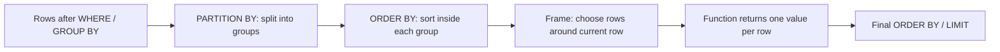

## 🎯 خلاصه

> **تابع پنجره (window function)** برای **هر سطر** یک مقدار را با استفاده از مجموعه‌ای از سطرهای مرتبط (همان «پنجره») حساب می‌کند، **بدون اینکه** آن سطرها را مثل `GROUP BY` در هم ادغام کند.

- `PARTITION BY` سطرها را به گروه‌های مستقل تقسیم می‌کند، اما هیچ سطری حذف نمی‌شود.
- `ORDER BY` داخل `OVER (...)` ترتیب را در هر گروه مشخص می‌کند.
- **frame** (با `ROWS` یا `RANGE`) مشخص می‌کند تابع کدام سطرهای اطراف سطر فعلی را ببیند.
- توابع رتبه‌بندی به سؤال «N تای اول در هر گروه» جواب می‌دهند، توابع جابه‌جایی به «مقایسه با سطر قبلی»، و تجمیع روی پنجره به جمع تجمعی و میانگین متحرک.

## 🌱 از ساده شروع کنیم (مبتدی)

> **💡 تشبیه:** یک امتحان کلاسی را در نظر بگیر. `GROUP BY` می‌گوید «میانگین کل کلاس را بده، یک عدد.» تابع پنجره می‌گوید «نمرهٔ هر دانش‌آموز را **کنار** میانگین کلاس بده.» هیچ‌کس از فهرست حذف نمی‌شود.

در کل این درس از این مجموعه داده‌ی کوچک استفاده می‌کنیم:

```sql
CREATE TABLE employees (id int, name text, dept text, salary int);
INSERT INTO employees VALUES
 (1,'Ali','data',9000), (2,'Sara','data',12000), (3,'Reza','data',12000),
 (4,'Nima','data',10000), (5,'Maryam','web',8000), (6,'Kian','web',8000),
 (7,'Parisa','web',7000);

CREATE TABLE daily_sales (day date, amount int);
INSERT INTO daily_sales VALUES
 ('2026-01-01',10), ('2026-01-02',20), ('2026-01-03',5), ('2026-01-04',15),
 ('2026-01-05',0), ('2026-01-06',30), ('2026-01-07',25), ('2026-01-08',40);
```

دو نتیجه را با هم مقایسه کن:

```sql
-- GROUP BY: 2 rows
SELECT dept, AVG(salary) AS dept_avg FROM employees GROUP BY dept;

-- Window: 7 rows, every employee keeps their row
SELECT name, dept, salary,
       AVG(salary) OVER (PARTITION BY dept) AS dept_avg
FROM employees;
```

شکل یک فراخوانی پنجره این است: `function(...) OVER (PARTITION BY ... ORDER BY ... frame)`. همهٔ بخش‌های `OVER` اختیاری‌اند. `OVER ()` یعنی «کل نتیجه یک پنجره است».

## 🔧 واقعاً چطور کار می‌کند (متوسط)

توابع پنجره **بعد از** `FROM`، `WHERE`، `GROUP BY` و `HAVING` اجرا می‌شوند، و **قبل از** `ORDER BY` نهایی، `DISTINCT` و `LIMIT`. برای هر سطر، موتور این کارها را انجام می‌دهد:



**توابع رتبه‌بندی** فقط در برخورد با مقادیر تکراری (ties) فرق دارند:

```sql
SELECT dept, name, salary,
       ROW_NUMBER() OVER (PARTITION BY dept ORDER BY salary DESC) AS rn,
       RANK()       OVER (PARTITION BY dept ORDER BY salary DESC) AS rk,
       DENSE_RANK() OVER (PARTITION BY dept ORDER BY salary DESC) AS drk
FROM employees
ORDER BY dept, salary DESC;
```

| dept | name | salary | ROW_NUMBER | RANK | DENSE_RANK |
|---|---|---|---|---|---|
| data | Sara | 12000 | 1 | 1 | 1 |
| data | Reza | 12000 | 2 | 1 | 1 |
| data | Nima | 10000 | 3 | 3 | 2 |
| data | Ali | 9000 | 4 | 4 | 3 |
| web | Maryam | 8000 | 1 | 1 | 1 |
| web | Kian | 8000 | 2 | 1 | 1 |
| web | Parisa | 7000 | 3 | 3 | 2 |

- `ROW_NUMBER` همیشه عدد یکتا می‌دهد. ترتیب سطرهای مساوی دلخواه است، پس وقتی قطعیت لازم داری یک شکست‌دهنده‌ی یکتا (مثلاً `, id`) اضافه کن.
- `RANK` به مقادیر مساوی یک رتبه می‌دهد و **عدد بعدی را می‌پرد** (1، 1، 3).
- `DENSE_RANK` به مقادیر مساوی یک رتبه می‌دهد و **نمی‌پرد** (1، 1، 2).
- `NTILE(n)` سطرهای مرتب‌شده را به `n` سطل با اندازه‌ی تقریباً برابر تقسیم می‌کند. با 7 سطر و `NTILE(4)`، سطل‌ها 2، 2، 2 و 1 سطر دارند: سطرهای اضافه به سطل‌های اول می‌روند.

**توابع جابه‌جایی** سطرهای دیگری از همان پنجره را می‌خوانند:

```sql
SELECT day, amount,
       amount - LAG(amount) OVER (ORDER BY day) AS change_vs_prev,
       LEAD(amount) OVER (ORDER BY day)         AS next_amount
FROM daily_sales;
```

`LAG(x, 1)` مقدار سطر قبلی را برمی‌گرداند (در سطر اول `NULL`). `LEAD` به جلو نگاه می‌کند. `FIRST_VALUE` و `LAST_VALUE` اولین یا آخرین مقدار **داخل frame** را برمی‌گردانند، و این ما را به frame می‌رساند.

**frame** تعیین می‌کند تابع تجمیعی کدام سطرها را ببیند. شکل آن `ROWS BETWEEN <start> AND <end>` یا `RANGE BETWEEN <start> AND <end>` است، با کرانه‌هایی مثل `UNBOUNDED PRECEDING`، `n PRECEDING`، `CURRENT ROW` و `n FOLLOWING`.

- `ROWS` **تعداد سطرهای فیزیکی** را می‌شمارد.
- `RANGE` روی **مقدار ORDER BY** کار می‌کند: همهٔ سطرهایی که مقدار یکسان دارند (peer) با هم در نظر گرفته می‌شوند.
- اگر `ORDER BY` بنویسی و frame ننویسی، پیش‌فرض `RANGE BETWEEN UNBOUNDED PRECEDING AND CURRENT ROW` است. بدون `ORDER BY`، frame کل پارتیشن است.

```sql
SELECT name, salary,
       SUM(salary) OVER (PARTITION BY dept ORDER BY salary
                         ROWS BETWEEN UNBOUNDED PRECEDING AND CURRENT ROW) AS rows_sum,
       SUM(salary) OVER (PARTITION BY dept ORDER BY salary) AS range_sum
FROM employees
WHERE dept = 'web'
ORDER BY salary;
```

Parisa در هر دو ستون 7000 می‌گیرد. Maryam و Kian هر دو حقوق 8000 دارند، پس `range_sum` به هر دوی آن‌ها 23000 می‌دهد (چون peer هستند). `rows_sum` به یکی از آن‌ها 15000 و به دیگری 23000 می‌دهد، و اینکه کدام کدام است دلخواه است.

## 🧠 عمق و trade-offها (سنیور)

- **هزینهٔ مرتب‌سازی.** هر جفت متمایز `(PARTITION BY, ORDER BY)` معمولاً مرتب‌سازی جداگانه می‌خواهد. چند پنجره با یک مشخصه می‌توانند یک مرتب‌سازی را شریک شوند، پس مشخصه‌ها را دوباره استفاده کن (بند `WINDOW` که در PostgreSQL و MySQL 8 هست) و در یک کوئری مشخصه‌های متفاوت زیاد نساز.
- **Skew.** سطرهای یک پارتیشن با هم پردازش می‌شوند. پارتیشن بزرگ (مثلاً `dept` با مقدار NULL یا یک مشتری داغ) می‌شود یک تسک کند. در Spark، پنجره‌ای بدون `PARTITION BY` **همهٔ سطرها را به یک پارتیشن** می‌فرستد و به همین دلیل هشدار می‌دهد. آن را مثل یک مرتب‌سازی سراسری روی یک executor در نظر بگیر. برنامهٔ اجرا را با `EXPLAIN` یا Spark UI بررسی کن، و به [[shuffle]] نگاه کن.
- **قطعیت برای dedup.** الگوی کلاسیک «نگه داشتن آخرین سطر هر کلید» این است: `ROW_NUMBER() OVER (PARTITION BY key ORDER BY updated_at DESC, id DESC) = 1`. بدون شکست‌دهندهٔ یکتا، نتیجه بین اجراها ممکن است تغییر کند.
- **استریминگ.** روی استریم‌های بی‌کران، پنجره‌ای با frame بی‌کران state را بی‌وقفه بزرگ می‌کند. OVER در Flink SQL به frame محدود و تنظیمات نگهداری state نیاز دارد؛ قبل از قول دادن رفتار خاص، مستندات نسخه‌ی خودت را بخوان.
- **پشتیبانی موتورها.** `QUALIFY` (فیلتر مستقیم روی نتیجهٔ پنجره) در موتورهایی مثل Snowflake، BigQuery، Databricks SQL و DuckDB هست، اما در PostgreSQL و MySQL نیست. جایی که نیست، پنجره را در یک subquery یا CTE بپیچ.
- **کی استفاده نکنیم.** تابع پنجره‌ای که کل جدول را به ازای هر کلید مرتب می‌خواهد، اغلب گران‌تر از یک جدول از پیش تجمیع‌شده یا join با یک snapshot روزانهٔ آماده است. قبل از انتخاب، اندازه بگیر.

## 🧪 امتحان کن

مجموعه‌داده‌ی ابتدای این درس را در PostgreSQL نسخهٔ 13 یا بالاتر (یا هر موتوری که توابع پنجره دارد؛ در صورت نیاز محاسبات `day` را تطبیق بده) اجرا کن.

1. **دومین حقوق متمایزِ بالا در هر دپارتمان.** آن را با `DENSE_RANK` بنویس، و توضیح بده چرا برای «مقادیر متمایز» `ROW_NUMBER` غلط است.
2. **درصد از کل حقوق دپارتمان.** برای هر کارمند، `salary` را به‌صورت درصدی از جمع دپارتمان نشان بده، با یک رقم اعشار.
3. **میانگین متحرک سه‌روزه** از `amount` در `daily_sales`، با frame که روز فعلی و دو روز قبل از آن را می‌گیرد.

<details><summary>پاسخ‌ها را ببین</summary>

**1.**
```sql
SELECT dept, salary
FROM (
  SELECT dept, salary,
         DENSE_RANK() OVER (PARTITION BY dept ORDER BY salary DESC) AS rnk
  FROM employees
) t
WHERE rnk = 2;
```
نتیجه: `data 10000` و `web 7000`. `ROW_NUMBER` ردیف دوم `data` یعنی Reza (12000) را انتخاب می‌کرد، که تکرار بالاترین حقوق است و نه دومین مقدار متمایز.

**2.**
```sql
SELECT dept, name,
       ROUND(100.0 * salary / SUM(salary) OVER (PARTITION BY dept), 1) AS pct_of_dept
FROM employees
ORDER BY dept, salary DESC;
```
وجود `100.0` مهم است: `100 * salary / SUM(...)` با عدد صحیح در PostgreSQL تقسیم صحیح انجام می‌دهد و به‌جای 27.9 مقدار 0 یا 27 می‌دهد.

**3.**
```sql
SELECT day, amount,
       AVG(amount) OVER (ORDER BY day ROWS BETWEEN 2 PRECEDING AND CURRENT ROW) AS ma3
FROM daily_sales;
```
مقادیر (گرد شده): 10، 15، 11.67، 13.33، 6.67، 15، 18.33، 31.67. دو سطر اول کمتر از 3 سطر دارند، چون frame نمی‌تواند قبل از اولین سطر برود.

</details>

## 💬 گوشه‌ی مصاحبه

**سؤال: «دومین حقوق بالا در هر دپارتمان».** پاسخ متوسط: «از پنجره با `DENSE_RANK` و PARTITION BY دپارتمان استفاده می‌کنم و در یک subquery فیلتر `rnk = 2` می‌گذارم.» پاسخ سنیور: «از `DENSE_RANK` استفاده می‌کنم تا تکراری‌ها جواب را جابه‌جا نکنند، و معنای برخورد با تکراری‌ها را از اول می‌گویم. همچنین بررسی می‌کنم جدول آن‌قدر بزرگ است که ایندکس روی `(dept, salary)` لازم باشد، و یادآوری می‌کنم که برای دپارتمانی با فقط یک حقوق متمایز، نتیجه خالی است.»

**سؤال: «میانگین متحرک 7 روزه».** متوسط: «`AVG` روی `ROWS BETWEEN 6 PRECEDING AND CURRENT ROW`.» سنیور: «این فقط وقتی درست است که دقیقاً یک سطر برای هر روز وجود داشته باشد. اگر روزی جا افتاده باشد، `ROWS` روزهای اشتباه را می‌شمارد، پس اول یک تقویم کامل می‌سازم، یا از frame از نوع `RANGE` روی تاریخ یا timestamp استفاده می‌کنم، در جایی که موتور offset از جنس interval را پشتیبانی کند.»

**سؤال: «درصد از کل در هر گروه».** از `SUM(x) OVER (PARTITION BY group)` به‌عنوان مخرج استفاده کن و مراقب تقسیم صحیح باش.

> **🎤 این را در مصاحبه بگو:** «تابع پنجره همهٔ سطرها را نگه می‌دارد و روی یک پارتیشن یک ستون محاسبه‌شده اضافه می‌کند. تابع رتبه‌بندی را بر اساس نحوهٔ برخورد با تکراری‌ها انتخاب می‌کنم، و وقتی از `LAST_VALUE` یا میانگین متحرک استفاده می‌کنم همیشه به frame فکر می‌کنم.»

## ⚠️ اشتباهات رایج

> **⚠️ مراقب باش:** `WHERE ROW_NUMBER() OVER (...) = 1` خطا می‌دهد. توابع پنجره بعد از `WHERE` ارزیابی می‌شوند. از subquery، CTE یا `QUALIFY` (جایی که پشتیبانی می‌شود) استفاده کن.

> **⚠️ مراقب باش:** `LAST_VALUE(x) OVER (ORDER BY day)` سطر فعلی را برمی‌گرداند، نه آخرین سطر جدول، چون frame پیش‌فرض در `CURRENT ROW` تمام می‌شود. از `ROWS BETWEEN UNBOUNDED PRECEDING AND UNBOUNDED FOLLOWING` استفاده کن.

- استفاده از `ROW_NUMBER` وقتی باید مقادیر مساوی رتبهٔ یکسان بگیرند (از `RANK` یا `DENSE_RANK` استفاده کن).
- فراموش کردن اینکه `RANK` عدد می‌پرد و `DENSE_RANK` نمی‌پرد.
- تکیه بر ترتیب `ROW_NUMBER` بین مقادیر مساوی. نتیجه دلخواه است، مگر `ORDER BY` یکتا باشد.
- استفاده از `ROWS` برای میانگین متحرک زمانی وقتی بعضی روزها جا افتاده‌اند.
- تقسیم صحیح در درصدها (`100 * a / b`).
- اضافه کردن تابع پنجره بدون `PARTITION BY` روی جدول بزرگ و انتظار موازی‌سازی.

## ✅ خودت را بسنج

1. کدام تابع به مقادیر مساوی یک عدد رتبه می‌دهد و بعد **عددهای بعدی را می‌پرد**؟
   - A) `ROW_NUMBER`
   - B) `RANK`
   - C) `DENSE_RANK`
   - D) `NTILE`

<details><summary>پاسخ</summary>

**B** — `RANK` به سطرهای مساوی یک رتبه می‌دهد و عددهای بعدی را می‌پرد (1، 1، 3). `DENSE_RANK` می‌شد 1، 1، 2، و `ROW_NUMBER` اصلاً مساوی نمی‌دهد.

</details>

2. چرا این کوئری خطا می‌دهد؟
   ```sql
   SELECT * FROM employees
   WHERE ROW_NUMBER() OVER (PARTITION BY dept ORDER BY salary DESC) = 1;
   ```
   - A) `ROW_NUMBER` با `PARTITION BY` مجاز نیست
   - B) توابع پنجره بعد از `WHERE` ارزیابی می‌شوند، پس فیلتر آن‌ها را نمی‌بیند
   - C) `ROW_NUMBER` به `LIMIT` نیاز دارد
   - D) `salary` باید در لیست `SELECT` باشد

<details><summary>پاسخ</summary>

**B** — ترتیب منطقی این است: `FROM`، `WHERE`، `GROUP BY`، `HAVING` و بعد توابع پنجره. پنجره را داخل یک subquery یا CTE ببر و آنجا فیلتر کن (یا در موتوری که پشتیبانی می‌کند از `QUALIFY` استفاده کن).

</details>

3. می‌نویسی `SELECT day, LAST_VALUE(amount) OVER (ORDER BY day) FROM daily_sales;` و هر سطر مقدار خودش را نشان می‌دهد. علت و راه‌حل چیست؟

   - A) جدول مرتب نیست؛ یک ایندکس اضافه کن
   - B) frame پیش‌فرض در `CURRENT ROW` تمام می‌شود؛ `ROWS BETWEEN UNBOUNDED PRECEDING AND UNBOUNDED FOLLOWING` اضافه کن
   - C) `LAST_VALUE` با تاریخ کار نمی‌کند؛ `day` را به متن تبدیل کن
   - D) `ORDER BY` داخل `OVER` مجاز نیست

<details><summary>پاسخ</summary>

**B** — با `ORDER BY` و بدون frame صریح، frame برابر `RANGE BETWEEN UNBOUNDED PRECEDING AND CURRENT ROW` است، پس «آخرین» مقدار همان سطر فعلی است. گسترش frame تا `UNBOUNDED FOLLOWING` آخرین مقدار واقعی پارتیشن را می‌دهد.

</details>

4. **(سنیور)** یک جاب Spark روی 2 میلیارد سطر، با `row_number() OVER (ORDER BY event_time)` برای ساخت یک شمارهٔ ترتیب سراسری اجرا می‌شود؛ جاب کند است و در نهایت با خطای کمبود حافظهٔ executor می‌افتد. چه اتفاقی می‌افتد و چه چیزی را تغییر می‌دهی؟

   - A) پنجره به `LIMIT` بزرگ‌تری نیاز دارد
   - B) بدون `PARTITION BY` همهٔ سطرها به یک پارتیشن و یک تسک می‌روند؛ طوری طراحی را عوض کن که ترتیب به ازای هر کلید باشد، یا شناسه‌ای بساز که نیاز به ترتیب سراسری نداشته باشد (مثلاً یک شناسهٔ صعودی به‌همراه offset هر پارتیشن)
   - C) Spark از `ROW_NUMBER` پشتیبانی نمی‌کند؛ به‌جای آن `RANK` استفاده کن
   - D) راه‌حل اضافه کردن `DISTINCT` است

<details><summary>پاسخ</summary>

**B** — پنجره‌ای بدون `PARTITION BY` یعنی یک مرتب‌سازی سراسری روی یک پارتیشن، که هم گلوگاه است و هم ریسک حافظه دارد. یا با یک کلید طبیعی پارتیشن‌بندی کن، یا ترتیب سراسری را فقط روی داده‌ی کوچک و تجمیع‌شده قبول کن، یا از روشی استفاده کن که شناسه‌ها را به‌صورت موازی بسازد.

</details>

5. **(سنیور)** داده‌ی روزانه جا افتادگی دارد: 2026-01-04 نیست. میانگین متحرک 7 روزه‌ات `ROWS BETWEEN 6 PRECEDING AND CURRENT ROW` است. چرا نتیجه غلط است و روش درست چیست؟

   - A) `ROWS` را نمی‌شود با `AVG` استفاده کرد
   - B) `ROWS` سطرها را می‌شمارد، پس پنجره 7 سطر را می‌گیرد که بیش از 7 روز تقویمی را پوشش می‌دهد؛ اول جای خالی‌ها را با یک جدول تقویم (یا `generate_series`) پر کن، یا از frame از نوع `RANGE` روی تاریخ استفاده کن، در جایی که موتور offset از جنس interval را پشتیبانی کند
   - C) به‌جای آن باید از `SUM` استفاده شود
   - D) جای خالی فقط برای `RANK` اهمیت دارد

<details><summary>پاسخ</summary>

**B** — وقتی یک روز جا افتاده، 7 سطر فیزیکی به عقب بیش از 7 روز تقویمی برمی‌گردند و میانگین دوره‌های مختلف را با هم مخلوط می‌کند. یک «ستون تاریخ» کامل بساز و داده را با left join به آن وصل کن، سپس `ROWS` را اعمال کن، یا در موتوری که پشتیبانی می‌کند از frame مبتنی بر تاریخ با `RANGE` استفاده کن.

</details>

## 🗂️ فلش‌کارت

| Front | Back |
|---|---|
| تابع پنجره در برابر GROUP BY | پنجره همهٔ سطرها را نگه می‌دارد و روی یک پارتیشن مقدار محاسبه‌شده اضافه می‌کند؛ GROUP BY سطرها را در هر گروه به یک سطر تبدیل می‌کند |
| `RANK` در برابر `DENSE_RANK` روی مساوی‌ها (1، 1، ?) | `RANK` عدد 3 می‌دهد (2 را می‌پرد)؛ `DENSE_RANK` عدد 2 می‌دهد (پرش ندارد) |
| `ROW_NUMBER` با مقادیر مساوی | اعداد یکتا، اما ترتیب بین مساوی‌ها دلخواه است، پس یک شکست‌دهندهٔ یکتا اضافه کن |
| frame پیش‌فرض وقتی `ORDER BY` هست | `RANGE BETWEEN UNBOUNDED PRECEDING AND CURRENT ROW` (مقادیر مساوی peer هستند) |
| چرا `LAST_VALUE` سطر فعلی را می‌دهد | frame پیش‌فرض در سطر فعلی تمام می‌شود؛ آن را تا `UNBOUNDED FOLLOWING` گسترش بده |
| می‌توانم روی `ROW_NUMBER` در `WHERE` فیلتر بگذارم؟ | نه؛ آن را در subquery یا CTE بپیچ (یا از `QUALIFY` در موتور پشتیبان استفاده کن) |
| `NTILE(4)` روی 7 سطر | اندازهٔ سطل‌ها 2، 2، 2، 1 است (سطل‌های اول سطرهای اضافه می‌گیرند) |

## 🔗 ادامه

- بانک سؤال و نقشه‌ی راه این موضوع را در بخش SQL پوشش می‌دهند: این درس را با **sql-interview-patterns** جفت کن برای مسائل «N تای اول در هر گروه»، gaps-and-islands و deduplication.
- **sql-subqueries-ctes** الگوی subquery و CTE را توضیح می‌دهد که برای فیلتر روی نتایج پنجره لازم داری.
- **sql-nulls** برای `ORDER BY` و مقادیر مساوی با `NULL` مهم است (پیش‌فرض `NULLS FIRST` / `NULLS LAST` را در موتورت بررسی کن).
- **sql-query-optimization** هزینهٔ مرتب‌سازی و خواندن برنامهٔ اجرا برای گرهٔ پنجره را پوشش می‌دهد.
- یک بار مستندات نحو پنجره و frame در موتور خودت را بخوان؛ استاندارد یکی است، اما پیش‌فرض‌ها و انواع frame پشتیبانی‌شده فرق می‌کنند.
