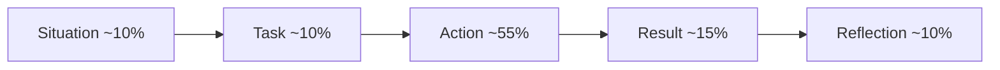

## 🎯 خلاصه

> **STAR(R)** یک ساختار چهاربخشی برای سؤال‌های «یه موقعیتی را تعریف کن که…» است: **S**ituation (موقعیت)، **T**ask (وظیفه)، **A**ction (اقدام)، **R**esult (نتیجه)، و یک **R** دیگر به معنی **Reflection** (بازاندیشی).

- **S و T** حدود ۲۰٪ پاسخ را می‌گیرند: فقط به اندازه‌ی لازم زمینه و **مسئولیت خودت**.
- **A** هسته‌ی پاسخ است و حدود نیمی از آن را تشکیل می‌دهد: کاری که **تو** انجام دادی، قدم به قدم.
- **R (Result)** به یک عدد، یک وضعیت «قبل و بعد»، یا یک نتیجه‌ی روشن نیاز دارد.
- **R (Reflection)** نشان می‌دهد چه یاد گرفتی و دفعه‌ی بعد چه می‌کردی. همین بخش داستان را به یک نشانه‌ی سنیور تبدیل می‌کند.

## 🌱 از ساده شروع کنیم (مبتدی)

> **💡 تشبیه:** پاسخ STAR مثل یک گزارش خبری کوتاه است. تیتر می‌گوید چه اتفاقی افتاد و چرا مهم بود، بدنه می‌گوید چه کسی چه کاری کرد، و انتها می‌گوید چه چیزی عوض شد. کسی دفترچه‌ی خاطرات کل هفته را نمی‌خواهد.

مصاحبه‌گر دنبال این نیست که آیا اتفاق دراماتیکی افتاده یا نه. او شاهد می‌خواهد که **تو** چطور فکر و عمل می‌کنی. داستانِ روشن و مشخص، بر داستانِ پرهیجانِ مبهم برتری دارد.

این قالب را پر کن، هر حرف یک خط:

```text
S (Situation): [کجا، کی، مقیاس، چه چیزی خراب بود یا چه چیزی لازم بود]
T (Task):      [مسئولیت خودِ من چه بود، و هدف یا ددلاین چه بود]
A (Action):    1) [اولین کاری که کردم]
               2) [دومین کار و دلیلش]
               3) [سومین کار و چیزی که بررسی کردم]
R (Result):    [قبل → بعد، با عدد اگر داری]
R (Reflection):[چه یاد گرفتم، دفعه‌ی بعد چه تغییری می‌دهم]
```

یک مثال برای مبتدی، عمداً کوتاه:

```text
S: جاب شبانه‌ی ETL جدول فروش ۵ ساعت طول می‌کشید و گاهی گزارش ساعت ۸ صبح را از دست می‌داد.
T: وظیفه‌ی من این بود که جاب قبل از ۷ صبح تمام شود، بدون اینکه خروجی عوض شود.
A: 1) جاب را پروفایل کردم و دیدم هر بار یک full table scan انجام می‌دهد.
   2) جدول را بر اساس تاریخ پارتیشن کردم و روی ستون پارتیشن فیلتر زدم.
   3) خروجی جاب قدیمی و جدید را دو هفته مقایسه کردم؛ یکی بودند.
R: زمان اجرا از ۵ ساعت به ۵۵ دقیقه رسید؛ گزارش ساعت ۸ دیگر دیر نشد.
R: دفعه‌ی بعد قبل از اولین دیپلوی، تست تعداد ردیف و checksum را درخواست می‌کردم.
```

> **⚠️ مراقب باش:** بیشتر پاسخ‌های ضعیف ۸۰٪ زمان را صرف Situation می‌کنند. S و T را کوتاه نگه دار. اگر مصاحبه‌گر به زمینه‌ی بیشتر نیاز داشته باشد، خودش می‌پرسد.

## 🔧 واقعاً چطور کار می‌کند (متوسط)

یک پاسخ دو دقیقه‌ای بودجه‌ی زمانی تقریبی دارد. این را راهنما بگیر:



هر سؤال یک **شایستگی (competency)** را می‌سنجد، نه یک داستان را. نگاشت‌های رایج:

| سؤال | شایستگی‌ای که سنجیده می‌شود |
|---|---|
| «یک incident تولیدی را تعریف کن.» | مالکیت زیر فشار، روش دیباگ |
| «زمانی که با مدیرت مخالف بودی را تعریف کن.» | قضاوت، ارتباط، تعهد پس از تصمیم |
| «یک تصمیم فنی‌ای که گرفتی را توضیح بده.» | تفکر trade-off، تصمیم‌گیری |
| «با نیازمندی‌های مبهم چطور کار کردی؟» | مدیریت ابهام، کار با ذی‌نفعان |

یک داستان را می‌توانی برای چند سؤال استفاده کنی. داستان خوب یک **نقطه‌ی تصمیم (decision point)** دارد؛ لحظه‌ای که باید بین گزینه‌ها انتخاب می‌کردی. آن را از زاویه‌های مختلف می‌توانی تعریف کنی.

**قاعده‌ی «من».** مصاحبه‌گر «ما» را نمی‌تواند امتیاز بدهد. برای زمینه‌ی تیم بگو «ما»، اما برای تصمیم‌ها و اقدام‌ها بگو «من»: «پیشنهاد دادم»، «بررسی کردم»، «تصمیم گرفتم». اگر تیم تصمیم گرفته، بگو سهم **تو** از آن چه بود.

**مثال کامل (تخیلی، با واقعیت‌های خودت جایگزین کن).** سؤال: «زمانی که یک مشکل کیفیت داده پیدا کردی را تعریف کن.»

> **پاسخ ضعیف:** «یه مشکلی تو داشبورد داشتیم. مدتی اعداد غلط بود و تیم روش کار می‌کرد. استرس‌زا بود، ولی درستش کردیم و خیلی یاد گرفتیم. الان اوضاع بهتره.»

چه چیزی کم است؟ مقیاس، مالک، روش، عدد، و بازاندیشی. مصاحبه‌گر نمی‌فهمد داوطلب دقیقاً چه کرده.

> **پاسخ قوی:** «**S:** داشبورد مالی ما دو روز حدود ۱۲٪ کمتر از جمع تراکنش‌های درگاه پرداخت نشان می‌داد و مدیر مالی روز دوشنبه متوجه شد. **T:** من مسئول on-call لایه‌ی ingestion بودم؛ هدفم این بود که اعداد همان روز درست شوند و تکرار بی‌صدا رخ ندهد. **A:** تعداد ردیف‌ها را به تفکیک پارتیشن بین raw zone و warehouse مقایسه کردم، که شکاف را به یک جدول منبع از روز دوم رساند. تیم بالادستی `amount` را از عدد صحیح (سنت) به رشته‌ی اعشاری تغییر داده بود، و cast من مقادیری را که قابل parse نبودند بی‌صدا NULL می‌کرد. parser را طوری اصلاح کردم که با خطا متوقف شود، دو روز را backfill کردم، و یک بررسی schema در ingest پیشنهاد دادم که تغییر نوع را رد کند. **R:** اعداد درست بعد از حدود ۶ ساعت به داشبورد رسیدند. این بررسی از آن زمان سه تغییر بالادستی را قبل از رسیدن به warehouse گرفته است. **Reflection:** الان cast بی‌صدا را باگ می‌دانم. اگر دوباره بود، بررسی schema را قبل از اولین دیپلوی می‌گذاشتم، نه بعد از incident.»

نسخه‌ی قوی بلندتر است، ولی هر جمله به مصاحبه‌گر چیزی برای امتیازدهی می‌دهد: روش، مالکیت، نتیجه، و درس.

## 🧠 عمق و trade-offها (سنیور)

در نقش سنیور، همین ساختار وزن بیشتری دارد. مصاحبه‌گر دنبال این‌ها است:

- **مقیاس و سطح اثر.** مقیاس را با زبان کسب‌وکار بگو: چند کاربر، چقدر پول، چند تیم تحت تأثیر بودند. «دو تیم و حدود ۴۰ داشبورد» از «یک pipeline بزرگ» مفیدتر است.
- **کیفیت تصمیم.** در بخش Action، گزینه‌هایی که رد کردی و دلیلشان را بگو. «Kafka را به جای drop روزانه‌ی فایل انتخاب کردم، چون SLA پایین‌دستی ۱۵ دقیقه بود و drop فایل تأخیر یک‌ساعته می‌آورد» نشان‌دهنده‌ی تفکر trade-off است.
- **تأثیرگذاری بدون اختیار رسمی.** سنیورها با داده، design doc و توافق، جهت را عوض می‌کنند، نه با دستور. نشان بده چطور دیگران را به اقدام رساندی.
- **شکست صادقانه.** سنیور می‌تواند یک شکست، هزینه‌اش، و اشتباه خودش را بدون سرزنش دیگران توضیح دهد. «backfill من پارتیشن‌های سالم را بازنویسی کرد چون فقط روی یک نمونه تست کرده بودم» باورپذیرتر از داستانی بدون هیچ تقصیری است.
- **اثر قابل‌اندازه‌گیری.** از متریکی استفاده کن که کسب‌وکار از قبل دنبالش است: هزینه‌ی هر اجرا، نرخ داده‌ی دیرهنگام، زمان تشخیص، تعداد pageهای on-call در ماه. قبل از اینکه نتیجه را ادعا کنی، متریک را با تیم توافق کن.

**پروب سه‌لایه.** بعد از پاسخ، معمولاً سه پرسش می‌آید: «چرا آن گزینه؟»، «چه گزینه‌های دیگری را بررسی کردی؟»، و «الان چه کار دیگری می‌کردی؟». برای هر داستان جواب هر سه را آماده کن. بخش Reflection در STAR(R) آمادگی تو برای سؤال سوم است.

**کِی STAR(R) را استفاده نکنیم.** برای سؤال‌های فرضی («اگر… چه می‌کردی؟») یا سؤال‌های طراحی سیستم، داستان تعریف نکن. استدلالت را نشان بده: نیازمندی‌ها را روشن کن، فرض‌ها را بگو، گزینه‌ها و trade-offها را مطرح کن، بعد انتخاب کن. STAR(R) برای چیزی است که قبلاً اتفاق افتاده.

## 🧪 امتحان کن

**تمرین ۱: قالب را پر کن.** یک پروژه‌ای که خوب می‌شناسی انتخاب کن. شش خط قالب بالا را پر کن. بعد با صدای بلند بخوانش و زمانش را بگیر. هدف ۱۱۰ تا ۱۳۰ کلمه، حدود دو دقیقه است.

**تمرین ۲: قسمت گم‌شده را پیدا کن.** این پاسخ را بخوان و بگو چه چیزی کم است:

> «اون DAG ایرفلویی که مدام خطا می‌داد رو درست کردم. یکم طول کشید، ولی آخرش کار کرد.»

جواب: مقیاس موقعیت، مالک وظیفه، قدم‌های Action، عدد نتیجه، و بازاندیشی، همه غایب‌اند.

**تمرین ۳: یک داستان، سه زاویه.** با قالبِ پرشده‌ات، جواب دو سؤال را بنویس: «یک شکست را تعریف کن» و «زمانی که یک فرایند را بهبود دادی را تعریف کن». Action یکی باشد، ولی Situation و Reflection را طوری عوض کن که به هر سؤال بخورد.

## 💬 گوشه‌ی مصاحبه

> **🎤 این را در مصاحبه بگو:** «زمانی که با یک منبع داده‌ی غیرقابل‌اعتماد سروکار داشتی را تعریف کن.» ترتیب STAR(R) را نگه دار و پاسخ را حدود دو دقیقه نگه دار.

**نمونه‌ی پاسخ متوسط (کوتاه):** «فایل‌های روزانه‌ی شریک ما هفته‌ای یک‌بار دیر می‌رسید و گزارش پایین‌دستی هم دیر می‌شد. از من خواسته شد pipeline را مقاوم کنم. یک sensor برای رسیدن فایل با timeout اضافه کردم و وقتی فایل بیش از دو ساعت دیر بود، به مسئول طرف مقابل هشدار می‌رفت. تأخیرها در سه ماه بعدی از هفتگی به تقریباً صفر رسید.»

**نمونه‌ی پاسخ سنیور (کوتاه):** «منبع فایل‌های شریک، ۴۰٪ incidentهای کیفیت داده‌ی ما را ایجاد می‌کرد. یک data contract یک‌صفحه‌ای با آن‌ها نوشتم که schema، زمان رسیدن و فرایند اصلاح را پوشش می‌داد، و SLA زمان رسیدن را با رئیس تیمشان مذاکره کردم. در سمت خودمان validation مربوط به schema در landing و یک جدول قرنطینه برای ردیف‌های خراب اضافه کردم، تا یک فایل خراب، فایل‌های سالم را متوقف نکند. incidentهای این منبع از حدود چهار در ماه به یک در فصل رسید، و فرایند را مستند کردم تا تیم on-call بدون من آن را اجرا کند.»

## ⚠️ اشتباهات رایج

- **Situation طولانی.** اگر ۶۰ ثانیه‌ی اول زمینه است، برای آنچه خودت کردی وقت نمی‌ماند.
- **پنهان شدن پشت «ما».** مصاحبه‌گر نمی‌فهمد چه سهمی داشتی.
- **نتیجه‌ی نداشته یا مبهم.** «بهتر شد» نتیجه نیست. عدد یا وضعیت «قبل و بعد» بگو.
- **نبودن Reflection.** بدون آن، داستان به یک خاطره تبدیل می‌شود، نه رشد.
- **سرزنش.** «فروشنده خرابش کرد» داستان را بدون مالکیت تمام می‌کند. نشان بده در برابرش چه کردی.
- **استفاده‌ی یک داستان برای همه‌ی سؤال‌ها.** مصاحبه‌گر متوجه می‌شود. چند داستان نگه دار و هرکدام را به یک شایستگی وصل کن.
- **ساختن عدد.** از تو می‌پرسند چطور اندازه گرفتی. مقدار تقریبی با یادداشت بگو، یا بازه بده.

## ✅ خودت را بسنج

۱. در یک پاسخ خوبِ دو دقیقه‌ای STAR(R)، چه سهمی باید به Action برسد؟
   - A) حدود ۱۰٪
   - B) حدود ۲۵٪
   - C) حدود ۵۵٪
   - D) حدود ۸۰٪

<details><summary>جواب</summary>

**C** — Action حامل سیگنال است. Situation و Task را کوتاه نگه دار، و برای Result و Reflection جا بگذار تا تأثیر و رشد دیده شود.

</details>

۲. کدام جمله برای Action یک پاسخ سنیور بهترین است؟
   - A) «تیم تصمیم گرفت که به Spark برویم.»
   - B) «تیم Spark می‌خواست، پس کمک کردم.»
   - C) «بعد از یک بنچمارک دو هفته‌ای، Spark را به جای جاب‌های Hive پیشنهاد دادم؛ گزینه‌ی Flink را رد کردم چون SLA ما روزانه بود و تیم تجربه‌ی Flink نداشت.»
   - D) «کار را انجام دادم و خوب پیش رفت.»

<details><summary>جواب</summary>

**C** — از «من» استفاده می‌کند، یک تصمیم را نام می‌برد، شاهد را نشان می‌دهد، و گزینه‌ی ردشده را با دلیل می‌گوید. این همان تفکر trade-off است که مصاحبه‌گر امتیاز می‌دهد.

</details>

۳. بعد از داستانت، مصاحبه‌گر می‌پرسد: «چرا آن رویکرد را انتخاب کردی؟» این پرسش چه چیزی را می‌سنجد؟

   - A) اینکه تاریخ‌ها را یادت هست یا نه
   - B) اینکه تصمیم آگاهانه گرفته‌ای و trade-off آن را می‌دانی
   - C) اینکه سریع حرف می‌زنی یا نه
   - D) اینکه پروژه بزرگ بوده یا نه

<details><summary>جواب</summary>

**B** — پروب سه‌لایه کیفیت تصمیم را می‌سنجد. گزینه‌ها و دلیل هرکدام را قبل از مصاحبه آماده کن.

</details>

۴. **(سنیور)** فقط یک داستان incident داری، ولی سؤال این است: «زمانی که یک فرایند را بهبود دادی را تعریف کن.» بهترین کار چیست؟

   - A) یک داستان دوم بساز
   - B) همان Action را نگه دار، ولی Situation و Reflection را عوض کن تا بهبود فرایندی که از آن incident بیرون آمد را نشان دهد
   - C) بخش Result را حذف کن
   - D) تاریخچه‌ی کل شرکت را تعریف کن

<details><summary>جواب</summary>

**B** — یک داستان با نقطه‌ی تصمیم روشن می‌تواند به چند سؤال جواب دهد. زمینه و درس را بازچینی کن، ولی واقعیت‌ها را ثابت نگه دار، چون مصاحبه‌گر ممکن است درباره‌ی هر دو نسخه پرسش کند.

</details>

## ✅ چک‌لیست خودارزیابی

قبل از اینکه داستانی را آماده بدانی، هر مورد را بررسی کن:

- [ ] Situation و Task با هم حدود ۳۰ ثانیه‌اند
- [ ] Task مسئولیت **خودم** را می‌گوید، نه تیم را
- [ ] حداقل سه قدم Action دارم که هرکدام با «من» شروع می‌شود
- [ ] حداقل یک گزینه‌ی ردشده با دلیل دارم
- [ ] Result عدد یا وضعیت روشن «قبل و بعد» دارد
- [ ] Reflection می‌گوید چه تغییری می‌دادم، نه فقط چه یاد گرفتم
- [ ] می‌توانم به «چرا؟»، «چه دیگری؟»، و «چه تغییری می‌دادی؟» برای این داستان جواب بدهم
- [ ] هر عددی را که قرار است بگویم بررسی کرده‌ام

## 🗂️ فلش‌کارت

| Front | Back |
|---|---|
| STAR(R) مخفف چیست؟ | Situation، Task، Action، Result، Reflection |
| کدام بخش هسته‌ی پاسخ است؟ | Action، حدود نیمی از زمان |
| چرا «من» به جای «ما»؟ | مصاحبه‌گر تصمیم‌ها و اقدام‌های خودت را امتیاز می‌دهد |
| نقطه‌ی تصمیم چیست؟ | لحظه‌ای که بین گزینه‌ها انتخاب کردی؛ داستان خوب یکی دارد |
| سه پروب رایج کدام‌اند؟ | چرا آن گزینه، چه دیگری بررسی کردی، الان چه تغییری می‌دادی |
| کِی STAR(R) را استفاده نکنیم؟ | سؤال‌های فرضی یا طراحی سیستم؛ به جایش استدلال ساختاریافته |
| چرا Reflection لازم است؟ | رشد را نشان می‌دهد و جواب «چه تغییری می‌دادی؟» است |

## 🔗 ادامه

- [[behavioral-questions]] انواع سؤال‌های رایج را به دسته‌ها وصل می‌کند تا بدانی کدام داستان را استفاده کنی.
- [[senior-signals]] توضیح می‌دهد سنیور فراتر از ساختار STAR(R) چه نشان می‌دهد: مالکیت، تأثیرگذاری و اثر.
- [[project-narratives]] نشان می‌دهد داستان‌های عمیق‌تر پروژه را که بخش Action قرار است وارسی‌شان کند چطور آماده کنی.
- [[senior-expectations]] توصیف می‌کند هر سطح باید چه چیزی نشان دهد.
- [[interview-loop]] جایگاه دورهای رفتاری را در فرایند معمول مصاحبه توضیح می‌دهد.
