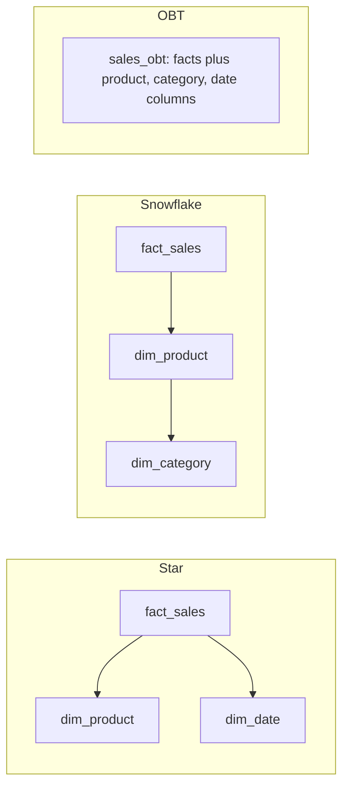

## 🎯 خلاصه

> **Star**، **snowflake** و **One Big Table (OBT)** سه شکل برای همان داده‌ی تحلیلی‌اند. تفاوتشان در **تعداد join** لازم برای یک کوئری و **تعداد کپی** هر مقدار توصیفی است که ذخیره می‌کنی.

- **Star:** یک جدول فکت در وسط، و برای هر بُعد یک جدول تخت. join ساده، و کمی تکرار داخل هر بُعد.
- **Snowflake:** ابعاد به زیرجدول‌ها نرمال شده‌اند (محصول → دسته → بخش). تکرار کمتر، ولی برای هر مرحله یک join بیشتر.
- **OBT:** هر ستون توصیفی روی ردیف‌های فکت کپی می‌شود. هنگام خواندن join بُعدی نداریم، ولی به‌روزرسانی گران است و جدول پهن است.
- در موتورهای ستونی (ClickHouse، StarRocks، BigQuery، Snowflake، و Spark روی Parquet)، هزینه‌ی یک رشته‌ی تکراری خیلی کمتر از row store است. به همین دلیل جدول‌های پهن رایج‌اند. trade-off از **join** به **به‌روزرسانی و حاکمیت داده** منتقل می‌شود.

## 🌱 از ساده شروع کنیم (مبتدی)

> **💡 Analogy:** یک کتابخانه. یک **star** مثل کارت فهرستی برای هر کتاب است که به قفسه، نویسنده و ناشر اشاره می‌کند، و هر کدام در کشوی خودشان هستند. یک **snowflake** نشانی ناشر را در کشوی دیگری می‌گذارد که کارت ناشر به آن اشاره می‌کند. یک **OBT** نام نویسنده، ناشر و قفسه را روی هر برگه‌ی امانت می‌نویسد. پس هیچ‌وقت به کشوی دیگری نمی‌روی، ولی وقتی ناشر عوض شود، باید هزاران برگه را بازنویسی کنی.

فروش را با سه توصیف در نظر بگیر: محصول، تاریخ و مشتری. جدول **فکت** رویدادها و عددها را نگه می‌دارد؛ **بُعدها** توصیف‌ها را:

```sql
-- Star: جدول فکت مستقیم به هر بُعد وصل می‌شود
SELECT d.year_month, p.category, SUM(f.amount) AS revenue
FROM fact_sales AS f
JOIN dim_date    AS d ON d.date_key    = f.date_key
JOIN dim_product AS p ON p.product_key = f.product_key
GROUP BY d.year_month, p.category;
```

سوال همیشه همان است: **چند join لازم دارم، و نام دسته را کجا ذخیره کنم؟**

## 🔧 واقعاً چطور کار می‌کند (متوسط)

### سه شکل



**Star.** بُعد یک جدول denormalized است. `dim_product` نام محصول، `category` و `department` را در یک ردیف دارد. تکرار `'Dairy'` در ۱۰٬۰۰۰ محصول قابل قبول است، چون بُعد کوچک است.

**Snowflake.** `dim_product` به `dim_category` ارجاع می‌دهد و `dim_category` به `dim_department`. هر ویژگی یک‌بار ذخیره می‌شود. هزینه، join‌های اضافه هر وقت کوئری به ویژگی عمیق‌تری نیاز داشته باشد.

**OBT.** در مسیر کوئری هیچ جدول بُعدی نیست. همه‌چیز یک جدول است:

```sql
CREATE TABLE sales_obt (
  sale_id        BIGINT,
  sale_date      DATE,
  year_month     VARCHAR(7),
  product_id     INT,
  product_name   VARCHAR(200),
  category       VARCHAR(100),
  customer_id    INT,
  customer_city  VARCHAR(100),
  customer_segment VARCHAR(50),
  amount         DECIMAL(12,2)
);

SELECT year_month, category, SUM(amount) AS revenue
FROM sales_obt
GROUP BY year_month, category;
```

همین گزارش با snowflake به دو join اضافه (محصول → دسته) نیاز دارد. با OBT به هیچ‌کدام نیاز ندارد.

### مقایسه‌ی trade-offها

| موضوع | Star | Snowflake | OBT |
|---|---|---|---|
| join هنگام کوئری | کم (یکی برای هر بُعد) | بیشتر (زنجیره) | ندارد |
| فضای ذخیره‌ی توصیف‌های تکراری | کمی تکرار | حداقل | حداکثر |
| تغییر یک ویژگی (مثلاً تغییر نام دسته) | به‌روزرسانی یک ردیف بُعد | به‌روزرسانی یک ردیف | بازنویسی هر ردیف فکتی که آن مقدار را دارد |
| سازگاری با ابزارهای BI و تحلیلگران | خوب، مدل استاندارد | سخت‌تر، جدول‌های زیاد | آسان‌ترین: یک جدول |
| سازگاری با SCD به سبک Kimball | طبیعی | طبیعی، ولی جدول‌های بیشتر برای نسخه‌بندی | سخت: تاریخچه روی هر ردیف تکرار می‌شود |

جدول نکته‌ی اصلی را نشان می‌دهد: join وقتی ارزان است که موتور بتواند خوب انجامش دهد، و به‌روزرسانی وقتی ارزان است که توصیف‌ها در یک جا باشند.

### چرا موتورهای ستونی جواب را عوض کردند

در فرمت ستونی، هر ستون جدا ذخیره و فشرده می‌شود. ستونی مثل `category` با ۲۰ مقدار متمایز در ۵۰۰ میلیون ردیف خیلی خوب فشرده می‌شود، و کوئری‌ای که فقط `category` و `amount` را می‌خواند، ستون‌های دیگر را اصلاً لمس نمی‌کند. پس تکرار خیلی کمتر از row store هزینه دارد و آنچه روی جدول‌های فکت بزرگ آزار می‌دهد، هزینه‌ی join است. به همین دلیل OBT و جدول‌های پهنِ star-مانند در ClickHouse، StarRocks، BigQuery و Spark روی Parquet رایج‌اند.

## 🧠 عمق و trade-offها (سنیور)

- **هزینه‌ی بازنویسی، صورتحساب واقعی است.** اگر محصولی در منبع تغییر نام بدهد، باید هر ردیف OBT آن محصول به‌روز شود. روی فرمت جدول lakehouse، این یعنی یک MERGE که فایل‌های داده‌ی مربوطه را بازنویسی می‌کند. برای جدول فکتی با میلیاردها ردیف، تغییر یک بُعد می‌تواند یک job دسته‌ای بزرگ شود. در star، تغییر در یک ردیف کوچک بُعد می‌ماند.
- **تاریخچه.** نگه‌داشتن تاریخچه‌ی SCD نوع ۲ در OBT یعنی تکرار کل ویژگی‌های نسخه‌دار روی هر ردیف فکت، که به‌ندرت عملی است. پاسخ معمول این است که برای تاریخچه یک بُعد (SCD2) نگه داری و جدول پهن را فقط برای نمای جاری یا نمای «لحظه‌ی زمانی» بسازی.
- **قبل از پهن کردن، grain را مشخص کن.** پهن کردن جدول فکت وقتی امن است که grain فکت ثابت بماند. اضافه کردن ستونی که با فکت رابطه‌ی یک‌به‌چند دارد (مثلاً چند برچسب برای هر سفارش) بی‌صدا ردیف‌ها را ضرب می‌کند و جمع‌ها را بزرگ می‌کند. قبل از denormalize کردن، cardinality join را چک کن. اصطلاح مربوطه: [[grain]].
- **کارایی join در موتورهای MPP ستونی.** join بُعدی در ClickHouse، StarRocks و موتورهای مشابه بهتر شده و به نسخه‌ی موتور، الگوریتم join و layout جدول بستگی دارد (مثلاً پخش یک بُعد کوچک به همه‌ی نودها). قبل از این‌که بگویی join «همیشه کند» یا «همیشه رایگان» است، مستندات join موتور خودت را ببین. عدد benchmark را از حافظه نقل نکن.
- **رویکرد لایه‌ای رایج است.** خیلی از تیم‌ها star (یا snowflake) را به‌عنوان **منبع حقیقت** نگه می‌دارند و یک OBT پهن را به‌عنوان جدول **serving** برای داشبوردها منتشر می‌کنند. OBT از روی star ساخته می‌شود، پس قابل دورریختن است. این کار مشکل به‌روزرسانی را دور می‌زند و سرعت یک جدول واحد را نگه می‌دارد.
- **OBT را مانیتور کن.** تعداد ردیف آن را با جدول فکت مقایسه کن (join بد ردیف‌ها را ضرب می‌کند)، رشد اندازه و تازگی ستون‌های توصیفی را هم بپا. `category` قدیمی در یک OBT بازسازی‌شده، خطای بی‌صداست.
- **کِی از OBT استفاده نکنی.** وقتی بسیاری از ابعاد زیاد عوض می‌شوند، وقتی چند جدول فکت ابعاد مشترک دارند (بُعد را در هر کدام کپی می‌کنی)، یا وقتی حاکمیت داده می‌خواهد تعریف‌ها در یک جا تغییر کنند، OBT بد است. در این موارد star همراه با semantic layer بهتر است.

## 🧪 امتحان کن

۱. **تمرین.** محصولی از دسته‌ی `Dairy` به `Fresh Food` می‌رود و این تغییر به ۸۰۰ محصول با ۳۰۰ میلیون ردیف فروش تاریخی اعمال می‌شود. کاری که در star و در OBT لازم است را مقایسه کن.

<details><summary>Solution</summary>

- **Star:** ۸۰۰ ردیف `dim_product` را به‌روز کن. فکت‌ها عوض نمی‌شوند، چون با `product_key` ارجاع می‌دهند، و دسته‌ی جدید بی‌درنگ در همه‌ی گزارش‌ها دیده می‌شود. (اگر تاریخچه مهم است، این مشکل SCD است، نه مشکل شکل جدول.)
- **OBT:** هر کدام از ردیف‌های فروش مرتبط (احتمالاً بیشتر از ۳۰۰ میلیون) دسته‌ی قدیمی را به‌صورت یک رشته‌ی کپی‌شده ذخیره کرده‌اند. همه را باید بازنویسی کنی، معمولاً با یک MERGE دسته‌ای یا بازسازی کامل. این هزینه‌ی به‌روزرسانی OBT است.

</details>

۲. **تمرین.** کوئری‌ای بنویس که درآمد به تفکیک `department` را برای مدل snowflake (`fact_sales → dim_product → dim_category → dim_department`) نشان دهد، و بعد نسخه‌ی OBT را (فرض کن `department` ستونی در `sales_obt` است).

<details><summary>Solution</summary>

```sql
-- Snowflake: سه join از فکت تا بخش
SELECT dep.department_name, SUM(f.amount) AS revenue
FROM fact_sales AS f
JOIN dim_product    AS p   ON p.product_key   = f.product_key
JOIN dim_category   AS c   ON c.category_key  = p.category_key
JOIN dim_department AS dep ON dep.department_key = c.department_key
GROUP BY dep.department_name;

-- OBT: بدون join
SELECT department, SUM(amount) AS revenue
FROM sales_obt
GROUP BY department;
```

</details>

## 💬 گوشه‌ی مصاحبه

**«Star یا snowflake؟ کِی OBT؟»** انتظار داری trade-off را از نظر join و به‌روزرسانی بگویی، نه این‌که یک شکل را «بهترین» بنامی.

- **جواب متوسط:** «برای BI، star پیش‌فرض است چون کوئری‌اش ساده است. snowflake ابعاد را نرمال می‌کند و فضا را کم می‌کند، ولی join اضافه دارد. OBT خواندنش سریع است ولی داده را تکرار می‌کند، پس برای جدول‌های serving استفاده‌اش می‌کنم.»
- **جواب سنیور:** «star را به‌عنوان منبع حقیقت نگه می‌دارم، چون به‌روزرسانی و تاریخچه آنجا ارزان است، و برای یک داشبورد خاص یک OBT منتشر می‌کنم، وقتی موتور اسکن‌های پهن را خوب انجام می‌دهد. تصمیم را بر اساس هزینه‌ی join روی آن موتور، تعداد دفعات تغییر توصیف‌ها، و این‌که آیا grain فکت وقتی پهنش می‌کنم ثابت می‌ماند می‌گیرم.»

**«چرا در ClickHouse جدول‌های پهن می‌سازند؟»** جواب نمونه: «ذخیره‌سازی ستونی مقادیر تکراری را خوب فشرده می‌کند و فقط ستون‌هایی را می‌خواند که کوئری نام برده، پس تکرار کمتر از row store هزینه دارد. جدول پهن join بُعدی هنگام خواندن را حذف می‌کند، که در اسکن‌های بزرگ بخش گران است. هزینه‌اش، هزینه‌ی به‌روزرسانی است، چون ویژگی تغییرکرده باید در هر ردیف بازنویسی شود؛ پس مدل نرمال را منبع نگه می‌دارم و جدول پهن را از روی آن بازسازی می‌کنم.»

## ⚠️ اشتباهات رایج

- **گفتن این‌که OBT همیشه سریع‌تر است.** در خیلی موارد خواندن سریع‌تر است، ولی بازسازی یا به‌روزرسانی می‌تواند کل هزینه را تعیین کند.
- **پهن کردن بدون بررسی grain.** ویژگی یک‌به‌چند ردیف‌های فکت را ضرب می‌کند و جمع‌ها دوبار شمرده می‌شوند.
- **گذاشتن تاریخچه‌ی SCD در OBT.** در این صورت هر ویژگی نسخه‌دار روی هر ردیف تکرار می‌شود.
- **فراموش کردن این‌که تغییر بُعد حالا بازنویسی فکت است.** تیم OBT این را در اولین تغییر نام بزرگ کشف می‌کند.
- **دیدن snowflake به‌عنوان «درست‌تر».** فضا را کم می‌کند، ولی join اضافه دارد و برای تحلیلگران سخت‌تر است. شکل مناسب به کار بستگی دارد.
- **نقل join یا عدد سرعت از حافظه.** اینها به نسخه‌ی موتور و layout بستگی دارند. روی داده‌ی خودت تست کن.

## ✅ خودت را بسنج

۱. تیم BI شکایت دارد که هر داشبورد پنج جدول بُعدی را join می‌کند. کدام تغییر مستقیم‌تر join هنگام خواندن را حذف می‌کند؟
   - A) افزودن index روی کلید هر بُعد
   - B) انتشار یک جدول پهن که ستون‌های توصیفی را روی ردیف‌های فکت کپی کرده (OBT)
   - C) نرمال‌تر کردن ابعاد به snowflake
   - D) افزایش تعداد partitionهای جدول فکت

<details><summary>Answer</summary>

**B** — یک OBT توصیف‌ها را روی ردیف‌های فکت ذخیره می‌کند، پس کوئری فقط یک جدول می‌خواند. index (A) می‌تواند join را ارزان‌تر کند ولی حذفش نمی‌کند؛ نرمال‌سازی (C) join اضافه می‌کند؛ partition (D) داده‌ی اسکن‌شده را محدود می‌کند، نه join را.

</details>

۲. نام دسته‌ی یک محصول عوض می‌شود. کدام شکل بیشترین کار نوشتن را لازم دارد؟
   - A) Star، چون فقط یک ردیف بُعد عوض می‌شود
   - B) Snowflake، چون فقط یک ردیف دسته عوض می‌شود
   - C) OBT، چون نام روی هر ردیف فروش آن دسته کپی شده
   - D) هر سه کار یکسانی لازم دارند

<details><summary>Answer</summary>

**C** — در OBT نام در هر ردیف فکت ذخیره شده، پس تغییر نام، ردیف‌های زیادی را بازنویسی می‌کند. Star و snowflake یک ردیف بُعد را عوض می‌کنند و فکت‌ها با کلید ارجاع می‌دهند.

</details>

۳. **(سنیور)** جدول فروش را با ویژگی `tags` پهن کرده‌ای، ولی یک سفارش می‌تواند چند برچسب داشته باشد و درآمد داشبورد ۳۰٪ بالا می‌رود. چه اتفاقی افتاده؟
   - A) موتور در `SUM` باگ دارد
   - B) ویژگی با فکت یک‌به‌چند است، پس هر سفارش به تعداد برچسب‌ها تکرار شده و مبلغ چند بار جمع شده
   - C) storage ستونی نمی‌تواند رشته ذخیره کند
   - D) داشبورد به‌جای `SUM` از `COUNT` استفاده کرده

<details><summary>Answer</summary>

**B** — اضافه کردن ویژگی یک‌به‌چند grain را عوض می‌کند: هر سفارش چند ردیف می‌شود و جمع `amount` به تعداد برچسب‌ها شمرده می‌شود. ویژگی‌های چندمقداری را در یک جدول bridge نگه دار، یا قبل از join تجمیعشان کن.

</details>

۴. **(سنیور)** چرا طرح لایه‌ای (star به‌عنوان منبع حقیقت، OBT به‌عنوان جدول serving) رایج است؟
   - A) انبار داده را لازم نمی‌کند
   - B) به‌روزرسانی و تاریخچه در مدل نرمال ارزان می‌ماند، و جدول پهن خواندن سریع می‌دهد و چون مشتق‌شده است می‌توان دوباره ساختش به‌جای وصله کردن
   - C) OBT را نمی‌توان از star ساخت
   - D) star schemaها با ابزارهای BI کار نمی‌کنند

<details><summary>Answer</summary>

**B** — تغییرات و تاریخچه به جایی می‌روند که اعمالشان ارزان است؛ OBT مشتق‌شده است، پس به‌جای وصله کردن، بازسازی می‌شود.

</details>

۵. کدام گزاره درباره‌ی join در موتورهای MPP ستونی قابل دفاع‌تر است؟
   - A) join در ClickHouse همیشه رایگان است
   - B) join در هر موتور ستونی همیشه کند است
   - C) هزینه‌ی join به نسخه‌ی موتور، الگوریتم join و layout جدول بستگی دارد، پس باید اندازه‌گیری شود
   - D) join فقط برای row storeها مهم است

<details><summary>Answer</summary>

**C** — موتورها پیاده‌سازی join متفاوتی دارند و در نسخه‌ها بهتر می‌شوند، پس فقط چیزی را ادعا کن که روی نسخه‌ی خودت اندازه‌گرفته یا در مستندات تأیید کرده‌ای.

</details>

## 🗂️ فلش‌کارت

| Front | Back |
|---|---|
| Star schema | یک جدول فکت که مستقیم به جدول‌های بُعدی تخت join می‌شود |
| Snowflake schema | ابعاد به زیرجدول نرمال شده‌اند (محصول → دسته → بخش) |
| One Big Table (OBT) | جدول پهنی که ستون‌های توصیفی روی ردیف‌های فکت کپی شده‌اند |
| هزینه‌ی اصلی star | مقداری تکرار داخل ابعاد؛ یک join برای هر بُعد |
| هزینه‌ی اصلی OBT | بازنویسی ردیف‌های زیاد وقتی یک مقدار توصیفی عوض شود |
| چرا جدول‌های پهن در موتورهای ستونی رایج‌اند؟ | مقادیر تکراری خوب فشرده می‌شوند و فقط ستون‌های نام‌برده خوانده می‌شوند |
| پهن کردن فکت با ویژگی یک‌به‌چند | grain را عوض می‌کند، ردیف‌ها را ضرب و جمع‌ها را بزرگ می‌کند |
| طرح لایه‌ای | star به‌عنوان منبع حقیقت، OBT بازسازی‌شده به‌عنوان جدول serving |

## 🔗 ادامه

- **dimensional-modeling** فکت، بُعد و grain را توضیح می‌دهد که پایه‌ی هر سه شکل است.
- **normalization** فرم‌های نرمال پشت ایده‌ی snowflake را پوشش می‌دهد.
- **scd** نشان می‌دهد تاریخچه چطور نگه داشته می‌شود، که سخت‌ترین بخش OBT است.
- **columnar-storage** توضیح می‌دهد چرا تکرار مقدار و اسکن پهن در فرمت‌های ستونی ارزان است.
- **clickhouse** و **physical-modeling-olap** کلید مرتب‌سازی و layout جدول را برای جدول‌های پهن پوشش می‌دهند.
- اصطلاح grain در واژه‌نامه است: [[grain]].
