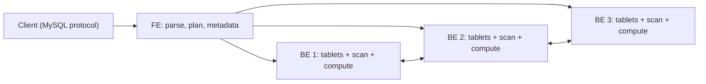

## 🎯 خلاصه

> **StarRocks** و **Apache Doris** پایگاه‌های داده‌ی تحلیلی MPP با ریشه‌ی مشترک و طراحی بسیار شبیه‌اند: یک **frontend (FE)** که query را برنامه‌ریزی و metadata را نگه می‌دارد، نودهای **backend (BE)** که tablet های داده‌ی ستونی را ذخیره و اسکن می‌کنند، و (در حالت shared-data در StarRocks) **compute node (CN)** ها. این سیستم‌ها SQL تعاملی سریع، load با تکرار بالا و upsert لحظه‌ای روی داده‌ی بزرگ را سرویس می‌دهند.

- ابتدا **مدل جدول** را انتخاب کن: Duplicate (همه‌چیز را نگه دار)، Aggregate (روی کلید از قبل جمع بزن)، Unique یا **Primary Key** (برای هر کلید یک ردیف فعلی).
- بارگذاری با **Stream Load** (push از طریق HTTP)، **Routine Load** (پیوسته از Kafka)، **Broker Load** (بارگذاری حجیم از object storage) و `INSERT` از external catalog ها انجام می‌شود.
- **materialized view** ها می‌توانند همگام (با هر load به‌روز شوند) یا ناهمگام (طبق زمان‌بندی refresh شوند و می‌توانند چند جدول را پوشش دهند) باشند.
- **external catalog** ها اجازه می‌دهند جدول‌های Iceberg و Hive را در همان جای خودشان query کنی، پس lakehouse و warehouse داده را به اشتراک می‌گذارند.
- با **replica**، تعداد **tablet**، سلامت **compaction** و **query profile** عملیات را مدیریت کن.

## 🌱 از ساده شروع کنیم (مبتدی)

> **💡 تشبیه:** یک کتابخانه‌ی بزرگ با میز پذیرش و انبارهای زیاد. میز پذیرش (FE) فهرست را می‌داند و تصمیم می‌گیرد هر سؤال به کدام انبارها نیاز دارد؛ انبارها (BE) کتاب‌ها را نگه می‌دارند و خواندن را انجام می‌دهند. کتاب‌ها به سینی‌های شماره‌دار (tablet) بریده شده‌اند و هر سینی نسخه‌ی پشتیبان در انبارهای دیگر دارد. وقتی افراد زیادی هم‌زمان سؤال می‌پرسند، میز هر سؤال را موازی به انبارهای درست می‌فرستد و جواب‌ها را ادغام می‌کند.

یک جدول کوچک با سینتکس StarRocks:

```sql
CREATE TABLE orders (
  order_id   BIGINT NOT NULL,
  user_id    BIGINT NOT NULL,
  order_date DATE   NOT NULL,
  status     VARCHAR(16),
  amount     DECIMAL(12,2)
)
PRIMARY KEY (order_id)
DISTRIBUTED BY HASH(order_id) BUCKETS 16
PROPERTIES ("replication_num" = "3");

SELECT order_date, SUM(amount) AS revenue
FROM orders
WHERE order_date >= '2026-10-01'
GROUP BY order_date
ORDER BY order_date;
```

سه نکته را ببین:

- جدول یک کلید دارد (`order_id`). این کلید تعیین می‌کند ردیف‌ها چطور ذخیره شوند و، در مدل Primary Key، کدام ردیف نسخه‌ی فعلی است.
- `DISTRIBUTED BY HASH` ردیف‌ها را بین ۱۶ bucket پخش می‌کند. هر bucket یک **tablet** است و هر tablet سه replica روی backend های مختلف دارد.
- query مثل SQL معمولی است. موتور آن را به fragment هایی تقسیم می‌کند که موازی روی backend ها اجرا می‌شوند.

## 🔧 واقعاً چطور کار می‌کند (متوسط)

### معماری



- **FE** (frontend، Java) metadata را نگه می‌دارد (دیتابیس‌ها، جدول‌ها، partition ها، محل tablet ها، کاربران)، SQL را parse می‌کند، plan توزیع‌شده می‌سازد و query ها را هماهنگ می‌کند. چند FE با آرایش leader و follower برای دسترس‌پذیری بالا اجرا می‌شوند. کلاینت‌ها با پروتکل MySQL وصل می‌شوند.
- **BE** (backend، C++) tablet ها را روی دیسک محلی نگه می‌دارد، fragment های plan را اجرا می‌کند و بیشتر کار CPU مربوط به اسکن، join و aggregation را انجام می‌دهد.
- **CN** (compute node) در **حالت shared-data** ظاهر می‌شود: داده در object storage است، CN ها compute بدون state با cache محلی هستند و بدون جابه‌جا کردن داده بالا و پایین می‌روند. برای اینکه کدام نسخه‌ها و قابلیت‌ها این حالت را دارند، مستندات را ببین.

### مدل‌های جدول

مدل تعیین می‌کند ردیف‌های با کلید یکسان چطور ذخیره و ادغام شوند. قبل از load داده انتخابش کن، چون تغییرش ساده نیست.

| مدل | نگه می‌دارد | کاربرد معمول | مراقب باش |
|---|---|---|---|
| **Duplicate Key** | همه‌ی ردیف‌ها، مرتب بر اساس کلید | لاگ رویداد، fact خام | حذف تکراری ندارد؛ باید در query فیلتر یا dedupe کنی |
| **Aggregate Key** | یک ردیف برای هر کلید، مقادیر با توابعی مثل SUM، MAX، REPLACE ادغام می‌شوند | متریک‌های از قبل جمع‌شده | فقط aggregation اعلام‌شده ممکن است؛ «آخرین مقدار» نیاز به REPLACE و دقت دارد |
| **Unique Key** | یک ردیف برای هر کلید، آخرین load برنده است | حالت فعلی به سبک CDC | معنای ادغام بین نسخه‌ها فرق دارد؛ مستندات نسخه‌ی خودت را بخوان |
| **Primary Key** | یک ردیف فعلی برای هر کلید، با index کلید اصلی؛ به‌روزرسانی و حذف کارا | upsert لحظه‌ای، CDC | index به حافظه‌ی متناسب با تعداد کلیدها نیاز دارد؛ اندازه‌اش را تعیین کن |

**sort key** (ستون‌های ابتدایی کلید) ترتیب داده روی دیسک را کنترل می‌کند. query هایی که روی ستون‌های اول sort فیلتر می‌کنند، بلوک‌های کامل را رد می‌کنند، شبیه چیزی که در [[columnar-storage]] و [[predicate-pushdown]] دیدی.

### tablet ها، replica ها و توزیع

هر partition با یک hash روی ستون توزیع (`DISTRIBUTED BY HASH`) به **bucket** ها تقسیم می‌شود. هر bucket یک tablet است. هر tablet چند replica (معمولاً سه‌تا) روی BE های مختلف دارد و FE بعد از load ها آن‌ها را یکسان نگه می‌دارد.

قواعد طراحی که در عمل مهم‌اند:

- **ستون توزیع با cardinality بالا و پخش یکنواخت انتخاب کن.** ستونی با چند مقدار (status، کشور) skew می‌سازد: یک tablet بزرگ می‌شود و یک BE گلوگاه می‌شود.
- **tablet های کوچک زیاد نساز.** هر tablet هزینه‌ی metadata و فایل دارد. تعداد bucket را از حجم داده و تعداد BE ها انتخاب کن و بعد اندازه‌ی tablet ها را چک کن.
- **replica** دسترس‌پذیری و موازی‌سازی خواندن می‌دهد، با هزینه‌ی فضا و کار نوشتن. سه تا معمولاً پیش‌فرض رایج است.

### بارگذاری

| روش | مکانیسم | مناسب برای |
|---|---|---|
| **Stream Load** | `PUT` از طریق HTTP از یک فایل یا payload؛ پاسخ همگام | push از اپلیکیشن، batch های کوچک تا متوسط |
| **Routine Load** | کلاستر پیوسته از Kafka می‌کشد و offset ها را دنبال می‌کند | ingestion استریمینگ به یک جدول |
| **Broker Load** | job ناهمگام حجیم که فایل‌ها را از HDFS یا object storage می‌خواند | بارگذاری بزرگ تاریخچه |
| **INSERT INTO ... SELECT** | SQL از جدول داخلی یا external | تبدیل داخل warehouse |

مثال Stream Load (پورت HTTP معمولاً FE روی 8030 است؛ درخواست به یک BE هدایت می‌شود):

```bash
curl --location-trusted -u loader:secret \
  -H "label: orders-2026-10-13-batch-001" \
  -H "format: json" \
  -T orders-2026-10-13.json \
  http://fe.internal:8030/api/shop/orders/_stream_load
```

**label** کلید idempotency است. یک job با همان label در بازه‌ی نگه‌داری label دوبار بارگذاری نمی‌شود، پس کلاینتی که retry می‌کند باید همان label را دوباره بفرستد. این همان الگوی [[idempotency]] است.

Routine Load از Kafka:

```sql
CREATE ROUTINE LOAD shop.orders_kafka ON orders
COLUMNS (order_id, user_id, order_date, status, amount)
PROPERTIES ("format" = "json", "desired_concurrent_number" = "4")
FROM KAFKA (
  "kafka_broker_list" = "kafka:9092",
  "kafka_topic" = "orders"
);
```

Routine Load offset های Kafka را همراه تراکنش‌های load ذخیره می‌کند، پس ری‌استارت از آخرین offset commit‌شده ادامه می‌دهد. این را با منبعی که به‌ندرت تکرار می‌فرستد، یا با جدول Primary Key ترکیب کن که ردیف‌های تکراری را به‌روزرسانی همان کلید تبدیل می‌کند.

### materialized view ها

- **همگام** (در Doris مثل rollup) به‌عنوان بخشی از هر load روی یک جدول پایه نگه داشته می‌شوند. نگه داشتنشان ارزان است و optimizer می‌تواند query را شفاف بازنویسی کند.
- **ناهمگام** طبق زمان‌بندی یا دستی refresh می‌شوند، می‌توانند چند جدول را join کنند و روی external catalog ها ساخته شوند. انتخاب معمول برای داشبورد های تجمیعی هستند، اما تازگی‌شان به آخرین refresh بستگی دارد.

```sql
CREATE MATERIALIZED VIEW daily_revenue
DISTRIBUTED BY HASH(order_date)
REFRESH ASYNC EVERY (INTERVAL 5 MINUTE)
AS
SELECT order_date, SUM(amount) AS revenue, COUNT(*) AS orders
FROM orders
GROUP BY order_date;
```

رفتار refresh و بازنویسی را در مستندات نسخه‌ی خودت چک کن، قبل از اینکه به کاربران تازگی قول بدهی.

### external catalog ها

یک external catalog موتور را به یک metastore موجود Iceberg یا Hive وصل می‌کند. بعد جدول‌های lake را در جای خودشان query می‌کنی:

```sql
-- جدول‌های Iceberg از یک REST یا Hive catalog، کنار جدول‌های داخلی
SELECT c.region, SUM(o.amount) AS revenue
FROM lake.sales.orders AS o
JOIN shop.customers AS c ON o.user_id = c.user_id
GROUP BY c.region;
```

اینجا lakehouse و warehouse به هم می‌رسند. برای اینکه metastore نسخه‌ی جدول را سازگار نگه می‌دارد، به [[catalogs]] نگاه کن.

### join و colocation

برای یک join، optimizer بین این‌ها انتخاب می‌کند:

- **broadcast join:** جدول کوچک روی هر BE که جدول بزرگ را اسکن می‌کند کپی می‌شود.
- **shuffle (partitioned) join:** هر دو طرف بر اساس کلید join دوباره پارتیشن می‌شوند، که هزینه‌ی انتقال روی شبکه دارد. به [[broadcast-join]] و [[shuffle]] نگاه کن.
- **colocate join:** جدول‌های داخل یک **colocate group** تعداد bucket، ستون توزیع و آرایش replica یکسان دارند، پس bucket های متناظر روی یک BE هستند. join محلی انجام می‌شود و shuffle ندارد.

colocation برای یک fact بزرگ که با یک dimension بزرگ روی همان کلید join می‌شود قدرتمند است، مثلاً `orders` و `order_items` با `order_id`. هزینه هم دارد: همه‌ی جدول‌های گروه باید با هم bucket شوند، که rebucket کردن و تغییر schema را سخت‌تر می‌کند.

### compaction و نسخه‌ها

هر load روی هر tablet یک نسخه‌ی جدید (rowset یا segment) می‌نویسد. **compaction** پس‌زمینه نسخه‌های کوچک را به بزرگ‌تر ادغام می‌کند. اگر load ها کوچک و پرتکرار باشند، نسخه‌ها سریع‌تر از ادغام compaction انباشته می‌شوند، query ها کندتر می‌شوند، و در نهایت سیستم با خطایی شبیه «too many versions» نوشتن را رد می‌کند. راه‌حل این است که batch ها بزرگ‌تر باشند یا تعداد load کم شود، و قبل از اضافه کردن job های load وضعیت compaction را چک کنی.

## 🧠 عمق و trade-offها (سنیور)

- **ClickHouse در برابر StarRocks.** MergeTree کلیک‌هاوس برای جدول‌های append-heavy و اسکن‌های تک‌جدولی روی داده‌ی denormalized عالی است، و وقتی schema را خودت کنترل می‌کنی خیلی سریع است. StarRocks یک موتور MPP کامل‌تر با join های shuffle، broadcast و colocate و پشتیبانی بهتر از upsert لحظه‌ای با مدل Primary Key دارد. در عمل: ClickHouse اغلب برای تحلیل رویداد روی جدول‌های پهن؛ StarRocks برای SQL چندجدولی، داشبورد با join، و وضعیت فعلی به سبک CDC. query های خودت را اندازه بگیر؛ هر دو سریع تغییر می‌کنند. به [[clickhouse]] و [[realtime-olap]] نگاه کن.
- **هزینه‌ی upsert.** جدول‌های Primary Key یک index از کلیدها نگه می‌دارند. حافظه‌اش با تعداد کلیدهای متمایز رشد می‌کند، و فضای کلید بزرگ روی BE کوچک می‌تواند خطا بسازد. حافظه را برای index اندازه بگیر، و اگر به‌روزرسانی‌ها کم‌اند، یک جدول Duplicate به‌همراه یک view dedup دوره‌ای را در نظر بگیر.
- **تازگی در برابر بار load.** load های کوچک پرتکرار تعداد نسخه‌ها و کار compaction را بالا می‌برند. الگوی معمول micro-batch هر ۱۰ تا ۶۰ ثانیه است، نه load به ازای هر رویداد، با پایش تعداد نسخه‌ها.
- **skew و کلیدهای داغ.** skew روی ستون توزیع رایج‌ترین علت query کند و دیسک نامتوازن است. اندازه‌ی tablet ها را به‌ازای هر BE و profile یک query کند را نگاه کن. به [[data-skew]] و [[hot-key]] نگاه کن.
- **query profile.** برای یک query کند، profile را فعال کن و از رابط وب FE یا خروجی profile بخوانش. دنبال عملگری بگرد که بیشترین زمان را می‌گیرد، نسبت ردیف‌های اسکن‌شده به ردیف‌های برگشتی (فیلتر ضعیف)، و زمان شبکه‌ی exchange ها (shuffleی که باید broadcast یا colocate می‌شد). `EXPLAIN` plan را قبل از اجرا نشان می‌دهد.
- **عملیات.** سلامت leader در FE، استفاده از دیسک BE، تعداد و اندازه‌ی tablet، سلامت replica، امتیاز compaction و خطای job های load را پایش کن. روی job های Routine Load که خطا دارند هشدار بگذار؛ اغلب بعد از خطای offset یا schema بی‌صدا متوقف می‌شوند.
- **backup و تغییر schema.** قبل از نیاز، backup و تست restore داشته باش. تغییر schema روی جدول بزرگ زمان و منابع می‌برد؛ آن را روی یک کپی تست کن.
- **کی استفاده نکنی.** داده‌ی کوچک که در یک دیتابیس جا می‌شود، workload های OLTP با تراکنش‌های نوشتن کوچک زیاد، و جست‌وجوی متن بی‌کران، جاهای بهتری دارند. وقتی به storage خود warehouse کم‌تر نیاز داری، موتور query روی lake مثل [[trino]] انتخاب بهتری است.

## 🧪 امتحان کن

روی یک کلاستر محلی StarRocks یا Doris (image های quick-start رسمی کافی‌اند) این‌ها را انجام بده:

۱. جدول `orders` بالا را با مدل Primary Key بساز. ۳ ردیف با Stream Load و `label` بارگذاری کن. همان Stream Load را با همان label تکرار کن و تأیید کن ردیف‌ها دو برابر نشده‌اند.
۲. یک به‌روزرسانی برای یک `order_id` موجود با `status` جدید وارد کن. تأیید کن جدول برای آن کلید یک ردیف با مقدار جدید برمی‌گرداند.
۳. materialized view ناهمگام `daily_revenue` را بساز. ردیف‌های جدید وارد کن، refresh را اجرا کن، و view را با همان aggregation روی جدول پایه مقایسه کن.
۴. `EXPLAIN` را روی join بین `orders` و یک جدول کوچک `customers` اجرا کن. مشخص کن join از نوع broadcast است یا shuffle.

<details><summary>Show solutions</summary>

۱. load اول ۳ ردیف می‌سازد. load دوم با همان label یا رد می‌شود یا به‌عنوان «قبلاً بارگذاری شده» گزارش می‌شود، پس تعداد ۳ می‌ماند. label همان چیزی است که retry را امن می‌کند.
۲. جدول Primary Key ردیف با همان کلید را جایگزین می‌کند. `SELECT * FROM orders WHERE order_id = ...` یک ردیف با status جدید برمی‌گرداند.
۳. بلافاصله بعد از load، materialized view ممکن است قدیمی باشد تا refresh بعدی. بعد از refresh، مجموع‌ها با aggregation جدول پایه یکسان می‌شوند. تازگی به زمان‌بندی refresh بستگی دارد.
۴. برای جدول کوچک سمت راست، plan یک broadcast نشان می‌دهد؛ برای جدول بزرگ یک shuffle (partitioned) join. اگر colocation تنظیم شده باشد، join بدون exchange دیده می‌شود.

</details>

## 💬 گوشه‌ی مصاحبه

**سؤال: «یک داشبورد سفارش‌های لحظه‌ای روی StarRocks چطور طراحی می‌کنی؟»**

- **جواب متوسط:** «topic سفارش‌ها را با Routine Load از Kafka به یک جدول می‌آورم، یک materialized view برای درآمد روزانه می‌سازم، و داشبورد را به view وصل می‌کنم.»
- **جواب سنیور:** «یک جدول Primary Key با کلید `order_id` می‌سازم تا به‌روزرسانی‌های CDC وضعیت فعلی را بازنویسی کنند، و با Routine Load بارگذاری می‌کنم تا از طریق کلید رفتاری نزدیک به exactly-once داشته باشم. ستون توزیع با پخش یکنواخت انتخاب می‌کنم، index کلید اصلی را به تعداد کلیدها اندازه می‌گیرم، و micro-batch ها را آن‌قدر بزرگ نگه می‌دارم که انباشت نسخه رخ ندهد. داشبورد از یک materialized view ناهمگام با بازه‌ی refresh متناسب با SLA می‌خواند، و روی خطای Routine Load، عقب‌افتادگی compaction و سلامت replica هشدار دارم.»

**سؤال: «کی ClickHouse را به جای StarRocks انتخاب می‌کنی؟»**

جدول‌های پهن و append-heavy رویداد با بیشتر اسکن‌های تک‌جدولی و به‌روزرسانی کم، وقتی schema را کنترل می‌کنی و سریع‌ترین اسکن را می‌خواهی. StarRocks طبیعی‌تر است وقتی workload چند جدول را join می‌کند، upsert لحظه‌ای لازم دارد، یا از materialized view برای سرویس داشبورد استفاده می‌کند.

> **🎤 این را در مصاحبه بگو:** «از مدل جدول شروع می‌کنم، چون تعیین می‌کند تکرار و به‌روزرسانی چطور رفتار کند. بعد به توزیع برای skew، الگوی load برای انباشت نسخه، و query profile برای کارایی فکر می‌کنم. بین ClickHouse و StarRocks بر اساس شکل join و الگوی به‌روزرسانی انتخاب می‌کنم، نه بر اساس برند.»

## ⚠️ اشتباهات رایج

> **⚠️ هشدار:** استفاده از ستونی با cardinality کم (status، کشور، روز) به‌عنوان کلید توزیع. یک tablet بزرگ می‌شود، یک BE زیر بار می‌رود، و کلاستر کند به نظر می‌رسد با اینکه ظرفیت خالی دارد.

> **⚠️ هشدار:** retry کردن Stream Load بدون همان label. retry می‌تواند همان batch را در یک جدول Duplicate دوبار بارگذاری کند.

- انتخاب مدل Duplicate برای داده‌ی CDC و انتظار اینکه به‌روزرسانی‌ها ردیف‌های قدیمی را جایگزین کنند.
- ساختن هزاران bucket کوچک به این دلیل که «موازی‌سازی بیشتر بهتر است». هر tablet هزینه دارد.
- بارگذاری یک ردیف در هر درخواست، که به‌ازای هر tablet یک نسخه می‌سازد و بعد خطای «too many versions».
- فرض اینکه materialized view ناهمگام همیشه تازه است.
- فراموش کردن اینکه job های Routine Load با خطای داده یا schema متوقف می‌شوند و به هشدار نیاز دارند.
- نادیده گرفتن query profile و تنظیم کورکورانه.

## ✅ خودت را بسنج

۱. کدام مدل جدول یک ردیف فعلی برای هر کلید نگه می‌دارد و به‌روزرسانی‌های لحظه‌ای کارا دارد؟
   - A) Duplicate Key
   - B) Aggregate Key
   - C) Primary Key
   - D) bucketing تصادفی

<details><summary>Answer</summary>

**C** — مدل Primary Key یک ردیف فعلی برای هر کلید نگه می‌دارد و کلیدها را index می‌کند تا به‌روزرسانی و حذف کارا باشد. Duplicate همه‌ی ردیف‌ها را نگه می‌دارد؛ Aggregate با توابع اعلام‌شده ادغام می‌کند.

</details>

۲. چرا retry یک Stream Load از همان label استفاده می‌کند؟
   - A) label سطح فشرده‌سازی را تعیین می‌کند
   - B) label job بارگذاری را مشخص می‌کند، پس درخواست تکراری با همان label دوبار اعمال نمی‌شود
   - C) label BE ای را انتخاب می‌کند که داده را ذخیره می‌کند
   - D) label فقط برای فایل‌های Parquet لازم است

<details><summary>Answer</summary>

**B** — label کلید idempotency برای load است. استفاده‌ی مجدد از آن باعث می‌شود اگر تلاش اول موفق بوده، retry کاری نکند.

</details>

۳. یک جدول fact و یک جدول dimension هر دو بزرگ، در هر query روی `customer_id` join می‌شوند. قوی‌ترین بهینه‌سازی برای بررسی کدام است؟
   - A) هر دو جدول را در یک ستون بگذار
   - B) colocate کن: تعداد bucket، ستون توزیع و آرایش replica یکسان، تا join محلی انجام شود
   - C) replica ها را غیرفعال کن
   - D) از Duplicate Key روی dimension استفاده کن

<details><summary>Answer</summary>

**B** — colocation باعث می‌شود bucket های متناظر روی یک BE باشند، پس join از shuffle روی شبکه پرهیز می‌کند. هزینه‌اش وابستگی بیشتر بین آرایش جدول‌هاست.

</details>

۴. **(سنیور)** بعد از یک ماه در production، یک BE سه برابر دیگران دیسک مصرف می‌کند و query هایی که `orders` را اسکن می‌کنند کندند. اول کدام دو چیز را چک می‌کنی؟

   - A) heap مربوط به JVM در FE و dialect SQL
   - B) اندازه‌ی tablet ها و skew ستون توزیع بین bucket ها، و همچنین query profile یک query کند
   - C) فقط تعداد پارتیشن‌های Kafka
   - D) نسخه‌ی درایور MySQL کلاینت

<details><summary>Answer</summary>

**B** — توزیع skew شده tablet ها و BE های نامتوازن تولید می‌کند. اندازه‌ی tablet ها را به‌ازای هر BE و profile را چک کن تا ببینی آیا چند bucket هزینه‌ی اسکن یا حافظه را غالب کرده‌اند.

</details>

۵. **(سنیور)** یک تیم در یک جدول ۵۰۰ درخواست Stream Load کوچک در دقیقه می‌فرستد. query ها در طول روز کند می‌شوند و بعد load ها شکست می‌خورند. مکانیسم محتمل چیست و چه چیزی را عوض می‌کنی؟

   - A) پروتکل Stream Load خیلی کند است که استفاده شود
   - B) هر load نسخه‌ی جدید روی هر tablet می‌سازد که سریع‌تر از ادغام compaction است؛ load ها را به نوشتن‌های بزرگ‌تر و کم‌تر تبدیل کن و تعداد نسخه و امتیاز compaction را پایش کن
   - C) دیسک FE پر است، پس FE را غیرفعال کن
   - D) Stream Load نمی‌تواند در جدول Primary Key بنویسد

<details><summary>Answer</summary>

**B** — انباشت نسخه خواندن را کند و در نهایت نوشتن را مسدود می‌کند. batch های بزرگ‌تر و پایش سلامت compaction علت ریشه‌ای را حل می‌کنند.

</details>

## 🗂️ فلش‌کارت

| Front | Back |
|---|---|
| FE در برابر BE | FE query را برنامه‌ریزی و metadata را نگه می‌دارد؛ BE tablet ها را ذخیره و کار را اجرا می‌کند |
| tablet چیست؟ | یک bucket از یک partition با replica های خودش روی BE ها |
| مدل Duplicate Key | همه‌ی ردیف‌ها را نگه می‌دارد؛ حذف تکراری ندارد |
| مدل Primary Key | یک ردیف فعلی برای هر کلید با index کلید؛ upsert و حذف کارا |
| چرا label در Stream Load مهم است؟ | کلید idempotency است که retry را امن می‌کند |
| Routine Load | کلاستر پیوسته از Kafka می‌کشد و offset ها را دنبال می‌کند |
| materialized view همگام در برابر ناهمگام | همگام با هر load روی یک جدول به‌روز می‌شود؛ ناهمگام طبق زمان‌بندی refresh و می‌تواند چند جدول را پوشش دهد |
| colocate join | bucket های متناظر روی یک BE؛ join بدون shuffle |
| چه چیزی «too many versions» را می‌سازد؟ | load های کوچک و پرتکرار که از compaction پس‌زمینه جلو می‌زنند |

## 🔗 ادامه

- **lakehouse-table-formats** و **catalogs** جدول‌های Iceberg و Hive را توضیح می‌دهند که می‌توانی در جای خودشان query کنی.
- **clickhouse** و **realtime-olap** جایگزین اصلی و الگوی گسترده‌تر را مقایسه می‌کنند.
- **mpp-architecture** مدل موتور موازی پشت FE و BE را توضیح می‌دهد.
- **kafka-exactly-once** تضمین‌هایی را توضیح می‌دهد که در سمت Kafka برای Routine Load لازم است.
- **trino** گزینه‌ی موتور query برای داده‌ی lake بدون warehouse را نشان می‌دهد.
- برای جزئیات merge مدل‌های جدول، rewrite در materialized view و پشتیبانی CN، مستندات رسمی نسخه‌ی خودت را بخوان؛ این جزئیات بین نسخه‌ها تغییر می‌کنند.
