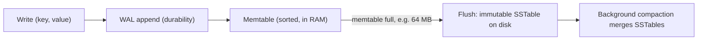

## 🎯 خلاصه

> یک **storage engine** تصمیم می‌گیرد بایت‌ها روی دیسک چطور چیده شوند و چطور تغییر کنند. **B-tree** صفحه‌ها را **درجا** به‌روز می‌کند: خواندن سریع است، اما نوشتن I/O تصادفی ایجاد می‌کند. **LSM-tree** (log-structured merge tree) نوشته‌ها را **append** می‌کند و فایل‌ها را در پس‌زمینه ادغام می‌کند: نوشتن سریع است، اما خواندن و فضای دیسک کار اضافه می‌خواهند.

- B-tree: یک درخت مرتب از صفحه‌های با اندازه‌ی ثابت. نوشتن، صفحه‌ی درست را پیدا می‌کند و دوباره می‌نویسدش.
- LSM-tree: نوشته‌ها به یک بافر مرتب در حافظه می‌روند که بعداً به‌صورت فایل‌های مرتب و تغییرناپذیر flush می‌شود. **compaction** در پس‌زمینه این فایل‌ها را ادغام می‌کند.
- هر طراحی بین سه هزینه معامله می‌کند: **write amplification**، **read amplification** و **space amplification**.

## 🌱 از ساده شروع کنیم (مبتدی)

> **💡 تشبیه:** یک **کابینت پرونده** را با یک **دفترچه** مقایسه کن. در کابینت، کارت را برمی‌داری، مقدار قدیمی را خط می‌زنی و مقدار جدید را همان‌جا می‌نویسی (B-tree). در دفترچه، همیشه خط جدید را به انتها اضافه می‌کنی، که سریع است. هر چند وقت یک‌بار، محتوای دفترچه را در یک دفتر تمیز و مرتب کپی می‌کنی و خط‌خورده‌ها را دور می‌ریزی (LSM-tree و compaction).

فرض کن یک key-value store داریم که `user:42 → "Ali"` را نگه می‌دارد. حالا آن را به `"Sara"` به‌روز می‌کنیم.

- **B-tree:** صفحه‌ای را پیدا می‌کند که `user:42` در آن است، بایت‌های آن را عوض می‌کند و صفحه را به همان جای قبلی روی دیسک برمی‌گرداند.
- **LSM-tree:** `user:42 → "Sara"` را به بافر حافظه اضافه می‌کند. مقدار قدیمی `"Ali"` تا وقتی compaction آن را پاک کند در فایل قدیمی‌تر می‌ماند.

خواندن برعکس کار می‌کند. B-tree یک مسیر کوتاه از ریشه تا یک برگ را طی می‌کند. LSM-tree اول جدیدترین داده‌ها را می‌بیند و بعد فایل‌های قدیمی‌تر را، تا کلید پیدا شود.

| | B-tree | LSM-tree |
|---|---|---|
| نوشتن | صفحه را پیدا کن و رویش بنویس | در حافظه append کن، بعداً flush کن |
| خواندن | یک مسیر از بالا به پایین درخت | چند جا را بررسی کن، از جدیدترین |
| الگوی دیسک | نوشتن تصادفی | نوشتن ترتیبی |
| کاربرد معمول | OLTP متعادل، جست‌وجوی تک‌کلیدی | ورود داده‌ی سنگین، event log، time-series |

هنوز لازم نیست جزئیات داخلی را بدانی. فقط این را به یاد بسپار: **B-tree = به‌روزرسانی درجا، LSM = همین حالا بنویس و بعداً ادغام کن.**

## 🔧 واقعاً چطور کار می‌کند (متوسط)

### صفحه‌های B-tree

یک B-tree داده را در **صفحه** (page) ذخیره می‌کند. PostgreSQL به‌طور پیش‌فرض از صفحه‌های 8 KB و InnoDB (در MySQL) از صفحه‌های 16 KB استفاده می‌کند. هر صفحه صدها کلید و اشاره‌گر را جا می‌دهد، پس درخت خیلی **کم‌عمق** است. فرض کن هر ورودی‌ی index حدود 100 بایت است و یک صفحه‌ی 16 KB حدود 160 ورودی دارد. در این صورت:

- با 3 سطح، حدود 160³ ≈ 4 میلیون ورودی برگ را می‌شود index کرد.
- با 4 سطح، حدود 160⁴ ≈ 655 میلیون ورودی را.

پس جست‌وجو در یک جدول یک‌میلیاردردیفی معمولاً 3 یا 4 خواندن صفحه است، و سطح‌های بالایی معمولاً در buffer cache می‌مانند.

به‌روزرسانی، برگ مناسب را پیدا می‌کند، آن را درجا عوض می‌کند و صفحه را برمی‌گرداند. وقتی صفحه پر شود، **split** می‌شود. برای اینکه بعد از crash چیزی از دست نرود، موتور اول یک رکورد را در [[wal-mvcc|write-ahead log]] (WAL) می‌نویسد و صفحه‌ی تغییرکرده را بعداً، در زمان checkpoint یا flush، در فایل داده می‌نویسد.

هزینه‌اش **write amplification** است. تغییر 100 بایت ممکن است کل یک صفحه‌ی 8 KB را دوباره بنویسد. فقط برای خود صفحه، این یعنی 8192 / 100 ≈ 82 برابر بیشتر از بایت‌هایی که اپلیکیشن نوشته است.

### مسیر نوشتن در LSM-tree



1. نوشته به **WAL** اضافه می‌شود تا بعد از crash از بین نرود.
2. نوشته وارد **memtable** می‌شود، یک ساختار مرتب در حافظه (LevelDB و RocksDB از skip list استفاده می‌کنند).
3. وقتی memtable پر شد، فقط‌خواندنی می‌شود و به‌صورت یک **SSTable** (sorted string table) روی دیسک نوشته می‌شود. SSTable بعد از نوشته‌شدن هرگز عوض نمی‌شود.
4. یک کار **compaction** در پس‌زمینه SSTableها را ادغام می‌کند. در ادغام، فقط جدیدترین نسخه‌ی هر کلید نگه داشته می‌شود و tombstone ها (نشانه‌های حذف) وقتی امن باشد پاک می‌شوند.

خواندن اول memtable، بعد memtableهای فقط‌خواندنی، و بعد SSTableها را از جدید به قدیم بررسی می‌کند. اولین نسخه‌ای که پیدا شود برنده است.

### Bloom filter

بدون کمک، خواندن یک کلید که وجود ندارد باید همه‌ی SSTableها را بگردد. پس هر SSTable یک **Bloom filter** هم دارد: یک آرایه‌ی بیتی به‌علاوه‌ی چند تابع hash.

- اگر فیلتر بگوید «نه»، کلید **قطعاً وجود ندارد** و فایل رد می‌شود.
- اگر بگوید «بله»، کلید **ممکن است** وجود داشته باشد. موتور فایل را می‌خواند و گاهی این یک **false positive** است.

با حدود 10 بیت برای هر کلید، نرخ false positive حدود 1٪ است. برای 1,000 کلید، فیلتر 10,000 بیت ≈ 1.2 KB جا می‌گیرد. Bloom filter فقط به **point lookup** کمک می‌کند و برای range scan کاری از دستش برنمی‌آید.

### استراتژی‌های compaction

| استراتژی | روش کار | Write amp | Read amp | Space amp | کاربرد معمول |
|---|---|---|---|---|---|
| Size-tiered | چند فایل با اندازه‌ی مشابه را در یک فایل بزرگ‌تر ادغام کن | پایین‌تر | بالاتر (فایل بیشتر) | بالاتر (نسخه‌ی قدیمی و جدید هم‌زمان هستند) | پیش‌فرض Cassandra برای خیلی از جدول‌ها |
| Leveled | سطح‌ها با نسبت ثابت بزرگ می‌شوند (ضریب پیش‌فرض RocksDB برابر 10 است)؛ فایل‌های یک سطح بازه‌ی کلیدی هم‌پوشان ندارند | بالاتر | پایین‌تر (تقریباً یک فایل در هر سطح) | پایین‌تر | پیش‌فرض RocksDB، بارهای کاری با خواندن زیاد |
| Time-window | فایل‌ها بر اساس بازه‌ی زمانی گروه می‌شوند؛ بازه‌های کامل با هم منقضی می‌شوند | پایین | بسته به شرایط | پایین برای داده‌ی TTL‌دار | time-series با TTL در Cassandra (TWCS) |

سه معیار **amplification** به زبان ساده:

- **Write amplification** = بایت‌های واقعاً نوشته‌شده روی دیسک / بایت‌هایی که اپلیکیشن نوشته است.
- **Read amplification** = تعداد خواندن دیسک برای هر جست‌وجو (فایل‌ها و بلاک‌هایی که بررسی می‌شوند).
- **Space amplification** = فضای استفاده‌شده‌ی دیسک / حجم داده‌ی زنده.

مدل ساده‌شده: اگر هر بایت یک‌بار flush شود و سپس در هر کدام از 4 سطح compaction دوباره نوشته شود، write amplification تقریباً 1 + 4 = 5 است.

### RocksDB به‌عنوان state backend

دو stream processor از RocksDB به‌صورت داخلی استفاده می‌کنند که مثال خوبی از دنیای واقعی است:

- **Flink** می‌تواند state کلیددار خود را در یک نمونه‌ی RocksDB داخلی روی هر task manager نگه دارد. این state می‌تواند بزرگ‌تر از heap باشد. checkpointها فایل‌های SST را، اغلب به‌صورت incremental، آپلود می‌کنند.
- **Kafka Streams** به‌صورت پیش‌فرض از RocksDB به‌عنوان store دائمی برای state استفاده می‌کند. هر store با یک **changelog topic** در Kafka پشتیبانی می‌شود، پس بعد از خطا می‌شود آن را بازسازی کرد.

## 🧠 عمق و trade-offها (سنیور)

- **حدس RUM.** هزینه‌ی خواندن، هزینه‌ی به‌روزرسانی و هزینه‌ی حافظه/فضا را نمی‌شود هم‌زمان کمینه کرد. هر موتور و هر تنظیم compaction دو تا را انتخاب می‌کند. بپرس بارکاری تو کدام یکی را بیشتر می‌پردازد.
- **Write stall.** موتورهای LSM وقتی compaction عقب بماند، نوشتن را کند یا متوقف می‌کنند، مثلاً وقتی تعداد فایل‌های level-0 از حد بگذرد. تعداد بایت‌های compaction در انتظار، تعداد فایل level-0 و زمان stall را پایش کن. جهشی در تأخیر نوشتن بدون تغییر ترافیک، معمولاً «بدهی compaction» است.
- **حذف هم یک نوشتن است.** یک delete یک tombstone می‌سازد. فضا فقط وقتی برمی‌گردد که compaction به آن tombstone برسد. در Cassandra، tombstone ها خواندن را هم کند می‌کنند (خواندن باید از رویشان رد شود) و قبل از حذف باید یک دوره‌ی grace قابل تنظیم (`gc_grace_seconds`، پیش‌فرض 10 روز) بگذرند تا repair بتواند آن‌ها را پخش کند. جدولی با حذف زیاد ممکن است از تعداد ردیف‌هایش کندتر خوانده شود.
- **فشرده‌سازی.** فایل‌های LSM بلاک‌های تغییرناپذیرند و خوب فشرده می‌شوند. این تقویت فضا و I/O را کم می‌کند، به قیمت CPU.
- **سخت‌افزار.** B-tree برای دیسک‌هایی طراحی شد که I/O تصادفی آن‌ها گران بود. SSD این فاصله را کم کرده، اما موتورهای LSM هنوز از نوشتن ترتیبی و I/O دسته‌ای بهره می‌برند. پیش از انتخاب، نوع ذخیره‌سازی را بررسی کن.
- **موتورهای تحلیلی همین ایده را دارند.** ClickHouse با MergeTree بخش‌های داده‌ی تغییرناپذیر می‌نویسد و آن‌ها را در پس‌زمینه ادغام می‌کند، پس برای درج شبیه یک طراحی LSM رفتار می‌کند. به همین دلیل ClickHouse دسته‌های بزرگ را می‌خواهد و نه یک ردیف در هر درج.
- **معیارهایی که باید پایش کنی:** p99 تأخیر خواندن و نوشتن، backlog compaction، تعداد فایل‌های level-0، تعداد SSTable‌هایی که هر خواندن بررسی می‌کند (read amplification)، نرخ موفقیت Bloom filter، نرخ cache hit و فضای دیسک در برابر حجم داده‌ی زنده.
- **کی LSM را استفاده نکنیم.** OLTP با خواندن زیاد و به‌روزرسانی مکرر ردیف‌های کوچک، و بارهایی که range query ارزان روی همان داده لازم دارند، معمولاً روی یک موتور B-tree مثل PostgreSQL یا InnoDB بهتر جواب می‌دهند.

## 🧪 امتحان کن

1. **عمق درخت.** صفحه‌ها 8 KB هستند و هر ورودی index، 64 بایت. هر صفحه چند ورودی دارد (هدرها را نادیده بگیر)؟ برای 100 میلیون کلید به چند سطح نیاز داریم؟
2. **Write amplification.** یک به‌روزرسانی B-tree، 100 بایت را عوض می‌کند و موتور کل صفحه‌ی 8 KB را می‌نویسد. فقط برای نوشتن صفحه، write amplification را تخمین بزن.
3. **هزینه‌ی Bloom filter.** یک کلید که وجود ندارد در 5 SSTable جست‌وجو می‌شود و نرخ false positive هر فیلتر 1٪ است. تعداد خواندن‌های اضافه‌ی فایل داده، به‌طور متوسط در هر جست‌وجو چقدر است؟
4. **یک LSM اسباب‌بازی را اجرا کن.** این اسکریپت را اجرا کن، اما پیش از اجرا خروجی‌اش را پیش‌بینی کن.

```python
class TinyLSM:
    def __init__(self, memtable_limit=3):
        self.memtable = {}
        self.sstables = []              # newest is last; each table is never changed
        self.limit = memtable_limit

    def put(self, key, value):
        self.memtable[key] = value
        if len(self.memtable) >= self.limit:
            self.sstables.append(dict(sorted(self.memtable.items())))  # "flush"
            self.memtable = {}

    def get(self, key):
        if key in self.memtable:
            return self.memtable[key]
        for table in reversed(self.sstables):   # newest first
            if key in table:
                return table[key]
        return None

db = TinyLSM()
for k, v in [("a", 1), ("b", 2), ("c", 3), ("a", 9)]:
    db.put(k, v)
print(db.get("a"))         # ?
print(len(db.sstables))    # ?
```

<details><summary>پاسخ‌ها را ببین</summary>

**1.** 8192 / 64 = 128 ورودی در هر صفحه. 128³ = 2,097,152 از 10⁸ کمتر است و 128⁴ = 268,435,456 از 10⁸ بیشتر. پس 4 سطح.

**2.** 8192 / 100 ≈ 82. فقط نوشتن صفحه حدود 82 برابر بایت‌هایی است که اپلیکیشن تغییر داده، و رکورد WAL هنوز حساب نشده.

**3.** هر فیلتر با احتمال 0.01 یک false positive می‌دهد. پنج فیلتر یعنی 5 × 0.01 = 0.05 خواندن فایل اضافه در هر جست‌وجو، به‌طور متوسط. فیلتر هیچ‌وقت false negative نمی‌دهد، پس هیچ ردیف واقعی‌ای رد نمی‌شود.

**4.** خروجی `9` و `1` است. سه `put` اول memtable را پر می‌کنند و `{a:1, b:2, c:3}` به‌صورت یک SSTable flush می‌شود. بعد `a=9` وارد memtable جدید می‌شود. `get("a")` اول memtable را می‌بیند و 9 را پیدا می‌کند. جدیدترین نسخه برنده است.

</details>

## 💬 گوشه‌ی مصاحبه

**سؤال: «چرا Cassandra از LSM-tree استفاده می‌کند ولی PostgreSQL از B-tree؟»** جواب متوسط: «Cassandra روی توان نوشتن بالا تمرکز دارد. داده را به commit log و memtable اضافه می‌کند و فایل‌های مرتب flush می‌کند، پس نوشتن ترتیبی است. PostgreSQL صفحه‌ها را درجا به‌روز می‌کند که برای OLTP با خواندن و نوشتن متعادل مناسب است.» جواب سنیور: «انتخاب از الگوی دسترسی می‌آید. Cassandra برای نوشتن بهینه شده و خواندن‌هایش با Bloom filter و partition key تعداد فایل‌های بررسی‌شده را محدود می‌کنند. هزینه‌ی compaction و tombstone را می‌پذیرم تا توان نوشتنی را داشته باشم که B-tree روی تعداد زیادی node سخت می‌تواند نگه دارد.»

**سؤال: «تأخیر خواندن روی یک جدول با نوشتن زیاد، بعد از یک ماه دو برابر شد. چه چیزهایی را بررسی می‌کنی؟»** جواب سنیور: «تعداد SSTableهایی را که هر خواندن می‌بیند، تعداد tombstone ها و این‌که استراتژی compaction با بار کاری می‌خواند یا نه را بررسی می‌کنم. بعد اثربخشی Bloom filter و نرخ cache hit را. رشد تعداد فایل‌های level-0 یا بایت‌های compaction در انتظار، نشانه‌ی بدهی compaction است.»

> **🎤 این را در مصاحبه بگو:** «B-tree صفحه‌ها را درجا به‌روز می‌کند، پس خواندن ارزان و نوشتن I/O تصادفی دارد. LSM-tree به یک log و یک memtable append می‌کند، فایل‌های مرتب و تغییرناپذیر flush می‌کند و آن‌ها را در پس‌زمینه ادغام می‌کند. انتخاب من به این بستگی دارد که بارکاری‌ام هزینه‌ی خواندن را بیشتر می‌پردازد یا نوشتن را، و هزینه‌های compaction و tombstone را از پیش حساب می‌کنم.»

## ⚠️ اشتباهات رایج

> **⚠️ حواست باشد:** «LSM یعنی نوشتن رایگان است.» نوشتن برای اپلیکیشن ارزان است، اما compaction بعداً همان داده را چند بار دوباره می‌نویسد. این هزینه به‌صورت write amplification و بار compaction ظاهر می‌شود.

> **⚠️ حواست باشد:** حذف فوراً فضای دیسک را آزاد نمی‌کند. یک tombstone نوشته می‌شود و فضا فقط وقتی برمی‌گردد که compaction به داده‌ی قدیمی برسد.

- قاطی کردن **WAL** (دوام، ترتیبی) با **memtable** (سرعت، در حافظه). به هر دو نیاز داری.
- استفاده از Bloom filter برای range scan. فیلترها فقط به point lookup کمک می‌کنند.
- انتخاب leveled compaction برای داده‌ی پرنوشتنی که با زمان منقضی می‌شود، جایی که time-window compaction معمولاً مناسب‌تر است.
- فرض این‌که B-tree همیشه برای نوشتن کند است. روی SSD و با نوشتن دسته‌ای، موتورهای B-tree هم نوشتن زیادی را خوب مدیریت می‌کنند.
- بی‌توجهی به معیارهای compaction تا وقتی که دیسک پر شود یا تأخیر جهش کند.

## ✅ خودت را بسنج

1. کدام ساختار بیشتر نوشته‌ها را به نوشتن ترتیبی روی دیسک تبدیل می‌کند؟
   - A) B-tree
   - B) LSM-tree
   - C) index هش‌شده
   - D) فایل heap با به‌روزرسانی درجا

<details><summary>جواب</summary>

**B** — یک LSM-tree به WAL append می‌کند، نوشته‌ها را در memtable نگه می‌دارد و SSTableهای مرتب flush می‌کند. B-tree صفحه‌ها را همان‌جایی که هستند به‌روز می‌کند، یعنی نوشتن تصادفی.

</details>

2. کدام گزاره درباره‌ی Bloom filter درست است؟
   - A) ممکن است false negative بدهد، پس «نه» ممکن است اشتباه باشد
   - B) ممکن است false positive بدهد، پس «بله» ممکن است اشتباه باشد، ولی «نه» همیشه درست است
   - C) برای پاسخ به range query به کار می‌رود
   - D) نیاز به compaction را از بین می‌برد

<details><summary>جواب</summary>

**B** — Bloom filter هیچ کلید درج‌شده‌ای را از دست نمی‌دهد، پس «نه» قطعی است. «بله» می‌تواند غلط باشد. فیلترها به range query جواب نمی‌دهند و روی compaction اثری ندارند.

</details>

3. یک جدول با نوشتن زیاد و TTL ‌30 روزه داریم و داده‌ی هر روز یک‌جا منقضی می‌شود. کدام استراتژی compaction بهتر است و چرا؟
   - A) Size-tiered، چون کمترین space amplification را دارد
   - B) Time-window compaction، چون هر فایل یک بازه‌ی زمانی را می‌پوشاند و بدون tombstone به‌صورت کامل منقضی می‌شود
   - C) Leveled، چون کمترین write amplification را دارد
   - D) بدون compaction، چون TTL داده را خودکار پاک می‌کند

<details><summary>جواب</summary>

**B** — time-window compaction داده را بر اساس زمان گروه می‌کند، پس فایل‌های کامل با هم منقضی و بدون بازنویسی حذف می‌شوند. Leveled compaction داده‌ای را که قرار است منقضی شود دوباره می‌نویسد، و size-tiered نسخه‌های قدیمی و جدید را مدت بیشتری نگه می‌دارد.

</details>

4. **(سنیور)** یک تیم جدول پرخواندن را از size-tiered به leveled compaction تغییر می‌دهد. چه چیزی به دست می‌آورد و چه چیزی می‌پردازد؟
   - A) write amplification بالاتر، ولی space amplification پایین‌تر و تعداد فایل کمتر در هر خواندن
   - B) write amplification پایین‌تر، ولی فضای بیشتر و فایل بیشتر در هر خواندن
   - C) هیچ‌چیز تغییر نمی‌کند، چون compaction روی خواندن اثری ندارد
   - D) tombstone کمتر، ولی بدون اثر روی فضای دیسک

<details><summary>جواب</summary>

**A** — leveled compaction سطح‌ها را بدون هم‌پوشانی نگه می‌دارد، پس هر خواندن تقریباً از یک فایل در هر سطح می‌گذرد و فضای دیسک نزدیک حجم داده‌ی زنده می‌ماند. بهایش این است که هر بایت در حرکت به سطح‌های پایین‌تر چند بار دوباره نوشته می‌شود.

</details>

5. **(سنیور)** چرا بارکاری پرحذف، حتی با تعداد ردیف کم، خواندن را کندتر می‌کند؟
   - A) حذف کل جدول را قفل می‌کند
   - B) هر حذف یک tombstone اضافه می‌کند و خواندن باید از tombstone ها رد شود تا compaction آن‌ها را پاک کند
   - C) حذف هر بار B-tree را از نو می‌سازد
   - D) Bloom filter بعد از حذف کار نمی‌کند

<details><summary>جواب</summary>

**B** — tombstone ها داده‌ای هستند که خواندن باید پردازش کند. تا وقتی compaction آن‌ها را پاک نکرده، یک کوئری ممکن است برای پیدا کردن چند ردیف زنده از میان انبوه ردیف‌های مرده عبور کند.

</details>

## 🗂️ فلش‌کارت

| جلو | پشت |
|---|---|
| مسیر نوشتن در B-tree | پیدا کردن برگ و بازنویسی درجای آن (بعد از رکورد WAL) |
| مسیر نوشتن در LSM-tree | append به WAL، بعد memtable، بعد flush به یک SSTable تغییرناپذیر |
| چرا SSTable عوض نمی‌شود | تغییرناپذیری باعث می‌شود flush و merge ترتیبی باشند و خواننده‌ها قفل لازم نداشته باشند |
| تضمین Bloom filter | «نه» قطعی است؛ «بله» می‌تواند false positive باشد (حدود 1٪ با 10 بیت برای هر کلید) |
| Write amplification | بایت‌های نوشته‌شده روی دیسک / بایت‌هایی که اپلیکیشن نوشته است |
| Leveled در برابر size-tiered | Leveled: read و space amp پایین، write amp بالا. Size-tiered: برعکس |
| tombstone چیست | نشانه‌ی حذف؛ فضا فقط وقتی آزاد می‌شود که compaction به آن برسد |
| چه کسانی RocksDB را داخل خود دارند | Kafka Streams (store پیش‌فرض state) و Flink (state backend داخلی) |

## 🔗 ادامه

- [[wal-mvcc]] جزئیات WAL و این‌که MVCC چطور جلوی بلاک‌شدن خواننده‌ها توسط نویسنده‌ها را می‌گیرد، را توضیح می‌دهد. هر دو موتور به آن وابسته‌اند.
- [[sql-indexing]] نشان می‌دهد planner چطور از index های B-tree استفاده می‌کند و نوشتن چه هزینه‌ای دارند.
- [[postgresql]] موتور عملی B-tree برای OLTP است، از جمله رفتار VACUUM و bloat.
- [[nosql-families]] فهرست می‌کند کدام دیتابیس‌ها از ذخیره‌سازی LSM استفاده می‌کنند و مدل داده‌شان از آن چطور می‌آید.
- [[streaming-state]] توضیح می‌دهد stream processor ها state کلیددار را چطور نگه می‌دارند، که اغلب روی RocksDB است.
- فصل ۳ کتاب *Designing Data-Intensive Applications* (Kleppmann) مقایسه‌ی کامل را دارد، و wiki پروژه‌ی RocksDB برای تنظیم compaction مفید است. پیش از تکیه روی یک پیش‌فرض، مستندات نسخه‌ی موتور خودت را بررسی کن.
