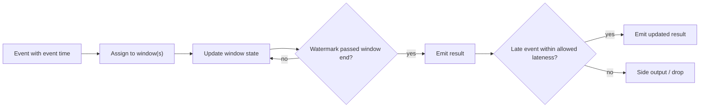

## 🎯 خلاصه

> یک stream processor باید دو سؤال را جواب بدهد که batch job ها می‌توانند از آن‌ها فرار کنند: هر رویداد متعلق به **کدام زمان** است (event time در برابر processing time)، و **کی امن است** نتیجه را منتشر کنی، با این‌که ممکن است داده‌ی دیررس هنوز برسد.

- **event time** زمانی است که چیزی اتفاق افتاده. **processing time** زمانی است که سیستم تو آن را دیده. این دو به‌خاطر تأخیر شبکه، retry و قطعی با هم فرق دارند.
- **windowها** رویدادها را بر اساس زمان گروه می‌کنند: tumbling (ثابت، بدون هم‌پوشانی)، sliding (اندازه‌ی ثابت، هم‌پوشان)، session (با یک بازه‌ی بی‌فعالیتی تمام می‌شود)، global (یک window، با trigger سفارشی).
- **watermark** ادعای سیستم است: «انتظار ندارم رویدادی قدیمی‌تر از این زمان برسد.» نتیجه‌ی یک window وقتی منتشر می‌شود که watermark از انتهای آن رد شود.
- **داده‌ی دیررس** بعد از watermark می‌رسد. می‌توانی دورش بیندازی، به side output بفرستی، یا تا **allowed lateness** بپذیری و اصلاح منتشر کنی.

## 🌱 از ساده شروع کنیم (مبتدی)

> **💡 Analogy:** یک مدرسه غیبت هر روز را گزارش می‌کند. یادداشت غیبت یک دانش‌آموز ممکن است یک هفته دیرتر برسد. اگر مدیر گزارش روز ۳ را فوراً منتشر کند، اشتباه است. اگر تا ابد صبر کند، گزارش هرگز منتشر نمی‌شود. watermark یعنی مدیر بگوید: «گزارش روز ۳ را وقتی منتشر می‌کنم که تقریباً مطمئن باشم یادداشت‌های روز ۳ رسیده‌اند.»

یک جریان کلیک را در نظر بگیر. هر کلیک دو زمان دارد:

```text
click  event_time (when the user clicked)   arrival (when we received it)
  A    10:00:10                              10:00:11
  B    10:00:50                              10:00:52
  C    10:01:05                              10:01:06
  D    10:00:40                              10:01:20   <- phone was offline, arrived late
```

تو می‌خواهی «کلیک در دقیقه» را بشماری. کلیک D متعلق به دقیقه‌ی 10:00 است، با این‌که در دقیقه‌ی 10:01 رسیده. اگر بر اساس **processing time** (زمان رسیدن) گروه کنی، D در دقیقه‌ی اشتباه می‌افتد. گروه‌بندی بر اساس **event time** درست است، اما بعد باید تصمیم بگیری کی دقیقه‌ی 10:00 «تمام» شده تا شمارش را منتشر کنی. این تصمیم همان watermark است.

قاعده‌ی ساده برای مبتدی: **بر اساس event time گروه کن، کامل بودن را با watermark تشخیص بده، و مشخص کن با داده‌ی دیررس چه می‌شود.**

## 🔧 واقعاً چطور کار می‌کند (متوسط)

**windowها.**

| نوع | شکل | مثال | هر رویداد متعلق به |
|---|---|---|---|
| Tumbling | اندازه‌ی ثابت، بدون هم‌پوشانی | هر ۱ دقیقه | دقیقاً ۱ window |
| Sliding (hopping) | اندازه‌ی ثابت، slide کوچک‌تر از اندازه | window ده‌دقیقه‌ای هر ۱ دقیقه | اندازه ÷ slide window (اینجا ۱۰ تا) |
| Session | با بازه‌ی بی‌فعالیتی تمام می‌شود، per key | gap سی‌دقیقه برای هر کاربر | sessionی که آن را گسترش می‌دهد یا با آن ادغام می‌شود |
| Global | یک window برای همه‌ی زمان‌ها | دسته‌بندی بر اساس تعداد | همان window واحد؛ trigger تصمیم خروجی را می‌گیرد |

**watermark ها.** watermark یعنی `W(t)` یک مقدار یکنواست: «انتظار رویدادی با event time ≤ t را ندارم». یک heuristic رایج bounded out-of-orderness است: `W = max(event_time دیده‌شده) − allowed_delay`. با چند ورودی موازی، operator از **کمترین** watermark بین آن‌ها استفاده می‌کند، پس یک partition بی‌کار یا کند همه چیز را عقب نگه می‌دارد. منبع‌های بی‌کار باید صریحاً مدیریت شوند، وگرنه watermark هرگز جلو نمی‌رود.

مثال کار شده در Flink SQL، شمارش tumbling یک‌دقیقه‌ای با تأخیر ۳۰ ثانیه:

```sql
CREATE TABLE clicks (
  user_id STRING,
  url     STRING,
  ts      TIMESTAMP(3),
  WATERMARK FOR ts AS ts - INTERVAL '30' SECOND
) WITH ( ... );  -- connector options omitted

SELECT window_start, window_end, COUNT(*) AS clicks
FROM TABLE(TUMBLE(TABLE clicks, DESCRIPTOR(ts), INTERVAL '1' MINUTE))
GROUP BY window_start, window_end;
```

چهار کلیک بالا را به ترتیب رسیدن دنبال کن. window ای `[10:00, 10:01)` وقتی بسته می‌شود که `W ≥ 10:01:00` باشد، و این نیاز دارد که بیشترین event time دیده‌شده دست‌کم `10:01:30` باشد.

| می‌رسد (event time) | بیشترین دیده‌شده | W = max − 30s | اثر |
|---|---|---|---|
| A (10:00:10) | 10:00:10 | 09:59:40 | شمارش 10:00 = ۱ |
| B (10:00:50) | 10:00:50 | 10:00:20 | شمارش 10:00 = ۲ |
| C (10:01:05) | 10:01:05 | 10:00:35 | شمارش 10:01 = ۱ |
| D (10:00:40)، دیررس | 10:01:05 | 10:00:35 | D ≥ W، پس پذیرفته می‌شود؛ شمارش 10:00 = ۳ |
| E (10:01:40) | 10:01:40 | 10:01:10 | W از 10:01:00 رد می‌شود، پس 10:00 **منتشر می‌کند ۳**؛ شمارش 10:01 = ۲ |
| F (10:00:30)، خیلی دیررس | 10:01:40 | 10:01:10 | F < W، پس **دیررس** است؛ دور ریخته یا به side output |



**trigger ها و accumulation.** یک **trigger** تعیین می‌کند window کی خروجی بدهد. windowهای event-time معمولاً وقتی منتشر می‌شوند که watermark از انتهای window رد شود. **firingهای زودهنگام** (مثلاً هر ۱۰ ثانیه بر اساس processing time) نتایج جزئی را زودتر نشان می‌دهند، و **firingهای دیررس** وقتی داده‌ی دیررس داخل allowed lateness برسد، دوباره منتشر می‌کنند. **accumulation mode** مشخص می‌کند هر انتشار چه چیزی دارد: فقط تغییر جدید (discarding)، جمع در حال اجرا (accumulating)، یا برگرداندن مقدار قبلی به‌علاوه‌ی مقدار جدید (accumulating-and-retracting در Beam). sinkها باید اصلاح‌ها را هندل کنند، پس حالت انتخابی باید با معنای sink هم‌خوان باشد.

**allowed lateness و side output.** API پنجره‌ی Flink بعد از این‌که watermark از انتهای window رد شد، state آن را به‌اندازه‌ی `allowedLateness` نگه می‌دارد. رویدادهای دیررس داخل این بازه نتیجه را به‌روز می‌کنند. رویدادهای بعد از آن به‌طور پیش‌فرض دور ریخته می‌شوند، یا به side output (`sideOutputLateData`) می‌روند تا بعداً دوباره پردازش شوند.

## 🧠 عمق و trade-offها (سنیور)

**سؤال داده‌ی دیررس را درست جواب بده.** یک aggregate ساعتی رویدادی را دو ساعت دیرتر دریافت می‌کند. سه چیز نتیجه را تعیین می‌کنند:

- آیا window هنوز داخل allowed lateness است؟ اگر allowed lateness صفر یا کمتر از دو ساعت باشد، رویداد دور ریخته یا به side output فرستاده می‌شود.
- اگر window نگه داشته شود، هر رویداد دیررس یک **اصلاح** راه می‌اندازد. sink باید upsert با کلید window و بُعد را پشتیبانی کند، وگرنه دوباره‌شماری می‌شود.
- اگر رویداد متعلق به window ای باشد که قبلاً منتشر و بسته شده، برای درستی به یک backfill batch نیاز داری که آن ساعت را دوباره محاسبه کند. این پل بین stream و batch است؛ به [[watermark]] و [[backfill]] نگاه کن.

**انتخاب تأخیر watermark یک trade-off است، نه یک ثابت.** توزیع `arrival_time − event_time` را برای هر منبع طی چند هفته اندازه بگیر. بسته به این‌که چقدر می‌توانی از stream گم کنی و بعداً اصلاح کنی، مقداری نزدیک p99 یا p99.9 این تأخیر انتخاب کن.

- خیلی کوچک: windowها زود بسته می‌شوند و بسیاری از رویدادها به مسیر دیررس می‌روند (نتایج اشتباه یا اصلاح‌شده).
- خیلی بزرگ: نتایج دیر می‌رسند و state رشد می‌کند، چون windowها بیشتر باز می‌مانند.

مثال محاسبه: windowهای tumbling یک‌ساعته، ۱ میلیون key فعال در هر window، حدود ۱۰۰ بایت state برای هر key در هر window، و allowed lateness دو ساعت. هر window حدود ۳ ساعت زنده می‌ماند (۱ فعلی به‌علاوه‌ی ۲ برای دیررس)، پس تقریباً ۳ window باز داریم: ۳ × ۱٬۰۰۰٬۰۰۰ × ۱۰۰ B ≈ ۳۰۰ MB state برای این aggregate، قبل از هر overhead. اگر lateness را دو برابر کنی، state تقریباً دو برابر می‌شود.

**event time یعنی source باید timestamp درست بدهد.** clock skew بین producerها، timestampهای با time zone محلی و رویدادهایی که اصلاً timestamp ندارند، watermark را بی‌صدا خراب می‌کنند. watermark lag (زمان فعلی − watermark) و نرخ رویداد دیررس برای هر منبع را مانیتور کن و روی هر دو هشدار بگذار.

**نکات موتورها.** Flink قابلیت‌های درجه‌یک event time، watermark strategy و side output دارد. Spark Structured Streaming از `withWatermark` استفاده می‌کند و در حالت append، state پنجره‌های قدیمی‌تر از watermark را پاک می‌کند. Kafka Streams پنجره‌بندی با grace period دارد. معنای دقیق «دیررس» و «دورریخته‌شده» بین موتورها فرق دارد؛ مستندات هر موتور را بررسی کن.

**کی نباید از windowهای event-time استفاده کنی.** اگر فقط شمارش فعلی برای یک داشبورد می‌خواهی و مرز دقیق دقیقه برایت مهم نیست، windowهای processing-time ساده‌ترند و watermark ندارند که تنظیمش کنی. هزینه‌اش این است که نتایج با قطعی و replay تغییر می‌کنند، پس برای billing یا تطبیق (reconciliation) استفاده‌شان نکن.

## 🧪 امتحان کن

اول پیش‌بینی کن. یک window tumbling یک‌دقیقه‌ای است، تأخیر watermark ۳۰ ثانیه است و allowed lateness صفر است. رویدادهای دقیقه‌ی 10:00 به این ترتیب می‌رسند: 10:00:20، بعد 10:01:45 (که watermark را به 10:01:15 می‌برد)، بعد 10:00:50.

- window ۱۰:۰۰ کی منتشر می‌شود؟
- رویداد با timestamp 10:00:50 چه می‌شود؟

<details><summary>حدست چیست؟</summary>

window وقتی منتشر می‌شود که watermark به 10:01:00 برسد. رویداد 10:01:45 بیشترین event time را به 10:01:45 می‌برد، پس watermark می‌شود 10:01:15، که از 10:01:00 رد می‌شود. window ۱۰:۰۰ همان لحظه با رویدادهای دیده‌شده‌تا‌به‌حال منتشر می‌شود (فقط 10:00:20). بعد رویداد 10:00:50 می‌رسد، وقتی watermark از انتهای window رد شده و allowed lateness صفر است، پس دور ریخته یا به side output می‌رود. شمارش ۱۰:۰۰ تو بی‌صدا یک رویداد کم دارد، مگر این‌که مسیر دیررس را مانیتور کنی.

</details>

همین trace را با allowed lateness یک‌دقیقه‌ای دنبال کن. حالا رویداد 10:00:50 window را به‌روز می‌کند و یک اصلاح منتشر می‌کند.

## 💬 گوشه‌ی مصاحبه

**س: یک رویداد دو ساعت دیر می‌رسد. aggregate ساعتی تو چه می‌شود؟**

> **🎤 Say this in the interview:** «بستگی به allowed lateness دارد. اگر window هنوز باز است، رویداد دیررس نتیجه را به‌روز می‌کند و sink یک اصلاح می‌گیرد، پس sink باید بر اساس window و key upsert کند. اگر window بسته شده، رویداد به side output می‌رود و آن ساعت را در یک backfill batch دوباره محاسبه می‌کنم. به‌طور پیش‌فرض همه‌ی windowها را دو ساعت باز نگه نمی‌دارم، چون state را ضرب می‌کند؛ lateness را از توزیع اندازه‌گیری‌شده تعیین می‌کنم.»

**س: تأخیر watermark را چطور انتخاب می‌کنی؟**

> **🎤 Say this in the interview:** «فاصله‌ی واقعی بین event time و زمان رسیدن را برای هر منبع اندازه می‌گیرم، بعد تأخیری نزدیک p99 یا p99.9 آن توزیع انتخاب می‌کنم. خیلی کوچک یعنی رویدادهای زیادی به مسیر دیررس می‌روند. خیلی بزرگ یعنی نتایج کند و state بیشتر. watermark lag و نرخ رویداد دیررس را مانیتور می‌کنم و وقتی منبع عوض شود، مقدار را دوباره بررسی می‌کنم، مثلاً وقتی کلاینت‌های موبایل شروع به ارسال دسته‌ای کنند.»

## ⚠️ اشتباهات رایج

- **گروه‌بندی بر اساس processing time وقتی سؤال کسب‌وکار درباره‌ی زمان وقوع است.** قطعی و replay جواب را عوض می‌کند.
- **گذاشتن یک watermark سراسری برای منابع نامرتبط.** کندترین منبع همه را عقب نگه می‌دارد.
- **فراموش کردن partitionهای بی‌کار.** کمترین watermark هرگز جلو نمی‌رود و هیچ window منتشر نمی‌شود.
- **فرض این‌که allowed lateness رایگان است.** state را ضرب می‌کند و پاک‌سازی را دیر می‌اندازد.
- **نوشتن اصلاحات دیررس در sinkی که فقط append می‌کند.** دوباره‌شماری رخ می‌دهد.
- **فکر کردن watermark یک تضمین است.** یک heuristic است. رویدادها همیشه می‌توانند بعد از آن برسند.

## ✅ خودت را بسنج

1. گوشی کاربر ۱۰ دقیقه آفلاین است و بعد کلیک‌ها را آپلود می‌کند. گزارش «کلیک در دقیقه» به‌طور پیش‌فرض باید کدام زمان را استفاده کند؟
   - A) processing time، چون ترتیب رسیدن است
   - B) event time، چون کلیک در زمان وقوعش ثبت شده
   - C) ingestion time در broker، چون همیشه یکنواست
   - D) هر کدام که سریع‌تر محاسبه شود

<details><summary>پاسخ</summary>

**B** — event time نشان می‌دهد کاربر کی کلیک کرده، پس کلیک‌ها در دقیقه‌ی درست قرار می‌گیرند. processing یا ingestion time آن‌ها را در دقیقه‌ی آپلود می‌گذارد، که برای سؤال کسب‌وکار اشتباه است.

</details>

2. با windowهای tumbling پنج‌دقیقه‌ای، یک رویداد به چند window تعلق دارد؟
   - A) ۱
   - B) ۵
   - C) ۰ یا ۱، بسته به watermark
   - D) بسته به key

<details><summary>پاسخ</summary>

**A** — windowهای tumbling هم‌پوشانی ندارند، پس هر رویداد دقیقاً به یک window تعلق دارد. windowهای sliding آن‌هایی هستند که یک رویداد می‌تواند به چند window تعلق داشته باشد.

</details>

3. watermark از انتهای window `[10:00, 10:01)` رد شده و allowed lateness صفر است. یک رویداد جدید با event time 10:00:45 می‌رسد. به‌طور پیش‌فرض چه می‌شود؟
   - A) به window اضافه می‌شود و window دوباره منتشر می‌شود
   - B) دور ریخته یا به مسیر داده‌ی دیررس فرستاده می‌شود
   - C) به window بعدی اضافه می‌شود
   - D) watermark به 10:00:45 برمی‌گردد

<details><summary>پاسخ</summary>

**B** — وقتی watermark از انتهای window رد شود و allowed lateness تمام شده باشد، window برای به‌روزرسانی بسته است و رویداد دیررس است. watermark هرگز به عقب برنمی‌گردد، پس گزینه‌ی D غلط است.

</details>

4. *(سنیور)* چرا یک partition بی‌کار در Kafka می‌تواند همه‌ی windowها را از منتشر شدن باز دارد، و چطور درستش کنی؟

<details><summary>پاسخ</summary>

با چند ورودی موازی، watermark operator کمترین مقدار بین آن‌هاست. یک partition بی‌کار watermarkش جلو نمی‌رود، پس کمترین مقدار ثابت می‌ماند و هیچ window بسته نمی‌شود. راه‌حل این است که منبع بی‌کار را به‌صورت idle علامت بزنی (تا از کمترین مقدار کنار گذاشته شود) یا یک idleness timeout برای watermark تنظیم کنی؛ مستندات موتورت این را زیر watermark strategyها توضیح می‌دهد.

</details>

5. *(سنیور)* یک تیم تأخیر watermark را ۱۰ دقیقه گذاشته چون «امن‌تر است». دو هزینه‌ی مشخص این انتخاب را بگو.

<details><summary>پاسخ</summary>

اول، هر نتیجه‌ی window تقریباً به‌اندازه‌ی این تأخیر دیر می‌شود، پس داشبوردها و هشدارها ۱۰ دقیقه عقب‌اند. دوم، windowها و state آن‌ها بیشتر باز می‌مانند، پس حافظه و اندازه‌ی checkpoint متناسب با تأخیر ضربدر تعداد keyهای فعال رشد می‌کند. مقدار درست از اندازه‌گیری توزیع دیررسی به دست می‌آید، نه از انتخاب یک عدد گرد.

</details>

## 🗂️ فلش‌کارت

| Front | Back |
|---|---|
| event time | زمانی که چیزی اتفاق افتاده، همان‌طور که producer ثبت کرده |
| processing time | زمانی که سیستم رویداد را پردازش می‌کند؛ با event time فرق دارد |
| tumbling window | اندازه‌ی ثابت، بدون هم‌پوشانی؛ هر رویداد در دقیقاً یک window |
| sliding window | اندازه‌ی ثابت، هم‌پوشان؛ هر رویداد در اندازه ÷ slide window |
| session window | بعد از یک بازه‌ی بی‌فعالیتی بسته می‌شود، per key |
| watermark | ادعا که رویدادهای قدیمی‌تر از این زمان دیگر انتظار نمی‌رود |
| allowed lateness | مدتی که state یک window بعد از رد شدن watermark از انتهایش نگه داشته می‌شود |
| side output | مسیری برای رویدادهای دیررس تا بعداً دوباره پردازش شوند |

## 🔗 ادامه

- **time-and-ordering** درباره‌ی ساعت‌ها، تضمین‌های ترتیب و این‌که چرا timestampها گمراه‌کننده‌اند توضیح می‌دهد. اگر معنای زمان برایت مبهم است، قبل از این درس بخوانش.
- **streaming-state** توضیح می‌دهد state پنجره کجا زندگی می‌کند، چطور checkpoint می‌شود و چه هزینه‌ای دارد.
- **stream-joins** همین مفاهیم زمانی را برای join کردن دو stream به کار می‌برد، جایی که watermark تعیین می‌کند join کی نهایی شود.
- **pattern-late-data** و **pattern-realtime-aggregation** این ایده‌ها را به‌صورت طراحی کامل سیستم با اصلاح، backfill و upsert در sink نشان می‌دهند.
- مدخل‌های glossary به نام‌های [[watermark]] و [[backfill]] دو اصطلاحی هستند که این درس بیشتر به آن‌ها تکیه می‌کند.
