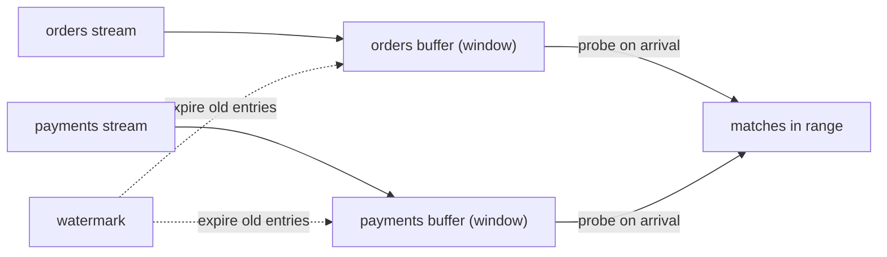

## 🎯 خلاصه

> یک **stream join** رویدادهای دو ورودی بی‌پایان را به هم وصل می‌کند. چون هیچ‌کدام از دو طرف تمام نمی‌شود، موتور باید تصمیم بگیرد **چقدر طول بکشد که هر طرف را به خاطر بسپارد**. این تصمیم (یک time window، یک جدول نسخه‌دار، یا یک lookup بیرونی) درستی، هزینه و حالت‌های خرابی join را تعیین می‌کند.

- **join جریان-جریان:** رویدادهایی را که در **event time** به هم نزدیک‌اند جفت کنید. هر دو طرف برای یک window در state بافر می‌شوند.
- **join جریان-جدول:** هر رویداد را با مقدار **فعلی** یک جدول غنی کنید. فقط طرف جریان بافر نمی‌شود و جدول خودش state است.
- **temporal join:** هر رویداد را با مقدار جدول **در زمان همان رویداد** غنی کنید. replay همان جواب را می‌دهد.
- **lookup join:** در زمان پردازش از یک store بیرونی (دیتابیس، cache) پرس‌وجو کنید. راه‌اندازی‌اش ساده است، ولی سخت‌ترین را برای deterministic بودن دارد.

## 🌱 از ساده شروع کنیم (مبتدی)

> **💡 Analogy:** گارسون یک برگه‌ی سفارش را با رسید پرداخت همان میز تطبیق می‌دهد. اگر پرداخت پنج دقیقه بعد از سفارش برسد، گارسون برگه را برای مدتی نگه می‌دارد. بعد از یک حد مشخص، برگه دور ریخته می‌شود. این «مدتی نگه داشتن» همان window است، و برگه‌های نگه‌داشته‌شده همان state.

یک مثال کوچک. سفارش‌ها و پرداخت‌ها دو جریان جدا هستند:

```text
orders:    o1 at 12:00:00  (amount 500)
           o2 at 12:03:00  (amount 200)
payments:  p1 at 12:04:00  (for o1)
           p2 at 12:25:00  (for o2)  <- 22 minutes after the order
```

اگر قانون این باشد که «پرداخت وقتی حساب می‌شود که ظرف ۱۰ دقیقه بعد از سفارش بیاید»، آن‌وقت `o1`/`p1` جفت می‌شوند و `o2`/`p2` نه. موتور باید `o2` را تا ساعت `12:13:00` در حافظه نگه دارد و بعد فراموشش کند. آن حافظه **state** است و حد زمانی جلوی رشد بی‌نهایت state را می‌گیرد.

## 🔧 واقعاً چطور کار می‌کند (متوسط)

**Stream-stream (interval) join.** موتور هر طرف را به اندازه‌ی window بافر می‌کند. وقتی رویدادی از یک طرف می‌رسد، در بافر طرف مقابل دنبال جفت‌های داخل بازه می‌گردد. در Flink SQL این به شکل interval join نوشته می‌شود:

```sql
SELECT o.order_id, o.amount, p.payment_id, p.event_time AS paid_at
FROM orders AS o
JOIN payments AS p
  ON o.order_id = p.order_id
 AND p.event_time BETWEEN o.event_time AND o.event_time + INTERVAL '10' MINUTE;
```

state هر طرف تا وقتی نگه داشته می‌شود که watermark از زمان آن رویداد به‌علاوه‌ی window بگذرد. حساب سرانگشتی: ۱٬۰۰۰ سفارش در ثانیه که هرکدام ۶۰۰ ثانیه می‌مانند، حدود ۶۰۰٬۰۰۰ سفارش در state می‌شود. با ۱ کیلوبایت برای هر رکورد، فقط برای همین طرف حدود ۶۰۰ مگابایت می‌شود، قبل از طرف پرداخت و قبل از سربار خود موتور. دو برابر کردن window، state را دو برابر می‌کند.



**outer joinها به watermark نیاز دارند.** یک left outer join فقط وقتی می‌تواند «سفارش بدون پرداخت» را خروجی بدهد که بداند پرداختی در زمان نمی‌رسد، و این لحظه‌ای است که window بسته می‌شود.

**Stream-table join.** جدول، آخرین مقدار هر کلید است و به‌عنوان state نگه داشته می‌شود (برای `KTable` ببینید [[kafka-streams]]). وقتی رویداد جریان می‌رسد، موتور مقدار فعلی جدول را می‌خواند و رویداد غنی‌شده را خروجی می‌دهد. طرف جریان window لازم ندارد، چون هر رویداد یک بار نگاه کرده می‌شود.

```sql
-- Flink SQL: lookup of the latest state of the table at the processing time
SELECT o.order_id, c.tier
FROM orders AS o
JOIN customers FOR SYSTEM_TIME AS OF o.proc_time AS c
  ON o.customer_id = c.customer_id;
```

**Temporal join.** جدول تاریخچه‌ی نسخه‌ها را نگه می‌دارد. برای هر رویداد، موتور نسخه‌ای را به کار می‌برد که در timestamp خود رویداد معتبر بوده، نه در زمان پردازش. مثال: سفارشی ساعت ۰۹:۰۰ با نرخ ارزِ معتبر ۰۹:۰۰ تبدیل می‌شود، حتی اگر job آن را ۰۹:۰۵ پردازش کند.

```sql
SELECT o.order_id, o.amount * r.rate AS amount_usd
FROM orders AS o
JOIN fx_rates FOR SYSTEM_TIME AS OF o.event_time AS r
  ON o.currency = r.currency;
```

**Lookup join.** موتور برای هر رویداد یک سیستم بیرونی (مثلاً دیتابیس JDBC یا یک key-value store) را صدا می‌زند، معمولاً به‌صورت async و همراه با cache. مقداری را می‌بیند که آن store در همان لحظه دارد.

**Co-partitioning.** برای join توزیع‌شده، هر دو ورودی باید روی کلید join با تعداد partition یکسان تقسیم شده باشند. وگرنه کلیدهای مطابق روی workerهای مختلف می‌افتند. موتورهای batch هم همین مفهوم را دارند؛ ببینید [[spark-joins-skew]].

## 🧠 عمق و trade-offها (سنیور)

- **deterministic بودن موقع replay.** چهار نوع join اینجا فرق دارند. interval و temporal join وقتی همان ورودی را دوباره پردازش کنید، همان خروجی را می‌دهند (با همان event timeها). lookup join، یا join جریان-جدول روی جدولی که عوض می‌شود، این‌طور نیست: جواب به زمان پردازش رکورد بستگی دارد. پردازش دوباره‌ی تاریخچه بعد از رفع یک باگ، غنی‌سازی‌های متفاوتی می‌دهد. قبل از انتخاب، تصمیم بگیرید که این برای کسب‌وکار مهم است یا نه.
- **اندازه‌ی state و window.** هزینه تقریباً `نرخ رویداد × طول window × اندازه‌ی رکورد` برای هر طرف است. یک window ۲۴ ساعته با ۱۰٬۰۰۰ رویداد در ثانیه یعنی ۸۶۴ میلیون رکورد برای هر طرف. window کوچک‌تر بگیرید، پیش‌فیلتر کنید، یا join را به یک key-value store با TTL منتقل کنید.
- **داده‌ی دیررس.** رویدادی که بعد از window (به‌علاوه‌ی grace period) می‌رسد، یا حذف می‌شود یا به side output می‌رود. معامله این است: درستی در برابر state. grace period طولانی‌تر state را طولانی‌تر نگه می‌دارد. ببینید [[late-arriving-data]] و [[watermark]].
- **hot key.** یک مشتری با یک میلیون رویداد باعث می‌شود یک task یا executor بافر عظیمی نگه دارد و همه‌چیز را کند کند. salting یا تقسیم کلید کمک می‌کند، اما معنای join را برای آن کلید عوض می‌کند. ببینید [[hot-key]] و [[data-skew]].
- **هزینه‌ی lookup join.** هر رویداد یک فراخوانی شبکه است، مگر اینکه cache داشته باشید. cache بار را کم می‌کند، ولی نتیجه را تا اندازه‌ی TTL کهنه می‌کند. lookupهای async توان عملیاتی را بالا نگه می‌دارند، ولی ممکن است ترتیب خروجی را به هم بزنند.
- **زمان خروجی outer join.** ردیف‌های بدون match دیر خارج می‌شوند، یعنی موقع بسته شدن window و نه موقع رسیدن. داشبوردهایی که روی outer join ساخته شده‌اند، به اندازه‌ی window «عقب» به نظر می‌رسند.
- **تفاوت موتورها.** Kafka Streams join جریان-جریان با window و join جریان-جدول و global-table دارد. Flink در SQL و DataStream API نوع‌های interval، temporal و lookup دارد. Spark Structured Streaming join جریان-جریان را با watermark و شرط بازه‌ی زمانی پشتیبانی می‌کند. برای دیدن ترکیب‌های پشتیبانی‌شده، داک موتور خودتان را ببینید.
- **چه چیزی را پایش کنیم.** اندازه‌ی state برای هر operator join، تأخیر watermark، تعداد رکوردهای دیررس حذف‌شده، و تأخیر فراخوانی lookup و نرخ cache hit.

## 🧪 امتحان کن

۱. با یک interval join ۵ دقیقه‌ای (پرداخت حداکثر ۵ دقیقه بعد از سفارش)، کدام جفت‌ها match می‌شوند: سفارش ساعت ۱۰:۰۰ با پرداخت ۱۰:۰۴؛ سفارش ۱۰:۰۰ با پرداخت ۱۰:۰۶؛ سفارش ۱۰:۰۰ با پرداخت ۰۹:۵۸؟
۲. رویدادهای سفارش را با یک جدول نرخ ارز غنی می‌کنید. پردازش دوباره‌ی سفارش‌های هفته‌ی قبل، جمع‌های متفاوتی با اجرای اول می‌دهد. نوع join احتمالی کدام است و راه‌حل چیست؟
۳. یک interval join در Flink SQL بنویسید که رویداد `shipments` را با رویداد `orders` تا ۲ ساعت قبل از آن جفت کند.

<details><summary>جواب‌ها را ببین</summary>

**۱.** جفت اول match می‌شود (۴ دقیقه در بازه‌ی ۵ دقیقه است). جفت دوم نه (۶ دقیقه بیرون بازه است). جفت سوم هم نه: پرداخت قبل از سفارش است، پس `BETWEEN o.event_time AND o.event_time + 5 min` آن را کنار می‌گذارد.

**۲.** احتمالاً lookup join یا join جریان-جدول روی جدولی است که در طول زمان عوض شده. پردازش دوباره از نرخ امروز استفاده می‌کند، نه نرخ معتبر در زمان هر سفارش. راه‌حل: temporal join روی یک جدول نرخ نسخه‌دار، تا هر سفارش نرخ معتبر در event time خودش را بگیرد.

**۳.**
```sql
SELECT s.shipment_id, o.order_id
FROM shipments AS s
JOIN orders AS o
  ON s.order_id = o.order_id
 AND o.event_time BETWEEN s.event_time - INTERVAL '2' HOUR AND s.event_time;
```
سفارش نباید دیرتر از ارسال باشد و نباید زودتر از دو ساعت قبل از آن باشد.

</details>

## 💬 گوشه‌ی مصاحبه

**سؤال: «دو جریان را چطور join می‌کنی؟»** جواب متوسط: «از یک windowed join استفاده می‌کنم: رویدادهای دو جریان را در یک بازه‌ی زمانی جفت می‌کنم و هر دو طرف را تا انقضای window در state نگه می‌دارم.» جواب سنیور: «اول می‌پرسم join برای چیست. اگر دارم داده‌ی مرجع را اضافه می‌کنم، temporal join می‌گیرم تا replayها deterministic باشند. اگر دو رویداد واقعی مثل سفارش و پرداختش را match می‌کنم، interval join با window متناسب با SLA کسب‌وکار. بعد state را با فرمول نرخ × window × اندازه‌ی رکورد تخمین می‌زنم، watermark و grace period تعیین می‌کنم، و تصمیم می‌گیرم رویدادهای دیررس کجا بروند.»

**سؤال: «چرا join موقع replay داده‌ی متفاوتی می‌دهد؟»** چون lookup یا join جریان-جدول جدول را در زمان پردازش می‌خواند، نه در event time. temporal join با جدول نسخه‌دار این مشکل را حل می‌کند.

> **🎤 Say this in the interview:** «join جریان حدِ حافظه است. هر نوع join تعیین می‌کند چه state‌ای نگه دارد و چقدر. من بر اساس درستی‌ای که لازم دارم انتخاب می‌کنم: match روی event time برای رویدادها، temporal lookup برای داده‌ی مرجع، و lookup بیرونی فقط وقتی که جواب می‌تواند با زمان عوض شود.»

## ⚠️ اشتباهات رایج

> **⚠️ Watch out:** استفاده از join جریان-جدول برای داده‌ی مرجع و بعد پردازش دوباره‌ی تاریخچه. replay از جدول امروزی استفاده می‌کند، پس نتیجه‌های گذشته عوض می‌شوند.

> **⚠️ Watch out:** فراموش کردن اینکه state با window رشد می‌کند. یک window «۱۰ دقیقه‌ای» روی جریان پرحجم می‌تواند خیلی بزرگ‌تر از انتظار تیم باشد.

- join روی processing time وقتی سؤال کسب‌وکار درباره‌ی event time است.
- تعریف نکردن رفتار رویدادهای دیررس. اگر قانون ساکت باشد، پیش‌فرض موتور تصمیم می‌گیرد.
- انتظار اینکه ردیف‌های «بدون match» در outer join فوری ظاهر شوند.
- join جریان‌هایی که روی کلید join هم‌partition نیستند.
- نادیده گرفتن hot key تا وقتی یک task عقب بیفتد.
- صدا زدن دیتابیس بیرونی برای هر رویداد بدون cache یا timeout.

## ✅ خودت را بسنج

1. کدام join برای تمام شدن به window نیاز دارد؟
   - A) join جریان-جدول
   - B) temporal join
   - C) join جریان-جریان
   - D) lookup join

<details><summary>جواب</summary>

**C** — join جریان-جریان دو ورودی بی‌پایان دارد، پس موتور باید مدت بافر شدن هر طرف را محدود کند. window همان محدودیت است. join جریان-جدول به‌جای آن، جدول را به‌عنوان state نگه می‌دارد.

</details>

2. پرداخت ۲ ساعت بعد از سفارشش می‌رسد و window ۱۰ دقیقه است. چه می‌شود؟
   - A) match می‌شود، چون joinها کل تاریخچه را نگاه می‌کنند
   - B) حذف یا به side output می‌رود، چون برای window دیررس است
   - C) جای سفارش را می‌گیرد
   - D) برای همیشه در state می‌ماند

<details><summary>جواب</summary>

**B** — وقتی window (به‌علاوه‌ی grace period) گذشته باشد، سفارش بافرشده دیگر نیست. پرداخت دیررس نمی‌تواند match شود، پس موتور آن را حذف می‌کند یا اگر پیکربندی شده باشد به side output می‌فرستد.

</details>

3. وقتی تاریخچه را دوباره پردازش می‌کنید، چرا برای تبدیل ارز temporal join بر lookup join ترجیح داده می‌شود؟
   - A) در هر query سریع‌تر است
   - B) نسخه‌ی جدول معتبر در event time را به کار می‌برد، پس خروجی موقع replay یکسان است
   - C) هیچ state لازم ندارد
   - D) بدون event time کار می‌کند

<details><summary>جواب</summary>

**B** — temporal join نسخه‌ی معتبر در timestamp خود رویداد را پیدا می‌کند. lookup join مقداری را می‌خواند که جدول در زمان پردازش دارد و این بین اجراها تغییر می‌کند.

</details>

4. **(سنیور)** یک stream-stream join برای یک window ۳۰ دقیقه‌ای، برای هر طرف ۲٬۰۰۰ رویداد در ثانیه نگه می‌دارد. تقریباً چند رکورد برای یک طرف در state است؟

   - A) ۶۰٬۰۰۰
   - B) ۳٬۶۰۰٬۰۰۰
   - C) ۱٬۰۰۰٬۰۰۰
   - D) ۱۲۰٬۰۰۰

<details><summary>جواب</summary>

**B** — ۲٬۰۰۰ رویداد در ثانیه × ۱٬۸۰۰ ثانیه (۳۰ دقیقه) = ۳٬۶۰۰٬۰۰۰ رکورد برای هر طرف. برای طرف دوم دوباره همین تعداد می‌شود، و به همین دلیل اندازه‌ی window اهرم اصلی کنترل state است.

</details>

5. **(سنیور)** تیم پیشنهاد می‌دهد برای «امن بودن» یک window ۷ روزه برای join بگذاریم. مهم‌ترین معامله‌ای که باید مطرح کنید چیست؟

   - A) joinهای دارای window اصلاً در production قابل استفاده نیستند
   - B) state با window رشد می‌کند، پس هزینه و زمان بازیابی هم رشد می‌کنند؛ window بزرگ معمولاً قانون کسب‌وکار گمشده را حل نمی‌کند
   - C) window ۷ روزه نیاز به watermark را از بین می‌برد
   - D) فقط موتورهای batch window های بیشتر از یک ساعت را پشتیبانی می‌کنند

<details><summary>جواب</summary>

**B** — اندازه‌ی state با window متناسب است. window بلند حافظه، اندازه‌ی checkpoint و زمان restore را بالا می‌برد و سؤال اصلی را پنهان می‌کند: قانون کسب‌وکار برای اینکه یک match چقدر می‌تواند دیر برسد چیست؟ راه‌حل SLA روشن و grace period است، نه window بزرگ دلخواه.

</details>

## 🗂️ فلش‌کارت

| Front | Back |
|---|---|
| چرا join جریان-جریان به window نیاز دارد؟ | هر دو ورودی بی‌پایان‌اند؛ موتور باید مدت بافر شدن هر طرف را محدود کند |
| join جریان-جدول: state چیست؟ | خود جدول (آخرین مقدار هر کلید)؛ طرف جریان بافر نمی‌شود |
| temporal join در برابر lookup join | temporal نسخه‌ی جدول در event time را می‌گیرد (deterministic)؛ lookup مقدار زمان پردازش را می‌گیرد |
| interval join | joinی که اختلاف زمانی دو رویداد باید در یک بازه باشد |
| تخمین سرانگشتی state | نرخ رویداد × طول window × اندازه‌ی رکورد، برای هر طرف |
| چرا ردیف‌های بدون match در outer join دیر می‌آیند؟ | فقط وقتی window بسته شود و دیگر match نرسد می‌توان خروجی داد |
| co-partitioning | هر دو ورودی روی کلید join با تعداد partition یکسان تقسیم شده باشند |

## 🔗 ادامه

- [[kafka-streams]] join جریان-جدول با `KTable` و co-partitioning را در کد نشان می‌دهد.
- [[stream-concepts]] زمان رویداد، window و watermark را توضیح می‌دهد که همه‌ی این joinها به آن‌ها وابسته‌اند.
- [[streaming-state]] state store، TTL و checkpoint را پوشش می‌دهد.
- [[pattern-late-data]] نشان می‌دهد چطور join های real-time را با نتایج batch شبانه تطبیق دهیم.
- [[spark-joins-skew]] نسخه‌ی batch همین join و مشکلات skew را پوشش می‌دهد.
- داک join موتور خودتان را برای نحو دقیق و ترکیب‌های پشتیبانی‌شده بخوانید؛ مفاهیم بین موتورها پایدارند.
