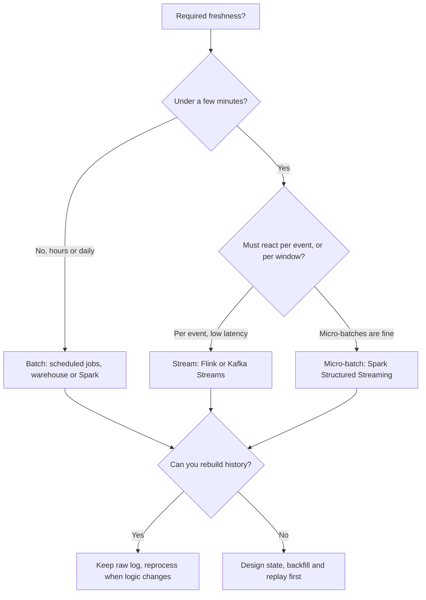

## 🎯 خلاصه

> **انتخاب تکنولوژی (technology selection)** یعنی انتخاب یک ابزار بر اساس **معیارهایی** که باید برآورده کند: تأخیر، حجم، تضمین‌های درستی، مهارت تیم، هزینهٔ عملیاتی و اکوسیستم. اسم ابزار آخرین چیزی است که می‌آید.

- از نیازمندی‌ها شروع کن: هدف تازگی داده، حجم، شکل کوئری، نیاز به ترتیب و replay، و اینکه چه کسی سیستم را اجرا می‌کند.
- کاندیدها را روی همان معیارها در یک جدول مقایسه کن، و بگو کدام معیار تصمیم را می‌گیرد.
- هر ابزاری یک trade-off است. «سریع‌تر» معمولاً یعنی «عملیات بیشتر» یا «انعطاف کمتر». هزینه‌ای که می‌پذیری را نام ببر.
- قبل از تعهد، روی داده‌ی خودت benchmark بزن. ادعاهای فروشنده و عددهای وبلاگ به workload و نسخه بستگی دارند.

## 🌱 از ساده شروع کنیم (مبتدی)

> **💡 تشبیه:** خرید ماشین. «بهترین ماشین» جواب ندارد. برای خانوادهٔ شش‌نفره در بزرگراه یک ون می‌خری؛ برای پیک موتوری در شهر یک موتور. اول معیارها می‌آیند (تعداد صندلی، مصرف، جاده)، و برند آخر.

ابزارهای داده هم همین‌طورند. جواب مبتدی این است: «Kafka، چون همه استفاده می‌کنند.» جواب سنیور: «Kafka، چون به replay برای هفت روز، چندین مصرف‌کنندهٔ مستقل و ترتیب در سطح کلید نیاز داریم، و می‌توانیم یک خوشه را اجرا کنیم.»

برای هر انتخاب این عادت سه‌مرحله‌ای را استفاده کن:

1. **نیازمندی را با عدد بنویس.** مثلاً «تازگی داشبورد زیر ۵ دقیقه»، «۲ ترابایت در روز»، «کوئری‌ها در p95 زیر ۳ ثانیه ۵۰۰ گیگابایت اسکن می‌کنند».
2. **معیارهایی که نیازمندی تعیین‌کننده‌شان می‌کند را فهرست کن.** اغلب فقط دو یا سه معیار مهم‌اند.
3. **کاندیدها را فقط روی همان معیارها مقایسه کن.** امکاناتی که استفاده نمی‌کنی را نادیده بگیر.

## 🔧 واقعاً چطور کار می‌کند (متوسط)

اولین تصمیم معمولاً batch یا stream است، چون تقریباً همه‌ی انتخاب‌های دیگر را تغییر می‌دهد.

حالا تصمیم‌های دو‌به‌دو. هر جدول معیارها را فهرست می‌کند، نه برنده را؛ ردیف آخر می‌گوید هر طرف کی انتخاب می‌شود.

### پیام‌رسانی: Kafka در برابر RabbitMQ

| معیار | Kafka | RabbitMQ |
|---|---|---|
| مدل اصلی | log توزیع‌شده و partition‌شده؛ مصرف‌کننده‌ها offset خودشان را نگه می‌دارند | broker با exchange و queue؛ پیام بعد از ack حذف می‌شود |
| replay داده‌ی قدیمی | بله، در بازهٔ retention | معمولاً خیر؛ بعد از ack پیام رفته است |
| مصرف‌کننده‌های مستقل زیاد | طبیعی: هر consumer group کل log را می‌خواند | نیاز به fan-out exchange و یک queue برای هر مصرف‌کننده |
| ترتیب در سطح کلید | بله، داخل یک partition | در سطح queue، با یک مصرف‌کننده |
| منطق مسیریابی | ساده (topic و کلید) | غنی (exchangeهای direct، topic، fanout و headers) |
| کاربرد رایج | جریان رویداد، CDC، ستون یکپارچه‌سازی | صف کار، request/reply، مسیریابی پیچیده |

وقتی داده تاریخچهٔ رویدادهاست که سیستم‌های زیادی می‌خوانند و دوباره می‌خوانند، Kafka. وقتی پیام‌ها کارهایی‌اند که باید یک‌بار انجام شوند و بعد حذف شوند، با مسیریابی که با کلیدها سخت بیان می‌شود، RabbitMQ. ایدهٔ زیرین را در [[queues-vs-logs]] ببین.

### پردازش stream: Flink در برابر Spark Structured Streaming

| معیار | Flink | Spark Structured Streaming |
|---|---|---|
| اجرا | رکورد به رکورد، pipeline‌ای | micro-batch (مدل پیش‌فرض) |
| تأخیر | معمولاً کم‌تر؛ زیر یک ثانیه ممکن است | معمولاً ثانیه‌ها؛ بستگی به trigger و اندازهٔ batch دارد |
| زمان رویداد و داده‌ی دیررسیده | اصلی: watermark، timer و keyed state | پشتیبانی شده با watermark؛ کنترل‌های سطح پایین‌تر کم‌تر |
| اشتراک کد batch و stream | ممکن، ولی با مدل ذهنی جدا | همان DataFrame API برای batch و stream |
| تناسب با اکوسیستم | قوی برای پردازش رویداد stateful | قوی اگر تیم از قبل Spark و Spark ML دارد |
| نکتهٔ عملیاتی | checkpoint، state backend و savepoint | checkpoint، shuffle و تنظیم اندازهٔ micro-batch |

برای منطق رویداد-به-رویداد با keyed state بزرگ، تأخیر تنگ و رفتار پیچیدهٔ زمان رویداد (مثلاً تشخیص تقلب)، Flink. وقتی تیم در Spark زندگی می‌کند، تأخیر ثانیه‌ای کافی است و batch و stream باید تبدیل‌های مشترک داشته باشند، Spark. قبل از وعدهٔ هر عدد تأخیر، مستندات نسخهٔ خودت را ببین.

### موتورهای OLAP: ClickHouse در برابر StarRocks در برابر Druid

| معیار | ClickHouse | StarRocks | Druid |
|---|---|---|---|
| نقطهٔ قوت | اسکن و تجمیع خیلی سریع روی جدول‌های بزرگ و عمدتاً append | SQL از نوع MPP با join قوی بین چند جدول و materialized view | ingestion لحظه‌ای جریان رویداد با rollup زمانی |
| به‌روزرسانی داده | بیشتر append؛ به‌روزرسانی نیاز به engine و الگوی خاص دارد | جدول‌های primary-key از upsert پشتیبانی می‌کنند | مبتنی بر segment؛ طراحی زمان‌محور |
| join | بهتر شده، ولی جدول‌ها را طوری طراحی کن که join سنگین نداشته باشی | از تمرکز اصلی موتور است | محدود؛ denormalize کن |
| بهترین کاربرد | تحلیل لاگ، داشبورد رویداد، تجمیع‌های ad-hoc روی یک جدول پهن | تحلیل star-schema با join زیاد و کاربر همزمان | متریک‌های لحظه‌ای و کاوش سری زمانی |

این‌ها تعمیم‌اند. هر موتور سریع تغییر می‌کند؛ اصل این است که بر اساس شکل کوئری (تجمیع پهن یا join)، الگوی به‌روزرسانی (append یا upsert) و تازگی انتخاب کنی، بعد benchmark بزنی. جزئیات را در [[clickhouse]] و [[starrocks-doris]] ببین.

### فرمت جدول: Iceberg در برابر Hudi در برابر Delta

| معیار | Iceberg | Hudi | Delta Lake |
|---|---|---|---|
| تمرکز طراحی | spec جدول مستقل از موتور با snapshot | upsert در سطح رکورد و pull افزایشی | log تراکنش مرتبط با اکوسیستم Spark |
| partitioning | hidden partitioning و تکامل partition | کلیدها و مسیر partition؛ گزینه‌های index رکوردی | ستون‌های partition؛ تکامل آن دستی‌تر است |
| پشتیبانی موتورها | گسترده (Spark، Flink، Trino و دیگران) | Spark، Flink و دیگران؛ باریک‌تر از Iceberg | قوی‌ترین در Spark و Databricks |
| upsertهای شبیه CDC | پشتیبانی دارد؛ حالت نوشتن را برای موتورت چک کن | نقطهٔ قوت اصلی | با MERGE در Spark پشتیبانی می‌شود |

قاعدهٔ عملی: وقتی چند موتور باید همان جدول‌ها را بخوانند و بنویسند، Iceberg. وقتی ingestion افزایشی در سطح رکورد کار اصلی است، Hudi. وقتی پلتفرم حول Spark است، Delta. مکانیزم‌ها را در [[lakehouse-table-formats]] بخوان.

### ارکستراسیون: Airflow در برابر Dagster

| معیار | Airflow | Dagster |
|---|---|---|
| واحد کار | taskها در یک DAG | assetهای تعریف‌شده با نرم‌افزار (جدول‌ها، مدل‌ها) |
| نمای lineage | گراف task؛ lineage داده نیاز به ابزار اضافه دارد | گراف asset با وضعیت آگاه از داده |
| اکوسیستم | مجموعهٔ بزرگی از operator و integration | کوچک‌تر و در حال رشد؛ قوی برای asset های dbt و Python |
| تست | ممکن، اغلب با راه‌اندازی بیشتر | برای تست محلی asset ها و resourceها طراحی شده |
| تناسب با تیم | بالغ، شناخته‌شده، با DAGهای زیاد موجود | خوب برای تیمی که pipeline را به شکل جدول فکر می‌کند |

وقتی شرکت از قبل Airflow را اجرا می‌کند و کار شامل taskهای ناهمگون زیادی است، Airflow. وقتی تیم جدول‌ها را مدل می‌کند و lineage و تست را داخلی می‌خواهد، Dagster. به [[airflow]] و [[orchestrator-alternatives]] نگاه کن.

## 🧠 عمق و trade-offها (سنیور)

- **اول معیار، بعد کاندیدا.** قبل از اسم بردن از ابزار، معیارها را با وزن بنویس. این تصمیم را قابل دفاع می‌کند و وقتی نیازمندی عوض شد، دوباره بازبینی‌اش آسان است.
- **هزینهٔ عملیاتی را حساب کن.** یک خوشهٔ Kafka خودمدیریت، یک خوشهٔ Flink و یک lakehouse هرکدام آدم on-call می‌خواهند. سرویس‌های مدیریت‌شده هزینه را به پول و محدودیت‌های فروشنده منتقل می‌کنند. هر دو را تخمین بزن و برای حجم از [[data-estimation]] کمک بگیر.
- **مهارت تیم یک محدودیت واقعی است.** ابزاری که از نظر فنی بهتر است ولی کسی نمی‌تواندش اجرا کند، انتخاب بدتری است. شکاف مهارت و هزینهٔ آموزش یا استخدام را نام ببر.
- **Lock-in طیف است.** فرمت‌های جدول باز و پروتکل‌های باز (پروتکل Kafka، SQL، Parquet) وابستگی را کم می‌کنند. ویژگی‌های اختصاصی ممکن است ارزشش را داشته باشند، به شرط اینکه هزینهٔ خروج را صریح بگویی.
- **exactly-once و ترتیب سرتاسری‌اند.** سیستم پیام‌رسانی را برای تضمین ترتیبش، پردازشگر را برای مدل state، و sink را برای idempotency انتخاب کن. یک حلقهٔ درست در یک بخش، مسیر کامل را درست نمی‌کند. به [[exactly-once]] نگاه کن.
- **با شکل واقعی کارت benchmark بزن.** کوئری‌های واقعی را با حجم و همزمانی واقعی اجرا کن. p95 و p99 را اندازه بگیر، نه میانگین. حالت‌های خرابی را هم تست کن: ری‌استارت broker، شکست checkpoint، از دست رفتن یک نود.
- **مسیر برگشت را برنامه‌ریزی کن.** بپرس یک سال بعد چطور می‌توانی مهاجرت کنی. نگه داشتن داده‌ی خام در فرمت باز و تبدیل‌ها در کد نسخه‌بندی‌شده، این گزینه را باز نگه می‌دارد.
- **گاهی اصلاً انتخاب نکن.** اگر یک انبار با SQL زمان‌بندی‌شده هدف تازگی ۱۵ دقیقه‌ای را برآورده کند، برای ظاهر، یک stream processor اضافه نکن. batch ساخت، تست و دیباگش ارزان‌تر است، و خیلی از incidentها از state استریمینگ غیرضروری می‌آیند.

## 🧪 امتحان کن

برای هر مورد انتخاب کن و توجیه بنویس. یک جدول تصمیم با حداقل سه معیار بساز، یک گزینه را انتخاب کن و trade-off‌ای که می‌پذیری را نام ببر.

1. **هشدار تقلب.** تراکنش‌های کارت با ۳٬۰۰۰ در ثانیه می‌رسند. تصمیم باید زیر ۳۰۰ میلی‌ثانیه گرفته شود و از مجموع خرج ۱۰ دقیقهٔ اخیر مشتری استفاده کند. موتور stream را انتخاب کن و بگو چه stateی لازم دارد.
2. **گزارش مالی ماهانه.** داده روزانه از ۱۲ منبع می‌رسد، گزارش‌ها روز ۳ هر ماه لازم‌اند، و تیم سه تحلیلگر SQL است. batch یا stream را انتخاب کن، و یک orchestrator.
3. **داشبورد clickstream.** ۲ میلیارد رویداد در روز، ۴۰ ستون، و داشبورد برای فیلتر ۷ روزه باید p95 زیر ۲ ثانیه باشد. موتور OLAP و فرمت جدول برای داده‌ی خام را انتخاب کن.

جواب‌ها را نشان بده

**۱.** معیارها: تأخیر (۳۰۰ میلی‌ثانیه)، تصمیم رویداد-به-رویداد، keyed state (مجموع ۱۰ دقیقه‌ای برای هر مشتری)، زمان رویداد با رویدادهای دیررسیده. **Flink** را انتخاب کن: پردازش رویداد-به-رویداد با keyed state و timerهای زمان رویداد با نیازمندی جور است. state یک تجمیع غلتان برای هر مشتری است، با پنجرهٔ نگهداری محدود و checkpoint. trade-off: کار عملیاتی بیشتر (checkpoint، پایش اندازهٔ state) نسبت به موتور micro-batch، که با نیاز تأخیر قابل قبول است. Spark Structured Streaming برای هدف ۳۰۰ میلی‌ثانیه معمولاً درشت‌دانه است.

**۲.** معیارها: تازگی (روزانه کافی است)، مهارت تیم (SQL)، هزینه، قابلیت تست. **batch** را با یک انبار و تبدیل‌های SQL انتخاب کن، orchestrate شده با ابزاری که تیم می‌تواند اجرا کند (Airflow یا Dagster). stream در یک ددلاین ماهانه state و کار عملیاتی اضافه می‌کند و فایده‌ای ندارد. trade-off: داده‌ی دیررسیده از یک منبع گزارش را عقب می‌اندازد، پس قبل از انتشار بررسی کامل بودن داده اضافه کن.

**۳.** معیارها: شکل کوئری (تجمیع‌های پهن، فیلتر زمانی)، همزمانی، ingestion، هزینه. یک موتور OLAP ستونی به سبک **ClickHouse** را برای تجمیع روی جدول پهن رویدادهای append-only انتخاب کن، با داده‌ی خام در یک فرمت جدول باز (Iceberg) روی object storage به‌عنوان سیستم ثبت. trade-off: join با جدول‌های بُعد باید طراحی شود (denormalize یا pre-join)، و تیم عملیات موتور را به عهده دارد. هدف ۲ ثانیه را با benchmark روی ۷ روز داده با همزمانی مورد انتظار تأیید کن.

## 💬 گوشه‌ی مصاحبه

**سؤال: «برای این سیستم Kafka یا RabbitMQ؟»** جواب متوسط: «Kafka برای توان بالا و RabbitMQ برای صف ساده.» جواب سنیور: «بستگی دارد که پیام‌ها رویدادهایی باشند که مصرف‌کننده‌های زیادی دوباره می‌خوانند، یا کارهایی که باید یک‌بار انجام شوند. اگر replay برای یک هفته لازم است و مصرف‌کننده‌های جدید باید تاریخچه را بخوانند، Kafka. اگر مسیریابی تک‌پیامی و acknowledgement برای jobهای پس‌زمینه لازم است، RabbitMQ. هم‌چنین توانایی تیم برای اجرای هرکدام را چک می‌کنم.»

**سؤال: «برای stream، Flink یا Spark؟»** جواب متوسط: «Flink برای real time، Spark برای batch.» جواب سنیور: «هدف تأخیر و مدل state تصمیم می‌گیرند. منطق رویداد-به-رویداد زیر یک ثانیه با keyed state به Flink می‌رسد. micro-batchهای در حد ثانیه که کد را با batch مشترک دارند به Spark. قبل از تعهد، job واقعی را benchmark می‌کنم، چون اندازهٔ state هزینهٔ واقعی است.»

> **🎤 این را در مصاحبه بگو:** «اول نیازمندی را با عدد می‌گویم، دو یا سه معیاری که تصمیم را می‌گیرند فهرست می‌کنم، و کاندیدها را فقط روی آن‌ها مقایسه می‌کنم. بعد هزینهٔ عملیاتی و trade-offی که می‌پذیرم را می‌گویم، و اینکه انتخاب را با benchmark چطور اعتبارسنجی می‌کنم.»

## ⚠️ اشتباهات رایج

> **⚠️ هشدار:** انتخاب موتور stream برای نیازمندی batch. استریمینگ state، ترتیب و حالت‌های خرابی اضافه می‌کند. فقط وقتی استفاده کن که تازگی یا منطق رویداد-به-رویداد لازمش دارد.

> **⚠️ هشدار:** مقایسهٔ امکاناتی که هرگز استفاده نمی‌کنی. معیارها از نیازمندی‌های تو می‌آیند، نه از فهرست امکانات.

- اسم بردن از ابزار قبل از گفتن تأخیر، حجم و شکل کوئری.
- نقل عدد benchmark از وبلاگ بدون بررسی نسخه، شکل داده یا سخت‌افزار.
- نادیده گرفتن هزینهٔ عملیاتی و مهارت تیم، که اغلب محدودیت واقعی‌اند.
- فرض اینکه تضمین یک ابزار بدون بررسی sink سرتاسری برقرار است.
- انتخاب جدیدترین ابزار فقط چون جدید است. بلوغ و اکوسیستم هم معیارند.
- تصمیم یک‌طرفه بدون مسیر مهاجرت یا benchmark.

## ✅ خودت را بسنج (quiz)

۱. یک تیم باید داده‌ی ۷ روز گذشتهٔ رویدادهای سفارش را به یک مصرف‌کنندهٔ جدید برساند، و چند سرویس مستقل همان رویدادها را می‌خوانند. کدام مدل پیام‌رسانی بهتر است؟
   - A) یک صف کار که هر پیام بعد از یک acknowledgement حذف می‌شود
   - B) یک log پارتیشن‌شده با retention که هر consumer group offset خودش را نگه می‌دارد
   - C) یک متغیر مشترک در cache
   - D) فراخوانی مستقیم HTTP بین سرویس‌ها

جواب

**B** — یک log نگه‌داشته‌شده و پارتیشن‌شده (مدل Kafka) امکان replay و چند consumer group مستقل را می‌دهد. صفی که با acknowledgement پیام را حذف می‌کند، نمی‌تواند پیام‌ها را به مصرف‌کنندهٔ جدید برگرداند.

۲. یک pipeline باید ظرف ۳۰۰ میلی‌ثانیه بر اساس یک تجمیع غلتان برای هر مشتری تصمیم بگیرد. کدام موتور بهتر جور است و چرا؟

   - A) یک job شبانه‌ی SQL در انبار داده
   - B) Flink، چون پردازش رویداد-به-رویداد با keyed state و timerهای زمان رویداد نیاز تأخیر و state را برآورده می‌کند
   - C) یک ماکروی صفحه‌گسترده که هر ساعت تازه می‌شود
   - D) یک موتور micro-batch با trigger پانزده‌دقیقه‌ای

جواب

**B** — نیازمندی تأخیر کم با state کلیددار و زمان رویداد است، و مدل Flink با آن جور است. trigger پانزده‌دقیقه‌ای یا job شبانه به هدف ۳۰۰ میلی‌ثانیه نمی‌رسد.

۳. چند موتور (Spark، Trino و یک job استریمینگ) باید همان جدول‌ها را بخوانند و بنویسند، و تیم متادیتای مستقل از موتور می‌خواهد. کدام فرمت جدول طبیعی‌ترین انتخاب است؟

   - A) پوشهٔ CSV بدون متادیتا
   - B) Iceberg، چون طراحی‌اش مستقل از موتور است و snapshot و hidden partitioning دارد
   - C) یک فایل SQLite روی یک نود
   - D) پوشهٔ Parquet بدون لایهٔ متادیتای جدول

جواب

**B** — Iceberg به‌عنوان یک spec باز برای جدول طراحی شده که موتورهای زیادی آن را پیاده‌سازی می‌کنند. پوشه‌های ساده متادیتای تراکنشی ندارند، پس نویسنده‌های همزمان و تغییر schema ناامن‌اند.

۴. **(سنیور)** یک تیم برای کاری با ۲۰۰ پیام در روز از یک ابزار داخلی Kafka انتخاب کرده، بدون نیاز به replay. تصمیم کجایش ایراد دارد و چطور قضاوتش می‌کنی؟

   - A) Kafka نمی‌تواند ۲۰۰ پیام در روز را هندل کند
   - B) تصمیم هزینهٔ عملیاتی اضافه می‌آورد بدون نیازی که مدل log را لازم داشته باشد؛ یک صف ساده‌تر یا سرویس مدیریت‌شده با معیارها بهتر جور است
   - C) Kafka به یک خوشهٔ Spark نیاز دارد
   - D) Kafka همهٔ پیام‌ها را بی‌ترتیب می‌رساند

جواب

**B** — معیارها (حجم کم، بدون replay، بدون fan-out) به یک log توزیع‌شده نیاز ندارند. اجرا و پایش یک خوشهٔ Kafka بیشتر از بار کاری هزینه دارد. ساده‌ترین ابزاری را انتخاب کن که نیازمندی‌های گفته‌شده را برآورده کند، و محرکی را بگو که تصمیم را عوض می‌کند (مثلاً یک مصرف‌کنندهٔ مستقل دوم یا نیاز به replay).

۵. **(سنیور)** benchmark موتور OLAP میانگین تأخیر را برآورده می‌کند، ولی p99 در همزمانی پیک شش برابر هدف است. نتیجه‌ات چیست و قبل از انتخاب موتور دیگر چه کار می‌کنی؟

   - A) موتور اشتباه است؛ فوراً عوضش کن
   - B) میانگین‌ها دم توزیع را پنهان می‌کنند؛ محدودیت‌های همزمانی، شکل کوئری، طراحی جدول (sort یا partition)، cache و جداسازی منابع را بررسی کن، و در بار پیک واقعی دوباره benchmark بزن
   - C) p99 برای داشبورد مهم نیست
   - D) داشبوردها را حذف کن

جواب

**B** — مشکل تأخیر دم در پیک اغلب از محدودیت همزمانی، اسکن‌های خیلی پهن یا نبود pre-aggregation می‌آید. اصلاح طراحی جدول یا جدا کردن workloadها ممکن است هدف را بدون مهاجرت برآورده کند. موتور را فقط بعد از تنظیم کار و اندازه‌گیری در بار واقعی قضاوت کن.

## 🗂️ فلش‌کارت

| رو | پشت |
|---|---|
| اولین سؤال در هر انتخاب ابزار | نیازمندی با عدد چیست (تازگی، حجم، شکل کوئری)؟ |
| تفاوت کلیدی Kafka و RabbitMQ | Kafka یک log نگه‌داشته‌شده و قابل replay با offset است؛ RabbitMQ بعد از ack پیام را حذف می‌کند |
| چه وقت Flink را به Spark Structured Streaming ترجیح بدهیم | منطق رویداد-به-رویداد با تأخیر کم و keyed state بزرگ با زمان رویداد |
| چه وقت batch را به stream ترجیح بدهیم | تازگی ساعت‌ها یا یک روز قابل قبول است و تیم سادگی می‌خواهد |
| اصلی‌ترین ویژگی Iceberg | spec جدول مستقل از موتور با snapshot و hidden partitioning |
| نقطهٔ قوت اصلی Hudi | upsert در سطح رکورد و pull افزایشی |
| Airflow در برابر Dagster در یک جمله | زمان‌بندی DAG محور task با اکوسیستم بزرگ در برابر مدل‌سازی asset محور با lineage و تست داخلی |
| قبل از تعهد به یک ابزار چه کنی | با داده و همزمانی واقعی benchmark بزن، حالت‌های خرابی را تست کن، و مسیر خروج را نام ببر |

## 🔗 ادامه

- **[[reference-architecture]]** نشان می‌دهد هر انتخاب کجای پلتفرم می‌نشیند.
- **[[data-estimation]]** اعداد حجمی را می‌دهد که برای مقایسهٔ گزینه‌ها لازم داری.
- **[[kafka-architecture]]** و **[[queues-vs-logs]]** trade-off پیام‌رسانی را عمیق‌تر توضیح می‌دهند.
- **[[lakehouse-table-formats]]** فرمت‌های جدول را با جزئیات بیشتر مقایسه می‌کند.
- **[[orchestrator-alternatives]]** گزینه‌های گسترده‌تر ارکستراسیون را پوشش می‌دهد.
- یک تصمیمی که در کار یا پروژه گرفتی را بعداً در قالب جدول بنویس و ببین معیارهای اولیه‌ات همان‌هایی بودند که واقعاً مهم بودند یا نه.
