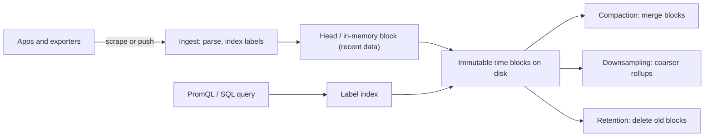

## 🎯 خلاصه

> یک **پایگاه داده‌ی سری‌زمانی (TSDB)** اندازه‌گیری‌هایی را ذخیره می‌کند که به شکل `(series, timestamp, value)` می‌رسند و برای **append به ترتیب زمان**، **فشرده‌سازی** دنباله‌های طولانی از مقادیر مشابه، و **کوئری بر اساس بازه‌ی زمانی** با تجمیع‌هایی مثل rate، میانگین یا percentile بهینه شده است.

- یک **series** ترکیب یکتای نام متریک و labelها (tags) است، مثل `cpu{host="a", region="eu"}`. هزینه با تعداد series رشد می‌کند، نه فقط با تعداد نقطه‌ها.
- ذخیره **بر اساس زمان partition** و فشرده می‌شود. داده‌ی قدیمی به صورت rollup درشت‌تر **downsample** می‌شود و بعد طبق قوانین retention **حذف** می‌شود.
- **cardinality بالا** (labelهایی با میلیون‌ها مقدار متمایز، مثل `user_id` یا request id) راه کلاسیک خراب شدن این سیستم‌هاست.
- گزینه‌های اصلی: Prometheus، VictoriaMetrics (سازگار با Prometheus، با retention طولانی)، TimescaleDB (افزونه‌ی PostgreSQL با SQL) و InfluxDB.

## 🌱 از ساده شروع کنیم (مبتدی)

> **💡 تشبیه:** **دفترچه‌ی دماسنج در یک آزمایشگاه**. هر دقیقه زمان و دما را یادداشت می‌کنی. تقریباً هیچ‌وقت یک خط قدیمی را ویرایش نمی‌کنی، به ندرت یک دقیقه‌ی خاص را نگاه می‌کنی، و معمولاً می‌پرسی «میانگین ساعتی هفته‌ی گذشته چه بود؟»

یک رکورد متریک کوچک است: یک نام، چند label، یک timestamp و یک عدد:

```text
http_requests_total{service="checkout", status="500"}  1700000000  42
http_requests_total{service="checkout", status="500"}  1700000015  45
http_requests_total{service="checkout", status="500"}  1700000030  47
```

دو ویژگی این داده را خاص می‌کند:
- تقریباً همیشه **به ترتیب زمان** می‌رسد، پس موتور می‌تواند append کند به جای جستجو.
- مقادیر پشت‌سرهم **مشابه‌اند** (یک counter آهسته بالا می‌رود، دما به آرامی عوض می‌شود)، پس خیلی خوب فشرده می‌شوند.

یک سؤال معمول یک تجمیع به سبک PromQL روی بازه‌ی زمانی است:

```text
sum by (service) (rate(http_requests_total{status="500"}[5m]))
```

یعنی: «برای هر سرویس، نرخ ثانیه‌ای پاسخ‌های ۵۰۰ که روی پنج دقیقه‌ی گذشته میانگین شده». موتور series‌های مطابق را پیدا می‌کند، فقط پنجره‌ی زمانی را می‌خواند و rate را حساب می‌کند.

## 🔧 واقعاً چطور کار می‌کند (متوسط)



**ingestion.** Prometheus متریک‌ها را با **scrape** کردن endpointها در یک بازه‌ی زمانی **pull** می‌کند. سیستم‌های دیگر **push** می‌کنند (remote write، line protocol، یا insert SQL). هر نمونه به یک ساختار head در حافظه append می‌شود و به‌طور دوره‌ای به صورت یک block تغییرناپذیر برای یک بازه‌ی زمانی ثابت نوشته می‌شود.

**فشرده‌سازی.** مقاله‌ی Gorilla (فیس‌بوک، ۲۰۱۵) تکنیکی را توضیح می‌دهد که بسیاری از TSDBها استفاده می‌کنند:
- **timestampها** به صورت *delta-of-delta* ذخیره می‌شوند. scrapeهای منظم ۱۵ ثانیه‌ای به دنباله‌های طولانی از صفر تبدیل می‌شوند که تقریباً جایی نمی‌گیرند.
- **مقادیر float** با **XOR** نسبت به مقدار قبلی ذخیره می‌شوند. وقتی مقادیر پشت‌سرهم بیشتر بیت‌هایشان مشترک است، فقط چند بیت نوشته می‌شود.

در عمل یک نمونه اغلب فقط چند بایت می‌گیرد، نه ۱۶ بایت خام. نسبت فشرده‌سازی به منظم بودن داده وابستگی زیادی دارد.

**ایندکس.** هر series یک مجموعه‌ی label دارد و یک inverted index، `label=value` را به شناسه‌ی series نگاشت می‌کند. کوئری‌ای مثل `{service="checkout", status="500"}` لیست‌های postings را اشتراک می‌گیرد و بعد فقط blockهای آن series‌ها را می‌خواند.

**Downsampling.** داده‌ی خام را برای مدت کوتاهی (روز) نگه دار، و بعد برای مدت طولانی‌تر تجمیع‌های ۵ دقیقه‌ای یا ساعتی (min، max، avg، count، sum) را ذخیره کن. بعضی سیستم‌ها این را خودکار انجام می‌دهند؛ بعضی یک job یا continuous aggregate لازم دارند.

**TimescaleDB** متفاوت کار می‌کند: خودش PostgreSQL است. یک *hypertable* جدولی است که بر اساس زمان به **chunk** تقسیم می‌شود، و با SQL کوئری می‌زنی:

```sql
SELECT create_hypertable('readings', 'ts');

SELECT time_bucket('5 minutes', ts) AS bucket,
       device_id,
       avg(temperature) AS avg_temp
FROM readings
WHERE ts > now() - interval '1 day'
GROUP BY bucket, device_id
ORDER BY bucket;
```

`time_bucket` در زمان کوئری downsampling را انجام می‌دهد، و chunk pruning هر chunk بیرون از آن روز را رد می‌کند.

## 🧠 عمق و trade-offها (سنیور)

- **cardinality هزینه را تعیین می‌کند.** هر ترکیب یکتای label یک series است با ورودی ایندکس، ردپای حافظه و مسیر نوشتن خودش. فرض کن ۱٬۰۰۰ سرویس × ۵۰ endpoint × ۴ کلاس وضعیت × ۱۰ pod = ۲٬۰۰۰٬۰۰۰ series. اضافه کردن label به نام `user_id` با ۱۰۰٬۰۰۰ کاربر فعال، این تعداد بالقوه را ۱۰۰٬۰۰۰ برابر می‌کند. شناسه‌های بی‌کران را در لاگ یا trace بگذار، نه در label.
- **ingestion و حافظه.** block هد، series‌های اخیر را در حافظه نگه می‌دارد. churn بالا (podهایی که می‌آیند و می‌روند، labelهایی که با هر deploy عوض می‌شوند) دائماً series جدید می‌سازد و حافظه و اندازه‌ی ایندکس را بالا می‌برد، حتی اگر هر series کوتاه‌عمر باشد.
- **retention در برابر downsampling.** بر اساس نوع سؤال انتخاب کن. داشبورد هفته‌ی گذشته به وضوح ۱۵ ثانیه‌ای نیاز دارد؛ برنامه‌ریزی ظرفیت فصلی به rollup ساعتی. retention کل blockها را ارزان حذف می‌کند، و برای همین partition کردن بر اساس زمان مهم است.
- **داده‌ی نامرتب و دیرهنگام.** بیشتر موتورها نمونه‌ها را در یک پنجره می‌پذیرند و نمونه‌های خیلی قدیمی را رد یا دور می‌ریزند. قبل از ساختن job بازپرسازی روی آن، محدودیت موتورت را چک کن.
- **انتخاب موتور.** Prometheus پیش‌فرض متریک‌های عملیاتی و alerting خودش است. VictoriaMetrics برای مقیاس بزرگ‌تر و retention طولانی‌تر با سازگاری Prometheus مناسب است. TimescaleDB وقتی که SQL، join با جدول‌های رابطه‌ای و ابزارهای PostgreSQL می‌خواهی. InfluxDB برای workloadهای نوع IoT مناسب است، ولی مدل داده‌ی فعلی‌اش را چک کن چون نسخه‌ها خیلی فرق دارند.
- **ارتباط با بقیه‌ی stack.** TSDB یک store تحلیلی عمومی نیست: برای تحلیل رویدادهای پهن و با cardinality بالا ضعیف است. برای آن از موتورهای [[columnar-storage]] مثل [[clickhouse]] یا [[realtime-olap]] استفاده کن.
- **مانیتور کردن خود مانیتورینگ.** تعداد active series، نرخ ingestion، نمونه‌های رد شده، مدت کوئری، مصرف دیسک برای هر پنجره‌ی retention و backlog compaction.
- **کی استفاده نکنی.** رویدادهای آزاد، لاگ، یا داده‌ای که باید با جدول‌های زیاد join شود و ردیف‌به‌ردیف به‌روز شود.

## 🧪 امتحان کن

یک سیستم متریک برای ۴۰۰ سرویس اجرا می‌کنی. هر سرویس ۸۰ متریک دارد و هر متریک labelهای `service`، `pod` (به‌طور میانگین ۸ pod برای هر سرویس)، `region` (۳ مقدار) و `endpoint` (به‌طور میانگین ۲۰ برای هر سرویس) دارد.

۱. تعداد series را تخمین بزن، با فرض اینکه همه‌ی ترکیب‌های label رخ می‌دهند. محاسبه را نشان بده.
۲. یک توسعه‌دهنده می‌خواهد `customer_id` (حدود ۲ میلیون مشتری) را به یک histogram تأخیر اضافه کند. تعداد series چه می‌شود و چه پیشنهادی می‌دهی؟
۳. یک plan برای retention طراحی کن: داده‌ی خام ۱۴ روز، rollup‌های ۵ دقیقه‌ای یک سال. هر وضوح به کدام سؤال جواب می‌دهد؟

<details><summary>راه‌حل را ببین</summary>

**۱.** برای هر سرویس، ترکیب‌های label برای هر متریک `pod × region × endpoint` است: ۸ × ۳ × ۲۰ = ۴۸۰ ترکیب. ضرب در ۸۰ متریک: ۳۸٬۴۰۰ series برای هر سرویس. برای ۴۰۰ سرویس: ۴۰۰ × ۳۸٬۴۰۰ = ۱۵٬۳۶۰٬۰۰۰، حدود ۱۵ میلیون series. داده‌ی واقعی معمولاً پراکنده‌تر است، ولی ظرفیت را روی کران بالا برنامه‌ریزی کن و بعد اندازه بگیر.

**۲.** histogram تأخیر برای هر series چند bucket دارد (مثلاً ۱۲ bucket به‌علاوه‌ی sum و count). ضرب در ۲ میلیون مشتری تعداد بالقوه‌ی series را به میلیاردها می‌رساند. به جای آن `customer_id` را از متریک‌ها بیرون نگه دار، جزئیات هر مشتری را در لاگ یا trace ثبت کن، و متریک‌ها را در سطح `service`، `endpoint` و `status` نگه دار.

**۳.** داده‌ی خام ۱۴ روز (داشبوردها، دیباگ alertها، تحلیل دقیق incidentها). rollup‌های ۵ دقیقه‌ای (min، max، avg، count) برای یک سال (روند و برنامه‌ریزی ظرفیت، بررسی‌های هفتگی). retention blockهای خام قدیمی را حذف می‌کند و rollupها باقی می‌مانند. job rollup باید idempotent باشد تا اجرای مجدد دوبار شمارش نکند.

</details>

## 💬 گوشه‌ی مصاحبه

**سؤال: «چرا یک پایگاه داده‌ی سری‌زمانی برای متریک‌ها با یک دیتابیس رابطه‌ای معمولی فرق دارد؟»**
پاسخ متوسط: «برای نوشتن با timestamp و کوئری‌های بازه‌ی زمانی بهینه شده و بهتر فشرده می‌کند.»
پاسخ سنیور: «الگوی نوشتن append-only و مرتب بر اساس زمان است، پس storage بر اساس زمان partition و با encodingهای delta-of-delta و XOR فشرده می‌شود. کوئری‌ها اول بر اساس زمان و labelها فیلتر می‌کنند، پس ایندکس label و chunk pruning بیشترین اهمیت را دارند. محدودیت واقعی cardinality است، چون هر ترکیب label یک series با هزینه‌ی حافظه و ایندکس خودش است.»

**سؤال: «بعد از یک deploy، سیستم مانیتورینگ کند شده و حافظه‌اش پر شده. چه چیزی را چک می‌کنی؟»**
پاسخ متوسط: «بار کوئری و فضای دیسک.»
پاسخ سنیور: «تعداد active series و رشد آن، مقادیر label که بی‌کران شده‌اند مثل request id یا user id، churn از ری‌استارت podها، و شمارنده‌ی نمونه‌های ردشده. بعد اول labelها را درست می‌کنم، چون اضافه کردن سخت‌افزار فقط مشکل را عقب می‌اندازد.»

> **🎤 این را در مصاحبه بگو:** «TSDB برای داده‌ی append-only و مرتب بر اساس زمان با فشرده‌سازی سنگین و retention زمانی طراحی شده. عامل محدودکننده cardinality سری‌هاست، پس labelها را بودجه‌ای می‌بینم و شناسه‌های بی‌کران را به لاگ یا trace منتقل می‌کنم.»

## ⚠️ اشتباهات رایج

> **⚠️ توجه:** گذاشتن یک شناسه‌ی یکتا در label. یک label با میلیون‌ها مقدار، یک متریک کوچک را به میلیون‌ها series تبدیل می‌کند، و هزینه خیلی قبل از دیسک در حافظه ظاهر می‌شود.

> **⚠️ توجه:** اشتباه گرفتن rate با counter خام. `http_requests_total` فقط بالا می‌رود (تا وقتی ری‌استارت شود)، پس `rate(...)` یا `increase(...)` کوئری می‌زنی، نه مقدار خام.

- استفاده از TSDB به عنوان انباره برای تحلیل رویداد با dimensionهای زیاد.
- تنظیم retention بدون فکر به downsampling، و بعد کشف اینکه سه‌ماهه‌ی آخر رفته.
- میانگین‌گیری از میانگین‌ها: میانگین میانگین‌های هر pod با میانگین کل درخواست‌ها یکی نیست وقتی pod‌ها ترافیک متفاوت دارند.
- فرض کردن اینکه داده‌ی نامرتب یا backfill همیشه پذیرفته می‌شود.
- بی‌توجهی به churn series از podهای کوتاه‌عمر و labelهای زمان deploy.

## ✅ خودت را بسنج

۱. یک «series» در پایگاه داده‌ی سری‌زمانی چیست؟
   - A) یک timestamp تنها
   - B) یک ترکیب یکتای نام متریک و labelها به همراه مقادیرش در طول زمان
   - C) یک فایل backup از دیتابیس
   - D) جدول نتیجه‌ی یک کوئری

<details><summary>جواب</summary>

**B** — هر نام متریک به همراه مجموعه‌ی label یک series است. هزینه و حافظه به تعداد series بستگی دارد.

</details>

۲. چرا فشرده‌سازی روی متریک‌های منظم این‌قدر خوب کار می‌کند؟

   - A) timestampها به صورت متن ذخیره می‌شوند
   - B) delta-of-delta فاصله‌های منظم را به مقادیر نزدیک صفر تبدیل می‌کند، و XOR مقادیر float مشابه پشت‌سرهم را با چند بیت کد می‌کند
   - C) مقادیر به عدد صحیح گرد می‌شوند
   - D) دیتابیس هر نمونه‌ی دوم را حذف می‌کند

<details><summary>جواب</summary>

**B** — scrapeهای منظم و مقادیر آهسته‌تغییر الگوهای تکراری می‌سازند که این encodingها خیلی خوب فشرده‌شان می‌کنند.

</details>

۳. کدام label خطرناک‌ترین برای اضافه کردن به یک متریک است؟

   - A) `region` با ۳ مقدار
   - B) `status_class` با ۵ مقدار
   - C) `request_id` با یک مقدار جدید برای هر درخواست
   - D) `service` با ۲۰۰ مقدار

<details><summary>جواب</summary>

**C** — یک مقدار جدید برای هر درخواست، برای هر درخواست یک series جدید می‌سازد که ایندکس و حافظه را از پا درمی‌آورد. بقیه محدودند.

</details>

۴. **(سنیور)** داشبوردهای هفته‌ی گذشته به وضوح ۱۵ ثانیه‌ای نیاز دارند، ولی بررسی ظرفیت به یک سال داده نیاز دارد. بهترین plan چیست؟

   - A) همه‌چیز را یک سال با ۱۵ ثانیه نگه دار
   - B) داده‌ی خام را برای بازه‌ی کوتاهی که داشبوردها استفاده می‌کنند نگه دار، و rollupهای downsample شده را برای بازه‌ی طولانی ذخیره کن
   - C) داده را بعد از ۱ روز حذف کن
   - D) همه‌چیز را بدون rollup به انباره ببر

<details><summary>جواب</summary>

**B** — rollupها سؤال‌های روند بلندمدت را با بخش کوچکی از storage جواب می‌دهند، و داده‌ی خام نیازهای کوتاه‌مدت و با وضوح بالا را پوشش می‌دهد. سپس retention هر لایه را طبق برنامه‌ی خودش حذف می‌کند.

</details>

۵. **(سنیور)** بعد از یک deploy که مقدار یک label را روی هر درخواست عوض کرد، مصرف حافظه بالا می‌رود و مسیر ingestion نمونه‌ها را رد می‌کند. محتمل‌ترین علت و اصلاح درست چیست؟

   - A) دیسک کم است، پس دیسک اضافه کن
   - B) churn series از مقادیر بی‌کران label؛ طراحی label را درست کن و label مشکل‌ساز را در instrumentation حذف یا محدود کن
   - C) فشرده‌سازی به خاطر منطقه‌ی زمانی متوقف شده
   - D) موتور کوئری کند است، پس replica اضافه کن

<details><summary>جواب</summary>

**B** — هر مقدار جدید label series جدید می‌سازد که block هد و ایندکس را پر می‌کند. اضافه کردن دیسک علت را حل نمی‌کند. label را در instrumentation حذف یا محدود کن و رشد series را مانیتور کن.

</details>

## 🗂️ فلش‌کارت

| Front | Back |
|---|---|
| Series | ترکیب یکتای نام متریک و مجموعه‌ی labelها، با مقادیرش در طول زمان |
| Cardinality | تعداد series‌های متمایز؛ محرک اصلی هزینه |
| Delta-of-delta | فشرده‌سازی timestampهایی که با فاصله‌ی منظم می‌رسند |
| XOR encoding | فشرده‌سازی floatهایی که بین نمونه‌ها کم تغییر می‌کنند |
| Downsampling | جایگزین کردن داده‌ی خام قدیمی با تجمیع‌های درشت‌تر مثل میانگین ۵ دقیقه‌ای |
| Retention | قانونی که داده‌ی قدیمی‌تر از یک پنجره‌ی تعیین‌شده را حذف می‌کند، معمولاً کل blockها |
| Hypertable (TimescaleDB) | جدولی که بر اساس زمان به chunkها تقسیم می‌شود و با SQL کوئری می‌شود |
| Series churn | ساخت مداوم series جدید از podهای کوتاه‌عمر یا labelهای متغیر |

## 🔗 ادامه

- [[design-metrics-monitoring]] — طراحی کامل سیستم با ذخیره‌ی سری‌زمانی و downsampling.
- [[pipeline-monitoring]] — مانیتورینگ pipelineهای داده با همان نوع متریک‌ها.
- [[data-retention]] — سیاست‌های نگه‌داری و حذف داده در لایه‌های storage مختلف.
- [[realtime-olap]] — store مناسب برای تحلیل رویدادهای پهن و با cardinality بالا.
