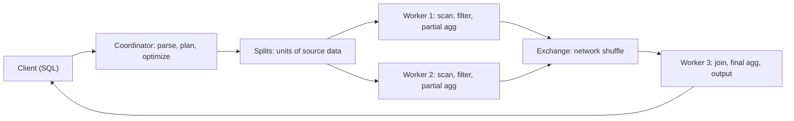

## 🎯 خلاصه

> **Trino** یک موتور کوئری SQL توزیع‌شده است که داده را **همان‌جایی که هست** می‌خواند (Hive، Iceberg، Delta، Postgres، Kafka و خیلی منابع دیگر) از طریق **connector**، پس یک جمله SQL می‌تواند بدون کپی‌کردن قبلی داده، بین سیستم‌ها join بزند.

- خودش **داده ذخیره نمی‌کند**. کوئری را برنامه‌ریزی، زمان‌بندی و اجرا می‌کند؛ داده در lake، دیتابیس یا store دیگر باقی می‌ماند.
- یک **coordinator** کوئری را برنامه‌ریزی و کار را زمان‌بندی می‌کند؛ چند **worker** taskها را در حافظه اجرا می‌کنند و داده را از طریق شبکه رد و بدل می‌کنند.
- جدول‌ها با `catalog.schema.table` آدرس‌دهی می‌شوند، که هر catalog یک connector پیکربندی‌شده است.
- برای تحلیل تعاملی و ad-hoc قوی است. محدودیت‌هایش حافظه، shuffle شبکه و تاریخاً تحمل خرابی برای کوئری‌های طولانی است، که حالت‌های retry جدیدتر آن را پوشش می‌دهند.

## 🌱 از ساده شروع کنیم (مبتدی)

> **💡 تشبیه:** Trino مثل **مترجم یک جلسه‌ی چندزبانه** است. اسناد در اتاق‌های خودشان (دیتابیس‌ها، lake) می‌مانند. Trino از هر اتاق صفحات لازم را می‌خواهد، روی میز می‌آورد و سؤالی را جواب می‌دهد که به هر دو دسته سند نیاز دارد.

فرض کن سفارش‌ها در یک جدول Iceberg روی object storage هستند و مشتری‌ها در یک دیتابیس Postgres. بدون موتور federated، باید یک طرف را export کنی، بارگذاری کنی و join بزنی. با Trino یک کوئری می‌نویسی:

```sql
SELECT o.order_id, c.name, o.amount
FROM iceberg.sales.orders AS o
JOIN postgresql.crm.customers AS c
  ON o.customer_id = c.id
WHERE o.order_date = DATE '2026-01-01'
  AND o.amount > 100;
```

هر catalog (`iceberg`، `postgresql`) یک connector است که روی کلاستر پیکربندی شده. فایل هر catalog این شکل را دارد (مثلاً `etc/catalog/postgresql.properties`):

```text
connector.name=postgresql
connection-url=jdbc:postgresql://crm-db:5432/crm
connection-user=trino_reader
connection-password=********
```

ایده‌ی کلیدی: **Trino کار را تا جایی که ممکن است به سمت داده می‌برد و فقط آنچه لازم است را جابه‌جا می‌کند.** فیلترها و انتخاب ستون‌ها به هر منبع فرستاده می‌شوند و فقط ردیف‌های مطابق به سمت workerها می‌آیند.

## 🔧 واقعاً چطور کار می‌کند (متوسط)

یک کوئری از این مراحل می‌گذرد:



۱. **parse و plan.** coordinator سرِ SQL را parse می‌کند، از هر connector متادیتا و آمار جدول را می‌خواهد و یک optimizer مبتنی بر هزینه اجرا می‌کند. predicate و ستون‌های لازم، اگر connector پشتیبانی کند، به آن push می‌شوند (مثلاً `WHERE` روی Postgres را خود Postgres اجرا می‌کند، و Iceberg از آمار فایل برای رد کردن فایل‌ها استفاده می‌کند).
۲. **Splits.** connector جدول را به **split** تقسیم می‌کند (مثلاً فایل Parquet یا بازه‌ای از بایت‌ها). workerها splitها را برمی‌دارند، پس جدول نامتوازن هم روی کل کلاستر پخش می‌شود.
۳. **اجرای pipeline‌ای.** مراحل هم‌زمان اجرا می‌شوند و **page**های ردیف را از بافرهای حافظه عبور می‌دهند. داده همان لحظه که تولید می‌شود جریان پیدا می‌کند، که تأخیر کم برای کوئری تعاملی می‌دهد، ولی یعنی یک مرحله بدون کمک نمی‌تواند خودش restart شود.
۴. **Exchange.** join و تجمیع‌ها داده را از طریق شبکه دوباره partition می‌کنند (hash exchange) یا یک طرف کوچک را به همه‌ی workerها broadcast می‌کنند. انتخاب بین join پارتیشنی و broadcast را optimizer بر اساس آمار می‌گیرد و با session property می‌توانی آن را override کنی.

حافظه محدودیت اصلی است. هر کوئری یک بودجه‌ی حافظه در کل کلاستر و محدودیت‌های هر node دارد. یک hash join بزرگ یا `GROUP BY` با cardinality بالا باید در حافظه‌ی هر worker جا شود. اگر نشود، کوئری با خطای محدودیت حافظه fail می‌شود، نه اینکه بی‌صدا کند شود.

**spill.** بعضی operatorها وقتی حافظه کم است، داده‌ی میانی را روی دیسک محلی می‌ریزند. spill کندتر است ولی از شکست جلوگیری می‌کند. در دسترس بودن و پیکربندی آن به نسخه و operator بستگی دارد، پس داک نسخه‌ات را چک کن و فرض نکن برای هر join فعال است.

## 🧠 عمق و trade-offها (سنیور)

- **تحمل خرابی.** حالت پیش‌فرض (`retry-policy = NONE`) وقتی یک worker می‌میرد کل کوئری را fail می‌کند، چون اجرای pipeline‌ای نتیجه‌ی میانی بادوام ندارد. fault-tolerant execution در Trino retry اضافه می‌کند. `retry-policy = QUERY` کل کوئری را دوباره اجرا می‌کند و با connectorهایی که پشتیبانی می‌کنند کار می‌کند. `retry-policy = TASK` taskهای منفرد را retry می‌کند، ولی **به یک exchange manager نیاز دارد** که نتایج میانی را spool کند (مثلاً روی storage سازگار با S3 یا HDFS)، و برای کوئری‌های batch بزرگ روی کلاستر اختصاصی توصیه می‌شود. exchange manager با فایل‌سیستم محلی فقط برای کلاستر تست تک‌نودی است. (با داک fault-tolerant execution در Trino بررسی شده؛ تنظیمات بین نسخه‌ها تغییر می‌کنند.)
- **تأخیر در برابر تاب‌آوری.** حالت‌های retry هزینه‌ی spooling دارند، پس کوئری‌های تعاملی کوتاه کندتر می‌شوند. به همین دلیل تیم‌ها اغلب دو کلاستر دارند: یکی تعاملی، و یکی برای jobهای batch طولانی با retry از نوع `TASK`.
- **کیفیت pushdown در connector.** Trino فقط به اندازه‌ای سریع است که connector بتواند push کند. اگر منبع JDBC نتواند یک فیلتر را push کند، Trino کل جدول را از شبکه می‌کشد. در `EXPLAIN` دنبال `ScanFilterProject` و آنچه در table scan push شده بگرد.
- **فرمت جدول مهم‌تر از موتور است.** روی Iceberg یا Delta، بیشتر کار با رد کردن فایل بر اساس مقدار partition و آمار ستون انجام می‌شود. چیدمان بد partition یا میلیون‌ها فایل ریز (ببین [[small-files-problem]]) Trino را کند می‌کند، هر قدر optimizer خوب باشد.
- **سازگاری بین منابع.** Trino تراکنش بین catalogها نمی‌دهد. یک join روی Postgres و Iceberg هر طرف را در نقطه‌ی زمانی خودش می‌خواند. گزارشی که به یک snapshot سازگار نیاز دارد باید به یک منبع تکیه کند یا به snapshot semantics داخل فرمت جدول.
- **نوشتن.** Trino روی بعضی connectorها (Iceberg، Hive، Delta) می‌نویسد، ولی جایگزین دیتابیس تراکنشی OLTP نیست و ETL حجیم معمولاً در Spark یا dbt بهتر است. Trino را برای خواندن و سرو کردن استفاده کن، و برای نوشتن وقتی connector و حجم مناسب است.
- **کی استفاده نکنی.** ETL طولانی و خیلی بزرگ بدون تحمل خرابی، workloadهایی که lookup کلیدی با تأخیر یک‌رقمی میلی‌ثانیه لازم دارند، یا streaming. صف کوئری‌ها و کوئری‌های fail شده، peak حافظه‌ی هر node، حجم exchange و دفعات برخورد کوئری‌ها به محدودیت حافظه را مانیتور کن.

## 🧪 امتحان کن

یک جدول Iceberg به نام `lake.events.clicks` داری (میلیاردها ردیف، partition شده بر اساس `event_date`) و یک جدول Postgres به نام `crm.public.users` (۵ میلیون ردیف).

۱. کوئری بنویس که کلیک‌ها را به تفکیک کشور کاربر برای `event_date = DATE '2026-01-01'` بشمارد، با join روی `user_id` به `users`.
۲. توضیح بده کدام فیلتر کجا push می‌شود، و چرا فیلتر `event_date` در `WHERE` مهم است.
۳. یک گزارش شبانه‌ی این join وسط کار با خطای از دست رفتن worker fail می‌شود. دو گزینه‌ی پیکربندی را که بررسی می‌کنی نام ببر و trade-off هر کدام را بگو.

<details><summary>راه‌حل را ببین</summary>

**۱.**
```sql
SELECT u.country, COUNT(*) AS clicks
FROM lake.events.clicks AS c
JOIN crm.public.users AS u
  ON c.user_id = u.user_id
WHERE c.event_date = DATE '2026-01-01'
GROUP BY u.country;
```

**۲.** `c.event_date = DATE '2026-01-01'` به scan مربوط به Iceberg push می‌شود، پس فقط فایل‌های همان partition خوانده می‌شوند. جدول users آن‌قدر کوچک است که Trino ممکن است آن را به همه‌ی workerها broadcast کند (broadcast join). با `EXPLAIN` توزیع join و predicateهای push شده را تأیید کن.

**۳.** گزینه‌ی اول: `retry-policy = QUERY`، که کل کوئری را با حداقل راه‌اندازی دوباره اجرا می‌کند ولی همه‌ی کار را تکرار می‌کند. گزینه‌ی دوم: `retry-policy = TASK` همراه exchange manager، که فقط taskهای خراب را دوباره اجرا می‌کند و برای کوئری‌های batch طولانی مناسب است، با هزینه‌ی overhead مربوط به spooling و کلاستر پیچیده‌تر. راه عملی سوم این است که کوئری را کوچک‌تر کنی (کلیک‌های روزانه را از پیش در یک جدول تجمیع کنی).

</details>

## 💬 گوشه‌ی مصاحبه

**سؤال: «Trino چیست و کی به جای بارگذاری همه‌چیز در یک انباره از آن استفاده می‌کنی؟»**
پاسخ متوسط: «Trino داده را از طریق connector همان‌جا کوئری می‌کند، پس می‌توانم جدول lake را با جدول دیتابیس بدون کپی join بزنم. برای تحلیل ad-hoc استفاده می‌کنم.»
پاسخ سنیور: «وقتی داده بین چند سیستم پخش است، وقتی تازگی منبع از سرعت یک کپی بارگذاری‌شده مهم‌تر است، یا وقتی یک لایه‌ی SQL روی lakehouse می‌خواهم. برای jobهای batch طولانی بدون تحمل خرابی از آن استفاده نمی‌کنم، و اول pushdown connector را چک می‌کنم، چون connectorی که فیلتر را push نکند همه‌چیز را کند می‌کند.»

**سؤال: «وسط کوئری یک worker بمیرد چه می‌شود؟»**
پاسخ متوسط: «کوئری fail می‌شود و دوباره اجرایش می‌کنیم.»
پاسخ سنیور: «به retry policy بستگی دارد. با حالت پیش‌فرض کوئری fail می‌شود. با `QUERY` از اول اجرا می‌شود. با `TASK` و exchange manager فقط taskهای گم‌شده دوباره اجرا می‌شوند، چون نتایج میانی spool شده بودند. انتخاب policy را بر اساس طول کوئری و هدف کلاستر انجام می‌دهم.»

> **🎤 این را در مصاحبه بگو:** «Trino یک موتور MPP توزیع‌شده، federated و در حافظه است. نقطه‌ی قوتش خواندن داده در جای خودش و join بین منابع است. برای برنامه‌ریزی روی حافظه، pushdown و retry policy تمرکز می‌کنم و ETL batch سنگین را روی موتوری می‌گذارم که برای آن ساخته شده.»

## ⚠️ اشتباهات رایج

> **⚠️ توجه:** فرض کردن اینکه join فدرال ارزان است. join یک جدول خیلی بزرگ با یک جدول کوچک خوب است اگر کوچک را broadcast کنی؛ join دو جدول خیلی بزرگ از طریق شبکه یک shuffle است و ممکن است از حافظه‌ی کلاستر بگذرد.

> **⚠️ توجه:** فرض کردن اینکه فیلتر به منبع می‌رسد. اگر ستون را داخل تابع ببری (`WHERE CAST(ts AS date) = ...`) یا نوع داده نامطابق باشد، pushdown بی‌صدا متوقف می‌شود. `EXPLAIN` را چک کن.

- انتظار سازگاری تراکنشی بین catalogها.
- اجرای ETL طولانی با policy پیش‌فرض بدون retry و بعد مقصر دانستن شبکه وقتی workerها می‌میرند.
- بی‌توجهی به چیدمان جدول: بر اساس ستون‌هایی که فیلتر می‌کنی partition کن و فایل‌های ریز را compact کن.
- استفاده از Trino به عنوان store OLTP یا برای lookup تک‌کلیدی.
- تنظیم حافظه برای هر کوئری بدون در نظر گرفتن کوئری‌های هم‌زمان روی همان کلاستر.

## ✅ خودت را بسنج

۱. coordinator در Trino چه کاری می‌کند؟
   - A) نتایج کوئری را برای همیشه ذخیره می‌کند
   - B) کوئری را parse و plan می‌کند و کار را روی workerها زمان‌بندی می‌کند
   - C) همه‌ی داده‌ی جدول‌ها را در حافظه نگه می‌دارد
   - D) فایل‌های Iceberg را replicate می‌کند

<details><summary>جواب</summary>

**B** — coordinator parse، plan، optimize و زمان‌بندی taskها را انجام می‌دهد. workerها splitها را اجرا و داده را exchange می‌کنند. Trino مالک storage نیست.

</details>

۲. کدام تنظیم به یک job batch طولانی اجازه می‌دهد با خرابی یک worker زنده بماند و فقط taskهای خراب را دوباره اجرا کند؟
   - A) `retry-policy = NONE`
   - B) `retry-policy = QUERY`
   - C) `retry-policy = TASK` با exchange manager پیکربندی‌شده
   - D) یک `query.max-memory` بزرگ‌تر

<details><summary>جواب</summary>

**C** — `TASK` taskهای منفرد را retry می‌کند، ولی برای spool کردن نتایج میانی به exchange manager نیاز دارد. `QUERY` همه‌چیز را دوباره اجرا می‌کند؛ `NONE` (پیش‌فرض) کوئری را fail می‌کند.

</details>

۳. کوئری `lake.db.orders` (partition شده بر اساس `order_date`) را با `pg.public.stores` join می‌زند و `WHERE` روی `order_date` فیلتر دارد. چرا فیلتر partition مهم است؟

   - A) برای اجرای join لازم است
   - B) Trino اجازه می‌دهد partitionها را حذف کند تا scan فقط فایل‌های مطابق را بخواند
   - C) خودکار join را به broadcast join تبدیل می‌کند
   - D) سمت Postgres را سریع‌تر می‌کند

<details><summary>جواب</summary>

**B** — فیلتر به scan مربوط به Iceberg push می‌شود و partition pruning فایل‌های خارج از بازه را رد می‌کند. بدون آن کل جدول خوانده می‌شود.

</details>

۴. **(سنیور)** کلاستر هم کوئری‌های کوتاه داشبورد و هم jobهای طولانی شبانه را اجرا می‌کند. فعال کردن retry از نوع `TASK` داشبوردها را کندتر می‌کند. بهترین اصلاح ساختاری چیست؟

   - A) حذف exchange manager
   - B) یک کلاستر جدا برای jobهای طولانی با retry از نوع `TASK` و نگه داشتن کلاستر تعاملی بدون overhead spooling
   - C) غیرفعال کردن همه‌ی joinها
   - D) افزایش `query.max-memory` فقط روی کلاستر داشبورد

<details><summary>جواب</summary>

**B** — fault tolerance هزینه‌ی spooling دارد که به کوئری‌های کوتاه و پرحجم آسیب می‌زند. جدا کردن workloadها اجازه می‌دهد هر کلاستر تنظیماتی داشته باشد که به آن می‌خورد.

</details>

۵. **(سنیور)** یک کوئری فدرال هم Postgres و هم Iceberg را در یک جمله می‌خواند، و گاهی مجموع‌های گزارش با بررسی سمت منبع نمی‌خوانند. محتمل‌ترین دلیل چیست؟

   - A) Trino هر بار اعشار را متفاوت گرد می‌کند
   - B) دو منبع در دو نقطه‌ی زمانی خوانده می‌شوند و Trino تراکنش بین catalogها ندارد
   - C) Iceberg از `SUM` پشتیبانی نمی‌کند
   - D) `JOIN` طبق طراحی ردیف‌های با کلید null را حذف می‌کند

<details><summary>جواب</summary>

**B** — هر منبع در snapshot خودش خوانده می‌شود، پس یک نوشتن هم‌زمان می‌تواند دو طرف را ناهمخوان کند. گزارش سازگار به یک منبع یا یک استراتژی snapshot در pipeline بالادستی نیاز دارد.

</details>

## 🗂️ فلش‌کارت

| Front | Back |
|---|---|
| Trino | موتور کوئری SQL توزیع‌شده که داده را در جای خودش از طریق connector می‌خواند |
| Coordinator | parse، plan، optimize و زمان‌بندی می‌کند؛ داده را نگه نمی‌دارد |
| Worker | taskها را روی splitها اجرا و page ها را با workerهای دیگر رد و بدل می‌کند |
| Connector | plugin که یک منبع (Hive، Iceberg، Postgres) را به catalog، جدول و split نگاشت می‌کند |
| Pushdown | اجرای فیلتر، projection یا تجمیع داخل خود منبع |
| Exchange | repartition یا broadcast داده در شبکه بین مراحل |
| `retry-policy = TASK` | taskهای منفرد را retry می‌کند؛ برای spool کردن نتایج به exchange manager نیاز دارد |
| Broadcast join | جدول کوچک روی همه‌ی workerها کپی می‌شود؛ جابه‌جایی طرف بزرگ را حذف می‌کند |

## 🔗 ادامه

- [[mpp-architecture]] — مدل کلی پشت Trino، Impala و موتورهای مشابه.
- [[lakehouse-table-formats]] — چرا متادیتای جدول و رد کردن فایل سرعت کوئری را تعیین می‌کند.
- [[cloud-warehouses]] — جایگزین وقتی storage و compute را یک‌جا و مدیریت‌شده می‌خواهی.
- داک Trino درباره‌ی fault-tolerant execution و connector pushdown، با نسخه‌ای که اجرا می‌کنی چک شود.
